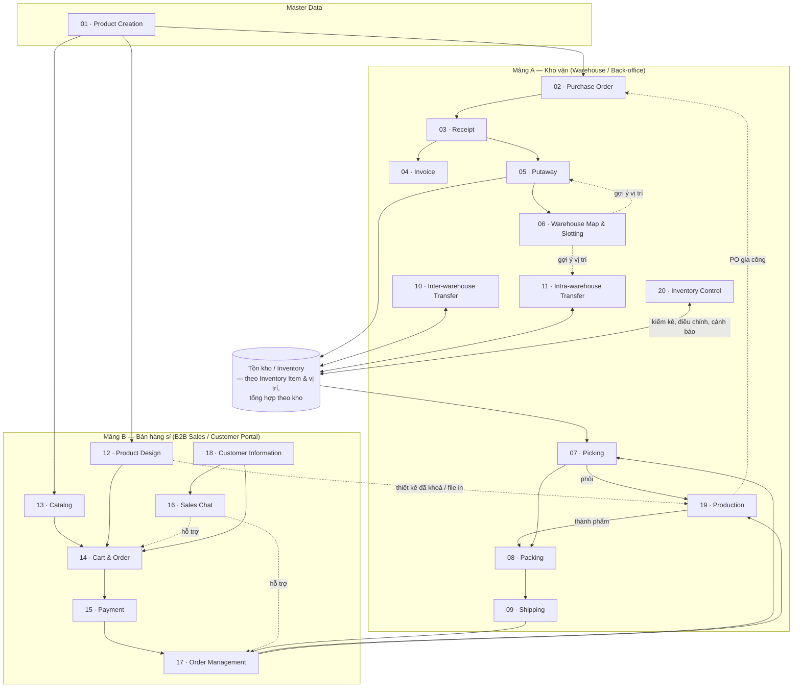
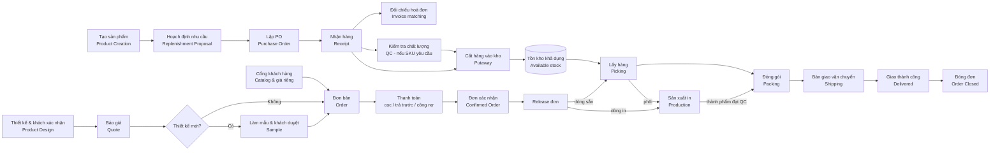

# 00 — Tổng quan hệ thống (System Overview)

## 1. Mục tiêu hệ thống (Goals)

StockFlowCommerce hướng đến việc **loại bỏ khoảng cách giữa vận hành kho và bán hàng online** cho doanh nghiệp chuyên cung cấp **ly và bao bì dùng một lần cho ngành đồ uống** (ly nhựa, ly giấy, bao bì mang đi), bán hàng trơn hoặc **in logo theo thiết kế của khách**, có **xưởng in nội bộ** (thuê **gia công ngoài** khi thiếu công suất) và **chỉ bán sỉ (B2B)** cho khách đã liên hệ từ trước — chủ yếu là quán / chuỗi đồ uống:

| # | Mục tiêu | Diễn giải |
|---|----------|-----------|
| G1 | **Một nguồn dữ liệu sản phẩm duy nhất (single source of truth)** | Sản phẩm khai báo một lần ở back-office, dùng chung cho cả kho vận và catalog TMĐT. |
| G2 | **Tồn kho thời gian thực (real-time inventory)** | Mọi nghiệp vụ nhập – xuất – chuyển kho cập nhật tồn kho ngay, tránh bán quá số lượng (oversell). |
| G3 | **Truy vết đầu-cuối (end-to-end traceability)** | Từ PO của nhà cung cấp → lô hàng nhận → vị trí lưu kho → đơn hàng khách → kiện hàng giao đi, tất cả liên kết bằng chứng từ. |
| G4 | **Tối ưu thao tác kho** | Kho Map 2D/3D + gợi ý vị trí (slotting) + lộ trình picking giúp giảm quãng đường di chuyển và sai sót. |
| G5 | **Từ thiết kế tới sản xuất** | Thiết kế logo 2D lên ly / bao bì, xem trước 3D, báo giá, **làm mẫu và khách duyệt mẫu** trước khi sản xuất số lượng lớn; thiết kế đã khoá đi theo đơn tới xưởng in và khâu đóng gói. |
| G6 | **Kết nối Sale – Khách hàng** | Kênh chat trực tiếp để tư vấn, chốt thiết kế, xử lý phát sinh trong đơn. |
| G7 | **Bán sỉ có kiểm soát tín dụng** | Mỗi khách có giá riêng và phương thức thanh toán riêng (đặt cọc, trả trước, công nợ có hạn mức); đơn vượt hạn mức bị giữ lại chờ duyệt. |

---

## 2. Vai trò & đối tượng người dùng (Role Registry)

Đây là **sổ đăng ký vai trò chuẩn** — nguồn tham chiếu duy nhất về tên vai trò trong toàn bộ tài liệu. Mọi module chỉ dùng tên trong danh sách này.

### 2.1. Vai trò nội bộ (role đăng nhập)

#### Nhóm kho vận (back-office)

| Role | Trách nhiệm chính | Quyền hạn tiêu biểu |
|------|-------------------|---------------------|
| **Quản trị hệ thống (System Admin)** | Cấu hình toàn hệ thống, khai báo kho & khu vực, phân quyền, quản lý dữ liệu gốc sản phẩm | Toàn quyền; cấu hình quy tắc slotting, quy tắc gợi ý |
| **Nhân viên mua hàng (Procurement Staff)** | Tạo & theo dõi PO, làm việc với NCC, đối chiếu hoá đơn (invoice matching) | Tạo/sửa PO ở trạng thái Draft; chốt PO; tạo Invoice |
| **Nhân viên kho (Warehouse Staff)** | Nhận hàng, kiểm đếm, cất hàng (putaway), lấy hàng (picking), đóng gói (packing), bàn giao vận chuyển (shipping), chuyển kho | Thao tác trên phiếu được phân công; ghi nhận số lượng thực tế |
| **Quản lý kho (Warehouse Manager)** | Giám sát KPI vận hành, duyệt điều chỉnh tồn (inventory adjustment), duyệt phiếu chuyển kho, xử lý ngoại lệ; **điều phối xưởng in**: khai báo trạm in, gán lệnh sản xuất cho trạm, đổi ưu tiên, xử lý lệnh tạm dừng, quyết định tách lệnh đưa gia công ngoài khi thiếu công suất | Duyệt/từ chối; ghi đè gợi ý slotting; đóng phiếu; gán/gán lại lệnh sản xuất |
| **Nhân viên sản xuất (Production Staff)** | Vận hành trạm in tại xưởng nội bộ: kiểm file in (prepress), nhận lệnh sản xuất mẫu và đơn hàng, in theo file đã duyệt, báo số lượng đạt / hỏng (phế phẩm kèm lý do), bàn giao thành phẩm cho QC | Thao tác trên lệnh sản xuất được gán cho trạm của mình; treo lệnh kèm lý do ([19](../warehouse/19-production/README.md)) |
| **Nhân viên kế hoạch tồn kho (Inventory Planner)** | Theo dõi mức tồn giữa các kho, đề xuất & tạo lệnh chuyển kho (TO) để cân bằng tồn; đánh giá Bảng Đề xuất Nhập hàng (Replenishment Proposal) do hệ thống sinh, phân tích sức mua / sức chứa kho, chuyển thành Draft PO; lập phiếu kiểm kê, theo dõi cảnh báo tồn thấp / hạn dùng ([20](../warehouse/20-inventory-control/README.md)) | Tạo/sửa TO ở trạng thái Draft; huỷ TO chưa xuất kho nguồn; đánh giá & convert Replenishment Proposal thành Draft PO |
| **Nhân viên QC (QC Staff)** | Kiểm tra chất lượng **hàng nhập** tại khu kiểm tra chất lượng (accept / reject / quarantine), **mẫu** và **thành phẩm in** (in nội bộ hoặc gia công ngoài) trước khi chuyển sang đóng gói ([19](../warehouse/19-production/README.md)); **duyệt kỹ thuật bộ file thiết kế** trước khi gửi khách xác nhận ([12](../ecommerce/12-product-design/README.md)) | Ghi kết quả QC cho từng phần hàng của phiếu nhận; quyết định hàng đi Putaway hay vào khu cách ly; kết luận đạt / không đạt cho lệnh sản xuất; duyệt Đạt / Không đạt bản thiết kế được giao |
| **Kế toán (Accountant)** | Đối chiếu ba chiều PO–Receipt–Invoice, công nợ NCC, đối soát thanh toán, **công nợ phải thu của khách sỉ**, hoàn tiền | Tạo & xử lý Invoice; duyệt chi trong hạn mức; chạy đối soát |

> ✅ Đã chốt 2026-10-06 (B1): có module **Sản xuất in** riêng — [19 · Production](../warehouse/19-production/README.md), xưởng in nội bộ (tách một phần lệnh đơn hàng đưa gia công ngoài khi thiếu công suất), hai loại sản xuất (mẫu và đơn hàng).

#### Nhóm bán hàng sỉ (sales)

| Role | Trách nhiệm chính | Quyền hạn tiêu biểu |
|------|-------------------|---------------------|
| **Quản trị bán hàng (E-commerce Admin)** | Quản lý catalog hiển thị trên cổng khách hàng, bảng giá theo khách, nội dung, chính sách; lập bản thiết kế cho khách và phân công người thiết kế / người duyệt ([12](../ecommerce/12-product-design/README.md)) | Xuất bản/ẩn sản phẩm; cấu hình phương thức thanh toán được phép theo khách; lập & đổi phân công bản thiết kế |
| **Nhân viên Sale (Sales Staff)** | Tạo hồ sơ khách sỉ, lập **báo giá**, tạo **yêu cầu làm mẫu**, thiết kế (tải bộ file) & gửi khách xác nhận ([12](../ecommerce/12-product-design/README.md)), tạo đơn từ báo giá, CSKH qua chat, xử lý yêu cầu thay đổi/huỷ/khiếu nại | Xem & thao tác khách và đơn được phân công; tạo báo giá, yêu cầu mẫu, đơn hộ; giảm giá trong hạn mức |
| **Điều phối đơn hàng (Order Coordinator)** | Duyệt & release đơn cho kho, xử lý đơn treo, phân bổ kho xuất, gộp/tách đơn | Thao tác trên mọi đơn; ghi đè kho xuất |

### 2.2. Vai thao tác (operational hat — không phải role riêng)

Warehouse Staff được gọi theo công đoạn được phân công. Đây chỉ là **cách gọi theo ngữ cảnh**, không phải role đăng nhập riêng:

| Vai thao tác | Công đoạn | Module |
|--------------|-----------|--------|
| Receiver | Nhận hàng, kiểm đếm | [03](../warehouse/03-receipt/README.md) |
| Putaway Operator | Cất hàng vào vị trí | [05](../warehouse/05-putaway/README.md) |
| Picker | Lấy hàng theo pick list | [07](../warehouse/07-picking/README.md) |
| Packer | Đóng gói, dán nhãn | [08](../warehouse/08-packing/README.md) |
| Dispatch Staff | Gom chuyến, lập kế hoạch xếp hàng lên xe (Load Planning) khi giao nguyên chuyến, xếp kiện lên xe, bàn giao vận chuyển | [09](../warehouse/09-shipping/README.md) |
| NV kho nguồn / kho đích | Xuất & nhận hàng chuyển kho | [10](../warehouse/10-inter-warehouse-transfer/README.md) |

### 2.3. Quyền theo ngữ cảnh (permission — không phải role)

Một số chức năng là **quyền** gán cho role qua cấu hình RBAC, không phải chức danh riêng. Trong tài liệu, "Người duyệt (Approver)" là cách gọi tắt của *người giữ quyền phê duyệt tương ứng*.

| Quyền | Nội dung | Gán mặc định cho |
|-------|----------|------------------|
| Duyệt PO vượt hạn mức | Phê duyệt / từ chối PO | Quản lý kho hoặc System Admin |
| Duyệt TO vượt ngưỡng | Phê duyệt / từ chối lệnh chuyển kho | Quản lý kho |
| Duyệt chi / hoàn tiền vượt hạn mức | Phê duyệt thanh toán, refund | Kế toán (mức cao hơn: System Admin) |
| Giám sát chat (Chat Supervision) | Phân công hội thoại, giám sát SLA, nhận escalate | Quản trị sàn hoặc Sales Staff được chỉ định |

> ⚠️ Giả định: phân bổ quyền mặc định ở trên do tài liệu đề xuất, chưa được đề bài xác nhận — thuộc câu hỏi A2 (RBAC). Xem [open-questions](../open-questions/README.md).

### 2.4. Đối tác ngoài & actor hệ thống

| Actor | Vai trò |
|-------|---------|
| **Khách hàng sỉ (B2B Customer)** | Doanh nghiệp đã liên hệ trước, được Sale tạo tài khoản. Trên cổng khách hàng: xem catalog & giá riêng, **xác nhận / yêu cầu sửa thiết kế**, chấp nhận báo giá, **duyệt mẫu**, đặt hàng / đặt lại, theo dõi đơn & công nợ, chat với Sale. **Không có khách vãng lai (guest).** |
| **Nhà cung cấp (Supplier / NCC)** | Giao hàng, phát hành hoá đơn (thường tương tác ngoài hệ thống: email/portal) |
| **Đơn vị vận chuyển (Carrier / 3PL)** | Bên thứ ba **ngoài hệ thống**: nhận kiện khi bàn giao, vận chuyển, giao cho khách, thu hộ phần còn lại (nếu có), hoàn hàng về kho (RTO); cung cấp xe tải / container cho giao nguyên chuyến. Hệ thống không tích hợp API và không theo dõi hành trình; nhân viên cập nhật kết quả giao khi hãng báo lại |

Ngoài ra, nhiều module liệt kê **actor hệ thống** — các engine tự động (Slotting Engine, Wave/Route Planner, Cartonization, Load Planner, Design Engine + 3D Renderer (phạm vi giai đoạn sau — [open-questions B18](../open-questions/README.md)), Production Scheduler, Payment Service, Routing + Notification…). Đây không phải người dùng; chúng thực thi quy tắc do các role trên cấu hình.

> ⚠️ Giả định: Một tài khoản nhân sự có thể mang nhiều vai trò (ví dụ Warehouse Staff kiêm Warehouse Manager ở kho nhỏ). Mô hình phân quyền chi tiết (RBAC) — phạm vi dữ liệu theo kho/nhóm khách, hạn mức cụ thể — chưa được đề bài xác định, xem [open-questions](../open-questions/README.md).

---

## 3. Bản đồ module & mối liên kết (Module Map)

---

## 4. Sơ đồ luồng tổng thể end-to-end (Product → Delivery)

Luồng "hạnh phúc" (happy path) từ lúc tạo sản phẩm đến lúc giao hàng thành công:

**Diễn giải theo từng chặng:**

| Chặng | Bắt đầu bằng | Kết thúc bằng | Module chịu trách nhiệm |
|-------|--------------|---------------|-------------------------|
| **1. Chuẩn bị hàng hoá (Procurement)** | Nhu cầu bổ sung tồn | Hàng nằm ở vị trí kho, sẵn bán | 01 → 02 → 03 → 04 → 05 → 06 |
| **2. Bán hàng sỉ (B2B Sales)** | Khách liên hệ / yêu cầu báo giá | Đơn đã xác nhận (đủ cọc, trả trước, hoặc trong hạn mức công nợ) | 18 → 12 → 14 → 15 (làm mẫu: 19; hỗ trợ: 16, 13) |
| **3. Sản xuất (Production)** | Đơn release có dòng in | Thành phẩm ở khu đóng gói | 17 → 07 (cấp phôi) → 19 (gia công ngoài một phần: 02, 03, 04) |
| **4. Hoàn tất đơn (Fulfillment)** | Đơn release / sản xuất xong | Kiện hàng đã giao cho khách | 17 → 07 → 08 → 09 |
| **5. Điều phối tồn kho (Inventory ops)** | Chênh lệch/tối ưu vị trí; cảnh báo tồn / hạn dùng | Tồn kho cân đối giữa & trong kho, số tồn khớp thực tế | 10, 11, 06, 20 |

---

## 5. Các luồng nghiệp vụ chính (Core Business Flows)

| Luồng | Chuỗi module | Chứng từ xuyên suốt | Sơ đồ chi tiết |
|-------|--------------|---------------------|----------------|
| **Procurement** | Hoạch định nhu cầu → PO → Receipt (WH/Input) → QC (WH/Quality Control, nếu SKU yêu cầu) → Putaway (WH/Stock); Invoice song song | PO number liên kết Receipt & Invoice; Receipt liên kết nhiệm vụ chuyển QC, kết quả QC & Putaway | [diagrams §1](../diagrams/README.md#1-luồng-procurement) |
| **Fulfillment** | Order → (Production: lấy phôi → in → QC, với dòng tùy chỉnh) → Picking → Packing → Shipping (gửi kiện qua hãng, hoặc giao nguyên chuyến có lập kế hoạch xếp hàng 3D) | Order number liên kết Production Order, Pick List, Package, Shipment, Load Plan (nếu giao nguyên chuyến) | [diagrams §2](../diagrams/README.md#2-luồng-fulfillment) |
| **Transfer** | Transfer Order → (xuất kho nguồn, có lập kế hoạch xếp hàng 3D nếu đi xe tải / container) → (vận chuyển) → (nhận kho đích) → Putaway | Transfer Order number; Load Plan (nếu có) | [diagrams §3](../diagrams/README.md#3-luồng-transfer-giữa-các-kho) |
| **Đặt hàng sỉ** | Design → Báo giá → (Làm mẫu) → Order → Payment; hoặc khách tự đặt trên cổng | Quote number → Order number → Payment transaction | — |
| **Sản xuất mẫu** | Yêu cầu làm mẫu → LSX `SAMPLE` → Khách duyệt mẫu | Sample request → LSX | [19](../warehouse/19-production/README.md) |
| **Sản xuất đơn hàng** | Release đơn → LSX `ORDER` (lấy phôi → in nội bộ hoặc tách gia công ngoài → QC) → Packing | Order number → LSX (+ LSX con, PO gia công) → Package | [diagrams §2](../diagrams/README.md#2-luồng-fulfillment) |

---

## 6. Nguyên tắc dữ liệu xuyên suốt (Cross-cutting Data Principles)

1. **SKU là đơn vị định danh hàng hoá nhỏ nhất** để quản lý tồn (mỗi biến thể sản phẩm = 1 SKU). Mỗi SKU có **đúng một Inventory Item** (hồ sơ hàng vật lý, quan hệ 1:1) — đối tượng được theo dõi tồn; nội dung bán hàng thuộc Product/Variant, không thuộc Inventory Item. Xem [01 · Product Creation](../warehouse/01-product-creation/README.md) và [Glossary](../glossary/README.md).
2. **Tồn kho luôn gắn với vị trí (location-based inventory)**: một số lượng SKU luôn thuộc về một vị trí cụ thể — **bin** trên tầng kệ, hoặc **khu vực chứa hàng (Area)** như khu nhận, cách ly, đóng gói, chờ giao (xem [06](../warehouse/06-warehouse-map-slotting/README.md)) — hoặc một trạng thái quá cảnh (in-transit). Tồn **theo kho** (Inventory Level) và tồn toàn hệ thống là số **tổng hợp** từ tồn theo vị trí, không phải nguồn dữ liệu riêng.
3. **Mọi thay đổi tồn kho phải có chứng từ nguồn (source document)**: Receipt, Pick, Adjustment, Transfer… Không có nghiệp vụ nào sửa tồn "trần" mà không để lại vết.
4. **Trạng thái chứng từ chỉ tiến, không lùi tự do**: chuyển trạng thái theo sơ đồ vòng đời của từng module; huỷ/hoàn phải là hành động có kiểm soát và ghi log.
5. **Sản phẩm tùy chỉnh mang theo "artifact thiết kế"**: đơn hàng chứa sản phẩm in luôn đính kèm file/định nghĩa thiết kế đã chốt (design snapshot), bất biến sau khi đơn confirmed. Thiết kế mới phải có **mẫu được khách duyệt** trước khi sản xuất đơn hàng ([19](../warehouse/19-production/README.md)).
6. **Phạm vi tổ chức**: hệ thống phục vụ **một pháp nhân duy nhất** (một công ty, một mã số thuế, một sổ cái) sở hữu **nhiều kho vật lý (multi-warehouse)**. Chuyển hàng giữa các kho là **luân chuyển tồn nội bộ** (xem [10 · Inter-warehouse Transfer](../warehouse/10-inter-warehouse-transfer/README.md)), **không** phát sinh hoá đơn/công nợ nội bộ. Hệ thống **không** hỗ trợ đa công ty / đa pháp nhân (multi-entity).
7. **Công thức số lượng tồn thống nhất**: **ATP = Tồn khả dụng (`Available`) − Phần đang giữ hàng (reservation)**. Tồn khả dụng chỉ gồm hàng `Available` **chưa hết hạn** và **không bị giữ** (không có khoản phân bổ, giữ cho sản xuất hay cho lệnh chuyển kho). Hàng `Inbound`, `Allocated`, `Blocked`, `Quarantine`, `Expired`, `In Production`, `In-Transit` không thuộc tồn khả dụng. Chi tiết: [20 · Inventory Control BR-01](../warehouse/20-inventory-control/README.md). Định nghĩa On-hand, Inventory Level, Available, ATP xem [Glossary](../glossary/README.md).
8. **Số lượng tồn luôn theo đơn vị cơ sở (base UoM)**: tồn kho và mọi chứng từ kho ghi số lượng theo đơn vị cơ sở của SKU (ví dụ *cái*). Số lượng nhập theo **đơn vị quy đổi** (ví dụ *thùng* = 1.000 cái) được hệ thống nhân hệ số trước khi ghi. Xem [01 · Product Creation](../warehouse/01-product-creation/README.md).
9. **Tiền tố kho (warehouse prefix)**: mỗi kho có một prefix duy nhất, không sửa được sau khi tạo, dùng cho **mã vị trí** (bin: prefix + mã kệ + tầng + mã bin, ví dụ `HN-A01-2-03`; khu vực: prefix + mã khu vực, ví dụ `HN-RCV01`) và **mã chứng từ phát sinh tại kho** (ví dụ `HN-RC-000123`). Xem [06](../warehouse/06-warehouse-map-slotting/README.md).

> ⚠️ Giả định: chứng từ liên quan hai kho (Transfer Order) dùng prefix của **kho nguồn**. Xem [open-questions](../open-questions/README.md).

---

## 7. Liên kết

- Chi tiết từng module: xem thư mục [warehouse/](../warehouse/) và [ecommerce/](../ecommerce/)
- Sơ đồ Mermaid đầy đủ: [diagrams/](../diagrams/README.md)
- Thuật ngữ: [glossary/](../glossary/README.md)
