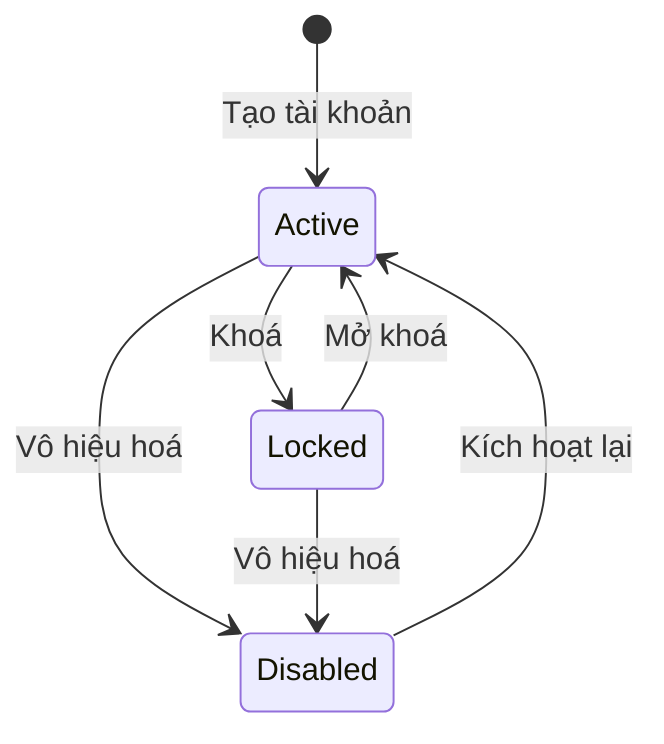
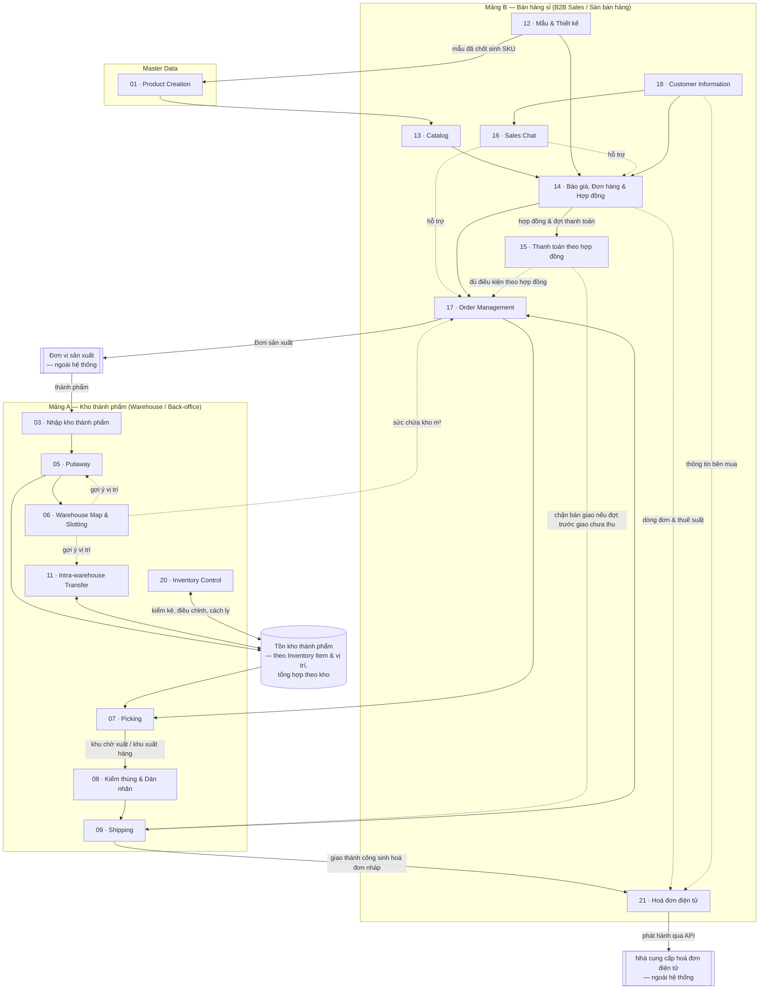

# 00 — Tổng quan hệ thống (System Overview)

> **Đã chốt 2026-11-04 (review nghiệp vụ — thu hẹp phạm vi):** kho chỉ là **kho thành phẩm**; **sản xuất nằm ngoài hệ thống** (hệ thống chỉ gửi **Đơn sản xuất** và nhập kho thành phẩm khi sản xuất xong); kho **không kiểm tra chất lượng (QC)** — chỉ đếm nhận đủ / thiếu / thừa; không còn mua hàng từ nhà cung cấp (bỏ PO, hoá đơn NCC); **sàn bán hàng** chỉ để khách xem hàng, xem mẫu thiết kế, chat và chốt đơn với Sale; mỗi đơn có một **hợp đồng mua bán**, khách **thanh toán theo đợt của hợp đồng** (chuyển khoản, không có QR / cổng thanh toán online). Đã xoá các module 02 · Purchase Order, 04 · Invoice, 19 · Production.
>
> **Đã chốt 2026-11-04 (bổ sung):** **không còn hàng trơn** — kho chỉ chứa thành phẩm in theo mẫu của khách, do đơn vị sản xuất **đóng thùng sẵn** rồi nhập vào; Đơn sản xuất chỉ phát sinh từ đơn hàng; kho **chỉ xuất nguyên thùng** và không đóng lại hàng (08 thu gọn thành kiểm thùng & dán nhãn giao hàng).
>
> **Đã chốt 2026-11-05:** khách sỉ **đặt theo số thùng**, không đặt lẻ; giá vẫn theo cái; mọi thùng đúng số cái chuẩn của SKU (thùng lệch không nhận).
>
> **Đã chốt 2026-11-05 (bổ sung):** bỏ role **Inventory Planner** và **Điều phối đơn hàng** (việc chuyển cho Sale và Quản lý kho); đổi **Quản trị bán hàng (E-commerce Admin)** thành **Quản lý kinh doanh (Sales Manager)**; "Yêu cầu sản xuất" đổi thành **Đơn sản xuất (Production Order)** — một chứng từ chung cho xưởng của công ty và đối tác, Sale lập, Sales Manager duyệt và gửi, có bước **khách duyệt mẫu in**; **bỏ module 10 · chuyển kho** — mỗi đơn xuất từ một kho, Đơn sản xuất giao thẳng về kho xuất, kho theo dõi **sức chứa (m³)** gồm hàng đang có và hàng sắp về; **bỏ hạn dùng** (ly và bao bì không có hạn dùng); sàn **ẩn giá**, bảng giá chỉ dùng nội bộ; thêm luồng **nhập hàng hoàn** vào khu cách ly.
>
> **✅ Đã chốt 2026-11-05 (phí vận chuyển, thuế & hoá đơn):** **phí vận chuyển** thu của khách là **một dòng phí** Sale nhập trên báo giá / đơn / hợp đồng (hệ thống không tự tính, module giao hàng không tính phí); báo giá / đơn / hợp đồng ghi **thuế VAT theo từng dòng** (theo nhóm thuế của sản phẩm) và **tổng có thuế**, lịch thanh toán chia trên tổng có thuế ([14](../ecommerce/14-cart-and-order/README.md), [15](../ecommerce/15-payment/README.md)). ~~Hoá đơn điện tử nằm ngoài phạm vi hệ thống~~ — thay bằng quyết định 2026-11-06 dưới đây.
>
> **✅ Đã chốt 2026-11-06 (hoá đơn điện tử):** hệ thống **tự phát hành hoá đơn VAT điện tử** qua **API của nhà cung cấp hoá đơn điện tử** (module mới [21 · E-invoice](../ecommerce/21-e-invoice/README.md)): mỗi **lần giao thành công** (shipment `Delivered`) sinh một **hoá đơn nháp**, **Kế toán bấm phát hành**; hoá đơn đã phát hành không sửa / xoá, thay đổi bằng **hoá đơn điều chỉnh / thay thế**; khách xem và tải **XML / PDF** trên trang đơn. Hoá đơn **không theo đợt thanh toán** và không ảnh hưởng thanh toán, công nợ ([15](../ecommerce/15-payment/README.md)).
>
> **✅ Đã chốt 2026-11-05 (khách tự thiết kế):** **chỉ khách tự thiết kế trên app** — bỏ luồng khách đưa mẫu cho Sale / nhân viên thiết kế hộ. Quản lý kinh doanh khai báo **cấu hình in** (khuôn 2D, vùng in, model 3D, ràng buộc file) cho từng quy cách ([01](../warehouse/01-product-creation/README.md)); khách bấm **"Thiết kế"** trên quy cách, tải ảnh / logo lên khuôn, xem trước 3D, **gửi duyệt**; hệ thống **tự kiểm (preflight)** rồi **Quản lý kinh doanh duyệt** kỹ thuật và nội dung; duyệt xong hệ thống **tự xuất file in PDF/X**, chốt design snapshot và sinh SKU riêng ([12](../ecommerce/12-product-design/README.md)). **Đặt hàng từ bản thiết kế = yêu cầu báo giá** gửi Sale ([13](../ecommerce/13-catalog/README.md), [16](../ecommerce/16-sales-chat/README.md)); khách vẫn không tự đặt hàng, sàn vẫn ẩn giá.
>
> **✅ Đã chốt 2026-11-05 (giao hàng):** **bỏ hình thức gửi kiện qua hãng** — **mọi đơn giao nguyên chuyến** (thuê nguyên xe tải / container của hãng vận chuyển), đi qua **kế hoạch xếp hàng 3D**; bỏ bước Sale chọn cách giao. Mỗi xe / chuyến có **mã vận đơn** của hãng — hãng đẩy qua **webhook**, hoặc kho **nhập tay / nhập hàng loạt từ file**; bắt buộc có mã vận đơn trước khi ký bàn giao. Hãng có webhook thì **mốc hành trình** và kết quả giao (`Delivered` / `Delivery Failed` / `Returned`) tự cập nhật; Quản lý kho vẫn ghi / sửa tay kèm lý do. Khách xem **tên hãng, mã vận đơn, biển số, các mốc hành trình** trên trang đơn ([09](../warehouse/09-shipping/README.md), [17](../ecommerce/17-order-management/README.md)). Hệ thống **chủ động gọi API** hãng (đặt xe, hỏi trạng thái) vẫn là phạm vi sau. *(✅ Cập nhật 2026-11-06:)* ngoại lệ là đơn vị vận chuyển **tích hợp API đặt xe** (xe tải / van nội thành) — hệ thống **tạo / huỷ đơn đặt xe qua API**, mỗi chuyến một đơn, mỗi shipment một điểm giao, kết quả giao về theo từng điểm ([09](../warehouse/09-shipping/README.md) BR-29).
>
> **✅ Đã chốt 2026-11-07 (role Điều phối sản xuất):** thêm role **Điều phối sản xuất (Production Coordinator)** — nhóm kho vận, phạm vi mọi kho — thay một phần quyết định 2026-11-05 (việc sản xuất trước đây giao cho Sale). Điều phối sản xuất **lập & gửi duyệt Đơn sản xuất**, ghi nhận đơn vị sản xuất nhận đơn, tiến độ, **vòng mẫu in** (tải mẫu, mở vòng in lại, phân loại lý do), **đóng thiếu / huỷ** Đơn sản xuất, quản lý **danh mục đơn vị sản xuất** và **thời gian sản xuất chuẩn**, lập **Đơn sản xuất bù** khi hàng lỗi phát hiện sau nhập kho. **Sale** giữ việc với khách (kho xuất, treo đơn, giao một phần, đổi SKU dòng đơn, dời cửa sổ giao, gửi thẻ duyệt mẫu in và báo tiến độ cho khách); **Sales Manager** vẫn duyệt và gửi Đơn sản xuất. Còn **8 role hệ thống** (§2.5.3) ([17](../ecommerce/17-order-management/README.md)).

## 1. Mục tiêu hệ thống (Goals)

StockFlowCommerce hướng đến việc **loại bỏ khoảng cách giữa vận hành kho thành phẩm và bán hàng sỉ** cho doanh nghiệp chuyên cung cấp **ly và bao bì dùng một lần cho ngành đồ uống** (ly nhựa, ly giấy, bao bì mang đi), **in logo theo mẫu của khách** (không bán hàng trơn), và **chỉ bán sỉ (B2B)** cho khách đã liên hệ từ trước — chủ yếu là quán / chuỗi đồ uống:

| # | Mục tiêu | Diễn giải |
|---|----------|-----------|
| G1 | **Một nguồn dữ liệu sản phẩm duy nhất (single source of truth)** | Sản phẩm khai báo một lần ở back-office, dùng chung cho kho thành phẩm và sàn bán hàng. Mỗi mẫu đã chốt của khách là một **SKU thành phẩm riêng** của khách đó — loại hàng duy nhất có tồn trong kho. |
| G2 | **Tồn kho thành phẩm thời gian thực (real-time inventory)** | Mọi nghiệp vụ nhập – xuất – điều chỉnh cập nhật tồn ngay; khi nhận đơn, hệ thống cho biết đủ hàng hay phải gửi Đơn sản xuất, và kho nhận còn đủ chỗ (m³) hay không. |
| G3 | **Truy vết đầu-cuối (end-to-end traceability)** | Từ Đơn sản xuất → lô hàng nhập kho → vị trí lưu kho → đơn hàng & hợp đồng → kiện hàng giao đi → đợt thanh toán, tất cả liên kết bằng chứng từ. |
| G4 | **Tối ưu thao tác kho** | Kho Map 2D/3D + gợi ý vị trí (slotting) + khu chờ xuất (Staging) giúp giảm quãng đường di chuyển và sai sót. |
| G5 | **Khách tự thiết kế trên app** | Khách tự thiết kế trên khuôn in của quy cách (xem trước 3D) → hệ thống tự kiểm → Quản lý kinh doanh duyệt → hệ thống xuất file in PDF/X; mẫu đã chốt sinh SKU thành phẩm, khách yêu cầu báo giá từ đó, và file in đi kèm Đơn sản xuất gửi đơn vị sản xuất. Nhiều bản của một bộ nhận diện gom được vào **dự án thiết kế**: dùng chung logo / ảnh, gửi duyệt cả bộ, yêu cầu báo giá cả dự án ([12](../ecommerce/12-product-design/README.md)). |
| G6 | **Kết nối Sale – Khách hàng** | Kênh chat trên sàn, gắn ngữ cảnh đơn hàng / mẫu thiết kế / báo giá, để tư vấn và chốt đơn ([16](../ecommerce/16-sales-chat/README.md)). |
| G7 | **Bán sỉ theo hợp đồng, kiểm soát công nợ** | Giá do Sale thoả thuận trên báo giá (sàn không hiện giá; bảng giá riêng chỉ dùng nội bộ làm giá gợi ý); mỗi đơn có hợp đồng mua bán với lịch thanh toán theo đợt; theo dõi công nợ phải thu có hạn mức & kỳ hạn. |

---

## 2. Vai trò & đối tượng người dùng (Role Registry)

Đây là **sổ đăng ký vai trò chuẩn** — nguồn tham chiếu duy nhất về tên vai trò trong toàn bộ tài liệu. Mọi module chỉ dùng tên trong danh sách này.

> ✅ Đã chốt 2026-11-04: bỏ ba role **Nhân viên mua hàng (Procurement Staff)**, **Nhân viên sản xuất (Production Staff)** và **Nhân viên QC (QC Staff)**. Việc duyệt kỹ thuật bộ file thiết kế chuyển cho **Quản lý kinh doanh** ([12](../ecommerce/12-product-design/README.md)).
>
> ✅ Đã chốt 2026-11-05: bỏ thêm hai role **Nhân viên kế hoạch tồn kho (Inventory Planner)** và **Điều phối đơn hàng (Order Coordinator)**. Việc phía khách và sản xuất (kho xuất, Đơn sản xuất, treo đơn, yêu cầu huỷ) chuyển cho **Sale**; việc trong kho (release, task lấy hàng, khu chờ xuất, kết quả giao, kiểm kê) chuyển cho **Quản lý kho**. Role "Quản trị bán hàng (E-commerce Admin)" đổi tên thành **Quản lý kinh doanh (Sales Manager)**.
>
> ✅ Đã chốt 2026-11-07: thêm role **Điều phối sản xuất (Production Coordinator)** — thay phần "sản xuất" của quyết định trên. Việc với Đơn sản xuất (lập, ghi nhận tiến độ, mẫu in, đóng thiếu / huỷ, danh mục đơn vị sản xuất, Đơn sản xuất bù) chuyển từ **Sale** sang **Điều phối sản xuất**; Sale giữ việc với khách. Không khôi phục role Điều phối đơn hàng.

### 2.1. Vai trò nội bộ (role đăng nhập)

#### Nhóm kho vận (back-office)

| Role | Trách nhiệm chính | Quyền hạn tiêu biểu |
|------|-------------------|---------------------|
| **Quản trị hệ thống (System Admin)** | Cấu hình toàn hệ thống, khai báo kho & khu vực, phân quyền, quản lý dữ liệu gốc sản phẩm; **tạm ngưng / tiếp tục / ngừng kinh doanh sản phẩm** ([01](../warehouse/01-product-creation/README.md)) | Toàn quyền; cấu hình quy tắc slotting, quy tắc gợi ý |
| **Nhân viên kho (Warehouse Staff)** | Nhập kho thành phẩm theo thùng, kiểm đếm, cất hàng (putaway), lấy hàng nguyên thùng (picking), đưa hàng về khu chờ xuất, kiểm thùng & dán nhãn giao hàng, bàn giao vận chuyển (shipping), nhập hàng hoàn, đếm kiểm kê | Thao tác trên phiếu được phân công; ghi nhận số lượng thực tế |
| **Quản lý kho (Warehouse Manager)** | Quản lý **các kho được gán** (một hoặc nhiều kho). **Thiết lập:** kho, bản đồ, vị trí (thể tích m³, tải trọng), danh mục hãng vận chuyển (kèm cấu hình kết nối webhook) & loại xe, quy cách thùng; theo dõi **bảng sức chứa kho** ([06](../warehouse/06-warehouse-map-slotting/README.md)). **Nhập kho:** xử lý nhận thiếu / thừa / thùng lệch số chuẩn; quyết định hàng hoàn trong khu cách ly ([03](../warehouse/03-receipt/README.md)). **Xuất kho:** release đơn, tạo task lấy hàng & giao người, khu chờ xuất, chuyển task sang khu xuất hàng, huỷ chuyến bàn giao, sửa mã vận đơn sau khi xe rời kho (kèm lý do), ghi nhận / sửa kết quả giao (kèm lý do), xử lý danh sách sự kiện webhook lỗi ([07](../warehouse/07-picking/README.md), [09](../warehouse/09-shipping/README.md)). **Kiểm soát tồn:** lập kiểm kê, **duyệt điều chỉnh tồn**, cách ly / gỡ cách ly ([20](../warehouse/20-inventory-control/README.md)) | Duyệt / từ chối điều chỉnh tồn (người duyệt khác người gửi; kho chỉ có một quản lý thì System Admin duyệt); ghi đè gợi ý slotting; có đủ quyền thao tác như nhân viên kho — đó là quyền, không phải việc chính |
| **Điều phối sản xuất (Production Coordinator)** *(thêm 2026-11-07)* | Phạm vi **mọi kho**. **Lập & gửi duyệt Đơn sản xuất** cho phần thiếu của từng đợt giao — chọn đơn vị sản xuất, đơn giá gia công, ngày cần hàng, cờ duyệt mẫu in; ghi nhận đơn vị sản xuất **nhận đơn** (`Accepted`, ngày hoàn thành dự kiến), **tiến độ**, chuyển `In Production`; **vòng mẫu in** — tải ảnh / video mẫu, ghi ngày gửi mẫu vật, mở vòng in lại và phân loại lý do `PRINT_DEFECT` / `CUSTOMER_CHANGE`; **đóng thiếu / huỷ** Đơn sản xuất; theo dõi **lịch sản xuất**, xử lý **cảnh báo trễ** với đơn vị sản xuất; khai báo **danh mục đơn vị sản xuất** và **thời gian sản xuất chuẩn**; lập **Đơn sản xuất bù** khi hàng lỗi phát hiện sau nhập kho ([17](../ecommerce/17-order-management/README.md), [20](../warehouse/20-inventory-control/README.md)) | Lập Đơn sản xuất; ghi nhận tiến độ sản xuất; không tự duyệt Đơn sản xuất mình lập; không chat với khách |
| **Kế toán (Accountant)** | **Lập phiếu thu** (đối chiếu sao kê) cho các **đợt thanh toán của hợp đồng**, huỷ phiếu thu ghi sai, **công nợ phải thu của khách sỉ**, ghi nhận đã hoàn tiền; **duyệt / từ chối đơn bị treo do công nợ** và **duyệt hạn mức, kỳ hạn công nợ, lịch thanh toán mặc định của khách** ([15](../ecommerce/15-payment/README.md)); **phát hành hoá đơn điện tử** theo từng lần giao qua nhà cung cấp hoá đơn điện tử, lập hoá đơn điều chỉnh / thay thế ([21](../ecommerce/21-e-invoice/README.md)) | Lập / huỷ phiếu thu, ghi nhận đã hoàn; duyệt tín dụng & hạn mức; chạy đối soát; **xem chi tiết & lịch sử đơn, hợp đồng (chỉ đọc)** *(Quyết định 21/10/2026)* |

#### Nhóm bán hàng sỉ (sales)

| Role | Trách nhiệm chính | Quyền hạn tiêu biểu |
|------|-------------------|---------------------|
| **Quản lý kinh doanh (Sales Manager)** | Quản lý **dữ liệu sản phẩm** — tạo, **duyệt (bốn mắt)**, đăng ảnh, danh mục, thương hiệu, thuộc tính ([01](../warehouse/01-product-creation/README.md)); quản lý nội dung trên sàn bán hàng, **bảng giá nội bộ** theo khách (giá gợi ý cho Sale, không hiện trên sàn); khai báo **cấu hình in** cho quy cách — khuôn 2D, model 3D, vùng in, ràng buộc file ([01](../warehouse/01-product-creation/README.md)); **duyệt kỹ thuật và kiểm duyệt nội dung** bản thiết kế khách tự làm ([12](../ecommerce/12-product-design/README.md)); **đổi trạng thái khách** và quản lý **nhóm khách** ([18](../ecommerce/18-customer-information/README.md)); **duyệt và gửi Đơn sản xuất** ([17](../ecommerce/17-order-management/README.md)) | Duyệt / từ chối sản phẩm; duyệt / trả lại Đơn sản xuất (không phải người lập); xuất bản / ẩn sản phẩm; khai báo cấu hình in của quy cách; duyệt / trả lại bản thiết kế của khách; chặn / gỡ chặn / đóng / mở lại khách |
| **Nhân viên Sale (Sales Staff)** | Tạo & gửi duyệt sản phẩm ([01](../warehouse/01-product-creation/README.md)), tạo hồ sơ khách sỉ, nhận **yêu cầu báo giá từ bản thiết kế** của khách ([16](../ecommerce/16-sales-chat/README.md)), lập **báo giá**, tạo **đơn hàng** từ báo giá đã chấp nhận, lập & gửi **hợp đồng mua bán**, tải bản hợp đồng đã ký ([14](../ecommerce/14-cart-and-order/README.md)), **chat với khách** ([16](../ecommerce/16-sales-chat/README.md)); với đơn đã `Confirmed`: **chọn kho xuất**, **treo / gỡ treo đơn**, **duyệt / từ chối yêu cầu huỷ**, **quyết định cho phép giao một phần**, **đổi SKU dòng đơn**, **dời cửa sổ giao**; gửi **thẻ duyệt mẫu in** và báo tiến độ sản xuất cho khách trong chat (Đơn sản xuất do Điều phối sản xuất lập — *2026-11-07*) ([17](../ecommerce/17-order-management/README.md)), xử lý khiếu nại | Tạo / sửa sản phẩm nháp; xem & thao tác khách và đơn được phân công; tạo báo giá, đơn, hợp đồng; xem Đơn sản xuất & lịch sản xuất; huỷ đơn / đóng phần còn lại; giảm giá trong hạn mức; **bật / tắt cờ cho phép giao một phần** của đơn *(Quyết định 21/10/2026)* |

### 2.2. Vai thao tác (operational hat — không phải role riêng)

Warehouse Staff được gọi theo công đoạn được phân công. Đây chỉ là **cách gọi theo ngữ cảnh**, không phải role đăng nhập riêng:

| Vai thao tác | Công đoạn | Module |
|--------------|-----------|--------|
| Receiver | Nhập kho thành phẩm theo Đơn sản xuất, nhập hàng hoàn vào khu cách ly, kiểm đếm số thùng | [03](../warehouse/03-receipt/README.md) |
| Putaway Operator | Cất hàng vào vị trí | [05](../warehouse/05-putaway/README.md) |
| Picker | Lấy nguyên thùng theo task được giao (mỗi đơn một task), đưa về khu chờ xuất hoặc khu xuất hàng, báo thiếu, cất lại hàng của đơn huỷ | [07](../warehouse/07-picking/README.md) |
| Packer | Quét kiểm đủ thùng cho đơn, dán nhãn giao hàng, gom thùng thành shipment (không đóng lại hàng) | [08](../warehouse/08-packing/README.md) |
| Dispatch Staff | Lập kế hoạch xếp hàng lên xe (Load Planning) cho mọi đơn (giao nguyên chuyến), ghi nhận đặt xe (với hãng tích hợp API đặt xe: hệ thống tạo đơn ở hãng, mã vận đơn có ngay); **nhập mã vận đơn** cho từng xe — tay từng chuyến hoặc **hàng loạt từ file** (khi hãng không đẩy qua webhook); xếp kiện lên xe, quét kiện, ký bàn giao | [09](../warehouse/09-shipping/README.md) |

### 2.3. Quyền theo ngữ cảnh (permission — không phải role)

Một số chức năng là **quyền** gán cho role qua cấu hình RBAC, không phải chức danh riêng. Trong tài liệu, "Người duyệt (Approver)" là cách gọi tắt của *người giữ quyền phê duyệt tương ứng*.

> **Quyết định 22/10/2026:** mọi kiểm tra truy cập trong hệ thống đi qua **mã quyền**, không chức năng nào bị khoá cứng theo tên vai trò. Cột "Gán mặc định cho" dưới đây (và "Quyền hạn tiêu biểu" ở §2.1) chỉ là cấu hình ban đầu: System Admin cấp một quyền cho vai trò khác trên màn phân quyền thì chức năng đó mở cho vai trò ấy, không cần sửa mã. Phạm vi dữ liệu (theo kho, đơn của chính khách) vẫn là điều kiện riêng, không phải kiểm tra vai trò.

| Quyền | Nội dung | Gán mặc định cho |
|-------|----------|------------------|
| Quyết định giao một phần | Bật / tắt cờ cho phép giao một phần của đơn ([17](../ecommerce/17-order-management/README.md) §4.2) *(Quyết định 21/10/2026)* | Sales Staff, System Admin |
| Duyệt kỹ thuật thiết kế | Duyệt kỹ thuật và kiểm duyệt nội dung (bản quyền, nội dung không phù hợp) bản thiết kế khách gửi duyệt đã qua tự kiểm: **duyệt** → hệ thống xuất file in PDF/X, sinh SKU riêng; **trả lại** kèm lý do. Người tạo là khách, người duyệt luôn là Quản lý kinh doanh ([12](../ecommerce/12-product-design/README.md)) *(Đã chốt 2026-11-04; cập nhật 2026-11-05)* | Quản lý kinh doanh |
| Lập Đơn sản xuất | Lập / sửa / gửi duyệt / huỷ Đơn sản xuất (kể cả Đơn sản xuất bù); khai báo danh mục đơn vị sản xuất và thời gian sản xuất chuẩn ([17](../ecommerce/17-order-management/README.md) §4.3) *(✅ Đã chốt 2026-11-07)* | Điều phối sản xuất |
| Ghi nhận tiến độ sản xuất | Ghi nhận đơn vị sản xuất nhận đơn, ngày hoàn thành dự kiến, chuyển `In Production`; tải mẫu in, mở vòng in lại, phân loại lý do in lại; đóng thiếu Đơn sản xuất ([17](../ecommerce/17-order-management/README.md) §4.3) *(✅ Đã chốt 2026-11-07)* | Điều phối sản xuất |
| Duyệt Đơn sản xuất | Duyệt / trả lại Đơn sản xuất trước khi gửi đơn vị sản xuất; người duyệt khác người lập ([17](../ecommerce/17-order-management/README.md)) *(Đã chốt 2026-11-05)* | Quản lý kinh doanh |
| Huỷ có kiểm soát kế hoạch xe | Huỷ có kiểm soát cả kế hoạch chuyến xe hoặc một xe đã bắt đầu xếp; bỏ xe `Planned` khỏi kế hoạch khi mọi xe khác đã rời kho; bắt buộc mã lý do + ghi chú ([09](../warehouse/09-shipping/README.md)) *(Quyết định 02/11/2026)* | Quản lý kho, System Admin |
| Duyệt điều chỉnh tồn | Duyệt / từ chối điều chỉnh tồn; người duyệt khác người gửi ([20](../warehouse/20-inventory-control/README.md)) | Quản lý kho (System Admin khi kho chỉ có một quản lý) |
| Duyệt tín dụng & lịch thanh toán | Duyệt / từ chối đơn bị treo do công nợ (vượt hạn mức, khách quá hạn); duyệt hạn mức, kỳ hạn công nợ, lịch thanh toán mặc định của khách | Kế toán |
| Hoàn tiền | Ghi nhận đã hoàn (số tiền, ngày, mã sao kê) cho số tiền phải hoàn do hệ thống tính khi huỷ / đóng phần còn lại / trả hàng ([15](../ecommerce/15-payment/README.md) §4.5) *(✅ 2026-11-06)* | Kế toán (System Admin có toàn quyền) |
| Phát hành hoá đơn điện tử | Phát hành / phát hành lại / tra lại hoá đơn qua nhà cung cấp hoá đơn điện tử; lập hoá đơn điều chỉnh / thay thế; huỷ nháp ([21](../ecommerce/21-e-invoice/README.md)) *(✅ Đã chốt 2026-11-06)* | Kế toán |
| Cấu hình kết nối hoá đơn điện tử | Môi trường của nhà cung cấp hoá đơn điện tử, thông tin xác thực, mẫu số, ký hiệu hoá đơn, ngưỡng cảnh báo lượt phát hành ([21](../ecommerce/21-e-invoice/README.md)) | System Admin |
| Giám sát chat (Chat Supervision) | Phân công hội thoại, giám sát SLA, nhận escalate | Quản lý kinh doanh hoặc Sales Staff được chỉ định |

Phân bổ trên là cấu hình mặc định khi cài đặt; người có quyền duyệt phân quyền sửa được ma trận quyền của từng role (§2.5.3).

### 2.4. Đối tác ngoài & actor hệ thống

| Actor | Vai trò |
|-------|---------|
| **Khách hàng sỉ (B2B Customer)** | Doanh nghiệp đã liên hệ trước, được Sale tạo tài khoản. Trên sàn bán hàng: xem hàng (**sàn không hiện giá**), **tự thiết kế** trên khuôn in của quy cách (tải ảnh / logo, xem trước 3D), **gửi duyệt**, xem lại, **tạo bản sửa**, **yêu cầu báo giá** từ bản thiết kế đã duyệt ([12](../ecommerce/12-product-design/README.md), [13](../ecommerce/13-catalog/README.md)), **duyệt / yêu cầu in lại mẫu in**, **chat với Sale**, chấp nhận báo giá, xem đơn, hợp đồng, đợt thanh toán & công nợ. **Không tự đặt hàng** trên sàn — đơn do Sale chốt. **Không có khách vãng lai (guest).** |
| **Đơn vị sản xuất (ngoài hệ thống)** | Xưởng của công ty **hoặc** đối tác bên ngoài — hệ thống xử lý như nhau, chỉ khác **kênh kết nối** khai báo trong danh mục Đơn vị sản xuất. Nhận **Đơn sản xuất** (kèm file in PDF/X đã chốt), xác nhận nhận đơn, in **mẫu thử** khi đơn yêu cầu duyệt mẫu in, sản xuất và tự kiểm tra chất lượng, đóng thùng đúng số chuẩn, giao về **đúng kho nhận**. Hệ thống không quản lý quá trình sản xuất; **Điều phối sản xuất** ghi nhận phản hồi và tiến độ ([17](../ecommerce/17-order-management/README.md)) |
| **Đơn vị vận chuyển (Carrier / 3PL)** | Bên thứ ba **ngoài hệ thống**: cung cấp xe tải / container (mọi đơn giao nguyên chuyến), nhận hàng khi bàn giao, vận chuyển, giao cho khách, hoàn hàng về kho (RTO). Hãng có **webhook** thì đẩy vào hệ thống **mã vận đơn**, biển số, tài xế, **mốc hành trình** và kết quả giao (kèm mã chuyến nội bộ để ghép đúng chuyến); hãng không có webhook thì kho nhập mã vận đơn (tay / từ file) và Quản lý kho ghi kết quả giao khi hãng báo lại. Hệ thống **không chủ động gọi API** hãng để hỏi trạng thái (phạm vi sau). Đơn vị vận chuyển xe tải / van nội thành *(✅ 2026-11-06)* có kiểu kết nối **tích hợp API đặt xe**: hệ thống **tạo / huỷ đơn** khi đặt / huỷ đặt xe (mỗi chuyến một đơn, mỗi shipment một điểm giao), hãng đẩy trạng thái từng điểm giao qua webhook ([09](../warehouse/09-shipping/README.md) BR-29) |
| **Nhà cung cấp hoá đơn điện tử (E-invoice provider)** | Bên thứ ba **ngoài hệ thống**: nhận dữ liệu hoá đơn qua API, **ký số**, nộp cơ quan thuế, cấp số hoá đơn, trả file XML / PDF; gửi email hoá đơn cho bên mua (⚠️ giả định). Không đẩy kết quả về — hệ thống tự hỏi lại kết quả ([21](../ecommerce/21-e-invoice/README.md)) *(✅ Đã chốt 2026-11-06)* |

Ngoài ra, nhiều module liệt kê **actor hệ thống** — các engine tự động (gợi ý bin khi cất hàng, Wave/Route Planner và Cartonization (phạm vi giai đoạn sau — [open-questions C17](../open-questions/README.md)), Load Planner, Payment Service, Notification (hộp thông báo — §6)…). Đây không phải người dùng; chúng thực thi quy tắc do các role trên cấu hình.

Một tài khoản có thể mang nhiều role (ví dụ Warehouse Staff kiêm Warehouse Manager ở kho nhỏ): quyền là hợp các role, phạm vi dữ liệu là phạm vi rộng nhất. Chi tiết tài khoản và phân quyền ở §2.5.

### 2.5. Tài khoản & phân quyền (Accounts & RBAC)

#### 2.5.1. Tài khoản nhân viên

| Trường | Ghi chú |
|--------|---------|
| Tên đăng nhập | Không đổi được |
| Email, họ tên | Sửa được |
| Role | Một hoặc nhiều role (§2.1) |
| Kho được gán | Một hoặc nhiều kho; quyết định phạm vi dữ liệu với role theo kho (§2.5.3) |
| Trạng thái | `Active` / `Locked` / `Disabled` |

1. **Tạo tài khoản** — người quản trị nhập thông tin, role, kho. Không nhập mật khẩu thì hệ thống sinh **mật khẩu tạm 16 ký tự**, hiện **một lần**; tài khoản bị đánh dấu **phải đổi mật khẩu**.
2. **Mật khẩu** — 10–72 ký tự, có ít nhất một chữ hoa, một chữ thường, một chữ số.
   - Người dùng tự đổi mật khẩu (phải nhập đúng mật khẩu cũ, mật khẩu mới khác mật khẩu cũ); tuỳ chọn đăng xuất các thiết bị khác.
   - Người quản trị đặt lại mật khẩu (nhập hoặc sinh mật khẩu tạm) → mọi phiên của tài khoản bị huỷ, phải đổi mật khẩu.
3. **Đăng nhập** — sai mật khẩu **5 lần liên tiếp** → **tự khoá 15 phút**, hết hạn tự mở; trong lúc khoá, hệ thống trả lời giống hệt sai mật khẩu. Mỗi địa chỉ IP tối đa 5 lần đăng nhập / phút.
4. **Phiên đăng nhập** — mỗi lần đăng nhập là một phiên, hiệu lực **8 giờ** (không có làm mới phiên); hệ thống kiểm phiên ở mọi thao tác. Người dùng xem được các phiên của mình, đăng xuất, đăng xuất các thiết bị khác.
5. **Phiên bị huỷ ngay** khi: đổi role của tài khoản, khoá, vô hiệu hoá, người quản trị đặt lại mật khẩu, hoặc người dùng đổi mật khẩu và chọn đăng xuất thiết bị khác.
6. **Đổi kho được gán** — có hiệu lực từ thao tác kế tiếp, không cần đăng nhập lại.

| Trạng thái | Ý nghĩa | Chuyển tiếp cho phép | Ai thực hiện |
|------------|---------|----------------------|--------------|
| `Active` | Đăng nhập được (trừ khi đang tự khoá 15 phút do sai mật khẩu) | → `Locked` (khoá), → `Disabled` (vô hiệu hoá) | Người quản trị tài khoản |
| `Locked` | Bị người quản trị khoá; chỉ **mở khoá** mới hết | → `Active` (mở khoá — cũng xoá khoá tự động), → `Disabled` | Người quản trị tài khoản |
| `Disabled` | Ngừng dùng; tài khoản được giữ để tra lịch sử | → `Active` (kích hoạt lại) | Người quản trị tài khoản |

**Ràng buộc với người quản trị tài khoản:**

- Chỉ **cấp được** quyền, role (hoặc bản sao role) mà **chính mình đang có đủ**.
- Chỉ **quản lý được** tài khoản không có quyền nào vượt mình — vì vậy chỉ System Admin cấp được role System Admin.
- **Không tự quản lý tài khoản của mình** (khoá, đổi role… cho chính mình).
- Luôn giữ **ít nhất một System Admin đang hoạt động**: không khoá, vô hiệu hoá hay thu role của System Admin cuối cùng.
- Luôn có **ít nhất một role giữ quyền sửa phân quyền**.
- Role khách hàng (`CUSTOMER`) không gán cho tài khoản nhân viên; tài khoản khách không mang role khác.

> ⚠️ Giả định: **quên mật khẩu tự phục vụ qua email**, **xác thực hai lớp (2FA)** và **làm mới phiên** thuộc phạm vi giai đoạn sau. Hiện người quên mật khẩu nhờ người quản trị đặt lại. Xem [open-questions A10](../open-questions/README.md).

#### 2.5.2. Tài khoản khách hàng sỉ

1. Khách **không tự đăng ký**. Sale tạo hồ sơ khách ([18](../ecommerce/18-customer-information/README.md)) → hệ thống tạo tài khoản cho người liên hệ (chưa có mật khẩu) và gửi **email mời**.
2. Link mời hiệu lực **72 giờ**; Sale gửi lại được sau tối thiểu 1 phút.
3. Người liên hệ mở link, **đặt mật khẩu** → kích hoạt. Tên đăng nhập là **email**.
4. Trạng thái hồ sơ khách quyết định đăng nhập: `Active` / `Pending Activation` đăng nhập được; `Blocked` / `Inactive` → tài khoản bị vô hiệu hoá, mọi phiên bị huỷ ([18](../ecommerce/18-customer-information/README.md)).

#### 2.5.3. Role, quyền và phạm vi dữ liệu

1. **Quyền** = **tài nguyên × hành động**, ví dụ `sales-contracts:APPROVE`. Hành động gồm: xem trang (`VIEW_PAGE`), đọc (`READ`), tạo (`CREATE`), sửa (`UPDATE`), xoá (`DELETE`), duyệt (`APPROVE`), xuất dữ liệu (`EXPORT`). Ba hành động cuối là **nhạy cảm**.
2. **Role** là tập quyền kèm **phạm vi dữ liệu**:

   | Phạm vi | Ý nghĩa | Role mặc định |
   |---------|---------|---------------|
   | `WAREHOUSE` | Chỉ dữ liệu của **các kho được gán** cho tài khoản; không được gán kho thì không thấy gì | Warehouse Staff, Warehouse Manager |
   | `ALL` | Toàn hệ thống | Mọi role nhân viên khác |
   | `OWN` | Chỉ dữ liệu của chính mình | Dùng cho các chức năng của khách trên cổng (đơn, công nợ, báo giá của chính khách) |

   Phạm vi theo nhóm (`TEAM`) chưa dùng.
3. **8 role hệ thống**: 7 role nhân viên ở §2.1 và role **Khách hàng** (`CUSTOMER`) *(cập nhật 2026-11-07: thêm Điều phối sản xuất)*. Role hệ thống không xoá, không đổi tên.
4. **Role tự tạo** — người có quyền tạo role tạo được role mới (tuỳ chọn sao chép từ role khác), đổi tên, đổi phạm vi; xoá được khi không còn ai mang role đó.
5. **Sửa ma trận quyền** của role (thay cả ma trận, hoặc cấp / thu từng quyền) cần quyền **duyệt phân quyền**. Ma trận của `CUSTOMER` và `SYSTEM_ADMIN` cố định. Thay đổi có hiệu lực từ thao tác kế tiếp của người mang role, không cần đăng nhập lại.
6. **Nhiều role** — một tài khoản mang nhiều role thì quyền là **hợp** các role, phạm vi là phạm vi **rộng nhất**.
7. **Ai quản trị tài khoản & phân quyền** — chỉ **System Admin**: tạo / sửa / khoá tài khoản nhân viên, tạo / sửa / xoá role, sửa ma trận quyền. *(✅ Đã chốt 2026-11-07: bỏ quyền quản trị tài khoản & phân quyền của Quản lý kinh doanh, cho khớp phiếu đăng ký đồ án.)*

---

## 3. Bản đồ module & mối liên kết (Module Map)

Theo năm nhóm chức năng đã chốt 2026-11-04:

| Nhóm chức năng | Module |
|----------------|--------|
| **Quản lý thiết kế** (khách tự thiết kế) | [12](../ecommerce/12-product-design/README.md) |
| **Bán hàng** — sàn bán hàng, bảng giá nội bộ, báo giá, đơn hàng theo số lượng, hợp đồng từng đơn, chat, khách hàng | [13](../ecommerce/13-catalog/README.md), [14](../ecommerce/14-cart-and-order/README.md), [16](../ecommerce/16-sales-chat/README.md), [17](../ecommerce/17-order-management/README.md), [18](../ecommerce/18-customer-information/README.md) |
| **Quản lý thanh toán** — theo hợp đồng, công nợ; hoá đơn điện tử theo lần giao *(bổ sung 2026-11-06)* | [15](../ecommerce/15-payment/README.md), [21](../ecommerce/21-e-invoice/README.md) |
| **Quản lý kho** — dữ liệu sản phẩm, nhập kho thành phẩm, vận hành kho, xuất kho, kiểm soát tồn | [01](../warehouse/01-product-creation/README.md), [03](../warehouse/03-receipt/README.md), [05](../warehouse/05-putaway/README.md)–[08](../warehouse/08-packing/README.md), [11](../warehouse/11-intra-warehouse-transfer/README.md), [20](../warehouse/20-inventory-control/README.md) |
| **Quản lý giao hàng** | [09](../warehouse/09-shipping/README.md) |

---

## 4. Sơ đồ luồng tổng thể end-to-end (Mẫu → Giao hàng → Công nợ)

Luồng "hạnh phúc" (happy path) từ lúc khách tự thiết kế trên app đến lúc giao hàng và thu đủ tiền:

```mermaid
flowchart LR
    A[Khách tự thiết kế\ntrên app · gửi duyệt] --> A1[Hệ thống tự kiểm\nQuản lý kinh doanh duyệt]
    A1 --> A2[Xuất file in PDF/X\nsinh SKU thành phẩm của khách]
    A2 --> B[Yêu cầu báo giá\nBáo giá]
    I[Sàn bán hàng\nxem hàng · chat với Sale] --> B
    B --> C[Đơn hàng\ntheo số lượng]
    C --> D[Hợp đồng mua bán\nký & tải lên]
    D --> D1{Đợt thu khi ký\nđã thu?}
    D1 -- Có / không có đợt này --> E[Đơn xác nhận\nConfirmed]
    E --> F{Đủ tồn\nthành phẩm?}
    F -- Thiếu --> G[Đơn sản xuất\nĐiều phối sản xuất lập · Sales Manager duyệt & gửi]
    G --> G1{Cần duyệt\nmẫu in?}
    G1 -- Có --> G2[Khách duyệt\nmẫu in]
    G2 --> G3[Sản xuất\nhàng loạt]
    G1 -- Không --> G3
    G3 --> H[Nhập kho thành phẩm\nđã đóng thùng · đếm đủ / thiếu]
    H --> H1[Cất hàng\nPutaway]
    H1 --> F
    F -- Đủ --> K[Lấy nguyên thùng\nPicking]
    K --> K1[Khu chờ xuất\nnếu cần giữ hàng]
    K1 --> L[Kiểm thùng & dán nhãn\ntại khu xuất hàng]
    K --> L
    L --> M[Bàn giao vận chuyển\nShipping]
    M --> N[Giao thành công\nDelivered]
    N --> N1[Hoá đơn điện tử\nKế toán phát hành qua nhà cung cấp hoá đơn điện tử]
    N1 --> O[Công nợ phải thu\nthu các đợt còn lại]
    O --> P[Đóng đơn\nOrder Closed]
```

**Diễn giải theo từng chặng:**

| Chặng | Bắt đầu bằng | Kết thúc bằng | Module chịu trách nhiệm |
|-------|--------------|---------------|-------------------------|
| **1. Mẫu & thiết kế** | Khách tự thiết kế trên app, trên quy cách đã có khuôn in (cấu hình in ở 01); có thể gom nhiều bản vào **dự án thiết kế** và gửi duyệt cả bộ | Quản lý kinh doanh duyệt bản thiết kế; file in PDF/X và SKU thành phẩm của khách được tạo | 01 (cấu hình in) → 13 → 12 → 01 (SKU riêng) |
| **2. Bán hàng & hợp đồng** | Khách yêu cầu báo giá từ bản thiết kế hoặc cả dự án thiết kế / xem hàng / chat với Sale | Hợp đồng đã ký (kèm **lịch giao** các đợt và lịch thanh toán), đơn `Confirmed` | 13 → 14 → 15 (hỗ trợ: 16, 18) |
| **3. Đáp ứng tồn (Đơn sản xuất & nhập kho)** | Đợt giao của đơn thiếu tồn thành phẩm tại kho xuất (SKU riêng của khách) — Điều phối sản xuất lập Đơn sản xuất theo từng đợt giao, theo dõi trên **lịch sản xuất** kèm **cảnh báo trễ** | Thành phẩm nằm ở vị trí kho xuất, sẵn cho đơn | 17 (Đơn sản xuất, duyệt mẫu in) → (đơn vị sản xuất, ngoài hệ thống) → 03 → 05 → 06 |
| **4. Xuất kho & giao hàng (Fulfillment)** | Đơn release cho kho — theo từng đợt giao; bàn giao từ ngày bắt đầu cửa sổ giao | Kiện hàng đã giao cho khách (mọi đợt giao) | 17 → 07 → 08 → 09 |
| **5. Thanh toán, hoá đơn & công nợ** | Hợp đồng đã ký | Mọi đợt thanh toán đã thu, mọi lần giao đã có hoá đơn, đơn đóng | 15 (liên quan 14, 17, 18); 21 (hoá đơn theo lần giao, liên quan 09) |
| **6. Kiểm soát tồn kho (Inventory ops)** | Chênh lệch / tối ưu vị trí; theo dõi sức chứa kho; hàng hoàn | Số tồn khớp thực tế, kho đủ chỗ cho hàng sắp về | 11, 06, 20, 03 |

---

## 5. Các luồng nghiệp vụ chính (Core Business Flows)

| Luồng | Chuỗi module | Chứng từ xuyên suốt | Sơ đồ chi tiết |
|-------|--------------|---------------------|----------------|
| **Nhập kho thành phẩm** | Đơn sản xuất → (đơn vị sản xuất) → Nhập kho (WH/Input) → Putaway (WH/Stock) | Số Đơn sản xuất liên kết phiếu nhập kho, lô hàng & nhiệm vụ cất hàng | [diagrams §1](../diagrams/README.md#1-luồng-nhập-kho-thành-phẩm) |
| **Fulfillment** | Order → kiểm tồn (thiếu → Đơn sản xuất) → Picking nguyên thùng → (khu chờ xuất) → Kiểm thùng & dán nhãn giao hàng → Shipping (giao nguyên chuyến: lập kế hoạch xếp hàng 3D, đặt xe, mã vận đơn, ký bàn giao) → kết quả giao (webhook của hãng hoặc ghi tay) | Order number liên kết Đơn sản xuất, pick task, thùng LPN (kiện giao), Shipment, Load Plan, chuyến xe ↔ mã vận đơn của hãng | [diagrams §2](../diagrams/README.md#2-luồng-fulfillment) |
| **Nhập hàng hoàn** | Hãng hoàn hàng (RTO) / khách trả → Phiếu nhập loại Hàng hoàn → khu `QUARANTINE` → gỡ cách ly về bin hoặc ghi giảm có duyệt | Shipment / yêu cầu trả liên kết phiếu nhập hàng hoàn | [diagrams §1.3](../diagrams/README.md#1-luồng-nhập-kho-thành-phẩm), [03](../warehouse/03-receipt/README.md) |
| **Bán sỉ theo hợp đồng** | Khách tự thiết kế → Yêu cầu báo giá → Báo giá → Order → Hợp đồng mua bán → Đợt thanh toán → Công nợ; song song: mỗi lần giao thành công → Hoá đơn điện tử | Design snapshot → Quote number → Order number ↔ Contract number → Delivery batch (đợt giao) / Payment installment → Payment transaction; Shipment (thuộc một đợt giao) → E-invoice (mã hoá đơn nội bộ ↔ số hoá đơn của nhà cung cấp) | [diagrams §3.1, §3.5](../diagrams/README.md#3-phụ-lục) |

---

## 6. Nguyên tắc dữ liệu xuyên suốt (Cross-cutting Data Principles)

1. **SKU là đơn vị định danh hàng hoá nhỏ nhất** để quản lý tồn (mỗi biến thể sản phẩm = 1 SKU). Mỗi SKU có **đúng một Inventory Item** (hồ sơ hàng vật lý, quan hệ 1:1) — đối tượng được theo dõi tồn; nội dung bán hàng thuộc Product/Variant, không thuộc Inventory Item. Xem [01 · Product Creation](../warehouse/01-product-creation/README.md) và [Glossary](../glossary/README.md).
2. **Tồn kho luôn gắn với vị trí (location-based inventory)**: một số lượng SKU luôn thuộc về một vị trí cụ thể — **bin** trên tầng kệ, hoặc **khu vực chứa hàng (Area)** thuộc một trong 5 loại: khu nhận (`RECEIVING`), khu cách ly (`QUARANTINE`), khu tạm (`OVERFLOW`), khu chờ xuất (`STAGING`), khu xuất hàng (`DISPATCH` — nơi kiểm thùng & dán nhãn giao hàng, gom shipment, chờ xe). Khu `NON_STORAGE` chỉ vẽ trên bản đồ, không chứa hàng. Xem [06](../warehouse/06-warehouse-map-slotting/README.md). Tồn **theo kho** (Inventory Level) và tồn toàn hệ thống là số **tổng hợp** từ tồn theo vị trí, không phải nguồn dữ liệu riêng.
3. **Mọi thay đổi tồn kho phải có chứng từ nguồn (source document)**: phiếu nhập kho thành phẩm hoặc hàng hoàn (Receipt), Pick, Adjustment… Không có nghiệp vụ nào sửa tồn "trần" mà không để lại vết.
4. **Trạng thái chứng từ chỉ tiến, không lùi tự do**: chuyển trạng thái theo sơ đồ vòng đời của từng module; huỷ/hoàn phải là hành động có kiểm soát và ghi log.
5. **Hàng in theo mẫu của khách là SKU thành phẩm riêng**: khi Quản lý kinh doanh duyệt bản thiết kế khách tự làm, hệ thống xuất file in PDF/X và sinh một SKU gắn với khách và bản thiết kế đã chốt (design snapshot, bất biến). Tồn, nhập, xuất đều theo SKU này; snapshot (kèm file in PDF/X) được đính kèm Đơn sản xuất gửi đơn vị sản xuất ([12](../ecommerce/12-product-design/README.md), [17](../ecommerce/17-order-management/README.md)).
6. **Phạm vi tổ chức**: hệ thống phục vụ **một pháp nhân duy nhất** (một công ty, một mã số thuế, một sổ cái) sở hữu **nhiều kho vật lý (multi-warehouse)**. *(Đã chốt 2026-11-05)* **Mỗi đơn bán xuất từ đúng một kho** (Sale chọn khi đơn `Confirmed`); mọi Đơn sản xuất của đơn ghi **kho nhận = kho xuất**, nên **không có chuyển hàng giữa các kho** (đã bỏ module 10). Đơn vẫn giao nhiều đợt từ cùng kho xuất. Đơn giao nhiều đợt theo **lịch giao** của hợp đồng (*cập nhật 2026-11-07* — [14](../ecommerce/14-cart-and-order/README.md) BR-23, [17](../ecommerce/17-order-management/README.md) §4.5). Dời / đóng kho (hiếm) xử lý bằng điều chỉnh tồn có duyệt. Hệ thống **không** hỗ trợ đa công ty / đa pháp nhân (multi-entity).
7. **Công thức số lượng tồn thống nhất**: **ATP = Tồn khả dụng (`Available`) − Phần đang giữ hàng (reservation)**. Tồn khả dụng chỉ gồm hàng `Available` **không bị giữ** (không có khoản phân bổ cho đơn — kể cả hàng đang giữ ở khu chờ xuất). Hàng `Inbound`, `Allocated`, `Quarantine` không thuộc tồn khả dụng. Chi tiết: [20 · Inventory Control BR-01](../warehouse/20-inventory-control/README.md). Định nghĩa On-hand, Inventory Level, Available, ATP xem [Glossary](../glossary/README.md).
8. **Bán, nhập và xuất theo thùng; giá theo cái** *(Đã chốt 2026-11-05)*: khách sỉ đặt theo **số thùng** (không đặt lẻ); mỗi SKU riêng có **số cái chuẩn / thùng** cố định và mọi thùng nhập về phải đúng số chuẩn. Báo giá, đơn, hợp đồng, Đơn sản xuất, phiếu nhập, phân bổ, kiểm kê đều tính theo số thùng; **đơn giá ghi theo cái**, thành tiền = số thùng × số cái / thùng × đơn giá cái. Nội bộ tồn vẫn quy ra đơn vị cơ sở (cái) để truy vết. Xem [01 · Product Creation](../warehouse/01-product-creation/README.md).
9. **Tiền tố kho (warehouse prefix)**: mỗi kho có một prefix duy nhất, không sửa được sau khi tạo, dùng cho **mã vị trí** (bin: prefix + mã kệ + tầng + mã bin, ví dụ `HN-A01-2-03`; khu vực: prefix + mã khu vực, ví dụ `HN-RCV01`) và **mã chứng từ phát sinh tại kho** (ví dụ `HN-RC-000123`). Xem [06](../warehouse/06-warehouse-map-slotting/README.md).

### Thông báo trong ứng dụng (In-app notifications)

1. Mỗi tài khoản (nhân viên và khách) có **hộp thông báo** riêng. Mỗi thông báo có nhóm, **mức độ** (`INFO` / `WARN` / `CRITICAL`), tiêu đề, nội dung, đường dẫn tới màn hình liên quan, trạng thái đã đọc.
2. Người nhận được xác định **theo role** (và theo kho, nếu có) **tại lúc gửi**; mỗi người một bản. Cùng một sự việc không tạo thông báo trùng cho cùng người.
3. Người dùng xem danh sách (lọc chưa đọc), số chưa đọc, đánh dấu đã đọc từng cái hoặc tất cả. Màn hình **tự hỏi lại số chưa đọc** theo chu kỳ (chưa đẩy thời gian thực).
4. **Thông báo đã đọc tự xoá sau 90 ngày**; thông báo chưa đọc được giữ.

| Sự việc | Mức độ | Người nhận | Kèm email |
|---------|--------|------------|-----------|
| Khách **chấp nhận / yêu cầu sửa** báo giá ([14](../ecommerce/14-cart-and-order/README.md)) | `INFO` | Sale phụ trách báo giá; tài khoản đó ngừng hoạt động thì mọi Sale (đánh dấu bàn giao) | Có |
| **Đơn sản xuất được gửi** về kho (số thùng, thể tích, ngày cần hàng) ([17](../ecommerce/17-order-management/README.md) §4.3) *(Đã chốt 2026-11-05)* | `INFO` | Quản lý kho của kho nhận | Không |
| **Còn trống dự kiến** của kho chuyển sang **âm** do một Đơn sản xuất được gửi ([06](../warehouse/06-warehouse-map-slotting/README.md) §4.6) *(Đã chốt 2026-11-05)* | `WARN` | Quản lý kho của kho nhận | Không |
| **Cảnh báo trễ** `AT_RISK` / `PRODUCTION_LATE` / `PO_NEEDED` ([17](../ecommerce/17-order-management/README.md) §4.12) *(✅ Đã chốt 2026-11-07)* | `WARN` | Điều phối sản xuất, Sale phụ trách đơn, Sales Manager | Không |
| **Cảnh báo trễ** `DELIVERY_LATE` — đợt giao quá cửa sổ giao ([17](../ecommerce/17-order-management/README.md) §4.12) | `WARN` | Sale phụ trách đơn, Sales Manager, Quản lý kho của kho xuất | Không |
| **Thùng lỗi bị ghi giảm** (điều chỉnh `DAMAGED` đã duyệt) thuộc lô của một Đơn sản xuất ([20](../warehouse/20-inventory-control/README.md) §4.8) *(✅ Đã chốt 2026-11-07 — ⚠️ cách báo là giả định, [open-questions B45](../open-questions/README.md))* | `WARN` | Điều phối sản xuất | Không |
| **Đơn đã bàn giao vận chuyển** — theo từng xe: tên hãng, **mã vận đơn**, biển số ([17](../ecommerce/17-order-management/README.md) §5.2, [09](../warehouse/09-shipping/README.md)) *(✅ Đã chốt 2026-11-05)* | `INFO` | Tài khoản khách của đơn | Không |
| **Hoá đơn nháp chờ phát hành** (khi shipment `Delivered`; nhắc lại sau 1 ngày nếu chưa phát hành) ([21](../ecommerce/21-e-invoice/README.md)) *(✅ Đã chốt 2026-11-06)* | `INFO` | Kế toán | Không |
| **Phát hành hoá đơn lỗi / chưa xác nhận**, **sắp hết / hết lượt phát hành** ([21](../ecommerce/21-e-invoice/README.md)) | `WARN` | Kế toán | Không |
| **Hoá đơn đã phát hành** (số, ký hiệu, link tải XML / PDF) ([21](../ecommerce/21-e-invoice/README.md)) | `INFO` | Tài khoản khách của đơn | Không (email hoá đơn do nhà cung cấp gửi — ⚠️ [open-questions G11](../open-questions/README.md)) |

Email ngoài hộp thông báo: **email mời** người liên hệ của khách (§2.5.2).

> ⚠️ Giả định: thông báo **"đã bàn giao vận chuyển"** cho khách chỉ gửi vào **hộp thông báo**, không gửi email. Xem [open-questions E23](../open-questions/README.md).

> ⚠️ Giả định: các **thông báo khác cho khách** (đơn đã tạo, hợp đồng chờ ký, đợt thanh toán đến hạn, đã giao), **email cho khách** (kể cả thông báo đã bàn giao) và **thông báo yêu cầu huỷ mới cho nhân viên** thuộc phạm vi giai đoạn sau — hiện hệ thống chỉ ghi nhật ký, không gửi. Xem [open-questions A10](../open-questions/README.md).

---

## 7. Liên kết

- Chi tiết từng module: xem thư mục [warehouse/](../warehouse/) và [ecommerce/](../ecommerce/)
- Sơ đồ Mermaid đầy đủ: [diagrams/](../diagrams/README.md)
- Thuật ngữ: [glossary/](../glossary/README.md)
