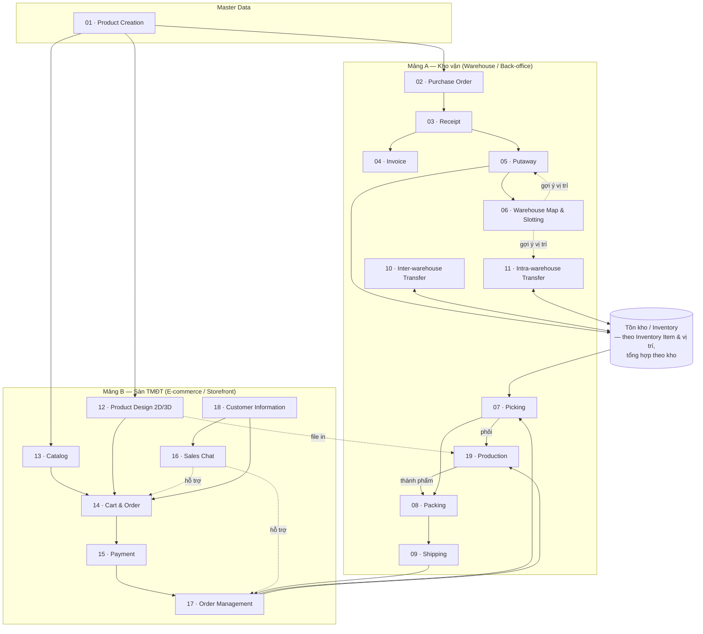
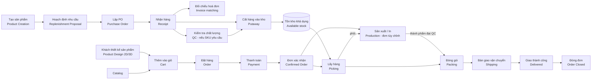

# 00 — Tổng quan hệ thống (System Overview)

## 1. Mục tiêu hệ thống (Goals)

StockFlowCommerce hướng đến việc **loại bỏ khoảng cách giữa vận hành kho và bán hàng online** cho doanh nghiệp kinh doanh sản phẩm tùy chỉnh / in ấn:

| # | Mục tiêu | Diễn giải |
|---|----------|-----------|
| G1 | **Một nguồn dữ liệu sản phẩm duy nhất (single source of truth)** | Sản phẩm khai báo một lần ở back-office, dùng chung cho cả kho vận và catalog TMĐT. |
| G2 | **Tồn kho thời gian thực (real-time inventory)** | Mọi nghiệp vụ nhập – xuất – chuyển kho cập nhật tồn kho ngay, tránh bán quá số lượng (oversell). |
| G3 | **Truy vết đầu-cuối (end-to-end traceability)** | Từ PO của nhà cung cấp → lô hàng nhận → vị trí lưu kho → đơn hàng khách → kiện hàng giao đi, tất cả liên kết bằng chứng từ. |
| G4 | **Tối ưu thao tác kho** | Kho Map 2D/3D + gợi ý vị trí (slotting) + lộ trình picking giúp giảm quãng đường di chuyển và sai sót. |
| G5 | **Trải nghiệm đặt hàng sản phẩm in ấn** | Khách tự thiết kế 2D, xem trước 3D trực tiếp, chốt thiết kế trước khi thanh toán; file thiết kế đi kèm đơn để sản xuất. |
| G6 | **Kết nối Sale – Khách hàng** | Kênh chat trực tiếp để tư vấn, chốt thiết kế, xử lý phát sinh trong đơn. |

---

## 2. Vai trò & đối tượng người dùng (Role Registry)

Đây là **sổ đăng ký vai trò chuẩn** — nguồn tham chiếu duy nhất về tên vai trò trong toàn bộ tài liệu. Mọi module chỉ dùng tên trong danh sách này.

### 2.1. Vai trò nội bộ (role đăng nhập)

#### Nhóm kho vận (back-office)

| Role | Trách nhiệm chính | Quyền hạn tiêu biểu |
|------|-------------------|---------------------|
| **Quản trị hệ thống (System Admin)** | Cấu hình toàn hệ thống, khai báo kho & khu vực, phân quyền, quản lý dữ liệu gốc sản phẩm | Toàn quyền; cấu hình quy tắc slotting, quy tắc gợi ý |
| **Nhân viên mua hàng (Procurement Staff)** | Tạo & theo dõi PO, làm việc với NCC, đối chiếu hoá đơn (invoice matching) | Tạo/sửa PO ở trạng thái Draft; chốt PO; tạo Invoice |
| **Nhân viên kho (Warehouse Staff)** | Nhận hàng, kiểm đếm, cất hàng (putaway), lấy hàng (picking), đóng gói (packing), bàn giao vận chuyển (shipping), chuyển kho | Thao tác trên phiếu được phân công; ghi nhận số lượng thực tế |
| **Quản lý kho (Warehouse Manager)** | Giám sát KPI vận hành, duyệt điều chỉnh tồn (inventory adjustment), duyệt phiếu chuyển kho, xử lý ngoại lệ; **điều phối xưởng in**: khai báo trạm in, gán lệnh sản xuất cho trạm, đổi ưu tiên, xử lý lệnh tạm dừng | Duyệt/từ chối; ghi đè gợi ý slotting; đóng phiếu; gán/gán lại lệnh sản xuất |
| **Nhân viên sản xuất (Production Staff)** | Vận hành trạm in tại xưởng nội bộ: nhận lệnh sản xuất, in theo file đã duyệt, báo số lượng đạt / hỏng, bàn giao thành phẩm cho QC | Thao tác trên lệnh sản xuất được gán cho trạm của mình ([19](../warehouse/19-production/README.md)) |
| **Nhân viên kế hoạch tồn kho (Inventory Planner)** | Theo dõi mức tồn giữa các kho, đề xuất & tạo lệnh chuyển kho (TO) để cân bằng tồn; đánh giá Bảng Đề xuất Nhập hàng (Replenishment Proposal) do hệ thống sinh, phân tích sức mua / sức chứa kho, chuyển thành Draft PO | Tạo/sửa TO ở trạng thái Draft; huỷ TO chưa xuất kho nguồn; đánh giá & convert Replenishment Proposal thành Draft PO |
| **Nhân viên QC (QC Staff)** | Kiểm tra chất lượng **hàng nhập** tại khu kiểm tra chất lượng (accept / reject / quarantine) và **thành phẩm in** tại xưởng trước khi chuyển sang đóng gói ([19](../warehouse/19-production/README.md)) | Ghi kết quả QC cho từng phần hàng của phiếu nhận; quyết định hàng đi Putaway hay vào khu cách ly; kết luận đạt / không đạt cho lệnh sản xuất |
| **Kế toán (Accountant)** | Đối chiếu ba chiều PO–Receipt–Invoice, công nợ NCC, đối soát thanh toán / COD / hoàn tiền | Tạo & xử lý Invoice; duyệt chi trong hạn mức; chạy đối soát |

#### Nhóm sàn TMĐT (storefront)

| Role | Trách nhiệm chính | Quyền hạn tiêu biểu |
|------|-------------------|---------------------|
| **Quản trị sàn (E-commerce Admin)** | Quản lý catalog hiển thị, giá, khuyến mãi, nội dung, chính sách; cấu hình template thiết kế & kiểm tra file in (prepress) | Xuất bản/ẩn sản phẩm; cấu hình phương thức thanh toán & vận chuyển |
| **Nhân viên Sale (Sales Staff)** | Tư vấn & chăm sóc khách hàng (CSKH) qua chat, hỗ trợ tạo/sửa đơn hộ khách, chốt thiết kế, xử lý yêu cầu thay đổi/huỷ/khiếu nại | Xem & thao tác đơn của khách được phân công; tạo đơn hộ; áp khuyến mãi trong hạn mức |
| **Điều phối đơn hàng (Order Coordinator)** | Duyệt & release đơn cho kho, xử lý đơn treo, phân bổ kho xuất, gộp/tách đơn | Thao tác trên mọi đơn; ghi đè kho xuất |

### 2.2. Vai thao tác (operational hat — không phải role riêng)

Warehouse Staff được gọi theo công đoạn được phân công. Đây chỉ là **cách gọi theo ngữ cảnh**, không phải role đăng nhập riêng:

| Vai thao tác | Công đoạn | Module |
|--------------|-----------|--------|
| Receiver | Nhận hàng, kiểm đếm | [03](../warehouse/03-receipt/README.md) |
| Putaway Operator | Cất hàng vào vị trí | [05](../warehouse/05-putaway/README.md) |
| Picker | Lấy hàng theo pick list | [07](../warehouse/07-picking/README.md) |
| Packer | Đóng gói, dán nhãn | [08](../warehouse/08-packing/README.md) |
| Dispatch Staff | Gom chuyến, bàn giao vận chuyển | [09](../warehouse/09-shipping/README.md) |
| NV kho nguồn / kho đích | Xuất & nhận hàng chuyển kho | [10](../warehouse/10-inter-warehouse-transfer/README.md) |

### 2.3. Quyền theo ngữ cảnh (permission — không phải role)

Một số chức năng là **quyền** gán cho role qua cấu hình RBAC, không phải chức danh riêng. Trong tài liệu, "Người duyệt (Approver)" là cách gọi tắt của *người giữ quyền phê duyệt tương ứng*.

| Quyền | Nội dung | Gán mặc định cho |
|-------|----------|------------------|
| Duyệt PO vượt hạn mức | Phê duyệt / từ chối PO | Quản lý kho hoặc System Admin |
| Duyệt TO vượt ngưỡng | Phê duyệt / từ chối lệnh chuyển kho | Quản lý kho |
| Duyệt chi / hoàn tiền vượt hạn mức | Phê duyệt thanh toán, refund | Kế toán (mức cao hơn: System Admin) |
| Giám sát chat (Chat Supervision) | Phân công hội thoại, giám sát SLA, nhận escalate | Quản trị sàn hoặc Sales Staff được chỉ định |

> ⚠️ Giả định: phân bổ quyền mặc định ở trên do tài liệu đề xuất, chưa được đề bài xác nhận — thuộc câu hỏi A2 (RBAC). Xem [open-questions](../open-questions/README.md).

### 2.4. Đối tác ngoài & actor hệ thống

| Actor | Vai trò |
|-------|---------|
| **Khách hàng (Customer / Guest)** | Duyệt catalog, thiết kế sản phẩm, đặt hàng, thanh toán, theo dõi đơn, chat với Sale; quản lý giỏ hàng, đơn hàng và hồ sơ của chính mình |
| **Nhà cung cấp (Supplier / NCC)** | Giao hàng, phát hành hoá đơn (thường tương tác ngoài hệ thống: email/portal) |
| **Đơn vị vận chuyển (Carrier / 3PL)** | Nhận kiện, vận chuyển, cập nhật tracking, thu hộ COD, xử lý hoàn (RTO) — tích hợp qua API |

Ngoài ra, nhiều module liệt kê **actor hệ thống** — các engine tự động (Slotting Engine, Wave/Route Planner, Cartonization, Carrier Integration, Design Engine + 3D Renderer, Production Scheduler, Payment Service, Routing + Notification…). Đây không phải người dùng; chúng thực thi quy tắc do các role trên cấu hình.

> ⚠️ Giả định: Một tài khoản nhân sự có thể mang nhiều vai trò (ví dụ Warehouse Staff kiêm Warehouse Manager ở kho nhỏ). Mô hình phân quyền chi tiết (RBAC) — phạm vi dữ liệu theo kho/nhóm khách, hạn mức cụ thể — chưa được đề bài xác định, xem [open-questions](../open-questions/README.md).

---

## 3. Bản đồ module & mối liên kết (Module Map)

---

## 4. Sơ đồ luồng tổng thể end-to-end (Product → Delivery)

Luồng "hạnh phúc" (happy path) từ lúc tạo sản phẩm đến lúc giao hàng thành công:

**Diễn giải theo từng chặng:**

| Chặng | Bắt đầu bằng | Kết thúc bằng | Module chịu trách nhiệm |
|-------|--------------|---------------|-------------------------|
| **1. Chuẩn bị hàng hoá (Procurement)** | Nhu cầu bổ sung tồn | Hàng nằm ở vị trí kho, sẵn bán | 01 → 02 → 03 → 04 → 05 → 06 |
| **2. Bán hàng (Storefront)** | Khách vào sàn | Đơn hàng đã thanh toán, chờ xử lý | 13 / 12 → 14 → 15 (hỗ trợ: 16, 18) |
| **3. Hoàn tất đơn (Fulfillment)** | Đơn confirmed | Kiện hàng đã giao cho khách | 17 → (19, với dòng tùy chỉnh) → 07 → 08 → 09 |
| **4. Điều phối tồn kho (Inventory ops)** | Chênh lệch/tối ưu vị trí | Tồn kho cân đối giữa & trong kho | 10, 11, 06 |

---

## 5. Các luồng nghiệp vụ chính (Core Business Flows)

| Luồng | Chuỗi module | Chứng từ xuyên suốt | Sơ đồ chi tiết |
|-------|--------------|---------------------|----------------|
| **Procurement** | Hoạch định nhu cầu → PO → Receipt (WH/Input) → QC (WH/Quality Control, nếu SKU yêu cầu) → Putaway (WH/Stock); Invoice song song | PO number liên kết Receipt & Invoice; Receipt liên kết nhiệm vụ chuyển QC, kết quả QC & Putaway | [diagrams §1](../diagrams/README.md#1-luồng-procurement) |
| **Fulfillment** | Order → (Production: lấy phôi → in → QC, với dòng tùy chỉnh) → Picking → Packing → Shipping | Order number liên kết Production Order, Pick List, Package, Shipment | [diagrams §2](../diagrams/README.md#2-luồng-fulfillment) |
| **Transfer** | Transfer Order → (xuất kho nguồn) → (vận chuyển) → (nhận kho đích) → Putaway | Transfer Order number | [diagrams §3](../diagrams/README.md#3-luồng-transfer-giữa-các-kho) |
| **Storefront checkout** | Design/Catalog → Cart → Order → Payment | Cart ID → Order number → Payment transaction | — |

---

## 6. Nguyên tắc dữ liệu xuyên suốt (Cross-cutting Data Principles)

1. **SKU là đơn vị định danh hàng hoá nhỏ nhất** để quản lý tồn (mỗi biến thể sản phẩm = 1 SKU). Mỗi SKU có **đúng một Inventory Item** (hồ sơ hàng vật lý, quan hệ 1:1) — đối tượng được theo dõi tồn; nội dung bán hàng thuộc Product/Variant, không thuộc Inventory Item. Xem [01 · Product Creation](../warehouse/01-product-creation/README.md) và [Glossary](../glossary/README.md).
2. **Tồn kho luôn gắn với vị trí (location-based inventory)**: một số lượng SKU luôn thuộc về một vị trí cụ thể — **bin** trên tầng kệ, hoặc **khu vực chứa hàng (Area)** như khu nhận, cách ly, đóng gói, chờ giao (xem [06](../warehouse/06-warehouse-map-slotting/README.md)) — hoặc một trạng thái quá cảnh (in-transit). Tồn **theo kho** (Inventory Level) và tồn toàn hệ thống là số **tổng hợp** từ tồn theo vị trí, không phải nguồn dữ liệu riêng.
3. **Mọi thay đổi tồn kho phải có chứng từ nguồn (source document)**: Receipt, Pick, Adjustment, Transfer… Không có nghiệp vụ nào sửa tồn "trần" mà không để lại vết.
4. **Trạng thái chứng từ chỉ tiến, không lùi tự do**: chuyển trạng thái theo sơ đồ vòng đời của từng module; huỷ/hoàn phải là hành động có kiểm soát và ghi log.
5. **Sản phẩm tùy chỉnh mang theo "artifact thiết kế"**: đơn hàng chứa sản phẩm in ấn luôn đính kèm file/định nghĩa thiết kế đã chốt (design snapshot), bất biến sau khi đơn confirmed.
6. **Phạm vi tổ chức**: hệ thống phục vụ **một pháp nhân duy nhất** (một công ty, một mã số thuế, một sổ cái) sở hữu **nhiều kho vật lý (multi-warehouse)**. Chuyển hàng giữa các kho là **luân chuyển tồn nội bộ** (xem [10 · Inter-warehouse Transfer](../warehouse/10-inter-warehouse-transfer/README.md)), **không** phát sinh hoá đơn/công nợ nội bộ. Hệ thống **không** hỗ trợ đa công ty / đa pháp nhân (multi-entity).
7. **Công thức số lượng tồn thống nhất**: **ATP = Tồn khả dụng (`Available`) − Phần đang giữ hàng (reservation)**. Hàng `Inbound`, `Allocated`, `Blocked`, `Quarantine`, `In-Transit` không thuộc tồn khả dụng. Định nghĩa On-hand, Inventory Level, Available, ATP xem [Glossary](../glossary/README.md).
8. **Tiền tố kho (warehouse prefix)**: mỗi kho có một prefix duy nhất, không sửa được sau khi tạo, dùng cho **mã vị trí** (bin: prefix + mã kệ + tầng + mã bin, ví dụ `HN-A01-2-03`; khu vực: prefix + mã khu vực, ví dụ `HN-RCV01`) và **mã chứng từ phát sinh tại kho** (ví dụ `HN-RC-000123`). Xem [06](../warehouse/06-warehouse-map-slotting/README.md).

> ⚠️ Giả định: chứng từ liên quan hai kho (Transfer Order) dùng prefix của **kho nguồn**. Xem [open-questions](../open-questions/README.md).

---

## 7. Liên kết

- Chi tiết từng module: xem thư mục [warehouse/](../warehouse/) và [ecommerce/](../ecommerce/)
- Sơ đồ Mermaid đầy đủ: [diagrams/](../diagrams/README.md)
- Thuật ngữ: [glossary/](../glossary/README.md)
