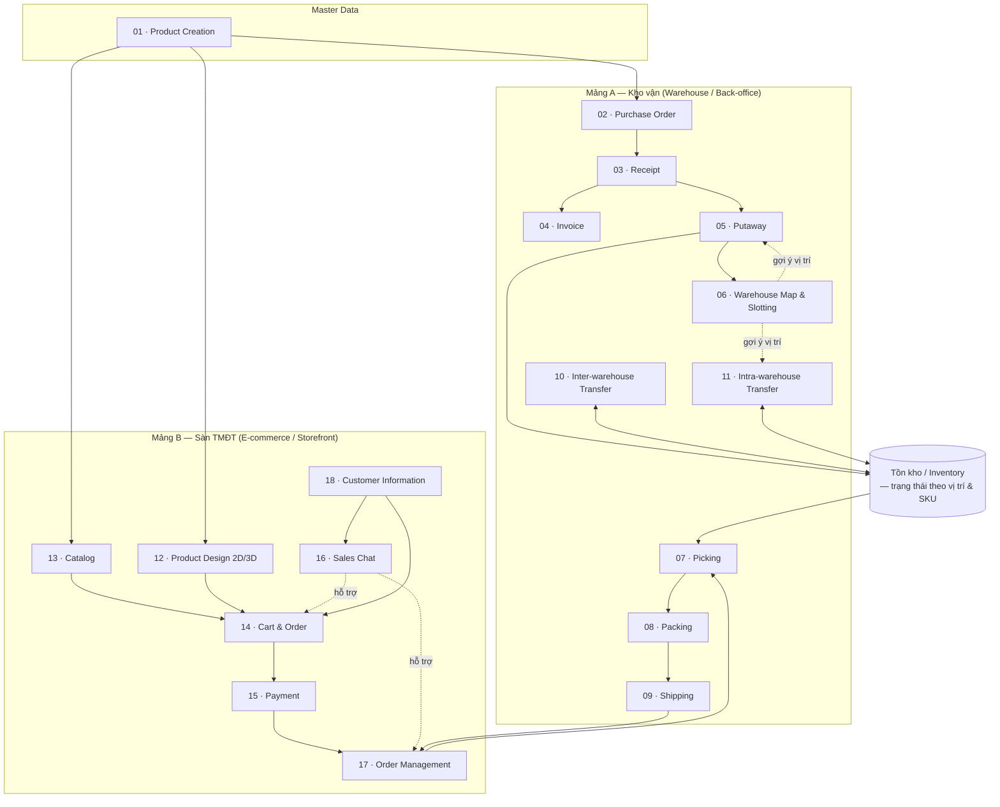
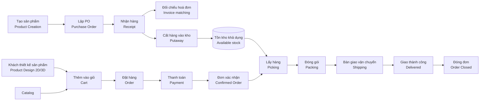

# 00 — Tổng quan hệ thống (System Overview)

## 1. Mục tiêu hệ thống (Goals)

StockFlowCommerce hướng đến việc **loại bỏ khoảng cách giữa vận hành kho và bán hàng online** cho doanh nghiệp kinh doanh sản phẩm tùy chỉnh / in ấn:

| # | Mục tiêu | Diễn giải |
|---|----------|-----------|
| G1 | **Một nguồn dữ liệu sản phẩm duy nhất (single source of truth)** | Sản phẩm khai báo một lần ở back-office, dùng chung cho cả kho vận và catalog TMĐT. |
| G2 | **Tồn kho thời gian thực (real-time inventory)** | Mọi nghiệp vụ nhập – xuất – chuyển kho cập nhật tồn kho ngay, tránh bán quá số lượng (oversell). |
| G3 | **Truy vết đầu-cuối (end-to-end traceability)** | Từ PO của nhà cung cấp → lô hàng nhận → vị trí lưu kho → đơn hàng khách → kiện hàng giao đi, tất cả liên kết bằng chứng từ. |
| G4 | **Tối ưu thao tác kho** | Kho Map 2D/3D + gợi ý vị trí (slotting) + lộ trình picking giúp giảm quãng đường di chuyển và sai sót. |
| G5 | **Trải nghiệm đặt hàng sản phẩm in ấn** | Khách tự thiết kế 2D, xem trước 3D trực tiếp, chốt thiết kế trước khi thanh toán; file thiết kế đi kèm đơn để sản xuất. |
| G6 | **Kết nối Sale – Khách hàng** | Kênh chat trực tiếp để tư vấn, chốt thiết kế, xử lý phát sinh trong đơn. |

---

## 2. Đối tượng người dùng (Actors)

### 2.1. Nhóm back-office (kho vận)

| Actor | Trách nhiệm chính | Quyền hạn tiêu biểu |
|-------|-------------------|---------------------|
| **Admin** | Cấu hình hệ thống, khai báo kho & khu vực, phân quyền, quản lý danh mục sản phẩm | Toàn quyền; cấu hình quy tắc slotting, quy tắc gợi ý |
| **Nhân viên mua hàng (Procurement Staff)** | Tạo & theo dõi PO, làm việc với NCC, đối chiếu hoá đơn (invoice matching) | Tạo/sửa PO ở trạng thái Draft; xác nhận PO; tạo Invoice |
| **Nhân viên kho (Warehouse Staff)** | Nhận hàng, kiểm đếm, cất hàng (putaway), lấy hàng (picking), đóng gói (packing), bàn giao vận chuyển (shipping), chuyển kho | Thao tác trên phiếu được phân công; ghi nhận số lượng thực tế |
| **Quản lý kho (Warehouse Manager)** | Giám sát KPI vận hành, duyệt điều chỉnh tồn (inventory adjustment), duyệt phiếu chuyển kho, xử lý ngoại lệ | Duyệt/từ chối; ghi đè gợi ý slotting; đóng phiếu |

### 2.2. Nhóm storefront (sàn TMĐT)

| Actor | Trách nhiệm chính | Quyền hạn tiêu biểu |
|-------|-------------------|---------------------|
| **Khách hàng (Customer)** | Duyệt catalog, thiết kế sản phẩm, đặt hàng, thanh toán, theo dõi đơn, chat với Sale | Quản lý giỏ hàng, đơn hàng và hồ sơ của chính mình |
| **Nhân viên Sale (Sales Staff)** | Tư vấn qua chat, hỗ trợ tạo/sửa đơn hộ khách, chốt thiết kế, xử lý yêu cầu thay đổi/huỷ | Xem & thao tác đơn của khách được phân công; tạo đơn hộ; áp khuyến mãi trong hạn mức |
| **Admin (TMĐT)** | Quản lý catalog hiển thị, giá, khuyến mãi, nội dung, chính sách | Xuất bản/ẩn sản phẩm; cấu hình phương thức thanh toán & vận chuyển |

> ⚠️ Giả định: Một tài khoản nhân sự có thể mang nhiều vai trò (ví dụ Warehouse Staff kiêm Manager ở kho nhỏ). Mô hình phân quyền chi tiết (RBAC) chưa được đề bài xác định — xem [open-questions](../open-questions/README.md).

---

## 3. Bản đồ module & mối liên kết (Module Map)

---

## 4. Sơ đồ luồng tổng thể end-to-end (Product → Delivery)

Luồng "hạnh phúc" (happy path) từ lúc tạo sản phẩm đến lúc giao hàng thành công:

**Diễn giải theo từng chặng:**

| Chặng | Bắt đầu bằng | Kết thúc bằng | Module chịu trách nhiệm |
|-------|--------------|---------------|-------------------------|
| **1. Chuẩn bị hàng hoá (Procurement)** | Nhu cầu bổ sung tồn | Hàng nằm ở vị trí kho, sẵn bán | 01 → 02 → 03 → 04 → 05 → 06 |
| **2. Bán hàng (Storefront)** | Khách vào sàn | Đơn hàng đã thanh toán, chờ xử lý | 13 / 12 → 14 → 15 (hỗ trợ: 16, 18) |
| **3. Hoàn tất đơn (Fulfillment)** | Đơn confirmed | Kiện hàng đã giao cho khách | 17 → 07 → 08 → 09 |
| **4. Điều phối tồn kho (Inventory ops)** | Chênh lệch/tối ưu vị trí | Tồn kho cân đối giữa & trong kho | 10, 11, 06 |

---

## 5. Các luồng nghiệp vụ chính (Core Business Flows)

| Luồng | Chuỗi module | Chứng từ xuyên suốt | Sơ đồ chi tiết |
|-------|--------------|---------------------|----------------|
| **Procurement** | PO → Receipt → Invoice → Putaway | PO number liên kết Receipt & Invoice; Receipt liên kết Putaway | [diagrams §1](../diagrams/README.md#1-luồng-procurement) |
| **Fulfillment** | Order → Picking → Packing → Shipping | Order number liên kết Pick List, Package, Shipment | [diagrams §2](../diagrams/README.md#2-luồng-fulfillment) |
| **Transfer** | Transfer Order → (xuất kho nguồn) → (vận chuyển) → (nhận kho đích) → Putaway | Transfer Order number | [diagrams §3](../diagrams/README.md#3-luồng-transfer-giữa-các-kho) |
| **Storefront checkout** | Design/Catalog → Cart → Order → Payment | Cart ID → Order number → Payment transaction | — |

---

## 6. Nguyên tắc dữ liệu xuyên suốt (Cross-cutting Data Principles)

1. **SKU là đơn vị định danh hàng hoá nhỏ nhất** để quản lý tồn (mỗi biến thể sản phẩm = 1 SKU). Xem [Glossary](../glossary/README.md).
2. **Tồn kho luôn gắn với vị trí (location-based inventory)**: một số lượng SKU luôn thuộc về một vị trí cụ thể (bin/slot) hoặc một trạng thái quá cảnh (in-transit).
3. **Mọi thay đổi tồn kho phải có chứng từ nguồn (source document)**: Receipt, Pick, Adjustment, Transfer… Không có nghiệp vụ nào sửa tồn "trần" mà không để lại vết.
4. **Trạng thái chứng từ chỉ tiến, không lùi tự do**: chuyển trạng thái theo sơ đồ vòng đời của từng module; huỷ/hoàn phải là hành động có kiểm soát và ghi log.
5. **Sản phẩm tùy chỉnh mang theo "artifact thiết kế"**: đơn hàng chứa sản phẩm in ấn luôn đính kèm file/định nghĩa thiết kế đã chốt (design snapshot), bất biến sau khi đơn confirmed.

> ⚠️ Giả định: Hệ thống hỗ trợ **nhiều kho (multi-warehouse)**. Mức độ hỗ trợ đa công ty / đa chi nhánh pháp lý (multi-entity) chưa rõ — xem [open-questions](../open-questions/README.md).

---

## 7. Liên kết

- Chi tiết từng module: xem thư mục [warehouse/](../warehouse/) và [ecommerce/](../ecommerce/)
- Sơ đồ Mermaid đầy đủ: [diagrams/](../diagrams/README.md)
- Thuật ngữ: [glossary/](../glossary/README.md)
