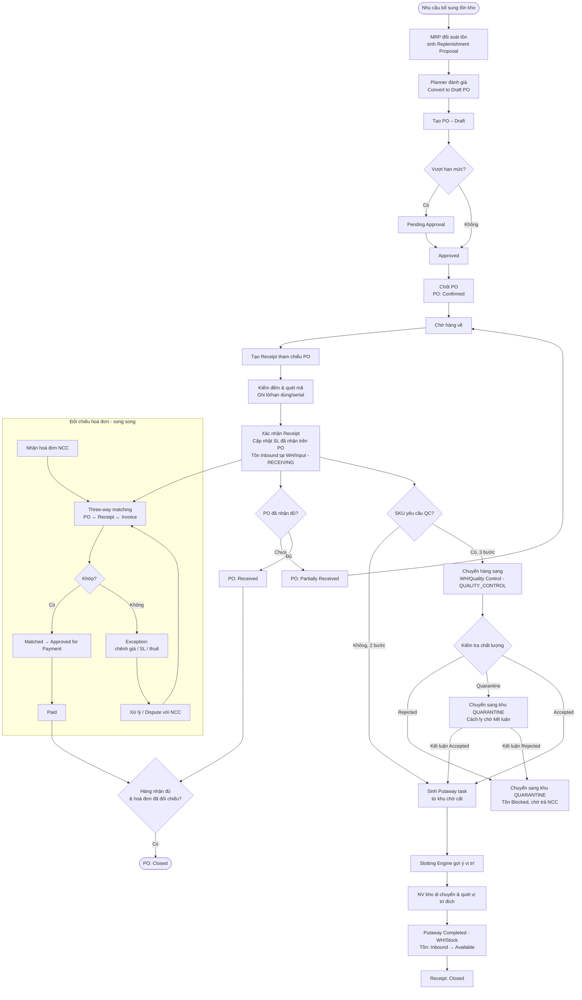
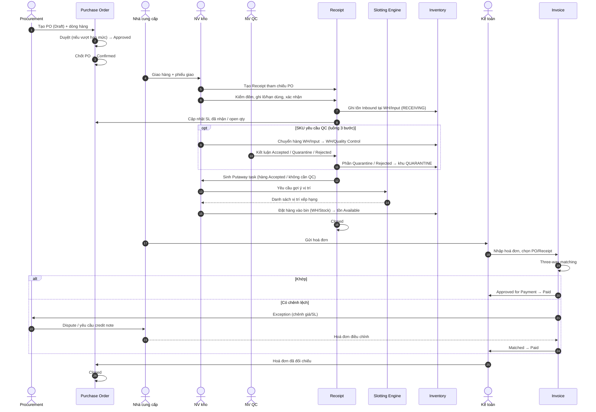
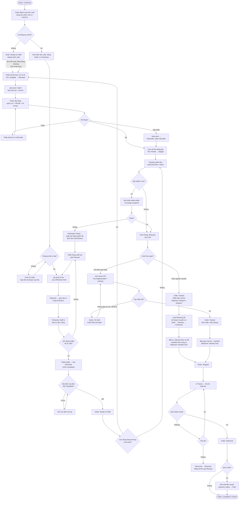
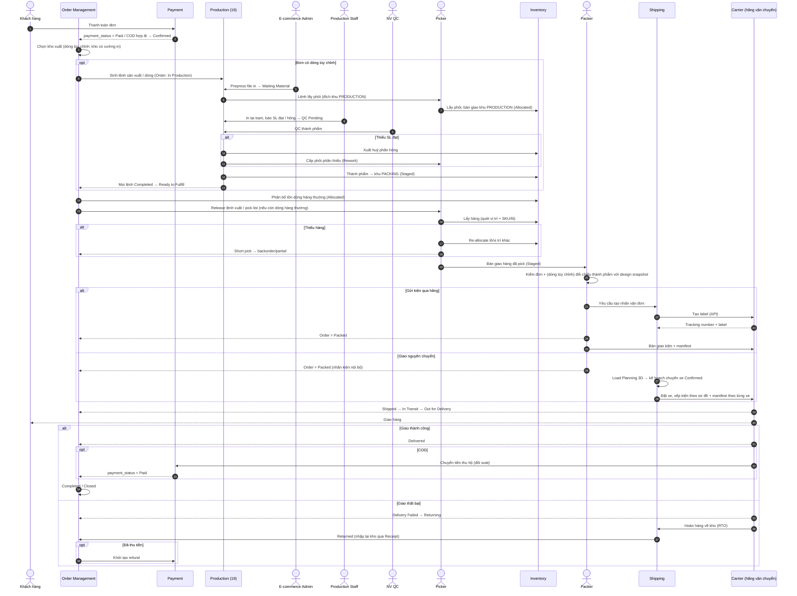
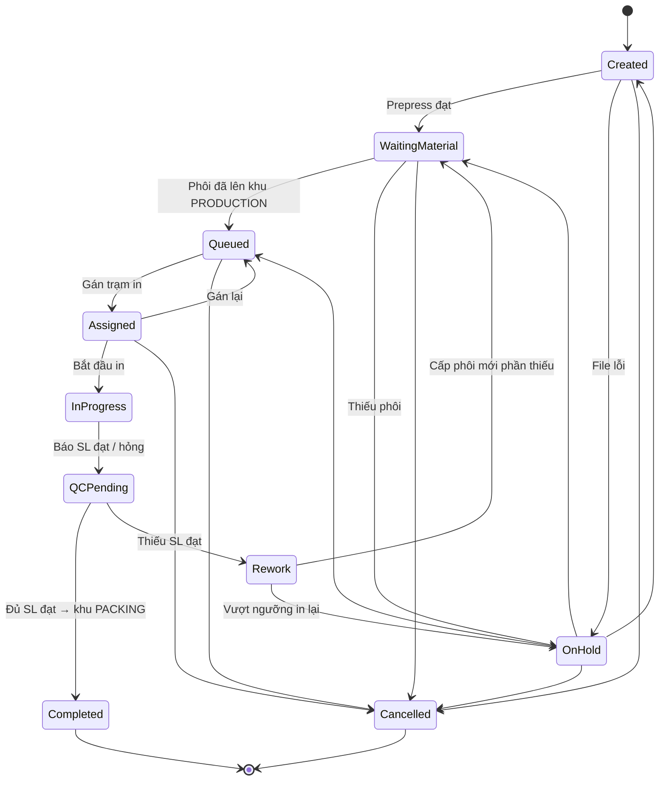
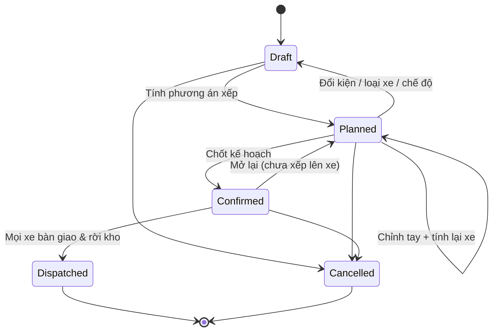
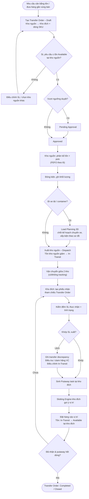
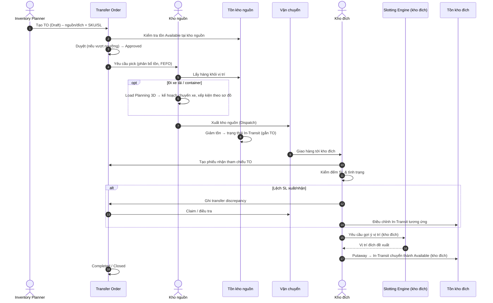
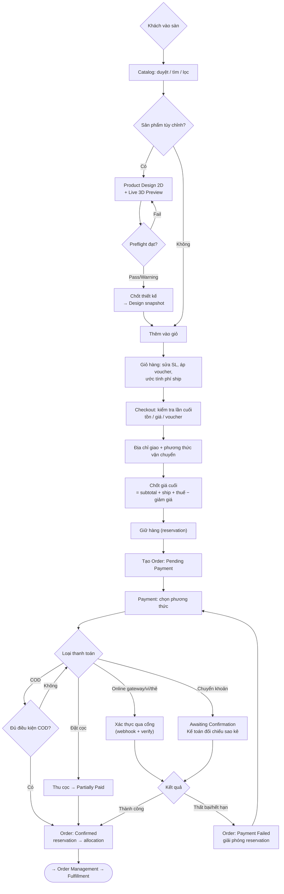
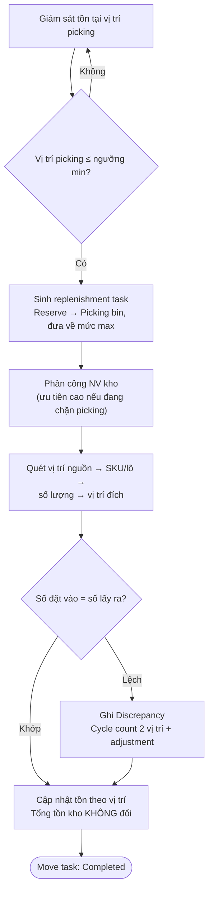

# Sơ đồ luồng dữ liệu & trạng thái (Flow & State Diagrams)

Tất cả sơ đồ vẽ bằng **Mermaid**. Trên GitHub/GitLab và hầu hết trình xem Markdown, các khối ```mermaid``` được render tự động. Nếu trình xem không hỗ trợ, dán nội dung vào <https://mermaid.live>.

Mục lục:

1. [Luồng Procurement: PO → Receipt → Invoice → Putaway](#1-luồng-procurement)
2. [Luồng Fulfillment: Order → (Production) → Picking → Packing → Shipping](#2-luồng-fulfillment) — kèm vòng đời lệnh sản xuất (§2.3) và kế hoạch chuyến xe (§2.4)
3. [Luồng Transfer giữa các kho](#3-luồng-transfer-giữa-các-kho)
4. [Phụ lục: Luồng Storefront checkout & luồng Transfer nội bộ kho](#4-phụ-lục)

---

## 1. Luồng Procurement

### 1.1. Flowchart tổng thể



### 1.2. Sequence diagram (trình tự tác nhân)



---

## 2. Luồng Fulfillment

### 2.1. Flowchart tổng thể



### 2.2. Sequence diagram (trình tự tác nhân)



### 2.3. Vòng đời lệnh sản xuất (Production Order)

Chi tiết trạng thái & điều kiện chuyển xem [19 · Production §5](../warehouse/19-production/README.md).



### 2.4. Vòng đời kế hoạch chuyến xe (Load Plan — giao nguyên chuyến)

Chi tiết: [09 · Shipping §4.2](../warehouse/09-shipping/README.md#42-giao-nguyên-chuyến--lập-kế-hoạch-xếp-hàng-3d-load-planning). Dùng cho đơn khách giao nguyên chuyến và lệnh chuyển kho đi xe tải / container.



---

## 3. Luồng Transfer giữa các kho

### 3.1. Flowchart tổng thể



### 3.2. Sequence diagram (trình tự tác nhân)



---

## 4. Phụ lục

### 4.1. Luồng Storefront checkout (Design/Catalog → Cart → Order → Payment)



### 4.2. Luồng Transfer nội bộ một kho (Intra-warehouse — Replenishment)



---

## 5. Ghi chú về sơ đồ

- Các trạng thái viết hoa kiểu `Confirmed`, `In Transit`… là trạng thái chứng từ/nhiệm vụ, khớp với bảng vòng đời trong từng module.
- Sơ đồ mô tả **happy path + các nhánh ngoại lệ chính**; edge case chi tiết xem phần "Ràng buộc nghiệp vụ & Edge case" của module tương ứng.
- Các bước "Sản xuất/In" trong luồng Fulfillment mô tả xưởng in nội bộ của [19 · Production](../warehouse/19-production/README.md) cho dòng đơn tùy chỉnh.
