# Sơ đồ luồng dữ liệu & trạng thái (Flow & State Diagrams)

Tất cả sơ đồ vẽ bằng **Mermaid**. Trên GitHub/GitLab và hầu hết trình xem Markdown, các khối ```mermaid``` được render tự động. Nếu trình xem không hỗ trợ, dán nội dung vào <https://mermaid.live>.

> **Đã chốt 2026-11-04:** kho chỉ là **kho thành phẩm**; **sản xuất nằm ngoài hệ thống** — hệ thống chỉ gửi **Đơn sản xuất (Production Order)** ([17](../ecommerce/17-order-management/README.md)) và **nhập kho thành phẩm** ([03](../warehouse/03-receipt/README.md)); kho không kiểm tra chất lượng khi nhập, chỉ đếm đủ / thiếu / thừa. Mỗi đơn có một **hợp đồng mua bán**, khách thanh toán theo **các đợt của hợp đồng** ([14](../ecommerce/14-cart-and-order/README.md), [15](../ecommerce/15-payment/README.md)).
>
> **Đã chốt 2026-11-04 (bổ sung):** **không còn hàng trơn** — mọi dòng đơn là **SKU thành phẩm riêng của khách**; **Đơn sản xuất chỉ phát sinh từ đơn bán** (Sale lập cho phần thiếu). Thành phẩm về kho đã được **đơn vị sản xuất** **đóng thùng sẵn (LPN)**: kho nhập, cất, di chuyển, lấy và xuất **nguyên thùng**, không mở thùng, không lấy lẻ. **Thùng LPN chính là kiện giao**: khâu đóng gói thay bằng **Kiểm thùng & Dán nhãn giao hàng** ([08](../warehouse/08-packing/README.md)) — không chọn loại kiện, không cân đo, không niêm phong.
>
> **Đã chốt 2026-11-05:** khách sỉ **đặt theo số thùng** (báo giá, đơn, hợp đồng, Đơn sản xuất ghi **số thùng**, kèm số cái); **giá vẫn theo cái**, MOQ và bậc giá theo số thùng ([01](../warehouse/01-product-creation/README.md) BR-11, [14](../ecommerce/14-cart-and-order/README.md) BR-08). **Mọi thùng đúng số cái chuẩn** của SKU: kho đếm số thùng, **thùng lệch số chuẩn không nhận** ([03](../warehouse/03-receipt/README.md) BR-13); không còn thùng lẻ. Giữ hàng / phân bổ một dòng = **chọn đủ N thùng** theo **FIFO** (ngày nhập); thiếu thùng thì phần thiếu (tính theo thùng) đi Đơn sản xuất ([07](../warehouse/07-picking/README.md) BR-03).
>
> **Đã chốt 2026-11-05 (bổ sung):**
> - **Vai trò:** **Nhân viên Sale** chọn kho xuất, chọn cách giao, lập và theo dõi Đơn sản xuất (ghi nhận `Accepted`, tiến độ, mẫu in), treo / gỡ treo đơn, cho phép giao một phần. **Quản lý kinh doanh (Sales Manager)** duyệt và gửi Đơn sản xuất. **Quản lý kho** của kho xuất release đơn, tạo task và giao người, quyết định khu chờ xuất, chuyển task sang khu xuất hàng (`DISPATCH`), ghi nhận kết quả giao. Không còn role Điều phối đơn hàng hay Inventory Planner.
> - **Đơn sản xuất** (tên cũ "Yêu cầu sản xuất") là **một chứng từ chung** cho xưởng của công ty và đối tác ngoài, gửi qua **kênh kết nối** của đơn vị sản xuất; Đơn sản xuất bật cờ **cần duyệt mẫu in** phải được khách duyệt mẫu trước khi in hàng loạt ([17](../ecommerce/17-order-management/README.md) §4.3).
> - **Mỗi đơn bán có đúng một kho xuất**; mọi Đơn sản xuất của đơn có kho nhận = kho xuất; không tách giao từ hai kho, **không có chuyển kho** (module chuyển kho giữa các kho đã bỏ) ([17](../ecommerce/17-order-management/README.md) BR-22, [20](../warehouse/20-inventory-control/README.md) BR-17).
> - Ly / bao bì **không có hạn dùng**: không FEFO, không cảnh báo cận hạn; **lô bắt buộc** — hệ thống tự gán lô = mã Đơn sản xuất khi nhập kho, hàng hoàn giữ lô gốc.
> - **Sức chứa kho** đo bằng thể tích (m³) kèm tải trọng — thể tích vị trí **hệ thống tự tính** (bin: kích thước × chiều cao lọt của tầng; khu chứa hàng: kích thước × chiều cao xếp tối đa); **Bảng sức chứa kho** (có %, xem theo zone / kệ / khu, nhân hệ số sử dụng của kho) cảnh báo (không chặn) khi lập Đơn sản xuất / chọn kho xuất; kho đầy thì hàng về được cất vào khu tạm `OVERFLOW` ([06](../warehouse/06-warehouse-map-slotting/README.md) §4.6).
> - **Sàn không hiển thị giá**; Sale lập báo giá theo **giá gợi ý** từ bảng giá riêng nội bộ; mẫu mới có **dòng phí khuôn / bản in**, hợp đồng ghi **số lần in mẫu miễn phí** ([13](../ecommerce/13-catalog/README.md), [14](../ecommerce/14-cart-and-order/README.md)).
> - **Hàng hoàn** (RTO, hàng khách trả) nhập lại qua **phiếu nhập loại Hàng hoàn** vào khu `QUARANTINE` ([03](../warehouse/03-receipt/README.md)).
> - **Không còn khu kiểm thùng riêng:** kiểm thùng & dán nhãn giao hàng làm tại **khu xuất hàng (`DISPATCH`)** — thùng lấy xong đưa thẳng về đây, kiểm, dán nhãn tại chỗ, gom shipment, chờ xe. Đích lấy hàng là `DISPATCH` (mặc định) hoặc `STAGING` ([06](../warehouse/06-warehouse-map-slotting/README.md) BR-22, [07](../warehouse/07-picking/README.md)).
>
> **Đã chốt 2026-11-05 (khách tự thiết kế):** **chỉ khách tự thiết kế** trên app — trên **khuôn 2D** của quy cách (cấu hình in do Quản lý kinh doanh khai báo — [01](../warehouse/01-product-creation/README.md) §4.10), có **xem trước 3D**; bỏ luồng khách đưa mẫu cho Sale, nhân viên thiết kế hộ. Gửi duyệt → hệ thống **preflight** → **Quản lý kinh doanh** duyệt kỹ thuật & kiểm duyệt nội dung → hệ thống **xuất file in PDF/X**, chốt snapshot, sinh SKU riêng. Vòng đời bản thiết kế `Draft` / `Pending Review` / `Approved` / `Archived`. Đặt hàng từ bản thiết kế = **yêu cầu báo giá** gửi Sale ([12](../ecommerce/12-product-design/README.md), §3.1).

Mục lục:

1. [Luồng nhập kho thành phẩm: Đơn sản xuất (duyệt & gửi, duyệt mẫu in) → Nhập kho theo thùng LPN → Putaway](#1-luồng-nhập-kho-thành-phẩm) — kèm nhập hàng hoàn vào khu `QUARANTINE` (§1.3)
2. [Luồng Fulfillment: Order → chọn kho xuất, kiểm tồn (Đơn sản xuất) → Picking nguyên thùng → (Khu chờ xuất) → Kiểm thùng & Dán nhãn giao hàng → Shipping](#2-luồng-fulfillment) — kèm vòng đời Đơn sản xuất (§2.3), phiên kiểm thùng & thùng giao (§2.4) và kế hoạch chuyến xe (§2.5)
3. [Phụ lục: Luồng bán sỉ theo hợp đồng, vòng đời đơn hàng, hợp đồng & đợt thanh toán, di chuyển nguyên thùng trong một kho](#3-phụ-lục)
4. [Ghi chú về sơ đồ](#4-ghi-chú-về-sơ-đồ)

---

## 1. Luồng nhập kho thành phẩm

Chi tiết: [17 · Order Management §4.3](../ecommerce/17-order-management/README.md) (Đơn sản xuất), [03 · Nhập kho thành phẩm](../warehouse/03-receipt/README.md), [05 · Putaway](../warehouse/05-putaway/README.md), [06 · Bảng sức chứa kho §4.6](../warehouse/06-warehouse-map-slotting/README.md). Nhập kho theo Đơn sản xuất đi **2 bước**: WH/Input (khu `RECEIVING`) → WH/Stock (bin). Đơn sản xuất **chỉ phát sinh từ đơn bán**: **Sale lập** cho phần thiếu sau khi đã kiểm tồn SKU riêng tại kho xuất, **Sales Manager duyệt và gửi** (người duyệt ≠ người lập — [17](../ecommerce/17-order-management/README.md) BR-23). **Kho nhận = kho xuất** của đơn bán; đơn vị sản xuất phải giao đúng kho nhận. Kho chỉ nhập **theo thùng LPN** do đơn vị sản xuất đóng sẵn ([03](../warehouse/03-receipt/README.md) BR-12), đếm **số thùng**; thùng có số cái khác **số cái chuẩn / thùng** không được nhận ([03](../warehouse/03-receipt/README.md) BR-13).

### 1.1. Flowchart tổng thể

```mermaid
flowchart TD
    START_ORDER(["Đơn Confirmed, Sale đã chọn kho xuất<br/>kiểm tồn SKU riêng tại kho xuất: còn thiếu thùng"]) --> PO_DRAFT["Sale lập Đơn sản xuất cho phần thiếu — Draft<br/>đơn vị sản xuất chọn từ danh mục, kho nhận = kho xuất của đơn<br/>dòng: SKU riêng, số thùng thiếu, số cái / thùng, bộ file thiết kế đã chốt<br/>cờ cần duyệt mẫu in: mặc định bật khi SKU sản xuất lần đầu"]
    PO_DRAFT --> CAP{"Thể tích Đơn sản xuất lớn hơn còn trống dự kiến<br/>hoặc còn trống nếu duyệt hết của kho nhận?"}
    CAP -->|"Có — cảnh báo Sale, không chặn"| PO_SUBMIT
    CAP -->|Không| PO_SUBMIT["Sale gửi duyệt<br/>Đơn sản xuất: Pending Approval"]
    PO_SUBMIT --> PO_APPROVE{"Sales Manager duyệt — người duyệt khác người lập<br/>bảng sức chứa tính lại lúc duyệt, vượt thì cảnh báo, không chặn"}
    PO_APPROVE -->|"Trả lại, có lý do"| PO_DRAFT
    PO_APPROVE -->|Duyệt| PO_SENT["Hệ thống xuất phiếu PDF kèm bộ file<br/>gửi qua kênh kết nối của đơn vị sản xuất<br/>Đơn sản xuất: Sent — đơn bán: Awaiting Stock"]
    PO_SENT --> EXT[["Đơn vị sản xuất — ngoài hệ thống<br/>xưởng của công ty hoặc đối tác ngoài"]]
    PO_SENT -.->|"thông báo INFO; WARN nếu còn trống dự kiến chuyển sang âm"| WHM_NOTE["Quản lý kho của kho nhận<br/>biết hàng sắp về, chuẩn bị chỗ"]
    EXT -.->|"xác nhận nhận đơn, ngày hoàn thành dự kiến"| PO_ACC["Sale ghi nhận tay<br/>Đơn sản xuất: Accepted"]
    PO_ACC --> FLAG{"Cờ cần duyệt mẫu in?"}
    FLAG -->|Có| SAMPLE["Đơn vị sản xuất in mẫu thử theo bộ file đã chốt<br/>Sale tải ảnh / video của vòng mẫu, ghi ngày gửi mẫu vật nếu có<br/>Đơn sản xuất: Sample Pending"]
    SAMPLE --> CUST_SAMPLE{"Khách xem mẫu in chờ duyệt<br/>trên sàn — mẫu thiết kế của tôi<br/>hoặc thẻ duyệt mẫu in trong chat"}
    CUST_SAMPLE -->|"Yêu cầu in lại, kèm ghi chú"| REPRINT["Sale ghi lý do in lại: PRINT_DEFECT / CUSTOMER_CHANGE<br/>mở vòng mẫu mới — vẫn Sample Pending<br/>vượt số lần in mẫu miễn phí của hợp đồng: cảnh báo, không chặn"]
    REPRINT --> SAMPLE
    CUST_SAMPLE -.->|"Cần sửa file thiết kế"| REDESIGN(["Khách tạo bản sửa ở 12, được duyệt thì sinh SKU mới<br/>Sale đổi SKU dòng đơn<br/>huỷ Đơn sản xuất này, lập Đơn sản xuất mới"])
    CUST_SAMPLE -->|"Duyệt mẫu"| PO_INPROD["Đơn sản xuất: In Production<br/>đơn vị sản xuất in hàng loạt, đóng thùng đúng số cái chuẩn"]
    FLAG -->|"Không — đơn vị sản xuất báo bắt đầu"| PO_INPROD
    PO_INPROD --> DELIVER["Giao các thùng thành phẩm về đúng kho nhận<br/>kèm phiếu giao ghi số Đơn sản xuất, số thùng"]

    DELIVER --> RC_GATE{"Đơn sản xuất<br/>nhận được hàng?"}
    RC_GATE -->|"Cờ bật, mẫu chưa duyệt: Sent / Accepted / Sample Pending"| RC_BLOCK(["Chặn tạo phiếu nhập<br/>không nhận hàng, báo Sale"])
    RC_GATE -->|"In Production / Partially Received, hoặc Sent / Accepted khi không bật cờ"| RC_CREATE["NV kho tạo phiếu nhập theo một Đơn sản xuất, tại kho nhận<br/>Phiếu nhập: Draft"]
    RC_CREATE --> RC_STD{"Từng thùng: số cái<br/>đúng số chuẩn / thùng của SKU?"}
    RC_STD -->|"Lệch số chuẩn"| RC_REJ["Không nhận thùng lệch<br/>trả lại đơn vị sản xuất<br/>phần đó vẫn mở trên Đơn sản xuất"]
    RC_REJ -.->|"tính là thiếu"| CMP
    RC_STD -->|"Đúng số chuẩn"| RC_COUNT["Đếm số thùng theo dòng Đơn sản xuất<br/>lô tự gán = mã Đơn sản xuất<br/>mỗi thùng mang số cái chuẩn<br/>cấp và dán nhãn LPN — thùng Receiving<br/>khu nhận hàng WH/Input — RECEIVING"]
    RC_COUNT --> CMP{"Số thùng nhận luỹ kế<br/>so với số thùng trên Đơn sản xuất?"}
    CMP -->|Thừa| OVER["Chặn: không nhận thùng làm vượt số thùng còn mở<br/>trả nguyên thùng lại đơn vị sản xuất"]
    OVER --> RC_COUNT
    CMP -->|"Đủ / Thiếu"| RC_CONFIRM["Xác nhận phiếu nhập<br/>tồn Inbound trong từng thùng tại khu RECEIVING, thùng In Stock<br/>Phiếu nhập: In Putaway"]

    RC_CONFIRM --> PO_CHECK{"Đơn sản xuất<br/>đã nhận đủ mọi dòng?"}
    PO_CHECK -->|Chưa| PO_PARTIAL["Đơn sản xuất: Partially Received<br/>phần thiếu vẫn mở"]
    PO_PARTIAL -->|"giao tiếp"| DELIVER
    PO_PARTIAL -.->|"không giao nốt"| PO_CLOSE(["Sale đóng thiếu<br/>Đơn sản xuất: Closed, có lý do"])
    PO_CHECK -->|Đủ| PO_RECEIVED["Đơn sản xuất: Received"]

    RC_CONFIRM --> PA_TASK["Mở nhiệm vụ cất<br/>mỗi thùng LPN một nhiệm vụ — Pending"]
    PA_TASK --> PA_SUGGEST{"Gợi ý tối đa 10 bin hợp lệ<br/>còn thể tích m³ và tải trọng<br/>cùng lô → cùng SKU → bin trống → bin còn chỗ"}
    PA_SUGGEST -->|"Có bin"| PA_MOVE["NV kho quét LPN + quét bin đích, cất cả thùng<br/>hệ thống kiểm lại ràng buộc cứng"]
    PA_SUGGEST -->|"Gợi ý rỗng — kho đầy"| PA_OVF["Quét vị trí khu tạm OVERFLOW để hoàn tất nhiệm vụ<br/>Quản lý kho dời lên bin khi có chỗ — 11"]
    PA_MOVE --> PA_DONE["Nhiệm vụ cất Done<br/>tồn Inbound → Available"]
    PA_OVF --> PA_DONE
    PA_DONE --> RC_CLOSE(["Cất xong mọi thùng của phiếu<br/>Phiếu nhập: Closed"])
    PA_DONE --> HOLD["Thùng cất xong được giữ cho đơn liên quan — 17"]
    HOLD --> ORDER_CHECK{"Mọi Đơn sản xuất của đơn<br/>đã Received và đã giữ đủ thùng?"}
    ORDER_CHECK -->|Chưa| WAIT(["Đơn tiếp tục Awaiting Stock"])
    ORDER_CHECK -->|Rồi| RTF(["Đơn: Ready to Fulfill → luồng §2"])
```

> Đơn sản xuất **không bật** cờ cần duyệt mẫu in mà hàng về khi còn `Sent` / `Accepted` vẫn được nhận; lúc xác nhận phiếu, hệ thống tự chuyển Đơn sản xuất qua `In Production` rồi `Partially Received` / `Received`. Đơn sản xuất **bật** cờ mà mẫu chưa được khách duyệt thì **chặn** nhập ([03](../warehouse/03-receipt/README.md) BR-15, [17](../ecommerce/17-order-management/README.md) §4.3 bước 11) — ✅ đã chốt 2026-11-05, xem [open-questions](../open-questions/README.md). Hàng giao rời, chưa đóng thùng thì không nhận. Thùng lỗi thấy rõ khi kiểm đếm không được nhận, trả nguyên thùng lại đơn vị sản xuất ngay; thùng lỗi phát hiện sau khi xác nhận phiếu được cách ly nguyên thùng sang khu `QUARANTINE` / điều chỉnh tồn ([20](../warehouse/20-inventory-control/README.md)) và đổi trả với đơn vị sản xuất ngoài hệ thống — ✅ đã chốt 2026-11-05, xem [open-questions](../open-questions/README.md).

> **Duyệt mẫu in** *(Đã chốt 2026-11-05)*: cờ do Sale bật / tắt theo từng Đơn sản xuất, mặc định bật khi SKU sản xuất lần đầu, tắt khi mặc định bật thì bắt buộc lý do. Mỗi vòng mẫu ghi số vòng, ảnh / video, ngày gửi mẫu vật, kết quả, lý do in lại. Vòng in lại `PRINT_DEFECT` (lỗi in của đơn vị sản xuất) không tính vào **số lần in mẫu miễn phí** của hợp đồng ([14](../ecommerce/14-cart-and-order/README.md) BR-18); vượt số lần miễn phí chỉ cảnh báo, phí phát sinh xử lý bằng phụ lục ngoài hệ thống (phạm vi sau). ✅ Đã chốt 2026-11-05: số lần in mẫu tính trên từng Đơn sản xuất, gồm cả vòng đầu; Sale phân loại lý do in lại. Xem [open-questions](../open-questions/README.md).

> **Sức chứa** *(Đã chốt 2026-11-05)*: cảnh báo dựa trên **còn trống dự kiến** = Sức chứa − Đang chiếm − Sắp về; Sắp về là phần chưa nhận của các Đơn sản xuất `Sent` / `Accepted` / `Sample Pending` / `In Production` / `Partially Received` có kho nhận là kho đó ([06](../warehouse/06-warehouse-map-slotting/README.md) BR-20, BR-21). Kho đầy không chặn nhận. ✅ Đã chốt 2026-11-05: chỉ cất vào `OVERFLOW` khi gợi ý bin rỗng; thùng ở `OVERFLOW` là tồn `Available`, giữ cho đơn được ngay ([05](../warehouse/05-putaway/README.md) BR-13). Xem [open-questions](../open-questions/README.md). **Chờ duyệt** (Đơn sản xuất `Draft` / `Pending Approval`) hiện riêng và chỉ trừ ở **còn trống nếu duyệt hết**; Sales Manager xem lại khi duyệt; Đơn sản xuất được gửi thì báo Quản lý kho kho nhận ([06](../warehouse/06-warehouse-map-slotting/README.md) §4.6).

> **Đã chốt 2026-11-05:** đơn vị sản xuất đóng **mọi thùng đúng số cái chuẩn / thùng** của SKU; kho đếm **số thùng**, thùng lệch số chuẩn không nhận và phần đó vẫn mở trên Đơn sản xuất ([03](../warehouse/03-receipt/README.md) BR-13, [open-questions B24](../open-questions/README.md)). ✅ Đã chốt 2026-11-05: thùng phát hiện lệch số chuẩn **sau khi xác nhận nhập** không được phân bổ, chuyển sang khu `QUARANTINE` rồi ghi giảm cả thùng bằng điều chỉnh có duyệt — xem [open-questions C34](../open-questions/README.md).

### 1.2. Sequence diagram (trình tự tác nhân)

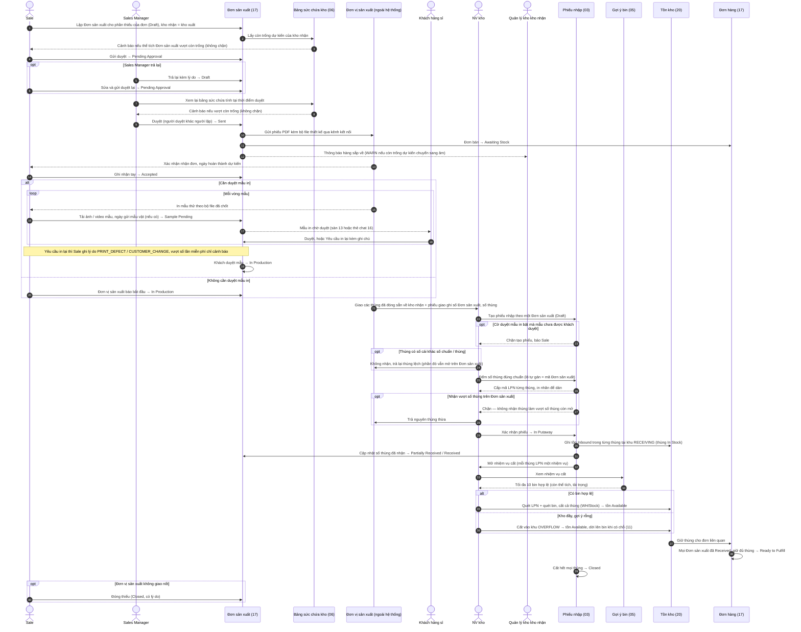

### 1.3. Nhập hàng hoàn (phiếu nhập loại Hàng hoàn)

Chi tiết: [03 · Nhập kho §4.2](../warehouse/03-receipt/README.md), [09 · Shipping §4.3](../warehouse/09-shipping/README.md), [17 · Order Management §4.10](../ecommerce/17-order-management/README.md), [20 · Inventory Control §4.4, §4.8](../warehouse/20-inventory-control/README.md). *(Đã chốt 2026-11-05)* Hàng hãng hoàn về (RTO) và hàng khách trả theo yêu cầu trả hàng đã duyệt (RMA) **luôn** nhập lại kho qua phiếu loại **Hàng hoàn** (`RETURN`), vào thẳng khu `QUARANTINE` — không qua `RECEIVING`, không cộng thẳng vào tồn khả dụng ([03](../warehouse/03-receipt/README.md) BR-14, [20](../warehouse/20-inventory-control/README.md) BR-15).

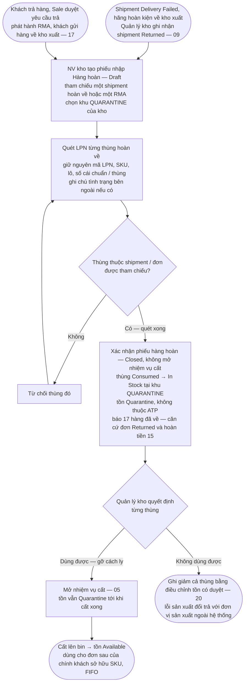

> ✅ Đã chốt 2026-11-05: phiếu hàng hoàn lập tại **kho xuất của đơn**, đóng ngay khi xác nhận; thùng hoàn về thiếu so với shipment / RMA thì xác nhận các thùng thực có, phần thiếu xử lý ngoài hệ thống; thùng đã bị mở vẫn nhận vào cách ly; thùng giữ mã LPN gốc, ngày nhập dùng cho FIFO là ngày nhập lại; gỡ cách ly mở nhiệm vụ cất, tồn vẫn `Quarantine` tới khi cất xong. Xem [open-questions](../open-questions/README.md).

---

## 2. Luồng Fulfillment

Chi tiết: [17 · Order Management §4.2–4.6](../ecommerce/17-order-management/README.md), [07 · Picking](../warehouse/07-picking/README.md), [08 · Kiểm thùng & Dán nhãn giao hàng](../warehouse/08-packing/README.md), [09 · Shipping](../warehouse/09-shipping/README.md).

### 2.1. Flowchart tổng thể

> **Đã chốt 2026-11-05:** **mỗi đơn có đúng một kho xuất** — Sale chọn khi đơn `Confirmed`, hệ thống gợi ý (ưu tiên kho đang có đủ hàng của các SKU trong đơn, rồi tới kho còn chỗ — ✅ C3) và hiện còn trống dự kiến của các kho. Chỉ giữ hàng có sẵn **tại kho xuất**; hàng dư ở kho khác không dùng cho đơn đó; mọi Đơn sản xuất của đơn có kho nhận = kho xuất; **không bao giờ tách giao từ hai kho**, đơn vẫn giao nhiều đợt (giao một phần) từ cùng kho xuất ([17](../ecommerce/17-order-management/README.md) §4.2, BR-22, [20](../warehouse/20-inventory-control/README.md) BR-17). ✅ Đã chốt 2026-11-05: kho xuất chỉ đổi được khi đơn chưa có hàng giữ và chưa có Đơn sản xuất từ `Sent` trở đi. Xem [open-questions](../open-questions/README.md).

> **Đã chốt 2026-11-05:** dòng đơn ghi **số thùng N**; mọi thùng đúng số cái chuẩn nên giữ hàng / phân bổ = **chọn đủ N thùng LPN** của SKU tại kho xuất, theo **FIFO** (ngày nhập). Chỉ có sẵn k < N thùng thì giữ k thùng, **N − k thùng còn lại là thiếu** — Sale lập Đơn sản xuất cho phần thiếu (tính theo thùng) hoặc thoả thuận lại số thùng với khách ([07](../warehouse/07-picking/README.md) BR-03, [17](../ecommerce/17-order-management/README.md) §4.2, BR-21, [open-questions C32](../open-questions/README.md)).

> **Đã chốt 2026-11-05:** **Quản lý kho** của kho xuất quyết định có dùng **khu chờ xuất (`STAGING`)** cho đơn. ✅ Đã chốt 2026-11-05: lấy thùng sang `STAGING` chưa trừ tồn, tồn ở đó đã gắn đơn; lấy bổ sung vào cùng task; **chuyển cả tác vụ sang khu xuất hàng** (`DISPATCH`) một lần cho cả task. Khu chờ xuất giữ thùng của đơn **chưa được phép xuất** (chưa dán nhãn, tồn chưa trừ); khu xuất hàng nhận thùng **đủ điều kiện xuất**, kiểm & dán nhãn tại chỗ, chờ xe ([06](../warehouse/06-warehouse-map-slotting/README.md) §4.5). Xem [open-questions C30, C31](../open-questions/README.md).

```mermaid
flowchart TD
    CONF(["Đơn: Confirmed<br/>hợp đồng Signed, đủ đợt ON_SIGNING"]) --> WH_SELECT["Sale chọn kho xuất — một kho cho cả đơn<br/>hệ thống gợi ý: ưu tiên kho đủ hàng, rồi kho còn chỗ<br/>hiện tồn khả dụng và còn trống dự kiến từng kho"]
    WH_SELECT --> CHECK["Hệ thống kiểm tồn SKU riêng khả dụng tại kho xuất, theo số thùng<br/>hàng dư từ đơn trước, hàng trả đã gỡ cách ly<br/>giữ đủ N thùng của dòng, hoặc số thùng có sẵn"]
    CHECK --> SETUP["Sale chọn cách giao: gửi kiện / giao nguyên chuyến"]
    SETUP --> ENOUGH{"Đủ hàng tại kho xuất?<br/>mỗi dòng có đủ N thùng"}

    ENOUGH -->|"Thiếu thùng"| PO_SEND["Sale lập Đơn sản xuất cho phần thiếu, tính theo số thùng<br/>kho nhận = kho xuất, cảnh báo nếu vượt còn trống dự kiến<br/>Sales Manager duyệt và gửi — luồng §1"]
    PO_SEND --> AWAIT["Đơn: Awaiting Stock — khi Đơn sản xuất Sent<br/>Sale báo khách ngày giao mới nếu trễ hợp đồng"]
    AWAIT --> AW_CHOICE{"Phần có sẵn<br/>xử lý thế nào?"}
    AW_CHOICE -->|"Chờ đủ hàng"| AW_BIN["Thùng nằm tại bin, đã giữ cho đơn"]
    AW_CHOICE -->|"Quản lý kho dùng khu chờ xuất: đích STAGING"| TASK
    AW_CHOICE -->|"Sale cho phép giao một phần: đích DISPATCH"| TASK
    AW_BIN -.->|"thành phẩm nhập kho xuất, cất xong — §1"| RECV["Mọi Đơn sản xuất của đơn đã Received, giữ đủ thùng<br/>Đơn: Ready to Fulfill<br/>đợt BEFORE_DELIVERY → Due"]

    ENOUGH -->|Đủ| RELEASE["Đơn: Ready to Fulfill — đợt BEFORE_DELIVERY → Due<br/>Quản lý kho của kho xuất release<br/>phân bổ đủ N thùng LPN cụ thể mỗi dòng — bin, lô, FIFO"]
    RELEASE --> TASK
    RECV --> HAS_TASK{"Đơn đã có task?"}
    HAS_TASK -->|Chưa| TASK["Quản lý kho tạo task, giao người<br/>chọn đích lấy hàng: DISPATCH / STAGING<br/>mỗi thùng đã phân bổ một dòng lấy hàng<br/>đơn Ready to Fulfill → Picking, đơn Awaiting Stock giữ nguyên"]
    HAS_TASK -->|Có| TOPUP["Quản lý kho phân bổ bổ sung đủ số thùng còn thiếu, FIFO<br/>thêm dòng vào cùng task, giữ đích của task — task và đơn → Picking"]
    TOPUP --> PICK
    TASK --> PICK["Picker quét vị trí + quét LPN của thùng<br/>đúng thùng của dòng, không nhập số lượng"]

    PICK --> SHORT{"Lấy được thùng<br/>của dòng?"}
    SHORT -->|"Không thấy / hư hỏng"| SHORT_HOLD["Báo thiếu: dòng Short, đơn On Hold INVENTORY<br/>tự mở kiểm kê mù thùng đó"]
    SHORT_HOLD --> REALLOC{"Quản lý kho phân bổ lại được đủ số thùng thiếu<br/>từ thùng khác của SKU tại kho xuất?"}
    REALLOC -->|"Được — tự gỡ treo"| PICK
    REALLOC -->|"Không"| SHORT_DECIDE(["Quản lý kho báo Sale, Sale quyết:<br/>Đơn sản xuất cho phần thiếu / thoả thuận lại số thùng /<br/>giao một phần rồi đóng phần còn lại / huỷ"])
    SHORT -->|"Lấy được"| DEST{"Đích lấy hàng?"}

    DEST -->|STAGING| STAGED["Dòng Staged: thùng chuyển nguyên sang khu STAGING, sổ MOVE<br/>chưa trừ tồn, phân bổ vẫn Held, giữ riêng cho đơn<br/>Task: Staged"]
    STAGED --> READY_OUT{"Đơn sẵn sàng xuất?<br/>đủ hàng, hoặc được giao một phần"}
    READY_OUT -->|"Chưa: chờ hàng / chờ đợt BEFORE_DELIVERY"| STAGED
    STAGED -.->|"phần thiếu nhập kho xuất"| RECV
    READY_OUT -->|Rồi| TO_CHECK["Quản lý kho: chuyển cả tác vụ sang khu xuất hàng DISPATCH<br/>một lần cho cả task, đơn không treo<br/>trừ tồn, sổ PICK, thùng và phân bổ Consumed — Task: Picked"]
    DEST -->|DISPATCH| PICKED["Dòng Picked: trừ tồn ngay, sổ PICK, thùng Consumed<br/>Task: Picked"]
    TO_CHECK --> CHECK_START
    PICKED --> CHECK_START["NV kho bắt đầu phiên kiểm thùng tại khu xuất hàng DISPATCH<br/>quét LPN từng thùng: đúng đơn, đúng SKU — thùng Checked<br/>thùng hư hỏng: loại → Removed, cất lại vào QUARANTINE"]

    CHECK_START --> LABEL["Kích thước, khối lượng theo quy cách thùng của SKU<br/>in và dán nhãn giao hàng lên từng thùng — Labeled<br/>thùng đầu tiên dán nhãn: khoá huỷ đơn, cách giao, địa chỉ"]
    LABEL --> COMPLETE{"Hoàn tất kiểm thùng:<br/>đủ thùng?"}
    COMPLETE -->|Đủ| PACKED["Phiên kiểm thùng: Completed<br/>Đơn: Packed — đã kiểm đủ thùng và dán nhãn<br/>Shipment: Ready to Dispatch"]
    COMPLETE -->|"Thiếu, đơn được giao một phần"| PART["Đơn: Partially Fulfilled<br/>Shipment: Ready to Dispatch<br/>phần còn lại lấy bổ sung sau, cùng kho xuất"]
    PART -.->|"phần còn lại về kho xuất"| RECV
    PACKED --> PAY_WARN["Cảnh báo nếu đợt BEFORE_DELIVERY chưa thu<br/>không chặn kiểm thùng"]
    PART --> PAY_WARN

    PAY_WARN --> MODE{"Cách giao?"}
    MODE -->|"Gửi kiện qua hãng"| PARCEL["Gán hãng, mở chuyến bàn giao cho một hãng<br/>quét LPN đủ kiện lên xe — mỗi thùng một kiện"]
    MODE -->|"Giao nguyên chuyến"| FTL["Load Planning 3D theo quy cách thùng — kế hoạch Confirmed, mỗi xe một chuyến<br/>đặt xe ngoài hệ thống, ghi nhận đặt xe<br/>bắt đầu xếp, quét LPN theo sơ đồ từng xe"]
    PARCEL --> GATE
    FTL --> GATE{"Mọi đợt BEFORE_DELIVERY đã Paid?<br/>đơn không treo"}
    GATE -->|Chưa| BLOCK["Từ chối ký bàn giao cả chuyến<br/>bỏ shipment đó ra, chờ ở khu xuất hàng DISPATCH<br/>tới khi Kế toán ghi nhận đủ tiền"]
    BLOCK -.-> GATE
    GATE -->|Rồi| HANDOVER["Ký bàn giao — tất cả hoặc không<br/>Shipment: Handed Over"]
    HANDOVER --> SHIPPED["Đơn: Shipped, hoặc Partially Fulfilled nếu còn phần chưa giao<br/>không theo dõi hành trình, không thu tiền khi giao"]

    SHIPPED --> RESULT{"Hãng báo kết quả<br/>Quản lý kho ghi nhận"}
    RESULT -->|"Thành công"| DELIVERED["Đơn: Delivered<br/>đợt AFTER_DELIVERY đến hạn — công nợ phải thu"]
    RESULT -->|"Thất bại, có lý do"| FAILED["Đơn: Delivery Failed"]
    FAILED -->|"Hãng giao lại thành công"| DELIVERED
    FAILED -->|"Hàng hoàn về kho xuất"| RTO(["Đơn: Returned — nhập lại qua phiếu Hàng hoàn vào QUARANTINE, §1.3<br/>xử lý hoàn tiền"])
    DELIVERED --> AUTO["Mỗi đêm: sau 7 ngày, mọi đợt Paid,<br/>không có yêu cầu trả hàng — Đơn: Completed"]
    AUTO --> CLOSED(["Sau 30 ngày: Closed"])
```

### 2.2. Sequence diagram (trình tự tác nhân)

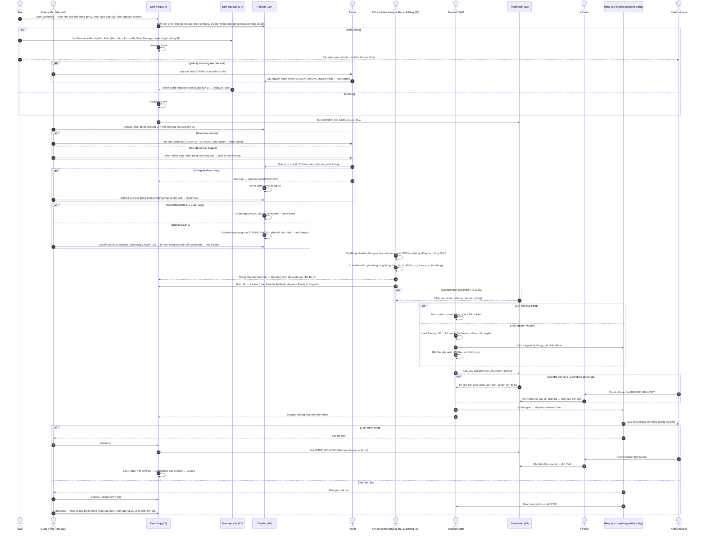

### 2.3. Vòng đời Đơn sản xuất (Production Order)

Chi tiết trạng thái & điều kiện chuyển xem [17 · Order Management §5.3](../ecommerce/17-order-management/README.md). Đơn sản xuất **chỉ phát sinh từ đơn bán**: **Sale lập** cho phần thiếu của đơn `Confirmed` sau khi đã kiểm tồn SKU riêng tại kho xuất; không có Đơn sản xuất bổ sung tồn. **Sales Manager duyệt** (→ `Sent`, hệ thống xuất phiếu và gửi qua kênh kết nối) hoặc **trả lại** (→ `Draft`, bắt buộc lý do). `Sample Pending` chỉ có khi bật cờ **cần duyệt mẫu in**; mỗi lần khách yêu cầu in lại là một **vòng mẫu** mới. `Sent` / `Accepted` → `In Production` do hệ thống chuyển khi hàng về mà Đơn sản xuất không bật cờ duyệt mẫu in ([03](../warehouse/03-receipt/README.md) BR-15). `Partially Received` / `Received` do hệ thống chuyển khi nhập kho theo thùng ([03](../warehouse/03-receipt/README.md)).

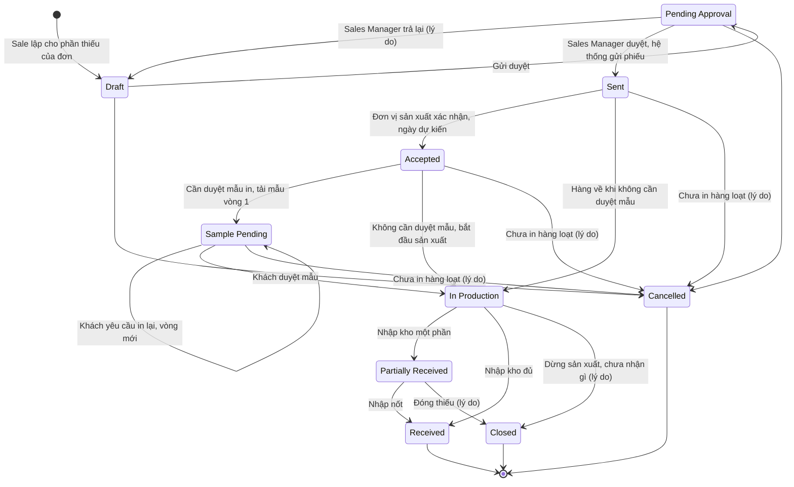

> **Đã chốt 2026-11-05:** Đơn sản xuất `In Production` không huỷ được; đơn vị sản xuất dừng hẳn khi chưa giao gì thì Sale **đóng** (`Closed`, bắt buộc lý do). Huỷ (`Cancelled`, bắt buộc lý do) chỉ khi chưa in hàng loạt: `Draft` / `Pending Approval` / `Sent` / `Accepted` / `Sample Pending` ([17](../ecommerce/17-order-management/README.md) BR-06). Phản hồi `Accepted`, tiến độ và mẫu in do Sale ghi nhận tay; kênh API là phạm vi sau.

### 2.4. Vòng đời phiên kiểm thùng & thùng giao (Outbound Check & Labeling)

Chi tiết: [08 · Kiểm thùng & Dán nhãn giao hàng §5](../warehouse/08-packing/README.md). Thùng LPN là kiện giao: kho chỉ quét kiểm đủ thùng, dán nhãn giao hàng và gom thùng thành shipment — làm ngay tại **khu xuất hàng (`DISPATCH`)**, không có khu kiểm thùng riêng ([06](../warehouse/06-warehouse-map-slotting/README.md) BR-22); không chọn loại kiện, không cân đo, không niêm phong. Khi **thùng đầu tiên** của đơn được dán nhãn, đơn không huỷ được, không đổi cách giao, không đổi địa chỉ giao ([08](../warehouse/08-packing/README.md) BR-04).

**Phiên kiểm thùng (theo đơn):**

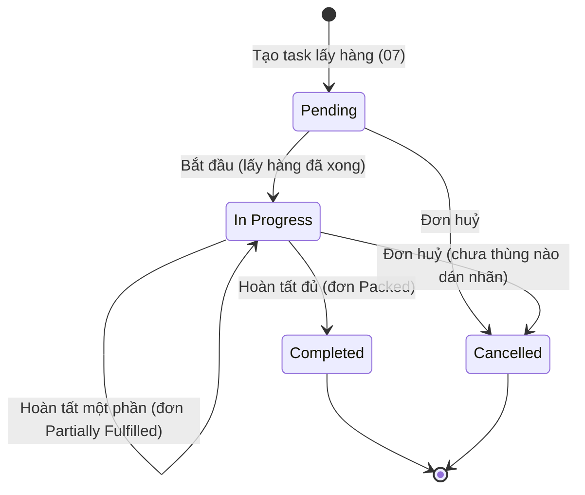

**Thùng giao (Outbound carton):**

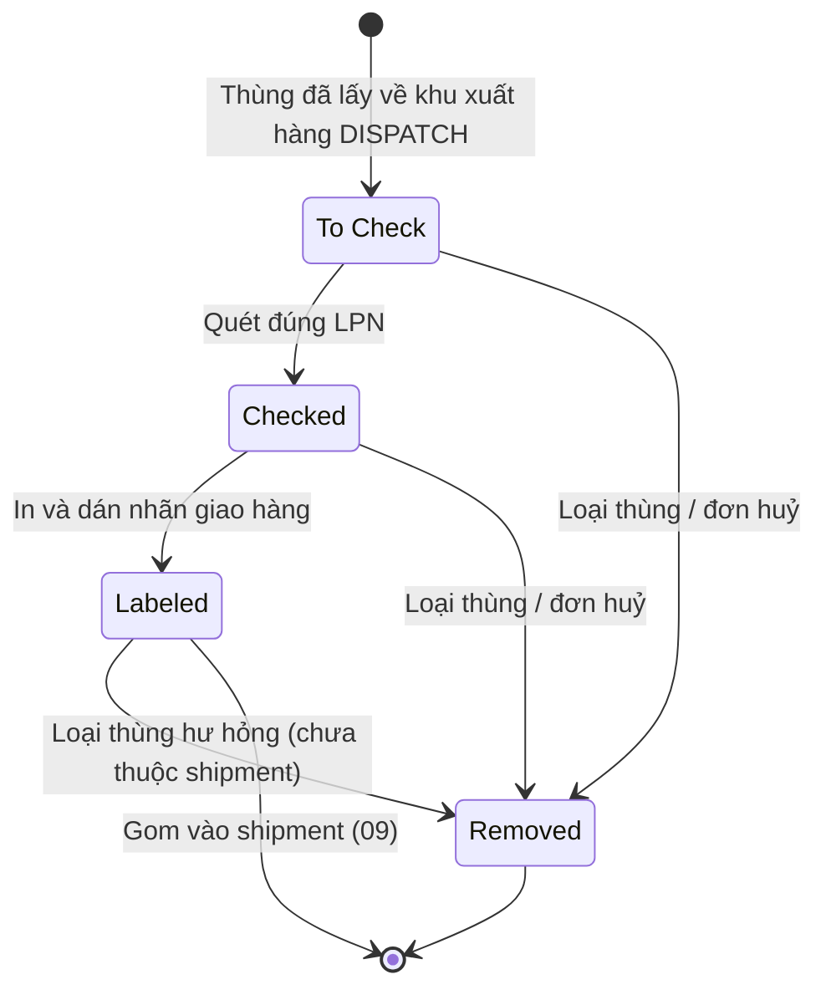

> Thùng `Removed` vào hàng chờ cất lại ([07](../warehouse/07-picking/README.md) §4.5); thùng hư hỏng được cất nguyên thùng vào khu `QUARANTINE` ([20](../warehouse/20-inventory-control/README.md) §4.8). Sau khi vào shipment, vòng đời của thùng theo shipment ở [09](../warehouse/09-shipping/README.md) §5.1.

### 2.5. Vòng đời kế hoạch chuyến xe (Load Plan — giao nguyên chuyến)

Chi tiết: [09 · Shipping §4.2, §5.3](../warehouse/09-shipping/README.md#42-giao-nguyên-chuyến--lập-kế-hoạch-xếp-hàng-3d-load-planning). Chỉ dùng cho **đơn khách giao nguyên chuyến**: kế hoạch chứa nguyên shipment `Ready to Dispatch` đã kiểm thùng, thuộc **một kho** (kho xuất của các đơn). **Kiện là thùng LPN**, kích thước / khối lượng theo quy cách thùng của SKU ([09](../warehouse/09-shipping/README.md) BR-17). Khi chốt, mỗi xe là một chuyến bàn giao. Kế hoạch không có nhánh gỡ kiện vì huỷ đơn — đơn đã có thùng dán nhãn thì không huỷ được; bỏ kiện khỏi kế hoạch (thùng hư hỏng, đơn chưa thu đợt `BEFORE_DELIVERY`) thì mở lại về `Planned` khi chưa xe nào bắt đầu xếp. Đã có xe bắt đầu xếp thì chỉ **huỷ có kiểm soát** (cả kế hoạch hoặc một xe) hoặc **bỏ xe `Planned` khỏi kế hoạch** khi mọi xe khác đã rời kho ([09](../warehouse/09-shipping/README.md) BR-14) *(Quyết định 02/11/2026)*. Huỷ có kiểm soát một xe đang xếp: chuyến `Planned` mới của xe dùng cùng sơ đồ, **trừ khi có kiện bị gỡ khỏi xe** — kiện đó bị loại khỏi kế hoạch (lý do `REMOVED_FROM_VEHICLE`, trả về khu `DISPATCH` chờ kế hoạch khác) và chuyến mới dùng **sơ đồ tính lại cho các kiện còn lại**; xe không còn kiện nào thì bị huỷ, không sinh chuyến mới *(✅ Đã chốt 2026-11-05)*.

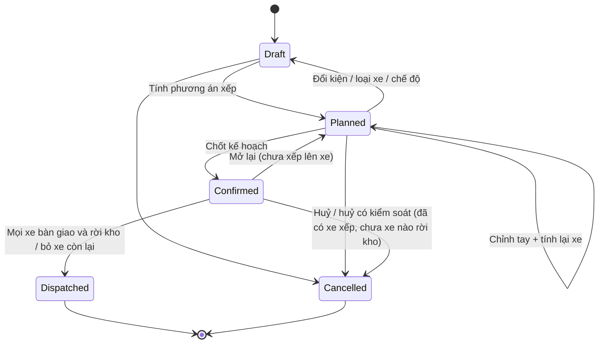

---

## 3. Phụ lục

### 3.1. Luồng bán sỉ theo hợp đồng (Khách tự thiết kế → Yêu cầu báo giá → Báo giá → Đơn → Hợp đồng → Đợt thanh toán → Công nợ)

Chi tiết: [12 · Thiết kế của khách](../ecommerce/12-product-design/README.md), [13 · Catalog](../ecommerce/13-catalog/README.md), [16 · Sales Chat](../ecommerce/16-sales-chat/README.md), [14 · Báo giá, Đơn hàng & Hợp đồng](../ecommerce/14-cart-and-order/README.md), [15 · Thanh toán theo hợp đồng & Công nợ](../ecommerce/15-payment/README.md). Khách **không tự đặt hàng** trên sàn: đơn do Sale tạo từ báo giá đã chấp nhận. **Sàn không hiển thị giá** *(Đã chốt 2026-11-05)*: giá chỉ có trên báo giá / đơn / hợp đồng; **đơn giá do Sale nhập**, hệ thống gợi ý từ **bảng giá riêng nội bộ** của khách (Sales Manager khai báo, chỉ nhân viên xem — [14](../ecommerce/14-cart-and-order/README.md) BR-10). Dòng báo giá / đơn chỉ là **SKU thành phẩm riêng của khách** (không còn hàng trơn), ghi **số thùng** (kèm số cái / thùng) và **đơn giá theo cái**; MOQ và bậc giá theo số thùng; thành tiền dòng = số thùng × số cái / thùng × đơn giá / cái ([14](../ecommerce/14-cart-and-order/README.md) BR-07, BR-08). SKU **sản xuất lần đầu** có thêm **dòng phí khuôn / bản in** trên báo giá, đơn và hợp đồng — thu theo các đợt như hàng hoá ([14](../ecommerce/14-cart-and-order/README.md) BR-17, [15](../ecommerce/15-payment/README.md)); hợp đồng ghi **số lần in mẫu miễn phí** dùng khi duyệt mẫu in ([14](../ecommerce/14-cart-and-order/README.md) BR-18).

```mermaid
flowchart TD
    ENTRY(["Khách sỉ xem sản phẩm, quy cách trên sàn — sàn không hiện giá<br/>chat với Sale"]) --> PATH{"Hàng in theo<br/>mẫu mới?"}
    PATH -->|Có| DESIGN["Khách bấm Thiết kế trên quy cách đã có khuôn in (13)<br/>tải ảnh / logo, đặt lên khuôn 2D, thêm chữ, xem trước 3D<br/>lưu — bản thiết kế Draft (12)"]
    DESIGN --> SUBMIT["Khách bấm Gửi duyệt<br/>hoặc Gửi duyệt và yêu cầu báo giá"]
    SUBMIT --> PREFLIGHT{"Hệ thống preflight<br/>độ phân giải ở kích thước in, vùng in / lề an toàn<br/>định dạng, dung lượng, quy cách đã có quy cách thùng"}
    PREFLIGHT -->|"Không đạt: báo lỗi cụ thể, vẫn Draft"| DESIGN
    PREFLIGHT -->|Đạt| PENDING["Bản thiết kế: Pending Review — khoá sửa"]
    PENDING --> REVIEW{"Sales Manager duyệt kỹ thuật<br/>và kiểm duyệt nội dung"}
    REVIEW -->|"Trả lại, kèm lý do: về Draft"| DESIGN
    REVIEW -->|Duyệt| SNAP["Hệ thống xuất bộ file: file in PDF/X, xem trước 2D / 3D, đặc tả<br/>chốt design snapshot bất biến, checksum<br/>sinh SKU thành phẩm riêng của khách, quy cách thùng theo quy cách — Approved"]
    SNAP --> RFQ["Khách bấm Yêu cầu báo giá: số thùng, ngày giao mong muốn<br/>mở chat với Sale kèm thẻ yêu cầu báo giá (16)"]
    PENDING -.->|"Đã gửi kèm yêu cầu báo giá:<br/>Sale nhận ngay, chỉ lập báo giá khi Approved"| RFQ
    PATH -->|"Không — SKU riêng của khách đã có"| QUOTE
    RFQ --> QUOTE["Sale lập báo giá (14)<br/>số thùng khách nêu là gợi ý, ngày giao mong muốn → ngày giao khách yêu cầu<br/>số thùng từng dòng, đơn giá / cái do Sale nhập — gợi ý từ bảng giá riêng nội bộ<br/>bậc giá và MOQ theo số thùng, hiệu lực<br/>SKU sản xuất lần đầu: thêm dòng phí khuôn / bản in"]
    QUOTE --> DISCOUNT{"Đơn giá thấp hơn giá gợi ý<br/>vượt hạn mức giảm giá của Sale?"}
    DISCOUNT -->|Có| DISC_OK["Sales Manager duyệt trước khi gửi"]
    DISC_OK --> Q_SENT
    DISCOUNT -->|Không| Q_SENT["Gửi báo giá cho khách — Sent<br/>khách thấy giá trên báo giá / thẻ báo giá trong chat"]

    Q_SENT --> Q_RESP{"Khách phản hồi trên sàn<br/>hoặc thẻ hành động trong chat"}
    Q_RESP -->|"Yêu cầu sửa"| Q_REV["Changes Requested → bản sửa mới"]
    Q_REV --> QUOTE
    Q_RESP -->|"Hết hiệu lực"| Q_EXP(["Báo giá: Expired"])
    Q_RESP -->|"Chấp nhận, chọn số thùng ≥ MOQ"| ACCEPT["Báo giá: Accepted"]
    ACCEPT --> ORDER["Sale tạo đơn từ báo giá<br/>chốt số thùng, số cái / thùng, đơn giá / cái, dòng phí khuôn / bản in<br/>Đơn: Draft — báo giá Converted"]

    ORDER --> CONTRACT["Sale lập hợp đồng mua bán — Draft<br/>các bên, dòng hàng và giá, dòng phí khuôn / bản in, điều khoản giao<br/>số lần in mẫu miễn phí — mặc định từ cấu hình chung<br/>lịch thanh toán: ON_SIGNING / BEFORE_DELIVERY / AFTER_DELIVERY"]
    CONTRACT --> SEND["Gửi hợp đồng — Sent<br/>Đơn: Pending Contract<br/>cảnh báo nếu vượt hạn mức / quá hạn"]
    SEND --> SIGN{"Khách ký?<br/>ngoài hệ thống"}
    SIGN -->|"Từ chối / cần sửa"| C_CANCEL["Huỷ hợp đồng, có lý do<br/>đơn về Draft để lập hợp đồng thay thế, hoặc huỷ đơn"]
    C_CANCEL -.-> CONTRACT
    SIGN -->|"Đã ký"| SIGNED["Sale tải bản scan → hợp đồng Signed<br/>sinh các đợt thanh toán — Not Due"]

    SIGNED --> CREDIT{"Có đợt AFTER_DELIVERY và khách<br/>quá hạn / vượt hạn mức?"}
    CREDIT -->|Có| HOLD["Đơn: On Hold — tín dụng<br/>Kế toán duyệt / từ chối"]
    HOLD -->|"Từ chối"| O_CANCEL(["Đơn: Cancelled — CREDIT_REJECTED"])
    HOLD -->|Duyệt| ONSIGN
    CREDIT -->|Không| ONSIGN{"Đợt ON_SIGNING đã thu đủ<br/>hoặc không có?"}
    ONSIGN -->|Chưa| PP["Đơn: Pending Payment<br/>khách chuyển khoản, Kế toán ghi nhận và phân bổ"]
    PP -->|"Thu đủ"| CONFIRMED
    ONSIGN -->|Rồi| CONFIRMED(["Đơn: Confirmed → Sale chọn kho xuất, kiểm tồn và Fulfillment — §2"])
    CONFIRMED -.-> AFTER["Đợt BEFORE_DELIVERY chặn bàn giao tới khi Paid<br/>sau giao: đợt AFTER_DELIVERY là công nợ phải thu<br/>phí khuôn / bản in nằm trong các đợt như hàng hoá<br/>mọi đợt Paid và đơn hoàn tất → hợp đồng Completed"]
```

> ✅ Đã chốt 2026-11-05: báo giá không bắt buộc SKU đã có giá nội bộ — chưa có thì Sale nhập giá trực tiếp; số lần in mẫu miễn phí mặc định 2. ⚠️ Giả định: một dòng phí khuôn / bản in cho mỗi SKU mẫu mới, chi tiết khuôn / bản in theo kỹ thuật in là phạm vi sau (B28). Xem [open-questions](../open-questions/README.md).

**Vòng đời bản thiết kế (Design)** — chi tiết [12](../ecommerce/12-product-design/README.md) §5.1. Bản `Approved` không sửa; muốn đổi thì khách **tạo bản sửa** (bản thiết kế mới ở `Draft`, duyệt xong sinh snapshot và SKU riêng mới — 12 §4.7).

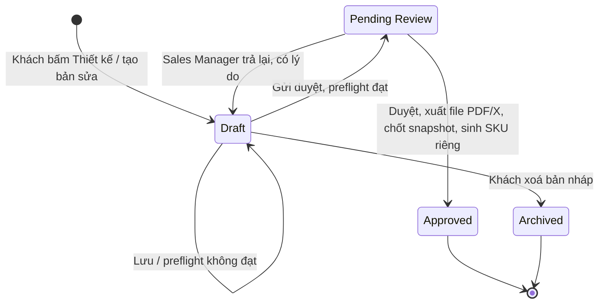

> ⚠️ Giả định: thẻ yêu cầu báo giá gửi kèm lúc gửi duyệt vẫn mở khi bản bị trả lại, đi tiếp theo bản đó; bản `Archived` thì thẻ đóng ([open-questions B40](../open-questions/README.md)). Ràng buộc file mặc định, chuẩn PDF/X-4, thiếu model 3D: [open-questions B34–B36](../open-questions/README.md).

### 3.2. Vòng đời đơn hàng (Order)

Chi tiết: [17 · Order Management §5.1](../ecommerce/17-order-management/README.md). Sơ đồ vẽ theo bảng chuyển tiếp của 17 §5.1.

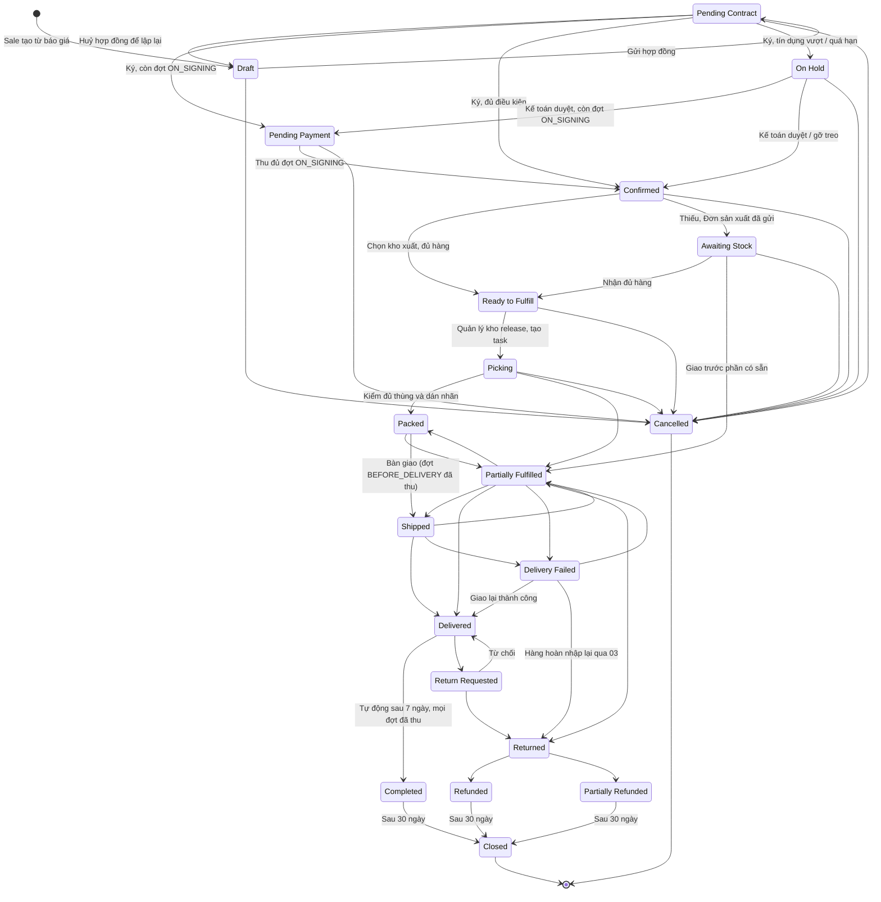

> **Sale** treo tay (`On Hold`) được từ `Confirmed`, `Awaiting Stock`, `Ready to Fulfill`, `Picking`, `Partially Fulfilled`, `Packed`; gỡ treo quay về đúng trạng thái trước đó ([17](../ecommerce/17-order-management/README.md) §4.9); treo do tín dụng do Kế toán duyệt. Sơ đồ chỉ vẽ nhánh treo tín dụng để dễ đọc. `Packed` = **đã kiểm đủ thùng & dán nhãn giao hàng** ([08](../warehouse/08-packing/README.md)). Mốc hết huỷ là khi **thùng đầu tiên của đơn được dán nhãn giao hàng** (08 BR-04): từ đó đơn không huỷ được, không đổi cách giao, không đổi địa chỉ giao — kể cả khi đơn còn `Picking`. `Returned` = hàng đã về kho qua phiếu nhập Hàng hoàn, nằm ở khu `QUARANTINE` (§1.3).

### 3.3. Vòng đời hợp đồng mua bán & đợt thanh toán

Chi tiết: [14 · §5.2 Hợp đồng mua bán](../ecommerce/14-cart-and-order/README.md), [15 · §5.1 Đợt thanh toán](../ecommerce/15-payment/README.md). Số tiền các đợt chia từ **tổng giá trị hợp đồng** = dòng hàng + dòng phí khuôn / bản in (nếu có).

| Mốc đến hạn của đợt | Chuyển `Due` khi | Ảnh hưởng tới đơn |
|---------------------|------------------|-------------------|
| `ON_SIGNING` | Hợp đồng `Signed` | Chưa thu đủ → đơn `Pending Payment` |
| `BEFORE_DELIVERY` | Đơn `Ready to Fulfill` | Chưa `Paid` → chặn bàn giao vận chuyển ([09](../warehouse/09-shipping/README.md) BR-04) |
| `AFTER_DELIVERY` | Đơn `Delivered` (+ N ngày là hạn trả) | Công nợ phải thu có kỳ hạn |

**Hợp đồng mua bán (Sales Contract):**

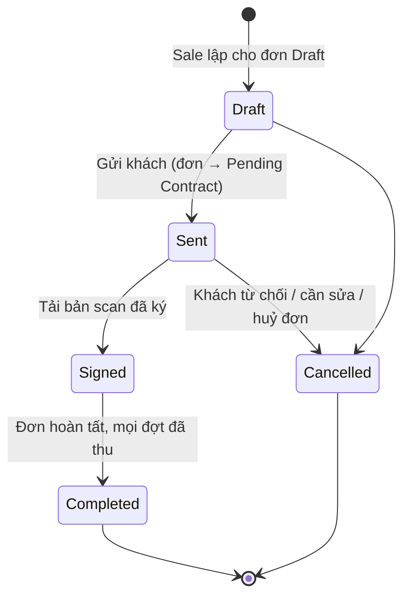

**Đợt thanh toán (Payment Installment):**

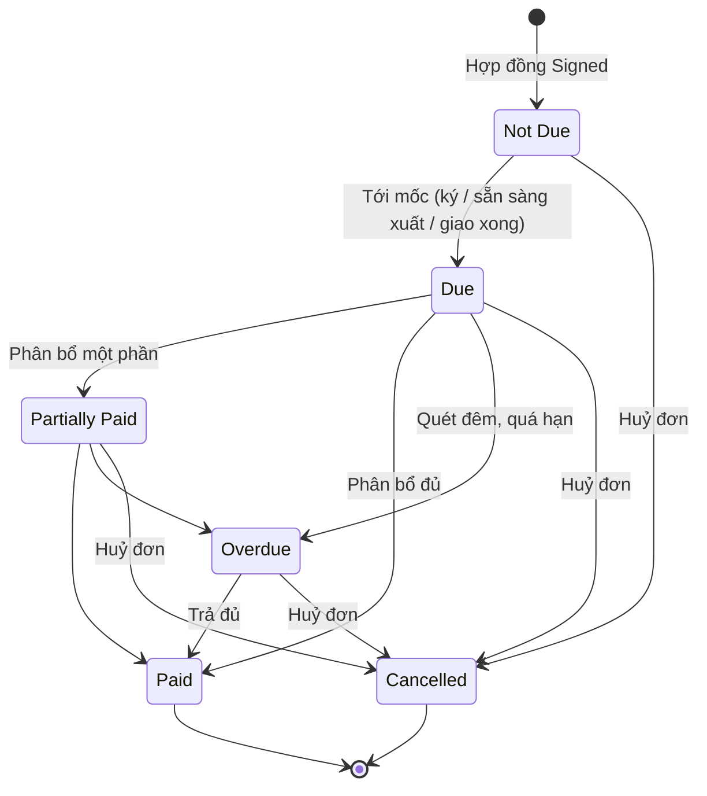

> ✅ Đã chốt 2026-11-05: trạng thái `Cancelled` của đợt (khi huỷ đơn) bổ sung ngoài danh sách trạng thái đã chốt; đơn huỷ sau khi hợp đồng `Signed` thì hợp đồng giữ `Signed` và chuyển `Completed` khi phí huỷ / hoàn tiền xử lý xong. **Khoản phí huỷ** dùng cùng vòng đời đợt, bắt đầu từ `Due`. Huỷ đơn trước khi có Đơn sản xuất tới `In Production` thì hoàn toàn bộ, kể cả dòng phí khuôn / bản in. Xem [open-questions](../open-questions/README.md).

### 3.4. Luồng di chuyển nguyên thùng trong một kho (Intra-warehouse)

Chi tiết: [11 · Intra-warehouse Transfer](../warehouse/11-intra-warehouse-transfer/README.md). **Di chuyển nguyên thùng LPN bằng tay nằm trong phạm vi hiện tại** *(Đã chốt 2026-11-04)*: quét thùng, quét vị trí đích, ghi ngay; không mở thùng, không di chuyển một phần thùng. Dùng cả để **dời thùng từ khu tạm `OVERFLOW` lên bin** khi kho có chỗ trở lại ([05](../warehouse/05-putaway/README.md) BR-13). **Không có chuyển kho** *(Đã chốt 2026-11-05)*: vị trí đích khác kho bị từ chối; dời / đóng kho (hiếm) xử lý bằng điều chỉnh tồn có duyệt ([20](../warehouse/20-inventory-control/README.md) §4.5 — ✅ đã chốt 2026-11-05). Tự động đưa thùng ra vùng lấy hàng, re-slotting và nhiệm vụ di chuyển là phạm vi giai đoạn sau ([C2, C24](../open-questions/README.md)). Lấy hàng về khu chờ xuất và cất lại thùng của đơn huỷ thuộc [07](../warehouse/07-picking/README.md), cách ly sang khu `QUARANTINE` thuộc [20](../warehouse/20-inventory-control/README.md) — không đi luồng này.

> ⚠️ Giả định: một lần xác nhận gồm **một hoặc nhiều thùng** tới **một vị trí đích**, mỗi thùng một dòng sổ `MOVE`; một thùng không hợp lệ thì cả lần không thực hiện. Thao tác không kiểm thể tích, tải trọng của vị trí đích. Xem [open-questions C24](../open-questions/README.md).

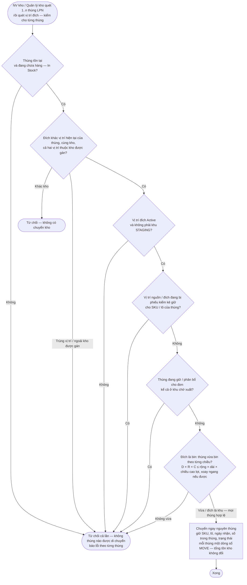

> Thùng không nằm ở vị trí sổ sách: không dùng thao tác này để sửa — lập phiếu kiểm kê, chênh lệch đi qua điều chỉnh tồn có duyệt ([20](../warehouse/20-inventory-control/README.md) §4.2–4.3). Thùng nghi lệch số cái chuẩn: cách ly sang khu `QUARANTINE`, không phân bổ, ghi giảm cả thùng bằng điều chỉnh có duyệt (✅ đã chốt 2026-11-05 — [open-questions C34](../open-questions/README.md)).

---

## 4. Ghi chú về sơ đồ

- Các trạng thái viết hoa kiểu `Confirmed`, `Sample Pending`… là trạng thái chứng từ / nhiệm vụ, khớp với bảng vòng đời trong từng module; khi lệch, **bảng vòng đời trong module là chuẩn**. Trong `stateDiagram-v2`, trạng thái nhiều từ được khai báo bằng mã không dấu cách kèm nhãn hiển thị (ví dụ `state "Pending Contract" as PendingContract`).
- Sơ đồ mô tả **happy path + các nhánh ngoại lệ chính**; edge case chi tiết xem phần "Ràng buộc nghiệp vụ & Edge case" của module tương ứng.
- **Sản xuất nằm ngoài hệ thống** *(Đã chốt 2026-11-04)*: bước của **đơn vị sản xuất** (xưởng của công ty hoặc đối tác ngoài) vẽ dạng khối "ngoài hệ thống"; hệ thống chỉ quản lý **Đơn sản xuất** ([17](../ecommerce/17-order-management/README.md) §4.3, §5.3) và **nhập kho thành phẩm** ([03](../warehouse/03-receipt/README.md)). Kho không kiểm tra chất lượng khi nhập.
- **Vai trò** *(Đã chốt 2026-11-05)*: việc phía khách / sản xuất là của **Sale** (Đơn sản xuất do **Sales Manager** duyệt và gửi); việc trong kho xuất (release, task, khu chờ xuất, kết quả giao) là của **Quản lý kho**.
- **Thùng LPN** *(Đã chốt 2026-11-04)*: mọi tồn nằm trong thùng do đơn vị sản xuất đóng sẵn; nhập, cất, di chuyển, lấy và kiểm kê đều **nguyên thùng**, xác nhận bằng quét LPN. Thùng LPN là **kiện giao** — "kiện" trong các sơ đồ giao hàng là thùng LPN, kích thước / khối lượng theo quy cách thùng của SKU ([01](../warehouse/01-product-creation/README.md), [08](../warehouse/08-packing/README.md) BR-02, BR-07).
- **Số thùng** *(Đã chốt 2026-11-05)*: "số lượng" của dòng báo giá, đơn, Đơn sản xuất, phiếu nhập trong các sơ đồ là **số thùng**; mọi thùng đúng số cái chuẩn của SKU (không có thùng lẻ), giá vẫn theo cái; phân bổ = chọn đủ N thùng theo **FIFO** (ngày nhập) ([01](../warehouse/01-product-creation/README.md) BR-11, [07](../warehouse/07-picking/README.md) BR-03).
- **Một kho xuất** *(Đã chốt 2026-11-05)*: mọi bước giữ hàng, lấy hàng, kiểm thùng, giao hàng của một đơn diễn ra tại kho xuất của đơn; Đơn sản xuất giao về kho đó. Không có chuyển kho.
- **Đơn vị vận chuyển** cũng nằm ngoài hệ thống: không tích hợp API, không theo dõi hành trình, không thu tiền khi giao; kết quả giao do **Quản lý kho** ghi nhận ([09](../warehouse/09-shipping/README.md)).
- Mũi tên **nét đứt** là nhánh phụ / sự kiện chờ (ví dụ đơn vị sản xuất phản hồi, hàng nhập kho về sau).
