# Sơ đồ luồng dữ liệu & trạng thái (Flow & State Diagrams)

Tất cả sơ đồ vẽ bằng **Mermaid**. Trên GitHub/GitLab và hầu hết trình xem Markdown, các khối ```mermaid``` được render tự động. Nếu trình xem không hỗ trợ, dán nội dung vào <https://mermaid.live>.

> **Đã chốt 2026-11-04:** kho chỉ là **kho thành phẩm**; **sản xuất nằm ngoài hệ thống** — hệ thống chỉ gửi **Yêu cầu sản xuất** ([17](../ecommerce/17-order-management/README.md)) và **nhập kho thành phẩm** ([03](../warehouse/03-receipt/README.md)); kho không kiểm tra chất lượng khi nhập, chỉ đếm đủ / thiếu / thừa. Mỗi đơn có một **hợp đồng mua bán**, khách thanh toán theo **các đợt của hợp đồng** ([14](../ecommerce/14-cart-and-order/README.md), [15](../ecommerce/15-payment/README.md)).
>
> **Đã chốt 2026-11-04 (bổ sung):** **không còn hàng trơn** — mọi dòng đơn là **SKU thành phẩm riêng của khách**; **Yêu cầu sản xuất chỉ phát sinh từ đơn** (Điều phối lập cho phần thiếu). Thành phẩm về kho đã được bộ phận sản xuất **đóng thùng sẵn (LPN)**: kho nhập, cất, di chuyển, lấy và xuất **nguyên thùng**, không mở thùng, không lấy lẻ. **Thùng LPN chính là kiện giao**: khâu đóng gói thay bằng **Kiểm thùng & Dán nhãn giao hàng** ([08](../warehouse/08-packing/README.md)) — không chọn loại kiện, không cân đo, không niêm phong.
>
> **Đã chốt 2026-11-05:** khách sỉ **đặt theo số thùng** (báo giá, đơn, hợp đồng, Yêu cầu sản xuất, lệnh chuyển kho ghi **số thùng**, kèm số cái); **giá vẫn theo cái**, MOQ và bậc giá theo số thùng ([01](../warehouse/01-product-creation/README.md) BR-11, [14](../ecommerce/14-cart-and-order/README.md) BR-08). **Mọi thùng đúng số cái chuẩn** của SKU: kho đếm số thùng, **thùng lệch số chuẩn không nhận** ([03](../warehouse/03-receipt/README.md) BR-13); không còn thùng lẻ. Giữ hàng / phân bổ một dòng = **chọn đủ N thùng** theo FEFO / FIFO; thiếu thùng thì phần thiếu (tính theo thùng) đi Yêu cầu sản xuất ([07](../warehouse/07-picking/README.md) BR-03).

Mục lục:

1. [Luồng nhập kho thành phẩm: Yêu cầu sản xuất → Nhập kho theo thùng LPN → Putaway](#1-luồng-nhập-kho-thành-phẩm)
2. [Luồng Fulfillment: Order → kiểm tồn (Yêu cầu sản xuất) → Picking nguyên thùng → (Khu chờ xuất) → Kiểm thùng & Dán nhãn giao hàng → Shipping](#2-luồng-fulfillment) — kèm vòng đời Yêu cầu sản xuất (§2.3), phiên kiểm thùng & thùng giao (§2.4) và kế hoạch chuyến xe (§2.5)
3. [Luồng Transfer giữa các kho](#3-luồng-transfer-giữa-các-kho)
4. [Phụ lục: Luồng bán sỉ theo hợp đồng, vòng đời đơn hàng, hợp đồng & đợt thanh toán, di chuyển nguyên thùng trong một kho](#4-phụ-lục)
5. [Ghi chú về sơ đồ](#5-ghi-chú-về-sơ-đồ)

---

## 1. Luồng nhập kho thành phẩm

Chi tiết: [17 · Order Management §4.3](../ecommerce/17-order-management/README.md) (Yêu cầu sản xuất), [03 · Nhập kho thành phẩm](../warehouse/03-receipt/README.md), [05 · Putaway](../warehouse/05-putaway/README.md). Nhập kho đi **2 bước**: WH/Input (khu `RECEIVING`) → WH/Stock (bin). Yêu cầu sản xuất **chỉ phát sinh từ đơn**: Điều phối lập cho phần thiếu sau khi đã kiểm tồn SKU riêng; Inventory Planner không lập Yêu cầu sản xuất. Kho chỉ nhập **theo thùng LPN** do bộ phận sản xuất đóng sẵn ([03](../warehouse/03-receipt/README.md) BR-12), đếm **số thùng**; thùng có số cái khác **số cái chuẩn / thùng** không được nhận ([03](../warehouse/03-receipt/README.md) BR-13).

### 1.1. Flowchart tổng thể

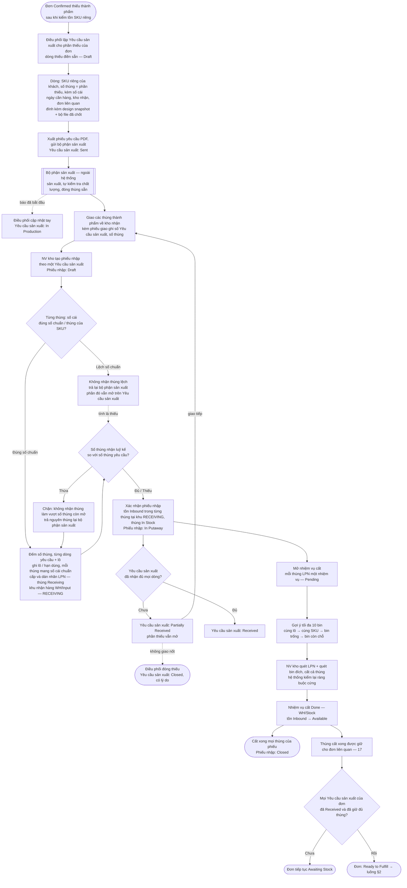

> Nhập kho theo Yêu cầu sản xuất còn ở `Sent` thì hệ thống chuyển yêu cầu sang `In Production` trước rồi mới ghi nhận số đã nhận ([17](../ecommerce/17-order-management/README.md) §4.3). Hàng giao rời, chưa đóng thùng thì không nhận. Thùng lỗi thấy rõ khi kiểm đếm không được nhận, trả nguyên thùng lại bộ phận sản xuất ngay; thùng lỗi phát hiện sau khi xác nhận phiếu được cách ly nguyên thùng sang khu `QUARANTINE` / điều chỉnh tồn ([20](../warehouse/20-inventory-control/README.md)) và đổi trả với bộ phận sản xuất ngoài hệ thống — ⚠️ giả định, xem [open-questions](../open-questions/README.md).

> **Đã chốt 2026-11-05:** bộ phận sản xuất đóng **mọi thùng đúng số cái chuẩn / thùng** của SKU; kho đếm **số thùng**, thùng lệch số chuẩn không nhận và phần đó vẫn mở trên Yêu cầu sản xuất ([03](../warehouse/03-receipt/README.md) BR-13, [open-questions B24](../open-questions/README.md)). ⚠️ Giả định: thùng phát hiện lệch số chuẩn **sau khi xác nhận nhập** không được phân bổ, chuyển sang khu `QUARANTINE` rồi ghi giảm cả thùng bằng điều chỉnh có duyệt — xem [open-questions C34](../open-questions/README.md).

### 1.2. Sequence diagram (trình tự tác nhân)

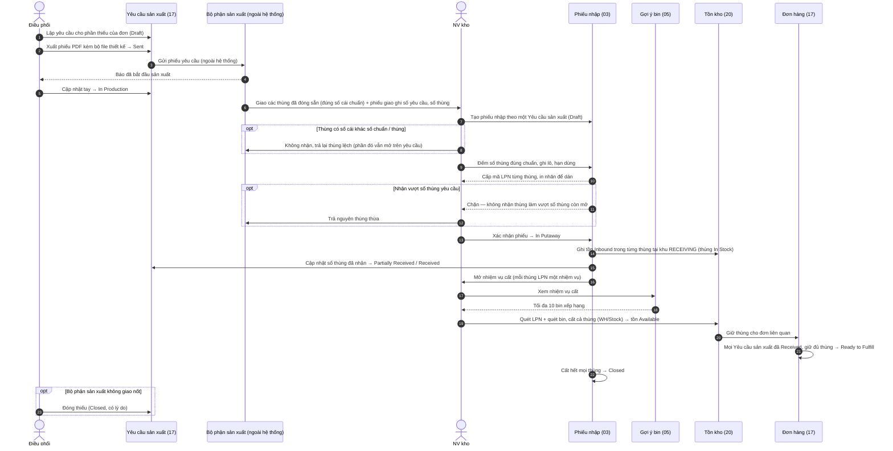

---

## 2. Luồng Fulfillment

Chi tiết: [17 · Order Management §4.2–4.6](../ecommerce/17-order-management/README.md), [07 · Picking](../warehouse/07-picking/README.md), [08 · Kiểm thùng & Dán nhãn giao hàng](../warehouse/08-packing/README.md), [09 · Shipping](../warehouse/09-shipping/README.md).

### 2.1. Flowchart tổng thể

> **Đã chốt 2026-11-05:** dòng đơn ghi **số thùng N**; mọi thùng đúng số cái chuẩn nên giữ hàng / phân bổ = **chọn đủ N thùng LPN** của SKU, ưu tiên FEFO / FIFO. Chỉ có sẵn k < N thùng thì giữ k thùng, **N − k thùng còn lại là thiếu** — Điều phối gửi Yêu cầu sản xuất cho phần thiếu (tính theo thùng) hoặc Sale thoả thuận lại số thùng với khách ([07](../warehouse/07-picking/README.md) BR-03, [17](../ecommerce/17-order-management/README.md) §4.2, BR-21, [open-questions C32](../open-questions/README.md)).

> ⚠️ Giả định: Điều phối quyết định có dùng **khu chờ xuất (`STAGING`)** cho đơn; lấy thùng sang `STAGING` chưa trừ tồn, lấy bổ sung vào cùng task, **chuyển cả tác vụ sang khu kiểm & dán nhãn** một lần cho cả task. Xem [open-questions](../open-questions/README.md).

```mermaid
flowchart TD
    CONF(["Đơn: Confirmed<br/>hợp đồng Signed, đủ đợt ON_SIGNING"]) --> CHECK["Hệ thống kiểm tồn SKU riêng khả dụng từng dòng, theo số thùng<br/>hàng dư từ đơn trước, hàng trả<br/>giữ đủ N thùng của dòng, hoặc số thùng có sẵn"]
    CHECK --> SETUP["Điều phối chọn kho xuất<br/>và cách giao: gửi kiện / giao nguyên chuyến"]
    SETUP --> ENOUGH{"Đủ hàng?<br/>mỗi dòng có đủ N thùng"}

    ENOUGH -->|"Thiếu thùng"| PR_SEND["Điều phối lập và gửi Yêu cầu sản xuất<br/>cho phần thiếu, tính theo số thùng — luồng §1"]
    PR_SEND --> AWAIT["Đơn: Awaiting Stock<br/>Sale báo khách ngày giao mới nếu trễ hợp đồng"]
    AWAIT --> AW_CHOICE{"Phần có sẵn<br/>xử lý thế nào?"}
    AW_CHOICE -->|"Chờ đủ hàng"| AW_BIN["Thùng nằm tại bin, đã giữ cho đơn"]
    AW_CHOICE -->|"Điều phối dùng khu chờ xuất: đích STAGING"| TASK
    AW_CHOICE -->|"Sale cho phép giao một phần: đích PACKING"| TASK
    AW_BIN -.->|"thành phẩm nhập kho, cất xong — §1"| RECV["Mọi Yêu cầu sản xuất của đơn đã Received, giữ đủ thùng<br/>Đơn: Ready to Fulfill<br/>đợt BEFORE_DELIVERY → Due"]

    ENOUGH -->|Đủ| RELEASE["Điều phối release, phân bổ đủ N thùng LPN cụ thể mỗi dòng — bin, lô<br/>FEFO / FIFO<br/>Đơn: Ready to Fulfill — đợt BEFORE_DELIVERY → Due"]
    RELEASE --> TASK
    RECV --> HAS_TASK{"Đơn đã có task?"}
    HAS_TASK -->|Chưa| TASK["Điều phối / Quản lý kho tạo task, giao người<br/>chọn đích lấy hàng: PACKING / STAGING<br/>mỗi thùng đã phân bổ một dòng lấy hàng<br/>đơn Ready to Fulfill → Picking, đơn Awaiting Stock giữ nguyên"]
    HAS_TASK -->|Có| TOPUP["Phân bổ bổ sung đủ số thùng còn thiếu, thêm dòng vào cùng task<br/>giữ đích của task — task và đơn → Picking"]
    TOPUP --> PICK
    TASK --> PICK["Picker quét vị trí + quét LPN của thùng<br/>đúng thùng của dòng, không nhập số lượng"]

    PICK --> SHORT{"Lấy được thùng<br/>của dòng?"}
    SHORT -->|"Không thấy / hư hỏng"| SHORT_HOLD["Báo thiếu: dòng Short, đơn On Hold INVENTORY<br/>tự mở kiểm kê mù thùng đó"]
    SHORT_HOLD --> REALLOC{"Phân bổ lại được đủ số thùng thiếu<br/>từ thùng khác của SKU, cùng kho?"}
    REALLOC -->|"Được — tự gỡ treo"| PICK
    REALLOC -->|"Không"| SHORT_DECIDE(["Điều phối + Sale quyết:<br/>Yêu cầu sản xuất / thoả thuận lại số thùng /<br/>giao một phần rồi đóng phần còn lại / huỷ"])
    SHORT -->|"Lấy được"| DEST{"Đích lấy hàng?"}

    DEST -->|STAGING| STAGED["Dòng Staged: thùng chuyển nguyên sang khu STAGING, sổ MOVE<br/>chưa trừ tồn, phân bổ vẫn Held, giữ riêng cho đơn<br/>Task: Staged"]
    STAGED --> READY_OUT{"Đơn sẵn sàng xuất?<br/>đủ hàng, hoặc được giao một phần"}
    READY_OUT -->|"Chưa: chờ hàng / chờ đợt BEFORE_DELIVERY"| STAGED
    STAGED -.->|"phần thiếu nhập kho"| RECV
    READY_OUT -->|Rồi| TO_CHECK["Điều phối / Quản lý kho: chuyển cả tác vụ sang khu kiểm và dán nhãn<br/>một lần cho cả task, đơn không treo<br/>trừ tồn, sổ PICK, thùng và phân bổ Consumed — Task: Picked"]
    DEST -->|PACKING| PICKED["Dòng Picked: trừ tồn ngay, sổ PICK, thùng Consumed<br/>Task: Picked"]
    TO_CHECK --> CHECK_START
    PICKED --> CHECK_START["NV kho bắt đầu phiên kiểm thùng tại khu PACKING<br/>quét LPN từng thùng: đúng đơn, đúng SKU — thùng Checked<br/>thùng hư hỏng: loại → Removed, cất lại vào QUARANTINE"]

    CHECK_START --> LABEL["Kích thước, khối lượng theo quy cách thùng của SKU<br/>in và dán nhãn giao hàng lên từng thùng — Labeled<br/>thùng đầu tiên dán nhãn: khoá huỷ đơn, cách giao, địa chỉ"]
    LABEL --> COMPLETE{"Hoàn tất kiểm thùng:<br/>đủ thùng?"}
    COMPLETE -->|Đủ| PACKED["Phiên kiểm thùng: Completed<br/>Đơn: Packed — đã kiểm đủ thùng và dán nhãn<br/>Shipment: Ready to Dispatch"]
    COMPLETE -->|"Thiếu, đơn được giao một phần"| PART["Đơn: Partially Fulfilled<br/>Shipment: Ready to Dispatch<br/>phần còn lại lấy bổ sung sau"]
    PART -.->|"phần còn lại về kho"| RECV
    PACKED --> PAY_WARN["Cảnh báo nếu đợt BEFORE_DELIVERY chưa thu<br/>không chặn kiểm thùng"]
    PART --> PAY_WARN

    PAY_WARN --> MODE{"Cách giao?"}
    MODE -->|"Gửi kiện qua hãng"| PARCEL["Gán hãng, mở chuyến bàn giao cho một hãng<br/>quét LPN đủ kiện lên xe — mỗi thùng một kiện"]
    MODE -->|"Giao nguyên chuyến"| FTL["Load Planning 3D theo quy cách thùng — kế hoạch Confirmed, mỗi xe một chuyến<br/>đặt xe ngoài hệ thống, ghi nhận đặt xe<br/>bắt đầu xếp, quét LPN theo sơ đồ từng xe"]
    PARCEL --> GATE
    FTL --> GATE{"Mọi đợt BEFORE_DELIVERY đã Paid?<br/>đơn không treo"}
    GATE -->|Chưa| BLOCK["Từ chối ký bàn giao cả chuyến<br/>bỏ shipment đó ra, chờ ở khu DISPATCH<br/>tới khi Kế toán ghi nhận đủ tiền"]
    BLOCK -.-> GATE
    GATE -->|Rồi| HANDOVER["Ký bàn giao — tất cả hoặc không<br/>Shipment: Handed Over"]
    HANDOVER --> SHIPPED["Đơn: Shipped, hoặc Partially Fulfilled nếu còn phần chưa giao<br/>không theo dõi hành trình, không thu tiền khi giao"]

    SHIPPED --> RESULT{"Hãng báo kết quả<br/>Điều phối cập nhật"}
    RESULT -->|"Thành công"| DELIVERED["Đơn: Delivered<br/>đợt AFTER_DELIVERY đến hạn — công nợ phải thu"]
    RESULT -->|"Thất bại, có lý do"| FAILED["Đơn: Delivery Failed"]
    FAILED -->|"Hãng giao lại thành công"| DELIVERED
    FAILED -->|"Hàng hoàn về kho"| RTO(["Đơn: Returned — nhập lại kho, xử lý hoàn tiền"])
    DELIVERED --> AUTO["Mỗi đêm: sau 7 ngày, mọi đợt Paid,<br/>không có yêu cầu trả hàng — Đơn: Completed"]
    AUTO --> CLOSED(["Sau 30 ngày: Closed"])
```

### 2.2. Sequence diagram (trình tự tác nhân)

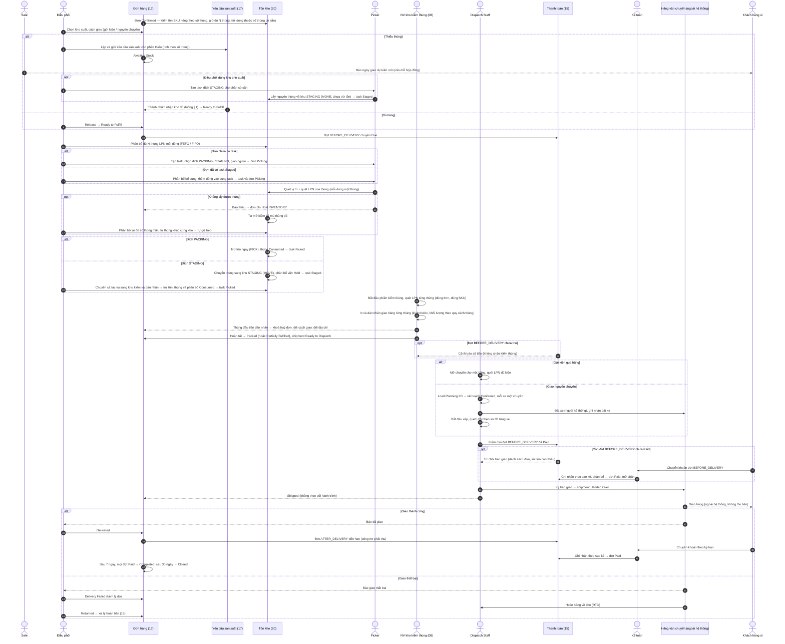

### 2.3. Vòng đời Yêu cầu sản xuất (Production Request)

Chi tiết trạng thái & điều kiện chuyển xem [17 · Order Management §5.3](../ecommerce/17-order-management/README.md). Yêu cầu sản xuất **chỉ phát sinh từ đơn**: Điều phối lập cho phần thiếu của đơn `Confirmed` sau khi đã kiểm tồn SKU riêng; không có yêu cầu bổ sung tồn. `Partially Received` / `Received` do hệ thống chuyển khi nhập kho theo thùng ([03](../warehouse/03-receipt/README.md)).

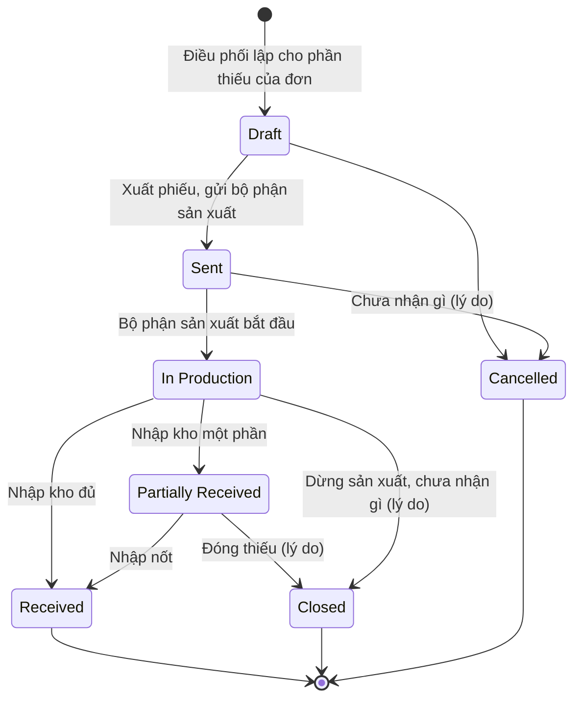

> ⚠️ Giả định: Yêu cầu sản xuất `In Production` mà bộ phận sản xuất dừng hẳn khi chưa giao gì thì Điều phối **đóng** (`Closed`, bắt buộc lý do), không huỷ. Xem [open-questions](../open-questions/README.md).

### 2.4. Vòng đời phiên kiểm thùng & thùng giao (Outbound Check & Labeling)

Chi tiết: [08 · Kiểm thùng & Dán nhãn giao hàng §5](../warehouse/08-packing/README.md). Thùng LPN là kiện giao: kho chỉ quét kiểm đủ thùng, dán nhãn giao hàng và gom thùng thành shipment — không chọn loại kiện, không cân đo, không niêm phong. Khi **thùng đầu tiên** của đơn được dán nhãn, đơn không huỷ được, không đổi cách giao, không đổi địa chỉ giao ([08](../warehouse/08-packing/README.md) BR-04).

**Phiên kiểm thùng (theo đơn):**

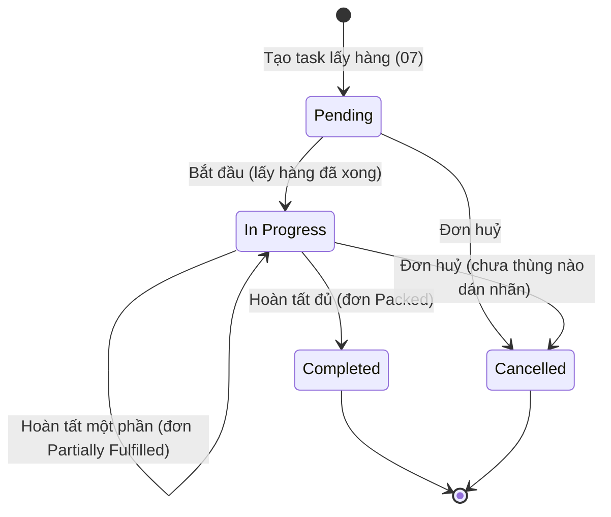

**Thùng giao (Outbound carton):**

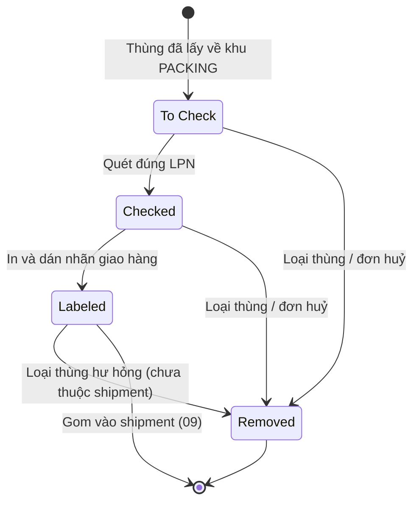

> Thùng `Removed` vào hàng chờ cất lại ([07](../warehouse/07-picking/README.md) §4.5); thùng hư hỏng được cất nguyên thùng vào khu `QUARANTINE` ([20](../warehouse/20-inventory-control/README.md) §4.8). Sau khi vào shipment, vòng đời của thùng theo shipment ở [09](../warehouse/09-shipping/README.md) §5.1.

### 2.5. Vòng đời kế hoạch chuyến xe (Load Plan — giao nguyên chuyến)

Chi tiết: [09 · Shipping §4.2, §5.3](../warehouse/09-shipping/README.md#42-giao-nguyên-chuyến--lập-kế-hoạch-xếp-hàng-3d-load-planning). Dùng cho đơn khách giao nguyên chuyến và lệnh chuyển kho nguyên chuyến ([10](../warehouse/10-inter-warehouse-transfer/README.md)); một kế hoạch không trộn đơn khách với lệnh chuyển kho. **Kiện là thùng LPN**, kích thước / khối lượng theo quy cách thùng của SKU ([09](../warehouse/09-shipping/README.md) BR-17). Khi chốt, mỗi xe là một chuyến bàn giao. Kế hoạch không có nhánh gỡ kiện vì huỷ đơn — đơn đã có thùng dán nhãn thì không huỷ được; bỏ kiện khỏi kế hoạch (thùng hư hỏng, đơn chưa thu đợt `BEFORE_DELIVERY`) thì mở lại về `Planned` khi chưa xe nào bắt đầu xếp.

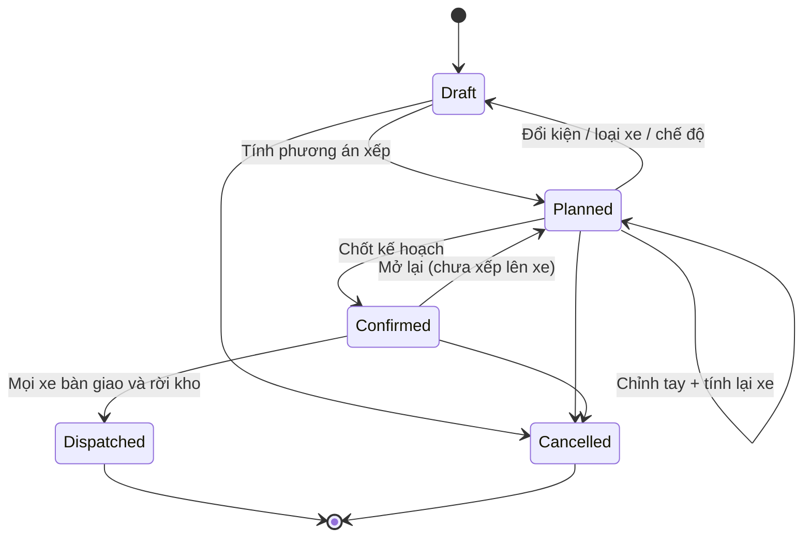

---

## 3. Luồng Transfer giữa các kho

Chi tiết: [10 · Inter-warehouse Transfer](../warehouse/10-inter-warehouse-transfer/README.md). Lệnh chuyển kho **chuyển nguyên thùng**: mỗi dòng ghi **số thùng**, kho nguồn phải đủ số thùng tự do; phân bổ = chọn đủ N thùng theo FEFO / FIFO ([10](../warehouse/10-inter-warehouse-transfer/README.md) BR-13); thùng LPN là kiện chuyển đi.

> ⚠️ Giả định: ngưỡng duyệt lệnh chuyển kho tính theo **tổng số thùng**, mặc định **100 thùng** ([10](../warehouse/10-inter-warehouse-transfer/README.md) BR-08). Xem [open-questions C35](../open-questions/README.md).

### 3.1. Flowchart tổng thể

> ⚠️ Từ bước **Kho đích: tạo phiếu nhận** trở đi (nhận, đối chiếu chênh lệch, cất hàng, đóng lệnh) là **phạm vi giai đoạn sau** — lệnh hiện dừng ở `In Transit` ([10](../warehouse/10-inter-warehouse-transfer/README.md) §4 bước 8–11, [open-questions C26](../open-questions/README.md)). Các bước đó vẽ **nét đứt**.

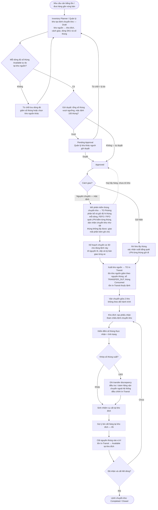

### 3.2. Sequence diagram (trình tự tác nhân)

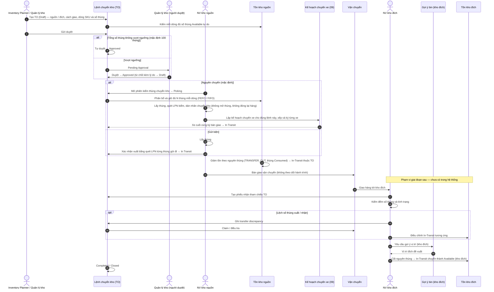

---

## 4. Phụ lục

### 4.1. Luồng bán sỉ theo hợp đồng (Mẫu & thiết kế → Báo giá → Đơn → Hợp đồng → Đợt thanh toán → Công nợ)

Chi tiết: [12 · Mẫu & thiết kế](../ecommerce/12-product-design/README.md), [14 · Báo giá, Đơn hàng & Hợp đồng](../ecommerce/14-cart-and-order/README.md), [15 · Thanh toán theo hợp đồng & Công nợ](../ecommerce/15-payment/README.md). Khách **không tự đặt hàng** trên sàn: đơn do Sale tạo từ báo giá đã chấp nhận. Dòng báo giá / đơn chỉ là **SKU thành phẩm riêng của khách** (không còn hàng trơn), ghi **số thùng** (kèm số cái / thùng) và **đơn giá theo cái**; MOQ và bậc giá theo số thùng; thành tiền dòng = số thùng × số cái / thùng × đơn giá / cái ([14](../ecommerce/14-cart-and-order/README.md) BR-07, BR-08).

```mermaid
flowchart TD
    ENTRY(["Khách sỉ xem quy cách trên sàn, liên hệ Sale<br/>chat / điện thoại / email"]) --> PATH{"Hàng in theo<br/>mẫu mới?"}
    PATH -->|Có| CUST_INPUT["Khách đưa mẫu: logo, file, ảnh, mẫu vật<br/>Sale ghi nhận yêu cầu thiết kế — Draft (12)"]
    CUST_INPUT --> DESIGN["Người thiết kế tải bộ file<br/>Sale / Quản trị bán hàng"]
    DESIGN --> REVIEW{"Quản trị bán hàng duyệt kỹ thuật<br/>người duyệt khác người thiết kế"}
    REVIEW -->|"Không đạt"| DESIGN
    REVIEW -->|Đạt| SUBMIT["Gửi khách xác nhận trên sàn — Submitted<br/>quy cách phải đã có quy cách thùng"]
    SUBMIT --> CUST_OK{"Khách xác nhận?"}
    CUST_OK -->|"Yêu cầu sửa"| DESIGN
    CUST_OK -->|"Xác nhận"| SNAP["Design snapshot bất biến<br/>+ sinh SKU thành phẩm riêng của khách, quy cách thùng theo quy cách — Approved"]
    PATH -->|"Không — SKU riêng của khách đã có"| QUOTE
    SNAP --> QUOTE["Sale lập báo giá (14)<br/>số thùng từng dòng, đơn giá / cái theo bảng giá riêng<br/>bậc giá và MOQ theo số thùng, hiệu lực — Sent"]

    QUOTE --> Q_RESP{"Khách phản hồi trên sàn<br/>hoặc thẻ hành động trong chat"}
    Q_RESP -->|"Yêu cầu sửa"| Q_REV["Changes Requested → bản sửa mới"]
    Q_REV --> QUOTE
    Q_RESP -->|"Hết hiệu lực"| Q_EXP(["Báo giá: Expired"])
    Q_RESP -->|"Chấp nhận, chọn số thùng ≥ MOQ"| ACCEPT["Báo giá: Accepted"]
    ACCEPT --> ORDER["Sale tạo đơn từ báo giá<br/>chốt số thùng, số cái / thùng, đơn giá / cái<br/>Đơn: Draft — báo giá Converted"]

    ORDER --> CONTRACT["Sale lập hợp đồng mua bán — Draft<br/>các bên, dòng hàng & giá, điều khoản giao<br/>lịch thanh toán: ON_SIGNING / BEFORE_DELIVERY / AFTER_DELIVERY"]
    CONTRACT --> SEND["Gửi hợp đồng — Sent<br/>Đơn: Pending Contract<br/>cảnh báo nếu vượt hạn mức / quá hạn"]
    SEND --> SIGN{"Khách ký?<br/>ngoài hệ thống"}
    SIGN -->|"Từ chối / cần sửa"| C_CANCEL["Huỷ hợp đồng, có lý do<br/>đơn về Draft để lập hợp đồng thay thế, hoặc huỷ đơn"]
    C_CANCEL -.-> CONTRACT
    SIGN -->|"Đã ký"| SIGNED["Sale tải bản scan → hợp đồng Signed<br/>sinh các đợt thanh toán — Not Due"]

    SIGNED --> CREDIT{"Có đợt AFTER_DELIVERY và khách<br/>quá hạn / vượt hạn mức?"}
    CREDIT -->|Có| HOLD["Đơn: On Hold — tín dụng<br/>Kế toán duyệt / từ chối"]
    HOLD -->|"Từ chối"| O_CANCEL(["Đơn: Cancelled — CREDIT_REJECTED"])
    HOLD -->|Duyệt| ONSIGN
    CREDIT -->|Không| ONSIGN{"Đợt ON_SIGNING đã thu đủ<br/>hoặc không có?"}
    ONSIGN -->|Chưa| PP["Đơn: Pending Payment<br/>khách chuyển khoản, Kế toán ghi nhận & phân bổ"]
    PP -->|"Thu đủ"| CONFIRMED
    ONSIGN -->|Rồi| CONFIRMED(["Đơn: Confirmed → kiểm tồn & Fulfillment — §2"])
    CONFIRMED -.-> AFTER["Đợt BEFORE_DELIVERY chặn bàn giao tới khi Paid<br/>sau giao: đợt AFTER_DELIVERY là công nợ phải thu<br/>mọi đợt Paid và đơn hoàn tất → hợp đồng Completed"]
```

### 4.2. Vòng đời đơn hàng (Order)

Chi tiết: [17 · Order Management §5.1](../ecommerce/17-order-management/README.md). Sơ đồ vẽ theo bảng chuyển tiếp của 17 §5.1.

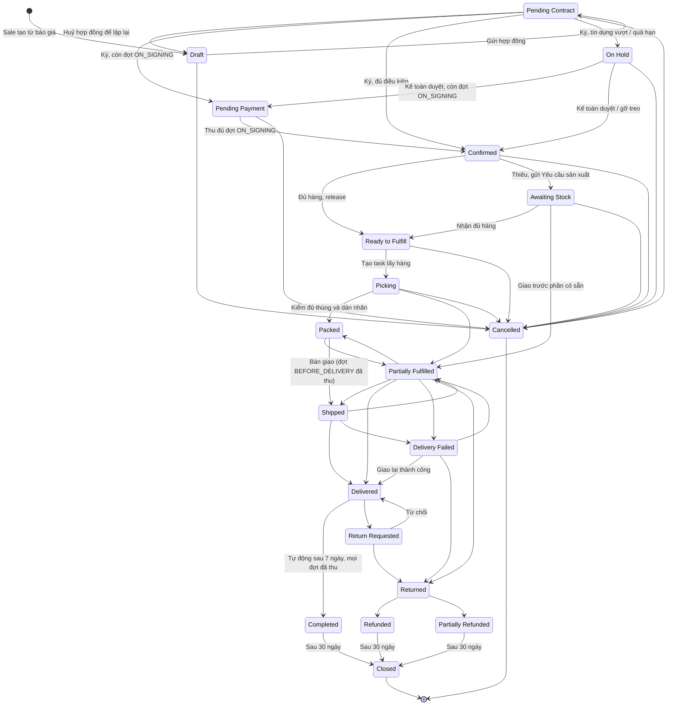

> Treo tay (`On Hold`) được từ `Confirmed`, `Awaiting Stock`, `Ready to Fulfill`, `Picking`, `Partially Fulfilled`, `Packed`; gỡ treo quay về đúng trạng thái trước đó ([17](../ecommerce/17-order-management/README.md) §4.9). Sơ đồ chỉ vẽ nhánh treo tín dụng để dễ đọc. `Packed` = **đã kiểm đủ thùng & dán nhãn giao hàng** ([08](../warehouse/08-packing/README.md)). Mốc hết huỷ là khi **thùng đầu tiên của đơn được dán nhãn giao hàng** (08 BR-04): từ đó đơn không huỷ được, không đổi cách giao, không đổi địa chỉ giao — kể cả khi đơn còn `Picking`.

### 4.3. Vòng đời hợp đồng mua bán & đợt thanh toán

Chi tiết: [14 · §5.2 Hợp đồng mua bán](../ecommerce/14-cart-and-order/README.md), [15 · §5.1 Đợt thanh toán](../ecommerce/15-payment/README.md).

| Mốc đến hạn của đợt | Chuyển `Due` khi | Ảnh hưởng tới đơn |
|---------------------|------------------|-------------------|
| `ON_SIGNING` | Hợp đồng `Signed` | Chưa thu đủ → đơn `Pending Payment` |
| `BEFORE_DELIVERY` | Đơn `Ready to Fulfill` | Chưa `Paid` → chặn bàn giao vận chuyển ([09](../warehouse/09-shipping/README.md) BR-04) |
| `AFTER_DELIVERY` | Đơn `Delivered` (+ N ngày là hạn trả) | Công nợ phải thu có kỳ hạn |

**Hợp đồng mua bán (Sales Contract):**

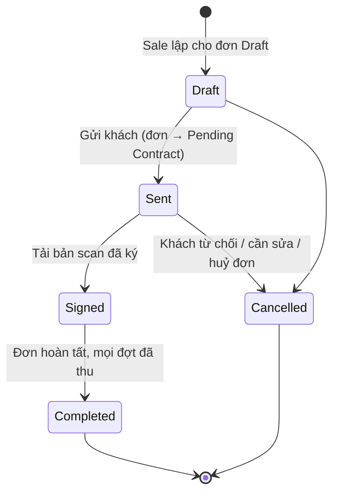

**Đợt thanh toán (Payment Installment):**

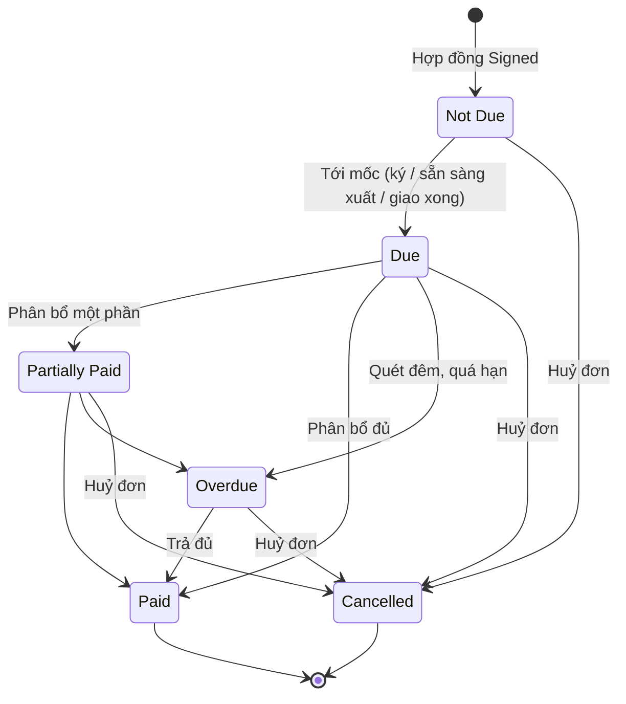

> ⚠️ Giả định: trạng thái `Cancelled` của đợt (khi huỷ đơn) bổ sung ngoài danh sách trạng thái đã chốt; đơn huỷ sau khi hợp đồng `Signed` thì hợp đồng giữ `Signed` và chuyển `Completed` khi phí huỷ / hoàn tiền xử lý xong. **Khoản phí huỷ** dùng cùng vòng đời đợt, bắt đầu từ `Due`. Xem [open-questions](../open-questions/README.md).

### 4.4. Luồng di chuyển nguyên thùng trong một kho (Intra-warehouse)

Chi tiết: [11 · Intra-warehouse Transfer](../warehouse/11-intra-warehouse-transfer/README.md). **Di chuyển nguyên thùng LPN bằng tay nằm trong phạm vi hiện tại** *(Đã chốt 2026-11-04)*: quét thùng, quét vị trí đích, ghi ngay; không mở thùng, không di chuyển một phần thùng. Tự động đưa thùng ra vùng lấy hàng, re-slotting và nhiệm vụ di chuyển là phạm vi giai đoạn sau ([C2, C24](../open-questions/README.md)). Lấy hàng về khu chờ xuất và cất lại thùng của đơn huỷ thuộc [07](../warehouse/07-picking/README.md), cách ly sang khu `QUARANTINE` thuộc [20](../warehouse/20-inventory-control/README.md) — không đi luồng này.

> ⚠️ Giả định: một lần xác nhận gồm **một hoặc nhiều thùng** tới **một vị trí đích**, mỗi thùng một dòng sổ `MOVE`; một thùng không hợp lệ thì cả lần không thực hiện. Thao tác không kiểm lớp lưu trữ, sức chứa, tải trọng của vị trí đích. Xem [open-questions C24](../open-questions/README.md).

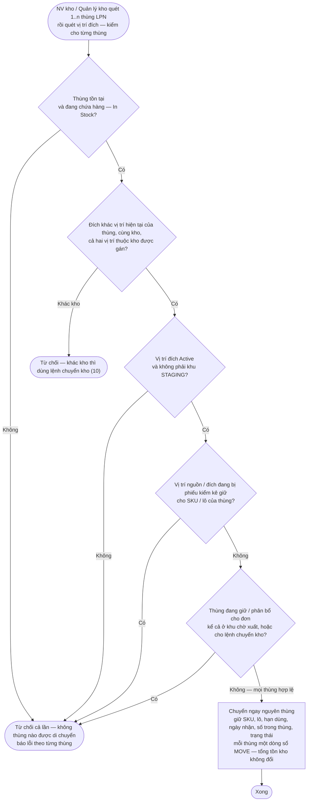

> Thùng không nằm ở vị trí sổ sách: không dùng thao tác này để sửa — lập phiếu kiểm kê, chênh lệch đi qua điều chỉnh tồn có duyệt ([20](../warehouse/20-inventory-control/README.md) §4.2–4.3). Thùng nghi lệch số cái chuẩn: cách ly sang khu `QUARANTINE`, không phân bổ, ghi giảm cả thùng bằng điều chỉnh có duyệt (⚠️ giả định — [open-questions C34](../open-questions/README.md)).

---

## 5. Ghi chú về sơ đồ

- Các trạng thái viết hoa kiểu `Confirmed`, `In Transit`… là trạng thái chứng từ / nhiệm vụ, khớp với bảng vòng đời trong từng module; khi lệch, **bảng vòng đời trong module là chuẩn**. Trong `stateDiagram-v2`, trạng thái nhiều từ được khai báo bằng mã không dấu cách kèm nhãn hiển thị (ví dụ `state "Pending Contract" as PendingContract`).
- Sơ đồ mô tả **happy path + các nhánh ngoại lệ chính**; edge case chi tiết xem phần "Ràng buộc nghiệp vụ & Edge case" của module tương ứng.
- **Sản xuất nằm ngoài hệ thống** *(Đã chốt 2026-11-04)*: bước của bộ phận sản xuất vẽ dạng khối "ngoài hệ thống"; hệ thống chỉ quản lý **Yêu cầu sản xuất** ([17](../ecommerce/17-order-management/README.md) §4.3, §5.3) và **nhập kho thành phẩm** ([03](../warehouse/03-receipt/README.md)). Kho không kiểm tra chất lượng khi nhập.
- **Thùng LPN** *(Đã chốt 2026-11-04)*: mọi tồn nằm trong thùng do bộ phận sản xuất đóng sẵn; nhập, cất, di chuyển, lấy, chuyển kho và kiểm kê đều **nguyên thùng**, xác nhận bằng quét LPN. Thùng LPN là **kiện giao** — "kiện" trong các sơ đồ giao hàng là thùng LPN, kích thước / khối lượng theo quy cách thùng của SKU ([01](../warehouse/01-product-creation/README.md), [08](../warehouse/08-packing/README.md) BR-02, BR-07).
- **Số thùng** *(Đã chốt 2026-11-05)*: "số lượng" của dòng báo giá, đơn, Yêu cầu sản xuất, phiếu nhập, lệnh chuyển kho trong các sơ đồ là **số thùng**; mọi thùng đúng số cái chuẩn của SKU (không có thùng lẻ), giá vẫn theo cái; phân bổ = chọn đủ N thùng FEFO / FIFO ([01](../warehouse/01-product-creation/README.md) BR-11, [07](../warehouse/07-picking/README.md) BR-03).
- **Đơn vị vận chuyển** cũng nằm ngoài hệ thống: không tích hợp API, không theo dõi hành trình, không thu tiền khi giao; kết quả giao do Điều phối cập nhật ([09](../warehouse/09-shipping/README.md)).
- Bước vẽ **nét đứt** (`classDef later`) là **phạm vi giai đoạn sau**; mũi tên nét đứt là nhánh phụ / sự kiện chờ.
