# Sơ đồ luồng dữ liệu & trạng thái (Flow & State Diagrams)

Tất cả sơ đồ vẽ bằng **Mermaid**. Trên GitHub/GitLab và hầu hết trình xem Markdown, các khối ```mermaid``` được render tự động. Nếu trình xem không hỗ trợ, dán nội dung vào <https://mermaid.live>.

Mục lục:

1. [Luồng Procurement: PO → Receipt → Invoice → Putaway](#1-luồng-procurement)
2. [Luồng Fulfillment: Order → (Production) → Picking → Packing → Shipping](#2-luồng-fulfillment) — kèm vòng đời lệnh sản xuất (§2.3) và kế hoạch chuyến xe (§2.4)
3. [Luồng Transfer giữa các kho](#3-luồng-transfer-giữa-các-kho)
4. [Phụ lục: Luồng bán sỉ, luồng sản xuất (đơn hàng, gia công ngoài, mẫu) & luồng Transfer nội bộ kho](#4-phụ-lục)

---

## 1. Luồng Procurement

### 1.1. Flowchart tổng thể

> ⚠️ Phần **đối chiếu hoá đơn** là **phạm vi giai đoạn sau** ([04](../warehouse/04-invoice/README.md)) — vẽ **nét đứt**.

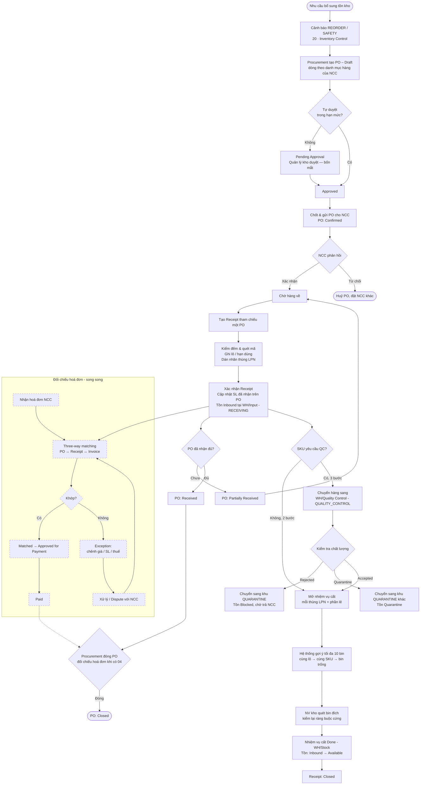

### 1.2. Sequence diagram (trình tự tác nhân)

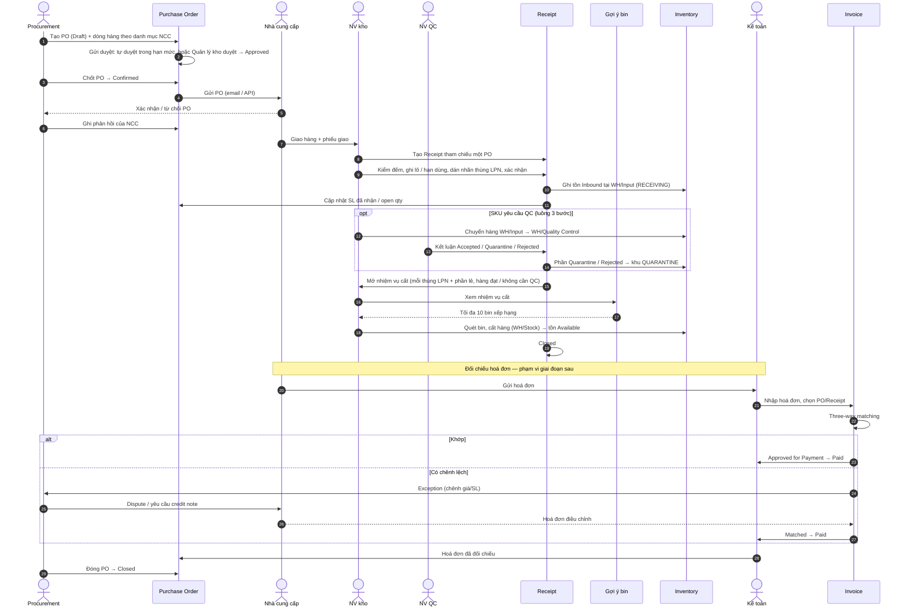

---

## 2. Luồng Fulfillment

### 2.1. Flowchart tổng thể

```mermaid
flowchart TD
    ORDER([Order: Confirmed]) --> SOURCE[Order Coordinator chọn kho xuất & release đơn\ndòng tùy chỉnh: kho có xưởng in]
    SOURCE --> PRINT{Có dòng tùy chỉnh?}
    PRINT -- Không --> READY[Order: Ready to Fulfill\nrelease lệnh xuất]

    PRINT -- Có --> MO[Sinh LSX ORDER / dòng — Pending Prepress\nOrder: In Production]
    MO --> PREPRESS{Prepress file in đạt?\nchecksum khớp}
    PREPRESS -- Không --> MO_HOLD[Lệnh On Hold\nSale liên hệ khách sửa file]
    MO_HOLD --> PREPRESS
    PREPRESS -- Có --> QUEUE[LSX Ready: vào hàng đợi\ntheo hạn hoàn thành]
    QUEUE --> BLANK[NV kho quét xuất phôi từ bin\nsang khu PRODUCTION\nLSX Material Issued]
    BLANK --> PRINTING[Production Staff in\nLSX Printing → báo SL in được / phế phẩm]
    PRINTING --> PQC{LSX QC: theo mẫu đã duyệt\nđủ SL đạt?}
    PQC -- Không --> REWORK[Phần hỏng xuất huỷ\nLSX quay về Ready để in bù]
    REWORK --> QUEUE
    PQC -- Có --> TO_PACK[Thành phẩm → khu PACKING, ghi tiêu thụ\nLSX Completed]
    PREPRESS -. xưởng không kịp hạn:\ntách một phần gia công ngoài .-> SUBC[LSX con gia công\nxem §4.2]
    SUBC -. hàng về, QC đạt .-> TO_PACK
    TO_PACK --> ALL_DONE{Mọi lệnh của đơn\nđã Completed?}
    ALL_DONE -- Chưa --> WAIT_MO[Chờ các lệnh còn lại]
    WAIT_MO --> ALL_DONE
    ALL_DONE -- Rồi --> READY_P[Order: Ready to Fulfill]
    MO -. đơn hỗn hợp: dòng hàng thường lấy song song\nSale cho phép giao một phần thì giao trước khi in xong .-> TASK
    READY_P --> HAS_STD{Còn dòng hàng thường\nchưa lấy?}
    HAS_STD -- Có --> TASK
    HAS_STD -- Không --> PACK_CHECK

    READY --> TASK[Điều phối / Quản lý kho tạo task\ngiao người — dòng lấy theo bin & lô\nđã phân bổ khi release]
    TASK --> PICK[Picker lấy hàng\nquét vị trí + SKU hoặc LPN thùng + số lượng\ntồn bị trừ ngay khi quét]

    PICK --> SHORT{Đủ hàng?}
    SHORT -- Thiếu --> SHORT_HOLD[Báo thiếu: đơn On Hold INVENTORY\nkiểm kê mù vị trí đó]
    SHORT_HOLD --> REALLOC{Điều phối phân bổ lại\ntừ bin khác cùng kho?}
    REALLOC -- Được --> PICK
    REALLOC -- Không đủ hàng --> PARTIAL[Điều phối + Sale quyết:\ngiao một phần / đóng phần còn lại / huỷ]
    SHORT -- Đủ --> PACK_CHECK

    PACK_CHECK[Packing: Packer bắt đầu phiên\nmở kiện, cho hàng vào] --> PACK_BOX[Niêm phong kiện\ncân & đo bắt buộc\nkit: đủ N kiện]
    PACK_BOX --> LABEL[In nhãn kiện nội bộ\nmã đơn, mã kiện, địa chỉ,\nsố tiền thu khi giao nếu có]
    LABEL --> COMPLETE[Hoàn tất đóng gói\nthiếu hàng: chỉ khi được giao một phần]
    COMPLETE --> PACK_DESIGN{Có dòng in?}
    PACK_DESIGN -- Không --> PACKED
    PACK_DESIGN -- Có --> PACK_FAIL{Checksum thiết kế khớp?}
    PACK_FAIL -- Không --> DESIGN_HOLD[Phiên + đơn On Hold\nDESIGN_MISMATCH]
    DESIGN_HOLD --> REVERIFY[Quản lý kho xác minh lại]
    REVERIFY --> COMPLETE
    PACK_FAIL -- Có --> PACKED[Order: Packed / Partially Fulfilled\nShipment: Ready to Dispatch]

    PACKED --> MODE{Hình thức giao?}
    MODE -- Gửi kiện qua hãng --> PICKUP[Mở chuyến bàn giao cho một hãng\nquét đủ kiện]
    PICKUP --> HANDOVER[Ký bàn giao — tất cả hoặc không\nchặn nếu đơn chưa đủ tiền phải thu trước khi giao\nShipment: Handed Over]
    MODE -- Giao nguyên chuyến --> LOADPLAN[Load Planning 3D\nKế hoạch chuyến xe:\nDraft → Planned → Confirmed\nmỗi xe một chuyến bàn giao]
    LOADPLAN --> BOOK[Đặt xe với hãng ngoài hệ thống\nghi nhận đặt xe]
    BOOK --> LOAD[Bắt đầu xếp → khoá kế hoạch\nquét kiện theo sơ đồ từng xe]
    LOAD --> HANDOVER
    HANDOVER --> SHIPPED[Order: Shipped\nkhông theo dõi hành trình]
    SHIPPED --> DELIV{Hãng báo kết quả\nOrder Coordinator cập nhật}
    DELIV -- Thành công --> DELIVERED[Order: Delivered]
    DELIV -- Thất bại --> FAILED[Order: Delivery Failed]
    FAILED -- Hãng giao lại thành công --> DELIVERED
    FAILED -- Hàng hoàn về --> RTO[Returned\nNhập lại kho qua Receipt]

    DELIVERED --> BAL{Còn phải thu?\ncông nợ / phần sau cọc}
    BAL -- Có --> RECON[Ghi công nợ phải thu /\nthu phần còn lại → Paid]
    BAL -- Không --> DONE
    RECON --> DONE([Order: Completed / Closed])
```

### 2.2. Sequence diagram (trình tự tác nhân)

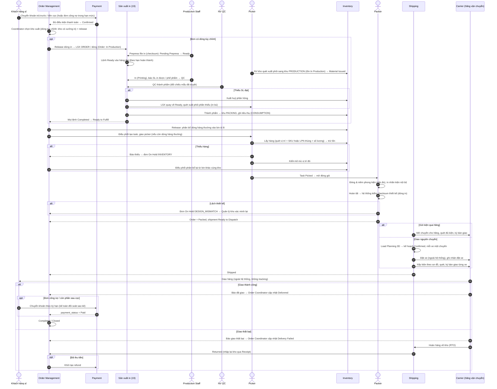

### 2.3. Vòng đời lệnh sản xuất (Production Order)

Chi tiết trạng thái & điều kiện chuyển xem [19 · Production §5](../warehouse/19-production/README.md). Áp dụng cho cả LSX `SAMPLE` và `ORDER`; nhánh `Subcontracted` chỉ dành cho LSX gia công ngoài. Hàng đợi là cách xem các lệnh `Ready`, không phải trạng thái.

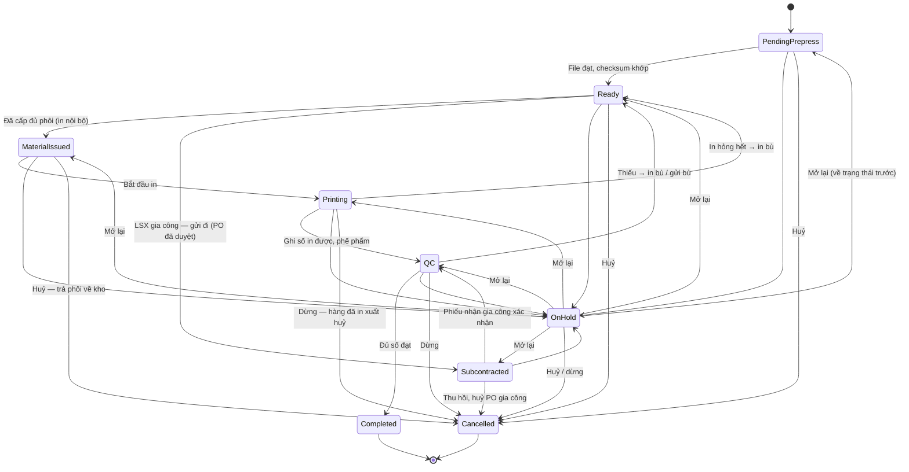

### 2.4. Vòng đời kế hoạch chuyến xe (Load Plan — giao nguyên chuyến)

Chi tiết: [09 · Shipping §4.2](../warehouse/09-shipping/README.md#42-giao-nguyên-chuyến--lập-kế-hoạch-xếp-hàng-3d-load-planning). Dùng cho đơn khách giao nguyên chuyến và lệnh chuyển kho đi xe tải / container.

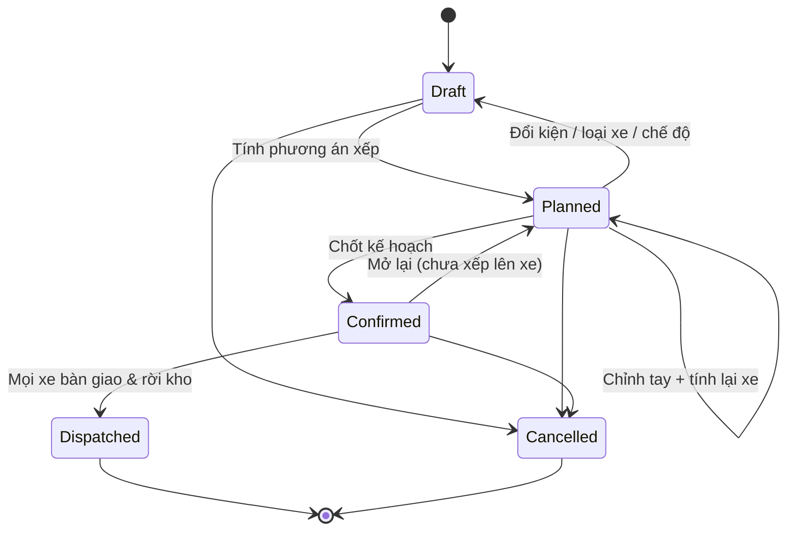

---

## 3. Luồng Transfer giữa các kho

### 3.1. Flowchart tổng thể

> ⚠️ Từ bước **Kho đích: tạo phiếu nhận** trở đi (nhận, đối chiếu chênh lệch, cất hàng, đóng lệnh) là **phạm vi giai đoạn sau** — lệnh hiện dừng ở `In Transit` ([10](../warehouse/10-inter-warehouse-transfer/README.md) §4 bước 8–11). Các bước đó vẽ **nét đứt**.

```mermaid
flowchart TD
    NEED([Nhu cầu cân bằng tồn / đưa hàng gần vùng bán]) --> TO_CREATE[Tạo Transfer Order – Draft\nKho nguồn → Kho đích + dòng SKU]
    TO_CREATE --> TO_CHECK{SL yêu cầu ≤ tồn Available\ntại kho nguồn?}
    TO_CHECK -- Không --> ADJUST[Điều chỉnh SL / chọn kho nguồn khác]
    ADJUST --> TO_CREATE
    TO_CHECK -- Có --> TO_APPROVE{Vượt ngưỡng duyệt?}
    TO_APPROVE -- Có --> TO_PENDING[Pending Approval] --> TO_APPROVED[Approved]
    TO_APPROVE -- Không --> TO_APPROVED

    TO_APPROVED --> SRC_PICK["Kho nguồn: phân bổ tồn + pick\nFEFO / FIFO, thùng nguyên trước"]
    SRC_PICK --> SRC_PACK[Đóng kiện, ghi khối lượng]
    SRC_PACK --> TRUCK{Đi xe tải / container?}
    TRUCK -- Có --> SRC_LOADPLAN[Load Planning 3D\nchốt kế hoạch chuyến xe,\nxếp kiện theo sơ đồ]
    SRC_LOADPLAN --> DISPATCH
    TRUCK -- Không --> DISPATCH[Xuất kho nguồn – Dispatch\nTồn kho nguồn giảm → In-Transit]

    DISPATCH --> TRANSPORT["Vận chuyển giữa 2 kho\n(không theo dõi hành trình)"]
    TRANSPORT --> DST_RECV[Kho đích: tạo phiếu nhận\ntham chiếu Transfer Order]
    DST_RECV --> DST_COUNT[Kiểm đếm SL thực nhận + tình trạng]
    DST_COUNT --> DISCREPANCY{Khớp SL xuất?}
    DISCREPANCY -- Lệch --> INVESTIGATE["Ghi transfer discrepancy\nĐiều tra / claim hãng VC (ngoài hệ thống)\nĐiều chỉnh In-Transit"]
    DISCREPANCY -- Khớp --> DST_PA
    INVESTIGATE --> DST_PA[Sinh Putaway task tại kho đích]

    DST_PA --> DST_SLOT[Gợi ý bin cất hàng tại kho đích — 05]
    DST_SLOT --> DST_MOVE[Đặt hàng vào vị trí\nTồn: In-Transit → Available tại kho đích]
    DST_MOVE --> TO_STATUS{Đã nhận & putaway hết dòng?}
    TO_STATUS -- Chưa --> DST_RECV
    TO_STATUS -- Rồi --> TO_DONE([Transfer Order: Completed / Closed])

    classDef later stroke-dasharray: 5 5
    class DST_RECV,DST_COUNT,DISCREPANCY,INVESTIGATE,DST_PA,DST_SLOT,DST_MOVE,TO_STATUS,TO_DONE later
```

### 3.2. Sequence diagram (trình tự tác nhân)

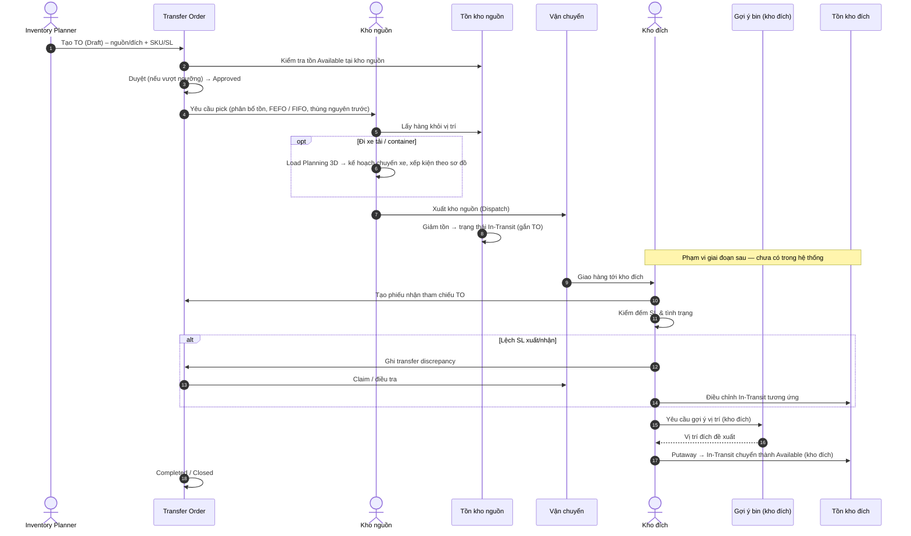

---

## 4. Phụ lục

### 4.1. Luồng bán sỉ (Báo giá → Mẫu → Đơn → Thanh toán)

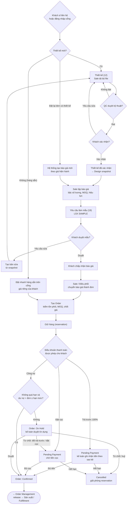

### 4.2. Luồng sản xuất đơn hàng và gia công ngoài

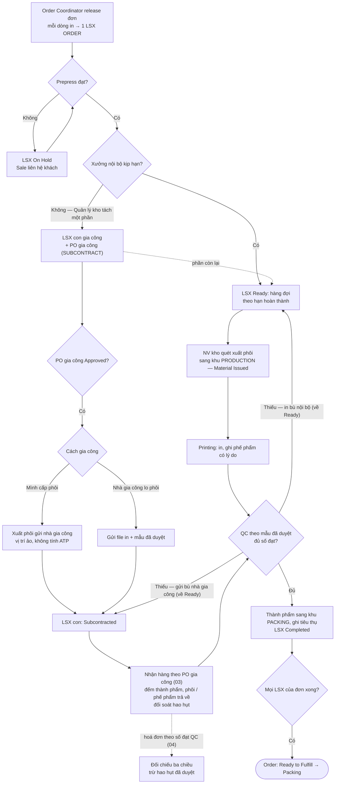

### 4.3. Luồng sản xuất mẫu (Sample)

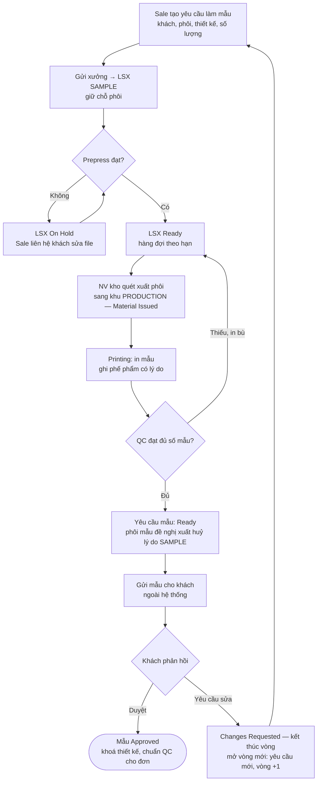

### 4.4. Luồng di chuyển hàng trong một kho (Intra-warehouse)

Bổ sung vùng picking tự động và nhiệm vụ di chuyển là phạm vi giai đoạn sau ([11](../warehouse/11-intra-warehouse-transfer/README.md), [C24](../open-questions/README.md)).

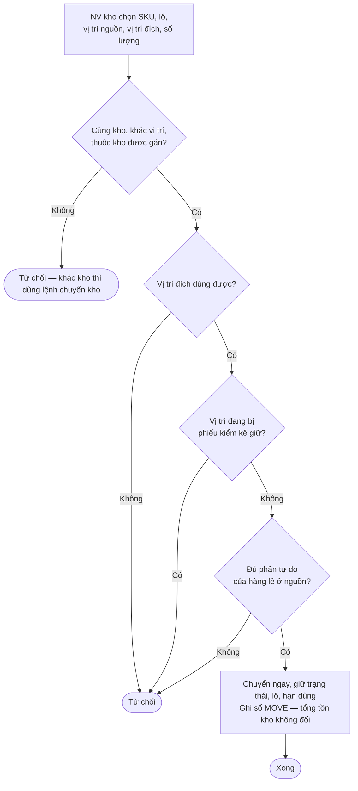

---

## 5. Ghi chú về sơ đồ

- Các trạng thái viết hoa kiểu `Confirmed`, `In Transit`… là trạng thái chứng từ/nhiệm vụ, khớp với bảng vòng đời trong từng module.
- Sơ đồ mô tả **happy path + các nhánh ngoại lệ chính**; edge case chi tiết xem phần "Ràng buộc nghiệp vụ & Edge case" của module tương ứng.
- Bước "Sản xuất in" trong luồng Fulfillment và luồng sản xuất mẫu mô tả xưởng in nội bộ (kèm gia công ngoài một phần lệnh đơn hàng) của [19 · Production](../warehouse/19-production/README.md) (đã chốt 2026-10-06).
