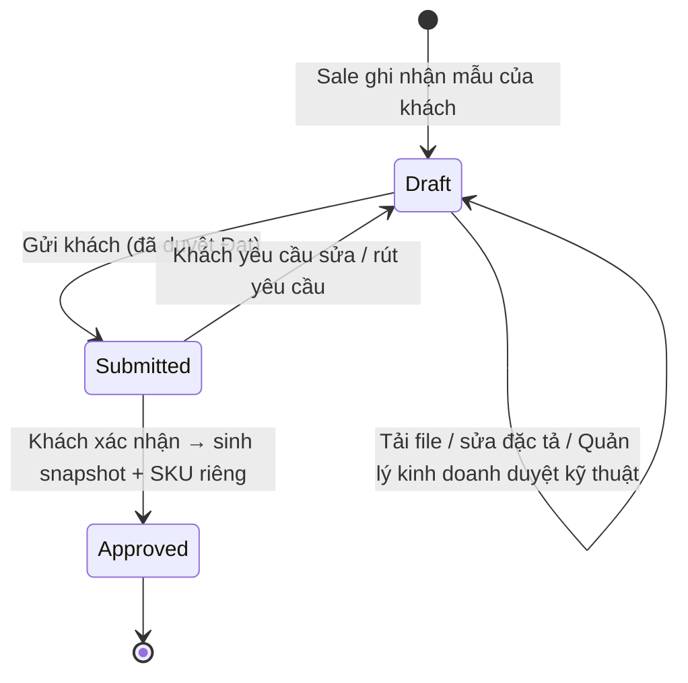

# 12 — Quản lý mẫu & thiết kế (Design Management)

> Đã chốt 2026-11-04: thiết kế bắt đầu từ **mẫu do khách (doanh nghiệp) đưa**; **Quản lý kinh doanh** duyệt kỹ thuật (người duyệt khác người thiết kế); khách xác nhận trên cổng khách hàng thì hệ thống sinh **design snapshot** và **SKU thành phẩm riêng của khách**. Sản xuất nằm ngoài hệ thống, nhận bộ file chốt qua **Đơn sản xuất** ([17](../17-order-management/README.md)).
>
> Đã chốt 2026-11-05: người duyệt kỹ thuật là role **Quản lý kinh doanh (Sales Manager)** (đổi tên role, việc giữ nguyên); chứng từ gửi sản xuất là **Đơn sản xuất (Production Order)** (đổi tên), gửi cho **đơn vị sản xuất** (xưởng của công ty hoặc đối tác ngoài). Đơn sản xuất có bước **duyệt mẫu in** ([17](../17-order-management/README.md)): khách duyệt mẫu in thử theo file đã chốt; nếu khách cần **sửa file thiết kế** (không phải lỗi in) thì quay về module này tạo **bản sửa** và sinh **SKU riêng mới** (§4.7).

## 1. Mục đích (Purpose)

Quản lý **mẫu và bản thiết kế in** (logo, nhận diện thương hiệu của quán đồ uống) trên ly và bao bì cho **từng khách sỉ**, từ lúc khách đưa mẫu tới khi khách **xác nhận**. Luồng gồm năm bước:

1. **Ghi nhận mẫu của khách** — Khách đưa mẫu (logo, file, ảnh, mẫu vật); Sale ghi nhận thành **yêu cầu thiết kế** (bản thiết kế ở `Draft`) và phân công người làm.
2. **Thiết kế** — Người thiết kế (Sale / Quản lý kinh doanh) tải lên **bộ file thiết kế** (file xem trước, đặc tả kỹ thuật, file in, hướng dẫn sản xuất).
3. **Duyệt kỹ thuật độc lập** — **Quản lý kinh doanh** (khác người thiết kế) duyệt bộ file trước khi gửi khách.
4. **Khách xác nhận** — Khách xác nhận trên cổng khách hàng.
5. **Chốt thiết kế** — Hệ thống sinh **design snapshot** và **SKU thành phẩm riêng** của khách ([01](../../warehouse/01-product-creation/README.md)).

Đầu ra:

- **Design snapshot** — bộ file và đặc tả đã được khách xác nhận, **bất biến**, mỗi file có **mã kiểm tra (checksum SHA-256)**.
- **SKU thành phẩm riêng của khách (customer-exclusive SKU)** — gắn với khách và snapshot; là **loại hàng duy nhất có tồn và được bán** (không còn hàng trơn): tồn, nhập, xuất, báo giá, đơn hàng đều theo SKU này.

Snapshot (qua SKU riêng) được dùng ở các bước sau:

- **Báo giá, đơn hàng & hợp đồng:** [14](../14-cart-and-order/README.md).
- **Đơn sản xuất:** [17](../17-order-management/README.md) — bộ file chốt được đính kèm Đơn sản xuất gửi đơn vị sản xuất; mẫu in thử (khi Đơn sản xuất bật cờ duyệt mẫu in) được in theo đúng bộ file này.

Ở mỗi lần gắn snapshot hoặc cấp link tải file, hệ thống kiểm lại checksum để chắc chắn đúng bộ file khách đã xác nhận.

> ⚠️ Giả định: phạm vi hiện tại **không** gồm trình thiết kế 2D cho khách tự thiết kế, xem trước 3D theo thời gian thực (Live 3D Preview) và kiểm tra kỹ thuật tự động (preflight `Pass` / `Warning` / `Fail`). Khách nhận và xác nhận **bộ file do nhân viên thiết kế**. Các tính năng trên được giữ làm **phạm vi giai đoạn sau**. Xem [open-questions B18](../../open-questions/README.md).

---

## 2. Actor liên quan

| Actor | Vai trò |
|-------|---------|
| **Khách hàng sỉ (B2B Customer)** — chủ sở hữu | Đưa mẫu cho Sale (qua [chat](../16-sales-chat/README.md) hoặc trực tiếp). Trên cổng khách hàng: xem bản thiết kế của mình, tải file mẫu tham khảo, **xác nhận** hoặc **yêu cầu sửa**, rút yêu cầu xác nhận, đề nghị sửa thiết kế đã xác nhận. Xem danh sách mẫu thiết kế của mình, kèm **mẫu in chờ duyệt** của Đơn sản xuất ([13](../13-catalog/README.md), [17](../17-order-management/README.md)). |
| **Nhân viên Sale (Sales Staff)** | Ghi nhận yêu cầu thiết kế từ mẫu khách đưa (lập bản thiết kế). Làm **người thiết kế**: tải bộ file, sửa đặc tả, gửi khách xác nhận, rút yêu cầu xác nhận, tạo bản sửa. Tra thiết kế đã xác nhận và SKU riêng của khách để báo giá. Lập **Đơn sản xuất** cho SKU riêng ([17](../17-order-management/README.md)) — snapshot của SKU được đính kèm; tải file theo quyền. |
| **Quản lý kinh doanh (Sales Manager)** | **Duyệt kỹ thuật** bộ file (**Đạt / Không đạt** kèm nhận xét) — chỉ khi **không phải người thiết kế / người sửa cuối** của bản đó. Đổi phân công trước khi khách xác nhận. Có thể làm người thiết kế (khi đó một Quản lý kinh doanh khác duyệt). Duyệt và gửi Đơn sản xuất ([17](../17-order-management/README.md)). |
| **Đơn vị sản xuất** *(ngoài hệ thống — xưởng của công ty hoặc đối tác ngoài)* | Nhận bộ file chốt kèm Đơn sản xuất; in **mẫu in thử** theo bộ file khi Đơn sản xuất cần duyệt mẫu in ([17](../17-order-management/README.md)); không thao tác trong module này. |
| **Hệ thống** | Quét mã độc file tải lên; tính checksum. Khi khách xác nhận: sinh snapshot, kiểm file lưu trữ khớp checksum, **sinh SKU thành phẩm riêng**. Kiểm lại checksum khi gắn báo giá / đơn / Đơn sản xuất và khi cấp link tải. Ghi lịch sử quyết định. |

- Chỉ chủ sở hữu, người thiết kế và người duyệt của một bản thiết kế mới thấy bản đó khi còn chưa xác nhận (BR-03).
- Khách không tự lập bản thiết kế; khách đưa mẫu, Sale ghi nhận.

---

## 3. Input / Output

### Input

| Trường | Mô tả | Bắt buộc |
|--------|-------|----------|
| Khách hàng | Một khách sỉ ([18](../18-customer-information/README.md)) | Có |
| Sản phẩm & quy cách | Một sản phẩm in theo mẫu (`CUSTOMIZABLE`) và **quy cách** (biến thể: dung tích, chất liệu…) sẽ in ([01](../../warehouse/01-product-creation/README.md)) | Có |
| Chủ sở hữu | Tài khoản khách hàng đang hoạt động, **thuộc đúng khách đó** | Có |
| **Mẫu của khách** | Logo, file gốc, ảnh, ảnh chụp mẫu vật khách đưa; mô tả yêu cầu. Lưu kèm bản thiết kế để tham khảo, **không** thuộc bộ file của snapshot | Không |
| Người thiết kế | Nhân viên Sale hoặc Quản lý kinh doanh đang hoạt động | Không (giao sau) |
| Người duyệt kỹ thuật | Quản lý kinh doanh đang hoạt động, khác chủ sở hữu và người thiết kế | Có |
| Tên thiết kế | ≤ 200 ký tự | Có |
| **Đặc tả kỹ thuật** | Mô tả bằng chữ (≤ 4.000 ký tự): vị trí in, kích thước, số màu, mã màu, kỹ thuật in, ghi chú cho đơn vị sản xuất… | Có |
| **Bộ file thiết kế** | Mỗi file mang một **vai trò** (bảng dưới). Định dạng JPEG / PNG / WebP / PDF, ≤ 50 MB mỗi file | `CUSTOMER_PREVIEW` bắt buộc trước khi duyệt |

**Vai trò của file trong bộ:**

| Vai trò | Dùng để | Người dùng chính |
|---------|---------|------------------|
| `CUSTOMER_PREVIEW` | Ảnh / PDF xem trước cho khách; là file được duyệt kỹ thuật và được khách xác nhận | Khách, người duyệt kỹ thuật, Sale |
| `TECHNICAL_SPEC` | Bản vẽ kỹ thuật: kích thước, vị trí, màu | Người duyệt kỹ thuật, đơn vị sản xuất |
| `PRINT_READY` | File in đúng chuẩn (bleed, DPI, hệ màu) | Đơn vị sản xuất (qua Đơn sản xuất) |
| `PRODUCTION_INSTRUCTION` | Hướng dẫn sản xuất, yêu cầu đóng thùng đặc biệt (đơn vị sản xuất đóng thùng trước khi giao về kho) | Đơn vị sản xuất |

### Output

| Kết quả | Mô tả | Dùng bởi |
|---------|-------|----------|
| **Bản thiết kế (design draft)** | Trạng thái, phân công, mẫu của khách, đặc tả, bộ file hiện tại, kết quả duyệt kỹ thuật | Người được phân công, khách |
| **Kết quả duyệt kỹ thuật** | Đạt / Không đạt + nhận xét, gắn với đúng file xem trước | Người thiết kế, khách |
| **Design snapshot** | Bộ file hiện tại lúc xác nhận (mỗi vai trò một file), checksum từng file và checksum cả bộ, đặc tả, người và thời điểm xác nhận. Bất biến. | [14](../14-cart-and-order/README.md), [17](../17-order-management/README.md) |
| **SKU thành phẩm riêng của khách** | SKU mới thuộc sản phẩm và quy cách của bản thiết kế, gắn khách sở hữu và snapshot; chỉ khách đó thấy và được báo giá / đặt | [01](../../warehouse/01-product-creation/README.md), [13](../13-catalog/README.md), [14](../14-cart-and-order/README.md), [17](../17-order-management/README.md), [03](../../warehouse/03-receipt/README.md), [20](../../warehouse/20-inventory-control/README.md) |
| **Lịch sử quyết định** | Mọi bước của bản thiết kế (BR-13) | Quản lý kinh doanh, Sale, kiểm toán |
| **Link tải file** | Link ngắn hạn, cấp theo quyền; file trong snapshot chỉ cấp khi checksum còn khớp | Khách, Sale, Quản lý kinh doanh, đơn vị sản xuất (qua Đơn sản xuất) |

---

## 4. Luồng nghiệp vụ từng bước (Step-by-step)

### 4.1. Ghi nhận mẫu của khách

1. Khách cần in logo / thiết kế mới, đưa mẫu cho Sale: gửi qua [chat](../16-sales-chat/README.md) (gắn ngữ cảnh sản phẩm), gửi email, hoặc đưa mẫu vật trực tiếp.
2. Sale lập bản thiết kế (yêu cầu thiết kế), gồm:
   - khách, sản phẩm và quy cách;
   - chủ sở hữu (tài khoản của khách);
   - mẫu của khách (tải lên file / ảnh khách gửi, ảnh chụp mẫu vật) và mô tả yêu cầu;
   - người thiết kế (mặc định là chính Sale đó);
   - người duyệt kỹ thuật (một Quản lý kinh doanh);
   - tên;
   - đặc tả ban đầu.
3. Hệ thống kiểm:
   - chủ sở hữu thuộc đúng khách (BR-01);
   - vai trò của từng người được giao (BR-02).

   Đạt thì tạo bản thiết kế ở `Draft`.

### 4.2. Thiết kế

4. Người thiết kế tải các file theo vai trò, cập nhật đặc tả. Khách cũng có thể tải thêm mẫu tham khảo (logo gốc, ảnh mẫu).
5. Mỗi lần tải là **một bản file mới**, không ghi đè. File mới nhất của mỗi vai trò tạo thành **bộ hiện tại**.
6. Mỗi thay đổi file hoặc đặc tả **xoá kết quả duyệt kỹ thuật trước đó** (BR-06).

### 4.3. Duyệt kỹ thuật

7. Quản lý kinh doanh được giao duyệt mở bộ hiện tại, kiểm khả năng in: vị trí và kích thước so với quy cách sản phẩm, màu, độ phân giải, file in, đối chiếu với mẫu của khách.
8. Người duyệt ghi **Đạt** hoặc **Không đạt**, kèm nhận xét (≤ 2.000 ký tự). Kết quả gắn với **đúng file xem trước hiện tại**.
   - Không đạt → người thiết kế sửa, tải lại, rồi duyệt lại.
   - Người duyệt không được là chủ sở hữu, người thiết kế hay người sửa cuối (BR-05).

### 4.4. Gửi khách xác nhận

9. Khi bộ hiện tại đã **Đạt**, người thiết kế gửi khách xác nhận → `Submitted`. Quy cách của bản thiết kế phải đã có **quy cách thùng** ([01](../../warehouse/01-product-creation/README.md)); chưa có thì không gửi được (⚠️ giả định — xem [open-questions](../../open-questions/README.md)). Khách thấy yêu cầu trên cổng khách hàng (mục mẫu thiết kế của tôi — [13](../13-catalog/README.md)); Sale có thể gửi kèm yêu cầu xác nhận vào [chat](../16-sales-chat/README.md).
10. Trong lúc chờ, không ai sửa được bản thiết kế. Muốn sửa thì người thiết kế hoặc khách **rút yêu cầu**: bản thiết kế về `Draft` và kết quả duyệt bị xoá.

### 4.5. Khách xác nhận hoặc yêu cầu sửa

11. Khách (chủ sở hữu) xem file xem trước và đặc tả, rồi chọn một trong hai:
    - **Xác nhận.** Hệ thống, trong cùng một bước (BR-09):
      - chụp **snapshot** của bộ hiện tại và đặc tả, tính checksum, kiểm file lưu trữ khớp;
      - **sinh SKU thành phẩm riêng** thuộc sản phẩm và quy cách của bản thiết kế, gắn khách sở hữu và snapshot; **quy cách thùng** (số cái chuẩn / thùng — cơ sở để khách đặt theo số thùng ở [14](../14-cart-and-order/README.md); kích thước, khối lượng) của SKU lấy theo quy cách, chỉnh được ở [01](../../warehouse/01-product-creation/README.md);
      - chuyển bản thiết kế → `Approved`. Bản thiết kế từ đây **không sửa được nữa** (BR-08).
    - **Yêu cầu sửa** kèm lý do (≤ 2.000 ký tự). Bản thiết kế về `Draft`, kết quả duyệt bị xoá. Người thiết kế sửa → duyệt lại → gửi lại.

> ⚠️ Giả định: SKU riêng được sinh **mã tự động** (theo mã sản phẩm + mã khách + số thứ tự), ở trạng thái `Active` ngay (duyệt kỹ thuật và khách xác nhận thay cho bước kích hoạt biến thể ở [01](../../warehouse/01-product-creation/README.md)). Xem [open-questions](../../open-questions/README.md).

SKU riêng **không hiện giá trên sàn** (sàn ẩn giá — [13](../13-catalog/README.md)). Giá có trên báo giá / đơn / hợp đồng do Sale lập ([14](../14-cart-and-order/README.md)); Sale tham khảo **giá nội bộ** do Quản lý kinh doanh khai báo ([13](../13-catalog/README.md) §4.2), nếu có. Lần sản xuất đầu của một SKU riêng (mẫu mới) có **dòng phí khuôn / bản in** trên báo giá và hợp đồng ([14](../14-cart-and-order/README.md)).

### 4.6. Dùng thiết kế đã xác nhận

12. Sale tra **danh sách thiết kế đã xác nhận và SKU riêng** của khách (lọc theo sản phẩm hoặc SKU) và xem trước, để chọn SKU riêng vào **dòng báo giá / đơn hàng** ([14](../14-cart-and-order/README.md)).
13. Khi đơn thiếu hàng của SKU riêng, Sale lập **Đơn sản xuất** ([17](../17-order-management/README.md)), Quản lý kinh doanh duyệt và gửi; snapshot của SKU được **đính kèm** Đơn sản xuất, đơn vị sản xuất nhận bộ file chốt (`PRINT_READY`, `TECHNICAL_SPEC`, `PRODUCTION_INSTRUCTION`) qua link tải có kiểm checksum.
    - **Duyệt mẫu in** ([17](../17-order-management/README.md)) — khi Đơn sản xuất bật cờ "cần duyệt mẫu in" (mặc định bật cho lần sản xuất đầu của SKU), đơn vị sản xuất in mẫu thử **theo đúng bộ file của snapshot**; khách xem ảnh / video mẫu ở mục mẫu thiết kế của tôi ([13](../13-catalog/README.md)) hoặc thẻ trong [chat](../16-sales-chat/README.md), rồi **Duyệt** hoặc **Yêu cầu in lại**.
    - Duyệt mẫu in **không sửa snapshot** (BR-14). Mẫu lỗi in hoặc khách muốn in lại cùng file → in lại vòng mới ở 17. Khách cần **sửa file thiết kế** → tạo bản sửa (4.7), sinh SKU riêng mới, đổi SKU dòng đơn theo quy trình ở [17](../17-order-management/README.md).
14. Mỗi lần gắn (báo giá, đơn, Đơn sản xuất) và mỗi lần cấp link tải, hệ thống kiểm (BR-10):
    - SKU riêng và snapshot thuộc **đúng khách** của chứng từ;
    - file lưu trữ **còn khớp checksum**.

### 4.7. Sửa thiết kế đã xác nhận (tạo bản sửa)

15. Muốn đổi một thiết kế đã xác nhận (khách đổi logo, đổi màu, đặt lại với nội dung mới, hoặc xem mẫu in thử rồi thấy cần sửa file): khách đề nghị qua Sale; chủ sở hữu hoặc người thiết kế **tạo bản sửa**. Hệ thống tạo **bản thiết kế mới** ở `Draft`:
    - giữ khách, sản phẩm, quy cách, phân công và đặc tả;
    - ghi nguồn là snapshot cũ;
    - bộ file phải tải lại.
16. Bản sửa đi lại từ 4.2. Khi khách xác nhận bản sửa, hệ thống sinh **snapshot mới và SKU riêng mới**. Snapshot và SKU cũ giữ nguyên, nên báo giá, đơn, Đơn sản xuất và tồn kho đã dùng SKU cũ không bị ảnh hưởng (BR-12).

> ⚠️ Giả định: SKU riêng cũ **vẫn `Active`** sau khi có bản sửa (còn tồn, còn đơn đang mở); khách chọn SKU nào qua Sale. Quản lý kinh doanh ngừng SKU cũ theo quy trình ngừng biến thể ở [01](../../warehouse/01-product-creation/README.md). Đổi SKU của một đơn đã chốt sang SKU mới đi theo quy trình thay đổi đơn ở [17](../17-order-management/README.md), chỉ khi Đơn sản xuất liên quan chưa sang `In Production`. Xem [open-questions B5](../../open-questions/README.md).

### 4.8. Đổi phân công

17. Quản lý kinh doanh đổi người thiết kế hoặc người duyệt **trước khi khách xác nhận**. Đổi phân công xoá kết quả duyệt và đưa bản thiết kế về `Draft`.
    - Chủ sở hữu không đổi được.
    - Thiết kế đã xác nhận giữ nguyên phân công; muốn đổi thì tạo bản sửa.

---

## 5. Trạng thái / Vòng đời (Lifecycle)

### 5.1. Bản thiết kế (Design draft)

| Trạng thái | Ý nghĩa | Chuyển tiếp cho phép | Ai thực hiện |
|------------|---------|----------------------|--------------|
| `Draft` | Đã ghi nhận yêu cầu thiết kế; đang thiết kế: nhận file, sửa đặc tả, duyệt kỹ thuật | → `Submitted` (gửi khách, cần duyệt **Đạt**) | Người thiết kế |
| `Submitted` | Chờ khách xác nhận; khoá sửa | → `Approved` (khách xác nhận); → `Draft` (khách yêu cầu sửa, hoặc rút yêu cầu) | Chủ sở hữu; người thiết kế (rút) |
| `Approved` | Khách đã xác nhận; snapshot và SKU riêng đã sinh; bất biến | *(cuối)* — đổi nội dung = tạo bản sửa (bản thiết kế mới) | Chủ sở hữu; Hệ thống (sinh snapshot, SKU) |

**Kết quả duyệt kỹ thuật** là thuộc tính của bản `Draft`, không phải trạng thái riêng. Có ba giá trị:

- **Chưa duyệt**: mỗi thay đổi đưa kết quả về đây.
- **Đạt.**
- **Không đạt.**

### 5.2. Design snapshot & SKU riêng

Snapshot **không có vòng đời**: sinh ra một lần khi khách xác nhận và không bao giờ thay đổi. Mỗi bản thiết kế có tối đa một snapshot và một SKU riêng; mỗi SKU riêng gắn đúng một snapshot.

Vòng đời của SKU riêng (`Active` → `Obsolete`) theo trạng thái biến thể ở [01](../../warehouse/01-product-creation/README.md); bản sửa là một bản thiết kế khác, có nguồn là snapshot cũ và sinh SKU riêng mới.

### 5.3. Lịch sử quyết định

| Sự kiện | Khi nào |
|---------|---------|
| `ASSIGNMENT_CHANGED` | Đổi người thiết kế / người duyệt |
| `SPECIFICATION_CHANGED` | Sửa đặc tả |
| `TECHNICAL_ACCEPTED` / `TECHNICAL_REJECTED` | Quản lý kinh doanh duyệt Đạt / Không đạt |
| `SENT_TO_CUSTOMER` | Gửi khách xác nhận |
| `CUSTOMER_CHANGES_REQUESTED` | Khách yêu cầu sửa |
| `WITHDRAWN` | Rút yêu cầu xác nhận |
| `CUSTOMER_CONFIRMED` | Khách xác nhận (ghi mã snapshot và SKU riêng đã sinh) |
| `DERIVED_FROM_SNAPSHOT` | Bản sửa được tạo từ snapshot cũ |

---

## 6. Ràng buộc nghiệp vụ (Business Rules) & Edge case

### Business rules

- **BR-01:** Mỗi bản thiết kế thuộc **đúng một khách**, **một sản phẩm `CUSTOMIZABLE`** và **một quy cách**. Chủ sở hữu phải là tài khoản khách hàng đang hoạt động **của chính khách đó** (mỗi khách một tài khoản đăng nhập).
- **BR-02:** Người thiết kế (nếu có) là Nhân viên Sale hoặc Quản lý kinh doanh đang hoạt động. Người duyệt **bắt buộc** là Quản lý kinh doanh đang hoạt động, khác chủ sở hữu và khác người thiết kế.
- **BR-03:** Bản thiết kế chỉ hiển thị với chủ sở hữu, người thiết kế và người duyệt của nó; với người khác coi như không tồn tại. Thiết kế **đã xác nhận** và SKU riêng thì Sale và Quản lý kinh doanh tra được theo khách (để báo giá, lập đơn, lập Đơn sản xuất); khách chỉ thấy thiết kế và SKU của chính mình.
- **BR-04:** File chỉ **thêm**, không sửa / xoá. Chỉ bản `Draft` nhận file. File phải đúng định dạng, đúng dung lượng (§3) và qua quét mã độc.
- **BR-05:** **Duyệt kỹ thuật độc lập (bốn mắt).** Chỉ người duyệt được giao mới duyệt được, và người đó không được là chủ sở hữu, người thiết kế hay người sửa cuối. Duyệt phải gắn với đúng file xem trước hiện tại và có nhận xét.
- **BR-06:** Mọi thay đổi đều **xoá kết quả duyệt**, kể cả thay đổi do khách: tải file, sửa đặc tả, đổi phân công, khách yêu cầu sửa, rút yêu cầu. Bản thiết kế phải được duyệt lại trước khi gửi khách.
- **BR-07:** **Khách xác nhận không thay cho duyệt kỹ thuật.**
  - Chỉ gửi khách khi bộ hiện tại đã Đạt.
  - Chỉ chủ sở hữu được xác nhận.
  - Khách xác nhận đúng file xem trước đang chờ; file đã đổi thì phải gửi lại.
- **BR-08:** **Snapshot bất biến từ lúc khách xác nhận.** Snapshot gồm bộ file, checksum SHA-256 của từng file và của cả bộ, cùng đặc tả. Bản `Approved` không nhận file, không sửa đặc tả, không đổi phân công.
- **BR-09:** **Xác nhận = snapshot + SKU riêng, trong cùng một bước.** Không sinh được SKU riêng (ví dụ trùng mã, sản phẩm / quy cách đã ngừng) thì việc xác nhận bị từ chối, bản thiết kế ở lại `Submitted`.
- **BR-10:** **Toàn vẹn thiết kế.**
  - SKU riêng chỉ được báo giá, đặt và đưa vào Đơn sản xuất cho **đúng khách sở hữu**.
  - Ở mọi lần dùng (gắn báo giá / đơn / Đơn sản xuất, tải file), file lưu trữ phải khớp checksum đã chốt.
  - Lệch thì từ chối; không bao giờ gửi sản xuất theo file chưa được xác nhận.
- **BR-11:** Mọi thao tác ghi gửi kèm **phiên bản** bản thiết kế người dùng đang xem. Ai đó đã đổi trước thì thao tác bị từ chối, người dùng tải lại.
- **BR-12:** Báo giá, đơn, Đơn sản xuất và tồn kho đã dùng một SKU riêng thì **giữ SKU (và snapshot) đó**; bản sửa sinh SKU mới, không ảnh hưởng tới chúng.
- **BR-13:** Mọi quyết định ghi **lịch sử**: người, file, nội dung / lý do, phiên bản, thời điểm (§5.3).
- **BR-14:** **Duyệt mẫu in không thay cho xác nhận thiết kế và không sửa snapshot.** Mẫu in thử của Đơn sản xuất ([17](../17-order-management/README.md)) được in theo bộ file của snapshot đã chốt; khách chỉ **Duyệt** hoặc **Yêu cầu in lại** (cùng file). Mọi thay đổi file thiết kế đi qua bản sửa (§4.7) → snapshot mới + SKU riêng mới.

### Edge case

| Tình huống | Hướng xử lý |
|------------|-------------|
| Duyệt kỹ thuật Không đạt | Bản thiết kế ở lại `Draft`. Người thiết kế sửa, tải lại, duyệt lại. |
| Người thiết kế tải file mới sau khi đã duyệt Đạt | Kết quả duyệt bị xoá (BR-06); phải duyệt lại trước khi gửi khách. |
| Khách muốn sửa khi đang chờ xác nhận | Khách chọn **Yêu cầu sửa** kèm lý do, hoặc rút yêu cầu. Bản thiết kế về `Draft`. |
| Hai người cùng thao tác trên một bản thiết kế | Người sau bị từ chối vì phiên bản đã đổi (BR-11); tải lại rồi làm tiếp. |
| Quản lý kinh doanh được giao duyệt cũng vừa tải file lên | Người đó thành "người sửa cuối", không duyệt được. Cần người khác tải lại, hoặc giao Quản lý kinh doanh khác duyệt. |
| Chỉ có một Quản lý kinh doanh và người đó là người thiết kế | Không có ai duyệt được (BR-02). Giao thiết kế cho Sale, hoặc cấp quyền Quản lý kinh doanh cho người khác. |
| Người duyệt nghỉ việc / bị khoá tài khoản | Quản lý kinh doanh khác đổi phân công (trước khi khách xác nhận); kết quả duyệt cũ bị xoá. |
| Khách đưa mẫu vật (ly / bao bì in sẵn) | Sale chụp ảnh, tải vào mục mẫu của khách; mẫu vật giữ ngoài hệ thống. |
| Khách muốn đổi thiết kế sau khi đã xác nhận | Tạo bản sửa từ snapshot (4.7) → duyệt → khách xác nhận → SKU riêng mới. |
| Mẫu in thử bị lỗi in (lệch màu, nhoè, sai vị trí so với file) | Không đụng thiết kế: khách **Yêu cầu in lại**, vòng mẫu mới ghi lý do lỗi in của bên sản xuất ([17](../17-order-management/README.md)). |
| Xem mẫu in thử, khách muốn đổi logo / màu / nội dung file | Không sửa snapshot (BR-14): tạo bản sửa (4.7) → khách xác nhận → SKU riêng mới; Sale đổi SKU dòng đơn và xử lý Đơn sản xuất theo quy trình ở [17](../17-order-management/README.md). |
| Gắn SKU riêng của khách khác vào báo giá / đơn | Hệ thống từ chối (BR-10). |
| File trong kho lưu trữ bị thay / hỏng sau khi xác nhận | Kiểm checksum thất bại: không gắn báo giá / đơn / Đơn sản xuất, không cấp link tải. Sale tạo bản sửa, khách xác nhận lại. |
| Snapshot thiếu file `PRINT_READY` | Đơn vị sản xuất không có file in. Tạo bản sửa có file in, khách xác nhận lại (sinh SKU mới). |
| Sản phẩm / quy cách bị ngừng trong lúc chờ khách xác nhận | Không sinh được SKU riêng → xác nhận bị từ chối (BR-09); Sale chọn quy cách khác bằng bản thiết kế mới. |
| File tải lên nhiễm mã độc / sai định dạng | Từ chối ngay, không lưu. |

---

## 7. Liên kết với các module khác

| Module | Quan hệ |
|--------|---------|
| [01 · Product Creation](../../warehouse/01-product-creation/README.md) | Sản phẩm `CUSTOMIZABLE` và quy cách mà bản thiết kế gắn vào; SKU thành phẩm riêng của khách được sinh vào sản phẩm đó khi khách xác nhận |
| [13 · Catalog](../13-catalog/README.md) | Khách xem mẫu thiết kế của mình, SKU riêng, tình trạng còn hàng và **mẫu in chờ duyệt**; mở chat với Sale từ mẫu thiết kế |
| [14 · Báo giá, Đơn hàng & Hợp đồng](../14-cart-and-order/README.md) | Dòng báo giá / đơn / hợp đồng dùng SKU riêng mang snapshot; hệ thống kiểm khách và checksum khi gắn |
| [16 · Sales Chat](../16-sales-chat/README.md) | Khách gửi mẫu, trao đổi thiết kế; Sale gửi yêu cầu xác nhận thiết kế và thẻ duyệt mẫu in gắn ngữ cảnh |
| [17 · Order Management](../17-order-management/README.md) | Đơn sản xuất đính kèm snapshot của SKU riêng gửi đơn vị sản xuất; **duyệt mẫu in** theo snapshot (khách cần sửa file → quay về 12 tạo bản sửa, SKU mới); đổi SKU của đơn đã chốt theo quy trình thay đổi đơn |
| [18 · Customer Information](../18-customer-information/README.md) | Chủ sở hữu là tài khoản đăng nhập của khách; thiết kế và SKU riêng gắn theo khách |
| [03 · Receipt](../../warehouse/03-receipt/README.md) | Nhập kho thành phẩm theo SKU riêng khi đơn vị sản xuất giao hàng |
| [20 · Inventory Control](../../warehouse/20-inventory-control/README.md) | Tồn và ATP của SKU riêng (chỉ dành cho khách sở hữu) |
