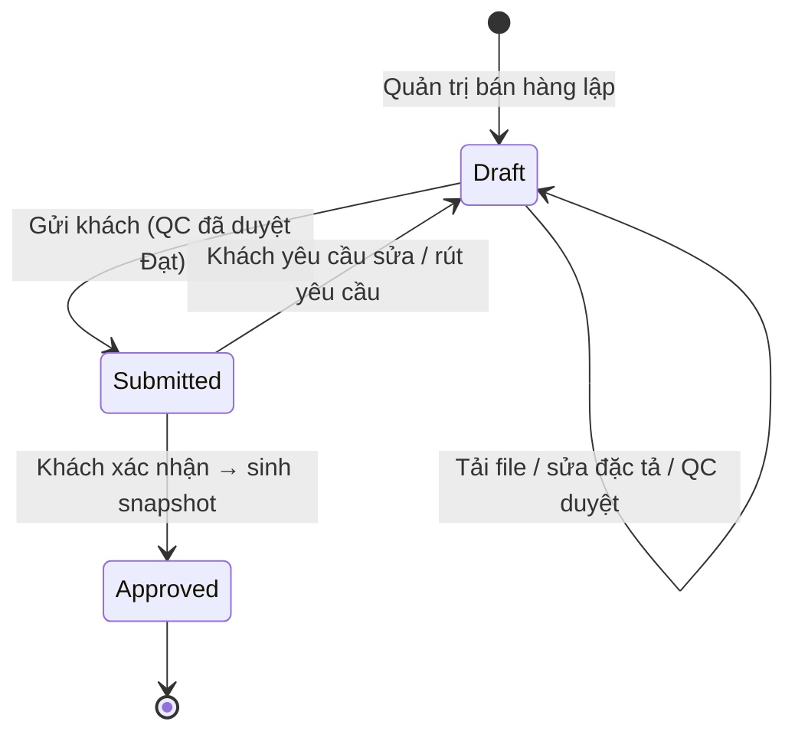

# 12 — Thiết kế sản phẩm in ấn (Product Design)

## 1. Mục đích (Purpose)

Quản lý **bản thiết kế in** (logo, nhận diện thương hiệu của quán đồ uống) trên ly và bao bì cho **từng khách sỉ**, từ lúc lập bản nháp tới khi khách **xác nhận**. Luồng gồm bốn bước:

1. **Lập bản thiết kế** — Back-office lập bản thiết kế cho khách và phân công người làm.
2. **Thiết kế** — Người thiết kế tải lên **bộ file thiết kế** (file xem trước, đặc tả kỹ thuật, file in, hướng dẫn sản xuất).
3. **Duyệt kỹ thuật độc lập** — **Nhân viên QC** duyệt bộ file trước khi gửi khách.
4. **Khách xác nhận** — Khách xác nhận trên cổng khách hàng.

Đầu ra là **bản thiết kế chốt (design snapshot)**: bộ file và đặc tả đã được khách xác nhận, **bất biến**, mỗi file có **mã kiểm tra (checksum SHA-256)**. Snapshot được dùng ở các bước sau:

- **Báo giá:** [14](../14-cart-and-order/README.md).
- **Làm mẫu và sản xuất:** [19](../../warehouse/19-production/README.md).
- **Đóng gói:** [08](../../warehouse/08-packing/README.md).

Ở mọi bước, hệ thống kiểm lại checksum để chắc chắn đúng file khách đã duyệt được đem in.

> ⚠️ Giả định: phạm vi hiện tại **không** gồm trình thiết kế 2D cho khách tự thiết kế, xem trước 3D theo thời gian thực (Live 3D Preview) và kiểm tra kỹ thuật tự động (preflight `Pass` / `Warning` / `Fail`). Khách nhận và xác nhận **bộ file do nhân viên thiết kế**. Các tính năng trên được giữ làm **phạm vi giai đoạn sau**. Xem [open-questions B18](../../open-questions/README.md).

---

## 2. Actor liên quan

| Actor | Vai trò |
|-------|---------|
| **Quản trị bán hàng (E-commerce Admin)** | Lập bản thiết kế cho một khách và một sản phẩm. Phân công: chủ sở hữu (tài khoản đăng nhập của khách), người thiết kế, người duyệt kỹ thuật. Đổi phân công trước khi khách xác nhận. Có thể đồng thời là người thiết kế. |
| **Nhân viên Sale (Sales Staff)** — người thiết kế | Tải bộ file, sửa đặc tả, gửi khách xác nhận, rút yêu cầu xác nhận, tạo bản sửa từ thiết kế đã xác nhận. Xem danh sách thiết kế đã xác nhận của khách để báo giá / làm mẫu. |
| **Nhân viên QC (QC Staff)** — người duyệt kỹ thuật | Duyệt **Đạt / Không đạt** bộ file hiện tại, kèm nhận xét làm bằng chứng. Phải độc lập với khách và với người sửa cuối. |
| **Khách hàng sỉ (B2B Customer)** — chủ sở hữu | Trên cổng khách hàng: xem bản thiết kế của mình, có thể tải file tham khảo, **xác nhận** hoặc **yêu cầu sửa**, rút yêu cầu xác nhận, tạo bản sửa. |
| **Nhân viên sản xuất (Production Staff)** | Kiểm file in trước sản xuất (prepress) trên snapshot của lệnh sản xuất — [19](../../warehouse/19-production/README.md) |
| **Hệ thống** | Quét mã độc file tải lên; tính checksum. Khi khách xác nhận: sinh snapshot và kiểm file lưu trữ khớp checksum. Kiểm lại checksum khi báo giá, đặt hàng, sản xuất, đóng gói. Ghi lịch sử quyết định. |

- Chỉ chủ sở hữu, người thiết kế và người duyệt của một bản thiết kế mới thấy bản đó khi còn là nháp (BR-03).
- Khách yêu cầu thiết kế mới qua Sale ([chat](../16-sales-chat/README.md) hoặc yêu cầu báo giá); khách không tự lập bản thiết kế.

---

## 3. Input / Output

### Input

| Trường | Mô tả | Bắt buộc |
|--------|-------|----------|
| Khách hàng & sản phẩm | Một khách sỉ và một sản phẩm in ([01](../../warehouse/01-product-creation/README.md)) | Có |
| Chủ sở hữu | Tài khoản khách hàng đang hoạt động, **thuộc đúng khách đó** | Có |
| Người thiết kế | Nhân viên Sale hoặc Quản trị bán hàng đang hoạt động | Không (giao sau) |
| Người duyệt kỹ thuật | Nhân viên QC đang hoạt động, khác chủ sở hữu và người thiết kế | Có |
| Tên thiết kế | ≤ 200 ký tự | Có |
| **Đặc tả kỹ thuật** | Mô tả bằng chữ (≤ 4.000 ký tự): vị trí in, kích thước, số màu, mã màu, kỹ thuật in, ghi chú cho xưởng… | Có |
| **Bộ file thiết kế** | Mỗi file mang một **vai trò** (bảng dưới). Định dạng JPEG / PNG / WebP / PDF, ≤ 50 MB mỗi file | `CUSTOMER_PREVIEW` bắt buộc trước khi duyệt |

**Vai trò của file trong bộ:**

| Vai trò | Dùng để | Người dùng chính |
|---------|---------|------------------|
| `CUSTOMER_PREVIEW` | Ảnh / PDF xem trước cho khách; là file được duyệt kỹ thuật và được khách xác nhận | Khách, QC, Đóng gói |
| `TECHNICAL_SPEC` | Bản vẽ kỹ thuật: kích thước, vị trí, màu | QC, Xưởng |
| `PRINT_READY` | File in đúng chuẩn (bleed, DPI, hệ màu) | Production Staff (prepress), xưởng / nhà gia công |
| `PRODUCTION_INSTRUCTION` | Hướng dẫn sản xuất, đóng gói đặc biệt | Xưởng, Đóng gói |

### Output

| Kết quả | Mô tả | Dùng bởi |
|---------|-------|----------|
| **Bản thiết kế (design draft)** | Trạng thái, phân công, đặc tả, bộ file hiện tại, kết quả duyệt kỹ thuật | Người được phân công, khách |
| **Kết quả duyệt kỹ thuật** | Đạt / Không đạt + nhận xét, gắn với đúng file xem trước | Người thiết kế, khách |
| **Design snapshot** | Bộ file hiện tại lúc xác nhận (mỗi vai trò một file), checksum từng file và checksum cả bộ, đặc tả, người và thời điểm xác nhận. Bất biến. | [14](../14-cart-and-order/README.md), [19](../../warehouse/19-production/README.md), [08](../../warehouse/08-packing/README.md) |
| **Lịch sử quyết định** | Mọi bước của bản thiết kế (BR-12) | Quản trị bán hàng, Sale, kiểm toán |
| **Link tải file** | Link ngắn hạn, cấp theo quyền; file trong snapshot chỉ cấp khi checksum còn khớp | Khách, Sale, Xưởng, Đóng gói |

---

## 4. Luồng nghiệp vụ từng bước (Step-by-step)

### 4.1. Lập bản thiết kế

1. Khách cần in thiết kế mới, liên hệ Sale (chat, điện thoại, yêu cầu báo giá).
2. Quản trị bán hàng lập bản thiết kế, gồm:
   - khách và sản phẩm;
   - chủ sở hữu (tài khoản của khách);
   - người thiết kế;
   - người duyệt QC;
   - tên;
   - đặc tả ban đầu.
3. Hệ thống kiểm:
   - chủ sở hữu thuộc đúng khách (BR-01);
   - vai trò của từng người được giao (BR-02).

   Đạt thì tạo bản thiết kế ở `Draft`.

### 4.2. Thiết kế

4. Người thiết kế tải các file theo vai trò, cập nhật đặc tả. Khách cũng có thể tải file tham khảo (logo gốc, ảnh mẫu).
5. Mỗi lần tải là **một bản file mới**, không ghi đè. File mới nhất của mỗi vai trò tạo thành **bộ hiện tại**.
6. Mỗi thay đổi file hoặc đặc tả **xoá kết quả duyệt kỹ thuật trước đó** (BR-06).

### 4.3. Duyệt kỹ thuật (QC)

7. Nhân viên QC được giao mở bộ hiện tại, kiểm khả năng in: vị trí và kích thước so với sản phẩm, màu, độ phân giải, file in.
8. QC ghi **Đạt** hoặc **Không đạt**, kèm nhận xét (≤ 2.000 ký tự). Kết quả gắn với **đúng file xem trước hiện tại**.
   - Không đạt → người thiết kế sửa, tải lại, rồi QC duyệt lại.
   - QC không được là chủ sở hữu, cũng không được là người sửa cuối (BR-05).

### 4.4. Gửi khách xác nhận

9. Khi bộ hiện tại đã **Đạt**, người thiết kế gửi khách xác nhận → `Submitted`. Khách thấy yêu cầu trên cổng khách hàng.
10. Trong lúc chờ, không ai sửa được bản thiết kế. Muốn sửa thì người thiết kế hoặc khách **rút yêu cầu**: bản thiết kế về `Draft` và kết quả duyệt bị xoá.

### 4.5. Khách xác nhận hoặc yêu cầu sửa

11. Khách (chủ sở hữu) xem file xem trước và đặc tả, rồi chọn một trong hai:
    - **Xác nhận.** Hệ thống chụp **snapshot** của bộ hiện tại và đặc tả, tính checksum, kiểm file lưu trữ khớp → `Approved`. Bản thiết kế từ đây **không sửa được nữa** (BR-08).
    - **Yêu cầu sửa** kèm lý do (≤ 2.000 ký tự). Bản thiết kế về `Draft`, kết quả duyệt bị xoá. Người thiết kế sửa → QC duyệt lại → gửi lại.

### 4.6. Dùng thiết kế đã xác nhận

12. Sale tra **danh sách thiết kế đã xác nhận** của khách (lọc theo sản phẩm hoặc SKU) và xem trước, để:
    - gắn vào **dòng báo giá** ([14](../14-cart-and-order/README.md));
    - gắn vào **yêu cầu làm mẫu** ([19](../../warehouse/19-production/README.md)).
13. Mỗi lần gắn, hệ thống kiểm (BR-09):
    - snapshot thuộc **đúng khách**;
    - snapshot thuộc **đúng sản phẩm của SKU phôi**;
    - file lưu trữ **còn khớp checksum**.
14. Thiết kế mới phải có **mẫu được khách duyệt** trước khi sản xuất đơn hàng ([19](../../warehouse/19-production/README.md)).

### 4.7. Sửa thiết kế đã xác nhận (tạo bản sửa)

15. Muốn đổi một thiết kế đã xác nhận (khách yêu cầu sửa sau khi xem mẫu, hoặc đặt lại với nội dung mới): chủ sở hữu hoặc người thiết kế **tạo bản sửa**. Hệ thống tạo **bản thiết kế mới** ở `Draft`:
    - giữ khách, sản phẩm, phân công và đặc tả;
    - ghi nguồn là snapshot cũ;
    - bộ file phải tải lại.
16. Bản sửa đi lại từ 4.2. Snapshot cũ giữ nguyên, nên báo giá, mẫu và đơn đã dùng nó không bị ảnh hưởng (BR-11).

### 4.8. Sản xuất và đóng gói

17. **Xưởng ([19](../../warehouse/19-production/README.md)):** Production Staff tải file `PRINT_READY` của snapshot gắn với lệnh sản xuất. Hệ thống chỉ cấp link khi checksum còn khớp (prepress).
18. **Đóng gói ([08](../../warehouse/08-packing/README.md)):**
    - Nhân viên đóng gói và QC xem file theo vai trò, trong phạm vi task của mình.
    - Khi hoàn tất đóng gói, hệ thống kiểm lại checksum. Lệch thì treo đóng gói và đơn (`DESIGN_MISMATCH`) cho tới khi QC / Quản lý kho xác minh lại.

### 4.9. Đổi phân công

19. Quản trị bán hàng đổi người thiết kế hoặc người duyệt **trước khi khách xác nhận**. Đổi phân công xoá kết quả duyệt và đưa bản thiết kế về `Draft`.
    - Chủ sở hữu không đổi được.
    - Thiết kế đã xác nhận giữ nguyên phân công; muốn đổi thì tạo bản sửa.

---

## 5. Trạng thái / Vòng đời (Lifecycle)

### 5.1. Bản thiết kế (Design draft)

| Trạng thái | Ý nghĩa | Chuyển tiếp cho phép | Ai thực hiện |
|------------|---------|----------------------|--------------|
| `Draft` | Đang thiết kế; nhận file, sửa đặc tả, duyệt kỹ thuật | → `Submitted` (gửi khách, cần duyệt **Đạt**) | Người thiết kế |
| `Submitted` | Chờ khách xác nhận; khoá sửa | → `Approved` (khách xác nhận); → `Draft` (khách yêu cầu sửa, hoặc rút yêu cầu) | Chủ sở hữu; người thiết kế (rút) |
| `Approved` | Khách đã xác nhận; snapshot đã sinh; bất biến | *(cuối)* — đổi nội dung = tạo bản sửa (bản thiết kế mới) | Chủ sở hữu |

**Kết quả duyệt kỹ thuật** là thuộc tính của bản `Draft`, không phải trạng thái riêng. Có ba giá trị:

- **Chưa duyệt**: mỗi thay đổi đưa kết quả về đây.
- **Đạt.**
- **Không đạt.**

### 5.2. Design snapshot

Snapshot **không có vòng đời**: sinh ra một lần khi khách xác nhận và không bao giờ thay đổi. Mỗi bản thiết kế có tối đa một snapshot.

> Trạng thái `Locked` / `Superseded` của bản cũ không còn dùng: snapshot bất biến ngay từ lúc xác nhận; bản sửa là một bản thiết kế khác, có nguồn là snapshot cũ.

### 5.3. Lịch sử quyết định

| Sự kiện | Khi nào |
|---------|---------|
| `ASSIGNMENT_CHANGED` | Đổi người thiết kế / người duyệt |
| `SPECIFICATION_CHANGED` | Sửa đặc tả |
| `TECHNICAL_ACCEPTED` / `TECHNICAL_REJECTED` | QC duyệt Đạt / Không đạt |
| `SENT_TO_CUSTOMER` | Gửi khách xác nhận |
| `CUSTOMER_CHANGES_REQUESTED` | Khách yêu cầu sửa |
| `WITHDRAWN` | Rút yêu cầu xác nhận |
| `CUSTOMER_CONFIRMED` | Khách xác nhận (ghi mã snapshot) |
| `DERIVED_FROM_SNAPSHOT` | Bản sửa được tạo từ snapshot cũ |

---

## 6. Ràng buộc nghiệp vụ (Business Rules) & Edge case

### Business rules

- **BR-01:** Mỗi bản thiết kế thuộc **đúng một khách** và **một sản phẩm**. Chủ sở hữu phải là tài khoản khách hàng đang hoạt động **của chính khách đó** (mỗi khách một tài khoản đăng nhập).
- **BR-02:** Người thiết kế (nếu có) là Nhân viên Sale hoặc Quản trị bán hàng đang hoạt động. Người duyệt **bắt buộc** là Nhân viên QC đang hoạt động, khác chủ sở hữu và khác người thiết kế.
- **BR-03:** Bản thiết kế chỉ hiển thị với chủ sở hữu, người thiết kế và người duyệt của nó; với người khác coi như không tồn tại. Thiết kế **đã xác nhận** thì Sale tra được theo khách (để báo giá, làm mẫu); khách không dùng danh sách này.
- **BR-04:** File chỉ **thêm**, không sửa / xoá. Chỉ bản `Draft` nhận file. File phải đúng định dạng, đúng dung lượng (§3) và qua quét mã độc.
- **BR-05:** **Duyệt kỹ thuật độc lập (bốn mắt).** Chỉ người duyệt được giao mới duyệt được, và người đó không được là chủ sở hữu hay người sửa cuối. Duyệt phải gắn với đúng file xem trước hiện tại và có nhận xét.
- **BR-06:** Mọi thay đổi đều **xoá kết quả duyệt**, kể cả thay đổi do khách: tải file, sửa đặc tả, đổi phân công, khách yêu cầu sửa, rút yêu cầu. Bản thiết kế phải được duyệt lại trước khi gửi khách.
- **BR-07:** **Khách xác nhận không thay cho duyệt kỹ thuật.**
  - Chỉ gửi khách khi bộ hiện tại đã Đạt.
  - Chỉ chủ sở hữu được xác nhận.
  - Khách xác nhận đúng file xem trước đang chờ; file đã đổi thì phải gửi lại.
- **BR-08:** **Snapshot bất biến từ lúc khách xác nhận.** Snapshot gồm bộ file, checksum SHA-256 của từng file và của cả bộ, cùng đặc tả. Bản `Approved` không nhận file, không sửa đặc tả, không đổi phân công.
- **BR-09:** **Toàn vẹn thiết kế.**
  - Báo giá, mẫu và đơn chỉ nhận snapshot **của đúng khách** và **đúng sản phẩm của SKU**.
  - Ở mọi lần dùng (gắn báo giá, đặt hàng, prepress, tải file, hoàn tất đóng gói), file lưu trữ phải khớp checksum đã chốt.
  - Lệch thì từ chối hoặc treo; không bao giờ in theo file chưa được xác nhận.
- **BR-10:** Mọi thao tác ghi gửi kèm **phiên bản** bản thiết kế người dùng đang xem. Ai đó đã đổi trước thì thao tác bị từ chối, người dùng tải lại.
- **BR-11:** Đơn, mẫu và báo giá đã gắn snapshot thì **giữ snapshot đó**; bản sửa không ảnh hưởng tới chúng. Đổi thiết kế của đơn đã đặt theo quy trình thay đổi ở [19](../../warehouse/19-production/README.md) (chỉ trước `Printing`).
- **BR-12:** Mọi quyết định ghi **lịch sử**: người, file, nội dung / lý do, phiên bản, thời điểm (§5.3).

### Edge case

| Tình huống | Hướng xử lý |
|------------|-------------|
| QC duyệt Không đạt | Bản thiết kế ở lại `Draft`. Người thiết kế sửa, tải lại, QC duyệt lại. |
| Người thiết kế tải file mới sau khi QC đã duyệt Đạt | Kết quả duyệt bị xoá (BR-06); phải duyệt lại trước khi gửi khách. |
| Khách muốn sửa khi đang chờ xác nhận | Khách chọn **Yêu cầu sửa** kèm lý do, hoặc rút yêu cầu. Bản thiết kế về `Draft`. |
| Hai người cùng thao tác trên một bản thiết kế | Người sau bị từ chối vì phiên bản đã đổi (BR-10); tải lại rồi làm tiếp. |
| QC được giao cũng vừa tải file lên | QC đó thành "người sửa cuối", không duyệt được. Cần người sửa khác tải lại, hoặc giao QC khác. |
| Người duyệt nghỉ việc / bị khoá tài khoản | Quản trị bán hàng giao QC khác (trước khi khách xác nhận); kết quả duyệt cũ bị xoá. |
| Khách yêu cầu sửa sau khi xem mẫu | Tạo bản sửa từ snapshot (4.7) → duyệt → xác nhận → làm mẫu vòng mới ([19](../../warehouse/19-production/README.md)). |
| Gắn snapshot của khách khác, hoặc của sản phẩm khác, vào báo giá | Hệ thống từ chối (BR-09). |
| File trong kho lưu trữ bị thay / hỏng sau khi xác nhận | Kiểm checksum thất bại: không gắn báo giá / đơn, không cấp link cho xưởng. Lúc đóng gói thì treo `DESIGN_MISMATCH` chờ xác minh. |
| Snapshot thiếu file `PRINT_READY` | Xưởng không lấy được file in. Tạo bản sửa có file in, khách xác nhận lại. |
| File tải lên nhiễm mã độc / sai định dạng | Từ chối ngay, không lưu. |

---

## 7. Liên kết với các module khác

| Module | Quan hệ |
|--------|---------|
| [01 · Product Creation](../../warehouse/01-product-creation/README.md) | Sản phẩm in mà bản thiết kế gắn vào; SKU phôi của dòng báo giá phải thuộc sản phẩm đó |
| [13 · Catalog](../13-catalog/README.md) | Khách xem sản phẩm in rồi yêu cầu thiết kế / báo giá qua Sale |
| [14 · Cart & Order](../14-cart-and-order/README.md) | Dòng in của báo giá / đơn mang snapshot đã xác nhận; hệ thống kiểm khách, sản phẩm, checksum khi gắn và khi đặt |
| [16 · Sales Chat](../16-sales-chat/README.md) | Khách trao đổi yêu cầu thiết kế, góp ý với Sale |
| [18 · Customer Information](../18-customer-information/README.md) | Chủ sở hữu là tài khoản đăng nhập của khách; thiết kế gắn theo khách |
| [19 · Production](../../warehouse/19-production/README.md) | Yêu cầu làm mẫu dùng snapshot; mẫu được duyệt mới sản xuất đơn; prepress tải `PRINT_READY` có kiểm checksum; đổi thiết kế sau khi đặt chỉ trước `Printing` |
| [08 · Packing](../../warehouse/08-packing/README.md) | Kiểm lại checksum khi hoàn tất đóng gói; lệch → treo `DESIGN_MISMATCH` |
| [17 · Order Management](../17-order-management/README.md) | Đơn treo lý do `DESIGN_MISMATCH` và việc xác minh lại thiết kế |
