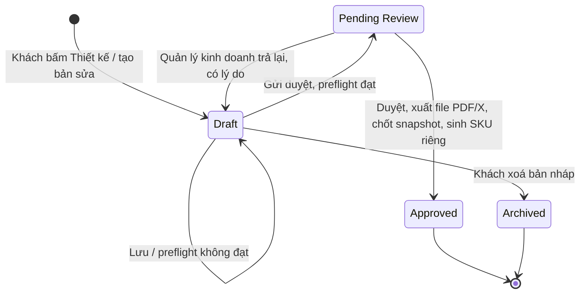

# 12 — Quản lý mẫu & thiết kế (Design Management)

> ✅ Đã chốt 2026-11-05 (khách tự thiết kế — thay quyết định 2026-11-04 "khách đưa mẫu, nhân viên thiết kế"): **chỉ khách tự thiết kế** trên app, trên **khuôn 2D** của quy cách, có **xem trước 3D**. Bỏ luồng khách đưa mẫu cho Sale, nhân viên thiết kế hộ, phân công người thiết kế. Khi khách gửi duyệt, hệ thống **tự kiểm (preflight)**; **Quản lý kinh doanh (Sales Manager)** duyệt kỹ thuật và kiểm duyệt nội dung. Duyệt xong, hệ thống **tự xuất file in PDF/X**, chốt **design snapshot** và sinh **SKU thành phẩm riêng của khách**. **Đặt hàng từ bản thiết kế = yêu cầu báo giá** gửi Sale: khách vẫn không tự đặt, sàn vẫn ẩn giá ([13](../13-catalog/README.md), [14](../14-cart-and-order/README.md), [16](../16-sales-chat/README.md)). Xem [open-questions B18, B7, B8](../../open-questions/README.md).
>
> Đã chốt 2026-11-05: chứng từ gửi sản xuất là **Đơn sản xuất (Production Order)**, gửi cho **đơn vị sản xuất** (xưởng của công ty hoặc đối tác ngoài, ngoài hệ thống). Đơn sản xuất có bước **duyệt mẫu in** ([17](../17-order-management/README.md)): khách duyệt mẫu in thử theo file đã chốt; nếu khách cần **sửa file thiết kế** (không phải lỗi in) thì quay về module này tạo **bản sửa** và sinh **SKU riêng mới** (§4.7).

## 1. Mục đích (Purpose)

Cho **khách sỉ tự thiết kế** bản in (logo, nhận diện thương hiệu của quán đồ uống) lên ly và bao bì, rồi chốt bản thiết kế đó thành **bộ file in** và **SKU thành phẩm riêng** của khách. Luồng gồm các bước:

1. **Thiết kế** — Trên sàn ([13](../13-catalog/README.md)), khách chọn một **quy cách** đã có khuôn in ([01 §4.10](../../warehouse/01-product-creation/README.md)), tải ảnh / logo lên, đặt lên **khuôn 2D**, **xem trước 3D**, lưu và xem lại trong **mẫu thiết kế của tôi**.
2. **Gửi duyệt & kiểm tự động** — Hệ thống **preflight**: độ phân giải ở kích thước in, nội dung trong vùng in / lề an toàn, định dạng và dung lượng file.
3. **Duyệt** — **Quản lý kinh doanh** duyệt kỹ thuật và **kiểm duyệt nội dung** (bản quyền, nội dung không phù hợp): **Duyệt** hoặc **Trả lại** kèm lý do.
4. **Chốt thiết kế** — Hệ thống **xuất bộ file** (file in **PDF/X** theo khuôn, ảnh xem trước, đặc tả kỹ thuật, hướng dẫn sản xuất), chốt **design snapshot** và sinh **SKU thành phẩm riêng** của khách ([01](../../warehouse/01-product-creation/README.md)).
5. **Yêu cầu báo giá** — Từ bản đã duyệt, khách gửi **yêu cầu báo giá** cho Sale qua [chat](../16-sales-chat/README.md); Sale lập báo giá, đơn, hợp đồng ([14](../14-cart-and-order/README.md)).

Đầu ra:

- **Design snapshot** — bộ file xuất và nội dung thiết kế đã được duyệt, **bất biến**, mỗi file có **mã kiểm tra (checksum SHA-256)**.
- **SKU thành phẩm riêng của khách (customer-exclusive SKU)** — gắn với khách và snapshot; là **loại hàng duy nhất có tồn và được bán** (không có hàng trơn): tồn, nhập, xuất, báo giá, đơn hàng đều theo SKU này.

Snapshot (qua SKU riêng) được dùng ở các bước sau:

- **Báo giá, đơn hàng & hợp đồng:** [14](../14-cart-and-order/README.md).
- **Đơn sản xuất:** [17](../17-order-management/README.md) — bộ file chốt (file in PDF/X) được đính kèm Đơn sản xuất gửi đơn vị sản xuất; mẫu in thử (khi Đơn sản xuất bật cờ duyệt mẫu in) được in theo đúng bộ file này.

Ở mỗi lần gắn snapshot hoặc cấp link tải file, hệ thống kiểm lại checksum để chắc chắn đúng bộ file đã duyệt.

**Ngoài phạm vi hiện tại (phạm vi sau):** thư viện mẫu có sẵn cho khách chọn; tự tách màu theo **kỹ thuật in**; nhiều người cùng sửa một bản thiết kế. Kỹ thuật in của quy cách cũng là phạm vi sau ([01 §4.10](../../warehouse/01-product-creation/README.md)).

---

## 2. Actor liên quan

| Actor | Vai trò |
|-------|---------|
| **Khách hàng sỉ (B2B Customer)** — chủ sở hữu | Trên sàn: bấm **"Thiết kế"** ở một quy cách để tạo bản thiết kế; tải ảnh / logo, đặt lên khuôn 2D, thêm chữ, xem trước 3D; **lưu**, xem lại trong **mẫu thiết kế của tôi** ([13](../13-catalog/README.md)); xoá bản nháp; **gửi duyệt** (có thể kèm yêu cầu báo giá); **tạo bản sửa** từ bản đã duyệt; **yêu cầu báo giá** từ bản đã duyệt. Duyệt **mẫu in** của Đơn sản xuất ([17](../17-order-management/README.md)). |
| **Quản lý kinh doanh (Sales Manager)** | Khai báo **cấu hình in** (khuôn 2D, vùng in, lề, model 3D, ràng buộc file) cho quy cách ([01 §4.10](../../warehouse/01-product-creation/README.md)). **Duyệt kỹ thuật + kiểm duyệt nội dung** bản thiết kế khách gửi: **Duyệt** hoặc **Trả lại** kèm lý do (quyền **Duyệt kỹ thuật thiết kế**). Duyệt và gửi Đơn sản xuất ([17](../17-order-management/README.md)). |
| **Nhân viên Sale (Sales Staff)** | **Nhận yêu cầu báo giá** từ bản thiết kế qua [chat](../16-sales-chat/README.md); tra thiết kế đã duyệt và SKU riêng của khách để báo giá ([14](../14-cart-and-order/README.md)). Lập **Đơn sản xuất** cho SKU riêng ([17](../17-order-management/README.md)) — snapshot của SKU được đính kèm; tải file theo quyền. Không thiết kế, không sửa bản thiết kế của khách. |
| **Đơn vị sản xuất** *(ngoài hệ thống — xưởng của công ty hoặc đối tác ngoài)* | Nhận bộ file chốt kèm Đơn sản xuất; in **mẫu in thử** theo bộ file khi Đơn sản xuất cần duyệt mẫu in ([17](../17-order-management/README.md)); không thao tác trong module này. |
| **Hệ thống** | Quét mã độc file tải lên; dựng xem trước 2D / 3D; **preflight** khi gửi duyệt; khi duyệt: **xuất bộ file** (file in PDF/X), tính checksum, chốt snapshot, **sinh SKU thành phẩm riêng**. Kiểm lại checksum khi gắn báo giá / đơn / Đơn sản xuất và khi cấp link tải. Mở chat kèm thẻ yêu cầu báo giá ([16](../16-sales-chat/README.md)). Ghi lịch sử quyết định. |

- Khách là **người tạo duy nhất** của bản thiết kế; người duyệt luôn là Quản lý kinh doanh, nên người duyệt không bao giờ là người tạo.
- Khả năng nhìn thấy theo trạng thái: xem BR-03.

---

## 3. Input / Output

### Input

| Trường | Mô tả | Bắt buộc |
|--------|-------|----------|
| Khách hàng & chủ sở hữu | Tài khoản khách hàng đang đăng nhập, **thuộc đúng một khách sỉ** ([18](../18-customer-information/README.md)); hệ thống gán | Có |
| Sản phẩm & quy cách | Một sản phẩm in theo mẫu (`CUSTOMIZABLE`) và một **quy cách** (dung tích, chất liệu…) `Active`, **đã có khuôn in** ([01 §4.10](../../warehouse/01-product-creation/README.md)) | Có |
| **Cấu hình in của quy cách** | Do Quản lý kinh doanh khai báo ở [01 §4.10](../../warehouse/01-product-creation/README.md): **khuôn 2D** (bản trải phẳng, kích thước thật), **vùng in**, **lề an toàn**, **lề tràn**, **model 3D** (xem trước), **ràng buộc file** (độ phân giải tối thiểu ở kích thước in thật, định dạng, dung lượng tối đa) | Có (khuôn 2D + vùng in); model 3D không bắt buộc |
| Tên thiết kế | ≤ 200 ký tự, khách đặt | Có |
| **Ảnh / logo tải lên** | File khách tải lên, đúng **định dạng** và **dung lượng** theo ràng buộc file của quy cách | Không khi lưu nháp; bản gửi duyệt phải có ít nhất một phần tử (ảnh hoặc chữ) |
| **Bố cục (layout)** | Các phần tử đặt trên khuôn 2D: ảnh (vị trí, góc xoay, kích thước), chữ (nội dung, phông, cỡ, màu, vị trí, góc xoay) | Có khi gửi duyệt |
| Yêu cầu báo giá *(tuỳ chọn)* | **Số thùng** mong muốn (số nguyên ≥ 1), **ngày giao mong muốn** (nếu có) — §4.8 | Không |
| **Quyết định duyệt** | **Duyệt** / **Trả lại**; nhận xét (≤ 2.000 ký tự) — bắt buộc khi Trả lại | Có (người duyệt) |

> ⚠️ Giả định: ràng buộc file mặc định khi Quản lý kinh doanh chưa chỉnh — độ phân giải tối thiểu **300 DPI** ở kích thước in thật; định dạng ảnh tải lên **PNG / JPG / SVG / PDF**; dung lượng tối đa **50 MB mỗi file**. Xem [open-questions B34](../../open-questions/README.md).

### Output

| Kết quả | Mô tả | Dùng bởi |
|---------|-------|----------|
| **Bản thiết kế (design)** | Trạng thái, quy cách, bố cục, ảnh tải lên, ảnh xem trước, kết quả preflight gần nhất, quyết định duyệt, phiên bản | Khách (chủ sở hữu), Quản lý kinh doanh; Sale (theo BR-03) |
| **Kết quả preflight** | Đạt / Không đạt, kèm **danh sách lỗi cụ thể** (phần tử nào, lỗi gì) | Khách |
| **Bộ file xuất** | Sinh tự động khi duyệt; mỗi file một **vai trò** (bảng dưới) | [17](../17-order-management/README.md), khách, Sale |
| **Design snapshot** | Bộ file xuất + nội dung thiết kế (bố cục, ảnh gốc khách tải lên) lúc duyệt, checksum từng file và checksum cả bộ, người và thời điểm duyệt. Bất biến. | [14](../14-cart-and-order/README.md), [17](../17-order-management/README.md) |
| **SKU thành phẩm riêng của khách** | SKU mới thuộc sản phẩm và quy cách của bản thiết kế, gắn khách sở hữu và snapshot; chỉ khách đó thấy và được báo giá / đặt | [01](../../warehouse/01-product-creation/README.md), [13](../13-catalog/README.md), [14](../14-cart-and-order/README.md), [17](../17-order-management/README.md), [03](../../warehouse/03-receipt/README.md), [20](../../warehouse/20-inventory-control/README.md) |
| **Yêu cầu báo giá** | Số thùng, ngày giao mong muốn, gắn bản thiết kế / SKU riêng; hiện thành **thẻ yêu cầu báo giá** trong chat | [16](../16-sales-chat/README.md), [14](../14-cart-and-order/README.md) |
| **Lịch sử quyết định** | Mọi bước của bản thiết kế (BR-13, §5.3) | Quản lý kinh doanh, Sale, kiểm toán |
| **Link tải file** | Link ngắn hạn, cấp theo quyền; file trong snapshot chỉ cấp khi checksum còn khớp | Khách, Sale, Quản lý kinh doanh, đơn vị sản xuất (qua Đơn sản xuất) |

**Vai trò của file trong bộ file xuất:**

| Vai trò | Nội dung | Người dùng chính |
|---------|----------|------------------|
| `PRINT_READY` | File in **PDF/X** theo khuôn: đúng kích thước thật, có lề tràn | Đơn vị sản xuất (qua Đơn sản xuất) |
| `CUSTOMER_PREVIEW` | Ảnh xem trước 2D (và 3D nếu quy cách có model 3D) | Khách, Quản lý kinh doanh, Sale |
| `TECHNICAL_SPEC` | Đặc tả kỹ thuật sinh từ cấu hình in và bố cục: quy cách, kích thước khuôn và vùng in, vị trí / kích thước từng phần tử, độ phân giải hiệu dụng của từng ảnh, phông và mã màu chữ | Quản lý kinh doanh, đơn vị sản xuất |
| `PRODUCTION_INSTRUCTION` | Hướng dẫn sản xuất **sinh mặc định từ quy cách thùng** (số cái / thùng, kích thước, khối lượng thùng — [01](../../warehouse/01-product-creation/README.md)) và yêu cầu đóng thùng (đơn vị sản xuất đóng thùng trước khi giao về kho) | Đơn vị sản xuất |

> ⚠️ Giả định: file in xuất theo chuẩn **PDF/X-4**. Xem [open-questions B35](../../open-questions/README.md).

---

## 4. Luồng nghiệp vụ từng bước (Step-by-step)

### 4.1. Bắt đầu thiết kế

1. Trên trang chi tiết sản phẩm ([13](../13-catalog/README.md)), khách chọn một quy cách và bấm **"Thiết kế"**. Nút chỉ có ở quy cách `Active` **đã có khuôn in** (khuôn 2D + vùng in — [01 §4.10](../../warehouse/01-product-creation/README.md)) của sản phẩm còn dùng được.
2. Hệ thống tạo **bản thiết kế** ở `Draft`, chủ sở hữu là tài khoản khách đang đăng nhập (BR-01), gắn sản phẩm và quy cách; khách đặt tên (đổi được khi còn `Draft`).
3. Khách cũng tạo bản thiết kế mới từ **mẫu thiết kế của tôi** (chọn sản phẩm, quy cách) hoặc tạo **bản sửa** từ bản đã duyệt (§4.7).

> ⚠️ Giả định: mỗi khách có tối đa **50 bản `Draft`** cùng lúc; bản `Draft` lâu không hoạt động **không tự xoá**. Xem [open-questions B37](../../open-questions/README.md).

### 4.2. Thiết kế trên khuôn 2D & xem trước 3D

4. Trình thiết kế hiện **khuôn 2D** của quy cách theo kích thước thật, đánh dấu **vùng in**, **lề an toàn** và **lề tràn**.
5. Khách **tải ảnh / logo lên** (hệ thống quét mã độc, kiểm định dạng và dung lượng ngay — BR-04), đặt lên khuôn: **kéo, xoay, đổi kích thước**; **thêm chữ**.
6. Khách **xem trước 3D** bố cục trên **model 3D** của quy cách.

   > ⚠️ Giả định: xem trước 3D dựng **phía trình duyệt của khách**, có **ảnh tĩnh dựng sẵn** làm dự phòng khi thiết bị không dựng được; quy cách **chưa có model 3D** thì khách chỉ xem trước 2D, vẫn thiết kế và gửi duyệt được. Xem [open-questions B7, B36](../../open-questions/README.md).
7. Khách **lưu**. Mỗi lần lưu tăng **phiên bản** bản thiết kế (BR-11). Bản `Draft` sửa tự do, không giới hạn số lần lưu.
8. Khách xem lại mọi bản thiết kế của mình (mọi trạng thái trừ `Archived`) trong **mẫu thiết kế của tôi** ([13](../13-catalog/README.md)).
9. Khách **xoá bản nháp** → `Archived` (BR-16). Chỉ bản `Draft` xoá được.

### 4.3. Gửi duyệt & kiểm tự động (preflight)

10. Khách bấm **"Gửi duyệt"** (hoặc **"Gửi duyệt và yêu cầu báo giá"** — §4.8). Hệ thống chạy **preflight** trên phiên bản đang lưu (BR-05):
    - có ít nhất một phần tử trên khuôn;
    - mỗi ảnh đạt **độ phân giải tối thiểu ở kích thước in thật** (theo ràng buộc file của quy cách);
    - chữ, logo nằm **trong vùng in và lề an toàn**; không phần tử nào vượt ra ngoài **vùng in + lề tràn**;
    - mọi file đúng **định dạng**, **dung lượng**;
    - quy cách và sản phẩm **còn dùng được** (quy cách `Active`, sản phẩm `Approved` / `Published`) và quy cách **đã có quy cách thùng** ([01](../../warehouse/01-product-creation/README.md)) — ✅ đã chốt 2026-11-05, xem [open-questions B25](../../open-questions/README.md).
11. **Không đạt** → hệ thống báo **lỗi cụ thể** (phần tử nào, lỗi gì, ví dụ "logo.png chỉ đạt 180 DPI ở kích thước in, cần ≥ 300"); bản thiết kế **vẫn `Draft`**, khách sửa rồi gửi lại.
12. **Đạt** → `Pending Review`. Bản thiết kế **khoá sửa** (BR-07); hệ thống báo cho Quản lý kinh doanh (hàng chờ duyệt).

### 4.4. Duyệt kỹ thuật & kiểm duyệt nội dung

13. Quản lý kinh doanh mở bản `Pending Review`: xem bố cục trên khuôn 2D, xem trước 3D, kết quả preflight, ảnh gốc khách tải lên. Kiểm:
    - **kỹ thuật** — khả năng in: vị trí, kích thước so với khuôn, độ rõ của ảnh, chữ quá nhỏ / quá sát mép;
    - **nội dung** — bản quyền, nhãn hiệu của bên thứ ba, nội dung không phù hợp ([open-questions B6](../../open-questions/README.md)).
14. Quản lý kinh doanh chọn (BR-06):
    - **Duyệt** (nhận xét không bắt buộc) → §4.5;
    - **Trả lại** kèm **lý do** (bắt buộc, ≤ 2.000 ký tự) → bản thiết kế về `Draft`; khách thấy lý do ở mẫu thiết kế của tôi, sửa rồi gửi duyệt lại (preflight chạy lại).
15. Quyết định gắn với **đúng phiên bản** đang chờ duyệt (BR-11).

### 4.5. Chốt thiết kế: xuất bộ file, snapshot & SKU riêng

16. Khi Quản lý kinh doanh **Duyệt**, hệ thống làm trong **cùng một bước** (BR-09):
    - **xuất bộ file** từ bố cục và cấu hình in: `PRINT_READY` (file in PDF/X theo khuôn, kích thước thật, lề tràn), `CUSTOMER_PREVIEW` (ảnh xem trước 2D / 3D), `TECHNICAL_SPEC`, `PRODUCTION_INSTRUCTION` (sinh mặc định từ quy cách thùng) — §3;
    - chốt **design snapshot**: bộ file xuất + nội dung thiết kế, tính checksum từng file và cả bộ, kiểm file lưu trữ khớp;
    - **sinh SKU thành phẩm riêng** thuộc sản phẩm và quy cách của bản thiết kế, gắn khách sở hữu và snapshot ([01 §4.8](../../warehouse/01-product-creation/README.md)); **quy cách thùng** (số cái chuẩn / thùng — cơ sở để khách đặt theo số thùng ở [14](../14-cart-and-order/README.md); kích thước, khối lượng) của SKU lấy theo quy cách, chỉnh được ở [01](../../warehouse/01-product-creation/README.md);
    - chuyển bản thiết kế → `Approved`. Bản thiết kế từ đây **không sửa được nữa** (BR-08).
17. Hệ thống báo khách: bản thiết kế đã duyệt, SKU riêng đã sinh; khách tải được file xem trước. Nếu khách đã gửi kèm yêu cầu báo giá (§4.8), Sale được báo là đã lập báo giá được.

> ✅ Đã chốt 2026-11-05: SKU riêng được sinh **mã tự động** (theo mã sản phẩm + mã khách + số thứ tự), ở trạng thái `Active` ngay (preflight và Quản lý kinh doanh duyệt thay cho bước kích hoạt biến thể ở [01](../../warehouse/01-product-creation/README.md)). Xem [open-questions B20](../../open-questions/README.md).

SKU riêng **không hiện giá trên sàn** (sàn ẩn giá — [13](../13-catalog/README.md)). Giá có trên báo giá / đơn / hợp đồng do Sale lập ([14](../14-cart-and-order/README.md)); Sale tham khảo **giá nội bộ** do Quản lý kinh doanh khai báo ([13](../13-catalog/README.md) §4.2), nếu có. Lần sản xuất đầu của một SKU riêng (mẫu mới) có **dòng phí khuôn / bản in** trên báo giá và hợp đồng ([14](../14-cart-and-order/README.md)).

### 4.6. Dùng thiết kế đã duyệt

18. Sale tra **danh sách thiết kế đã duyệt và SKU riêng** của khách (lọc theo sản phẩm hoặc SKU) và xem trước, để chọn SKU riêng vào **dòng báo giá / đơn hàng** ([14](../14-cart-and-order/README.md)).
19. Khi đơn thiếu hàng của SKU riêng, Sale lập **Đơn sản xuất** ([17](../17-order-management/README.md)), Quản lý kinh doanh duyệt và gửi; snapshot của SKU được **đính kèm** Đơn sản xuất, đơn vị sản xuất nhận bộ file chốt (`PRINT_READY`, `TECHNICAL_SPEC`, `PRODUCTION_INSTRUCTION`) qua link tải có kiểm checksum.
    - **Duyệt mẫu in** ([17](../17-order-management/README.md)) — khi Đơn sản xuất bật cờ "cần duyệt mẫu in" (mặc định bật cho lần sản xuất đầu của SKU), đơn vị sản xuất in mẫu thử **theo đúng bộ file của snapshot**; khách xem ảnh / video mẫu ở mẫu thiết kế của tôi ([13](../13-catalog/README.md)) hoặc thẻ trong [chat](../16-sales-chat/README.md), rồi **Duyệt** hoặc **Yêu cầu in lại**.
    - Duyệt mẫu in **không sửa snapshot** (BR-14). Mẫu lỗi in hoặc khách muốn in lại cùng file → in lại vòng mới ở 17. Khách cần **sửa file thiết kế** → tạo bản sửa (§4.7), sinh SKU riêng mới, đổi SKU dòng đơn theo quy trình ở [17](../17-order-management/README.md).
20. Mỗi lần gắn (báo giá, đơn, Đơn sản xuất) và mỗi lần cấp link tải, hệ thống kiểm (BR-10):
    - SKU riêng và snapshot thuộc **đúng khách** của chứng từ;
    - file lưu trữ **còn khớp checksum**.

### 4.7. Sửa thiết kế đã duyệt (tạo bản sửa)

21. Muốn đổi một thiết kế đã duyệt (đổi logo, đổi màu, nội dung mới, hoặc xem mẫu in thử rồi thấy cần sửa file): khách bấm **"Tạo bản sửa"** trên bản `Approved` ở mẫu thiết kế của tôi. Hệ thống tạo **bản thiết kế mới** ở `Draft`:
    - cùng khách, sản phẩm, quy cách;
    - **sao chép nội dung** (bố cục, ảnh) từ snapshot cũ;
    - ghi nguồn là snapshot cũ.
22. Bản sửa đi lại từ §4.2. Khi bản sửa được duyệt, hệ thống xuất bộ file mới, sinh **snapshot mới và SKU riêng mới**. Snapshot và SKU cũ giữ nguyên, nên báo giá, đơn, Đơn sản xuất và tồn kho đã dùng SKU cũ không bị ảnh hưởng (BR-12).

> ⚠️ Giả định: SKU riêng cũ **vẫn `Active`** sau khi có bản sửa (còn tồn, còn đơn đang mở); khách chọn SKU nào khi yêu cầu báo giá. Quản lý kinh doanh ngừng SKU cũ theo quy trình ngừng biến thể ở [01](../../warehouse/01-product-creation/README.md). Đổi SKU của một đơn đã chốt sang SKU mới đi theo quy trình thay đổi đơn ở [17](../17-order-management/README.md), chỉ khi Đơn sản xuất liên quan chưa sang `In Production`. Xem [open-questions B5](../../open-questions/README.md).

### 4.8. Yêu cầu báo giá từ bản thiết kế

23. Từ một bản **`Approved`**, khách bấm **"Yêu cầu báo giá"**, nhập **số thùng** mong muốn (số nguyên ≥ 1) và **ngày giao mong muốn** (nếu có). Hệ thống mở **chat với Sale** gắn ngữ cảnh bản thiết kế / SKU riêng, kèm **thẻ yêu cầu báo giá** ([16](../16-sales-chat/README.md)).
24. Khách có thể **"Gửi duyệt và yêu cầu báo giá"** cùng lúc từ bản `Draft`:
    - preflight không đạt → không gửi gì, bản thiết kế vẫn `Draft`;
    - preflight đạt → bản thiết kế sang `Pending Review` và Sale **nhận yêu cầu ngay**, nhưng chỉ **lập báo giá** được khi bản đã `Approved` (SKU riêng đã sinh) (BR-15).
25. Sale lập báo giá / đơn / hợp đồng như ở [14](../14-cart-and-order/README.md): số thùng khách nêu là **gợi ý**; ngày giao mong muốn chép thành **ngày giao khách yêu cầu** của báo giá.
26. Khách **không tự đặt hàng**; sàn không hiện giá ([13](../13-catalog/README.md)).

Ràng buộc tương ứng ở module khác: [13](../13-catalog/README.md) BR-16 (yêu cầu báo giá từ mẫu thiết kế của tôi), [14](../14-cart-and-order/README.md) BR-22 (báo giá từ yêu cầu báo giá của khách), [16](../16-sales-chat/README.md) BR-11 (thẻ yêu cầu báo giá).

---

## 5. Trạng thái / Vòng đời (Lifecycle)

### 5.1. Bản thiết kế (Design)

| Trạng thái | Ý nghĩa | Chuyển tiếp cho phép | Ai thực hiện |
|------------|---------|----------------------|--------------|
| `Draft` | Khách đang thiết kế: tải ảnh, đặt bố cục, xem trước, lưu; sửa tự do | → `Pending Review` (gửi duyệt, **preflight đạt**); → `Archived` (khách xoá bản nháp) | Chủ sở hữu; Hệ thống (preflight) |
| `Pending Review` | Đã qua preflight, chờ Quản lý kinh doanh duyệt kỹ thuật và kiểm duyệt nội dung; khoá sửa | → `Approved` (Duyệt — xuất bộ file, chốt snapshot, sinh SKU riêng); → `Draft` (Trả lại, kèm lý do) | Quản lý kinh doanh; Hệ thống (xuất file, snapshot, SKU) |
| `Approved` | Đã duyệt; bộ file, snapshot và SKU riêng đã sinh; bất biến | *(cuối)* — đổi nội dung = tạo bản sửa (bản thiết kế mới); yêu cầu báo giá được | Chủ sở hữu (tạo bản sửa, yêu cầu báo giá) |
| `Archived` | Bản nháp khách đã xoá; không còn hiện ở mẫu thiết kế của tôi; giữ lịch sử | *(cuối)* | Chủ sở hữu |

### 5.2. Design snapshot & SKU riêng

Snapshot **không có vòng đời**: sinh ra một lần khi bản thiết kế được duyệt và không bao giờ thay đổi. Mỗi bản thiết kế có tối đa một snapshot và một SKU riêng; mỗi SKU riêng gắn đúng một snapshot.

Vòng đời của SKU riêng (`Active` → `Obsolete`) theo trạng thái biến thể ở [01](../../warehouse/01-product-creation/README.md); bản sửa là một bản thiết kế khác, có nguồn là snapshot cũ và sinh SKU riêng mới.

### 5.3. Lịch sử quyết định

| Sự kiện | Khi nào |
|---------|---------|
| `CREATED` | Khách tạo bản thiết kế |
| `DERIVED_FROM_SNAPSHOT` | Bản sửa được tạo từ snapshot cũ |
| `PREFLIGHT_FAILED` | Gửi duyệt nhưng preflight không đạt (ghi danh sách lỗi) |
| `SUBMITTED_FOR_REVIEW` | Preflight đạt, bản thiết kế sang `Pending Review` |
| `RETURNED` | Quản lý kinh doanh trả lại (ghi lý do) |
| `APPROVED` | Quản lý kinh doanh duyệt (ghi mã snapshot, SKU riêng đã sinh và checksum bộ file) |
| `ARCHIVED` | Khách xoá bản nháp |
| `QUOTE_REQUESTED` | Khách gửi yêu cầu báo giá (ghi số thùng, ngày giao mong muốn) |

---

## 6. Ràng buộc nghiệp vụ (Business Rules) & Edge case

### Business rules

- **BR-01:** Mỗi bản thiết kế thuộc **đúng một khách**, **một sản phẩm `CUSTOMIZABLE`** và **một quy cách**. Chủ sở hữu là tài khoản khách hàng đang hoạt động **của chính khách đó** (mỗi khách một tài khoản đăng nhập) và là **người tạo duy nhất**; nhân viên không tạo, không sửa bản thiết kế của khách.
- **BR-02:** Chỉ bắt đầu thiết kế được trên quy cách `Active` của sản phẩm `Approved` / `Published` **đã có khuôn in** (khuôn 2D + vùng in — [01 §4.10](../../warehouse/01-product-creation/README.md)).
- **BR-03:** **Phạm vi nhìn thấy.** Bản `Draft` chỉ chủ sở hữu thấy. Bản `Pending Review` thêm Quản lý kinh doanh (hàng chờ duyệt) và Sale nhận yêu cầu báo giá gắn bản đó (chỉ xem). Thiết kế **đã duyệt** và SKU riêng thì Sale và Quản lý kinh doanh tra được theo khách (để báo giá, lập đơn, lập Đơn sản xuất). Khách chỉ thấy thiết kế và SKU của chính mình; với người khác coi như không tồn tại.

  > ⚠️ Giả định: nhân viên **không xem** bản `Draft` của khách (khách cần hỗ trợ thì gửi ảnh chụp / mô tả qua chat). Xem [open-questions B38](../../open-questions/README.md).
- **BR-04:** File tải lên phải đúng **định dạng**, **dung lượng** theo ràng buộc file của quy cách và qua **quét mã độc**; sai thì từ chối ngay, không lưu. Chỉ bản `Draft` nhận file và sửa bố cục.
- **BR-05:** **Preflight bắt buộc** trước `Pending Review`: có phần tử; độ phân giải tối thiểu ở kích thước in thật; chữ / logo trong vùng in và lề an toàn, không vượt vùng in + lề tràn; định dạng, dung lượng; quy cách / sản phẩm còn dùng được và **quy cách đã có quy cách thùng** (✅ đã chốt 2026-11-05 — [open-questions B25](../../open-questions/README.md)). Không đạt thì báo lỗi cụ thể và bản thiết kế ở lại `Draft`.
- **BR-06:** **Preflight không thay cho duyệt người.** Chỉ Quản lý kinh doanh đang hoạt động (quyền **Duyệt kỹ thuật thiết kế**) được Duyệt / Trả lại; mỗi lần duyệt gồm **duyệt kỹ thuật** và **kiểm duyệt nội dung**. Trả lại bắt buộc lý do.
- **BR-07:** Bản `Pending Review` **khoá sửa**: không nhận file, không đổi bố cục, không xoá. Muốn sửa thì chờ kết quả duyệt.
- **BR-08:** **Snapshot bất biến từ lúc duyệt.** Snapshot gồm bộ file xuất, nội dung thiết kế, checksum SHA-256 của từng file và của cả bộ. Bản `Approved` không nhận file, không sửa bố cục, không xoá.
- **BR-09:** **Duyệt = xuất bộ file + snapshot + SKU riêng, trong cùng một bước.** Không xuất được bộ file hoặc không sinh được SKU riêng (ví dụ trùng mã, sản phẩm / quy cách đã ngừng) thì việc duyệt bị từ chối, bản thiết kế ở lại `Pending Review`.
- **BR-10:** **Toàn vẹn thiết kế.**
  - SKU riêng chỉ được báo giá, đặt và đưa vào Đơn sản xuất cho **đúng khách sở hữu**.
  - Ở mọi lần dùng (gắn báo giá / đơn / Đơn sản xuất, tải file), file lưu trữ phải khớp checksum đã chốt.
  - Lệch thì từ chối; không bao giờ gửi sản xuất theo file chưa được duyệt.
- **BR-11:** Mọi thao tác ghi (lưu, gửi duyệt, duyệt, trả lại, xoá) gửi kèm **phiên bản** bản thiết kế người dùng đang xem. Ai đó đã đổi trước thì thao tác bị từ chối, người dùng tải lại.
- **BR-12:** Báo giá, đơn, Đơn sản xuất và tồn kho đã dùng một SKU riêng thì **giữ SKU (và snapshot) đó**; bản sửa sinh SKU mới, không ảnh hưởng tới chúng.
- **BR-13:** Mọi quyết định ghi **lịch sử**: người, nội dung / lý do, phiên bản, thời điểm (§5.3).
- **BR-14:** **Duyệt mẫu in không thay cho duyệt thiết kế và không sửa snapshot.** Mẫu in thử của Đơn sản xuất ([17](../17-order-management/README.md)) được in theo bộ file của snapshot đã chốt; khách chỉ **Duyệt** hoặc **Yêu cầu in lại** (cùng file). Mọi thay đổi file thiết kế đi qua bản sửa (§4.7) → snapshot mới + SKU riêng mới.
- **BR-15:** **Yêu cầu báo giá không phải đơn hàng.** Khách gửi yêu cầu báo giá từ bản `Approved`, hoặc kèm khi gửi duyệt; Sale chỉ **lập báo giá** khi bản đã `Approved` (SKU riêng đã sinh). Khách không tự đặt; sàn không hiện giá.
- **BR-16:** Chỉ bản `Draft` xoá được (→ `Archived`); `Archived` không khôi phục, không dùng lại. Bản `Pending Review` / `Approved` không xoá được.

### Edge case

| Tình huống | Hướng xử lý |
|------------|-------------|
| Quy cách chưa có khuôn in (khuôn 2D + vùng in) | Không có nút "Thiết kế"; khách liên hệ Sale qua chat, Quản lý kinh doanh khai báo cấu hình in ở [01 §4.10](../../warehouse/01-product-creation/README.md). |
| Quy cách có khuôn nhưng chưa có model 3D | Khách chỉ xem trước 2D, vẫn thiết kế và gửi duyệt được (⚠️ giả định §4.2). |
| Thiết bị của khách không dựng được 3D | Hiện ảnh tĩnh dự phòng (⚠️ giả định §4.2). |
| Ảnh khách tải lên độ phân giải thấp | Lưu nháp được; khi gửi duyệt preflight báo lỗi phần tử đó (DPI thực tế ở kích thước in so với ngưỡng); bản thiết kế ở lại `Draft`. |
| Logo / chữ lấn ra ngoài lề an toàn | Preflight không đạt, chỉ rõ phần tử; khách kéo vào trong rồi gửi lại. |
| Quy cách chưa có quy cách thùng khi khách gửi duyệt | Preflight không đạt (BR-05); khách liên hệ Sale, Quản lý kho khai báo quy cách thùng ([01](../../warehouse/01-product-creation/README.md)). |
| Quản lý kinh doanh trả lại (vi phạm bản quyền, chữ quá nhỏ…) | Về `Draft` kèm lý do; khách sửa, gửi duyệt lại (preflight chạy lại). |
| Khách muốn sửa khi bản đang `Pending Review` | Không sửa được (BR-07); chờ kết quả duyệt, hoặc tạo bản thiết kế mới. |
| Hai người cùng thao tác trên một bản thiết kế (khách mở hai tab; hai Quản lý kinh doanh cùng duyệt) | Người sau bị từ chối vì phiên bản đã đổi (BR-11); tải lại rồi làm tiếp. |
| Quy cách / sản phẩm bị khoá hoặc ngừng khi bản đang `Pending Review` | Không sinh được SKU riêng → duyệt bị từ chối (BR-09); Quản lý kinh doanh trả lại kèm lý do, khách chọn quy cách khác bằng bản thiết kế mới. |
| Xuất bộ file PDF/X lỗi khi duyệt | Duyệt bị từ chối, bản thiết kế ở lại `Pending Review` (BR-09); Quản lý kinh doanh duyệt lại sau. |
| Khách đã đạt số bản nháp tối đa | Không tạo bản mới; khách xoá bớt bản nháp (⚠️ giả định §4.1). |
| "Gửi duyệt và yêu cầu báo giá" nhưng bản bị trả lại | Thẻ yêu cầu báo giá vẫn ở chat; Sale chờ tới khi bản đó được gửi lại và duyệt mới lập báo giá (BR-15). ⚠️ Giả định — xem [open-questions B40](../../open-questions/README.md). |
| Khách muốn đổi thiết kế sau khi đã duyệt | Tạo bản sửa từ snapshot (§4.7) → gửi duyệt → duyệt → SKU riêng mới. |
| Mẫu in thử bị lỗi in (lệch màu, nhoè, sai vị trí so với file) | Không đụng thiết kế: khách **Yêu cầu in lại**, vòng mẫu mới ghi lý do lỗi in của bên sản xuất ([17](../17-order-management/README.md)). |
| Xem mẫu in thử, khách muốn đổi logo / màu / nội dung file | Không sửa snapshot (BR-14): tạo bản sửa (§4.7) → duyệt → SKU riêng mới; Sale đổi SKU dòng đơn và xử lý Đơn sản xuất theo quy trình ở [17](../17-order-management/README.md). |
| Gắn SKU riêng của khách khác vào báo giá / đơn | Hệ thống từ chối (BR-10). |
| File trong kho lưu trữ bị thay / hỏng sau khi duyệt | Kiểm checksum thất bại: không gắn báo giá / đơn / Đơn sản xuất, không cấp link tải. Khách tạo bản sửa (Sale hướng dẫn qua chat), gửi duyệt lại → SKU mới. |
| File tải lên nhiễm mã độc / sai định dạng / quá dung lượng | Từ chối ngay, không lưu (BR-04). |

---

## 7. Liên kết với các module khác

| Module | Quan hệ |
|--------|---------|
| [01 · Product Creation](../../warehouse/01-product-creation/README.md) | Sản phẩm `CUSTOMIZABLE`, quy cách và **cấu hình in** của quy cách (khuôn 2D, vùng in, lề, model 3D, ràng buộc file — §4.10) mà khách thiết kế trên đó; quy cách thùng là điều kiện preflight; SKU thành phẩm riêng của khách được sinh vào sản phẩm khi bản thiết kế được duyệt (§4.8) |
| [13 · Catalog](../13-catalog/README.md) | Nút **"Thiết kế"** trên quy cách có khuôn in; **mẫu thiết kế của tôi** — tạo, sửa, xem lại, gửi duyệt, xoá bản nháp, tạo bản sửa, yêu cầu báo giá; SKU riêng, tình trạng còn hàng và **mẫu in chờ duyệt** |
| [14 · Báo giá, Đơn hàng & Hợp đồng](../14-cart-and-order/README.md) | Sale lập báo giá từ yêu cầu báo giá (số thùng gợi ý, ngày giao khách yêu cầu); dòng báo giá / đơn / hợp đồng dùng SKU riêng mang snapshot; hệ thống kiểm khách và checksum khi gắn |
| [16 · Sales Chat](../16-sales-chat/README.md) | Hội thoại gắn ngữ cảnh bản thiết kế / SKU riêng kèm **thẻ yêu cầu báo giá**; thẻ duyệt mẫu in |
| [17 · Order Management](../17-order-management/README.md) | Đơn sản xuất đính kèm snapshot (file in PDF/X) của SKU riêng gửi đơn vị sản xuất; **duyệt mẫu in** theo snapshot (khách cần sửa file → quay về 12 tạo bản sửa, SKU mới); đổi SKU của đơn đã chốt theo quy trình thay đổi đơn |
| [18 · Customer Information](../18-customer-information/README.md) | Chủ sở hữu là tài khoản đăng nhập của khách; thiết kế và SKU riêng gắn theo khách |
| [03 · Receipt](../../warehouse/03-receipt/README.md) | Nhập kho thành phẩm theo SKU riêng khi đơn vị sản xuất giao hàng |
| [20 · Inventory Control](../../warehouse/20-inventory-control/README.md) | Tồn và ATP của SKU riêng (chỉ dành cho khách sở hữu) |
