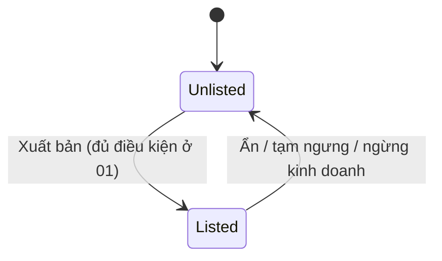

# 13 — Catalog sản phẩm trên cổng khách hàng (Catalog)

> Đã chốt 2026-10-06: hệ thống **chỉ bán sỉ (B2B)**. Catalog nằm trong **cổng khách hàng**, chỉ người đã đăng nhập mới xem được; tình trạng còn hàng chỉ dành cho **khách sỉ đang hoạt động** (giá: xem mốc chốt 2026-11-05 bên dưới — sàn không hiển thị giá).
>
> Đã chốt 2026-11-04: catalog **chỉ để xem hàng và liên hệ Sale** — **khách không tự đặt hàng**; đơn do Sale chốt từ báo giá ([14](../14-cart-and-order/README.md)). **Không còn hàng trơn**: catalog hiển thị các **quy cách** in được của sản phẩm `CUSTOMIZABLE` (để khách xem và tự thiết kế — xem mốc chốt khách tự thiết kế bên dưới), **mẫu thiết kế của khách** và **SKU thành phẩm riêng của khách** ([12](../12-product-design/README.md)). Không có giá gốc, không có giá nhóm.
>
> Đã chốt 2026-11-05: khách sỉ **đặt theo số thùng**, không đặt lẻ; **giá vẫn theo cái**. Bảng giá riêng ghi **đơn giá theo cái**, còn **MOQ và bậc giá tính theo số thùng**. Mỗi SKU riêng có **số cái chuẩn / thùng** cố định (quy cách thùng — [01](../../warehouse/01-product-creation/README.md)), hiển thị cho khách. Tình trạng còn hàng tính theo **số thùng** ([open-questions A9](../../open-questions/README.md)).
>
> Đã chốt 2026-11-05 (lượt 4): **sàn ẩn giá hoàn toàn** — catalog không hiển thị giá ở bất cứ màn hình nào, kể cả SKU riêng. Giá chỉ có trên **báo giá / đơn / hợp đồng** sau khi Sale thoả thuận với khách ([14](../14-cart-and-order/README.md)). **Bảng giá riêng** giữ lại làm **giá nội bộ**: do **Quản lý kinh doanh (Sales Manager)** khai báo, **chỉ nhân viên xem**, là **giá gợi ý** cho Sale khi lập báo giá. Mục **mẫu thiết kế của tôi** hiện thêm **mẫu in chờ duyệt** của Đơn sản xuất, với nút **Duyệt** / **Yêu cầu in lại** ([17](../17-order-management/README.md)).
>
> ✅ Đã chốt 2026-11-05 (khách tự thiết kế): **chỉ khách tự thiết kế trên app** ([12](../12-product-design/README.md)) — bỏ luồng khách đưa mẫu cho Sale / nhân viên thiết kế hộ và nút "Yêu cầu in theo mẫu" qua chat. Trang chi tiết có nút **"Thiết kế"** trên từng quy cách **đã có khuôn in** (khuôn 2D và vùng in — [01](../../warehouse/01-product-creation/README.md)). **Mẫu thiết kế của tôi** là nơi khách **tạo, sửa, xem lại, gửi duyệt, tạo bản sửa** và **yêu cầu báo giá**. **Đặt hàng từ bản thiết kế = yêu cầu báo giá** gửi Sale: khách vẫn không tự đặt, sàn vẫn ẩn giá ([14](../14-cart-and-order/README.md), [16](../16-sales-chat/README.md)).

## 1. Mục đích (Purpose)

Trưng bày ly và bao bì cho **khách sỉ đã đăng nhập** trên cổng khách hàng:

- **cây danh mục**, **trang danh sách** (PLP), **trang chi tiết sản phẩm** (PDP), bộ ảnh;
- **tìm kiếm** không dấu, theo tên hoặc mã, có **gợi ý** khi gõ;
- **quy cách in được** của từng sản phẩm `CUSTOMIZABLE` (dung tích, chất liệu…) — để khách tham khảo và **bắt đầu tự thiết kế** bằng nút **"Thiết kế"** (chỉ quy cách đã có khuôn in); quy cách không có giá, không có tồn;
- **mẫu thiết kế của tôi** — nơi khách **tạo, sửa, xem lại, gửi duyệt** bản thiết kế, **tạo bản sửa** và **yêu cầu báo giá** từ bản đã duyệt; gom các bản thành **dự án thiết kế** (thư viện tài nguyên dùng chung, **gửi duyệt cả bộ**, **yêu cầu báo giá cả dự án**); kèm SKU riêng sinh ra từ đó ([12](../12-product-design/README.md)) và **mẫu in chờ duyệt** của Đơn sản xuất để khách **Duyệt** / **Yêu cầu in lại** ([17](../17-order-management/README.md));
- **SKU thành phẩm riêng của khách** (chỉ khách sở hữu thấy) kèm **số cái / thùng** — **không kèm giá**;
- **chỉ báo còn hàng** của SKU riêng (không bao giờ hiện số tồn);
- **yêu cầu báo giá** từ bản thiết kế đã duyệt hoặc **cả dự án**: mở chat với Sale kèm **thẻ yêu cầu báo giá** (nhiều dòng khi yêu cầu cả dự án — [16](../16-sales-chat/README.md));
- **mở chat với Sale** gắn ngữ cảnh sản phẩm / quy cách / SKU riêng / mẫu thiết kế / đơn cũ để hỏi hàng, yêu cầu báo giá hoặc đặt lại ([16](../16-sales-chat/README.md)).

Sàn **không hiển thị giá** (BR-04). Phía back-office, module quản lý **nội dung SEO / slug**, **giá nội bộ (bảng giá riêng) của khách cho SKU riêng**, cùng việc **xuất bản / ẩn** sản phẩm. Giá nội bộ chỉ nhân viên xem và là **giá gợi ý** khi Sale lập báo giá ([14](../14-cart-and-order/README.md)).

Catalog là **lớp hiển thị tiêu thụ dữ liệu** từ [Product Creation](../../warehouse/01-product-creation/README.md) (một nguồn dữ liệu — [open-questions G1](../../open-questions/README.md)) và **tồn khả dụng (ATP)** từ [Inventory Control](../../warehouse/20-inventory-control/README.md).

> ⚠️ Giả định: các phần sau thuộc **phạm vi giai đoạn sau** (xem [open-questions D17](../../open-questions/README.md)):
> - lọc theo thuộc tính, thương hiệu;
> - sắp xếp theo độ phổ biến;
> - thứ tự hiển thị và sản phẩm nổi bật do Quản lý kinh doanh đặt.
>
> Sàn ẩn giá (chốt 2026-11-05) nên **không có** lọc theo khoảng giá hay sắp xếp theo giá.

---

## 2. Actor liên quan

| Actor | Vai trò |
|-------|---------|
| **Khách hàng sỉ (B2B Customer)** | Đăng nhập cổng; duyệt danh mục, tìm kiếm, xem chi tiết sản phẩm và quy cách, xem **SKU riêng** của mình (không có giá). **Tự thiết kế**: bấm **"Thiết kế"** trên quy cách đã có khuôn in; trong **mẫu thiết kế của tôi** sửa bản nháp, xem lại, **gửi duyệt**, **tạo bản sửa** từ bản đã duyệt; tạo **dự án thiết kế**, quản lý thư viện tài nguyên, **gửi duyệt cả bộ** ([12](../12-product-design/README.md)). **Yêu cầu báo giá** từ bản thiết kế đã duyệt hoặc **cả dự án** (nêu số thùng mong muốn, ngày giao mong muốn nếu có). Hồ sơ `Active` mới xem được **tình trạng còn hàng** của SKU riêng. **Duyệt mẫu in**: xem ảnh / video mẫu in thử, bấm **Duyệt** hoặc **Yêu cầu in lại** kèm ghi chú. **Mở chat với Sale** từ sản phẩm, quy cách, SKU riêng, mẫu thiết kế hoặc đơn cũ. Không tự đặt hàng. |
| **Quản lý kinh doanh (Sales Manager)** | Sửa **slug và nội dung SEO**; **xuất bản / ẩn** sản phẩm; khai báo **giá nội bộ (bảng giá riêng)** của khách (đơn giá / cái, bậc theo số thùng) cho SKU riêng của chính khách đó |
| **Quản trị hệ thống (System Admin)** | Như Quản lý kinh doanh |
| **Nhân viên Sale (Sales Staff)** | **Xem** giá nội bộ làm giá gợi ý khi tư vấn và lập báo giá; nhận hội thoại khách mở từ catalog, gồm **yêu cầu báo giá từ bản thiết kế** hoặc **cả dự án** ([16](../16-sales-chat/README.md)); gửi link sản phẩm / SKU riêng qua [chat](../16-sales-chat/README.md); gửi thẻ duyệt mẫu in, nhắc khách duyệt mẫu in hiện ở đây (ảnh / video mẫu do **Điều phối sản xuất** tải lên vòng mẫu của Đơn sản xuất — [17](../17-order-management/README.md), *cập nhật 2026-11-07*) |
| **Hệ thống** | Dựng bản hiển thị (projection) và chỉ mục tìm kiếm theo sự kiện; lọc SKU riêng, bản thiết kế và mẫu in theo khách sở hữu; chỉ hiện nút "Thiết kế" trên quy cách đã có khuôn in; tính chỉ báo còn hàng từ ATP; mở hội thoại kèm **thẻ yêu cầu báo giá** khi khách yêu cầu báo giá ([16](../16-sales-chat/README.md)); gửi kết quả duyệt mẫu in về Đơn sản xuất ([17](../17-order-management/README.md)) |

---

## 3. Input / Output

### Input

| Nhóm | Dữ liệu | Nguồn |
|------|---------|-------|
| Sản phẩm & quy cách | Sản phẩm `CUSTOMIZABLE` `Published`: tên, mô tả, danh mục, các **quy cách** `Active` (dung tích, chất liệu…) — chỉ là khuôn để in, không có tồn, không có giá; quy cách **đã có khuôn in** hay chưa (khuôn 2D và vùng in trong cấu hình in của quy cách) | [01 Product Creation](../../warehouse/01-product-creation/README.md) |
| **SKU thành phẩm riêng của khách** | SKU sinh khi bản thiết kế của khách được duyệt (`Approved`): khách sở hữu, snapshot, sản phẩm & quy cách; **quy cách thùng** (số cái chuẩn / thùng) | [12](../12-product-design/README.md), [01](../../warehouse/01-product-creation/README.md) |
| **Mẫu thiết kế của khách** | Bản thiết kế mà khách là chủ sở hữu: trạng thái (`Draft` / `Pending Review` / `Approved`), ảnh xem trước 2D / 3D, lý do trả lại gần nhất (nếu có), SKU riêng (nếu đã duyệt), dự án chứa bản (nếu có) | [12](../12-product-design/README.md) |
| **Dự án thiết kế của khách** | Dự án mà khách là chủ sở hữu: tên, mô tả, trạng thái (`Active` / `Archived`), các bản thiết kế trong dự án, thư viện tài nguyên | [12](../12-product-design/README.md) |
| **Yêu cầu báo giá** | Từ một bản thiết kế `Approved` (hoặc kèm khi gửi duyệt): **số thùng mong muốn** (số nguyên ≥ 1 — chỉ là gợi ý cho Sale), **ngày giao mong muốn** (không bắt buộc, không ở quá khứ). **Cả dự án**: các bản `Approved` được chọn, số thùng mong muốn từng bản, **một ngày giao mong muốn chung** | Khách |
| **Mẫu in chờ duyệt** | Vòng mẫu in đang chờ khách của các Đơn sản xuất `Sample Pending` thuộc khách: SKU riêng, mã Đơn sản xuất, số vòng, **ảnh / video mẫu** Điều phối sản xuất tải lên, ngày gửi mẫu vật (nếu có), kết quả các vòng trước | [17](../17-order-management/README.md) |
| Ảnh | Ảnh **đã đăng** (bốn mắt) của từng quy cách, ảnh bìa | [01](../../warehouse/01-product-creation/README.md) |
| Cây danh mục | Danh mục đang hoạt động, thứ tự, ảnh, SEO của danh mục | [01](../../warehouse/01-product-creation/README.md) |
| Nội dung catalog | **Slug** (khoá sau lần xuất bản đầu), **tiêu đề SEO** (≤ 255), **mô tả SEO** | Quản lý kinh doanh |
| **Giá nội bộ của khách (bảng giá riêng — customer price)** | Cho mỗi (khách, SKU riêng của khách đó): **1–20 bậc**, mỗi bậc = **số thùng tối thiểu** (≥ 1, không trùng) + **đơn giá theo cái** (VND nguyên dương). **Bậc đầu là MOQ gợi ý** (tính theo thùng). Chỉ nhân viên xem | Quản lý kinh doanh |
| Tồn khả dụng (ATP) | ATP **toàn hệ thống** của SKU riêng, theo **số thùng** | [20 · Inventory Control](../../warehouse/20-inventory-control/README.md) |
| Đơn cũ của khách | Danh sách đơn để khách mở chat "đặt lại" | [17](../17-order-management/README.md) |

### Output

| Kết quả | Dùng bởi |
|---------|----------|
| **Cây danh mục** | Khách |
| **Trang danh sách / kết quả tìm kiếm** — mỗi thẻ: tên, ảnh bìa, các quy cách, số SKU riêng của khách thuộc sản phẩm (nếu có); không kèm giá, tồn | Khách |
| **Gợi ý tìm kiếm** (tên, slug, mã khớp) | Khách |
| **Trang chi tiết** — tên, mô tả, SEO, các quy cách, bộ ảnh đã đăng, nút **"Thiết kế"** trên quy cách đã có khuôn in; SKU riêng của khách thuộc sản phẩm (nếu có) | Khách |
| **Bắt đầu thiết kế** — bản thiết kế `Draft` mới của khách trên quy cách được chọn | [12](../12-product-design/README.md) |
| **Mẫu thiết kế của tôi** — danh sách thiết kế của khách, trạng thái, ảnh xem trước, các thao tác theo trạng thái (sửa, xoá bản nháp, gửi duyệt, tạo bản sửa, yêu cầu báo giá), SKU riêng kèm số cái / thùng và chỉ báo còn hàng (không có giá); **dự án thiết kế** (các bản cạnh nhau, thư viện tài nguyên, gửi duyệt cả bộ, yêu cầu báo giá cả dự án); **mẫu in chờ duyệt** | Khách |
| **Kết quả duyệt mẫu in** của khách — **Duyệt** hoặc **Yêu cầu in lại** kèm ghi chú, gắn đúng vòng mẫu | [17](../17-order-management/README.md) |
| **Giá nội bộ** cho từng SKU riêng (chỉ nhân viên) — số cái / thùng, các bậc (số thùng tối thiểu → đơn giá / cái), MOQ gợi ý (thùng) | Sale, Quản lý kinh doanh |
| **Chỉ báo còn hàng** cho từng SKU riêng: `In stock` / `Low stock` / `Out of stock` | Khách |
| **Hội thoại mở từ catalog** — gắn ngữ cảnh sản phẩm / quy cách / SKU riêng / mẫu thiết kế / đơn cũ; với yêu cầu báo giá: kèm **thẻ yêu cầu báo giá** (bản thiết kế / SKU riêng, số thùng mong muốn, ngày giao mong muốn; **nhiều dòng** khi yêu cầu cả dự án) | [16](../16-sales-chat/README.md), [14](../14-cart-and-order/README.md) |
| Giá gợi ý (bậc giá: số thùng tối thiểu → đơn giá / cái) điền sẵn vào báo giá | [14](../14-cart-and-order/README.md) |

---

## 4. Luồng nghiệp vụ từng bước (Step-by-step)

### 4.1. Xuất bản & duy trì catalog (Quản lý kinh doanh)

1. **Nội dung catalog** — Quản lý kinh doanh sửa **slug**, **tiêu đề SEO**, **mô tả SEO** (gửi kèm phiên bản đang đọc). Tên và mô tả hiển thị lấy từ sản phẩm ở [01](../../warehouse/01-product-creation/README.md), không sửa ở đây. Sản phẩm `Discontinued` không sửa được.
   - Slug được chuẩn hoá (bỏ dấu, `đ` → `d`, chữ thường nối bằng `-`) và **khoá sau lần xuất bản đầu**.
2. **Xuất bản** — theo điều kiện của [01 §4.5](../../warehouse/01-product-creation/README.md) → sản phẩm `Published`, hiện trên catalog cùng các quy cách. Quy cách không có giá nên xuất bản không đòi điều kiện về giá. **Ẩn** → về `Approved`. Sản phẩm bị tạm ngưng (`Inactive`) cũng rời catalog; tiếp tục rồi phải xuất bản lại.
3. **Cập nhật hiển thị** — mỗi lần sửa nội dung, xuất bản, ẩn, tạm ngưng / tiếp tục, ngừng kinh doanh hoặc sinh SKU riêng mới, hệ thống dựng lại bản hiển thị của sản phẩm.
   - Bản nào cập nhật lỗi được thử lại sau mỗi 30 giây.
   - Khởi động lại thì dựng lại toàn bộ.
   - Tìm kiếm luôn kiểm lại trạng thái thật của sản phẩm, nên bản hiển thị chậm cũng không làm lộ sản phẩm đã ẩn.

### 4.2. Giá nội bộ của khách (Quản lý kinh doanh)

1. **Giá nội bộ (bảng giá riêng) của khách** — Quản lý kinh doanh khai báo 1–20 bậc cho (khách, SKU riêng); mỗi bậc gồm **số thùng tối thiểu** và **đơn giá theo cái**. Bậc có số thùng nhỏ nhất là **MOQ gợi ý** (số thùng) của khách cho SKU đó. SKU riêng chỉ đặt được giá cho **chính khách sở hữu**.
2. Đây là **nguồn giá gợi ý duy nhất**: quy cách không có giá; không có giá gốc, không có giá nhóm.
3. Sửa giá gửi kèm phiên bản (khoá lạc quan). Không có thời hạn hiệu lực, không cần duyệt; mọi thay đổi được ghi nhật ký kiểm toán.
4. **Chỉ nhân viên xem**; giá nội bộ **không bao giờ hiện trên sàn** (BR-04). Sale dùng làm **giá gợi ý** — điền sẵn bậc giá khi lập báo giá ([14](../14-cart-and-order/README.md)); giá thật được thoả thuận với khách và chốt trên báo giá / đơn / hợp đồng.
5. SKU riêng **chưa có giá nội bộ** (ví dụ vừa sinh) thì Sale tự nhập bậc giá trên báo giá ([14](../14-cart-and-order/README.md)); khách không thấy khác biệt vì sàn không hiện giá.

   > ✅ Đã chốt 2026-11-05: báo giá không bắt buộc SKU phải có giá nội bộ trước; giá nội bộ chỉ là gợi ý. Xem [open-questions](../../open-questions/README.md).

### 4.3. Khách duyệt & tìm hàng

1. **Đăng nhập cổng khách hàng.** Người chưa đăng nhập không xem được catalog (chỉ ảnh sản phẩm đã đăng là truy cập công khai).
2. **Cây danh mục** — danh mục đang hoạt động; danh mục ngưng ẩn cả nhánh con. Cùng cấp xếp theo thứ tự đặt rồi theo tên.
3. **Trang danh sách** — lọc theo **danh mục** (gồm mọi danh mục con) và/hoặc **từ khoá**. Sắp xếp:
   - **Liên quan** (mặc định khi có từ khoá);
   - **Mới nhất** (mặc định khi không có từ khoá) — theo lần xuất bản đầu;
   - **Tên**.

   Mỗi trang mặc định 20 sản phẩm, tối đa 200; kết quả xét trong 500 sản phẩm phù hợp nhất.
4. **Tìm kiếm:**
   - Không phân biệt dấu (bỏ dấu tiếng Việt cả từ khoá lẫn dữ liệu, `đ` → `d`); từ khoá tối đa 100 ký tự.
   - Khớp **tên** và **mô tả**; từ cuối khớp theo tiền tố (đang gõ dở); gõ sai chính tả nhẹ vẫn tìm được theo tên.
   - Khớp **mã** (mã quy cách, mã SKU riêng) chính xác hoặc theo tiền tố — chỉ trong các mã khách được xem (BR-02).
   - Xếp hạng "liên quan": khớp chữ + gần đúng + **khớp đúng mã được ưu tiên mạnh** + **SKU riêng còn hàng được cộng điểm**.
5. **Gợi ý khi gõ** — từ **2 ký tự** (chữ / số) trở lên; mặc định 5, tối đa **10** gợi ý; mỗi gợi ý có tên, đường dẫn, mã khớp. Giới hạn 30 lần / 10 giây mỗi người.

### 4.4. Trang chi tiết, quy cách và tình trạng còn hàng

1. **Trang chi tiết** — tên, mô tả, nội dung SEO, **các quy cách nhận in** (dung tích, chất liệu…), **bộ ảnh đã đăng** (theo quy cách, có ảnh bìa).
   - Mỗi quy cách **đã có khuôn in** (khuôn 2D và vùng in — [01](../../warehouse/01-product-creation/README.md)) có nút **"Thiết kế"**: bấm → hệ thống tạo một bản thiết kế `Draft` của khách trên quy cách đó và mở trình thiết kế; quy trình thiết kế, gửi duyệt ở [12](../12-product-design/README.md). Quy cách chưa có khuôn in không có nút này (BR-14).
   - Nút **"Chat với Sale"** mở hội thoại gắn ngữ cảnh sản phẩm / quy cách để hỏi tư vấn ([16](../16-sales-chat/README.md)).

   > Đã chốt 2026-11-04: quy cách của sản phẩm `CUSTOMIZABLE` chỉ là **khuôn để in** — không có tồn, không có giá, không báo giá / đặt trực tiếp. Hàng có tồn và bán được chỉ là **SKU thành phẩm riêng của khách** ([01](../../warehouse/01-product-creation/README.md), [open-questions B19](../../open-questions/README.md)).
2. **SKU riêng của khách** — khách sở hữu SKU riêng thuộc sản phẩm này thấy thêm các SKU đó (tên thiết kế, quy cách, ảnh xem trước, **số cái / thùng**) kèm chỉ báo còn hàng. Khách khác không thấy (BR-02).
3. **Không hiển thị giá** — trang chi tiết, danh sách, tìm kiếm và mẫu thiết kế của tôi đều không có giá, bậc giá hay MOQ (BR-04). Thay vào đó là nút **"Yêu cầu báo giá"** / **"Chat với Sale"**; khách thấy giá khi Sale gửi **báo giá** ([14](../14-cart-and-order/README.md)) — đơn giá / cái, bậc theo số thùng, thành tiền dòng = số thùng × số cái / thùng × đơn giá / cái ([14](../14-cart-and-order/README.md) BR-08).
4. **Tình trạng còn hàng** của SKU riêng (chỉ khách `Active`; tối đa 50 SKU mỗi lần hỏi):

   | Hiển thị | Điều kiện |
   |----------|-----------|
   | `In stock` — Còn hàng | ATP > ngưỡng |
   | `Low stock` — Sắp hết | 0 < ATP ≤ ngưỡng (mặc định **5 thùng**; đặt 0 thì không cảnh báo sắp hết) |
   | `Out of stock` — Hết hàng | ATP ≤ 0 |

   - **Không bao giờ hiện số ATP** cho khách.
   - ATP tính **toàn hệ thống** (cộng **mọi kho**), theo **số thùng** (mọi thùng đúng số cái chuẩn của SKU). Kết quả có thể trễ tối đa 10 giây.
   - **Quan hệ với kho xuất** *(✅ Đã chốt 2026-11-05)*: chỉ báo **không** cam kết hàng có sẵn ở một kho cụ thể. Đơn chỉ giữ hàng **tại kho xuất** Sale chọn khi đơn `Confirmed` ([17](../17-order-management/README.md) BR-22); khi chọn, hệ thống **ưu tiên gợi ý kho đang có đủ hàng** của các SKU trong đơn, rồi tới kho còn chỗ. Hàng nằm ở kho khác kho xuất không dùng cho đơn đó (không chuyển kho), nên "còn hàng" trên sàn có thể khác hàng có sẵn ở kho xuất.

   > ✅ Đã chốt 2026-11-05: ngưỡng "sắp hết" (mặc định 5) tính theo **số thùng**, cùng đơn vị với ATP hiển thị. Xem [open-questions D28](../../open-questions/README.md).
   - SKU riêng được sản xuất theo đơn, nên thường `Out of stock`; tồn có thể còn từ **hàng dư của đơn trước** hoặc **hàng trả** đã đưa lại tồn khả dụng ([17](../17-order-management/README.md)).
   - `Out of stock` không chặn khách liên hệ Sale: Sale vẫn có thể chốt đơn, phần thiếu được bổ sung qua Đơn sản xuất ([17](../17-order-management/README.md)).

### 4.5. Mẫu thiết kế của tôi

1. Khách mở mục **Mẫu thiết kế của tôi**: danh sách bản thiết kế mà khách là chủ sở hữu ([12](../12-product-design/README.md)), với trạng thái và ảnh xem trước. Bản khách đã xoá (`Archived`) không hiện. Vòng đời và quy tắc của bản thiết kế thuộc [12](../12-product-design/README.md).
2. **Thiết kế mới** — khách bấm "Thiết kế" trên một quy cách ở trang chi tiết (§4.4), hoặc bấm "Thiết kế mới" ở đây rồi chọn sản phẩm và quy cách đã có khuôn in → bản `Draft` mới.
3. **Thao tác theo trạng thái:**

   | Trạng thái | Khách thấy | Khách làm được |
   |------------|------------|----------------|
   | `Draft` — bản nháp | Ảnh xem trước; lý do trả lại gần nhất (nếu bản bị Quản lý kinh doanh trả lại) | **Sửa** trong trình thiết kế (tự do); **xoá** (→ `Archived`); **Gửi duyệt**; **Gửi duyệt và yêu cầu báo giá** (§4.6). Hệ thống tự kiểm (preflight) khi gửi: không đạt → báo lỗi cụ thể, bản vẫn `Draft` ([12](../12-product-design/README.md)) |
   | `Pending Review` — chờ duyệt | Ảnh xem trước 2D / 3D (chỉ xem) | Chờ Quản lý kinh doanh duyệt; không sửa được |
   | `Approved` — đã duyệt | Ảnh xem trước 2D / 3D (chỉ xem); **SKU riêng** sinh ra kèm số cái / thùng và chỉ báo còn hàng (không có giá) | **Tạo bản sửa** (bản thiết kế mới `Draft`, sao chép nội dung; duyệt xong sinh SKU mới, SKU cũ giữ nguyên); **Yêu cầu báo giá** (§4.6) |

4. SKU riêng vẫn hiện ở đây kể cả khi sản phẩm gốc đang `Unlisted`, chừng nào SKU còn `Active`.
5. **Mẫu in chờ duyệt** — với SKU riêng có Đơn sản xuất đang `Sample Pending` ([17](../17-order-management/README.md)), mục này hiện vòng mẫu in đang chờ khách: số vòng, **ảnh / video mẫu** Điều phối sản xuất tải lên, ngày gửi mẫu vật (nếu có), kết quả các vòng trước. Khách chọn:
   - **Duyệt** → Đơn sản xuất sang `In Production` ([17](../17-order-management/README.md));
   - **Yêu cầu in lại** kèm **ghi chú** (bắt buộc) → Điều phối sản xuất mở vòng mẫu mới và ghi lý do in lại ở [17](../17-order-management/README.md).

   Mẫu in được in theo đúng file in đã chốt của bản thiết kế; khách muốn **sửa thiết kế** thì tự **tạo bản sửa** từ bản `Approved` ngay trong mục này và gửi duyệt ([12](../12-product-design/README.md)); duyệt xong sinh SKU riêng mới, Sale đổi SKU của dòng đơn theo [17](../17-order-management/README.md) — không làm trong bước duyệt mẫu. Cùng thao tác duyệt mẫu có trên thẻ hành động trong [chat](../16-sales-chat/README.md); làm ở một nơi thì nơi kia hiện kết quả.
6. Từ mỗi mẫu, khách có thể **mở chat với Sale** gắn ngữ cảnh mẫu thiết kế (hỏi tư vấn, góp ý).
7. **Dự án thiết kế** — trong mục này, khách tạo **dự án** để gom các bản của một bộ nhận diện ([12](../12-product-design/README.md) §4.9–§4.11):
   - tạo bản mới ngay trong dự án, thêm bản sẵn có, gỡ bản (trừ bản `Pending Review`);
   - tải logo / ảnh vào **thư viện tài nguyên** của dự án một lần, dùng lại khi thiết kế từng bản;
   - xem các bản **cạnh nhau** (ảnh xem trước, trạng thái);
   - chọn từ 2 bản `Draft` trở lên → **"Gửi duyệt cả bộ"**: một bản không qua tự kiểm thì không bản nào được gửi;
   - chọn các bản `Approved` → **"Yêu cầu báo giá cả dự án"** (§4.6);
   - **đóng dự án** khi không còn bản chờ duyệt; các bản bên trong giữ nguyên.

### 4.6. Liên hệ Sale từ catalog

Khách **không tự đặt hàng** trên catalog. Mọi nhu cầu mua đi qua Sale:

1. **Yêu cầu báo giá từ bản thiết kế** — "đặt hàng" từ một bản thiết kế chính là **yêu cầu báo giá** gửi Sale. Từ một bản `Approved` (mục mẫu thiết kế của tôi, hoặc SKU riêng trên trang sản phẩm), khách bấm **"Yêu cầu báo giá"**, nhập:
   - **số thùng mong muốn** (số nguyên ≥ 1) — chỉ là **gợi ý** cho Sale;
   - **ngày giao mong muốn** (không bắt buộc, không ở quá khứ).

   Hệ thống mở hội thoại với Sale gắn ngữ cảnh bản thiết kế / SKU riêng, kèm **thẻ yêu cầu báo giá** ([16](../16-sales-chat/README.md)). Sale lập báo giá ([14](../14-cart-and-order/README.md)) với giá gợi ý từ giá nội bộ của khách; ngày giao mong muốn thành **ngày giao khách yêu cầu** của báo giá.
2. **Gửi duyệt và yêu cầu báo giá** — từ một bản `Draft`, khách có thể gửi duyệt và yêu cầu báo giá **cùng lúc** (nhập như bước 1). Hệ thống tự kiểm bản thiết kế như khi gửi duyệt ([12](../12-product-design/README.md)): không đạt → báo lỗi, không gửi gì; đạt → bản sang `Pending Review` và hội thoại kèm thẻ yêu cầu báo giá được mở ngay. Sale nhận yêu cầu ngay nhưng **chỉ lập báo giá được khi bản đã `Approved`** (SKU riêng đã sinh) (BR-16).
3. **Đặt lại** — từ một đơn cũ, khách bấm **"Đặt lại"**: hệ thống mở hội thoại gắn ngữ cảnh đơn đó. Sale lập báo giá mới, giá gợi ý theo giá nội bộ hiện hành ([14](../14-cart-and-order/README.md)).
4. **Hỏi hàng / tư vấn** — từ sản phẩm, quy cách, SKU riêng hoặc mẫu thiết kế, khách bấm **"Chat với Sale"**: hệ thống mở hội thoại gắn ngữ cảnh đó ([16](../16-sales-chat/README.md)). Chat không dùng để gửi mẫu cho Sale thiết kế hộ — khách tự thiết kế (§4.4, §4.5).
5. **Yêu cầu báo giá cả dự án** — trong một dự án `Active`, khách chọn **một hoặc nhiều bản `Approved`**, bấm **"Yêu cầu báo giá cả dự án"**, nhập **số thùng mong muốn từng bản** (gợi ý) và **một ngày giao mong muốn chung** (không bắt buộc, không ở quá khứ). Hệ thống mở **một hội thoại** gắn ngữ cảnh dự án, kèm **thẻ yêu cầu báo giá nhiều dòng** ([16](../16-sales-chat/README.md)); Sale lập **một báo giá nhiều dòng** ([14](../14-cart-and-order/README.md)). Ở mức dự án không có "Gửi duyệt và yêu cầu báo giá" (BR-16).

---

## 5. Trạng thái / Vòng đời (Lifecycle)

Catalog không có chứng từ. Một sản phẩm hiện trên catalog khi **`Published`** ở [01](../../warehouse/01-product-creation/README.md); mỗi SKU riêng mang một chỉ báo còn hàng. Mẫu in chờ duyệt chỉ hiện khi Đơn sản xuất ở `Sample Pending`; vòng đời Đơn sản xuất và các vòng mẫu in thuộc [17](../17-order-management/README.md). Vòng đời **bản thiết kế** (`Draft` → `Pending Review` → `Approved`; `Archived` khi khách xoá bản nháp) thuộc [12](../12-product-design/README.md); vòng đời **dự án thiết kế** (`Active` → `Archived`) cũng thuộc [12](../12-product-design/README.md) §5.4; mục mẫu thiết kế của tôi chỉ hiển thị và gọi thao tác của 12 (§4.5).

| Trạng thái hiển thị | Ý nghĩa | Chuyển tiếp cho phép | Ai thực hiện |
|---------------------|---------|----------------------|--------------|
| `Listed` | Sản phẩm `Published`: hiện trong danh sách, tìm kiếm, trang chi tiết | → `Unlisted` (ẩn, tạm ngưng, ngừng kinh doanh) | Quản lý kinh doanh / System Admin |
| `Unlisted` | Sản phẩm `Approved` (chưa / thôi xuất bản), `Inactive` hoặc `Discontinued`: không hiện, link trực tiếp không xem được nữa | → `Listed` (xuất bản; với `Inactive` phải tiếp tục trước) | Quản lý kinh doanh / System Admin |

| Chỉ báo còn hàng (theo SKU riêng) | Điều kiện |
|-----------------------------------|-----------|
| `In stock` | ATP > ngưỡng (mặc định 5 thùng) |
| `Low stock` | 0 < ATP ≤ ngưỡng |
| `Out of stock` | ATP ≤ 0 |

---

## 6. Ràng buộc nghiệp vụ (Business Rules) & Edge case

### Business rules

- **BR-01:** Chỉ sản phẩm `Published` hiển thị; chỉ quy cách và SKU riêng `Active` được liệt kê. Catalog chỉ dành cho người đã đăng nhập.
- **BR-02:** **SKU thành phẩm riêng chỉ hiển thị với khách sở hữu** — trong danh sách, tìm kiếm, gợi ý, trang chi tiết và mẫu thiết kế của tôi. Với khách khác, SKU đó coi như không tồn tại.
- **BR-03:** **Tình trạng còn hàng và mẫu in chờ duyệt chỉ trả cho khách có hồ sơ `Active`**. Khách `Blocked` / `Inactive` không đăng nhập được ([18](../18-customer-information/README.md)); khách `Pending Activation` đăng nhập được nhưng không thấy tồn.
- **BR-04:** **Sàn không hiển thị giá** — không có giá, bậc giá hay MOQ ở bất cứ màn hình catalog nào (danh sách, tìm kiếm, gợi ý, trang chi tiết, mẫu thiết kế của tôi), kể cả với SKU riêng. Khách chỉ thấy giá trên **báo giá / đơn / hợp đồng** do Sale lập (trang chứng từ trên cổng hoặc thẻ trong chat — [14](../14-cart-and-order/README.md)). Giá nội bộ (bảng giá riêng của khách sở hữu cho SKU riêng) là **nguồn giá gợi ý duy nhất**; mỗi (khách, SKU riêng) có một bảng; không có giá gốc, không có giá nhóm; quy cách không có giá.
- **BR-05:** Giá nội bộ có **1–20 bậc** theo **số thùng**; bậc đầu là **MOQ gợi ý** (số thùng). Khi điền sẵn vào báo giá, đơn giá theo bậc chọn bằng **tổng số thùng của SKU trong báo giá**; MOQ ràng buộc là MOQ trên báo giá ([14](../14-cart-and-order/README.md) BR-07).
- **BR-06:** Mọi giá là **VND nguyên dương**, **theo cái**; thành tiền dòng = số thùng × số cái / thùng × đơn giá / cái ([14](../14-cart-and-order/README.md) BR-08). Không có thời hạn hiệu lực, không có duyệt giá nội bộ. Giá nội bộ chỉ là **giá gợi ý**; giá được chốt trên báo giá / đơn ([14](../14-cart-and-order/README.md)).
- **BR-07:** Tình trạng còn hàng tính từ **ATP toàn hệ thống** của SKU riêng (định nghĩa ở [Glossary](../../glossary/README.md), [20 BR-01](../../warehouse/20-inventory-control/README.md)); **không bao giờ hiện số ATP**. ✅ Đã chốt 2026-11-05 ([open-questions C3](../../open-questions/README.md)): chỉ báo **giữ tính theo mọi kho**, không theo kho phục vụ khu vực giao; giữ hàng cho đơn chỉ dùng tồn **tại kho xuất** ([17](../17-order-management/README.md) BR-22, [20 BR-01](../../warehouse/20-inventory-control/README.md)), và khi Sale chọn kho xuất hệ thống **ưu tiên gợi ý kho đang có đủ hàng** — chỉ báo trên sàn không cam kết hàng ở kho xuất (§4.4).
- **BR-08:** **Khách không đặt hàng trên catalog.** Mọi lối "đặt hàng", "yêu cầu báo giá" (kể cả từ bản thiết kế), "đặt lại" đều mở hội thoại với Sale gắn ngữ cảnh ([16](../16-sales-chat/README.md)); đơn do Sale tạo từ báo giá đã chấp nhận ([14](../14-cart-and-order/README.md)). Tự thiết kế trên app không phải đặt hàng.
- **BR-09:** Slug khoá sau lần xuất bản đầu; nội dung catalog của sản phẩm `Discontinued` không sửa được.
- **BR-10:** Chỉ Quản lý kinh doanh / System Admin khai báo giá nội bộ và xuất bản; Sale chỉ xem giá nội bộ. Khách không bao giờ xem được giá nội bộ.
- **BR-11:** **Quy cách chỉ để xem và thiết kế**: không có giá, không có chỉ báo còn hàng, không được báo giá / đặt trực tiếp. Muốn mua, khách tự thiết kế trên quy cách (nút "Thiết kế"), gửi duyệt rồi yêu cầu báo giá; chỉ SKU riêng sinh từ bản thiết kế đã duyệt (`Approved`) mới được báo giá ([12](../12-product-design/README.md), [14](../14-cart-and-order/README.md)).
- **BR-12:** **Khách đặt theo số thùng, không đặt lẻ.** Mỗi SKU riêng hiển thị **số cái chuẩn / thùng** ([01](../../warehouse/01-product-creation/README.md)); mọi số lượng khách thấy trên catalog (tình trạng còn hàng) và trên báo giá (MOQ, bậc giá) tính theo thùng.
- **BR-13:** **Duyệt mẫu in trên sàn** chỉ dành cho **khách sở hữu** SKU của Đơn sản xuất, chỉ khi Đơn sản xuất ở `Sample Pending` và vòng mẫu đang chờ khách. Khách chỉ chọn **Duyệt** hoặc **Yêu cầu in lại** (bắt buộc ghi chú); mỗi vòng nhận đúng một kết quả, kết quả đã ghi (trên sàn hoặc qua thẻ chat) thì không đổi được. Quy tắc vòng mẫu, lý do in lại, số lần in mẫu miễn phí thuộc [17](../17-order-management/README.md). ✅ Đã chốt 2026-11-05: mỗi vòng mẫu chỉ nhận một kết quả, đã ghi thì không đổi — xem [open-questions](../../open-questions/README.md).
- **BR-14:** **Nút "Thiết kế"** chỉ hiện trên quy cách `Active` của sản phẩm `Published` **đã có khuôn in** (khuôn 2D và vùng in trong cấu hình in của quy cách — [01](../../warehouse/01-product-creation/README.md)). Quy cách chưa có khuôn in chỉ để xem; khách không bắt đầu thiết kế được trên quy cách đó ([12](../12-product-design/README.md)).
- **BR-15:** **Mẫu thiết kế của tôi chỉ hiện bản thiết kế của chính khách** (khách khác coi như không tồn tại, như BR-02). Thao tác theo trạng thái của [12](../12-product-design/README.md): chỉ bản `Draft` được sửa, xoá, gửi duyệt; bản `Pending Review` và `Approved` chỉ xem; muốn đổi bản `Approved` thì **tạo bản sửa** (bản mới `Draft`; duyệt xong sinh SKU riêng mới, SKU cũ giữ nguyên). Không có thao tác duyệt bản thiết kế trên cổng khách hàng — Quản lý kinh doanh duyệt ở back-office. **Dự án thiết kế** cũng chỉ hiện với chủ sở hữu; thao tác dự án (thêm / gỡ bản, thư viện, gửi duyệt cả bộ, đóng dự án) theo [12](../12-product-design/README.md) BR-17–BR-22.
- **BR-16:** **Yêu cầu báo giá từ bản thiết kế** chỉ từ bản **`Approved`** (SKU riêng đã sinh), hoặc gửi kèm khi gửi duyệt bản `Draft` ("Gửi duyệt và yêu cầu báo giá" — chỉ gửi khi bản qua được tự kiểm). Sale chỉ **lập báo giá** khi bản đã `Approved`. **Số thùng** khách nêu là **gợi ý**, không ràng buộc báo giá; **ngày giao mong muốn** thành ngày giao khách yêu cầu của báo giá ([14](../14-cart-and-order/README.md)). Yêu cầu báo giá không giữ hàng, không có giá. **Yêu cầu báo giá cả dự án** chỉ gồm bản `Approved` của một dự án `Active`, một ngày giao mong muốn chung, và không có biến thể "gửi duyệt kèm yêu cầu báo giá" ([12](../12-product-design/README.md) BR-21).

### Edge case

| Tình huống | Hướng xử lý |
|------------|-------------|
| Hết hàng ngay khi khách đang xem | Chỉ báo cập nhật sau tối đa 10 giây; Sale kiểm lại tồn khi lập đơn ([14](../14-cart-and-order/README.md)) |
| Sàn báo `In stock` nhưng hàng nằm rải ở nhiều kho, không kho nào đủ cho đơn | Chỉ báo tính theo mọi kho (BR-07). Khi đơn `Confirmed`, Sale chọn kho xuất theo gợi ý (ưu tiên kho đủ hàng, rồi kho còn chỗ); phần thiếu tại kho xuất đi Đơn sản xuất ([17](../17-order-management/README.md) §4.2) |
| Khách muốn mua SKU riêng `Out of stock` | Khách vẫn mở chat với Sale; Sale báo thời gian có hàng, đơn thiếu hàng được bổ sung qua Đơn sản xuất ([17](../17-order-management/README.md)) |
| Khách muốn đặt thẳng một quy cách (chưa có thiết kế) | Không có giá, không báo giá được (BR-11); khách bấm "Thiết kế" trên quy cách → tự thiết kế, gửi duyệt ([12](../12-product-design/README.md)) → yêu cầu báo giá khi bản `Approved` (hoặc "Gửi duyệt và yêu cầu báo giá") |
| Quy cách khách muốn chưa có khuôn in | Không có nút "Thiết kế" (BR-14); khách chat với Sale; Quản lý kinh doanh khai báo cấu hình in cho quy cách ở [01](../../warehouse/01-product-creation/README.md) |
| Khách chưa có SKU riêng nào | Catalog chỉ hiện sản phẩm và quy cách; mục mẫu thiết kế của tôi trống hoặc chỉ có bản chưa duyệt (`Draft` / `Pending Review`); khách vẫn chat với Sale được |
| Khách muốn yêu cầu báo giá cho bản đang `Pending Review` (lúc gửi duyệt chưa chọn yêu cầu báo giá) | Chưa có nút "Yêu cầu báo giá" (BR-16); khách chờ bản được duyệt, hoặc chat với Sale hỏi trước |
| Khách "Gửi duyệt và yêu cầu báo giá", bản bị Quản lý kinh doanh trả lại | Bản về `Draft` kèm lý do; Sale chưa lập báo giá được (BR-16); thẻ yêu cầu báo giá trong hội thoại hiện trạng thái bản thiết kế ([16](../16-sales-chat/README.md)); khách sửa và gửi duyệt lại |
| Khách "Gửi duyệt cả bộ" trong dự án, một bản không qua tự kiểm | Không bản nào được gửi; hệ thống báo lỗi theo từng bản ([12](../12-product-design/README.md) BR-19); khách sửa hoặc bỏ chọn bản lỗi rồi gửi lại |
| Khách muốn yêu cầu báo giá cả dự án nhưng có bản chưa duyệt | Chỉ chọn được bản `Approved` (BR-16); khách yêu cầu báo giá phần đã duyệt hoặc chờ các bản còn lại |
| Khách bấm "Gửi duyệt" nhưng ảnh không đủ độ phân giải / nằm ngoài vùng in | Hệ thống tự kiểm báo lỗi cụ thể, bản vẫn `Draft` ([12](../12-product-design/README.md)); không mở yêu cầu báo giá |
| Sản phẩm bị ẩn khi khách có link trực tiếp | Trang sản phẩm không xem được nữa; SKU riêng của khách vẫn xem được trong mẫu thiết kế của tôi |
| Quản lý kinh doanh đổi giá nội bộ sau khi Sale đã gửi báo giá | Báo giá đã gửi giữ giá của nó; giá nội bộ mới chỉ gợi ý cho báo giá lập sau ([14](../14-cart-and-order/README.md)) |
| Khách hỏi giá trên sàn | Sàn không hiện giá (BR-04); khách bấm "Yêu cầu báo giá" → chat với Sale, nhận báo giá |
| Khách có nhiều SKU riêng, một số hết hàng | Mỗi SKU riêng có chỉ báo riêng |
| SKU riêng vừa sinh, chưa có giá nội bộ | Sale tự nhập bậc giá trên báo giá; khách không thấy khác biệt trên sàn |
| Khách duyệt mẫu in trên sàn trong khi đã có kết quả ghi qua thẻ chat | Vòng mẫu đã có kết quả; thao tác sau bị từ chối, màn hình hiện kết quả hiện tại (BR-13) |
| Khách xem mẫu in và muốn đổi logo / màu (không phải lỗi in) | Không chọn được "sửa file" ở bước duyệt mẫu; khách tự **tạo bản sửa** từ bản `Approved` trong mẫu thiết kế của tôi, gửi duyệt ([12](../12-product-design/README.md)) → SKU riêng mới; Sale đổi SKU dòng đơn theo [17](../17-order-management/README.md) |
| Mẫu in chờ duyệt nhưng khách không phản hồi | Đơn sản xuất ở lại `Sample Pending`; Sale nhắc khách qua [chat](../16-sales-chat/README.md) |
| Khách cần một số cái không chia hết cho số cái / thùng | Không bán lẻ (BR-12); khách trao đổi với Sale qua chat để chọn số thùng nguyên |
| Khách gõ đúng mã SKU riêng của khách khác | Không tìm thấy (BR-02) |
| Khách mới chưa kích hoạt (`Pending Activation`) | Xem được catalog nhưng không thấy tình trạng còn hàng; vẫn mở chat với Sale được |
| Kết quả tìm kiếm rỗng | Gõ sai nhẹ vẫn tìm theo tên; nếu vẫn rỗng, bỏ bớt từ khoá hoặc danh mục |
| Bản hiển thị chưa kịp cập nhật sau khi ẩn | Tìm kiếm kiểm lại trạng thái thật; bản lỗi được thử lại mỗi 30 giây |
| Danh mục bị ngưng | Cả nhánh con biến khỏi cây; lọc theo danh mục đó báo không tìm thấy |

---

## 7. Liên kết với các module khác

| Module | Quan hệ |
|--------|---------|
| [01 · Product Creation](../../warehouse/01-product-creation/README.md) | Nguồn sản phẩm `CUSTOMIZABLE`, quy cách, ảnh đã đăng, cây danh mục; điều kiện xuất bản; trạng thái `Published`; **cấu hình in** của quy cách (đã có khuôn in hay chưa — quyết định nút "Thiết kế"); SKU riêng của khách thuộc sản phẩm `CUSTOMIZABLE` và quy cách thùng (số cái chuẩn / thùng) |
| [20 · Inventory Control](../../warehouse/20-inventory-control/README.md) | ATP toàn hệ thống (mọi kho) của SKU riêng (theo số thùng) để tính chỉ báo còn hàng; giữ hàng cho đơn chỉ dùng tồn tại kho xuất |
| [12 · Quản lý mẫu & thiết kế](../12-product-design/README.md) | Nút "Thiết kế" mở trình thiết kế trên quy cách đã có khuôn in; mục mẫu thiết kế của tôi gọi các thao tác của bản thiết kế (sửa, xoá bản nháp, gửi duyệt, tạo bản sửa) và của **dự án thiết kế** (thư viện tài nguyên, gửi duyệt cả bộ, đóng dự án); SKU riêng sinh khi bản được duyệt (`Approved`); khách cần sửa thiết kế sau khi xem mẫu in → bản sửa |
| [14 · Báo giá, Đơn hàng & Hợp đồng](../14-cart-and-order/README.md) | Giá nội bộ của khách làm giá gợi ý của báo giá; giá chỉ hiện với khách trên báo giá / đơn / hợp đồng; yêu cầu báo giá từ bản thiết kế hoặc cả dự án (số thùng gợi ý, ngày giao mong muốn → ngày giao khách yêu cầu) và đặt lại đi qua Sale |
| [16 · Sales Chat](../16-sales-chat/README.md) | Khách mở chat gắn ngữ cảnh sản phẩm / quy cách / SKU riêng / mẫu thiết kế / đơn cũ; **thẻ yêu cầu báo giá** từ bản thiết kế (nhiều dòng khi yêu cầu cả dự án); Sale gửi link sản phẩm / SKU riêng; thẻ duyệt mẫu in (cùng thao tác với mục mẫu thiết kế của tôi) |
| [17 · Order Management](../17-order-management/README.md) | Đơn cũ để khách mở chat đặt lại; **trang đơn của khách** (trạng thái, theo dõi giao hàng theo từng xe: tên hãng, mã vận đơn, biển số, các mốc hành trình) và thông báo "đã bàn giao vận chuyển" thuộc 17 (§5.2), không thuộc catalog; hàng hết được bổ sung qua Đơn sản xuất; **mẫu in chờ duyệt** của Đơn sản xuất `Sample Pending` và kết quả Duyệt / Yêu cầu in lại; hàng dư / hàng trả của SKU riêng làm tồn khả dụng |
| [18 · Customer Information](../18-customer-information/README.md) | Trạng thái hồ sơ khách quyết định xem tình trạng còn hàng; giá nội bộ gắn hồ sơ khách |
