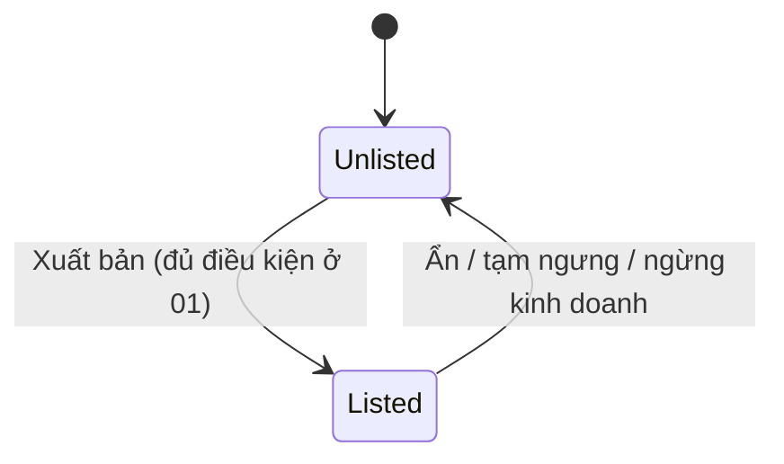

# 13 — Catalog sản phẩm trên cổng khách hàng (Catalog)

> Đã chốt 2026-10-06: hệ thống **chỉ bán sỉ (B2B)**. Catalog nằm trong **cổng khách hàng**, chỉ người đã đăng nhập mới xem được; giá và tình trạng còn hàng chỉ dành cho **khách sỉ đang hoạt động**, với **giá riêng** của từng khách.

## 1. Mục đích (Purpose)

Trưng bày ly và bao bì cho **khách sỉ đã đăng nhập** trên cổng khách hàng:

- **cây danh mục**, **trang danh sách** (PLP), **trang chi tiết sản phẩm** (PDP), bộ ảnh;
- **tìm kiếm** không dấu, theo tên hoặc SKU, có **gợi ý** khi gõ;
- **giá áp cho khách** (giá riêng kèm bậc số lượng / MOQ, giá nhóm, hoặc giá gốc);
- **chỉ báo còn hàng** (không bao giờ hiện số tồn);
- điểm vào **đặt hàng** hàng sẵn ([14](../14-cart-and-order/README.md)).

Phía back-office, module quản lý **nội dung SEO / slug**, **giá gốc theo SKU**, **giá riêng theo khách** và **giá theo nhóm khách**, cùng việc **xuất bản / ẩn** sản phẩm.

Catalog là **lớp hiển thị tiêu thụ dữ liệu** từ [Product Creation](../../warehouse/01-product-creation/README.md) (một nguồn dữ liệu — [open-questions G1](../../open-questions/README.md)) và **tồn khả dụng (ATP)** từ [Inventory Control](../../warehouse/20-inventory-control/README.md).

> ⚠️ Giả định: các phần sau thuộc **phạm vi giai đoạn sau** (xem [open-questions D17](../../open-questions/README.md)):
> - **đặt trước / backorder**;
> - lọc theo thuộc tính, thương hiệu, khoảng giá;
> - sắp xếp theo giá / độ phổ biến;
> - thứ tự hiển thị và sản phẩm nổi bật do Quản trị bán hàng đặt;
> - **giá và tồn theo đơn vị bán** (thùng…) — hiện mọi giá và số lượng trên catalog tính theo **đơn vị cơ sở** ([open-questions A9](../../open-questions/README.md));
> - khách **tự gửi yêu cầu báo giá / yêu cầu thiết kế** từ trang sản phẩm — hiện khách liên hệ Sale qua [chat](../16-sales-chat/README.md).

---

## 2. Actor liên quan

| Actor | Vai trò |
|-------|---------|
| **Khách hàng sỉ (B2B Customer)** | Đăng nhập cổng; duyệt danh mục, tìm kiếm, xem chi tiết. Hồ sơ `Active` mới xem được **giá áp cho mình** và **tình trạng còn hàng**. Đặt hàng hàng sẵn, đặt lại đơn cũ ([14](../14-cart-and-order/README.md)). |
| **Quản trị bán hàng (E-commerce Admin)** | Sửa **slug và nội dung SEO**; đặt **giá gốc** từng SKU; **xuất bản / ẩn** sản phẩm; quản lý **giá riêng theo khách** (bậc số lượng) và **giá theo nhóm khách** |
| **Quản trị hệ thống (System Admin)** | Như Quản trị bán hàng |
| **Nhân viên Sale (Sales Staff)** | **Xem** giá riêng / giá nhóm để tư vấn và lập báo giá; gửi link sản phẩm qua [chat](../16-sales-chat/README.md) |
| **Điều phối đơn hàng (Order Coordinator)** | **Xem** giá riêng / giá nhóm |
| **Hệ thống** | Dựng bản hiển thị (projection) và chỉ mục tìm kiếm theo sự kiện; tính giá áp cho khách; tính chỉ báo còn hàng từ ATP |

---

## 3. Input / Output

### Input

| Nhóm | Dữ liệu | Nguồn |
|------|---------|-------|
| Sản phẩm & biến thể | Sản phẩm `Published`: tên, mô tả, loại (`STANDARD` / `CUSTOMIZABLE`), SKU `Active`, danh mục | [01 Product Creation](../../warehouse/01-product-creation/README.md) |
| Ảnh | Ảnh **đã đăng** (bốn mắt) của từng biến thể, ảnh bìa | [01](../../warehouse/01-product-creation/README.md) |
| Cây danh mục | Danh mục đang hoạt động, thứ tự, ảnh, SEO của danh mục | [01](../../warehouse/01-product-creation/README.md) |
| Nội dung catalog | **Slug** (khoá sau lần xuất bản đầu), **tiêu đề SEO** (≤ 255), **mô tả SEO** | Quản trị bán hàng |
| **Giá gốc (base price)** | Một giá cho mỗi SKU, VND nguyên dương, áp từ 1 đơn vị | Quản trị bán hàng |
| **Giá nhóm khách (segment price)** | Một giá cho mỗi (nhóm khách, SKU), VND nguyên dương, **không có bậc** | Quản trị bán hàng; nhóm khách ở [18](../18-customer-information/README.md) |
| **Giá riêng của khách (customer price)** | Cho mỗi (khách, SKU): **1–20 bậc**, mỗi bậc = số lượng tối thiểu (≥ 1, không trùng) + đơn giá VND nguyên dương. **Bậc đầu là MOQ** | Quản trị bán hàng |
| Tồn khả dụng (ATP) | ATP **toàn hệ thống** của SKU, theo đơn vị cơ sở | [20 · Inventory Control](../../warehouse/20-inventory-control/README.md) |

### Output

| Kết quả | Dùng bởi |
|---------|----------|
| **Cây danh mục** | Khách |
| **Trang danh sách / kết quả tìm kiếm** — mỗi thẻ: tên, ảnh bìa, các SKU đang bán, loại sản phẩm (không kèm giá, tồn) | Khách |
| **Gợi ý tìm kiếm** (tên, slug, SKU khớp) | Khách |
| **Trang chi tiết** — tên, mô tả, SEO, loại, các SKU, bộ ảnh đã đăng | Khách |
| **Lịch giá của khách** cho từng SKU — nguồn giá (riêng / nhóm / gốc), các bậc, MOQ | Khách, [14](../14-cart-and-order/README.md) |
| **Chỉ báo còn hàng** cho từng SKU: `In stock` / `Low stock` / `Out of stock` | Khách |
| Giá chốt khi đặt hàng (theo tổng số lượng SKU trong đơn) | [14](../14-cart-and-order/README.md), [17](../17-order-management/README.md) |

---

## 4. Luồng nghiệp vụ từng bước (Step-by-step)

### 4.1. Xuất bản & duy trì catalog (Quản trị bán hàng)

1. **Nội dung catalog** — Quản trị bán hàng sửa **slug**, **tiêu đề SEO**, **mô tả SEO** (gửi kèm phiên bản đang đọc). Tên và mô tả hiển thị lấy từ sản phẩm ở [01](../../warehouse/01-product-creation/README.md), không sửa ở đây. Sản phẩm `Discontinued` không sửa được.
   - Slug được chuẩn hoá (bỏ dấu, `đ` → `d`, chữ thường nối bằng `-`) và **khoá sau lần xuất bản đầu**.
2. **Giá gốc** — đặt cho từng SKU. Thiếu giá gốc thì không xuất bản được.
3. **Xuất bản** — theo điều kiện của [01 §4.5](../../warehouse/01-product-creation/README.md) → sản phẩm `Published`, hiện trên catalog. **Ẩn** → về `Approved`. Sản phẩm bị tạm ngưng (`Inactive`) cũng rời catalog; tiếp tục rồi phải xuất bản lại.
4. **Cập nhật hiển thị** — mỗi lần sửa nội dung, đổi giá, xuất bản, ẩn, tạm ngưng / tiếp tục hoặc ngừng kinh doanh, hệ thống dựng lại bản hiển thị của sản phẩm.
   - Bản nào cập nhật lỗi được thử lại sau mỗi 30 giây.
   - Khởi động lại thì dựng lại toàn bộ.
   - Tìm kiếm luôn kiểm lại trạng thái thật của sản phẩm, nên bản hiển thị chậm cũng không làm lộ sản phẩm đã ẩn.

### 4.2. Giá riêng và giá nhóm (Quản trị bán hàng)

1. **Giá nhóm khách** — Quản trị bán hàng đặt một giá cho (nhóm khách, SKU). Khách thuộc nhóm ([18](../18-customer-information/README.md)) mà chưa có giá riêng thì dùng giá này.
2. **Giá riêng của khách** — đặt 1–20 bậc cho (khách, SKU). Bậc có số lượng nhỏ nhất là **MOQ** của khách cho SKU đó.
3. Sửa giá gửi kèm phiên bản (khoá lạc quan). Không có thời hạn hiệu lực, không cần duyệt; mọi thay đổi được ghi nhật ký kiểm toán.
4. Sale và Điều phối **chỉ xem**; Sale dùng làm giá mặc định khi lập báo giá ([14](../14-cart-and-order/README.md)).

### 4.3. Khách duyệt & tìm hàng

1. **Đăng nhập cổng khách hàng.** Người chưa đăng nhập không xem được catalog (chỉ ảnh sản phẩm đã đăng là truy cập công khai).
2. **Cây danh mục** — danh mục đang hoạt động; danh mục ngưng ẩn cả nhánh con. Cùng cấp xếp theo thứ tự đặt rồi theo tên.
3. **Trang danh sách** — lọc theo **danh mục** (gồm mọi danh mục con) và/hoặc **từ khoá**. Sắp xếp:
   - **Liên quan** (mặc định khi có từ khoá);
   - **Mới nhất** (mặc định khi không có từ khoá) — theo lần xuất bản đầu;
   - **Tên**.

   Mỗi trang mặc định 20 sản phẩm, tối đa 200; kết quả xét trong 500 sản phẩm phù hợp nhất.
4. **Tìm kiếm:**
   - Không phân biệt dấu (bỏ dấu tiếng Việt cả từ khoá lẫn dữ liệu, `đ` → `d`); từ khoá tối đa 100 ký tự.
   - Khớp **tên** và **mô tả**; từ cuối khớp theo tiền tố (đang gõ dở); gõ sai chính tả nhẹ vẫn tìm được theo tên.
   - Khớp **SKU** chính xác hoặc theo tiền tố.
   - Xếp hạng "liên quan": khớp chữ + gần đúng + **khớp đúng SKU được ưu tiên mạnh** + **còn hàng được cộng điểm**.
5. **Gợi ý khi gõ** — từ **2 ký tự** (chữ / số) trở lên; mặc định 5, tối đa **10** gợi ý; mỗi gợi ý có tên, đường dẫn, SKU khớp. Giới hạn 30 lần / 10 giây mỗi người.

### 4.4. Trang chi tiết, giá và tình trạng còn hàng

1. **Trang chi tiết** — tên, mô tả, nội dung SEO, loại sản phẩm, các SKU đang bán, **bộ ảnh đã đăng** (theo biến thể, có ảnh bìa).
2. **Giá áp cho khách** (chỉ khách `Active`) — với mỗi SKU, hệ thống chọn theo thứ tự:

   | Thứ tự | Nguồn | Bậc | MOQ |
   |--------|-------|-----|-----|
   | 1 | **Giá riêng của khách** | 1–20 bậc | Bậc đầu |
   | 2 | **Giá nhóm** của nhóm khách đang thuộc | Một giá | 1 |
   | 3 | **Giá gốc** của SKU | Một giá | 1 |

   - Không có nguồn nào → SKU **không có giá** (không đặt được).
   - Đơn giá theo bậc = bậc **cuối cùng có số lượng tối thiểu ≤ số lượng đặt**.
3. **Tình trạng còn hàng** (chỉ khách `Active`; tối đa 50 SKU mỗi lần hỏi):

   | Hiển thị | Điều kiện |
   |----------|-----------|
   | `In stock` — Còn hàng | ATP > ngưỡng |
   | `Low stock` — Sắp hết | 0 < ATP ≤ ngưỡng (mặc định **5**; đặt 0 thì không cảnh báo sắp hết) |
   | `Out of stock` — Hết hàng | ATP ≤ 0 |

   - **Không bao giờ hiện số ATP** cho khách.
   - ATP tính **toàn hệ thống**, theo đơn vị cơ sở. Kết quả có thể trễ tối đa 10 giây.
4. **Sản phẩm tùy chỉnh** (`CUSTOMIZABLE`) hiển thị như hàng thường, kèm loại sản phẩm. Phôi có thể đặt như hàng sẵn; **dòng có thiết kế chỉ vào đơn qua báo giá** ([14](../14-cart-and-order/README.md) BR-12). Thiết kế mới: khách liên hệ Sale qua [chat](../16-sales-chat/README.md); quy trình ở [12](../12-product-design/README.md).

### 4.5. Đặt hàng từ catalog

1. **Đặt hàng hàng sẵn** — khách chọn SKU và số lượng → tạo đơn ([14](../14-cart-and-order/README.md) §4.2).
   - Giá chốt theo **tổng số lượng của SKU trong cả đơn** (cộng mọi dòng cùng SKU).
   - Dưới MOQ của giá riêng → từ chối.
   - Không có giỏ hàng lưu phía hệ thống; cổng tự giữ danh sách hàng đang chọn.
2. **Đặt lại** — từ một đơn cũ có nguồn từ báo giá, hệ thống tạo **báo giá nháp mới theo giá hiện hành** để Sale xử lý ([14](../14-cart-and-order/README.md) §4.2).

---

## 5. Trạng thái / Vòng đời (Lifecycle)

Catalog không có chứng từ. Một sản phẩm hiện trên catalog khi **`Published`** ở [01](../../warehouse/01-product-creation/README.md); mỗi SKU mang một chỉ báo còn hàng.

| Trạng thái hiển thị | Ý nghĩa | Chuyển tiếp cho phép | Ai thực hiện |
|---------------------|---------|----------------------|--------------|
| `Listed` | Sản phẩm `Published`: hiện trong danh sách, tìm kiếm, trang chi tiết | → `Unlisted` (ẩn, tạm ngưng, ngừng kinh doanh) | Quản trị bán hàng / System Admin |
| `Unlisted` | Sản phẩm `Approved` (chưa / thôi xuất bản), `Inactive` hoặc `Discontinued`: không hiện, link trực tiếp không xem được nữa | → `Listed` (xuất bản; với `Inactive` phải tiếp tục trước) | Quản trị bán hàng / System Admin |

| Chỉ báo còn hàng (theo SKU) | Điều kiện |
|-----------------------------|-----------|
| `In stock` | ATP > ngưỡng (mặc định 5) |
| `Low stock` | 0 < ATP ≤ ngưỡng |
| `Out of stock` | ATP ≤ 0 |

---

## 6. Ràng buộc nghiệp vụ (Business Rules) & Edge case

### Business rules

- **BR-01:** Chỉ sản phẩm `Published` hiển thị; chỉ SKU `Active` được liệt kê. Catalog chỉ dành cho người đã đăng nhập.
- **BR-02:** **Giá và tình trạng còn hàng chỉ trả cho khách có hồ sơ `Active`**. Khách `Blocked` / `Inactive` không đăng nhập được ([18](../18-customer-information/README.md)); khách `Pending Activation` đăng nhập được nhưng không thấy giá, tồn.
- **BR-03:** Giá áp cho khách theo thứ tự **giá riêng → giá nhóm → giá gốc**. Giá nhóm và giá gốc một mức, không có bậc. Hai quy tắc giá cùng mức ưu tiên cho cùng SKU là lỗi cấu hình và bị báo lỗi, không tự chọn.
- **BR-04:** Giá riêng có **1–20 bậc**; bậc đầu là **MOQ**. Đơn giá theo bậc chọn bằng **tổng số lượng của SKU trong đơn**. Dưới MOQ thì không có giá (không rơi về giá nhóm / giá gốc).
- **BR-05:** Mọi giá là **VND nguyên dương**, theo **đơn vị cơ sở**. Không có thời hạn hiệu lực, không có duyệt giá. Giá được **chốt vào đơn** khi tạo ([14](../14-cart-and-order/README.md) BR-03).
- **BR-06:** Tình trạng còn hàng tính từ **ATP toàn hệ thống** (định nghĩa ở [Glossary](../../glossary/README.md), [20 BR-01](../../warehouse/20-inventory-control/README.md)); **không bao giờ hiện số ATP**. ⚠️ Giả định: tính ATP theo kho phục vụ khu vực giao là phạm vi sau — xem [open-questions C3](../../open-questions/README.md).
- **BR-07:** Không có đặt trước / backorder: `Out of stock` thì không đặt được (phạm vi sau — D17).
- **BR-08:** Slug khoá sau lần xuất bản đầu; nội dung catalog của sản phẩm `Discontinued` không sửa được.
- **BR-09:** Chỉ Quản trị bán hàng / System Admin sửa giá và xuất bản; Sale và Điều phối chỉ xem giá riêng / giá nhóm.
- **BR-10:** Dòng có thiết kế chỉ vào đơn qua báo giá; catalog không chặn xem sản phẩm tùy chỉnh.

### Edge case

| Tình huống | Hướng xử lý |
|------------|-------------|
| Hết hàng ngay khi khách đang xem | Chỉ báo cập nhật sau tối đa 10 giây; bước đặt hàng kiểm lại tồn ([14](../14-cart-and-order/README.md)) |
| Sản phẩm bị ẩn khi khách có link trực tiếp | Trang sản phẩm không xem được nữa |
| Giá thay đổi giữa lúc xem và lúc đặt | Đơn lấy giá hiện hành lúc tạo; xem [14](../14-cart-and-order/README.md) |
| Nhiều biến thể, một số hết hàng | Mỗi SKU có chỉ báo riêng; SKU `Out of stock` không đặt được |
| Khách đặt dưới MOQ của giá riêng | Từ chối, báo số lượng tối thiểu |
| SKU không có giá nào (không giá riêng, không giá nhóm, không giá gốc) | Không đặt được; sản phẩm đã xuất bản luôn có giá gốc cho SKU `Active` lúc xuất bản |
| Khách mới chưa kích hoạt (`Pending Activation`) | Xem được catalog nhưng không thấy giá, tồn |
| Kết quả tìm kiếm rỗng | Gõ sai nhẹ vẫn tìm theo tên; nếu vẫn rỗng, bỏ bớt từ khoá hoặc danh mục |
| Bản hiển thị chưa kịp cập nhật sau khi ẩn / đổi giá | Tìm kiếm kiểm lại trạng thái thật; bản lỗi được thử lại mỗi 30 giây |
| Danh mục bị ngưng | Cả nhánh con biến khỏi cây; lọc theo danh mục đó báo không tìm thấy |

---

## 7. Liên kết với các module khác

| Module | Quan hệ |
|--------|---------|
| [01 · Product Creation](../../warehouse/01-product-creation/README.md) | Nguồn sản phẩm, biến thể, ảnh đã đăng, cây danh mục, loại sản phẩm; điều kiện xuất bản; trạng thái `Published` |
| [20 · Inventory Control](../../warehouse/20-inventory-control/README.md) | ATP toàn hệ thống để tính chỉ báo còn hàng |
| [12 · Product Design](../12-product-design/README.md) | Thiết kế cho sản phẩm tùy chỉnh (Sale lập, khách xác nhận trên cổng) |
| [14 · Quote & Order](../14-cart-and-order/README.md) | Giá riêng làm giá mặc định của báo giá; đặt hàng hàng sẵn với giá chốt theo bậc; đặt lại tạo báo giá mới |
| [16 · Sales Chat](../16-sales-chat/README.md) | Sale gửi link sản phẩm; khách hỏi về sản phẩm, yêu cầu thiết kế / báo giá |
| [17 · Order Management](../17-order-management/README.md) | Giá chốt vào đơn |
| [18 · Customer Information](../18-customer-information/README.md) | Trạng thái hồ sơ khách quyết định xem giá / tồn; nhóm khách quyết định giá nhóm |
