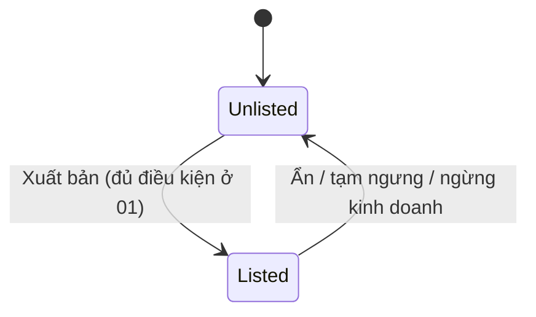

# 13 — Catalog sản phẩm trên cổng khách hàng (Catalog)

> Đã chốt 2026-10-06: hệ thống **chỉ bán sỉ (B2B)**. Catalog nằm trong **cổng khách hàng**, chỉ người đã đăng nhập mới xem được; giá và tình trạng còn hàng chỉ dành cho **khách sỉ đang hoạt động**, với **giá riêng** của từng khách.
>
> Đã chốt 2026-11-04: catalog **chỉ để xem hàng và liên hệ Sale** — **khách không tự đặt hàng**; đơn do Sale chốt từ báo giá ([14](../14-cart-and-order/README.md)). **Không còn hàng trơn**: catalog hiển thị các **quy cách** in được của sản phẩm `CUSTOMIZABLE` (để khách xem và yêu cầu in qua chat), **mẫu thiết kế của khách** và **SKU thành phẩm riêng của khách kèm giá riêng** ([12](../12-product-design/README.md)). Không có giá gốc, không có giá nhóm.
>
> Đã chốt 2026-11-05: khách sỉ **đặt theo số thùng**, không đặt lẻ; **giá vẫn theo cái**. Bảng giá riêng ghi **đơn giá theo cái**, còn **MOQ và bậc giá tính theo số thùng**. Mỗi SKU riêng có **số cái chuẩn / thùng** cố định (quy cách thùng — [01](../../warehouse/01-product-creation/README.md)), hiển thị kèm bảng giá. Tình trạng còn hàng tính theo **số thùng** ([open-questions A9](../../open-questions/README.md)).

## 1. Mục đích (Purpose)

Trưng bày ly và bao bì cho **khách sỉ đã đăng nhập** trên cổng khách hàng:

- **cây danh mục**, **trang danh sách** (PLP), **trang chi tiết sản phẩm** (PDP), bộ ảnh;
- **tìm kiếm** không dấu, theo tên hoặc mã, có **gợi ý** khi gõ;
- **quy cách in được** của từng sản phẩm `CUSTOMIZABLE` (dung tích, chất liệu…) — để khách tham khảo và **yêu cầu in theo mẫu** qua chat; quy cách không có giá, không có tồn;
- **mẫu thiết kế của tôi** — các bản thiết kế của khách và SKU riêng sinh ra từ đó ([12](../12-product-design/README.md));
- **SKU thành phẩm riêng của khách** (chỉ khách sở hữu thấy) kèm **số cái / thùng** và **bảng giá riêng** (đơn giá theo cái; bậc giá / MOQ theo số thùng);
- **chỉ báo còn hàng** của SKU riêng (không bao giờ hiện số tồn);
- **mở chat với Sale** gắn ngữ cảnh sản phẩm / quy cách / SKU riêng / mẫu thiết kế / đơn cũ để hỏi hàng, yêu cầu in theo mẫu, yêu cầu báo giá hoặc đặt lại ([16](../16-sales-chat/README.md)).

Phía back-office, module quản lý **nội dung SEO / slug**, **giá riêng của khách cho SKU riêng**, cùng việc **xuất bản / ẩn** sản phẩm. Giá riêng là **giá mặc định** khi Sale lập báo giá / đơn ([14](../14-cart-and-order/README.md)).

Catalog là **lớp hiển thị tiêu thụ dữ liệu** từ [Product Creation](../../warehouse/01-product-creation/README.md) (một nguồn dữ liệu — [open-questions G1](../../open-questions/README.md)) và **tồn khả dụng (ATP)** từ [Inventory Control](../../warehouse/20-inventory-control/README.md).

> ⚠️ Giả định: các phần sau thuộc **phạm vi giai đoạn sau** (xem [open-questions D17](../../open-questions/README.md)):
> - lọc theo thuộc tính, thương hiệu, khoảng giá;
> - sắp xếp theo giá / độ phổ biến;
> - thứ tự hiển thị và sản phẩm nổi bật do Quản trị bán hàng đặt.

---

## 2. Actor liên quan

| Actor | Vai trò |
|-------|---------|
| **Khách hàng sỉ (B2B Customer)** | Đăng nhập cổng; duyệt danh mục, tìm kiếm, xem chi tiết sản phẩm và quy cách, xem **mẫu thiết kế của tôi** và **SKU riêng** của mình. Hồ sơ `Active` mới xem được **giá áp cho mình** và **tình trạng còn hàng** của SKU riêng. **Mở chat với Sale** từ sản phẩm, quy cách, SKU riêng, mẫu thiết kế hoặc đơn cũ. Không tự đặt hàng. |
| **Quản trị bán hàng (E-commerce Admin)** | Sửa **slug và nội dung SEO**; **xuất bản / ẩn** sản phẩm; quản lý **giá riêng của khách** (đơn giá / cái, bậc theo số thùng) cho SKU riêng của chính khách đó |
| **Quản trị hệ thống (System Admin)** | Như Quản trị bán hàng |
| **Nhân viên Sale (Sales Staff)** | **Xem** giá riêng để tư vấn và lập báo giá; nhận hội thoại khách mở từ catalog; gửi link sản phẩm / SKU riêng qua [chat](../16-sales-chat/README.md) |
| **Điều phối đơn hàng (Order Coordinator)** | **Xem** giá riêng |
| **Hệ thống** | Dựng bản hiển thị (projection) và chỉ mục tìm kiếm theo sự kiện; lọc SKU riêng theo khách sở hữu; tính giá áp cho khách; tính chỉ báo còn hàng từ ATP |

---

## 3. Input / Output

### Input

| Nhóm | Dữ liệu | Nguồn |
|------|---------|-------|
| Sản phẩm & quy cách | Sản phẩm `CUSTOMIZABLE` `Published`: tên, mô tả, danh mục, các **quy cách** `Active` (dung tích, chất liệu…) — chỉ là khuôn để in, không có tồn, không có giá | [01 Product Creation](../../warehouse/01-product-creation/README.md) |
| **SKU thành phẩm riêng của khách** | SKU sinh khi khách xác nhận thiết kế: khách sở hữu, snapshot, sản phẩm & quy cách; **quy cách thùng** (số cái chuẩn / thùng) | [12](../12-product-design/README.md), [01](../../warehouse/01-product-creation/README.md) |
| **Mẫu thiết kế của khách** | Bản thiết kế mà khách là chủ sở hữu: trạng thái, file xem trước, SKU riêng (nếu đã xác nhận) | [12](../12-product-design/README.md) |
| Ảnh | Ảnh **đã đăng** (bốn mắt) của từng quy cách, ảnh bìa | [01](../../warehouse/01-product-creation/README.md) |
| Cây danh mục | Danh mục đang hoạt động, thứ tự, ảnh, SEO của danh mục | [01](../../warehouse/01-product-creation/README.md) |
| Nội dung catalog | **Slug** (khoá sau lần xuất bản đầu), **tiêu đề SEO** (≤ 255), **mô tả SEO** | Quản trị bán hàng |
| **Giá riêng của khách (customer price)** | Cho mỗi (khách, SKU riêng của khách đó): **1–20 bậc**, mỗi bậc = **số thùng tối thiểu** (≥ 1, không trùng) + **đơn giá theo cái** (VND nguyên dương). **Bậc đầu là MOQ** (tính theo thùng) | Quản trị bán hàng |
| Tồn khả dụng (ATP) | ATP **toàn hệ thống** của SKU riêng, theo **số thùng** | [20 · Inventory Control](../../warehouse/20-inventory-control/README.md) |
| Đơn cũ của khách | Danh sách đơn để khách mở chat "đặt lại" | [17](../17-order-management/README.md) |

### Output

| Kết quả | Dùng bởi |
|---------|----------|
| **Cây danh mục** | Khách |
| **Trang danh sách / kết quả tìm kiếm** — mỗi thẻ: tên, ảnh bìa, các quy cách, số SKU riêng của khách thuộc sản phẩm (nếu có); không kèm giá, tồn | Khách |
| **Gợi ý tìm kiếm** (tên, slug, mã khớp) | Khách |
| **Trang chi tiết** — tên, mô tả, SEO, các quy cách, bộ ảnh đã đăng, nút "Yêu cầu in theo mẫu"; SKU riêng của khách thuộc sản phẩm (nếu có) | Khách |
| **Mẫu thiết kế của tôi** — danh sách thiết kế của khách, trạng thái, file xem trước, SKU riêng kèm giá và chỉ báo còn hàng | Khách |
| **Bảng giá của khách** cho từng SKU riêng — số cái / thùng, các bậc (số thùng tối thiểu → đơn giá / cái), MOQ (thùng), hoặc "Liên hệ Sale" khi chưa có giá | Khách, Sale |
| **Chỉ báo còn hàng** cho từng SKU riêng: `In stock` / `Low stock` / `Out of stock` | Khách |
| **Hội thoại mở từ catalog** — gắn ngữ cảnh sản phẩm / quy cách / SKU riêng / mẫu thiết kế / đơn cũ | [16](../16-sales-chat/README.md) |
| Giá mặc định (đơn giá / cái) cho dòng báo giá / đơn, chọn bậc theo tổng số thùng của SKU riêng | [14](../14-cart-and-order/README.md), [17](../17-order-management/README.md) |

---

## 4. Luồng nghiệp vụ từng bước (Step-by-step)

### 4.1. Xuất bản & duy trì catalog (Quản trị bán hàng)

1. **Nội dung catalog** — Quản trị bán hàng sửa **slug**, **tiêu đề SEO**, **mô tả SEO** (gửi kèm phiên bản đang đọc). Tên và mô tả hiển thị lấy từ sản phẩm ở [01](../../warehouse/01-product-creation/README.md), không sửa ở đây. Sản phẩm `Discontinued` không sửa được.
   - Slug được chuẩn hoá (bỏ dấu, `đ` → `d`, chữ thường nối bằng `-`) và **khoá sau lần xuất bản đầu**.
2. **Xuất bản** — theo điều kiện của [01 §4.5](../../warehouse/01-product-creation/README.md) → sản phẩm `Published`, hiện trên catalog cùng các quy cách. Quy cách không có giá nên xuất bản không đòi điều kiện về giá. **Ẩn** → về `Approved`. Sản phẩm bị tạm ngưng (`Inactive`) cũng rời catalog; tiếp tục rồi phải xuất bản lại.
3. **Cập nhật hiển thị** — mỗi lần sửa nội dung, đổi giá riêng, xuất bản, ẩn, tạm ngưng / tiếp tục, ngừng kinh doanh hoặc sinh SKU riêng mới, hệ thống dựng lại bản hiển thị của sản phẩm.
   - Bản nào cập nhật lỗi được thử lại sau mỗi 30 giây.
   - Khởi động lại thì dựng lại toàn bộ.
   - Tìm kiếm luôn kiểm lại trạng thái thật của sản phẩm, nên bản hiển thị chậm cũng không làm lộ sản phẩm đã ẩn.

### 4.2. Giá riêng của khách (Quản trị bán hàng)

1. **Giá riêng của khách** — Quản trị bán hàng đặt 1–20 bậc cho (khách, SKU riêng); mỗi bậc gồm **số thùng tối thiểu** và **đơn giá theo cái**. Bậc có số thùng nhỏ nhất là **MOQ** (số thùng) của khách cho SKU đó. SKU riêng chỉ đặt được giá cho **chính khách sở hữu**.
2. Đây là **nguồn giá duy nhất**: quy cách không có giá; không có giá gốc, không có giá nhóm.
3. Sửa giá gửi kèm phiên bản (khoá lạc quan). Không có thời hạn hiệu lực, không cần duyệt; mọi thay đổi được ghi nhật ký kiểm toán.
4. Sale và Điều phối **chỉ xem**; Sale dùng làm giá mặc định khi lập báo giá ([14](../14-cart-and-order/README.md)).

> ⚠️ Giả định: SKU riêng **chưa có giá riêng** thì catalog hiện **"Liên hệ Sale"** và giá do Sale chốt trên báo giá ([14](../14-cart-and-order/README.md)). Xem [open-questions D27](../../open-questions/README.md).

### 4.3. Khách duyệt & tìm hàng

1. **Đăng nhập cổng khách hàng.** Người chưa đăng nhập không xem được catalog (chỉ ảnh sản phẩm đã đăng là truy cập công khai).
2. **Cây danh mục** — danh mục đang hoạt động; danh mục ngưng ẩn cả nhánh con. Cùng cấp xếp theo thứ tự đặt rồi theo tên.
3. **Trang danh sách** — lọc theo **danh mục** (gồm mọi danh mục con) và/hoặc **từ khoá**. Sắp xếp:
   - **Liên quan** (mặc định khi có từ khoá);
   - **Mới nhất** (mặc định khi không có từ khoá) — theo lần xuất bản đầu;
   - **Tên**.

   Mỗi trang mặc định 20 sản phẩm, tối đa 200; kết quả xét trong 500 sản phẩm phù hợp nhất.
4. **Tìm kiếm:**
   - Không phân biệt dấu (bỏ dấu tiếng Việt cả từ khoá lẫn dữ liệu, `đ` → `d`); từ khoá tối đa 100 ký tự.
   - Khớp **tên** và **mô tả**; từ cuối khớp theo tiền tố (đang gõ dở); gõ sai chính tả nhẹ vẫn tìm được theo tên.
   - Khớp **mã** (mã quy cách, mã SKU riêng) chính xác hoặc theo tiền tố — chỉ trong các mã khách được xem (BR-02).
   - Xếp hạng "liên quan": khớp chữ + gần đúng + **khớp đúng mã được ưu tiên mạnh** + **SKU riêng còn hàng được cộng điểm**.
5. **Gợi ý khi gõ** — từ **2 ký tự** (chữ / số) trở lên; mặc định 5, tối đa **10** gợi ý; mỗi gợi ý có tên, đường dẫn, mã khớp. Giới hạn 30 lần / 10 giây mỗi người.

### 4.4. Trang chi tiết, quy cách, giá và tình trạng còn hàng

1. **Trang chi tiết** — tên, mô tả, nội dung SEO, **các quy cách nhận in** (dung tích, chất liệu…), **bộ ảnh đã đăng** (theo quy cách, có ảnh bìa), nút **"Yêu cầu in theo mẫu"** mở chat với Sale gắn ngữ cảnh sản phẩm / quy cách ([16](../16-sales-chat/README.md)); quy trình thiết kế ở [12](../12-product-design/README.md).

   > Đã chốt 2026-11-04: quy cách của sản phẩm `CUSTOMIZABLE` chỉ là **khuôn để in** — không có tồn, không có giá, không báo giá / đặt trực tiếp. Hàng có tồn và bán được chỉ là **SKU thành phẩm riêng của khách** ([01](../../warehouse/01-product-creation/README.md), [open-questions B19](../../open-questions/README.md)).
2. **SKU riêng của khách** — khách sở hữu SKU riêng thuộc sản phẩm này thấy thêm các SKU đó (tên thiết kế, quy cách, ảnh xem trước, **số cái / thùng**), kèm giá và chỉ báo còn hàng. Khách khác không thấy (BR-02).
3. **Giá áp cho khách** (chỉ khách `Active`) — với mỗi SKU riêng, giá là **giá riêng của khách** (1–20 bậc, MOQ = bậc đầu, tính theo thùng).
   - Chưa có giá riêng → SKU hiện **"Liên hệ Sale"**.
   - Đơn giá / cái theo bậc = bậc **cuối cùng có số thùng tối thiểu ≤ số thùng đặt**. Khách xem bảng bậc kèm số cái / thùng; số thùng thực tế do khách chọn khi chấp nhận báo giá ([14](../14-cart-and-order/README.md)).
   - Thành tiền một dòng = số thùng × số cái / thùng × đơn giá / cái ([14](../14-cart-and-order/README.md) BR-08).
4. **Tình trạng còn hàng** của SKU riêng (chỉ khách `Active`; tối đa 50 SKU mỗi lần hỏi):

   | Hiển thị | Điều kiện |
   |----------|-----------|
   | `In stock` — Còn hàng | ATP > ngưỡng |
   | `Low stock` — Sắp hết | 0 < ATP ≤ ngưỡng (mặc định **5 thùng**; đặt 0 thì không cảnh báo sắp hết) |
   | `Out of stock` — Hết hàng | ATP ≤ 0 |

   - **Không bao giờ hiện số ATP** cho khách.
   - ATP tính **toàn hệ thống**, theo **số thùng** (mọi thùng đúng số cái chuẩn của SKU). Kết quả có thể trễ tối đa 10 giây.

   > ⚠️ Giả định: ngưỡng "sắp hết" (mặc định 5) tính theo **số thùng**, cùng đơn vị với ATP hiển thị. Xem [open-questions D28](../../open-questions/README.md).
   - SKU riêng được sản xuất theo đơn, nên thường `Out of stock`; tồn có thể còn từ **hàng dư của đơn trước** hoặc **hàng trả** đã đưa lại tồn khả dụng ([17](../17-order-management/README.md)).
   - `Out of stock` không chặn khách liên hệ Sale: Sale vẫn có thể chốt đơn, phần thiếu được bổ sung qua Yêu cầu sản xuất ([17](../17-order-management/README.md)).

### 4.5. Mẫu thiết kế của tôi

1. Khách mở mục **Mẫu thiết kế của tôi**: danh sách bản thiết kế mà khách là chủ sở hữu ([12](../12-product-design/README.md)), với trạng thái (`Draft` — đang thiết kế, `Submitted` — chờ khách xác nhận, `Approved` — đã xác nhận) và file xem trước.
2. Bản `Submitted`: khách vào trang thiết kế để **xác nhận** hoặc **yêu cầu sửa** theo [12 §4.5](../12-product-design/README.md).
3. Bản `Approved`: hiện **SKU riêng** sinh ra, kèm giá áp cho khách và chỉ báo còn hàng. SKU riêng vẫn hiện ở đây kể cả khi sản phẩm gốc đang `Unlisted`, chừng nào SKU còn `Active`.
4. Từ mỗi mẫu, khách có thể **mở chat với Sale** gắn ngữ cảnh mẫu thiết kế (góp ý, đề nghị sửa, yêu cầu báo giá).

### 4.6. Liên hệ Sale từ catalog

Khách **không tự đặt hàng** trên catalog. Mọi nhu cầu mua đi qua Sale:

1. **Hỏi hàng / yêu cầu báo giá** — từ một SKU riêng (trên trang sản phẩm hoặc mẫu thiết kế của tôi), khách bấm **"Chat với Sale"** / **"Yêu cầu báo giá"**: hệ thống mở hội thoại gắn ngữ cảnh SKU riêng ([16](../16-sales-chat/README.md)). Sale lập báo giá ([14](../14-cart-and-order/README.md)) với giá mặc định từ bảng giá riêng của khách.
2. **Đặt lại** — từ một đơn cũ, khách bấm **"Đặt lại"**: hệ thống mở hội thoại gắn ngữ cảnh đơn đó. Sale lập báo giá mới theo giá hiện hành ([14](../14-cart-and-order/README.md)).
3. **Yêu cầu in theo mẫu** — từ một sản phẩm / quy cách, hoặc từ mẫu thiết kế của tôi: mở hội thoại; khách gửi mẫu (logo, file, ảnh) qua chat; Sale ghi nhận yêu cầu thiết kế ([12 §4.1](../12-product-design/README.md)). Có SKU riêng (sau khi khách xác nhận thiết kế) thì mới báo giá được.

---

## 5. Trạng thái / Vòng đời (Lifecycle)

Catalog không có chứng từ. Một sản phẩm hiện trên catalog khi **`Published`** ở [01](../../warehouse/01-product-creation/README.md); mỗi SKU riêng mang một chỉ báo còn hàng.

| Trạng thái hiển thị | Ý nghĩa | Chuyển tiếp cho phép | Ai thực hiện |
|---------------------|---------|----------------------|--------------|
| `Listed` | Sản phẩm `Published`: hiện trong danh sách, tìm kiếm, trang chi tiết | → `Unlisted` (ẩn, tạm ngưng, ngừng kinh doanh) | Quản trị bán hàng / System Admin |
| `Unlisted` | Sản phẩm `Approved` (chưa / thôi xuất bản), `Inactive` hoặc `Discontinued`: không hiện, link trực tiếp không xem được nữa | → `Listed` (xuất bản; với `Inactive` phải tiếp tục trước) | Quản trị bán hàng / System Admin |

| Chỉ báo còn hàng (theo SKU riêng) | Điều kiện |
|-----------------------------------|-----------|
| `In stock` | ATP > ngưỡng (mặc định 5 thùng) |
| `Low stock` | 0 < ATP ≤ ngưỡng |
| `Out of stock` | ATP ≤ 0 |

---

## 6. Ràng buộc nghiệp vụ (Business Rules) & Edge case

### Business rules

- **BR-01:** Chỉ sản phẩm `Published` hiển thị; chỉ quy cách và SKU riêng `Active` được liệt kê. Catalog chỉ dành cho người đã đăng nhập.
- **BR-02:** **SKU thành phẩm riêng chỉ hiển thị với khách sở hữu** — trong danh sách, tìm kiếm, gợi ý, trang chi tiết và mẫu thiết kế của tôi. Với khách khác, SKU đó coi như không tồn tại.
- **BR-03:** **Giá và tình trạng còn hàng chỉ trả cho khách có hồ sơ `Active`**. Khách `Blocked` / `Inactive` không đăng nhập được ([18](../18-customer-information/README.md)); khách `Pending Activation` đăng nhập được nhưng không thấy giá, tồn.
- **BR-04:** **Giá chỉ có một nguồn: giá riêng của khách sở hữu cho SKU riêng.** Mỗi (khách, SKU riêng) có một bảng giá. Không có giá gốc, không có giá nhóm; quy cách không có giá.
- **BR-05:** Giá riêng có **1–20 bậc** theo **số thùng**; bậc đầu là **MOQ** (số thùng). Đơn giá theo bậc chọn bằng **tổng số thùng của SKU trong báo giá / đơn**. Dưới MOQ thì không có giá.
- **BR-06:** Mọi giá là **VND nguyên dương**, **theo cái**; thành tiền dòng = số thùng × số cái / thùng × đơn giá / cái ([14](../14-cart-and-order/README.md) BR-08). Không có thời hạn hiệu lực, không có duyệt giá. Giá catalog là **giá mặc định**; giá được chốt trên báo giá / đơn ([14](../14-cart-and-order/README.md)).
- **BR-07:** Tình trạng còn hàng tính từ **ATP toàn hệ thống** của SKU riêng (định nghĩa ở [Glossary](../../glossary/README.md), [20 BR-01](../../warehouse/20-inventory-control/README.md)); **không bao giờ hiện số ATP**. ⚠️ Giả định: tính ATP theo kho phục vụ khu vực giao là phạm vi sau — xem [open-questions C3](../../open-questions/README.md).
- **BR-08:** **Khách không đặt hàng trên catalog.** Mọi lối "đặt hàng", "yêu cầu báo giá", "đặt lại", "yêu cầu in theo mẫu" đều mở hội thoại với Sale gắn ngữ cảnh ([16](../16-sales-chat/README.md)); đơn do Sale tạo từ báo giá đã chấp nhận ([14](../14-cart-and-order/README.md)).
- **BR-09:** Slug khoá sau lần xuất bản đầu; nội dung catalog của sản phẩm `Discontinued` không sửa được.
- **BR-10:** Chỉ Quản trị bán hàng / System Admin sửa giá và xuất bản; Sale và Điều phối chỉ xem giá riêng.
- **BR-11:** **Quy cách chỉ để xem và yêu cầu in**: không có giá, không có chỉ báo còn hàng, không được báo giá / đặt trực tiếp. Muốn mua, khách yêu cầu in theo mẫu qua chat; chỉ SKU riêng sinh từ thiết kế khách đã xác nhận mới được báo giá ([12](../12-product-design/README.md), [14](../14-cart-and-order/README.md)).
- **BR-12:** **Khách đặt theo số thùng, không đặt lẻ.** Mỗi SKU riêng hiển thị **số cái chuẩn / thùng** ([01](../../warehouse/01-product-creation/README.md)); mọi số lượng khách thấy trên catalog (MOQ, bậc giá, tình trạng còn hàng) tính theo thùng.

### Edge case

| Tình huống | Hướng xử lý |
|------------|-------------|
| Hết hàng ngay khi khách đang xem | Chỉ báo cập nhật sau tối đa 10 giây; Sale kiểm lại tồn khi lập đơn ([14](../14-cart-and-order/README.md)) |
| Khách muốn mua SKU riêng `Out of stock` | Khách vẫn mở chat với Sale; Sale báo thời gian có hàng, đơn thiếu hàng được bổ sung qua Yêu cầu sản xuất ([17](../17-order-management/README.md)) |
| Khách muốn đặt thẳng một quy cách (chưa có thiết kế) | Không có giá, không báo giá được (BR-11); khách bấm "Yêu cầu in theo mẫu" → luồng thiết kế ([12](../12-product-design/README.md)) |
| Khách chưa có SKU riêng nào | Catalog chỉ hiện sản phẩm và quy cách; mục mẫu thiết kế của tôi trống hoặc chỉ có bản chưa xác nhận; khách liên hệ Sale qua chat |
| Sản phẩm bị ẩn khi khách có link trực tiếp | Trang sản phẩm không xem được nữa; SKU riêng của khách vẫn xem được trong mẫu thiết kế của tôi |
| Giá thay đổi giữa lúc xem và lúc Sale báo giá | Báo giá lấy giá hiện hành lúc lập; xem [14](../14-cart-and-order/README.md) |
| Khách có nhiều SKU riêng, một số hết hàng | Mỗi SKU riêng có chỉ báo riêng |
| SKU riêng vừa sinh, chưa có giá riêng | Hiện "Liên hệ Sale"; Sale chốt giá trên báo giá |
| Khách cần một số cái không chia hết cho số cái / thùng | Không bán lẻ (BR-12); khách trao đổi với Sale qua chat để chọn số thùng nguyên |
| Khách gõ đúng mã SKU riêng của khách khác | Không tìm thấy (BR-02) |
| Khách mới chưa kích hoạt (`Pending Activation`) | Xem được catalog nhưng không thấy giá, tồn; vẫn mở chat với Sale được |
| Kết quả tìm kiếm rỗng | Gõ sai nhẹ vẫn tìm theo tên; nếu vẫn rỗng, bỏ bớt từ khoá hoặc danh mục |
| Bản hiển thị chưa kịp cập nhật sau khi ẩn / đổi giá | Tìm kiếm kiểm lại trạng thái thật; bản lỗi được thử lại mỗi 30 giây |
| Danh mục bị ngưng | Cả nhánh con biến khỏi cây; lọc theo danh mục đó báo không tìm thấy |

---

## 7. Liên kết với các module khác

| Module | Quan hệ |
|--------|---------|
| [01 · Product Creation](../../warehouse/01-product-creation/README.md) | Nguồn sản phẩm `CUSTOMIZABLE`, quy cách, ảnh đã đăng, cây danh mục; điều kiện xuất bản; trạng thái `Published`; SKU riêng của khách thuộc sản phẩm `CUSTOMIZABLE` và quy cách thùng (số cái chuẩn / thùng) |
| [20 · Inventory Control](../../warehouse/20-inventory-control/README.md) | ATP toàn hệ thống của SKU riêng (theo số thùng) để tính chỉ báo còn hàng |
| [12 · Quản lý mẫu & thiết kế](../12-product-design/README.md) | Mẫu thiết kế của khách và SKU riêng sinh khi khách xác nhận; khách xác nhận / yêu cầu sửa thiết kế từ mục mẫu thiết kế của tôi |
| [14 · Báo giá, Đơn hàng & Hợp đồng](../14-cart-and-order/README.md) | Bảng giá riêng của khách làm giá mặc định của báo giá / đơn; yêu cầu báo giá và đặt lại đi qua Sale |
| [16 · Sales Chat](../16-sales-chat/README.md) | Khách mở chat gắn ngữ cảnh sản phẩm / quy cách / SKU riêng / mẫu thiết kế / đơn cũ; Sale gửi link sản phẩm / SKU riêng |
| [17 · Order Management](../17-order-management/README.md) | Đơn cũ để khách mở chat đặt lại; hàng hết được bổ sung qua Yêu cầu sản xuất; hàng dư / hàng trả của SKU riêng làm tồn khả dụng |
| [18 · Customer Information](../18-customer-information/README.md) | Trạng thái hồ sơ khách quyết định xem giá / tồn; bảng giá riêng gắn hồ sơ khách |
