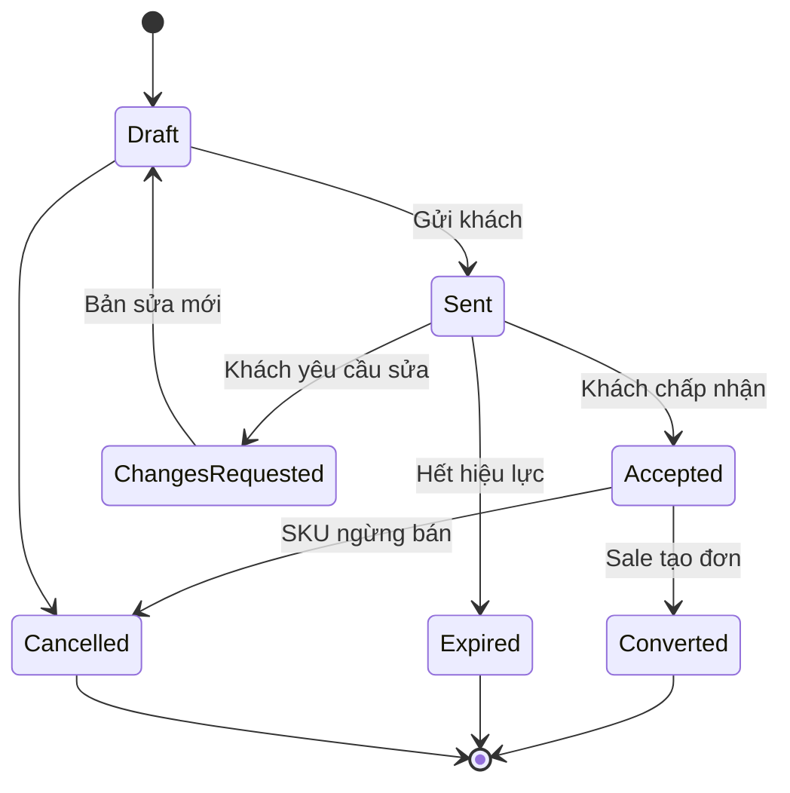
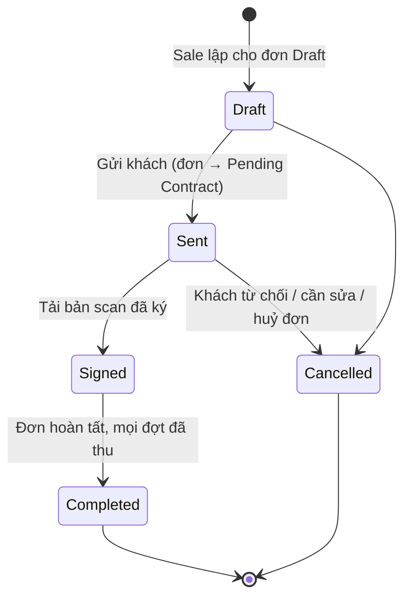
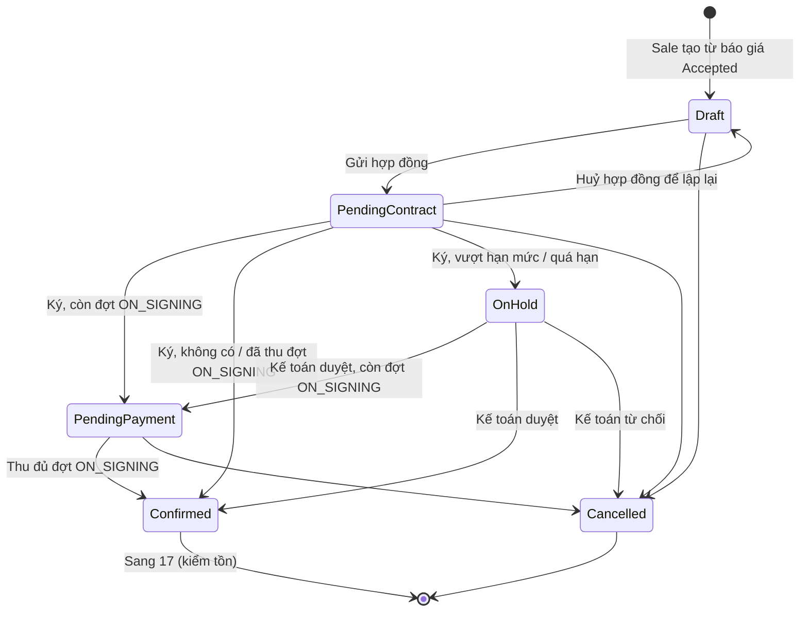

# 14 — Báo giá, Đơn hàng & Hợp đồng (Quote, Order & Sales Contract)

> Đã chốt 2026-10-06: hệ thống **chỉ bán sỉ (B2B)** cho khách đã liên hệ từ trước. Không có khách vãng lai, giỏ hàng bán lẻ hay voucher.
>
> Đã chốt 2026-11-04: khách **không tự đặt hàng** trên cổng; mọi đơn do **Sale tạo từ báo giá đã chấp nhận**. Mỗi đơn có đúng **một Hợp đồng mua bán (Sales Contract)**; khách thanh toán bằng chuyển khoản theo **các đợt thanh toán** ghi trong hợp đồng. (Tên thư mục `14-cart-and-order` giữ nguyên để không gãy liên kết.) **Không còn hàng trơn**: dòng báo giá / đơn chỉ là **SKU thành phẩm riêng của khách** (sinh khi bản thiết kế của khách được duyệt ở [12](../12-product-design/README.md)).
>
> Đã chốt 2026-11-05: khách **đặt theo số thùng**, không đặt lẻ. Số lượng trên báo giá, đơn, hợp đồng là **số thùng** (số nguyên ≥ 1), hiển thị kèm số cái = số thùng × **số cái / thùng** của SKU. **Giá vẫn theo cái**; thành tiền dòng = số thùng × số cái / thùng × đơn giá / cái. **MOQ và bậc giá tính theo số thùng** ([open-questions A9](../../open-questions/README.md)).
>
> Đã chốt 2026-11-05 (bổ sung): **sàn không hiển thị giá** ([13](../13-catalog/README.md)) — giá chỉ có trên báo giá / đơn / hợp đồng sau khi Sale thoả thuận với khách. **Giá trên báo giá do Sale nhập**; hệ thống gợi ý từ **bảng giá riêng nội bộ** của khách do Quản lý kinh doanh (Sales Manager) khai báo, chỉ nhân viên xem. Báo giá và hợp đồng có **dòng phí khuôn / bản in** cho mẫu mới (lần sản xuất đầu của SKU); hợp đồng có điều khoản **số lần in mẫu miễn phí** dùng cho bước duyệt mẫu in của Đơn sản xuất ([17](../17-order-management/README.md) §4.3). Role điều phối đơn hàng đã bỏ: việc tiếp nhận đơn đã xác nhận (chọn kho xuất, Đơn sản xuất) chuyển cho Sale.
>
> ✅ Đã chốt 2026-11-05 (phí vận chuyển & thuế): **phí vận chuyển** thu của khách là **một dòng phí** do Sale nhập trên báo giá / đơn / hợp đồng (như dòng phí khuôn / bản in); hệ thống không tự tính; cộng vào tổng tiền và chia vào lịch thanh toán như hàng hoá (BR-20). Mỗi dòng (hàng và phí) ghi **thuế suất VAT** theo **nhóm thuế** của sản phẩm ([01](../../warehouse/01-product-creation/README.md)), **tiền thuế**; chứng từ ghi **tổng có thuế** (BR-21). **Hoá đơn điện tử xuất ở phần mềm hoá đơn ngoài hệ thống**; hệ thống chỉ cung cấp số liệu ([15](../15-payment/README.md)).
>
> ✅ Đã chốt 2026-11-05 (khách tự thiết kế): **khách tự thiết kế trên app** ([12](../12-product-design/README.md)); bản thiết kế được Quản lý kinh doanh duyệt thì sinh SKU riêng. **Đặt hàng từ bản thiết kế = yêu cầu báo giá** gửi Sale ([13](../13-catalog/README.md), [16](../16-sales-chat/README.md)): khách nêu **số thùng mong muốn** (chỉ là gợi ý) và **ngày giao mong muốn** (nếu có — thành **ngày giao khách yêu cầu** của báo giá). Sale lập báo giá / đơn / hợp đồng như cũ; khách vẫn không tự đặt hàng, sàn vẫn ẩn giá.

## 1. Mục đích (Purpose)

Module quản lý ba chứng từ nối tiếp nhau của mảng bán hàng:

- **Báo giá (Quote):** Sale lập đề nghị giá cho khách sỉ, thường từ **yêu cầu báo giá** khách gửi trên sàn từ một bản thiết kế ([13](../13-catalog/README.md)). Dòng báo giá là **SKU thành phẩm riêng của chính khách đó** (SKU in theo thiết kế khách tự làm, sinh khi bản thiết kế được duyệt ở [12](../12-product-design/README.md)) — kèm **đơn giá theo cái** do Sale nhập (gợi ý từ bảng giá riêng nội bộ — [13](../13-catalog/README.md)), bậc giá theo **số thùng** (bậc thấp nhất = MOQ), **dòng phí khuôn / bản in** nếu SKU sản xuất lần đầu, **dòng phí vận chuyển** (nếu thu), **thuế VAT** từng dòng và **tổng có thuế**, hiệu lực và lịch thanh toán dự kiến. Khách chấp nhận báo giá trên sàn (trang báo giá) hoặc bằng **thẻ hành động** của báo giá trong [chat](../16-sales-chat/README.md).
- **Đơn hàng (Order):** **Sale tạo đơn từ báo giá đã chấp nhận**, đặt theo **số thùng** khách đã chọn. Đơn là **chứng từ trung tâm của mảng bán hàng**, được [Order Management](../17-order-management/README.md) theo dõi suốt vòng đời.
- **Hợp đồng mua bán (Sales Contract):** mỗi đơn có đúng **một** hợp đồng còn hiệu lực, ghi: các bên, dòng hàng & giá, dòng phí khuôn / bản in và dòng phí vận chuyển (nếu có), thuế VAT từng dòng và tổng có thuế, điều khoản giao hàng, điều khoản **số lần in mẫu miễn phí**, **lịch thanh toán (các đợt)** và file hợp đồng đã ký. Hợp đồng ký xong thì đơn mới được xác nhận; các đợt thanh toán được theo dõi ở [15 Payment](../15-payment/README.md).

---

## 2. Actor liên quan

| Actor | Vai trò |
|-------|---------|
| **Khách hàng sỉ (B2B Customer)** | **Yêu cầu báo giá** từ bản thiết kế đã duyệt trên sàn — nêu số thùng mong muốn, ngày giao mong muốn ([13](../13-catalog/README.md)). Xem báo giá; **chấp nhận** (chọn số thùng) hoặc **yêu cầu sửa** — trên sàn hoặc bằng thẻ hành động trong [chat](../16-sales-chat/README.md). Xem đơn và hợp đồng trên cổng; ký hợp đồng (ngoài hệ thống) và có thể gửi lại bản scan đã ký qua chat. Bấm "Đặt lại" một đơn cũ để mở chat với Sale. |
| **Nhân viên Sale (Sales Staff)** | Nhận **yêu cầu báo giá từ bản thiết kế** ([16](../16-sales-chat/README.md)). Lập, sửa, gửi, huỷ báo giá (không chấp nhận / yêu cầu sửa thay khách); **nhập đơn giá** (tham khảo giá gợi ý), **số tiền phí khuôn / bản in** và **số tiền phí vận chuyển** (nếu thu). **Tạo đơn từ báo giá đã chấp nhận.** Lập hợp đồng, lịch thanh toán và điều khoản **số lần in mẫu miễn phí**, gửi khách, tải bản scan hợp đồng đã ký lên. Tiếp nhận đơn đã xác nhận để chọn kho xuất và lập Đơn sản xuất ([17](../17-order-management/README.md)). |
| **Kế toán (Accountant)** | Duyệt / từ chối đơn bị treo vì **tín dụng** khi hợp đồng có đợt trả sau giao ([15](../15-payment/README.md) §4.3) |
| **Quản lý kinh doanh (Sales Manager)** | Khai báo **bảng giá riêng nội bộ** của khách cho SKU riêng (đơn giá / cái, bậc & MOQ theo số thùng — giá gợi ý cho Sale, không hiện trên sàn — [13](../13-catalog/README.md)); duyệt đơn giá thấp hơn giá gợi ý vượt hạn mức của Sale |
| **Hệ thống** | Gợi ý giá theo bảng giá riêng nội bộ của khách; thêm dòng phí khuôn / bản in cho SKU sản xuất lần đầu; tính thành tiền; lấy **thuế suất VAT** từng dòng theo nhóm thuế, tính tiền thuế và tổng có thuế; kiểm SKU còn bán được và thuộc đúng khách; tự đánh dấu báo giá hết hiệu lực; quy lịch thanh toán ra số tiền; chuyển trạng thái đơn theo hợp đồng và đợt thanh toán |

---

## 3. Input / Output

### Input

| Trường | Mô tả | Bắt buộc |
|--------|-------|----------|
| Khách sỉ | Hồ sơ khách `Active`: thông tin pháp lý, sổ địa chỉ, **lịch thanh toán mặc định**, hạn mức & kỳ hạn công nợ, bảng giá riêng nội bộ ([18](../18-customer-information/README.md)) | Có |
| **Yêu cầu báo giá** | Khách gửi trên sàn từ một bản thiết kế ([13](../13-catalog/README.md)), đến Sale qua thẻ yêu cầu báo giá trong [chat](../16-sales-chat/README.md): bản thiết kế / SKU riêng, **số thùng mong muốn** (gợi ý), **ngày giao mong muốn** (nếu có). Khách cũng có thể hỏi qua chat, điện thoại, email mà không có yêu cầu này | Không |
| Dòng báo giá | **SKU thành phẩm riêng** đang bán được, thuộc chính khách này ([12](../12-product-design/README.md)) — không chọn quy cách `CUSTOMIZABLE` (chỉ là khuôn, không có tồn / giá); **số cái / thùng** của SKU (quy cách thùng — [01](../../warehouse/01-product-creation/README.md)); **bậc giá** (số thùng tối thiểu ≥ 1, **đơn giá theo cái** VND nguyên dương — Sale nhập, hệ thống gợi ý từ bảng giá riêng nội bộ) | Có |
| **Dòng phí khuôn / bản in** | Một dòng phí cho mỗi SKU **sản xuất lần đầu** (SKU chưa có Đơn sản xuất nào tới `In Production` — [17](../17-order-management/README.md)); số tiền VND do Sale nhập. Đặt lại SKU đã từng sản xuất thì không có dòng này | Có (khi có SKU sản xuất lần đầu) |
| **Dòng phí vận chuyển** | Tối đa **một dòng** cho cả báo giá; số tiền VND nguyên dương **do Sale nhập** theo thoả thuận với khách (hệ thống không tự tính, không lấy từ hãng hay từ kế hoạch xếp xe — [09](../../warehouse/09-shipping/README.md)). Không thu phí vận chuyển thì không có dòng này (BR-20) | Không |
| **Thuế suất VAT từng dòng** | Hệ thống lấy theo **nhóm thuế** (`STANDARD` / `REDUCED` / `EXEMPT` → % theo cấu hình) của sản phẩm ([01](../../warehouse/01-product-creation/README.md)): dòng hàng và dòng phí khuôn / bản in theo sản phẩm của SKU; dòng phí vận chuyển theo nhóm `STANDARD` (⚠️ giả định — [open-questions D31](../../open-questions/README.md)). Sale không sửa (BR-21) | Có (hệ thống điền) |
| Hiệu lực báo giá | Ngày hết hiệu lực, ở tương lai | Có |
| **Ngày giao khách yêu cầu** | Ngày khách muốn nhận hàng; một ngày cho cả báo giá, Sale nhập khi báo giá còn `Draft` (lập từ yêu cầu báo giá thì hệ thống điền sẵn **ngày giao mong muốn** khách nêu); không ở quá khứ. Để trống nghĩa là khách không nêu ngày. Khác **ngày giao dự kiến** Sale hẹn trong hợp đồng (BR-19) *(Quyết định PROD-DUE 02/11/2026)* | Không |
| Lịch thanh toán dự kiến | Lấy từ lịch mặc định của khách; chỉ để khách tham khảo, lịch ràng buộc nằm trong hợp đồng | Không |
| Số thùng khách chấp nhận | Khách chọn **số thùng** (số nguyên ≥ 1) cho từng dòng khi chấp nhận; hệ thống hiện kèm số cái = số thùng × số cái / thùng | Có (khi chấp nhận) |
| Địa chỉ giao & người nhận | Từ sổ địa chỉ của khách | Có (khi tạo đơn) |
| Ngày giao dự kiến | Ngày Sale hẹn khách, ghi vào điều khoản giao hàng của hợp đồng | Có (khi lập hợp đồng) |
| **Lịch thanh toán của hợp đồng** | Danh sách đợt: tên đợt, **số tiền hoặc %**, **mốc đến hạn** (`ON_SIGNING` / `BEFORE_DELIVERY` / `AFTER_DELIVERY` + N ngày); tổng các đợt = **tổng tiền đơn (có thuế)** | Có (khi lập hợp đồng) |
| **Số lần in mẫu miễn phí** | Điều khoản hợp đồng: số lần in mẫu thử khách được miễn phí khi Đơn sản xuất cần duyệt mẫu in; mặc định lấy từ cấu hình chung (ví dụ 2), Sale sửa được khi lập hợp đồng | Có (khi lập hợp đồng) |
| Bản scan hợp đồng đã ký | File hợp đồng có chữ ký hai bên, ngày ký | Có (khi ghi nhận đã ký) |

### Output

| Kết quả | Dùng bởi |
|---------|----------|
| **Báo giá** (mã, số bản sửa, dòng, bậc giá, dòng phí khuôn / bản in, dòng phí vận chuyển, thuế suất & tiền thuế từng dòng, tổng có thuế, hiệu lực, ngày giao khách yêu cầu) | Khách, Sale |
| **Đơn hàng** (mã đơn; mỗi dòng: SKU, số thùng, số cái / thùng, số cái, đơn giá / cái, thành tiền, **thuế suất VAT, tiền thuế**, **ngày giao khách yêu cầu** — đã chốt; dòng phí khuôn / bản in, dòng phí vận chuyển — mỗi dòng phí có thuế suất & tiền thuế; địa chỉ; tổng chưa thuế, tổng tiền thuế, **tổng có thuế**) | [15 Payment](../15-payment/README.md), [17 Order Management](../17-order-management/README.md) |
| **Hợp đồng mua bán** (mã hợp đồng, các bên, dòng hàng, dòng phí khuôn / bản in, dòng phí vận chuyển, thuế VAT từng dòng, tổng có thuế, điều khoản giao, **số lần in mẫu miễn phí**, lịch thanh toán, bản PDF để ký, bản scan đã ký) | Khách (xem trên cổng), Kế toán, Sale; [17](../17-order-management/README.md) (số lần in mẫu miễn phí khi duyệt mẫu in) |
| **Các đợt thanh toán** sinh khi hợp đồng `Signed` | [15 Payment](../15-payment/README.md) |
| Thông báo cho Sale (khách chấp nhận / yêu cầu sửa báo giá) | Sale |

---

## 4. Luồng nghiệp vụ từng bước (Step-by-step)

### 4.1. Báo giá (Quote)

1. **Tiếp nhận yêu cầu** — chủ yếu là **yêu cầu báo giá** khách gửi trên sàn từ một bản thiết kế ([13](../13-catalog/README.md)): Sale nhận **thẻ yêu cầu báo giá** trong [chat](../16-sales-chat/README.md) gồm bản thiết kế / SKU riêng, **số thùng mong muốn** và **ngày giao mong muốn** (nếu có). Khách cũng có thể hỏi qua chat, điện thoại hoặc email; số lượng khách nêu theo cái thì Sale quy về **số thùng nguyên** theo số cái / thùng của SKU.
   - Mọi hàng đều in theo thiết kế **khách tự làm trên app** ([12](../12-product-design/README.md)): chỉ khi bản thiết kế được Quản lý kinh doanh duyệt (`Approved`) và hệ thống sinh **SKU thành phẩm riêng của khách** thì mới vào báo giá.
   - Khách "Gửi duyệt và yêu cầu báo giá" cùng lúc → Sale nhận yêu cầu ngay nhưng **chỉ lập báo giá khi bản đã `Approved`** (BR-22).
   - Khách mua lại thiết kế đã duyệt thì dùng luôn SKU riêng đã có.
2. **Lập báo giá** — Sale chọn SKU riêng của chính khách này (quy cách `CUSTOMIZABLE` không báo giá trực tiếp); lập từ yêu cầu báo giá thì hệ thống điền sẵn SKU riêng của bản thiết kế, hiện **số thùng khách nêu** để Sale tham khảo (không ràng buộc — số thùng thật do khách chọn khi chấp nhận) và điền **ngày giao mong muốn** vào ngày giao khách yêu cầu (BR-22). Sale **nhập bậc giá** — số thùng tối thiểu và đơn giá / cái; hệ thống hiện **giá gợi ý** từ bảng giá riêng nội bộ của khách ([13](../13-catalog/README.md)), Sale giữ hoặc sửa theo thoả thuận (BR-10). Nhập hiệu lực, lịch thanh toán dự kiến (mặc định theo khách) và, nếu khách nêu, **ngày giao khách yêu cầu** (một ngày cho cả báo giá, không ở quá khứ — BR-19). Báo giá ở `Draft`, **bản sửa số 1**.
   - **Phí khuôn / bản in** — SKU **sản xuất lần đầu** (mẫu mới) thì hệ thống thêm một **dòng phí khuôn / bản in** cho SKU đó; Sale nhập số tiền. Dòng phí không có số thùng, không tính vào MOQ / bậc giá, không đi vào giữ hàng hay Đơn sản xuất (BR-17).

     > ⚠️ Giả định: chi tiết khuôn / bản in theo từng kỹ thuật in (cách tính, số khuôn theo màu…) là phạm vi sau; hệ thống chỉ ghi một dòng phí cho mỗi SKU mẫu mới. Xem [open-questions](../../open-questions/README.md).
   - **Phí vận chuyển** *(✅ Đã chốt 2026-11-05)* — nếu thu phí vận chuyển của khách, Sale thêm **một dòng phí vận chuyển** và nhập số tiền theo thoả thuận (hệ thống không tự tính). Dòng phí không có số thùng, không tính MOQ / bậc giá, không đi vào giữ hàng hay Đơn sản xuất (BR-20).
   - **Thuế VAT** *(✅ Đã chốt 2026-11-05)* — hệ thống điền **thuế suất** cho từng dòng hàng và dòng phí theo nhóm thuế của sản phẩm ([01](../../warehouse/01-product-creation/README.md)), tính **tiền thuế** từng dòng và **tổng có thuế** của báo giá (BR-21).
3. **Gửi báo giá** → `Sent`; khách xem trên sàn, và Sale có thể gửi báo giá vào hội thoại chat dưới dạng **thẻ hành động** (chấp nhận / yêu cầu sửa). Hệ thống chỉ cho gửi khi:
   - mọi dòng đã có giá; mọi dòng phí (khuôn / bản in, vận chuyển) đã có số tiền; mọi dòng đã có thuế suất (sản phẩm có nhóm thuế);
   - hiệu lực còn ở tương lai;
   - khách `Active`;
   - mọi SKU còn bán được, SKU theo mẫu thuộc đúng khách.
4. **Khách phản hồi** trên sàn hoặc bằng thẻ hành động trong chat (chỉ khách được làm; nhân viên không làm thay):
   - **Chấp nhận** → `Accepted`. Khách chọn **số thùng** từng dòng. Hệ thống kiểm:
     - báo giá còn hiệu lực;
     - khách `Active`;
     - SKU còn bán được;
     - số thùng là số nguyên ≥ MOQ (thùng).

     Bậc giá chọn theo **tổng số thùng của SKU đó** trên mọi dòng; thành tiền dòng = số thùng × số cái / thùng × đơn giá / cái (BR-08). Hệ thống báo Sale.
   - **Yêu cầu sửa** → `Changes Requested`. Sale mở lại → `Draft` **bản sửa mới** (số bản sửa +1), rồi gửi lại.
   - Hết hiệu lực mà chưa chấp nhận → `Expired`. Báo giá **được coi là hết hiệu lực ngay khi qua hạn**; hệ thống lưu lại trạng thái này định kỳ.
5. **Huỷ báo giá:**
   - Báo giá `Draft` huỷ tự do.
   - Báo giá `Accepted` chỉ huỷ được khi có SKU **không còn bán được**, bắt buộc lý do (≤ 500 ký tự).
6. **Đặt lại đơn cũ** — khách bấm **"Đặt lại"** trên một đơn cũ ở sàn → hệ thống chỉ **mở chat** với Sale, gắn ngữ cảnh đơn đó ([16](../16-sales-chat/README.md)); không tự sinh báo giá. Sale **lập báo giá mới** như bước 2, giá gợi ý theo bảng giá **hiện hành**; SKU đã từng sản xuất thì không có dòng phí khuôn / bản in. Báo giá mới **không** mang theo ngày giao khách yêu cầu của đơn cũ: Sale nhập ngày mới nếu khách yêu cầu (BR-19).

### 4.2. Tạo đơn hàng (Order)

7. **Tạo đơn từ báo giá** — Sale chọn báo giá `Accepted` → hệ thống tạo đơn `Draft`, báo giá → `Converted`.
   - Đơn lấy đúng SKU, số thùng, số cái / thùng, đơn giá / cái khách đã chấp nhận, cùng các dòng phí (khuôn / bản in, vận chuyển) và thuế suất từng dòng của báo giá.
   - **Mỗi dòng đơn chép ngày giao khách yêu cầu** của báo giá (trống nếu khách không nêu) và **không đổi** nữa sau khi đơn được tạo; ngày này là **ngày cần hàng mặc định** khi Sale lập Đơn sản xuất cho dòng ([17](../17-order-management/README.md) §4.3 bước 6) (BR-19).
   - Tạo lại lần nữa thì trả về chính đơn đó, không tạo đơn thứ hai.
8. **Kiểm tra cuối** — giá còn đúng (báo giá còn hiệu lực lúc chấp nhận)? đủ MOQ? SKU còn bán được? Hệ thống hiển thị **tồn khả dụng** từng dòng theo **số thùng** (SKU riêng có thể còn hàng dư từ đơn trước hoặc hàng trả) để Sale hẹn ngày giao; thiếu hàng **không chặn** tạo đơn — phần thiếu sẽ được bổ sung bằng Đơn sản xuất sau khi đơn xác nhận ([17](../17-order-management/README.md) §4.2).
9. **Địa chỉ giao & người nhận** — chọn từ sổ địa chỉ của khách ([18](../18-customer-information/README.md)).
10. **Chốt giá cuối** — **tổng chưa thuế** = subtotal (tổng thành tiền các dòng hàng) + dòng phí khuôn / bản in + dòng phí vận chuyển; **tổng tiền thuế** = Σ tiền thuế các dòng; **tổng tiền đơn = tổng có thuế** = tổng chưa thuế + tổng tiền thuế (BR-09). Giá dòng hàng, dòng phí và thuế suất được **chốt (price lock)** vào đơn.

### 4.3. Hợp đồng mua bán (Sales Contract)

11. **Lập hợp đồng** — Sale lập hợp đồng cho đơn `Draft`; hợp đồng ở `Draft`. Hệ thống điền sẵn:
    - **các bên**: bên bán (thông tin doanh nghiệp), bên mua (tên công ty, mã số thuế, địa chỉ đăng ký kinh doanh, người đại diện — [18](../18-customer-information/README.md));
    - **dòng hàng & giá** (số thùng, số cái / thùng, số cái, đơn giá / cái, thành tiền), **dòng phí khuôn / bản in** và **dòng phí vận chuyển** (nếu có), **thuế suất & tiền thuế** từng dòng, tổng chưa thuế, tổng tiền thuế, **tổng có thuế** — copy từ đơn, không sửa riêng trên hợp đồng;
    - **điều khoản giao hàng**: địa chỉ giao, người nhận, ngày giao dự kiến;
    - **điều khoản số lần in mẫu miễn phí** — mặc định lấy từ cấu hình chung (ví dụ 2), Sale sửa được khi lập hợp đồng (BR-18);
    - **lịch thanh toán** mặc định của khách.

    > ✅ Đã chốt 2026-11-05: số lần in mẫu miễn phí mặc định là **2**. Xem [open-questions](../../open-questions/README.md).
12. **Lịch thanh toán** — Sale chỉnh các đợt theo thoả thuận với khách:
    - mỗi đợt nhập **số tiền** hoặc **%** tổng tiền đơn (**tổng có thuế**, gồm cả các dòng phí), và một **mốc đến hạn**:

      | Mốc | Ý nghĩa | Ảnh hưởng tới đơn |
      |-----|---------|-------------------|
      | `ON_SIGNING` | Thanh toán khi ký hợp đồng (+ N ngày) | Chưa thu đủ → đơn `Pending Payment`, chưa được xác nhận |
      | `BEFORE_DELIVERY` | Thanh toán trước khi bàn giao cho vận chuyển | Chưa thu đủ → **chặn bàn giao** ([09](../../warehouse/09-shipping/README.md)) |
      | `AFTER_DELIVERY` | Thanh toán sau khi giao + N ngày | Thành **công nợ phải thu** có kỳ hạn ([15](../15-payment/README.md)) |

    - % được quy ra số tiền (làm tròn tới đồng, phần lẻ dồn vào đợt cuối); **tổng các đợt = tổng tiền đơn**.
    - Có đợt `AFTER_DELIVERY` thì khách phải có **hạn mức công nợ** do kế toán duyệt ([18](../18-customer-information/README.md)); N mặc định = kỳ hạn công nợ của khách.

    > ✅ Đã chốt 2026-11-05: số đợt và tỷ lệ mỗi đợt do Sale nhập theo từng hợp đồng, có mẫu mặc định theo khách ở [18](../18-customer-information/README.md). Xem [open-questions](../../open-questions/README.md).
13. **Gửi hợp đồng** — Sale xuất bản hợp đồng (PDF) và gửi khách → hợp đồng `Sent`, đơn → `Pending Contract`. Khách xem hợp đồng trên cổng. Lúc gửi, hệ thống kiểm **vị thế tín dụng** trên phần `AFTER_DELIVERY` ([15](../15-payment/README.md) §4.3); vượt hạn mức hoặc khách có khoản quá hạn thì **cảnh báo** Sale (sửa lịch thanh toán, hoặc vẫn gửi và chấp nhận đơn sẽ bị treo chờ kế toán khi ký).
14. **Ký hợp đồng** — hai bên ký **ngoài hệ thống** (giấy hoặc chữ ký số bên ngoài); khách có thể gửi lại bản scan đã ký qua chat. Sale tải **bản scan đã ký** lên hợp đồng, nhập ngày ký → hợp đồng `Signed`; nội dung hợp đồng từ đây **bất biến**.

    > ✅ Đã chốt 2026-11-05: hợp đồng ký ngoài hệ thống, Sale tải bản scan lên; phụ lục / sửa hợp đồng sau khi ký là phạm vi sau. Xem [open-questions](../../open-questions/README.md).
15. **Kết quả khi ký** — hệ thống sinh các **đợt thanh toán** ([15](../15-payment/README.md) §5.1), rồi chuyển đơn:
    - khách quá hạn hoặc vượt hạn mức (kiểm lại lúc ký) → `On Hold` lý do tín dụng, chờ **kế toán** duyệt;
    - còn đợt `ON_SIGNING` chưa thu đủ → `Pending Payment`;
    - không có đợt `ON_SIGNING`, hoặc đã thu đủ → `Confirmed`; đơn sang [Order Management](../17-order-management/README.md): Sale chọn kho xuất, hệ thống kiểm tồn thành phẩm và giữ hàng.
16. **Sửa / huỷ hợp đồng trước khi ký** — hợp đồng `Draft` sửa tự do. Hợp đồng `Sent` không sửa; cần đổi nội dung thì Sale **huỷ hợp đồng** (bắt buộc lý do), đơn quay về `Draft` và Sale lập hợp đồng thay thế, hoặc huỷ luôn đơn. Khách từ chối ký → Sale huỷ hợp đồng và đơn.

    > ✅ Đã chốt 2026-11-05: "mỗi đơn một hợp đồng" hiểu là **một hợp đồng còn hiệu lực**; hợp đồng `Cancelled` trước khi ký được thay bằng hợp đồng mới cho cùng đơn. Xem [open-questions](../../open-questions/README.md).
17. **Hoàn tất hợp đồng** — khi đơn đã hoàn tất và **mọi đợt đã thu đủ**, hệ thống chuyển hợp đồng → `Completed`.

> ⚠️ Giả định: ngưỡng hạn mức, kỳ hạn cụ thể cho từng khách do kế toán đặt ([15](../15-payment/README.md)); bảng giá riêng nội bộ theo khách có bậc theo số thùng (D14). Xem [open-questions](../../open-questions/README.md).

---

## 5. Trạng thái / Vòng đời (Lifecycle)

### 5.1. Trạng thái Báo giá (Quote)

| Trạng thái | Ý nghĩa | Chuyển tiếp cho phép | Ai thực hiện |
|------------|---------|----------------------|--------------|
| `Draft` | Sale đang soạn (mỗi lần mở lại là một bản sửa mới) | → `Sent`, → `Cancelled` | Sale |
| `Sent` | Đã gửi khách, đang trong hiệu lực | → `Accepted`, → `Changes Requested`, → `Expired` | Khách / Hệ thống |
| `Changes Requested` | Khách yêu cầu sửa | → `Draft` (bản sửa mới) | Sale |
| `Accepted` | Khách chấp nhận, đã chọn số thùng | → `Converted`, → `Cancelled` (chỉ khi SKU không còn bán được) | Khách |
| `Converted` | Sale đã tạo đơn từ báo giá | *(cuối)* | Sale |
| `Expired` | Hết hiệu lực chưa chấp nhận | *(cuối)* | Hệ thống |
| `Cancelled` | Huỷ | *(cuối)* | Sale |

### 5.2. Trạng thái Hợp đồng mua bán (Sales Contract)

| Trạng thái | Ý nghĩa | Chuyển tiếp cho phép | Ai thực hiện |
|------------|---------|----------------------|--------------|
| `Draft` | Sale đang soạn hợp đồng và lịch thanh toán cho đơn `Draft` | → `Sent`, → `Cancelled` | Sale |
| `Sent` | Đã gửi khách, chờ ký; nội dung khoá | → `Signed`, → `Cancelled` | Sale |
| `Signed` | Đã ký, bản scan đã tải lên; đã sinh các đợt thanh toán; bất biến | → `Completed` | Sale (tải bản scan) |
| `Completed` | Đơn đã hoàn tất và mọi đợt đã thu đủ | *(cuối)* | Hệ thống |
| `Cancelled` | Huỷ trước khi ký (khách từ chối, cần sửa nội dung, hoặc huỷ đơn) — bắt buộc lý do | *(cuối)* | Sale |

> ✅ Đã chốt 2026-11-05: đơn bị huỷ **sau khi** hợp đồng đã `Signed` (yêu cầu huỷ được duyệt — [17](../17-order-management/README.md) §4.8): hợp đồng giữ `Signed`, việc thanh lý hợp đồng làm ngoài hệ thống; hệ thống chuyển hợp đồng `Completed` khi phí huỷ đã thu đủ và tiền hoàn đã xử lý. Xem [open-questions](../../open-questions/README.md).

### 5.3. Trạng thái đơn hàng ở giai đoạn bán (chi tiết đầy đủ ở [17 Order Management](../17-order-management/README.md) §5.1)

| Trạng thái | Ý nghĩa | Chuyển tiếp cho phép | Ai thực hiện |
|------------|---------|----------------------|--------------|
| `Draft` | Sale vừa tạo đơn từ báo giá; đang lập hợp đồng | → `Pending Contract`, → `Cancelled` | Sale |
| `Pending Contract` | Hợp đồng đã gửi, chờ ký | → `Pending Payment`, → `Confirmed`, → `On Hold` (tín dụng), → `Draft` (huỷ hợp đồng để lập lại), → `Cancelled` | Sale (tải bản ký) / Hệ thống |
| `Pending Payment` | Hợp đồng đã ký, chờ đợt `ON_SIGNING` | → `Confirmed`, → `Cancelled` | Hệ thống (phân bổ tiền — [15](../15-payment/README.md)) / Sale (huỷ) |
| `On Hold` | Tạm giữ; ở giai đoạn này là treo vì tín dụng chờ kế toán | → `Pending Payment`, → `Confirmed` (kế toán duyệt), → `Cancelled` (từ chối) | Kế toán |
| `Confirmed` | Hợp đồng đã ký, đủ điều kiện theo hợp đồng; chuyển sang chọn kho xuất, kiểm tồn & giữ hàng | → `Ready to Fulfill`, → `Awaiting Stock`, … (xem [17](../17-order-management/README.md)) | Hệ thống / Sale |

---

## 6. Ràng buộc nghiệp vụ (Business Rules) & Edge case

### Business rules

- **BR-01:** Chỉ **tài khoản khách sỉ đang hoạt động** mới nhận báo giá và hợp đồng. **Sàn không hiển thị giá** (kể cả SKU riêng); giá chỉ có trên báo giá / đơn / hợp đồng. Không có guest checkout, **khách không tự tạo đơn** trên cổng.
- **BR-02:** **Đơn chỉ được tạo từ báo giá `Accepted`**, do **Sale** tạo. Tạo lại lần nữa trả về cùng một đơn.
- **BR-03:** **Chỉ khách** chấp nhận hoặc yêu cầu sửa báo giá (trên sàn hoặc bằng thẻ hành động trong chat); nhân viên không làm thay.
- **BR-04:** Dòng báo giá / đơn **chỉ là SKU thành phẩm riêng của khách**, và SKU đó **chỉ được báo giá cho khách sở hữu** ([12](../12-product-design/README.md)). Hệ thống kiểm SKU thuộc đúng khách ở mọi bước. Quy cách `CUSTOMIZABLE` (không có tồn / giá) không được chọn làm dòng báo giá / đơn.
- **BR-05:** SKU phải **còn bán được** ở mọi bước: lập, sửa, gửi, chấp nhận báo giá, tạo đơn. Hệ thống chỉ rõ từng dòng không đạt.
- **BR-06:** Giá dòng hàng được **chốt vào đơn** tại thời điểm tạo đơn; thay đổi bảng giá sau đó không ảnh hưởng đơn đã tạo. Báo giá giữ giá trong thời hạn hiệu lực.
- **BR-07:** Số thùng mỗi dòng phải **≥ MOQ** (bậc giá thấp nhất của báo giá / bảng giá, tính theo thùng). Bậc giá chọn theo **tổng số thùng của SKU** trên mọi dòng của báo giá.
- **BR-08:** **Đặt theo thùng, giá theo cái.** Số lượng dòng báo giá / đơn / hợp đồng là **số thùng**, số nguyên ≥ 1 — không đặt lẻ cái. Mỗi dòng hiển thị kèm số cái = số thùng × **số cái / thùng** của SKU ([01](../../warehouse/01-product-creation/README.md)). Đơn giá ghi **theo cái**; **thành tiền dòng = số thùng × số cái / thùng × đơn giá / cái**. Giữ hàng, phân bổ và Đơn sản xuất dùng cùng số thùng đó ([17](../17-order-management/README.md)). ✅ Đã chốt 2026-11-05: số cái / thùng được **chốt vào dòng** cùng đơn giá (BR-06); đổi quy cách thùng của SKU sau đó không ảnh hưởng báo giá / đơn đã lập — xem [open-questions A11](../../open-questions/README.md).
- **BR-09:** Tổng tiền đơn = **tổng có thuế** = subtotal (tổng thành tiền các dòng hàng) + dòng phí khuôn / bản in + dòng phí vận chuyển + tổng tiền thuế các dòng (BR-20, BR-21); mọi khoản phải minh bạch trên báo giá và hợp đồng. Giảm giá thể hiện qua đơn giá Sale nhập (BR-10), không có dòng chiết khấu riêng *(✅ Đã chốt 2026-11-05)*.
- **BR-10:** **Giá trên báo giá do Sale nhập**; giá gợi ý lấy từ bảng giá riêng nội bộ của khách (do Sales Manager khai báo, chỉ nhân viên xem). Sale nhập đơn giá thấp hơn giá gợi ý vượt hạn mức giảm giá được cấp → phải có người có quyền duyệt (mặc định Sales Manager) trước khi gửi báo giá.
- **BR-11:** Mọi thao tác trên báo giá và hợp đồng gửi kèm **số phiên bản** người dùng đang xem. Ai đó đã đổi trước thì thao tác bị từ chối. Mỗi lần mở lại báo giá sau yêu cầu sửa là một **bản sửa** mới.
- **BR-12:** **Mỗi đơn có đúng một hợp đồng còn hiệu lực** (không `Cancelled`). Dòng hàng, giá, dòng phí và tổng tiền trên hợp đồng luôn bằng của đơn.
- **BR-13:** **Lịch thanh toán**: ít nhất một đợt; mỗi đợt có số tiền > 0 và đúng một mốc `ON_SIGNING` / `BEFORE_DELIVERY` / `AFTER_DELIVERY`; **tổng các đợt = tổng tiền đơn (tổng có thuế)**. Đợt `AFTER_DELIVERY` chỉ dùng được khi khách có hạn mức công nợ > 0 do kế toán duyệt ([18](../18-customer-information/README.md)).
- **BR-14:** Hợp đồng chỉ `Signed` khi đã có **bản scan đã ký** và ngày ký. Hợp đồng `Sent` / `Signed` không sửa nội dung; hợp đồng `Signed` không huỷ được trong hệ thống.
- **BR-15:** Đơn chỉ `Confirmed` khi hợp đồng `Signed` **và** đợt `ON_SIGNING` (nếu có) đã thu đủ **và** không bị treo tín dụng. Đơn chưa `Confirmed` thì chưa chọn kho xuất, chưa giữ hàng, chưa chuyển cho kho.
- **BR-16:** Đơn từ `Pending Payment` trở đi không sửa dòng hàng / số thùng / giá (cần phụ lục hợp đồng — phạm vi sau); chỉ đổi địa chỉ giao, hoặc đổi SKU theo mẫu khi khách sửa thiết kế, theo quy tắc ở [Order Management](../17-order-management/README.md) §4.7.
- **BR-17:** **Phí khuôn / bản in** là một **dòng phí** trên báo giá, đơn và hợp đồng cho mỗi SKU **sản xuất lần đầu** (mẫu mới — SKU chưa có Đơn sản xuất nào tới `In Production`); đặt lại SKU đã từng sản xuất thì không có dòng này. Dòng phí không có số thùng, không tính MOQ / bậc giá, không giữ hàng, không vào Đơn sản xuất; được cộng vào tổng tiền đơn (BR-09) và chốt giá cùng đơn (BR-06).
- **BR-18:** Hợp đồng có điều khoản **số lần in mẫu miễn phí**, mặc định lấy từ cấu hình chung (✅ đã chốt 2026-11-05: 2 lần), Sale sửa được khi lập hợp đồng (số nguyên ≥ 0); bất biến khi hợp đồng `Signed`. Dùng cho bước duyệt mẫu in của Đơn sản xuất ([17](../17-order-management/README.md) §4.3): vòng in lại do lỗi in của đơn vị sản xuất (`PRINT_DEFECT`) không tính; vượt số lần miễn phí → **cảnh báo** Sale, không chặn; phí phát sinh xử lý bằng phụ lục ngoài hệ thống (phạm vi sau).
- **BR-19:** **Ngày giao khách yêu cầu** thuộc báo giá, không bắt buộc: chỉ sửa được khi báo giá `Draft` (mỗi bản sửa mới Sale có thể đổi), không ở quá khứ, được giữ trong bản báo giá đã gửi. Khi tạo đơn, **mỗi dòng đơn chép ngày này** và **không đổi** sau đó; báo giá mới để đặt lại đơn cũ không mang ngày cũ theo. Đơn sản xuất lập cho dòng lấy ngày này làm **ngày cần hàng** mặc định ([17](../17-order-management/README.md) BR-26). Ngày này khác **ngày giao dự kiến** Sale hẹn trong điều khoản giao hàng của hợp đồng *(Quyết định PROD-DUE 02/11/2026)*.
- **BR-20:** **Phí vận chuyển** thu của khách là **một dòng phí** (tối đa một dòng) trên báo giá, đơn và hợp đồng, số tiền **do Sale nhập** theo thoả thuận; hệ thống **không tự tính** (không theo cân nặng / vùng, không lấy từ hãng, không lấy từ ước tính tải hay kế hoạch xếp xe ở [09](../../warehouse/09-shipping/README.md)), áp dụng như nhau cho gửi kiện và giao nguyên chuyến. Dòng phí không có số thùng, không tính MOQ / bậc giá, không giữ hàng, không vào Đơn sản xuất; được cộng vào tổng tiền đơn (BR-09), chốt giá cùng đơn (BR-06) và **chia vào lịch thanh toán như hàng hoá** ([15](../15-payment/README.md)). Không thu phí vận chuyển thì không có dòng này *(✅ Đã chốt 2026-11-05)*.
- **BR-21:** **Thuế VAT theo từng dòng.** Mỗi dòng hàng và dòng phí (khuôn / bản in, vận chuyển) trên báo giá, đơn, hợp đồng ghi **thuế suất VAT** — hệ thống lấy theo **nhóm thuế** của sản phẩm ([01](../../warehouse/01-product-creation/README.md)), Sale không sửa — và **tiền thuế** = thành tiền dòng × thuế suất (làm tròn tới đồng). Chứng từ ghi tổng chưa thuế, tổng tiền thuế và **tổng có thuế**; lịch thanh toán chia trên tổng có thuế (BR-13). Thuế suất được chốt vào đơn cùng giá (BR-06). **Hoá đơn điện tử (VAT e-invoice) xuất ở phần mềm hoá đơn ngoài hệ thống**; hệ thống chỉ cung cấp số liệu ([15](../15-payment/README.md)) *(✅ Đã chốt 2026-11-05)*. ⚠️ Giả định: dòng phí vận chuyển (không gắn sản phẩm) dùng thuế suất của nhóm `STANDARD`. Xem [open-questions D31](../../open-questions/README.md).
- **BR-22:** **Báo giá từ yêu cầu báo giá của khách** *(✅ Đã chốt 2026-11-05)*. Yêu cầu báo giá khách gửi từ bản thiết kế trên sàn ([13](../13-catalog/README.md)) chỉ là **đề nghị**, không phải báo giá hay đơn: Sale chỉ **lập báo giá** khi bản thiết kế đã **`Approved`** và SKU riêng đã sinh ([12](../12-product-design/README.md)) — kể cả khi khách "Gửi duyệt và yêu cầu báo giá" cùng lúc. **Số thùng** khách nêu là **gợi ý**, không ràng buộc bậc giá, MOQ hay số thùng khách chọn khi chấp nhận. **Ngày giao mong muốn** được điền sẵn làm **ngày giao khách yêu cầu** của báo giá và tuân BR-19 (Sale sửa được khi `Draft`, không ở quá khứ).

### Edge case

| Tình huống | Hướng xử lý |
|------------|-------------|
| Thiếu tồn thành phẩm lúc tạo đơn | Không chặn; Sale hẹn ngày giao theo thời gian sản xuất (kể cả thời gian duyệt mẫu in nếu SKU sản xuất lần đầu). Sau khi đơn `Confirmed`, Sale chọn kho xuất và lập Đơn sản xuất cho phần thiếu, Sales Manager duyệt & gửi ([17](../17-order-management/README.md)) |
| Khách cần một số cái không chia hết cho số cái / thùng | Không đặt lẻ (BR-08); Sale thoả thuận với khách số thùng nguyên (làm tròn lên hoặc xuống) rồi báo giá theo số thùng |
| Khách muốn hàng in theo bản thiết kế chưa duyệt (`Draft` / `Pending Review`) | Chưa báo giá được (BR-22): khách gửi duyệt trên app ([12](../12-product-design/README.md)); Sale chờ bản `Approved` và SKU riêng được sinh |
| Khách "Gửi duyệt và yêu cầu báo giá", bản thiết kế bị trả lại | Bản về `Draft`; Sale chưa lập báo giá; khách sửa và gửi duyệt lại, Sale lập khi bản `Approved` |
| Ngày giao mong muốn khách nêu đã qua khi Sale lập báo giá | Không dùng được ngày ở quá khứ (BR-19); Sale thoả thuận ngày mới với khách rồi nhập |
| Khách nêu số thùng dưới MOQ dự kiến | Số thùng khách nêu chỉ là gợi ý (BR-22); Sale đặt bậc giá / MOQ theo thoả thuận, khách chọn số thùng ≥ MOQ khi chấp nhận (BR-07) |
| Báo giá hết hiệu lực rồi khách mới đồng ý | Sale lập báo giá mới, giá gợi ý theo bảng giá hiện hành |
| Khách hỏi giá trên sàn | Sàn không hiện giá (BR-01); khách mở chat / yêu cầu báo giá, Sale lập báo giá |
| Khách đặt lại SKU đã từng sản xuất | Không có dòng phí khuôn / bản in (BR-17); Sale lập báo giá mới như bình thường |
| Báo giá có SKU mẫu mới thì khách sửa thiết kế trước khi chấp nhận | Khách tạo bản sửa trên app, bản sửa được duyệt sinh SKU mới ([12](../12-product-design/README.md)); Sale mở bản sửa mới của báo giá với SKU mới và dòng phí khuôn / bản in cho SKU mới |
| Khách đề nghị miễn / giảm phí khuôn hoặc thêm lần in mẫu miễn phí | Sale nhập số tiền phí và số lần in mẫu miễn phí theo thoả thuận trước khi gửi báo giá / hợp đồng; hợp đồng đã `Signed` thì không sửa (phụ lục — phạm vi sau) |
| SKU ngừng bán sau khi khách đã chấp nhận | Không tạo đơn được; Sale huỷ báo giá (ghi lý do) và báo giá lại SKU thay thế |
| Khách đặt dưới MOQ | Chặn dòng; hiển thị MOQ (số thùng) |
| Khách muốn đặt lại đơn cũ | Bấm "Đặt lại" trên sàn → mở chat với Sale; Sale lập báo giá mới, giá gợi ý theo bảng giá hiện hành |
| Khách gửi bản scan hợp đồng đã ký qua chat | Sale tải file đó lên hợp đồng, nhập ngày ký → `Signed` |
| Khách xin sửa hợp đồng đã gửi | Sale huỷ hợp đồng (lý do), đơn về `Draft`, lập hợp đồng thay thế và gửi lại |
| Khách từ chối ký hợp đồng | Sale huỷ hợp đồng và huỷ đơn (`CUSTOMER_REQUEST`) |
| Lịch thanh toán có đợt `AFTER_DELIVERY` vượt hạn mức | Cảnh báo lúc gửi; Sale tăng phần thu trước giao, hoặc gửi và đơn bị treo chờ kế toán khi ký |
| Khách đã ký nhưng chậm thanh toán đợt `ON_SIGNING` | Đơn ở `Pending Payment`, chưa giữ hàng; Sale nhắc qua chat; quá lâu thì Sale huỷ đơn (`PAYMENT_NOT_RECEIVED`) |
| Tổng các đợt lệch tổng tiền đơn (do làm tròn %) | Phần lẻ dồn vào đợt cuối; vẫn lệch thì chặn gửi hợp đồng |
| Khách đề nghị miễn phí vận chuyển / tự đến lấy hàng | Sale không thêm dòng phí vận chuyển (BR-20) |
| Đơn đổi cách giao (gửi kiện ↔ nguyên chuyến) sau khi đã tạo | Dòng phí vận chuyển đã chốt không đổi (BR-06, BR-16); chênh lệch phí xử lý bằng phụ lục ngoài hệ thống (phạm vi sau) |
| Sản phẩm của SKU chưa có nhóm thuế | Không gửi được báo giá (bước 3); nhóm thuế bắt buộc khi gửi duyệt sản phẩm ở [01](../../warehouse/01-product-creation/README.md) nên hiếm gặp |
| Khách cần hoá đơn VAT | Kế toán xuất hoá đơn điện tử ở phần mềm hoá đơn ngoài hệ thống, dùng số liệu dòng, thuế suất, tiền thuế, tổng có thuế của hợp đồng / đợt ([15](../15-payment/README.md)) |
| Trùng đơn | Huỷ một đơn với lý do `DUPLICATE_ORDER` ([17](../17-order-management/README.md)) |

---

## 7. Liên kết với các module khác

| Module | Quan hệ |
|--------|---------|
| [13 · Catalog](../13-catalog/README.md) | Sản phẩm; **bảng giá riêng nội bộ** theo khách (đơn giá / cái, bậc & MOQ theo số thùng) làm giá gợi ý cho Sale — sàn không hiện giá; tình trạng còn hàng trên cổng khách hàng; khách gửi **yêu cầu báo giá** từ bản thiết kế (số thùng gợi ý, ngày giao mong muốn) |
| [01 · Product Creation](../../warehouse/01-product-creation/README.md) | SKU thành phẩm riêng của khách và quy cách thùng (**số cái / thùng** — cơ sở để đặt theo thùng và tính thành tiền); **nhóm thuế** của sản phẩm — nguồn thuế suất VAT từng dòng |
| [12 · Design Management](../12-product-design/README.md) | Bản thiết kế khách tự làm được duyệt (`Approved`) sinh SKU thành phẩm riêng — điều kiện để báo giá hàng in (BR-22) |
| [15 · Payment](../15-payment/README.md) | Hợp đồng `Signed` sinh các đợt thanh toán (chia trên tổng có thuế, gồm các dòng phí); thu đủ đợt `ON_SIGNING` → `Confirmed`; kiểm tín dụng cho đợt `AFTER_DELIVERY`; cung cấp số liệu cho hoá đơn điện tử xuất ngoài hệ thống |
| [17 · Order Management](../17-order-management/README.md) | Nhận đơn `Confirmed`: Sale chọn kho xuất, kiểm tồn thành phẩm và giữ hàng theo số thùng, Đơn sản xuất (duyệt mẫu in dùng **số lần in mẫu miễn phí** của hợp đồng; **ngày giao khách yêu cầu** của dòng đơn là ngày cần hàng mặc định); huỷ đơn |
| [09 · Shipping](../../warehouse/09-shipping/README.md) | Đợt `BEFORE_DELIVERY` chưa thu đủ chặn bàn giao vận chuyển; 09 không tính phí vận chuyển thu khách — phí là dòng phí Sale nhập ở đây (BR-20) |
| [16 · Sales Chat](../16-sales-chat/README.md) | **Thẻ yêu cầu báo giá** từ bản thiết kế (Sale nhận yêu cầu); thẻ hành động chấp nhận / yêu cầu sửa báo giá; "Đặt lại" mở chat; khách gửi bản scan hợp đồng đã ký |
| [18 · Customer Information](../18-customer-information/README.md) | Thông tin pháp lý lập hợp đồng; sổ địa chỉ; lịch thanh toán mặc định; hạn mức & kỳ hạn công nợ; bảng giá riêng |
