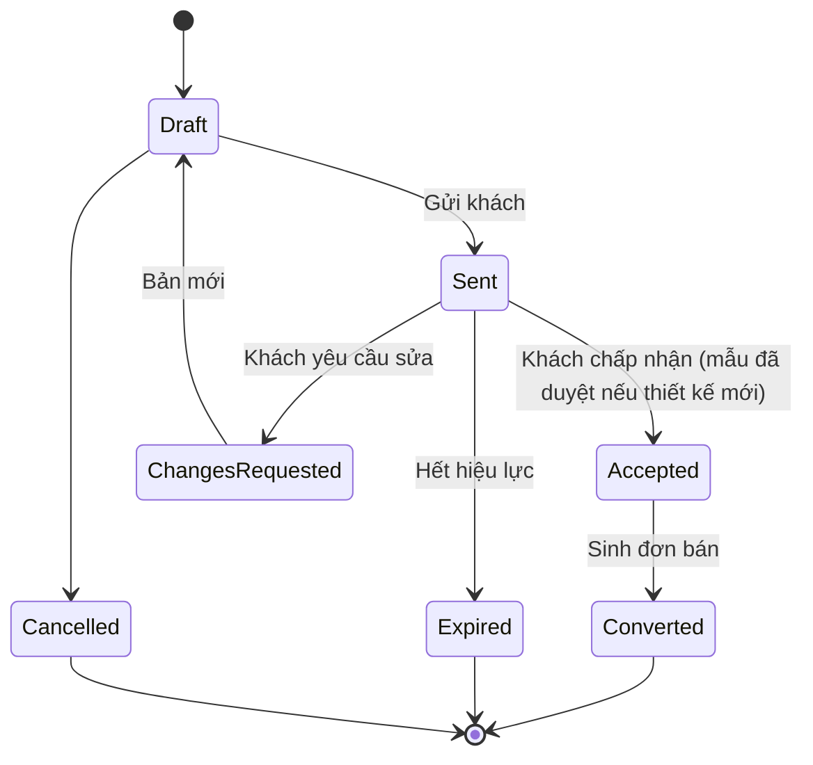
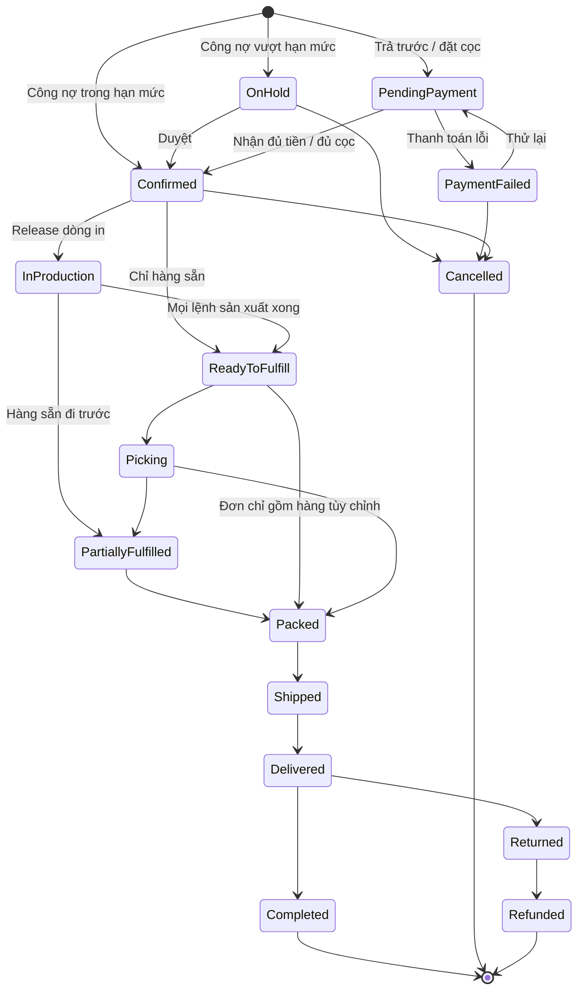

# 14 — Báo giá & Đặt hàng sỉ (Quote & Order)

> Đã chốt 2026-10-06: hệ thống **chỉ bán sỉ (B2B)** cho khách đã liên hệ từ trước. Không có khách vãng lai, giỏ hàng bán lẻ hay voucher. (Tên thư mục `14-cart-and-order` giữ nguyên để không gãy liên kết.)

## 1. Mục đích (Purpose)

- **Báo giá (Quote):** Sale lập đề nghị giá cho khách sỉ — phôi, thông số in, thiết kế, bậc số lượng / MOQ, giá, hiệu lực, phương thức thanh toán. Thiết kế mới đi kèm **yêu cầu làm mẫu** ([19](../../warehouse/19-production/README.md)). Khách chấp nhận báo giá → thành **đơn bán**.
- **Đặt hàng (Order):** đơn bán được tạo theo **hai cách**:
  1. **Từ báo giá đã chấp nhận** (Sale tạo, hoặc hệ thống tạo khi khách chấp nhận trên cổng);
  2. **Khách tự đặt trên cổng khách hàng** theo giá riêng — đặt nhanh theo SKU / số lượng, hoặc **đặt lại** đơn cũ (thiết kế đã có mẫu duyệt).

Order là **chứng từ trung tâm của mảng bán hàng**, được [Order Management](../17-order-management/README.md) theo dõi suốt vòng đời.

---

## 2. Actor liên quan

| Actor | Vai trò |
|-------|---------|
| **Khách hàng sỉ (B2B Customer)** | Xem báo giá, chấp nhận / yêu cầu sửa; đặt nhanh, đặt lại trên cổng; chọn địa chỉ giao và phương thức thanh toán được phép |
| **Nhân viên Sale (Sales Staff)** | Lập & gửi báo giá, tạo yêu cầu làm mẫu, tạo đơn từ báo giá, giảm giá trong hạn mức |
| **Người giữ quyền duyệt** | Duyệt giảm giá vượt hạn mức của Sale; duyệt đơn công nợ vượt hạn mức tín dụng |
| **Hệ thống (Pricing, Inventory, Tax, Credit check)** | Tính giá theo bảng giá riêng của khách, kiểm tồn phôi, tính thuế & phí giao, kiểm hạn mức công nợ, giữ hàng (reservation) |
| **Quản trị bán hàng (E-commerce Admin)** | Cấu hình bảng giá theo khách, MOQ, thời hạn hiệu lực báo giá, thời hạn giữ hàng |

---

## 3. Input / Output

### Input

| Trường | Mô tả | Bắt buộc |
|--------|-------|----------|
| Khách sỉ | Hồ sơ khách: phương thức thanh toán được phép, hạn mức, kỳ hạn công nợ, bảng giá riêng ([18](../18-customer-information/README.md)) | Có |
| Dòng báo giá / dòng đơn | SKU phôi, **đơn vị bán** (ví dụ *thùng*), số lượng theo đơn vị bán, thiết kế đã chốt (design snapshot) nếu là hàng in | Có |
| Mẫu đã duyệt | Với dòng in có thiết kế mới: mẫu `Approved` ([19](../../warehouse/19-production/README.md)) | Có (thiết kế mới) |
| Địa chỉ giao & người nhận | Từ sổ địa chỉ của khách | Có (khi tạo đơn) |
| Phương thức thanh toán | Một trong các phương thức được phép cho khách: **trả trước 100%**, **đặt cọc**, **công nợ** | Có (khi tạo đơn) |
| Ghi chú / yêu cầu xuất hoá đơn | | Không |

### Output

| Kết quả | Dùng bởi |
|---------|----------|
| **Báo giá** (Quote number, dòng, giá, bậc số lượng, hiệu lực) | Khách, Sale |
| **Yêu cầu làm mẫu** (thiết kế mới) | [19 Production](../../warehouse/19-production/README.md) |
| **Order** (Order number, dòng hàng đã chốt giá, địa chỉ, phí, tổng tiền, phương thức thanh toán) | 15 Payment, 17 Order Management |
| **Reservation tồn kho** (giữ phôi cho đơn) | Mảng kho vận |
| **Yêu cầu thu tiền** (cọc / trả trước) hoặc **ghi nhận công nợ** | 15 Payment |
| Sự kiện "đơn được tạo" | 17 Order Management, 16 Sales Chat, 18 Customer Info |

---

## 4. Luồng nghiệp vụ từng bước (Step-by-step)

### 4.1. Báo giá (Quote)

1. **Tiếp nhận yêu cầu** — khách liên hệ Sale (qua [chat](../16-sales-chat/README.md), điện thoại, hoặc gửi yêu cầu trên cổng): loại ly / bao bì, số lượng, logo / thiết kế.
2. **Lập báo giá** — Sale chọn phôi, gắn thiết kế đã chốt ([12](../12-product-design/README.md)), nhập bậc số lượng, giá (mặc định từ bảng giá riêng của khách), MOQ, hiệu lực, phương thức thanh toán đề xuất. Báo giá ở `Draft`.
3. **Thiết kế mới → làm mẫu** — nếu cặp (thiết kế, phôi) chưa có mẫu được duyệt, Sale tạo **yêu cầu làm mẫu** ([19](../../warehouse/19-production/README.md)) song song.
4. **Gửi báo giá** — báo giá `Sent`; khách xem trên cổng khách hàng.
5. **Khách phản hồi:**
   - **Chấp nhận** → `Accepted`. Với thiết kế mới, chỉ chấp nhận được khi **mẫu đã `Approved`**.
   - **Yêu cầu sửa** → `Changes Requested` → Sale sửa → gửi lại (bản mới).
   - Không phản hồi tới hết hiệu lực → `Expired`.
6. **Chuyển thành đơn** — báo giá `Accepted` sinh đơn bán (§4.3) với giá theo báo giá → `Converted`.

### 4.2. Khách tự đặt trên cổng (Self-service order)

7. **Chọn hàng** — từ [catalog](../13-catalog/README.md) trên cổng (giá riêng của khách), **đặt nhanh** theo SKU / số lượng theo **đơn vị bán**, hoặc **đặt lại** một đơn cũ. Hệ thống quy số lượng về đơn vị cơ sở (ví dụ 3 thùng × 1.000 = 3.000 cái) và kiểm tồn khả dụng mỗi lần cập nhật.
8. Dòng in chỉ chọn được **thiết kế đã có mẫu duyệt**; thiết kế mới phải đi qua báo giá (§4.1).

### 4.3. Tạo đơn (Order)

9. **Kiểm tra cuối** — còn tồn phôi khả dụng? giá còn đúng (báo giá còn hiệu lực / bảng giá hiện hành)? đủ MOQ? sản phẩm còn `Published`?
10. **Địa chỉ giao & người nhận** — chọn từ sổ địa chỉ của khách ([18](../18-customer-information/README.md)).
11. **Chốt giá cuối** — subtotal + phí giao + thuế − chiết khấu = **tổng tiền đơn**. Giá dòng hàng được **chốt (price lock)** vào đơn.
12. **Chọn phương thức thanh toán** — chỉ trong các phương thức được phép cho khách; trên cổng, khách đọc danh sách phương thức được phép và chọn trong đó *(Quyết định 21/10/2026)*:
    - **Trả trước 100%** hoặc **Đặt cọc** → Order `Pending Payment`, chuyển sang [15 Payment](../15-payment/README.md). Phần còn lại của đơn đặt cọc có thể **ghi công nợ** (nếu khách được phép): hạn mức được kiểm trên phần còn lại ngay lúc đặt đơn, vượt thì báo lỗi để Sale đổi cách trả, không giữ đơn *(Quyết định 21/10/2026 — [15](../15-payment/README.md) §4.2 bước 3)*;
    - **Công nợ** → hệ thống kiểm **hạn mức**: dư nợ hiện tại + giá trị đơn ≤ hạn mức → Order `Confirmed`; vượt → Order `On Hold` chờ người có quyền duyệt.
13. **Giữ hàng (Reservation)** — reserve tồn phôi cho các dòng (giảm ATP). Với đơn chờ thanh toán, reservation có thời hạn.
14. **Kết quả:**
    - Nhận đủ tiền trả trước / đủ tiền cọc, hoặc công nợ hợp lệ / được duyệt → Order `Confirmed`; gửi xác nhận cho khách; đẩy sang [Order Management](../17-order-management/README.md) để release (dòng in → [sản xuất](../../warehouse/19-production/README.md), dòng sẵn → [Picking](../../warehouse/07-picking/README.md)).
    - Hết hạn chưa thanh toán → Order `Cancelled`; giải phóng reservation.

> ⚠️ Giả định: hạn mức công nợ, kỳ hạn, người duyệt vượt hạn mức chưa có ngưỡng cụ thể (D13, đã chốt một phần — xem [open-questions](../../open-questions/README.md)); bảng giá riêng theo khách có bậc số lượng (D14). Xem [open-questions](../../open-questions/README.md).

---

## 5. Trạng thái / Vòng đời (Lifecycle)

### 5.1. Trạng thái Báo giá (Quote)

| Trạng thái | Ý nghĩa | Chuyển tiếp | Ai |
|------------|---------|-------------|----|
| `Draft` | Sale đang soạn | → `Sent`, → `Cancelled` | Sale |
| `Sent` | Đã gửi khách, đang trong hiệu lực | → `Accepted`, → `Changes Requested`, → `Expired` | Khách / Hệ thống |
| `Changes Requested` | Khách yêu cầu sửa | → `Draft` (bản mới) | Sale |
| `Accepted` | Khách chấp nhận (thiết kế mới: mẫu đã duyệt) | → `Converted` | Khách |
| `Converted` | Đã sinh đơn bán | *(cuối)* | Hệ thống |
| `Expired` | Hết hiệu lực chưa chấp nhận | *(cuối)* | Hệ thống |
| `Cancelled` | Huỷ | *(cuối)* | Sale |

### 5.2. Trạng thái Order (tổng quát — chi tiết ở [17 Order Management](../17-order-management/README.md))

| Trạng thái | Ý nghĩa | Chuyển tiếp | Nguồn |
|------------|---------|-------------|-------|
| `Pending Payment` | Chờ tiền trả trước / tiền cọc | → `Confirmed`, → `Payment Failed`, → `Cancelled` | 15 Payment |
| `Payment Failed` | Thanh toán không thành công | → `Pending Payment` (thử lại), → `Cancelled` | 15 Payment |
| `On Hold` | Đơn công nợ vượt hạn mức, chờ duyệt | → `Confirmed`, → `Cancelled` | Người duyệt hạn mức |
| `Confirmed` | Đủ điều kiện thanh toán; phôi đã giữ | → `In Production` / `Ready to Fulfill`, → `Cancelled` | System |
| `In Production` | Các dòng in đang sản xuất ([19](../../warehouse/19-production/README.md)) | → `Ready to Fulfill` (mọi lệnh sản xuất `Completed`) | 19 Production |
| `Ready to Fulfill` | Sẵn sàng cho kho xử lý | → `Picking` …, → `Packed` (đơn chỉ gồm hàng in — không qua picking thành phẩm) | 07 Picking / 08 Packing |
| `Picking` / `Packed` / `Shipped` / `Delivered` | Theo luồng Fulfillment (sau `Shipped` không theo dõi hành trình — xem 09); đơn `Packed` không huỷ được *(Quyết định 21/10/2026)* | | 07/08/09 |
| `Partially Fulfilled` | Một phần hàng đã giao, phần còn lại chờ — chỉ khi Sale cho phép giao một phần *(Quyết định 19/10 và 21/10/2026, xem [17](../17-order-management/README.md) §4.2a)* | → `Packed` / `Shipped` / `Delivered` | 17 |
| `Completed` | Giao xong & đã thu đủ tiền (hoặc công nợ đã tất toán) | *(cuối)* | 17 Order Management |
| `Cancelled` | Huỷ (trước khi giao) | *(cuối)* | Khách / Sale / System |
| `Returned` / `Refunded` | Hoàn hàng / hoàn tiền (chỉ khi lỗi sản xuất) | *(cuối)* | 09 Shipping / 15 Payment |

---

## 6. Ràng buộc nghiệp vụ (Business Rules) & Edge case

### Business rules

- **BR-01:** Chỉ **tài khoản khách sỉ đang hoạt động** mới được xem giá, nhận báo giá và đặt hàng. Không có guest checkout.
- **BR-02:** Dòng in phải có design snapshot `Confirmed`; snapshot `Locked` khi đơn `Confirmed`. Với **thiết kế mới**, báo giá chỉ được chấp nhận khi đã có **mẫu `Approved`** ([19](../../warehouse/19-production/README.md)); đặt lại thiết kế đã có mẫu duyệt thì không cần làm mẫu.
- **BR-03:** Giá dòng hàng được **chốt vào Order** tại thời điểm tạo đơn; thay đổi bảng giá sau đó không ảnh hưởng đơn đã tạo. Báo giá giữ giá trong thời hạn hiệu lực.
- **BR-04:** Số lượng mỗi dòng phải **≥ MOQ** của phôi / báo giá.
- **BR-05:** Chỉ dùng **phương thức thanh toán được phép** cho khách đó (trả trước, đặt cọc, công nợ).
- **BR-06:** Đơn công nợ: **dư nợ hiện tại + giá trị đơn ≤ hạn mức**; vượt → `On Hold` cho tới khi người có quyền duyệt.
- **BR-07:** Reservation tồn có **thời hạn** với đơn chờ trả trước / chờ cọc; hết hạn chưa thanh toán → giải phóng, đơn `Cancelled`.
- **BR-08:** Tổng tiền đơn = subtotal + phí giao + thuế − chiết khấu; mọi khoản phải minh bạch trước khi khách xác nhận.
- **BR-09:** Đơn `Confirmed` chỉ được sửa nội dung (SKU / số lượng / địa chỉ) qua [Order Management](../17-order-management/README.md) với quy tắc & phê duyệt; không sửa tự do.
- **BR-10:** Sale giảm giá vượt hạn mức được cấp → phải có người có quyền duyệt trước khi gửi báo giá.
- **BR-11:** Số lượng dòng báo giá / đơn nhập theo **đơn vị bán** được phép của biến thể và phải là số nguyên. Reservation, allocation và lệnh sản xuất dùng số lượng đã quy về **đơn vị cơ sở**; đơn vị bán và hệ số được chốt vào dòng đơn cùng giá (BR-03).  ⚠️ Giả định — xem [open-questions](../../open-questions/README.md).

### Edge case

| Tình huống | Hướng xử lý |
|------------|-------------|
| Hết phôi khả dụng lúc tạo đơn | Chặn; báo dòng thiếu; Sale đề xuất giảm số lượng, đổi phôi, hoặc hẹn ngày khi có hàng (PO) |
| Khách chấp nhận báo giá khi mẫu chưa duyệt | Chặn chấp nhận; nhắc khách duyệt mẫu trước |
| Báo giá hết hiệu lực rồi khách mới đồng ý | Sale lập báo giá mới theo giá hiện hành |
| Bảng giá thay đổi giữa lúc xem và lúc đặt (đơn tự đặt) | Hiển thị chênh lệch, yêu cầu khách xác nhận giá mới trước khi tạo đơn |
| Khách đặt dưới MOQ | Chặn dòng; hiển thị MOQ |
| Đơn công nợ vượt hạn mức | `On Hold`; báo người có quyền duyệt; khách có thể chuyển sang trả trước / đặt cọc |
| Khách quá hạn công nợ đặt đơn công nợ mới | Theo chính sách: chặn đơn công nợ mới cho tới khi thanh toán phần quá hạn (D13) |
| Đơn hỗn hợp: hàng sẵn + hàng in | Phần hàng sẵn được pick song song trong lúc in và chờ tại khu đóng gói; mặc định đóng gói khi đủ cả hai phần, hoặc tách giao theo chính sách giao gộp/tách |
| Trùng đơn (đặt lại 2 lần) | Phát hiện theo khách + nội dung + khoảng thời gian; hỏi xác nhận trước khi tạo đơn thứ hai |

---

## 7. Liên kết với các module khác

| Module | Quan hệ |
|--------|---------|
| [13 · Catalog](../13-catalog/README.md) | Sản phẩm, giá riêng theo khách & đơn vị bán, tình trạng còn hàng trên cổng khách hàng |
| [01 · Product Creation](../../warehouse/01-product-creation/README.md) | Đơn vị bán & hệ số quy đổi dùng để quy số lượng dòng đơn về đơn vị cơ sở |
| [12 · Product Design](../12-product-design/README.md) | Dòng in mang design snapshot; ảnh hưởng giá dòng |
| [19 · Production](../../warehouse/19-production/README.md) | Yêu cầu làm mẫu cho thiết kế mới; mẫu `Approved` là điều kiện chấp nhận báo giá; dòng in sinh lệnh sản xuất khi release, đơn ở `In Production` cho tới khi mọi lệnh `Completed` |
| [15 · Payment](../15-payment/README.md) | Thu trả trước / cọc; ghi nhận công nợ; kết quả quyết định `Confirmed` / `Failed` |
| [17 · Order Management](../17-order-management/README.md) | Theo dõi & thao tác đơn suốt vòng đời sau khi tạo; release sang sản xuất / kho |
| [07 · Picking](../../warehouse/07-picking/README.md) | Reservation → allocation; đơn `Ready to Fulfill` chuyển vào kho |
| [16 · Sales Chat](../16-sales-chat/README.md) | Kênh trao đổi báo giá, mẫu, đơn với khách |
| [18 · Customer Information](../18-customer-information/README.md) | Hồ sơ khách sỉ: sổ địa chỉ, phương thức thanh toán được phép, hạn mức, bảng giá riêng |
