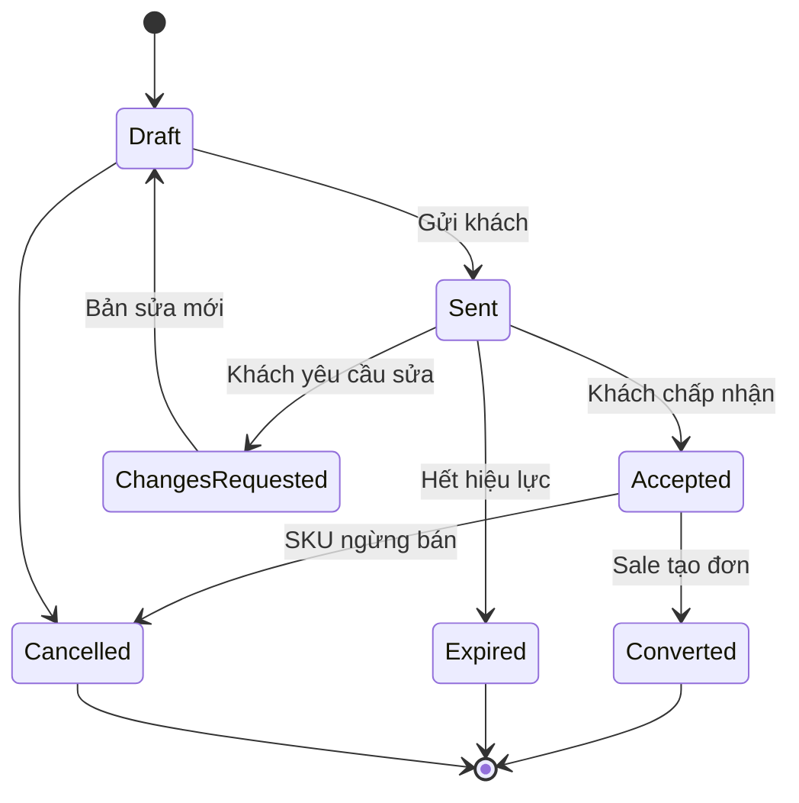
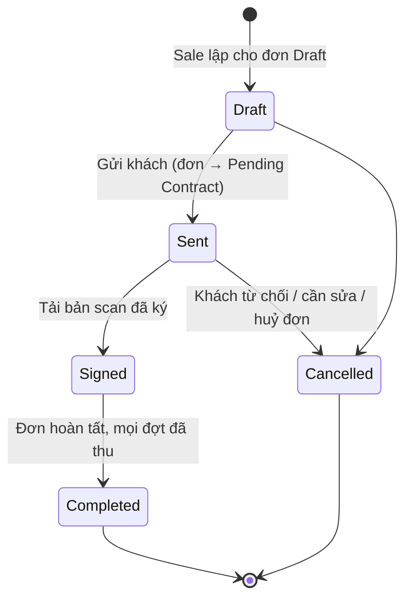
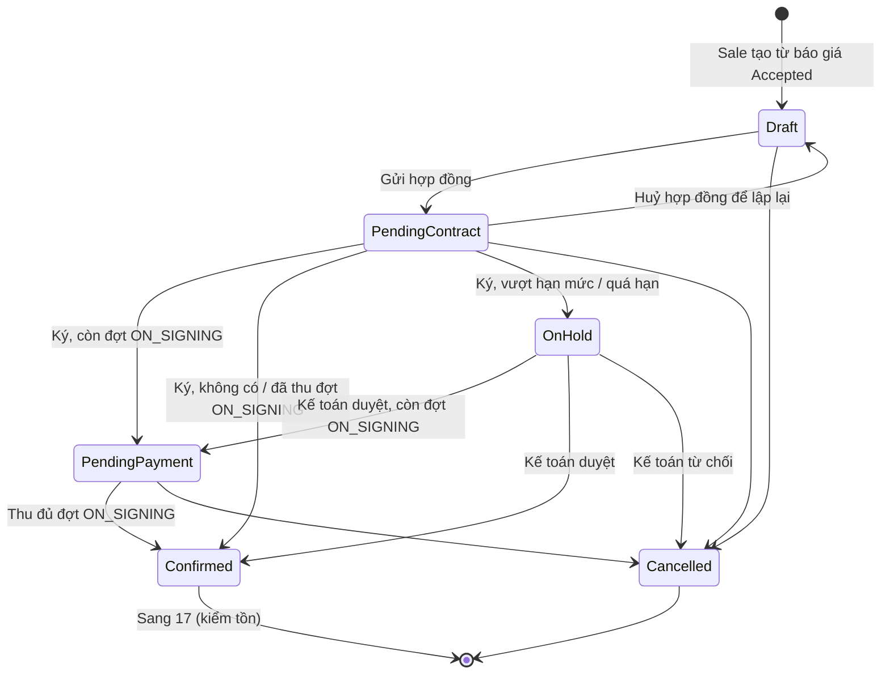

# 14 — Báo giá, Đơn hàng & Hợp đồng (Quote, Order & Sales Contract)

> Đã chốt 2026-10-06: hệ thống **chỉ bán sỉ (B2B)** cho khách đã liên hệ từ trước. Không có khách vãng lai, giỏ hàng bán lẻ hay voucher.
>
> Đã chốt 2026-11-04: khách **không tự đặt hàng** trên cổng; mọi đơn do **Sale tạo từ báo giá đã chấp nhận**. Mỗi đơn có đúng **một Hợp đồng mua bán (Sales Contract)**; khách thanh toán bằng chuyển khoản theo **các đợt thanh toán** ghi trong hợp đồng. (Tên thư mục `14-cart-and-order` giữ nguyên để không gãy liên kết.) **Không còn hàng trơn**: dòng báo giá / đơn chỉ là **SKU thành phẩm riêng của khách** (sinh khi khách xác nhận thiết kế ở [12](../12-product-design/README.md)).
>
> Đã chốt 2026-11-05: khách **đặt theo số thùng**, không đặt lẻ. Số lượng trên báo giá, đơn, hợp đồng là **số thùng** (số nguyên ≥ 1), hiển thị kèm số cái = số thùng × **số cái / thùng** của SKU. **Giá vẫn theo cái**; thành tiền dòng = số thùng × số cái / thùng × đơn giá / cái. **MOQ và bậc giá tính theo số thùng** ([open-questions A9](../../open-questions/README.md)).

## 1. Mục đích (Purpose)

Module quản lý ba chứng từ nối tiếp nhau của mảng bán hàng:

- **Báo giá (Quote):** Sale lập đề nghị giá cho khách sỉ. Dòng báo giá là **SKU thành phẩm riêng của chính khách đó** (SKU in theo mẫu của khách, sinh khi khách xác nhận thiết kế ở [12](../12-product-design/README.md)) — kèm **đơn giá theo cái**, bậc giá theo **số thùng** (bậc thấp nhất = MOQ), hiệu lực và lịch thanh toán dự kiến. Khách chấp nhận báo giá trên sàn (trang báo giá) hoặc bằng **thẻ hành động** của báo giá trong [chat](../16-sales-chat/README.md).
- **Đơn hàng (Order):** **Sale tạo đơn từ báo giá đã chấp nhận**, đặt theo **số thùng** khách đã chọn. Đơn là **chứng từ trung tâm của mảng bán hàng**, được [Order Management](../17-order-management/README.md) theo dõi suốt vòng đời.
- **Hợp đồng mua bán (Sales Contract):** mỗi đơn có đúng **một** hợp đồng còn hiệu lực, ghi: các bên, dòng hàng & giá, điều khoản giao hàng, **lịch thanh toán (các đợt)** và file hợp đồng đã ký. Hợp đồng ký xong thì đơn mới được xác nhận; các đợt thanh toán được theo dõi ở [15 Payment](../15-payment/README.md).

---

## 2. Actor liên quan

| Actor | Vai trò |
|-------|---------|
| **Khách hàng sỉ (B2B Customer)** | Xem báo giá; **chấp nhận** (chọn số thùng) hoặc **yêu cầu sửa** — trên sàn hoặc bằng thẻ hành động trong [chat](../16-sales-chat/README.md). Xem đơn và hợp đồng trên cổng; ký hợp đồng (ngoài hệ thống) và có thể gửi lại bản scan đã ký qua chat. Bấm "Đặt lại" một đơn cũ để mở chat với Sale. |
| **Nhân viên Sale (Sales Staff)** | Lập, sửa, gửi, huỷ báo giá (không chấp nhận / yêu cầu sửa thay khách). **Tạo đơn từ báo giá đã chấp nhận.** Lập hợp đồng và lịch thanh toán, gửi khách, tải bản scan hợp đồng đã ký lên. |
| **Điều phối đơn hàng (Order Coordinator)** | Xem báo giá, đơn và hợp đồng; tiếp nhận đơn đã xác nhận để kiểm tồn và điều phối ([17](../17-order-management/README.md)) |
| **Kế toán (Accountant)** | Duyệt / từ chối đơn bị treo vì **tín dụng** khi hợp đồng có đợt trả sau giao ([15](../15-payment/README.md) §4.3) |
| **Quản trị bán hàng (E-commerce Admin)** | Cấu hình bảng giá riêng của khách cho SKU riêng ([13](../13-catalog/README.md)); duyệt giảm giá vượt hạn mức của Sale |
| **Hệ thống** | Tính giá theo bảng giá riêng của khách; kiểm SKU còn bán được và thuộc đúng khách; tự đánh dấu báo giá hết hiệu lực; quy lịch thanh toán ra số tiền; chuyển trạng thái đơn theo hợp đồng và đợt thanh toán |

---

## 3. Input / Output

### Input

| Trường | Mô tả | Bắt buộc |
|--------|-------|----------|
| Khách sỉ | Hồ sơ khách `Active`: thông tin pháp lý, sổ địa chỉ, **lịch thanh toán mặc định**, hạn mức & kỳ hạn công nợ, bảng giá riêng ([18](../18-customer-information/README.md)) | Có |
| Dòng báo giá | **SKU thành phẩm riêng** đang bán được, thuộc chính khách này ([12](../12-product-design/README.md)) — không chọn quy cách `CUSTOMIZABLE` (chỉ là khuôn, không có tồn / giá); **số cái / thùng** của SKU (quy cách thùng — [01](../../warehouse/01-product-creation/README.md)); **bậc giá** (số thùng tối thiểu ≥ 1, **đơn giá theo cái** VND nguyên dương) | Có |
| Hiệu lực báo giá | Ngày hết hiệu lực, ở tương lai | Có |
| Lịch thanh toán dự kiến | Lấy từ lịch mặc định của khách; chỉ để khách tham khảo, lịch ràng buộc nằm trong hợp đồng | Không |
| Số thùng khách chấp nhận | Khách chọn **số thùng** (số nguyên ≥ 1) cho từng dòng khi chấp nhận; hệ thống hiện kèm số cái = số thùng × số cái / thùng | Có (khi chấp nhận) |
| Địa chỉ giao & người nhận | Từ sổ địa chỉ của khách | Có (khi tạo đơn) |
| Ngày giao dự kiến | Ngày Sale hẹn khách, ghi vào điều khoản giao hàng của hợp đồng | Có (khi lập hợp đồng) |
| **Lịch thanh toán của hợp đồng** | Danh sách đợt: tên đợt, **số tiền hoặc %**, **mốc đến hạn** (`ON_SIGNING` / `BEFORE_DELIVERY` / `AFTER_DELIVERY` + N ngày); tổng các đợt = tổng tiền đơn | Có (khi lập hợp đồng) |
| Bản scan hợp đồng đã ký | File hợp đồng có chữ ký hai bên, ngày ký | Có (khi ghi nhận đã ký) |

### Output

| Kết quả | Dùng bởi |
|---------|----------|
| **Báo giá** (mã, số bản sửa, dòng, bậc giá, hiệu lực) | Khách, Sale |
| **Đơn hàng** (mã đơn; mỗi dòng: SKU, số thùng, số cái / thùng, số cái, đơn giá / cái, thành tiền — đã chốt; địa chỉ, tổng tiền) | [15 Payment](../15-payment/README.md), [17 Order Management](../17-order-management/README.md) |
| **Hợp đồng mua bán** (mã hợp đồng, các bên, dòng hàng, điều khoản giao, lịch thanh toán, bản PDF để ký, bản scan đã ký) | Khách (xem trên cổng), Kế toán, Sale |
| **Các đợt thanh toán** sinh khi hợp đồng `Signed` | [15 Payment](../15-payment/README.md) |
| Thông báo cho Sale (khách chấp nhận / yêu cầu sửa báo giá) | Sale |

---

## 4. Luồng nghiệp vụ từng bước (Step-by-step)

### 4.1. Báo giá (Quote)

1. **Tiếp nhận yêu cầu** — khách liên hệ Sale qua [chat](../16-sales-chat/README.md), điện thoại hoặc email: loại ly / bao bì, số lượng (Sale quy về **số thùng nguyên** theo số cái / thùng của SKU), logo / mẫu. Mọi hàng đều in theo mẫu của khách: yêu cầu mới phải đi qua luồng thiết kế ([12](../12-product-design/README.md)) cho tới khi khách xác nhận và hệ thống sinh **SKU thành phẩm riêng của khách**, rồi mới vào báo giá. Khách mua lại thiết kế đã xác nhận thì dùng luôn SKU riêng đã có.
2. **Lập báo giá** — Sale chọn SKU riêng của chính khách này (quy cách `CUSTOMIZABLE` không báo giá trực tiếp), nhập **bậc giá** — số thùng tối thiểu và đơn giá / cái (mặc định từ bảng giá riêng của khách — [13](../13-catalog/README.md)), hiệu lực, lịch thanh toán dự kiến (mặc định theo khách). Báo giá ở `Draft`, **bản sửa số 1**.
3. **Gửi báo giá** → `Sent`; khách xem trên sàn, và Sale có thể gửi báo giá vào hội thoại chat dưới dạng **thẻ hành động** (chấp nhận / yêu cầu sửa). Hệ thống chỉ cho gửi khi:
   - mọi dòng đã có giá;
   - hiệu lực còn ở tương lai;
   - khách `Active`;
   - mọi SKU còn bán được, SKU theo mẫu thuộc đúng khách.
4. **Khách phản hồi** trên sàn hoặc bằng thẻ hành động trong chat (chỉ khách được làm; nhân viên không làm thay):
   - **Chấp nhận** → `Accepted`. Khách chọn **số thùng** từng dòng. Hệ thống kiểm:
     - báo giá còn hiệu lực;
     - khách `Active`;
     - SKU còn bán được;
     - số thùng là số nguyên ≥ MOQ (thùng).

     Bậc giá chọn theo **tổng số thùng của SKU đó** trên mọi dòng; thành tiền dòng = số thùng × số cái / thùng × đơn giá / cái (BR-08). Hệ thống báo Sale.
   - **Yêu cầu sửa** → `Changes Requested`. Sale mở lại → `Draft` **bản sửa mới** (số bản sửa +1), rồi gửi lại.
   - Hết hiệu lực mà chưa chấp nhận → `Expired`. Báo giá **được coi là hết hiệu lực ngay khi qua hạn**; hệ thống lưu lại trạng thái này định kỳ.
5. **Huỷ báo giá:**
   - Báo giá `Draft` huỷ tự do.
   - Báo giá `Accepted` chỉ huỷ được khi có SKU **không còn bán được**, bắt buộc lý do (≤ 500 ký tự).
6. **Đặt lại đơn cũ** — khách bấm **"Đặt lại"** trên một đơn cũ ở sàn → hệ thống chỉ **mở chat** với Sale, gắn ngữ cảnh đơn đó ([16](../16-sales-chat/README.md)); không tự sinh báo giá. Sale **lập báo giá mới** như bước 2, theo bảng giá **hiện hành**.

### 4.2. Tạo đơn hàng (Order)

7. **Tạo đơn từ báo giá** — Sale chọn báo giá `Accepted` → hệ thống tạo đơn `Draft`, báo giá → `Converted`.
   - Đơn lấy đúng SKU, số thùng, số cái / thùng, đơn giá / cái khách đã chấp nhận.
   - Tạo lại lần nữa thì trả về chính đơn đó, không tạo đơn thứ hai.
8. **Kiểm tra cuối** — giá còn đúng (báo giá còn hiệu lực lúc chấp nhận)? đủ MOQ? SKU còn bán được? Hệ thống hiển thị **tồn khả dụng** từng dòng theo **số thùng** (SKU riêng có thể còn hàng dư từ đơn trước hoặc hàng trả) để Sale hẹn ngày giao; thiếu hàng **không chặn** tạo đơn — phần thiếu sẽ được bổ sung bằng Yêu cầu sản xuất sau khi đơn xác nhận ([17](../17-order-management/README.md) §4.2).
9. **Địa chỉ giao & người nhận** — chọn từ sổ địa chỉ của khách ([18](../18-customer-information/README.md)).
10. **Chốt giá cuối** — subtotal (tổng thành tiền các dòng) + phí giao + thuế − chiết khấu = **tổng tiền đơn**. Giá dòng hàng được **chốt (price lock)** vào đơn.

### 4.3. Hợp đồng mua bán (Sales Contract)

11. **Lập hợp đồng** — Sale lập hợp đồng cho đơn `Draft`; hợp đồng ở `Draft`. Hệ thống điền sẵn:
    - **các bên**: bên bán (thông tin doanh nghiệp), bên mua (tên công ty, mã số thuế, địa chỉ đăng ký kinh doanh, người đại diện — [18](../18-customer-information/README.md));
    - **dòng hàng & giá** (số thùng, số cái / thùng, số cái, đơn giá / cái, thành tiền), tổng tiền — copy từ đơn, không sửa riêng trên hợp đồng;
    - **điều khoản giao hàng**: địa chỉ giao, người nhận, ngày giao dự kiến;
    - **lịch thanh toán** mặc định của khách.
12. **Lịch thanh toán** — Sale chỉnh các đợt theo thoả thuận với khách:
    - mỗi đợt nhập **số tiền** hoặc **%** tổng tiền đơn, và một **mốc đến hạn**:

      | Mốc | Ý nghĩa | Ảnh hưởng tới đơn |
      |-----|---------|-------------------|
      | `ON_SIGNING` | Thanh toán khi ký hợp đồng (+ N ngày) | Chưa thu đủ → đơn `Pending Payment`, chưa được xác nhận |
      | `BEFORE_DELIVERY` | Thanh toán trước khi bàn giao cho vận chuyển | Chưa thu đủ → **chặn bàn giao** ([09](../../warehouse/09-shipping/README.md)) |
      | `AFTER_DELIVERY` | Thanh toán sau khi giao + N ngày | Thành **công nợ phải thu** có kỳ hạn ([15](../15-payment/README.md)) |

    - % được quy ra số tiền (làm tròn tới đồng, phần lẻ dồn vào đợt cuối); **tổng các đợt = tổng tiền đơn**.
    - Có đợt `AFTER_DELIVERY` thì khách phải có **hạn mức công nợ** do kế toán duyệt ([18](../18-customer-information/README.md)); N mặc định = kỳ hạn công nợ của khách.

    > ⚠️ Giả định: số đợt và tỷ lệ mỗi đợt do Sale nhập theo từng hợp đồng, có mẫu mặc định theo khách ở [18](../18-customer-information/README.md). Xem [open-questions](../../open-questions/README.md).
13. **Gửi hợp đồng** — Sale xuất bản hợp đồng (PDF) và gửi khách → hợp đồng `Sent`, đơn → `Pending Contract`. Khách xem hợp đồng trên cổng. Lúc gửi, hệ thống kiểm **vị thế tín dụng** trên phần `AFTER_DELIVERY` ([15](../15-payment/README.md) §4.3); vượt hạn mức hoặc khách có khoản quá hạn thì **cảnh báo** Sale (sửa lịch thanh toán, hoặc vẫn gửi và chấp nhận đơn sẽ bị treo chờ kế toán khi ký).
14. **Ký hợp đồng** — hai bên ký **ngoài hệ thống** (giấy hoặc chữ ký số bên ngoài); khách có thể gửi lại bản scan đã ký qua chat. Sale tải **bản scan đã ký** lên hợp đồng, nhập ngày ký → hợp đồng `Signed`; nội dung hợp đồng từ đây **bất biến**.

    > ⚠️ Giả định: hợp đồng ký ngoài hệ thống, Sale tải bản scan lên; phụ lục / sửa hợp đồng sau khi ký là phạm vi sau. Xem [open-questions](../../open-questions/README.md).
15. **Kết quả khi ký** — hệ thống sinh các **đợt thanh toán** ([15](../15-payment/README.md) §5.1), rồi chuyển đơn:
    - khách quá hạn hoặc vượt hạn mức (kiểm lại lúc ký) → `On Hold` lý do tín dụng, chờ **kế toán** duyệt;
    - còn đợt `ON_SIGNING` chưa thu đủ → `Pending Payment`;
    - không có đợt `ON_SIGNING`, hoặc đã thu đủ → `Confirmed`; đơn sang [Order Management](../17-order-management/README.md) để kiểm tồn thành phẩm và điều phối.
16. **Sửa / huỷ hợp đồng trước khi ký** — hợp đồng `Draft` sửa tự do. Hợp đồng `Sent` không sửa; cần đổi nội dung thì Sale **huỷ hợp đồng** (bắt buộc lý do), đơn quay về `Draft` và Sale lập hợp đồng thay thế, hoặc huỷ luôn đơn. Khách từ chối ký → Sale huỷ hợp đồng và đơn.

    > ⚠️ Giả định: "mỗi đơn một hợp đồng" hiểu là **một hợp đồng còn hiệu lực**; hợp đồng `Cancelled` trước khi ký được thay bằng hợp đồng mới cho cùng đơn. Xem [open-questions](../../open-questions/README.md).
17. **Hoàn tất hợp đồng** — khi đơn đã hoàn tất và **mọi đợt đã thu đủ**, hệ thống chuyển hợp đồng → `Completed`.

> ⚠️ Giả định: ngưỡng hạn mức, kỳ hạn cụ thể cho từng khách do kế toán đặt ([15](../15-payment/README.md)); bảng giá riêng theo khách có bậc theo số thùng (D14). Xem [open-questions](../../open-questions/README.md).

---

## 5. Trạng thái / Vòng đời (Lifecycle)

### 5.1. Trạng thái Báo giá (Quote)

| Trạng thái | Ý nghĩa | Chuyển tiếp cho phép | Ai thực hiện |
|------------|---------|----------------------|--------------|
| `Draft` | Sale đang soạn (mỗi lần mở lại là một bản sửa mới) | → `Sent`, → `Cancelled` | Sale |
| `Sent` | Đã gửi khách, đang trong hiệu lực | → `Accepted`, → `Changes Requested`, → `Expired` | Khách / Hệ thống |
| `Changes Requested` | Khách yêu cầu sửa | → `Draft` (bản sửa mới) | Sale |
| `Accepted` | Khách chấp nhận, đã chọn số thùng | → `Converted`, → `Cancelled` (chỉ khi SKU không còn bán được) | Khách |
| `Converted` | Sale đã tạo đơn từ báo giá | *(cuối)* | Sale |
| `Expired` | Hết hiệu lực chưa chấp nhận | *(cuối)* | Hệ thống |
| `Cancelled` | Huỷ | *(cuối)* | Sale |

### 5.2. Trạng thái Hợp đồng mua bán (Sales Contract)

| Trạng thái | Ý nghĩa | Chuyển tiếp cho phép | Ai thực hiện |
|------------|---------|----------------------|--------------|
| `Draft` | Sale đang soạn hợp đồng và lịch thanh toán cho đơn `Draft` | → `Sent`, → `Cancelled` | Sale |
| `Sent` | Đã gửi khách, chờ ký; nội dung khoá | → `Signed`, → `Cancelled` | Sale |
| `Signed` | Đã ký, bản scan đã tải lên; đã sinh các đợt thanh toán; bất biến | → `Completed` | Sale (tải bản scan) |
| `Completed` | Đơn đã hoàn tất và mọi đợt đã thu đủ | *(cuối)* | Hệ thống |
| `Cancelled` | Huỷ trước khi ký (khách từ chối, cần sửa nội dung, hoặc huỷ đơn) — bắt buộc lý do | *(cuối)* | Sale |

> ⚠️ Giả định: đơn bị huỷ **sau khi** hợp đồng đã `Signed` (yêu cầu huỷ được duyệt — [17](../17-order-management/README.md) §4.8): hợp đồng giữ `Signed`, việc thanh lý hợp đồng làm ngoài hệ thống; hệ thống chuyển hợp đồng `Completed` khi phí huỷ đã thu đủ và tiền hoàn đã xử lý. Xem [open-questions](../../open-questions/README.md).

### 5.3. Trạng thái đơn hàng ở giai đoạn bán (chi tiết đầy đủ ở [17 Order Management](../17-order-management/README.md) §5.1)

| Trạng thái | Ý nghĩa | Chuyển tiếp cho phép | Ai thực hiện |
|------------|---------|----------------------|--------------|
| `Draft` | Sale vừa tạo đơn từ báo giá; đang lập hợp đồng | → `Pending Contract`, → `Cancelled` | Sale |
| `Pending Contract` | Hợp đồng đã gửi, chờ ký | → `Pending Payment`, → `Confirmed`, → `On Hold` (tín dụng), → `Draft` (huỷ hợp đồng để lập lại), → `Cancelled` | Sale (tải bản ký) / Hệ thống |
| `Pending Payment` | Hợp đồng đã ký, chờ đợt `ON_SIGNING` | → `Confirmed`, → `Cancelled` | Hệ thống (phân bổ tiền — [15](../15-payment/README.md)) / Sale (huỷ) |
| `On Hold` | Tạm giữ; ở giai đoạn này là treo vì tín dụng chờ kế toán | → `Pending Payment`, → `Confirmed` (kế toán duyệt), → `Cancelled` (từ chối) | Kế toán |
| `Confirmed` | Hợp đồng đã ký, đủ điều kiện theo hợp đồng; chuyển sang kiểm tồn & điều phối | → `Ready to Fulfill`, → `Awaiting Stock`, … (xem [17](../17-order-management/README.md)) | Hệ thống / Điều phối |

---

## 6. Ràng buộc nghiệp vụ (Business Rules) & Edge case

### Business rules

- **BR-01:** Chỉ **tài khoản khách sỉ đang hoạt động** mới được xem giá, nhận báo giá và hợp đồng. Không có guest checkout, **khách không tự tạo đơn** trên cổng.
- **BR-02:** **Đơn chỉ được tạo từ báo giá `Accepted`**, do **Sale** tạo. Tạo lại lần nữa trả về cùng một đơn.
- **BR-03:** **Chỉ khách** chấp nhận hoặc yêu cầu sửa báo giá (trên sàn hoặc bằng thẻ hành động trong chat); nhân viên không làm thay.
- **BR-04:** Dòng báo giá / đơn **chỉ là SKU thành phẩm riêng của khách**, và SKU đó **chỉ được báo giá cho khách sở hữu** ([12](../12-product-design/README.md)). Hệ thống kiểm SKU thuộc đúng khách ở mọi bước. Quy cách `CUSTOMIZABLE` (không có tồn / giá) không được chọn làm dòng báo giá / đơn.
- **BR-05:** SKU phải **còn bán được** ở mọi bước: lập, sửa, gửi, chấp nhận báo giá, tạo đơn. Hệ thống chỉ rõ từng dòng không đạt.
- **BR-06:** Giá dòng hàng được **chốt vào đơn** tại thời điểm tạo đơn; thay đổi bảng giá sau đó không ảnh hưởng đơn đã tạo. Báo giá giữ giá trong thời hạn hiệu lực.
- **BR-07:** Số thùng mỗi dòng phải **≥ MOQ** (bậc giá thấp nhất của báo giá / bảng giá, tính theo thùng). Bậc giá chọn theo **tổng số thùng của SKU** trên mọi dòng của báo giá.
- **BR-08:** **Đặt theo thùng, giá theo cái.** Số lượng dòng báo giá / đơn / hợp đồng là **số thùng**, số nguyên ≥ 1 — không đặt lẻ cái. Mỗi dòng hiển thị kèm số cái = số thùng × **số cái / thùng** của SKU ([01](../../warehouse/01-product-creation/README.md)). Đơn giá ghi **theo cái**; **thành tiền dòng = số thùng × số cái / thùng × đơn giá / cái**. Giữ hàng, phân bổ và Yêu cầu sản xuất dùng cùng số thùng đó ([17](../17-order-management/README.md)). ⚠️ Giả định: số cái / thùng được **chốt vào dòng** cùng đơn giá (BR-06); đổi quy cách thùng của SKU sau đó không ảnh hưởng báo giá / đơn đã lập — xem [open-questions A11](../../open-questions/README.md).
- **BR-09:** Tổng tiền đơn = subtotal (tổng thành tiền các dòng) + phí giao + thuế − chiết khấu; mọi khoản phải minh bạch trên báo giá và hợp đồng.
- **BR-10:** Sale giảm giá vượt hạn mức được cấp → phải có người có quyền duyệt trước khi gửi báo giá.
- **BR-11:** Mọi thao tác trên báo giá và hợp đồng gửi kèm **số phiên bản** người dùng đang xem. Ai đó đã đổi trước thì thao tác bị từ chối. Mỗi lần mở lại báo giá sau yêu cầu sửa là một **bản sửa** mới.
- **BR-12:** **Mỗi đơn có đúng một hợp đồng còn hiệu lực** (không `Cancelled`). Dòng hàng, giá và tổng tiền trên hợp đồng luôn bằng của đơn.
- **BR-13:** **Lịch thanh toán**: ít nhất một đợt; mỗi đợt có số tiền > 0 và đúng một mốc `ON_SIGNING` / `BEFORE_DELIVERY` / `AFTER_DELIVERY`; **tổng các đợt = tổng tiền đơn**. Đợt `AFTER_DELIVERY` chỉ dùng được khi khách có hạn mức công nợ > 0 do kế toán duyệt ([18](../18-customer-information/README.md)).
- **BR-14:** Hợp đồng chỉ `Signed` khi đã có **bản scan đã ký** và ngày ký. Hợp đồng `Sent` / `Signed` không sửa nội dung; hợp đồng `Signed` không huỷ được trong hệ thống.
- **BR-15:** Đơn chỉ `Confirmed` khi hợp đồng `Signed` **và** đợt `ON_SIGNING` (nếu có) đã thu đủ **và** không bị treo tín dụng. Đơn chưa `Confirmed` thì chưa giữ hàng, chưa điều phối kho.
- **BR-16:** Đơn từ `Pending Payment` trở đi không sửa dòng hàng / số thùng / giá (cần phụ lục hợp đồng — phạm vi sau); chỉ đổi địa chỉ giao, hoặc đổi SKU theo mẫu khi khách sửa thiết kế, theo quy tắc ở [Order Management](../17-order-management/README.md) §4.7.

### Edge case

| Tình huống | Hướng xử lý |
|------------|-------------|
| Thiếu tồn thành phẩm lúc tạo đơn | Không chặn; Sale hẹn ngày giao theo thời gian sản xuất. Sau khi đơn `Confirmed`, Điều phối tạo Yêu cầu sản xuất cho phần thiếu ([17](../17-order-management/README.md)) |
| Khách cần một số cái không chia hết cho số cái / thùng | Không đặt lẻ (BR-08); Sale thoả thuận với khách số thùng nguyên (làm tròn lên hoặc xuống) rồi báo giá theo số thùng |
| Khách muốn hàng in theo mẫu chưa xác nhận | Chưa báo giá được: đi luồng thiết kế ([12](../12-product-design/README.md)) tới khi khách xác nhận và có SKU theo mẫu |
| Báo giá hết hiệu lực rồi khách mới đồng ý | Sale lập báo giá mới theo giá hiện hành |
| SKU ngừng bán sau khi khách đã chấp nhận | Không tạo đơn được; Sale huỷ báo giá (ghi lý do) và báo giá lại SKU thay thế |
| Khách đặt dưới MOQ | Chặn dòng; hiển thị MOQ (số thùng) |
| Khách muốn đặt lại đơn cũ | Bấm "Đặt lại" trên sàn → mở chat với Sale; Sale lập báo giá mới theo giá hiện hành |
| Khách gửi bản scan hợp đồng đã ký qua chat | Sale tải file đó lên hợp đồng, nhập ngày ký → `Signed` |
| Khách xin sửa hợp đồng đã gửi | Sale huỷ hợp đồng (lý do), đơn về `Draft`, lập hợp đồng thay thế và gửi lại |
| Khách từ chối ký hợp đồng | Sale huỷ hợp đồng và huỷ đơn (`CUSTOMER_REQUEST`) |
| Lịch thanh toán có đợt `AFTER_DELIVERY` vượt hạn mức | Cảnh báo lúc gửi; Sale tăng phần thu trước giao, hoặc gửi và đơn bị treo chờ kế toán khi ký |
| Khách đã ký nhưng chậm thanh toán đợt `ON_SIGNING` | Đơn ở `Pending Payment`, chưa giữ hàng; Sale nhắc qua chat; quá lâu thì Sale huỷ đơn (`PAYMENT_NOT_RECEIVED`) |
| Tổng các đợt lệch tổng tiền đơn (do làm tròn %) | Phần lẻ dồn vào đợt cuối; vẫn lệch thì chặn gửi hợp đồng |
| Trùng đơn | Huỷ một đơn với lý do `DUPLICATE_ORDER` ([17](../17-order-management/README.md)) |

---

## 7. Liên kết với các module khác

| Module | Quan hệ |
|--------|---------|
| [13 · Catalog](../13-catalog/README.md) | Sản phẩm, bảng giá riêng theo khách (đơn giá / cái, bậc & MOQ theo số thùng), tình trạng còn hàng trên cổng khách hàng |
| [01 · Product Creation](../../warehouse/01-product-creation/README.md) | SKU thành phẩm riêng của khách và quy cách thùng (**số cái / thùng** — cơ sở để đặt theo thùng và tính thành tiền) |
| [12 · Design Management](../12-product-design/README.md) | Khách xác nhận thiết kế sinh SKU thành phẩm theo mẫu — điều kiện để báo giá hàng in |
| [15 · Payment](../15-payment/README.md) | Hợp đồng `Signed` sinh các đợt thanh toán; thu đủ đợt `ON_SIGNING` → `Confirmed`; kiểm tín dụng cho đợt `AFTER_DELIVERY` |
| [17 · Order Management](../17-order-management/README.md) | Nhận đơn `Confirmed`: kiểm tồn thành phẩm và giữ hàng theo số thùng, Yêu cầu sản xuất, điều phối kho; huỷ đơn |
| [09 · Shipping](../../warehouse/09-shipping/README.md) | Đợt `BEFORE_DELIVERY` chưa thu đủ chặn bàn giao vận chuyển |
| [16 · Sales Chat](../16-sales-chat/README.md) | Thẻ hành động chấp nhận / yêu cầu sửa báo giá; "Đặt lại" mở chat; khách gửi bản scan hợp đồng đã ký |
| [18 · Customer Information](../18-customer-information/README.md) | Thông tin pháp lý lập hợp đồng; sổ địa chỉ; lịch thanh toán mặc định; hạn mức & kỳ hạn công nợ; bảng giá riêng |
