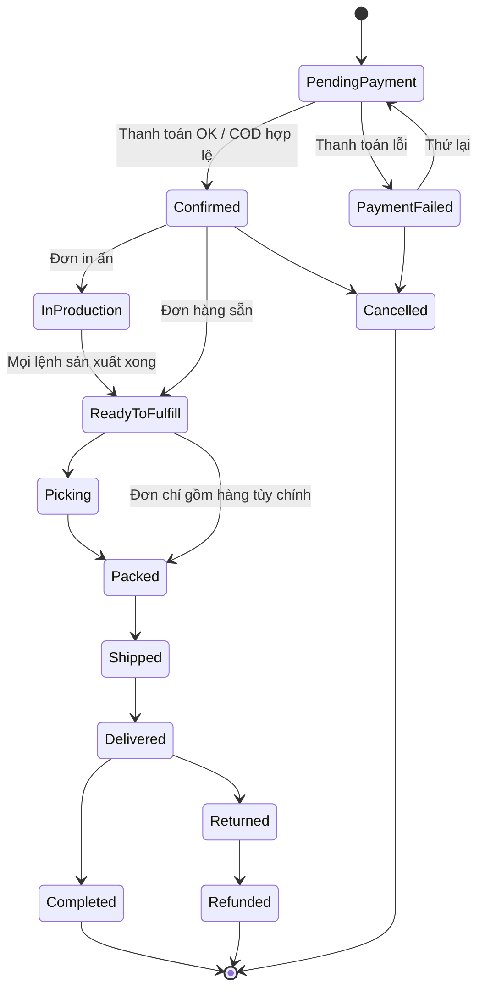

# 14 — Giỏ hàng & Đặt hàng (Cart & Order)

## 1. Mục đích (Purpose)

- **Giỏ hàng (Cart):** nơi khách tạm gom sản phẩm (kể cả sản phẩm tùy chỉnh kèm design snapshot), điều chỉnh số lượng, xem tạm tính, áp mã giảm giá, ước tính phí vận chuyển.
- **Đặt hàng (Order / Checkout):** biến giỏ hàng thành **đơn hàng chính thức** — thu thập địa chỉ giao, phương thức vận chuyển, phương thức thanh toán, xác nhận giá cuối, và tạo `Order` chuyển sang [Payment](../15-payment/README.md) rồi [Fulfillment](../../warehouse/07-picking/README.md).

Order là **chứng từ trung tâm của mảng bán hàng**, được [Order Management](../17-order-management/README.md) theo dõi suốt vòng đời.

---

## 2. Actor liên quan

| Actor | Vai trò |
|-------|---------|
| **Khách hàng (Customer / Guest)** | Thêm/sửa/xoá dòng giỏ, áp voucher, chọn địa chỉ & vận chuyển, đặt hàng |
| **Nhân viên Sale (Sales Staff)** | Tạo/sửa đơn hộ khách (assisted order), áp ưu đãi trong hạn mức, chốt đơn qua [chat](../16-sales-chat/README.md) |
| **Hệ thống (Pricing, Promotion, Inventory, Tax, Shipping rate)** | Tính giá, kiểm tồn, tính thuế & phí ship, giữ hàng (reservation) |
| **Quản trị sàn (E-commerce Admin)** | Cấu hình quy tắc giỏ (thời hạn giữ, số lượng tối đa), khuyến mãi, chính sách đặt trước |

---

## 3. Input / Output

### Input

| Trường | Mô tả | Bắt buộc |
|--------|-------|----------|
| Dòng giỏ (cart line) | SKU, số lượng, (design snapshot nếu sản phẩm tùy chỉnh) | Có |
| Mã giảm giá / voucher | | Không |
| Địa chỉ giao & người nhận | | Có (khi checkout) |
| Phương thức vận chuyển | Chọn từ danh sách khả dụng theo địa chỉ & giỏ | Có (khi checkout) |
| Phương thức thanh toán | Chuyển sang [15 Payment](../15-payment/README.md) | Có (khi checkout) |
| Ghi chú đơn / yêu cầu xuất hoá đơn | | Không |
| Thông tin khách | Từ [18 Customer Information](../18-customer-information/README.md) hoặc nhập mới (guest) | Có |

### Output

| Kết quả | Dùng bởi |
|---------|----------|
| **Cart** (có ID, danh sách dòng, tạm tính) | Khách, Sale |
| **Order** (Order number, dòng hàng đã chốt giá, địa chỉ, phí, tổng tiền) | 15 Payment, 17 Order Management |
| **Reservation tồn kho** (giữ hàng cho đơn) | Mảng kho vận (07 Picking allocation) |
| **Yêu cầu thanh toán** | 15 Payment |
| Sự kiện "đơn được tạo" | 17 Order Management, 16 Sales Chat, 18 Customer Info |

---

## 4. Luồng nghiệp vụ từng bước (Step-by-step)

### 4.1. Giỏ hàng (Cart)

1. **Thêm vào giỏ** — từ [Catalog](../13-catalog/README.md) (sản phẩm thường) hoặc sau khi chốt thiết kế ở [12](../12-product-design/README.md) (sản phẩm tùy chỉnh — dòng giỏ mang design snapshot & giá theo thông số in).
2. **Xem & chỉnh giỏ** — đổi số lượng, xoá dòng, xem tạm tính (subtotal). Hệ thống kiểm tồn khả dụng mỗi lần cập nhật.
3. **Áp mã giảm giá** — kiểm tra điều kiện (giá trị tối thiểu, sản phẩm áp dụng, hạn dùng, giới hạn lượt).
4. **Ước tính phí vận chuyển & thuế** — theo địa chỉ tạm (nếu có) và trọng số/kích thước giỏ.
5. **Giữ giỏ** — giỏ tồn tại theo thời hạn cấu hình; với khách đăng nhập thì đồng bộ nhiều thiết bị.

### 4.2. Đặt hàng (Checkout)

6. **Bắt đầu checkout** — hệ thống **khoá kiểm tra lần cuối**: còn hàng? giá còn đúng? voucher còn hiệu lực? sản phẩm còn `Published`?
7. **Thông tin khách & địa chỉ giao** — chọn từ sổ địa chỉ ([18](../18-customer-information/README.md)) hoặc nhập mới; guest nhập trực tiếp.
8. **Chọn phương thức vận chuyển** — danh sách dịch vụ khả dụng + phí + thời gian dự kiến (từ shipping rate engine).
9. **Chốt giá cuối (Order totals)** — subtotal + phí ship + thuế − giảm giá = **tổng phải thanh toán**. Giá dòng hàng được **"chốt" (price lock)** vào đơn.
10. **Giữ hàng (Reservation)** — hệ thống reserve tồn cho các dòng hàng (giảm ATP) trong thời hạn chờ thanh toán.
11. **Chọn phương thức thanh toán & tạo Order** — Order được tạo ở trạng thái `Pending Payment`; chuyển sang [15 Payment](../15-payment/README.md).
12. **Kết quả thanh toán:**
    - **Thành công** (hoặc COD hợp lệ) → Order `Confirmed`; reservation chuyển thành allocation; gửi xác nhận cho khách; đẩy sang [Order Management](../17-order-management/README.md) → [Fulfillment](../../warehouse/07-picking/README.md).
    - **Thất bại / hết hạn** → Order `Payment Failed` / `Cancelled`; giải phóng reservation.
13. **Đơn có sản phẩm tùy chỉnh** → sau `Confirmed`, design snapshot `Locked`; mỗi dòng tùy chỉnh sinh một **lệnh sản xuất** tại xưởng in nội bộ và đơn chuyển `In Production` (xem [19 Production](../../warehouse/19-production/README.md)).

### 4.3. Đặt hàng hộ (Assisted order — Sale)

14. Sale tạo giỏ/đơn thay khách qua [chat](../16-sales-chat/README.md): chọn sản phẩm, gắn thiết kế khách gửi, áp ưu đãi trong hạn mức, gửi khách **link thanh toán** hoặc chốt COD.

---

## 5. Trạng thái / Vòng đời (Lifecycle)

### 5.1. Trạng thái Cart

| Trạng thái | Ý nghĩa |
|------------|---------|
| `Active` | Đang dùng, còn trong thời hạn |
| `Abandoned` | Quá hạn không thao tác (có thể trigger email nhắc) |
| `Converted` | Đã chuyển thành Order |
| `Merged` | Guest cart gộp vào cart tài khoản sau khi đăng nhập |

### 5.2. Trạng thái Order (tổng quát — chi tiết ở [17 Order Management](../17-order-management/README.md))

| Trạng thái | Ý nghĩa | Chuyển tiếp | Nguồn |
|------------|---------|-------------|-------|
| `Pending Payment` | Đơn đã tạo, chờ thanh toán | → `Confirmed`, → `Payment Failed`, → `Cancelled` | 15 Payment |
| `Payment Failed` | Thanh toán không thành công | → `Pending Payment` (thử lại), → `Cancelled` | 15 Payment |
| `Confirmed` | Đã thanh toán / COD hợp lệ; hàng đã giữ | → `In Production` (nếu in ấn) / `Ready to Fulfill`, → `Cancelled` | System |
| `In Production` | Đang sản xuất/in (đơn tùy chỉnh) | → `Ready to Fulfill` (mọi lệnh sản xuất `Completed`) | 19 Production |
| `Ready to Fulfill` | Sẵn sàng cho kho xử lý | → `Picking` …, → `Packed` (đơn chỉ gồm hàng tùy chỉnh — không qua picking thành phẩm) | 07 Picking / 08 Packing |
| `Picking` / `Packed` / `Shipped` / `In Transit` / `Delivered` | Theo luồng Fulfillment | | 07/08/09 |
| `Completed` | Giao xong & (nếu COD) đã thu tiền | *(cuối)* | 17 Order Management |
| `Cancelled` | Huỷ (trước khi giao) | *(cuối)* | Khách / Sale / System |
| `Returned` / `Refunded` | Hoàn hàng / hoàn tiền | *(cuối)* | 09 Shipping / 15 Payment |

---

## 6. Ràng buộc nghiệp vụ (Business Rules) & Edge case

### Business rules

- **BR-01:** Không cho checkout khi có dòng hàng hết tồn khả dụng hoặc sản phẩm không còn `Published`.
- **BR-02:** Sản phẩm tùy chỉnh chỉ vào giỏ khi có design snapshot `Confirmed`; snapshot `Locked` khi đơn `Confirmed`.
- **BR-03:** Giá dòng hàng được **chốt vào Order** tại thời điểm tạo đơn; thay đổi giá catalog sau đó không ảnh hưởng đơn đã tạo.
- **BR-04:** Reservation tồn có **thời hạn**; hết hạn chưa thanh toán → giải phóng, đơn `Cancelled`/`Payment Failed`.
- **BR-05:** Tổng tiền đơn = subtotal + phí ship + thuế − giảm giá; mọi khoản phải minh bạch trước khi khách xác nhận.
- **BR-06:** Voucher: kiểm tra điều kiện & giới hạn lượt tại **thời điểm checkout**, không chỉ khi áp vào giỏ.
- **BR-07:** Đơn `Confirmed` chỉ được sửa nội dung (SKU/số lượng/địa chỉ) qua [Order Management](../17-order-management/README.md) với quy tắc & phê duyệt; không sửa tự do.
- **BR-08:** Một khách có thể có nhiều giỏ đang mở? → mặc định **một giỏ Active/khách**; guest cart gộp vào khi đăng nhập.  ⚠️ Giả định — xem [open-questions](../../open-questions/README.md).

### Edge case

| Tình huống | Hướng xử lý |
|------------|-------------|
| Hết hàng ở bước checkout | Chặn; hiển thị dòng lỗi; cho khách giảm số lượng / xoá dòng / chọn biến thể khác |
| Giá thay đổi giữa giỏ và checkout | Hiển thị chênh lệch, yêu cầu khách xác nhận giá mới trước khi tạo đơn |
| Voucher hết lượt đúng lúc checkout | Bỏ voucher, tính lại tổng, thông báo |
| Khách đóng trình duyệt sau khi tạo Order `Pending Payment` | Giữ đơn theo thời hạn; gửi link thanh toán qua email; hết hạn → huỷ & giải phóng hàng |
| Thanh toán thành công nhưng tạo đơn lỗi kỹ thuật | Đối soát giao dịch; tạo đơn thủ công hoặc hoàn tiền; không để "mất đơn/mất tiền" |
| Guest checkout rồi tạo tài khoản sau | Gắn đơn vào tài khoản qua email khớp |
| Đơn hỗn hợp: hàng thường + hàng in ấn | Phần hàng thường được pick song song trong lúc in và chờ tại khu đóng gói; mặc định đóng gói khi đủ cả hai phần, hoặc tách giao theo chính sách giao gộp/tách |
| Sale áp giảm giá vượt hạn mức | Cần Manager duyệt; đơn giữ ở trạng thái chờ duyệt ưu đãi |

---

## 7. Liên kết với các module khác

| Module | Quan hệ |
|--------|---------|
| [13 · Catalog](../13-catalog/README.md) | Nguồn sản phẩm, giá, tình trạng còn hàng để thêm vào giỏ |
| [12 · Product Design](../12-product-design/README.md) | Dòng giỏ sản phẩm tùy chỉnh mang design snapshot; ảnh hưởng giá dòng |
| [15 · Payment](../15-payment/README.md) | Order `Pending Payment` chuyển sang thanh toán; kết quả quyết định `Confirmed`/`Failed` |
| [17 · Order Management](../17-order-management/README.md) | Theo dõi & thao tác đơn suốt vòng đời sau khi tạo |
| [07 · Picking](../../warehouse/07-picking/README.md) | Reservation → allocation; đơn `Ready to Fulfill` chuyển vào kho |
| [19 · Production](../../warehouse/19-production/README.md) | Dòng tùy chỉnh sinh lệnh sản xuất; đơn ở `In Production` cho tới khi mọi lệnh `Completed` |
| [16 · Sales Chat](../16-sales-chat/README.md) | Đặt hàng hộ (assisted order); gửi link thanh toán |
| [18 · Customer Information](../18-customer-information/README.md) | Sổ địa chỉ, thông tin người nhận, lịch sử mua |
