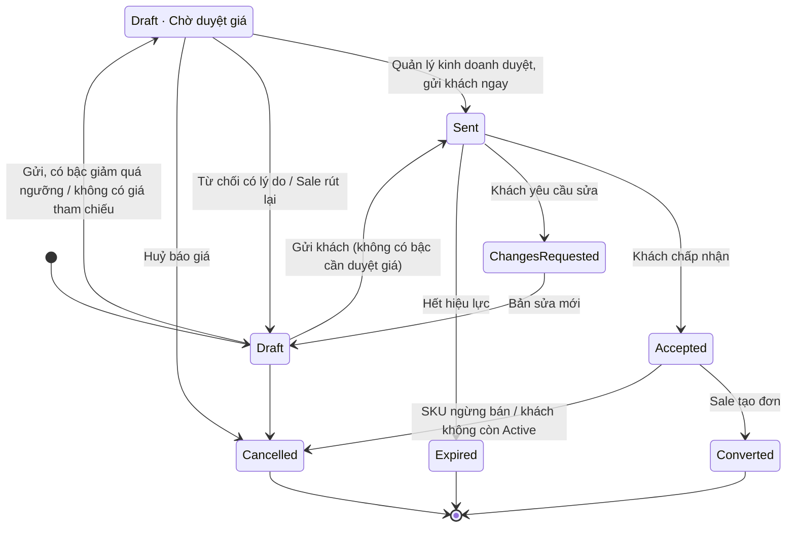
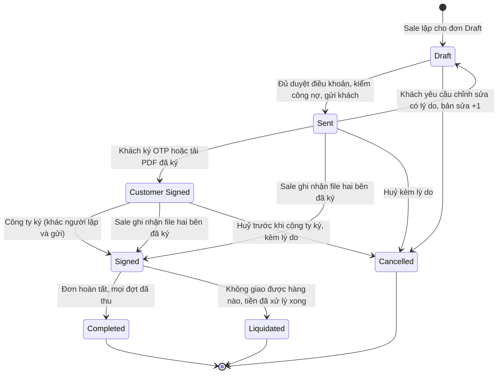
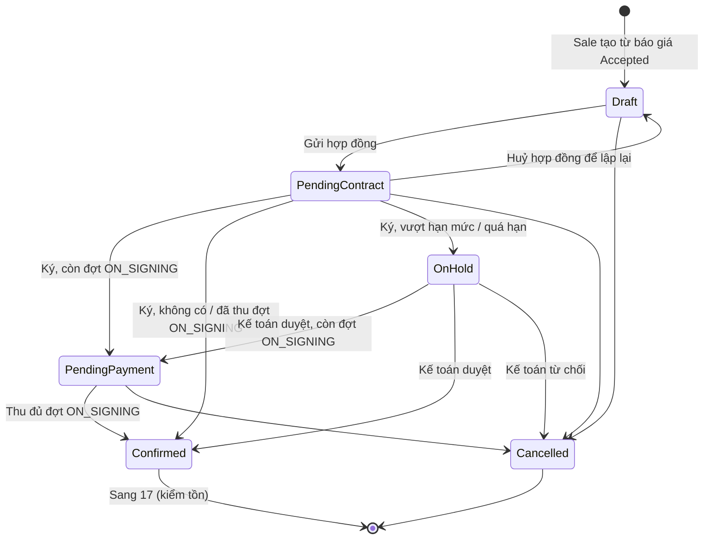

# 14 — Báo giá, Đơn hàng & Hợp đồng (Quote, Order & Sales Contract)

> Đã chốt 2026-10-06: hệ thống **chỉ bán sỉ (B2B)** cho khách đã liên hệ từ trước. Không có khách vãng lai, giỏ hàng bán lẻ hay voucher.
>
> Đã chốt 2026-11-04: khách **không tự đặt hàng** trên cổng; mọi đơn do **Sale tạo từ báo giá đã chấp nhận**. Mỗi đơn có đúng **một Hợp đồng mua bán (Sales Contract)**; khách thanh toán bằng chuyển khoản theo **các đợt thanh toán** ghi trong hợp đồng. (Tên thư mục `14-cart-and-order` giữ nguyên để không gãy liên kết.) **Không còn hàng trơn**: dòng báo giá / đơn chỉ là **SKU thành phẩm riêng của khách** (sinh khi bản thiết kế của khách được duyệt ở [12](../12-product-design/README.md)).
>
> Đã chốt 2026-11-05: khách **đặt theo số thùng**, không đặt lẻ. Số lượng trên báo giá, đơn, hợp đồng là **số thùng** (số nguyên ≥ 1), hiển thị kèm số cái = số thùng × **số cái / thùng** của SKU. **Giá vẫn theo cái**; thành tiền dòng = số thùng × số cái / thùng × đơn giá / cái. **MOQ và bậc giá tính theo số thùng** ([open-questions A9](../../open-questions/README.md)).
>
> Đã chốt 2026-11-05 (bổ sung): **sàn không hiển thị giá** ([13](../13-catalog/README.md)) — giá chỉ có trên báo giá / đơn / hợp đồng sau khi Sale thoả thuận với khách. **Giá trên báo giá do Sale nhập**; hệ thống gợi ý từ **bảng giá riêng nội bộ** của khách do Quản lý kinh doanh (Sales Manager) khai báo, chỉ nhân viên xem *(✅ Chốt lại 2026-11-26: không có bảng giá riêng thì gợi ý từ **giá chuẩn của quy cách**; giảm quá ngưỡng thì cần duyệt — xem mốc chốt 2026-11-26 bên dưới)*. Báo giá và hợp đồng có **dòng phí khuôn / bản in** cho mẫu mới (lần sản xuất đầu của SKU); hợp đồng có điều khoản **số lần in mẫu miễn phí** dùng cho bước duyệt mẫu in của Đơn sản xuất ([17](../17-order-management/README.md) §4.3). Role điều phối đơn hàng đã bỏ: việc tiếp nhận đơn đã xác nhận (chọn kho xuất, Đơn sản xuất) chuyển cho Sale.
>
> ✅ Đã chốt 2026-11-05 (phí vận chuyển & thuế): **phí vận chuyển** thu của khách là **một dòng phí** do Sale nhập trên báo giá / đơn / hợp đồng (như dòng phí khuôn / bản in); hệ thống không tự tính; cộng vào tổng tiền và chia vào lịch thanh toán như hàng hoá (BR-20). Mỗi dòng (hàng và phí) ghi **thuế suất VAT** theo **nhóm thuế** của sản phẩm ([01](../../warehouse/01-product-creation/README.md)), **tiền thuế**; chứng từ ghi **tổng có thuế** (BR-21). *(Cập nhật 2026-11-06)* **Hoá đơn điện tử** do hệ thống phát hành qua nhà cung cấp hoá đơn điện tử theo **từng lần giao thành công**, dùng thuế suất **có hiệu lực ngày lập hoá đơn** và gắn cờ cho Kế toán khi khác thuế suất trên hợp đồng ([21](../21-e-invoice/README.md); *✅ Đã chốt 2026-11-25*, D34).
>
> ✅ Đã chốt 2026-11-05 (khách tự thiết kế): **khách tự thiết kế trên app** ([12](../12-product-design/README.md)); bản thiết kế được Quản lý kinh doanh duyệt (*✅ Chốt lại 2026-11-20: nay Điều phối sản xuất*) thì sinh SKU riêng. **Đặt hàng từ bản thiết kế = yêu cầu báo giá** gửi Sale ([13](../13-catalog/README.md), [16](../16-sales-chat/README.md)): khách nêu **số thùng mong muốn** (chỉ là gợi ý) và **ngày giao mong muốn** (nếu có — thành **ngày giao khách yêu cầu** của báo giá). Sale lập báo giá / đơn / hợp đồng như cũ; khách vẫn không tự đặt hàng, sàn vẫn ẩn giá.
>
> ✅ Đã chốt 2026-11-07 (góp ý hội đồng — lịch giao nhiều đợt): điều khoản giao hàng của hợp đồng có **lịch giao** gồm một hoặc nhiều **đợt giao**; mỗi đợt có **cửa sổ giao** (từ ngày – đến ngày) và số thùng từng SKU (BR-23). Đợt thanh toán `BEFORE_DELIVERY` / `AFTER_DELIVERY` **gắn được** với một đợt giao (BR-13, [15](../15-payment/README.md)). Mọi đợt giao về **một địa chỉ**; mỗi đợt một địa chỉ là phạm vi sau. Sau khi ký, chỉ **dời cửa sổ giao** được (kèm bằng chứng khách đồng ý — [17](../17-order-management/README.md) §4.5); Đơn sản xuất lập **theo từng đợt giao**. Xem [open-questions D37, D38](../../open-questions/README.md).
>
> ✅ Đã chốt 2026-11-26 (giá chuẩn & duyệt giá báo giá — thay quyết định 2026-11-25 "Sale tự quyết giá; chỉ báo Quản lý kinh doanh sau khi gửi, không chặn"): **giá tham chiếu** của một bậc giá trên dòng báo giá lấy từ **bảng giá riêng của khách** cho SKU, không có thì từ **giá chuẩn của quy cách** mà SKU được thiết kế trên đó ([13](../13-catalog/README.md) §4.2); hệ thống điền sẵn bậc giá từ đó. Khi Sale bấm **Gửi**, báo giá có bậc **giảm quá ngưỡng** so với giá tham chiếu (cấu hình, mặc định **10%**) hoặc có bậc **không có giá tham chiếu** thì **không tới khách** mà **chờ duyệt giá** — vẫn `Draft`, khoá sửa và khoá gửi: **Quản lý kinh doanh duyệt** → gửi khách ngay; **từ chối** (bắt buộc lý do) → về nháp để Sale sửa; người duyệt khác người gửi duyệt (BR-10, BR-24). Lý do: lần báo giá đầu của mỗi thiết kế (SKU mới) trước đây không có giá gợi ý nào nên cảnh báo giá thấp không chạy; "giá chuẩn + giảm quá ngưỡng thì cấp trên duyệt" là cách phổ biến của phần mềm bán hàng B2B. Xem [open-questions D40](../../open-questions/README.md).
>
> ✅ Đã chốt 2026-11-28 (Sale phụ trách khách — **chế độ chặt**): báo giá và hợp đồng của một khách đã có **Sale phụ trách** đang làm ([18](../18-customer-information/README.md) §4.5) chỉ do **người phụ trách**, **người đang lo thay**, **Sales Manager** hoặc **System Admin** lập, sửa, gửi, huỷ; Sale khác bị chặn kèm tên người phụ trách (BR-25). Lý do: trước đây Sale nào cũng sửa, gửi, huỷ được báo giá và hợp đồng của Sale khác, nên còn đường "giành khách" bằng một báo giá giá thấp. Giá, duyệt giá, phiên bản, khách chấp nhận, tạo đơn, ghi nhận ký **không đổi**. Báo giá và hợp đồng ghi thêm **Sale phụ trách lúc lập** để tính doanh số, không đổi khi khách được chuyển (BR-26); thông báo về báo giá, hợp đồng đi tới **Sale phụ trách khách** theo quy tắc chung, không còn theo người gửi ([00 §6](../../00-system-overview/README.md)).

## 1. Mục đích (Purpose)

Module quản lý ba chứng từ nối tiếp nhau của mảng bán hàng:

- **Báo giá (Quote):** Sale lập đề nghị giá cho khách sỉ, thường từ **yêu cầu báo giá** khách gửi trên sàn từ một bản thiết kế ([13](../13-catalog/README.md)). Dòng báo giá là **SKU thành phẩm riêng của chính khách đó** (SKU in theo thiết kế khách tự làm, sinh khi bản thiết kế được duyệt ở [12](../12-product-design/README.md)) — kèm **đơn giá theo cái** do Sale nhập (gợi ý từ bảng giá riêng nội bộ của khách, không có thì từ giá chuẩn của quy cách — [13](../13-catalog/README.md); giảm quá ngưỡng so với giá tham chiếu thì Quản lý kinh doanh duyệt trước khi tới khách), bậc giá theo **số thùng** (bậc thấp nhất = MOQ), **dòng phí khuôn / bản in** nếu SKU sản xuất lần đầu, **dòng phí vận chuyển** (nếu thu), **thuế VAT** từng dòng và **tổng có thuế**, hiệu lực và lịch thanh toán dự kiến. Khách chấp nhận báo giá trên sàn (trang báo giá) hoặc bằng **thẻ hành động** của báo giá trong [chat](../16-sales-chat/README.md).
- **Đơn hàng (Order):** **Sale tạo đơn từ báo giá đã chấp nhận**, đặt theo **số thùng** khách đã chọn. Đơn là **chứng từ trung tâm của mảng bán hàng**, được [Order Management](../17-order-management/README.md) theo dõi suốt vòng đời.
- **Hợp đồng mua bán (Sales Contract):** mỗi đơn có đúng **một** hợp đồng còn hiệu lực, ghi: các bên, dòng hàng & giá, dòng phí khuôn / bản in và dòng phí vận chuyển (nếu có), thuế VAT từng dòng và tổng có thuế, điều khoản giao hàng gồm **lịch giao (các đợt giao)**, điều khoản **số lần in mẫu miễn phí**, **lịch thanh toán (các đợt)** và file hợp đồng đã ký. Khách ký trước bằng OTP trên cổng hoặc tải PDF đã ký, công ty ký sau; chỉ khi công ty đã ký thì đơn mới được xét xác nhận (BR-14, BR-15); các đợt thanh toán được theo dõi ở [15 Payment](../15-payment/README.md).

---

## 2. Actor liên quan

| Actor | Vai trò |
|-------|---------|
| **Khách hàng sỉ (B2B Customer)** | **Yêu cầu báo giá** từ bản thiết kế đã duyệt trên sàn — nêu số thùng mong muốn, ngày giao mong muốn ([13](../13-catalog/README.md)). Xem báo giá; **chấp nhận** (chọn số thùng) hoặc **yêu cầu sửa** — trên sàn hoặc bằng thẻ hành động trong [chat](../16-sales-chat/README.md). Xem đơn, hợp đồng và lịch sử bản sửa trên cổng; **Yêu cầu chỉnh sửa** hợp đồng kèm lý do khi chưa ký; ký bằng OTP qua email, họ tên, chức danh và đồng ý ký điện tử, hoặc tải PDF đã ký lên. Có thể gửi file đã ký qua chat để Sale ghi nhận. Bấm "Đặt lại" một đơn cũ để mở chat với Sale. |
| **Nhân viên Sale (Sales Staff)** | Nhận **yêu cầu báo giá từ bản thiết kế** ([16](../16-sales-chat/README.md)). Lập, sửa, gửi, huỷ báo giá (không chấp nhận / yêu cầu sửa thay khách); **nhập đơn giá** (tham khảo giá gợi ý); báo giá giảm quá ngưỡng hoặc không có giá tham chiếu thì **gửi duyệt giá**, **rút lại** khi đang chờ duyệt (BR-10, BR-24); **số tiền phí khuôn / bản in** và **số tiền phí vận chuyển** (nếu thu). **Tạo đơn từ báo giá đã chấp nhận.** Lập hợp đồng, **lịch giao**, lịch thanh toán và điều khoản **số lần in mẫu miễn phí**, gửi khách (kiểm công nợ không đạt thì hợp đồng chờ Kế toán duyệt; **rút lại** được khi đang chờ — [15](../15-payment/README.md) §4.3), gửi duyệt điều khoản khác chuẩn, gia hạn ký khi `Sent`, ghi nhận file hai bên đã ký; xem lịch sử bản sửa và kết quả kiểm tra file. Tiếp nhận đơn đã xác nhận để chọn kho xuất và lập Đơn sản xuất ([17](../17-order-management/README.md)). *(✅ 2026-11-28)* Lập, sửa, gửi, huỷ báo giá và hợp đồng chỉ cho khách **mình phụ trách**, **đang lo thay**, hoặc khách **chưa có người phụ trách** đang làm (BR-25); vẫn **xem** được báo giá, hợp đồng của mọi khách. |
| **Kế toán (Accountant)** | Duyệt / từ chối **hợp đồng chờ duyệt công nợ trước khi gửi** và đơn bị treo vì **tín dụng** khi ký, khi hợp đồng có đợt trả sau giao ([15](../15-payment/README.md) §4.3) |
| **Quản lý kinh doanh (Sales Manager)** | Khai báo **bảng giá riêng nội bộ** của khách cho SKU riêng (đơn giá / cái, bậc & MOQ theo số thùng) và **giá chuẩn của quy cách** — giá gợi ý / giá tham chiếu cho Sale, không hiện trên sàn ([13](../13-catalog/README.md) §4.2); **duyệt / từ chối giá báo giá** đang chờ duyệt giá, người duyệt khác người gửi duyệt (BR-24) *(✅ Chốt lại 2026-11-26: thay "nhận thông báo khi báo giá được gửi có dòng thấp hơn giá gợi ý quá ngưỡng")*; xem báo giá và đơn (ngoài duyệt giá, không sửa). *(✅ 2026-11-28)* Giao / đổi **Sale phụ trách** khách; luật chế độ chặt không bao giờ chặn Manager (BR-25), nhưng ma trận quyền của role vẫn chặn: Manager điều phối, **không lập báo giá**, ma trận quyền về báo giá không đổi (✅ Đã chốt 2026-11-28 — [open-questions D42](../../open-questions/README.md)); **duyệt điều khoản hợp đồng khác chuẩn** và **ký phía công ty theo uỷ quyền** (khác người lập / gửi — BR-28, BR-30; ✅ 2026-11-28) |
| **Hệ thống** | Điền sẵn giá theo bảng giá riêng nội bộ của khách, không có thì theo giá chuẩn của quy cách; khi Sale gửi, đo mức giảm từng bậc so với **giá tham chiếu**, giữ báo giá ở **chờ duyệt giá** và báo người giữ quyền duyệt giá; lưu giá tham chiếu của mỗi lượt gửi duyệt; kiểm lại như khi gửi lúc duyệt; thêm dòng phí khuôn / bản in cho SKU sản xuất lần đầu; tính thành tiền; lấy **thuế suất VAT** từng dòng theo nhóm thuế, tính tiền thuế và tổng có thuế; kiểm SKU còn bán được và thuộc đúng khách; kiểm người thao tác **được làm cho khách này** (BR-25) và chụp **Sale phụ trách lúc lập** lên báo giá, hợp đồng (BR-26); tự đánh dấu báo giá hết hiệu lực; kiểm **lịch giao** khớp số thùng của đơn; quy lịch thanh toán ra số tiền, **gợi ý số tiền** của đợt thanh toán gắn với một đợt giao; chuyển trạng thái đơn theo hợp đồng và đợt thanh toán; gửi OTP email, lưu bằng chứng đồng ý, kiểm tra PDF tải lên, ký số phía công ty bằng chứng thư dùng thử và lập trang chứng nhận ký; gắn cờ quá hạn ký, báo Sale |

---

## 3. Input / Output

### Input

| Trường | Mô tả | Bắt buộc |
|--------|-------|----------|
| Khách sỉ | Hồ sơ khách `Active`: thông tin pháp lý, sổ địa chỉ, **lịch thanh toán mặc định**, hạn mức & kỳ hạn công nợ, bảng giá riêng nội bộ ([18](../18-customer-information/README.md)) | Có |
| **Yêu cầu báo giá** | Khách gửi trên sàn từ một bản thiết kế hoặc **cả dự án thiết kế** ([13](../13-catalog/README.md)), đến Sale qua thẻ yêu cầu báo giá trong [chat](../16-sales-chat/README.md): bản thiết kế / SKU riêng (nhiều dòng khi cả dự án), **số thùng mong muốn** (gợi ý), **ngày giao mong muốn** (nếu có; một ngày chung khi cả dự án). Khách cũng có thể hỏi qua chat, điện thoại, email mà không có yêu cầu này | Không |
| Dòng báo giá | **SKU thành phẩm riêng** đang bán được, thuộc chính khách này ([12](../12-product-design/README.md)) — không chọn quy cách `CUSTOMIZABLE` (chỉ là khuôn, không có tồn, không báo giá trực tiếp); **số cái / thùng** của SKU (quy cách thùng — [01](../../warehouse/01-product-creation/README.md)); **bậc giá** (số thùng tối thiểu ≥ 1, **đơn giá theo cái** VND nguyên dương — Sale nhập, hệ thống điền sẵn từ bảng giá riêng nội bộ, không có thì từ giá chuẩn của quy cách — BR-10) | Có |
| **Dòng phí khuôn / bản in** | Một dòng phí cho mỗi SKU **sản xuất lần đầu** (SKU **chưa có khuôn**: chưa có đơn đã xác nhận nào chưa huỷ và chưa có Đơn sản xuất nào tới `In Production` — [17](../17-order-management/README.md); BR-17); số tiền VND do Sale nhập. SKU đã có khuôn (đặt lại SKU đã từng sản xuất) thì không có dòng này | Có (khi có SKU sản xuất lần đầu) |
| **Dòng phí vận chuyển** | Tối đa **một dòng** cho cả báo giá; số tiền VND nguyên dương **do Sale nhập** theo thoả thuận với khách (hệ thống không tự tính, không lấy từ hãng hay từ kế hoạch xếp xe — [09](../../warehouse/09-shipping/README.md)). Không thu phí vận chuyển thì không có dòng này (BR-20) | Không |
| **Thuế suất VAT từng dòng** | Hệ thống lấy theo **nhóm thuế** (`STANDARD` / `REDUCED` / `EXEMPT` → % theo cấu hình) của sản phẩm ([01](../../warehouse/01-product-creation/README.md)): dòng hàng và dòng phí khuôn / bản in theo sản phẩm của SKU; dòng phí vận chuyển theo nhóm `STANDARD` (⚠️ giả định — [open-questions D31](../../open-questions/README.md)). Sale không sửa (BR-21) | Có (hệ thống điền) |
| Hiệu lực báo giá | Ngày hết hiệu lực, ở tương lai | Có |
| **Quyết định duyệt giá** *(✅ Đã chốt 2026-11-26)* | Quản lý kinh doanh **duyệt** (ghi chú tuỳ chọn) hoặc **từ chối** (lý do bắt buộc, ≤ 500 ký tự) báo giá đang chờ duyệt giá (BR-24) | Khi báo giá chờ duyệt giá |
| **Ngày giao khách yêu cầu** | Ngày khách muốn nhận hàng; một ngày cho cả báo giá, Sale nhập khi báo giá còn `Draft` (lập từ yêu cầu báo giá thì hệ thống điền sẵn **ngày giao mong muốn** khách nêu); không ở quá khứ. Để trống nghĩa là khách không nêu ngày. Khác **lịch giao** Sale lập trong hợp đồng (BR-19, BR-23) *(Quyết định PROD-DUE 02/11/2026)* | Không |
| Lịch thanh toán dự kiến | Lấy từ lịch mặc định của khách; chỉ để khách tham khảo, lịch ràng buộc nằm trong hợp đồng | Không |
| Số thùng khách chấp nhận | Khách chọn **số thùng** (số nguyên ≥ 1) cho từng dòng khi chấp nhận; hệ thống hiện kèm số cái = số thùng × số cái / thùng | Có (khi chấp nhận) |
| Địa chỉ giao & người nhận | Từ sổ địa chỉ của khách; **một địa chỉ cho mọi đợt giao** của đơn (BR-23) | Có (khi tạo đơn) |
| **Lịch giao** | Danh sách **đợt giao** ghi vào điều khoản giao hàng của hợp đồng: số thứ tự, **cửa sổ giao** (từ ngày – đến ngày; muốn một ngày cố định thì hai ngày bằng nhau), các dòng (SKU, **số thùng**). Mặc định **một đợt** gồm toàn bộ số thùng, cửa sổ giao = ngày giao khách yêu cầu (BR-23) | Có (khi lập hợp đồng) |
| **Lịch thanh toán của hợp đồng** | Danh sách đợt: tên đợt, **số tiền hoặc %**, **mốc đến hạn** (`ON_SIGNING` / `BEFORE_DELIVERY` / `AFTER_DELIVERY` + N ngày), **đợt giao gắn kèm** (tuỳ chọn, chỉ cho `BEFORE_DELIVERY` / `AFTER_DELIVERY`); tổng các đợt = **tổng tiền đơn (có thuế)** | Có (khi lập hợp đồng) |
| **Số lần in mẫu miễn phí** | Điều khoản hợp đồng: số lần in mẫu thử khách được miễn phí khi Đơn sản xuất cần duyệt mẫu in; mặc định lấy từ cấu hình chung (ví dụ 2), Sale sửa được khi lập hợp đồng | Có (khi lập hợp đồng) |
| **Điều khoản khác** | Thoả thuận riêng của từng hợp đồng; mức phạt vi phạm (0–8%), dung sai số lượng (0–10%), thời hạn bảo hành (0–36 tháng), để trống thì dùng mặc định. Có thoả thuận riêng hoặc khác mặc định thì phải duyệt điều khoản trước khi gửi (BR-28) | Khi có thoả thuận riêng / khác chuẩn |
| **Người ký hai bên** | Họ tên, chức danh; người ký phía công ty và số giấy uỷ quyền khi ký theo uỷ quyền, in trên hợp đồng | Có khi ký; số giấy uỷ quyền khi áp dụng |
| **Bằng chứng ký của khách** | OTP email đã xác minh, họ tên, chức danh, sự đồng ý ký điện tử; hoặc PDF đã ký tải lên cùng kết quả kiểm tra | Có (khi khách ký) |
| **File hợp đồng đã ký** | PDF hệ thống ký số phía công ty, hoặc PDF ký bên ngoài; bản scan hợp đồng giấy có chữ ký hai bên vẫn được Sale ghi nhận, kèm ngày ký và kết quả kiểm tra | Có (khi hợp đồng `Signed`) |

### Output

| Kết quả | Dùng bởi |
|---------|----------|
| **Báo giá** (mã, số bản sửa, dòng, bậc giá, dòng phí khuôn / bản in, dòng phí vận chuyển, thuế suất & tiền thuế từng dòng, tổng có thuế, hiệu lực, ngày giao khách yêu cầu) và **bản PDF báo giá** dựng khi tải, không lưu (§4.1 bước 3) | Khách, Sale |
| **Đơn hàng** (mã đơn; mỗi dòng: SKU, số thùng, số cái / thùng, số cái, đơn giá / cái, thành tiền, **thuế suất VAT, tiền thuế**, **ngày giao khách yêu cầu** — đã chốt; dòng phí khuôn / bản in, dòng phí vận chuyển — mỗi dòng phí có thuế suất & tiền thuế; địa chỉ; tổng chưa thuế, tổng tiền thuế, **tổng có thuế**) | [15 Payment](../15-payment/README.md), [17 Order Management](../17-order-management/README.md) |
| **Hợp đồng mua bán** (mã hợp đồng, các bên, dòng hàng, dòng phí khuôn / bản in, dòng phí vận chuyển, thuế VAT từng dòng, tổng có thuế, điều khoản giao gồm **lịch giao**, **số lần in mẫu miễn phí**, lịch thanh toán, bản PDF để ký (tổng có thuế kèm dòng **Bằng chữ**), **Điều khoản khác**, người ký và uỷ quyền, thoả thuận ký điện tử, số bản sửa, hạn ký, file đã ký và kết quả kiểm tra, **Trang chứng nhận ký**, mã xác minh / QR) | Khách (xem trên cổng), Kế toán, Sale; [17](../17-order-management/README.md) (số lần in mẫu miễn phí khi duyệt mẫu in; **lịch giao** để giữ hàng, lập Đơn sản xuất và xuất kho theo đợt) |
| **Các đợt thanh toán** sinh khi hợp đồng `Signed` | [15 Payment](../15-payment/README.md) |
| **Lượt duyệt giá** của báo giá — người gửi duyệt, thời điểm; giá tham chiếu, nguồn (giá riêng / giá chuẩn) và mức giảm từng bậc lúc gửi; người duyệt / từ chối, ghi chú / lý do (BR-24) | Sale, Quản lý kinh doanh |
| Thông báo cho **Sale phụ trách khách** theo quy tắc chung (khách chấp nhận / yêu cầu sửa báo giá; hợp đồng chưa ký, chưa thu đủ) và cho Sale đã gửi duyệt giá (báo giá bị từ chối / được duyệt giá — kèm người phụ trách khách nếu là người khác) — [00 §6](../../00-system-overview/README.md) *(✅ Chốt lại 2026-11-28)* | Sale |
| **Sale phụ trách lúc lập** trên báo giá và hợp đồng (ảnh chụp người phụ trách khách lúc lập; khác người gửi) (BR-26) *(✅ 2026-11-28)* | Báo cáo doanh số theo Sale |
| Thông báo cho Quản lý kinh doanh (báo giá chờ duyệt giá, hợp đồng chờ duyệt điều khoản khác chuẩn / chờ công ty ký) | Quản lý kinh doanh |

---

## 4. Luồng nghiệp vụ từng bước (Step-by-step)

### 4.1. Báo giá (Quote)

1. **Tiếp nhận yêu cầu** — chủ yếu là **yêu cầu báo giá** khách gửi trên sàn từ một bản thiết kế ([13](../13-catalog/README.md)): Sale nhận **thẻ yêu cầu báo giá** trong [chat](../16-sales-chat/README.md) gồm bản thiết kế / SKU riêng, **số thùng mong muốn** và **ngày giao mong muốn** (nếu có). Khách cũng có thể hỏi qua chat, điện thoại hoặc email; số lượng khách nêu theo cái thì Sale quy về **số thùng nguyên** theo số cái / thùng của SKU.
   - Mọi hàng đều in theo thiết kế **khách tự làm trên app** ([12](../12-product-design/README.md)): chỉ khi bản thiết kế được Điều phối sản xuất duyệt (`Approved`; *✅ Chốt lại 2026-11-20*) và hệ thống sinh **SKU thành phẩm riêng của khách** thì mới vào báo giá.
   - Khách "Gửi duyệt và yêu cầu báo giá" cùng lúc → Sale nhận yêu cầu ngay nhưng **chỉ lập báo giá khi bản đã `Approved`** (BR-22).
   - Khách mua lại thiết kế đã duyệt thì dùng luôn SKU riêng đã có.
   - **Ai nhận yêu cầu** *(✅ 2026-11-28)* — thẻ yêu cầu báo giá đến **Sale phụ trách khách** (hoặc người thay) theo định tuyến chat ([16](../16-sales-chat/README.md) §4.1); mọi Sale vẫn thấy yêu cầu, nhưng nút **Lập báo giá** chỉ bật cho người được làm (BR-25). Khách **chưa có người phụ trách** → yêu cầu chỉ vào **hàng chờ của Sales Manager**; Manager giao người phụ trách rồi Sale đó mới lập báo giá — không còn hộp chung "ai nhanh tay thì lấy".
   - Khách **yêu cầu báo giá cả dự án thiết kế** ([12](../12-product-design/README.md) §4.11) → Sale nhận **một thẻ nhiều dòng** (mỗi dòng một bản thiết kế kèm trạng thái và số thùng mong muốn, một ngày giao mong muốn chung) và lập **một báo giá nhiều dòng** khi mọi dòng đã `Approved` — hệ thống báo Sale lúc yêu cầu đủ điều kiện báo giá (BR-22).
2. **Lập báo giá** — Sale chọn SKU riêng của chính khách này (quy cách `CUSTOMIZABLE` không báo giá trực tiếp); lập từ yêu cầu báo giá thì hệ thống điền sẵn SKU riêng của bản thiết kế (hoặc mọi SKU riêng của thẻ yêu cầu cả dự án), hiện **số thùng khách nêu** để Sale tham khảo (không ràng buộc — số thùng thật do khách chọn khi chấp nhận) và điền **ngày giao mong muốn** vào ngày giao khách yêu cầu (BR-22). Sale **nhập bậc giá** — số thùng tối thiểu và đơn giá / cái; dòng chưa nhập bậc giá được hệ thống **điền sẵn** từ bảng giá riêng nội bộ của khách, không có thì từ **giá chuẩn của quy cách** mà SKU được thiết kế trên đó (khi tổng số thùng của SKU trên báo giá ≥ bậc đầu của giá chuẩn) ([13](../13-catalog/README.md) §4.2); không có cả hai thì Sale tự nhập. Mỗi bậc hiện **giá tham chiếu** (đọc tại số thùng bắt đầu của bậc) và nguồn của nó; Sale giữ hoặc sửa theo thoả thuận (BR-10). Nhập hiệu lực, lịch thanh toán dự kiến (mặc định theo khách) và, nếu khách nêu, **ngày giao khách yêu cầu** (một ngày cho cả báo giá, không ở quá khứ — BR-19). Báo giá ở `Draft`, **bản sửa số 1**.
   - **Phí khuôn / bản in** — SKU **sản xuất lần đầu** (mẫu mới) thì hệ thống thêm một **dòng phí khuôn / bản in** cho SKU đó; Sale nhập số tiền. Dòng phí không có số thùng, không tính vào MOQ / bậc giá, không đi vào giữ hàng hay Đơn sản xuất (BR-17).

     > ⚠️ Giả định: chi tiết khuôn / bản in theo từng kỹ thuật in (cách tính, số khuôn theo màu…) là phạm vi sau; hệ thống chỉ ghi một dòng phí cho mỗi SKU mẫu mới. Xem [open-questions](../../open-questions/README.md).
   - **Phí vận chuyển** *(✅ Đã chốt 2026-11-05)* — nếu thu phí vận chuyển của khách, Sale thêm **một dòng phí vận chuyển** và nhập số tiền theo thoả thuận (hệ thống không tự tính). Dòng phí không có số thùng, không tính MOQ / bậc giá, không đi vào giữ hàng hay Đơn sản xuất (BR-20).
   - **Thuế VAT** *(✅ Đã chốt 2026-11-05)* — hệ thống điền **thuế suất** cho từng dòng hàng và dòng phí theo nhóm thuế của sản phẩm ([01](../../warehouse/01-product-creation/README.md)), tính **tiền thuế** từng dòng và **tổng có thuế** của báo giá (BR-21).
3. **Gửi báo giá** → `Sent` (hoặc **chờ duyệt giá** — dưới đây); khách xem trên sàn, và Sale có thể gửi báo giá vào hội thoại chat dưới dạng **thẻ hành động** (chấp nhận / yêu cầu sửa). Hệ thống chỉ cho gửi khi:
   - mọi dòng đã có giá; mọi dòng phí (khuôn / bản in, vận chuyển) đã có số tiền; mọi dòng đã có thuế suất (sản phẩm có nhóm thuế);
   - hiệu lực còn ở tương lai;
   - khách `Active`;
   - mọi SKU còn bán được, SKU theo mẫu thuộc đúng khách;
   - SKU **đã có khuôn** không còn dòng phí khuôn / bản in (BR-17).

   **Duyệt giá** *(✅ Đã chốt 2026-11-26 — thay "chỉ báo Quản lý kinh doanh sau khi gửi, không chặn" của 2026-11-25)* — lúc Sale bấm Gửi, hệ thống đo từng bậc của từng dòng hàng: **mức giảm = (giá tham chiếu − đơn giá Sale nhập) ÷ giá tham chiếu**. Không có bậc nào cần duyệt → `Sent` ngay. Có bậc **giảm quá ngưỡng** (cấu hình, mặc định **10%**) hoặc có bậc **không có giá tham chiếu** → báo giá **không gửi khách** mà **chờ duyệt giá** (BR-10, BR-24):
   - vẫn là `Draft` về vòng đời — khách không thấy (yêu cầu báo giá của khách vẫn hiện "Sale đang soạn báo giá" — BR-22); báo giá **khoá sửa và khoá gửi**; hệ thống báo trong ứng dụng cho người giữ quyền **duyệt giá báo giá** (Quản lý kinh doanh) và **lưu lại** giá tham chiếu, nguồn (giá riêng / giá chuẩn) và mức giảm từng bậc của lượt gửi duyệt;
   - **Quản lý kinh doanh duyệt** (có thể kèm ghi chú) → hệ thống kiểm lại như khi gửi (khách `Active`, SKU còn bán được, dòng phí khuôn đúng BR-17, hiệu lực còn ở tương lai) rồi **gửi khách ngay** → `Sent`, người gửi là Sale đã gửi duyệt; Sale được báo trong ứng dụng. Báo giá đã hết hiệu lực thì không duyệt được: Sale rút lại, sửa hiệu lực, gửi lại;
   - **Từ chối** — bắt buộc lý do (≤ 500 ký tự) → báo giá về nháp để Sale sửa; Sale được báo kèm lý do;
   - **Sale rút lại** → về nháp; **huỷ báo giá** khi đang chờ duyệt → lượt duyệt kết thúc;
   - người duyệt / từ chối phải **khác** người gửi duyệt (bốn mắt).

   Giá **cao hơn** giá tham chiếu không cần duyệt. Dòng phí khuôn / bản in và phí vận chuyển không thuộc luật này.

   **Bản PDF báo giá** *(✅ Đã chốt 2026-11-15)* — Sale tải được báo giá dạng PDF; khách tải được báo giá của chính mình từ khi đã gửi — để trình duyệt nội bộ trước khi chấp nhận. Hệ thống **dựng bản PDF mỗi lần tải**, không lưu file. Bản PDF gồm:
   - tiêu đề "BÁO GIÁ", mã báo giá, số bản sửa, ngày lập (ngày gửi; bản nháp ghi ngày in), hiệu lực đến, thời điểm khách chấp nhận (nếu đã chấp nhận);
   - **bên bán** và **khách hàng** (thông tin pháp lý của khách nếu đã có, nếu chưa thì tên khách và mã số thuế);
   - mỗi dòng: SKU, **số thùng × số cái / thùng = số cái**, đơn giá / cái, thành tiền, thuế suất & tiền thuế VAT; các **bậc giá** đề nghị;
   - các dòng phí (khuôn / bản in, vận chuyển) kèm thuế;
   - tiền hàng, các khoản phí, tổng chưa thuế, tiền thuế, **tổng có thuế** và dòng **Bằng chữ** (tổng có thuế viết bằng chữ tiếng Việt);
   - ngày giao khách yêu cầu, cách tính giá (đơn giá theo cái, đặt theo thùng nguyên từ MOQ), điều kiện Sale ghi trên báo giá, chỗ ký của bên bán;
   - câu "Báo giá không phải hợp đồng; hợp đồng chỉ giao kết khi hai Bên ký Hợp đồng mua bán." *(✅ Đã chốt 2026-11-25)*.

   Báo giá đã chấp nhận in số thùng và giá khách đã chấp nhận; chưa chấp nhận thì in số đề nghị. Báo giá `Draft`, `Cancelled`, `Expired` in kèm **dòng đánh dấu** (bản nháp / đã huỷ / đã hết hiệu lực) để bản in không bị dùng như một chào giá còn hiệu lực; phần chưa có giá in "chưa xác định".
4. **Khách phản hồi** trên sàn hoặc bằng thẻ hành động trong chat (chỉ khách được làm; nhân viên không làm thay):
   - **Chấp nhận** → `Accepted`. Khách chọn **số thùng** từng dòng. Hệ thống kiểm:
     - báo giá còn hiệu lực;
     - khách `Active`;
     - SKU còn bán được;
     - số thùng là số nguyên ≥ MOQ (thùng).

     Bậc giá chọn theo **tổng số thùng của SKU đó** trên mọi dòng; thành tiền dòng = số thùng × số cái / thùng × đơn giá / cái (BR-08). Hệ thống báo Sale.
   - **Yêu cầu sửa** → `Changes Requested`. Sale mở lại → `Draft` **bản sửa mới** (số bản sửa +1), rồi gửi lại; bản sửa mới đi lại từ đầu bước 3 và có thể phải duyệt giá lần nữa (BR-24).
   - Hết hiệu lực mà chưa chấp nhận → `Expired`. Báo giá **được coi là hết hiệu lực ngay khi qua hạn**; hệ thống lưu lại trạng thái này định kỳ.
5. **Huỷ báo giá:**
   - Báo giá `Draft` huỷ tự do, kể cả khi đang **chờ duyệt giá** (lượt duyệt kết thúc). Nháp lập từ **yêu cầu báo giá** thì hệ thống cảnh báo Sale trước khi huỷ: huỷ khi chưa gửi thì yêu cầu đó đóng hẳn, không lập lại báo giá từ nó được (BR-22).
   - Báo giá `Accepted` chỉ huỷ được khi có SKU **không còn bán được** hoặc **khách không còn `Active`** *(✅ Đã chốt 2026-11-25)*, bắt buộc lý do (≤ 500 ký tự).
6. **Đặt lại đơn cũ** — khách bấm **"Đặt lại"** trên một đơn cũ ở sàn → hệ thống chỉ **mở chat** với Sale, gắn ngữ cảnh đơn đó ([16](../16-sales-chat/README.md)); không tự sinh báo giá. Sale **lập báo giá mới** như bước 2, giá gợi ý / giá tham chiếu theo bảng giá riêng (hoặc giá chuẩn) **hiện hành**; SKU đã từng sản xuất thì không có dòng phí khuôn / bản in. Báo giá mới **không** mang theo ngày giao khách yêu cầu của đơn cũ: Sale nhập ngày mới nếu khách yêu cầu (BR-19).

### 4.2. Tạo đơn hàng (Order)

7. **Tạo đơn từ báo giá** — Sale chọn báo giá `Accepted` → hệ thống tạo đơn `Draft`, báo giá → `Converted`.
   - Đơn lấy đúng SKU, số thùng, số cái / thùng, đơn giá / cái khách đã chấp nhận, cùng các dòng phí (khuôn / bản in, vận chuyển) và thuế suất từng dòng của báo giá.
   - **Mỗi dòng đơn chép ngày giao khách yêu cầu** của báo giá (trống nếu khách không nêu) và **không đổi** nữa sau khi đơn được tạo; ngày này là **cửa sổ giao mặc định** của lịch giao khi Sale lập hợp đồng (bước 11) (BR-19).
   - Tạo lại lần nữa thì trả về chính đơn đó, không tạo đơn thứ hai.
8. **Kiểm tra cuối** — giá còn đúng (báo giá còn hiệu lực lúc chấp nhận)? đủ MOQ? SKU còn bán được? Hệ thống hiển thị **tồn khả dụng** từng dòng theo **số thùng** (SKU riêng có thể còn hàng dư từ đơn trước hoặc hàng trả) để Sale lập lịch giao; thiếu hàng **không chặn** tạo đơn — phần thiếu sẽ được bổ sung bằng Đơn sản xuất sau khi đơn xác nhận ([17](../17-order-management/README.md) §4.2).
9. **Địa chỉ giao & người nhận** — chọn từ sổ địa chỉ của khách ([18](../18-customer-information/README.md)).
10. **Chốt giá cuối** — **tổng chưa thuế** = subtotal (tổng thành tiền các dòng hàng) + dòng phí khuôn / bản in + dòng phí vận chuyển; **tổng tiền thuế** = Σ tiền thuế các dòng; **tổng tiền đơn = tổng có thuế** = tổng chưa thuế + tổng tiền thuế (BR-09). Giá dòng hàng, dòng phí và thuế suất được **chốt (price lock)** vào đơn.

### 4.3. Hợp đồng mua bán (Sales Contract)

11. **Lập hợp đồng** — Sale lập hợp đồng cho đơn `Draft`; hợp đồng ở `Draft`. Hệ thống điền sẵn:
    - **các bên**: bên bán (thông tin doanh nghiệp), bên mua (tên công ty, mã số thuế, địa chỉ đăng ký kinh doanh, người đại diện — [18](../18-customer-information/README.md));
    - **dòng hàng & giá** (số thùng, số cái / thùng, số cái, đơn giá / cái, thành tiền), **dòng phí khuôn / bản in** và **dòng phí vận chuyển** (nếu có), **thuế suất & tiền thuế** từng dòng, tổng chưa thuế, tổng tiền thuế, **tổng có thuế** — copy từ đơn, không sửa riêng trên hợp đồng;
    - **điều khoản giao hàng**: địa chỉ giao, người nhận, **lịch giao** — mặc định **một đợt** gồm toàn bộ số thùng của đơn, cửa sổ giao = ngày giao khách yêu cầu (trống thì Sale nhập);
    - **điều khoản số lần in mẫu miễn phí** — mặc định lấy từ cấu hình chung (ví dụ 2), Sale sửa được khi lập hợp đồng (BR-18);
    - **lịch thanh toán** mặc định của khách;
    - **phạt vi phạm, dung sai số lượng, bảo hành** theo mặc định; Sale nhập theo thoả thuận từng hợp đồng và bổ sung **Điều khoản khác** nếu có;
    - **người ký hai bên**: họ tên, chức danh; phía công ty ghi **số giấy uỷ quyền** khi người ký không phải người đại diện theo pháp luật. Thông tin người ký được in trên PDF.

    **Duyệt điều khoản nội bộ** *(✅ Đã chốt 2026-11-28)* — có **Điều khoản khác**, hoặc phạt / dung sai / bảo hành khác mặc định thì Sale gửi Quản lý kinh doanh duyệt **trước khi gửi khách**. Hợp đồng vẫn `Draft`, khoá sửa và gửi trong lúc chờ; từ chối phải có lý do để Sale sửa, Sale rút lại được. Điều khoản chuẩn không cần duyệt. **Duyệt điều khoản trước, kiểm công nợ sau** theo bước 13; đây là hai việc độc lập, không thay thế nhau. Bản sửa có điều khoản khác chuẩn phải được duyệt cho nội dung mới (BR-28).

    > ✅ Đã chốt 2026-11-05: số lần in mẫu miễn phí mặc định là **2**. Xem [open-questions](../../open-questions/README.md).

    **Lịch giao** *(✅ Đã chốt 2026-11-07)* — Sale chia đơn thành **các đợt giao** theo thoả thuận với khách (ví dụ đợt 1 giao trước ngày khai trương, đợt 2 sau hai tuần):
    - mỗi đợt có **số thứ tự**, **cửa sổ giao** (từ ngày – đến ngày, không ở quá khứ; một ngày cố định thì hai ngày bằng nhau) và các **dòng** (SKU của đơn, **số thùng** nguyên ≥ 1);
    - với mỗi SKU, **tổng số thùng qua các đợt = số thùng của dòng đơn**; mỗi đợt có ít nhất một thùng;
    - đợt sau **bắt đầu không sớm hơn** đợt trước;
    - mọi đợt giao về **cùng địa chỉ** của đơn (BR-23).

    Hệ thống kiểm các ràng buộc này khi lưu và khi gửi hợp đồng; lịch một đợt chạy như đơn giao một lần.
12. **Lịch thanh toán** — Sale chỉnh các đợt theo thoả thuận với khách:
    - mỗi đợt nhập **số tiền** hoặc **%** tổng tiền đơn (**tổng có thuế**, gồm cả các dòng phí), và một **mốc đến hạn**:

      | Mốc | Ý nghĩa | Ảnh hưởng tới đơn |
      |-----|---------|-------------------|
      | `ON_SIGNING` | Thanh toán khi ký hợp đồng (+ N ngày) | Chưa thu đủ → đơn `Pending Payment`, chưa được xác nhận |
      | `BEFORE_DELIVERY` | Thanh toán trước khi bàn giao cho vận chuyển | Chưa thu đủ → **chặn bàn giao** ([09](../../warehouse/09-shipping/README.md)) |
      | `AFTER_DELIVERY` | Thanh toán sau khi giao + N ngày | Thành **công nợ phải thu** có kỳ hạn ([15](../15-payment/README.md)) |

    - **Gắn đợt giao** *(tuỳ chọn, ✅ Đã chốt 2026-11-07)* — đợt `BEFORE_DELIVERY` / `AFTER_DELIVERY` có thể gắn với **một đợt giao** của lịch giao: `BEFORE_DELIVERY` gắn đợt giao *k* chỉ chặn bàn giao của **đợt k**; `AFTER_DELIVERY` gắn đợt giao *k* tính hạn từ ngày **đợt k** giao xong. Khi gắn, hệ thống **gợi ý số tiền** *(✅ Đã chốt 2026-11-25)*: phần còn lại của tổng tiền đơn sau khi trừ các đợt **không gắn** đợt giao, chia cho các đợt có gắn theo tỷ lệ **giá trị hàng của đợt giao** (số thùng × số cái / thùng × đơn giá / cái, cộng tiền thuế của dòng); đợt gắn cuối nhận phần lẻ làm tròn, hai đợt gắn cùng một đợt giao chia đều phần của đợt giao đó. Các đợt không gắn vừa bằng các dòng phí (không có trả trước) thì mỗi đợt gắn đúng bằng giá trị hàng của đợt giao. Cách này khấu trừ phần trả trước nên tổng các đợt không vượt tổng tiền đơn; Sale sửa được. Đợt không gắn chạy như cũ — `BEFORE_DELIVERY` trước **lần bàn giao đầu tiên**, `AFTER_DELIVERY` từ **lần giao cuối cùng** ([15](../15-payment/README.md) §4.1).
    - % được quy ra số tiền (làm tròn tới đồng, phần lẻ dồn vào đợt cuối); **tổng các đợt = tổng tiền đơn**.
    - Có đợt `AFTER_DELIVERY` thì khách phải có **hạn mức công nợ** do kế toán duyệt ([18](../18-customer-information/README.md)); N mặc định = kỳ hạn công nợ của khách.

    > ✅ Đã chốt 2026-11-05: số đợt và tỷ lệ mỗi đợt do Sale nhập theo từng hợp đồng, có mẫu mặc định theo khách ở [18](../18-customer-information/README.md). Xem [open-questions](../../open-questions/README.md).
13. **Gửi hợp đồng** — Sale xuất bản hợp đồng (PDF; sau dòng **tổng giá trị có thuế** có dòng **Bằng chữ** — tổng có thuế viết bằng chữ tiếng Việt, *✅ Đã chốt 2026-11-15*) và gửi khách → hợp đồng `Sent`, đơn → `Pending Contract`. Khách xem hợp đồng trên cổng. Lúc gửi, hệ thống kiểm **vị thế tín dụng** trên phần `AFTER_DELIVERY` ([15](../15-payment/README.md) §4.3). Hợp đồng nháp hiện sẵn **cảnh báo** khi lịch thanh toán sẽ không đạt, để Sale sửa trước. Vượt hạn mức hoặc khách có khoản quá hạn thì hợp đồng **không gửi** mà **chờ Kế toán duyệt** — vẫn `Draft`, khoá sửa, đơn giữ trạng thái trước lượt gửi (lần đầu là `Draft`, bản sửa theo yêu cầu khách là `Pending Contract`): Kế toán duyệt (bắt buộc ghi chú) → gửi khách ngay, người gửi là Sale; từ chối (bắt buộc lý do) → về nháp để Sale sửa lịch thanh toán rồi gửi lại; Sale rút lại được khi đang chờ; người duyệt khác người gửi *(✅ Đã chốt 2026-11-26, QĐ-B — thay "chỉ cảnh báo, vẫn gửi được")*. Khách không còn `Active` thì **không gửi được hợp đồng mới** (BR-01); hợp đồng đã gửi trước đó vẫn ghi nhận ký và thu tiền được, hợp đồng đã ký thực hiện tới cùng *(✅ Đã chốt 2026-11-25)*.

    **Hạn ký** *(✅ Đã chốt 2026-11-28)* — khi gửi, hệ thống đặt hạn ký theo cấu hình, **mặc định 7 ngày kể từ ngày gửi**. Sale được gia hạn khi hợp đồng `Sent`; hạn mới không ở quá khứ và không quá 60 ngày kể từ ngày gia hạn. Quá hạn: gắn cờ **"Quá hạn ký"**, quét mỗi đêm và báo Sale phụ trách khách theo quy tắc chung một lần; **không tự huỷ** hợp đồng hay đơn. Khách phải được Sale gia hạn trước khi ký (BR-29).

    **Điều khoản PDF và quy tắc hệ thống** *(✅ Đã chốt 2026-11-25; bổ sung 2026-11-28)* — chữ in trên hợp đồng là đặc tả của hệ thống:

    | Điều khoản in trên hợp đồng | Hệ thống làm gì |
    |-----------------------------|-----------------|
    | **Huỷ hợp đồng, tiền trả trước** (luôn in): các khoản Bên B trả trước khi nhận hàng là **khoản thanh toán trước, không phải tiền đặt cọc**; trước khi hàng được đưa vào in hàng loạt, Bên B huỷ được và được hoàn toàn bộ, không tính phí; sau đó chỉ huỷ khi Bên A đồng ý — hai Bên thoả thuận chấm dứt kèm **phí huỷ** (% số tiền đã nhận hoặc số tiền cụ thể, không vượt giá trị hợp đồng), trừ vào số đã trả, phần thừa hoàn lại | Hoàn / giữ tiền khi huỷ đơn theo [17](../17-order-management/README.md) BR-11 |
    | **Điều kiện tín dụng** (BLDS Điều 120; chỉ in khi lịch có đợt `AFTER_DELIVERY`): phần thanh toán sau giao hàng có hiệu lực khi Bên A xác nhận hạn mức công nợ của Bên B; không xác nhận thì hợp đồng bị huỷ bỏ, Bên A hoàn toàn bộ số tiền đã nhận | Kế toán từ chối đơn treo tín dụng → đơn huỷ `CREDIT_REJECTED`, hoàn toàn bộ; hợp đồng giữ `Signed` rồi `Liquidated` khi tiền đã xử lý xong ([15](../15-payment/README.md) §4.3 bước 10; BR-14) |
    | **Thuế VAT** theo thời điểm lập hoá đơn; phần chênh lệch tiền thuế được thanh toán thêm hoặc hoàn lại theo hoá đơn | Hoá đơn dùng thuế suất ngày lập hoá đơn, gắn cờ cho Kế toán khi khác hợp đồng; các đợt thanh toán không tự tính lại, Kế toán xử lý chênh lệch ngoài hệ thống (BR-21) |
    | **Thời hạn khiếu nại**: N ngày kể từ ngày giao mỗi đợt, N là thời hạn ghi trên hợp đồng (mặc định theo cấu hình, 7 ngày; không để trống) | Đổi trả và tự hoàn tất đơn dùng đúng N ngày này ([17](../17-order-management/README.md) BR-20) |
    | **Phạt vi phạm** (≤ 8%, Luật Thương mại Điều 301; cấu hình 0–8%) và **lãi chậm trả** (Điều 306) | Hệ thống không tự tính; đây là quyền yêu cầu, Kế toán xử lý ở phần mềm kế toán |
    | **Điều khoản khác** (khi có): thoả thuận riêng, kèm mức phạt, dung sai và bảo hành áp dụng cho hợp đồng | Khác chuẩn thì Quản lý kinh doanh duyệt trước khi gửi (BR-28) |
    | **Người ký**: họ tên, chức danh hai bên; số giấy uỷ quyền phía công ty khi áp dụng | Người ký công ty phải được uỷ quyền và có quyền ký; khác người lập và người gửi hợp đồng (BR-30) |
    | **Thoả thuận giao kết bằng phương tiện điện tử**: hai bên đồng ý giao kết, xác nhận nội dung và ký qua cổng khách hàng; ghi rõ phương thức xác nhận và bằng chứng được lưu | Khách ký là đồng ý nội dung; không có bước "Đồng ý" riêng. Không khẳng định OTP hoặc chứng thư dùng thử tự động tương đương chữ ký tay theo luật; xem căn cứ và giới hạn ở bước 14 |
14. **Ký hợp đồng** *(✅ Đã chốt 2026-11-28)* — khách ký trước, công ty ký sau:
    - **Khách ký trên cổng** khi hợp đồng `Sent`, còn hạn ký: đọc hợp đồng, chọn **"Ký hợp đồng"**, nhập **họ tên, chức danh** người ký, đồng ý ký bằng phương tiện điện tử và nhập **OTP gửi qua email**. Ký đồng thời là đồng ý nội dung, **không có bước "Đồng ý" riêng**. Hệ thống lưu người ký, email, thời điểm, địa chỉ truy cập, trình duyệt, dấu kiểm tra tính toàn vẹn của bản PDF đã gửi và việc OTP đã xác minh → **`Customer Signed` — Khách đã ký, chờ công ty ký**. Báo Sale phụ trách khách và người có quyền ký phía công ty; đơn vẫn `Pending Contract`, chưa sinh đợt thanh toán.
    - **Công ty ký trong trang quản trị**: người được uỷ quyền (Quản lý kinh doanh, có **quyền ký hợp đồng phía công ty**) kiểm tra rồi ký. Người **lập hoặc gửi** hợp đồng không được ký phía công ty, kể cả giữ quyền ký (bốn mắt). Hệ thống đính **Trang chứng nhận ký** rồi áp dụng chữ ký số bằng chứng thư của công ty → `Signed`. Trong đồ án dùng **chứng thư dùng thử (TEST)** do dự án tự cấp, phải hiện rõ trên PDF và khi xác minh.
    - **Trang chứng nhận ký** ghi mã hợp đồng, bản sửa, dấu kiểm tra tính toàn vẹn của bản gửi, thông tin và thời điểm ký hai bên, phương thức xác nhận của khách, **mã xác minh hợp đồng / mã QR** dẫn tới trang tra cứu. Người dùng tải PDF đã ký và trang chứng nhận, tra cứu trạng thái, kiểm tra file còn nguyên vẹn; trang công khai không lộ số tiền hay thông tin cá nhân người ký.
    - **Dự phòng cho cả hai bên: tải PDF đã ký lên** — bản scan giấy ký tay hoặc PDF đã ký số thật ở phần mềm bên ngoài. Khách tải lên từ `Sent` → `Customer Signed`; công ty tải bản để ký ngoài có kèm trang chứng nhận rồi tải lại. Hệ thống kiểm tra chữ ký số nếu có: tính toàn vẹn, người ký, nơi cấp, thời hạn chứng thư tại lúc ký và nội dung phải đúng bản đã gửi ký; sai nội dung / chữ ký không hợp lệ thì từ chối. Kết quả kiểm tra được lưu và hiển thị; đồ án **chưa kiểm tra chuỗi tin cậy của nơi cấp**. Bản scan được tiếp nhận, đánh dấu **"không có chữ ký số"**. Riêng lựa chọn **công ty tải lên bản đã ký số** yêu cầu chữ ký số hợp lệ trên đúng bản PDF dành cho công ty; bản scan hai bên đi qua cách ghi nhận của Sale dưới đây (BR-31).
    - **Sale ghi nhận file đã ký** vẫn giữ: nhận bản scan hoặc PDF đã được **cả hai bên ký**, kể cả khách gửi qua chat; tải lên hợp đồng, nhập ngày ký. Hệ thống kiểm tra file và lưu kết quả → `Signed` từ `Sent` hoặc `Customer Signed`. Việc này ghi nhận chữ ký công ty đã có trên file, không phải Sale tự ký thay công ty.

    Nội dung `Sent` / `Customer Signed` khoá sửa; từ `Signed` bất biến — riêng **cửa sổ giao** của đợt chưa bàn giao được dời theo [17](../17-order-management/README.md) §4.5, bản hợp đồng đã ký giữ nguyên.

    > ✅ Đã chốt 2026-11-05 *(đã được thay thế ngày 2026-11-28)*: ~~hợp đồng ký ngoài hệ thống, Sale tải file hợp đồng đã ký lên~~; phụ lục / sửa hợp đồng sau khi ký là phạm vi sau.
    >
    > ✅ Đã chốt 2026-11-28 (thay quyết định ký ngoài hệ thống ngày 2026-11-05): **khách ký OTP trên cổng, công ty ký sau trong trang quản trị**; có đường tải PDF ký ngoài cho cả hai bên và giữ Sale ghi nhận file đã ký. Hợp đồng chỉ `Signed` khi có chữ ký phía công ty. Xem [open-questions D20](../../open-questions/README.md).

    **Căn cứ và giới hạn pháp lý** — [Luật Giao dịch điện tử 2023, Điều 22, 23, 35, 36](https://mst.gov.vn/van-ban-phap-luat/24987.htm):
    - **Điều 22 khoản 4** đề cập hình thức xác nhận điện tử khác để thể hiện sự chấp thuận; việc sử dụng theo pháp luật liên quan. **OTP là bằng chứng đồng ý, không phải chữ ký số**, không mặc nhiên là chữ ký điện tử chuyên dùng bảo đảm an toàn.
    - **Điều 23 khoản 1** không phủ nhận giá trị pháp lý chỉ vì chữ ký ở dạng điện tử; **khoản 2** chỉ dành sự tương đương chữ ký tay cho chữ ký điện tử chuyên dùng bảo đảm an toàn hoặc chữ ký số đáp ứng quy định. Không dùng khoản 1 để suy ra mọi cách xác nhận đều tương đương chữ ký tay.
    - **Điều 35 khoản 2** cho phép đề nghị, chấp nhận giao kết qua thông điệp dữ liệu; **Điều 36** cho phép các bên thoả thuận dùng phương tiện điện tử, cùng yêu cầu kỹ thuật và xác nhận. Hợp đồng phải thể hiện thoả thuận đó.

    **Chứng thư dùng thử không do tổ chức chứng thực chữ ký số được cấp phép cấp**. PDF và trang chứng nhận in rõ: **"Chứng thư số dùng thử của hệ thống, không do tổ chức cung cấp dịch vụ chứng thực chữ ký số cấp"**; không tuyên bố bản thử tương đương chữ ký tay theo luật. Vận hành thật cần **chứng thư riêng của công ty qua nhà cung cấp ký số từ xa**; thay chứng thư / nhà cung cấp, **giữ cùng quy trình** khách ký trước, công ty ký sau. Chưa chọn nhà cung cấp thật ([open-questions G15](../../open-questions/README.md)).
15. **Kết quả khi công ty đã ký** — chỉ khi hợp đồng → `Signed` (ký trong hệ thống, công ty tải bản đã ký số, hoặc Sale ghi nhận file hai bên đã ký), hệ thống sinh các **đợt thanh toán** ([15](../15-payment/README.md) §5.1), rồi chuyển đơn:
    - khách quá hạn hoặc vượt hạn mức (kiểm lại lúc ký) → `On Hold` lý do tín dụng, chờ **kế toán** duyệt — trừ hợp đồng đã được Kế toán duyệt trước khi gửi mà tình hình **không xấu hơn lúc duyệt** ([15](../15-payment/README.md) §4.3 bước 9);
    - còn đợt `ON_SIGNING` chưa thu đủ → `Pending Payment`;
    - không có đợt `ON_SIGNING`, hoặc đã thu đủ → `Confirmed`; đơn sang [Order Management](../17-order-management/README.md): Sale chọn kho xuất, hệ thống kiểm tồn thành phẩm và giữ hàng.
16. **Thương lượng / huỷ trước khi công ty ký** *(✅ Đã chốt 2026-11-28)* — `Draft` được sửa khi không chờ duyệt. Khi `Sent`, khách chọn **"Yêu cầu chỉnh sửa"**, bắt buộc lý do → hợp đồng về `Draft`, **số bản sửa +1** (bắt đầu từ 1); báo Sale phụ trách khách. Giữ **PDF từng bản đã gửi**, lý do và thời điểm yêu cầu để xem lại; Sale sửa, duyệt điều khoản khác chuẩn nếu có, rồi gửi lại. Đơn vẫn `Pending Contract` trong lúc sửa cùng hợp đồng. Từ `Customer Signed` **không được yêu cầu chỉnh sửa hoặc mở lại nháp**: cần đổi thì Sale **huỷ kèm lý do và lập hợp đồng thay thế**.

    Sale được huỷ `Draft` / `Sent` / **`Customer Signed`**, kể cả do huỷ đơn, **trước khi công ty ký**; hợp đồng → `Cancelled`, đơn về `Draft` để lập thay thế hoặc huỷ luôn đơn. Thẻ hợp đồng trong chat chuyển "Đã huỷ", không còn tải bản cũ từ thẻ; lịch sử bản gửi vẫn được giữ để truy vết. Khách từ chối ký → Sale huỷ hợp đồng và đơn. Sau khi công ty ký, xử lý chấm dứt / thanh lý theo BR-14.

    > ✅ Đã chốt 2026-11-05: "mỗi đơn một hợp đồng" hiểu là **một hợp đồng còn hiệu lực**; hợp đồng `Cancelled` trước khi ký được thay bằng hợp đồng mới cho cùng đơn. Xem [open-questions](../../open-questions/README.md).
17. **Hoàn tất hợp đồng** — khi đơn đã hoàn tất và **mọi đợt đã thu đủ**, hệ thống chuyển hợp đồng → `Completed`.

> ⚠️ Giả định: ngưỡng hạn mức, kỳ hạn cụ thể cho từng khách do kế toán đặt ([15](../15-payment/README.md)); bảng giá riêng nội bộ theo khách có bậc theo số thùng (D14). Xem [open-questions](../../open-questions/README.md).

### 4.4. Ai được làm trên báo giá, hợp đồng của khách *(✅ Đã chốt 2026-11-28 — chế độ chặt)*

18. **Kiểm người thao tác** — mỗi thao tác dưới đây, hệ thống kiểm người làm có **được làm cho khách này** không: **người phụ trách** khách, **người đang lo thay** hôm nay, người giữ quyền **giao Sale phụ trách** (Sales Manager, System Admin), hoặc **bất kỳ Sale nào** khi khách **chưa có người phụ trách đang làm** ("Chưa có" / "Cần giao người phụ trách" — [18](../18-customer-information/README.md) §4.5). Không được → bị chặn với thông báo "Khách này do [A] phụ trách. Nhờ A hoặc Sales Manager" (BR-25).

    | Bị kiểm | Không bị kiểm (giữ như cũ) |
    |---------|----------------------------|
    | **Báo giá**: lập (kể cả lập từ thẻ yêu cầu báo giá, yêu cầu cả dự án), sửa, gửi, mở bản sửa, huỷ, rút lại khi đang chờ duyệt giá | Quản lý kinh doanh **duyệt / từ chối giá** (BR-24) |
    | **Hợp đồng**: lập, sửa, gửi, huỷ, gửi / rút duyệt điều khoản, gia hạn ký | **Khách** chấp nhận / yêu cầu sửa báo giá (BR-03) |
    | | **Tạo đơn** từ báo giá đã `Accepted` (BR-02) — tạo lại vẫn trả cùng một đơn |
    | | **Ghi nhận đã ký** (tải file hợp đồng đã ký), duyệt điều khoản, **ký phía công ty** (vẫn kiểm quyền và bốn mắt), Kế toán duyệt công nợ, tải PDF |

    Việc **vận hành sau khi ký** (chọn kho, treo / gỡ treo, duyệt huỷ, giao một phần, quyết định giao thất bại, đổi địa chỉ giao) **không bị chặn**, để vận hành không tắc khi người phụ trách vắng; làm hộ thì ghi vết và báo người phụ trách ([17](../17-order-management/README.md) BR-32).
19. **Sale phụ trách lúc lập** — khi lập báo giá và khi lập hợp đồng, hệ thống ghi **Sale phụ trách khách lúc đó** lên chứng từ. Trường này **không đổi** khi khách được chuyển: doanh số đã chốt vẫn thuộc người cũ, báo cáo theo Sale đọc trường này, không đọc người phụ trách hiện tại. **Người gửi** vẫn ghi như cũ, chỉ để truy vết (BR-26). Báo giá, hợp đồng lập trước 2026-11-28 được điền từ người gửi.
20. **Khi khách được chuyển** cho Sale khác ([18](../18-customer-information/README.md) BR-16) — báo giá nháp hay đang chờ khách phản hồi, hợp đồng chờ ký vẫn ghi người gửi cũ; từ đó **người phụ trách mới** nhận thông báo (khách chấp nhận / yêu cầu sửa, hợp đồng quá hạn ký…) và là người sửa / gửi lại được; người cũ mất quyền làm nếu không còn là người phụ trách hay người thay. Báo giá đang chờ duyệt giá vẫn do Manager duyệt như cũ; kết quả báo cho Sale đã gửi duyệt và người phụ trách mới.

> ✅ Đã chốt 2026-11-28 ([open-questions D43](../../open-questions/README.md)): lập báo giá cho khách chưa có người phụ trách **không** làm người lập thành người phụ trách. Chỉ bốn đường làm một Sale thành người phụ trách: **Sales Manager giao**, **nhận hội thoại** của khách từ hàng chờ chat, **tạo hồ sơ** khách, **chuyển khách tiềm năng** được giao thành khách ([18](../18-customer-information/README.md) BR-15).

---

## 5. Trạng thái / Vòng đời (Lifecycle)

### 5.1. Trạng thái Báo giá (Quote)

| Trạng thái | Ý nghĩa | Chuyển tiếp cho phép | Ai thực hiện |
|------------|---------|----------------------|--------------|
| `Draft` | Sale đang soạn (mỗi lần mở lại là một bản sửa mới) | → `Sent` (không có bậc cần duyệt giá), → *Chờ duyệt giá*, → `Cancelled` | Sale |
| `Draft` · *Chờ duyệt giá (Pending price approval)* — trạng thái phụ của `Draft` *(✅ Đã chốt 2026-11-26)* | Sale đã bấm Gửi nhưng có bậc giảm quá ngưỡng so với giá tham chiếu hoặc không có giá tham chiếu; khách không thấy; khoá sửa, khoá gửi (BR-24) | → `Sent` (duyệt — gửi khách ngay, kiểm lại như khi gửi), → `Draft` (từ chối kèm lý do / Sale rút lại), → `Cancelled` (huỷ báo giá) | Quản lý kinh doanh (duyệt / từ chối — khác người gửi duyệt) / Sale (rút lại, huỷ) |
| `Sent` | Đã gửi khách, đang trong hiệu lực | → `Accepted`, → `Changes Requested`, → `Expired` | Khách / Hệ thống |
| `Changes Requested` | Khách yêu cầu sửa | → `Draft` (bản sửa mới) | Sale |
| `Accepted` | Khách chấp nhận, đã chọn số thùng | → `Converted`, → `Cancelled` (chỉ khi SKU không còn bán được hoặc khách không còn `Active`; bắt buộc lý do) | Khách |
| `Converted` | Sale đã tạo đơn từ báo giá | *(cuối)* | Sale |
| `Expired` | Hết hiệu lực chưa chấp nhận | *(cuối)* | Hệ thống |
| `Cancelled` | Huỷ | *(cuối)* | Sale |

### 5.2. Trạng thái Hợp đồng mua bán (Sales Contract)

| Trạng thái | Ý nghĩa | Chuyển tiếp cho phép | Ai thực hiện |
|------------|---------|----------------------|--------------|
| `Draft` | Sale đang soạn; có thể chờ duyệt điều khoản khác chuẩn hoặc **chờ Kế toán duyệt công nợ trước khi gửi** (hai việc độc lập, khoá sửa trong lúc chờ, khách không thấy nháp). Bản sửa từ `Sent` giữ đơn ở `Pending Contract` | → `Sent` (đủ duyệt điều khoản rồi kiểm công nợ), → `Cancelled` | Sale / Quản lý kinh doanh / Kế toán |
| `Sent` | Đã gửi khách, chờ khách ký; nội dung khoá | → `Customer Signed`, → `Draft` (khách yêu cầu chỉnh sửa kèm lý do, bản sửa +1), → `Signed` (Sale ghi nhận file hai bên đã ký), → `Cancelled` | Khách / Sale |
| `Customer Signed` | **Khách đã ký, chờ công ty ký**; nội dung khoá, chưa sinh đợt thanh toán, đơn vẫn `Pending Contract` | → `Signed`, → `Cancelled` (kèm lý do); không về `Draft` | Người có quyền ký phía công ty / Sale (ghi nhận file hai bên đã ký, huỷ) |
| `Signed` | Hai bên đã ký, công ty ký sau cùng hoặc Sale ghi nhận file hai bên đã ký; đã sinh các đợt thanh toán; bất biến | → `Completed`, → `Liquidated` | Người có quyền ký phía công ty / Sale (ghi nhận file hai bên đã ký) |
| `Completed` | Đơn đã hoàn tất và mọi đợt đã thu đủ; đã giao được hàng | *(cuối)* | Hệ thống |
| `Liquidated` | Đơn kết thúc mà **không giao được hàng nào** (mọi chuyến bị trả về / thất lạc, hoặc đơn huỷ sau khi ký — kể cả kế toán từ chối đơn treo tín dụng) và tiền đã xử lý xong: hợp đồng được thanh lý, không phải `Completed` | *(cuối)* | Hệ thống |
| `Cancelled` | Huỷ trước khi công ty ký, kể cả khi khách đã ký (khách từ chối, lập hợp đồng thay thế, hoặc huỷ đơn) — bắt buộc lý do | *(cuối)* | Sale |

> ✅ Đã chốt 2026-11-05: đơn bị huỷ **sau khi** hợp đồng đã `Signed` (yêu cầu huỷ được duyệt — [17](../17-order-management/README.md) §4.8): hợp đồng giữ `Signed`, việc thanh lý hợp đồng làm ngoài hệ thống. Xem [open-questions](../../open-questions/README.md).
>
> Đồng bộ theo code (WF-05 Q-6): khi phí huỷ đã thu đủ và tiền hoàn đã xử lý, hệ thống chuyển hợp đồng sang **`Liquidated`** (không giao được hàng nào), không phải `Completed` như ghi chú trên; `Completed` chỉ dành cho hợp đồng đã giao được hàng. Cùng cách cho đơn bị kế toán từ chối khi treo tín dụng.

### 5.3. Trạng thái đơn hàng ở giai đoạn bán (chi tiết đầy đủ ở [17 Order Management](../17-order-management/README.md) §5.1)

| Trạng thái | Ý nghĩa | Chuyển tiếp cho phép | Ai thực hiện |
|------------|---------|----------------------|--------------|
| `Draft` | Sale vừa tạo đơn từ báo giá; đang lập hợp đồng | → `Pending Contract`, → `Cancelled` | Sale |
| `Pending Contract` | Hợp đồng đã gửi, chờ khách / công ty ký; giữ trạng thái khi hợp đồng về nháp theo yêu cầu chỉnh sửa | → `Pending Payment`, → `Confirmed`, → `On Hold` (tín dụng), → `Draft` (huỷ hợp đồng để lập lại), → `Cancelled` | Người ký công ty / Sale (ghi nhận file hai bên đã ký) / Hệ thống |
| `Pending Payment` | Hợp đồng đã ký, chờ đợt `ON_SIGNING` | → `Confirmed`, → `Cancelled` | Hệ thống (phiếu thu — [15](../15-payment/README.md)) / Sale (huỷ) |
| `On Hold` | Tạm giữ; ở giai đoạn này là treo vì tín dụng chờ kế toán | → `Pending Payment`, → `Confirmed` (kế toán duyệt), → `Cancelled` (từ chối) | Kế toán |
| `Confirmed` | Hợp đồng đã ký, đủ điều kiện theo hợp đồng; chuyển sang chọn kho xuất, kiểm tồn & giữ hàng | → `Ready to Fulfill`, → `Awaiting Stock`, … (xem [17](../17-order-management/README.md)) | Hệ thống / Sale |

---

## 6. Ràng buộc nghiệp vụ (Business Rules) & Edge case

### Business rules

- **BR-01:** Chỉ **tài khoản khách sỉ đang hoạt động** mới nhận báo giá và hợp đồng **mới**: khách không còn `Active` thì không gửi được báo giá hay hợp đồng mới; hợp đồng đã gửi vẫn ghi nhận ký và thu tiền được, hợp đồng đã ký thực hiện tới cùng ([18](../18-customer-information/README.md) BR-09). **Sàn không hiển thị giá** (kể cả SKU riêng); giá chỉ có trên báo giá / đơn / hợp đồng. Không có guest checkout, **khách không tự tạo đơn** trên cổng.
- **BR-02:** **Đơn chỉ được tạo từ báo giá `Accepted`**, do **Sale** tạo. Tạo lại lần nữa trả về cùng một đơn.
- **BR-03:** **Chỉ khách** chấp nhận hoặc yêu cầu sửa báo giá (trên sàn hoặc bằng thẻ hành động trong chat); nhân viên không làm thay.
- **BR-04:** Dòng báo giá / đơn **chỉ là SKU thành phẩm riêng của khách**, và SKU đó **chỉ được báo giá cho khách sở hữu** ([12](../12-product-design/README.md)). Hệ thống kiểm SKU thuộc đúng khách ở mọi bước. Quy cách `CUSTOMIZABLE` (không có tồn, không có giá bán — giá chuẩn của quy cách chỉ là giá tham chiếu cho SKU riêng thiết kế trên nó, BR-10) không được chọn làm dòng báo giá / đơn.
- **BR-05:** SKU phải **còn bán được** ở mọi bước: lập, sửa, gửi, chấp nhận báo giá, tạo đơn. Hệ thống chỉ rõ từng dòng không đạt.
- **BR-06:** Giá dòng hàng được **chốt vào đơn** tại thời điểm tạo đơn; thay đổi bảng giá sau đó không ảnh hưởng đơn đã tạo. Báo giá giữ giá trong thời hạn hiệu lực.
- **BR-07:** Số thùng mỗi dòng phải **≥ MOQ** (bậc giá thấp nhất của báo giá / bảng giá, tính theo thùng). Bậc giá chọn theo **tổng số thùng của SKU** trên mọi dòng của báo giá.
- **BR-08:** **Đặt theo thùng, giá theo cái.** Số lượng dòng báo giá / đơn / hợp đồng là **số thùng**, số nguyên ≥ 1 — không đặt lẻ cái. Mỗi dòng hiển thị kèm số cái = số thùng × **số cái / thùng** của SKU ([01](../../warehouse/01-product-creation/README.md)). Đơn giá ghi **theo cái**; **thành tiền dòng = số thùng × số cái / thùng × đơn giá / cái**. Giữ hàng, phân bổ và Đơn sản xuất dùng cùng số thùng đó ([17](../17-order-management/README.md)). ✅ Đã chốt 2026-11-05: số cái / thùng được **chốt vào dòng** cùng đơn giá (BR-06); đổi quy cách thùng của SKU sau đó không ảnh hưởng báo giá / đơn đã lập — xem [open-questions A11](../../open-questions/README.md).
- **BR-09:** Tổng tiền đơn = **tổng có thuế** = subtotal (tổng thành tiền các dòng hàng) + dòng phí khuôn / bản in + dòng phí vận chuyển + tổng tiền thuế các dòng (BR-20, BR-21); mọi khoản phải minh bạch trên báo giá và hợp đồng. Giảm giá thể hiện qua đơn giá Sale nhập (BR-10), không có dòng chiết khấu riêng *(✅ Đã chốt 2026-11-05)*.
- **BR-10:** **Giá trên báo giá do Sale nhập; giảm sâu thì cấp trên duyệt** *(✅ Chốt lại 2026-11-26 — thay quyết định 2026-11-25 "Sale tự quyết giá, không có bước duyệt trước khi gửi; chỉ báo Quản lý kinh doanh sau khi gửi, không chặn")*. **Giá tham chiếu** của một bậc giá trên dòng báo giá — đọc tại **số thùng bắt đầu** của bậc — lấy theo thứ tự: **bảng giá riêng của khách** cho SKU (nếu có bậc áp dụng ở số thùng đó) → **giá chuẩn của quy cách** mà SKU được thiết kế trên đó → không có ([13](../13-catalog/README.md) §4.2, BR-04; cả hai do Quản lý kinh doanh khai báo, chỉ nhân viên xem). Dòng không nhập bậc giá được **điền sẵn** từ bảng giá riêng, không có thì từ giá chuẩn (khi tổng số thùng của SKU trên báo giá ≥ bậc đầu); không có cả hai thì Sale tự nhập. Khi Sale gửi, **mức giảm** của từng bậc = (giá tham chiếu − đơn giá Sale nhập) ÷ giá tham chiếu; có bậc giảm quá **ngưỡng cấu hình** (mặc định **10%**) hoặc có bậc **không có giá tham chiếu** thì báo giá phải được **duyệt giá** trước khi tới khách (BR-24). Giá **cao hơn** giá tham chiếu không cần duyệt (thiết kế in nhiều màu Sale nâng giá tự do). Dòng phí khuôn / bản in và phí vận chuyển không thuộc luật này. Xem [open-questions D40](../../open-questions/README.md).
- **BR-11:** Mọi thao tác trên báo giá và hợp đồng gửi kèm **số phiên bản** người dùng đang xem. Ai đó đã đổi trước thì thao tác bị từ chối. Mỗi lần mở lại báo giá sau yêu cầu sửa là một **bản sửa** mới.
- **BR-12:** **Mỗi đơn có đúng một hợp đồng còn hiệu lực** (không `Cancelled`). Dòng hàng, giá, dòng phí và tổng tiền trên hợp đồng luôn bằng của đơn; **lịch giao** của hợp đồng là lịch giao của đơn.
- **BR-13:** **Lịch thanh toán**: ít nhất một đợt; mỗi đợt có số tiền > 0 và đúng một mốc `ON_SIGNING` / `BEFORE_DELIVERY` / `AFTER_DELIVERY`; **tổng các đợt = tổng tiền đơn (tổng có thuế)**. Đợt `AFTER_DELIVERY` chỉ dùng được khi khách có hạn mức công nợ > 0 do kế toán duyệt ([18](../18-customer-information/README.md)). Đợt `BEFORE_DELIVERY` / `AFTER_DELIVERY` **gắn được tối đa một đợt giao** của lịch giao (tuỳ chọn); số tiền gợi ý chia phần còn lại sau các đợt không gắn theo tỷ lệ giá trị hàng (có thuế) của các đợt giao, nên tổng không vượt tổng tiền đơn (§4.3 bước 12; ✅ Đã chốt 2026-11-25), Sale sửa được; đợt `ON_SIGNING` không gắn đợt giao *(✅ Đã chốt 2026-11-07)*.
- **BR-14:** Hợp đồng chỉ `Signed` khi **hai bên đã ký**, có file và ngày ký: khách ký trước → `Customer Signed`, công ty ký sau → `Signed`; hoặc Sale ghi nhận file hai bên đã ký (bản scan / PDF ký số). `Customer Signed` chưa sinh đợt thanh toán và chưa xác nhận đơn. `Sent` / `Customer Signed` / `Signed` khoá nội dung; chỉ `Sent` được về `Draft` qua yêu cầu chỉnh sửa của khách (BR-27). `Customer Signed` được huỷ có lý do trước khi công ty ký; `Signed` không huỷ được trong hệ thống *(✅ Chốt lại 2026-11-28)*. **Điều kiện tín dụng in trong hợp đồng không đạt** — Kế toán từ chối đơn treo tín dụng — thì hợp đồng chấm dứt theo điều kiện đó và hoàn toàn bộ; trong hệ thống hợp đồng giữ `Signed` rồi chuyển `Liquidated` khi tiền đã xử lý xong, không chuyển `Cancelled` ([15](../15-payment/README.md) §4.3 bước 10; ✅ Đã chốt 2026-11-25). Ngoại lệ sau khi ký: **dời cửa sổ giao** của đợt chưa bàn giao theo [17](../17-order-management/README.md) §4.5 (BR-23); bản đã ký giữ nguyên.
- **BR-15:** Đơn chỉ `Confirmed` khi hợp đồng `Signed` **và** đợt `ON_SIGNING` (nếu có) đã thu đủ **và** không bị treo tín dụng. Đơn chưa `Confirmed` thì chưa chọn kho xuất, chưa giữ hàng, chưa chuyển cho kho.
- **BR-16:** Đơn từ `Pending Payment` trở đi không sửa dòng hàng / số thùng / giá (cần phụ lục hợp đồng — phạm vi sau); chỉ đổi địa chỉ giao, hoặc đổi SKU theo mẫu khi khách sửa thiết kế, theo quy tắc ở [Order Management](../17-order-management/README.md) §4.7.
- **BR-17:** **Phí khuôn / bản in** là một **dòng phí** trên báo giá, đơn và hợp đồng cho mỗi SKU **sản xuất lần đầu** (mẫu mới — SKU **chưa có khuôn**: chưa có đơn đã xác nhận nào chưa huỷ và chưa có Đơn sản xuất nào tới `In Production`); SKU đã có khuôn (đặt lại SKU đã từng sản xuất) thì không có dòng này — gửi báo giá còn dòng phí khuôn cho SKU đã có khuôn bị **chặn**, để phí chỉ thu một lần *(✅ Đã chốt 2026-11-25)*. Dòng phí không có số thùng, không tính MOQ / bậc giá, không giữ hàng, không vào Đơn sản xuất; được cộng vào tổng tiền đơn (BR-09) và chốt giá cùng đơn (BR-06).
- **BR-18:** Hợp đồng có điều khoản **số lần in mẫu miễn phí**, mặc định lấy từ cấu hình chung (✅ đã chốt 2026-11-05: 2 lần), Sale sửa được khi lập hợp đồng (số nguyên ≥ 0); bất biến khi hợp đồng `Signed`. Dùng cho bước duyệt mẫu in của Đơn sản xuất ([17](../17-order-management/README.md) §4.3): vòng in lại do lỗi in của đơn vị sản xuất (`PRINT_DEFECT`) không tính; vượt số lần miễn phí → **cảnh báo** Sale, không chặn; phí phát sinh xử lý bằng phụ lục ngoài hệ thống (phạm vi sau).
- **BR-19:** **Ngày giao khách yêu cầu** thuộc báo giá, không bắt buộc: chỉ sửa được khi báo giá `Draft` (mỗi bản sửa mới Sale có thể đổi), không ở quá khứ, được giữ trong bản báo giá đã gửi. Khi tạo đơn, **mỗi dòng đơn chép ngày này** và **không đổi** sau đó; báo giá mới để đặt lại đơn cũ không mang ngày cũ theo. Ngày này là **cửa sổ giao mặc định** của lịch giao (một đợt) khi Sale lập hợp đồng; Đơn sản xuất lấy **ngày cần hàng** từ đợt giao, không từ ngày này ([17](../17-order-management/README.md) BR-26). Ngày này khác **lịch giao** Sale lập trong điều khoản giao hàng của hợp đồng (BR-23) *(Quyết định PROD-DUE 02/11/2026; cập nhật 2026-11-07)*.
- **BR-20:** **Phí vận chuyển** thu của khách là **một dòng phí** (tối đa một dòng) trên báo giá, đơn và hợp đồng, số tiền **do Sale nhập** theo thoả thuận; hệ thống **không tự tính** (không theo cân nặng / vùng, không lấy từ hãng, không lấy từ ước tính tải hay kế hoạch xếp xe ở [09](../../warehouse/09-shipping/README.md); mọi đơn giao nguyên chuyến — [17](../17-order-management/README.md) BR-16). Dòng phí không có số thùng, không tính MOQ / bậc giá, không giữ hàng, không vào Đơn sản xuất; được cộng vào tổng tiền đơn (BR-09), chốt giá cùng đơn (BR-06) và **chia vào lịch thanh toán như hàng hoá** ([15](../15-payment/README.md)). Không thu phí vận chuyển thì không có dòng này *(✅ Đã chốt 2026-11-05)*.
- **BR-21:** **Thuế VAT theo từng dòng.** Mỗi dòng hàng và dòng phí (khuôn / bản in, vận chuyển) trên báo giá, đơn, hợp đồng ghi **thuế suất VAT** — hệ thống lấy theo **nhóm thuế** của sản phẩm ([01](../../warehouse/01-product-creation/README.md)), Sale không sửa — và **tiền thuế** = thành tiền dòng × thuế suất (làm tròn tới đồng). Chứng từ ghi tổng chưa thuế, tổng tiền thuế và **tổng có thuế**; lịch thanh toán chia trên tổng có thuế (BR-13). Thuế suất được chốt vào đơn cùng giá (BR-06) *(✅ Đã chốt 2026-11-05)*. **Hoá đơn điện tử (VAT e-invoice)** phát hành ở [21](../21-e-invoice/README.md) theo từng lần giao thành công *(✅ Đã chốt 2026-11-06)*, dùng thuế suất **có hiệu lực ngày lập hoá đơn** *(✅ Đã chốt 2026-11-25)*. ⚠️ Giả định: dòng phí vận chuyển (không gắn sản phẩm) dùng thuế suất của nhóm `STANDARD`. Xem [open-questions D31](../../open-questions/README.md).

  > ✅ Đã chốt 2026-11-25 (D34): báo giá, đơn, hợp đồng và các đợt thanh toán dùng thuế suất **chốt lúc lập báo giá** (thuế suất có hiệu lực ngày đó). Hoá đơn dùng thuế suất có hiệu lực **ngày lập hoá đơn** (ngày giao) theo luật; khác thuế suất của dòng hợp đồng thì hoá đơn được **gắn cờ** cho Kế toán ([21](../21-e-invoice/README.md)). Các đợt thanh toán không tự tính lại; phần chênh lệch tiền thuế Kế toán xử lý ngoài hệ thống, và hợp đồng in câu "phần chênh lệch tiền thuế được thanh toán thêm hoặc hoàn lại theo hoá đơn" (§4.3 bước 13). Xem [open-questions D34](../../open-questions/README.md).
- **BR-22:** **Báo giá từ yêu cầu báo giá của khách** *(✅ Đã chốt 2026-11-05)*. Yêu cầu báo giá khách gửi từ bản thiết kế trên sàn ([13](../13-catalog/README.md)) chỉ là **đề nghị**, không phải báo giá hay đơn: Sale chỉ **lập báo giá** khi bản thiết kế đã **`Approved`** và SKU riêng đã sinh ([12](../12-product-design/README.md)) — kể cả khi khách "Gửi duyệt và yêu cầu báo giá" cùng lúc. Yêu cầu báo giá **cả dự án thiết kế** chứa được bản chờ duyệt, bị trả lại hoặc `Approved`; Sale chỉ lập báo giá khi **mọi dòng đã `Approved`** và lập thành **một báo giá nhiều dòng** (mỗi SKU riêng một dòng; Sale bỏ / thêm dòng theo thoả thuận với khách — [12](../12-product-design/README.md) BR-21, BR-25) *(✅ Chốt lại 2026-11-25: trước đây chỉ gồm bản `Approved`)*. Yêu cầu cả dự án treo thì Sale đóng kèm lý do ([12](../12-product-design/README.md) BR-25.3). **Số thùng** khách nêu là **gợi ý**, không ràng buộc bậc giá, MOQ hay số thùng khách chọn khi chấp nhận. **Ngày giao mong muốn** được điền sẵn làm **ngày giao khách yêu cầu** của báo giá và tuân BR-19 (Sale sửa được khi `Draft`, không ở quá khứ). Yêu cầu báo giá **đóng khi Sale lập báo giá** từ nó; khi nháp chưa gửi, khách thấy "Sale đang soạn báo giá". Sale huỷ nháp đó khi chưa gửi thì khách thấy "Sale đã đóng" và yêu cầu không lập lại báo giá được; Sale lập báo giá tay cho cùng khách và SKU nếu cần *(✅ Đã chốt 2026-11-25)*.
- **BR-23:** **Lịch giao của hợp đồng** *(✅ Đã chốt 2026-11-07 — góp ý hội đồng)*. Hợp đồng có **ít nhất một đợt giao**; mỗi đợt có số thứ tự, **cửa sổ giao** (từ ngày ≤ đến ngày, không ở quá khứ khi gửi hợp đồng) và các dòng (SKU của đơn, số thùng nguyên ≥ 1). Với mỗi SKU, **tổng số thùng qua các đợt = số thùng của dòng đơn**; đợt sau bắt đầu không sớm hơn đợt trước. **Mọi đợt giao về một địa chỉ** (địa chỉ giao của đơn); mỗi đợt một địa chỉ là phạm vi sau (⚠️ [open-questions D38](../../open-questions/README.md)). Lịch giao **bất biến khi `Signed`**, trừ **dời cửa sổ giao** của đợt chưa bàn giao (kèm mã lý do, bằng chứng khách đồng ý, lịch sử — [17](../17-order-management/README.md) §4.5, BR-28); đổi SKU / số thùng giữa các đợt hoặc thêm / bớt đợt cần phụ lục hợp đồng — phạm vi sau. Lịch giao điều khiển giữ hàng, Đơn sản xuất, xuất kho và chặn bàn giao theo đợt ở [17](../17-order-management/README.md), [09](../../warehouse/09-shipping/README.md).
- **BR-24:** **Duyệt giá báo giá** *(✅ Đã chốt 2026-11-26)*. Báo giá **chờ duyệt giá** (BR-10) vẫn là `Draft` — khách không thấy — và bị **khoá sửa, khoá gửi**; hệ thống báo trong ứng dụng cho người giữ quyền **duyệt giá báo giá** (mặc định Quản lý kinh doanh, System Admin — [00 §2.3](../../00-system-overview/README.md)). Người duyệt / từ chối phải **khác người gửi duyệt** (bốn mắt). **Duyệt** (ghi chú tuỳ chọn) → hệ thống kiểm lại như khi gửi (§4.1 bước 3: khách `Active`, SKU còn bán được, dòng phí khuôn đúng BR-17, hiệu lực còn ở tương lai) rồi **gửi khách ngay** → `Sent`, người gửi là Sale đã gửi duyệt; báo giá đã hết hiệu lực thì không duyệt được. **Từ chối** bắt buộc lý do (≤ 500 ký tự) → về nháp để Sale sửa, Sale được báo kèm lý do. Sale **rút lại** → về nháp; **huỷ** báo giá khi đang chờ duyệt → lượt duyệt kết thúc. Mỗi lượt gửi duyệt **lưu lại** giá tham chiếu, nguồn (giá riêng / giá chuẩn) và mức giảm từng bậc tại lúc gửi; sửa giá chuẩn hay bảng giá riêng sau đó **không** ảnh hưởng báo giá đã gửi duyệt, đã duyệt hoặc đã gửi. **Bản sửa** mới của báo giá sau khi khách yêu cầu sửa đi lại từ đầu (BR-10), có thể phải duyệt lần nữa.
- **BR-25:** **Chỉ người lo khách được lập / gửi báo giá, hợp đồng** *(✅ Đã chốt 2026-11-28 — chế độ chặt)*. Với khách có **Sale phụ trách đang làm**, chỉ **người phụ trách**, **người đang lo thay**, **Sales Manager** và **System Admin** được lập, sửa, gửi, mở bản sửa, huỷ, rút lại báo giá (kể cả lập từ yêu cầu báo giá) và lập, sửa, gửi, huỷ hợp đồng, gửi / rút duyệt điều khoản, gia hạn ký; Sale khác bị chặn kèm tên người phụ trách ([18](../18-customer-information/README.md) BR-21). Khách **chưa có** người phụ trách đang làm thì Sale nào cũng làm được. Duyệt điều khoản, ký phía công ty (vẫn kiểm quyền và bốn mắt), duyệt giá, khách chấp nhận, tạo đơn từ báo giá đã chấp nhận, ghi nhận đã ký **không bị kiểm** (§4.4 bước 18). Mọi Sale vẫn **xem** được báo giá, hợp đồng của mọi khách. Giá giảm quá ngưỡng vẫn phải duyệt giá như cũ (BR-10), nên chế độ chặt cộng duyệt giá chặn cả đường "giành khách bằng báo giá giá thấp".
- **BR-26:** **Sale phụ trách lúc lập** *(✅ Đã chốt 2026-11-28)*. Báo giá và hợp đồng ghi **Sale phụ trách khách tại lúc lập**; không đổi khi khách được chuyển; doanh số theo Sale tính theo trường này. **Người gửi** chỉ để truy vết; không trường nào trong hai trường này dùng để chọn người nhận thông báo — thông báo đi theo quy tắc chung của [18](../18-customer-information/README.md) BR-20.

- **BR-27:** **Thương lượng và bản sửa hợp đồng** *(✅ Đã chốt 2026-11-28)*. Chỉ khách được **Yêu cầu chỉnh sửa** từ `Sent`, bắt buộc lý do → `Draft`, số bản sửa +1; giữ PDF từng bản đã gửi và lý do, thời điểm yêu cầu. Không sửa trực tiếp bản `Sent`. Từ `Customer Signed` không nhận yêu cầu sửa: phải huỷ kèm lý do rồi lập hợp đồng thay thế. Sau `Signed` áp dụng BR-14.
- **BR-28:** **Duyệt điều khoản khác chuẩn** *(✅ Đã chốt 2026-11-28)*. Có **Điều khoản khác** hoặc mức phạt / dung sai / bảo hành khác mặc định thì phải được người có quyền **duyệt điều khoản hợp đồng** (Quản lý kinh doanh, System Admin) duyệt trước khi gửi. Trong lúc chờ, nháp khoá sửa / gửi; từ chối bắt buộc lý do, Sale rút lại được. Duyệt gắn với nội dung, bản sửa mới phải kiểm lại. Duyệt điều khoản xong mới kiểm công nợ; duyệt điều khoản không thay duyệt công nợ.
- **BR-29:** **Hạn ký** *(✅ Đã chốt 2026-11-28)*. Khi gửi đặt hạn theo cấu hình, mặc định **7 ngày**. Sale gia hạn khi `Sent` (không ở quá khứ, tối đa 60 ngày tới). Khách không ký được sau hạn; quá hạn gắn cờ và báo Sale phụ trách khách theo quy tắc chung một lần qua lượt quét mỗi đêm, không tự huỷ hợp đồng hay đơn.
- **BR-30:** **Quyền ký và bốn mắt** *(✅ Đã chốt 2026-11-28)*. Chỉ người được uỷ quyền có **quyền ký hợp đồng phía công ty** (mặc định Quản lý kinh doanh, System Admin) ký từ `Customer Signed`; người lập **hoặc** người gửi không được tự ký phía công ty, kể cả ký số ở ngoài rồi tải lên. Quyền ký khác quyền duyệt điều khoản; quản trị hệ thống không thay giấy uỷ quyền. Chỉ sau chữ ký công ty mới `Signed`, sinh đợt thanh toán và xét xác nhận đơn theo BR-15; Sale ghi nhận file hai bên đã ký theo BR-31 vẫn giữ.
- **BR-31:** **Kiểm tra file ký ngoài** *(✅ Đã chốt 2026-11-28)*. Mọi PDF tải lên để ký / ghi nhận đã ký đều được kiểm tra và lưu kết quả: chữ ký số nếu có, tính toàn vẹn, người ký, nơi cấp, hiệu lực chứng thư tại lúc ký, nội dung khớp bản gửi ký. Nội dung khác hoặc chữ ký số không hợp lệ thì từ chối, nêu lý do và giữ nguyên trạng thái. Scan không có chữ ký số vẫn tiếp nhận qua khách tải lên hoặc Sale ghi nhận, đánh dấu **"không có chữ ký số"**; không coi dấu này là xác minh chữ ký tay. Công ty chọn tải bản **đã ký số** thì phải có chữ ký số hợp lệ trên đúng PDF dành cho công ty. Sale chỉ ghi nhận `Signed` khi file đã có chữ ký cả hai bên. Kết quả kiểm tra của đồ án chưa bao gồm chuỗi tin cậy của nơi cấp.
- **BR-32:** **Ký OTP** *(✅ Đã chốt 2026-11-28)*. Khách phải nhập họ tên, chức danh, đồng ý ký điện tử và xác minh OTP email cho đúng hợp đồng, bản sửa; không có bước đồng ý nội dung riêng. OTP hết hạn sau **10 phút**, tối đa **5 lần thử**, dùng một lần; mỗi hợp đồng chỉ có một mã đang hiệu lực, gửi lại sau **60 giây**, tối đa **5 mã / giờ**. Sai / hết hạn / hết lượt thì không ghi nhận ký; yêu cầu mã mới theo giới hạn trên. Bằng chứng đồng ý gắn với đúng PDF đã gửi, không biến OTP thành chữ ký số. Hợp đồng đã ký, đã huỷ hoặc đã đổi bản sửa không ký lại bằng mã cũ.

### Edge case

| Tình huống | Hướng xử lý |
|------------|-------------|
| Sale khác (không phụ trách, không lo thay) lập / sửa / gửi báo giá cho khách đã có chủ | Bị chặn: "Khách này do [A] phụ trách. Nhờ A hoặc Sales Manager" (BR-25) *(✅ 2026-11-28)* |
| Sale khác lập / gửi hợp đồng cho đơn của khách đã có chủ | Bị chặn như báo giá (BR-25) |
| Mọi Sale thấy thẻ yêu cầu báo giá của khách đã có chủ | Xem được; nút **Lập báo giá** chỉ bật cho người phụ trách / người thay (BR-25) |
| Khách chưa có người phụ trách gửi yêu cầu báo giá | Yêu cầu vào hàng chờ của Sales Manager; Manager giao người phụ trách, Sale đó lập báo giá (§4.1 bước 1) |
| Người phụ trách nghỉ phép, khách cần báo giá gấp | Người thay lập và gửi được (BR-25); không có lịch thay thì Sales Manager lập lịch thay hoặc đổi người phụ trách ([18](../18-customer-information/README.md) §4.5) |
| Người thay gửi báo giá, khách hỏi lại trong chat sau khi lịch thay đã hết | Hội thoại mới về người phụ trách: một khách một đầu mối; người gửi vẫn ghi trên báo giá ([16](../16-sales-chat/README.md) BR-12) |
| Khách được chuyển khi có báo giá chờ khách phản hồi | Thông báo khách chấp nhận / yêu cầu sửa đi tới người mới; báo giá vẫn ghi người gửi cũ; người mới sửa / gửi lại được (§4.4 bước 20) |
| Khách được chuyển khi hợp đồng chờ ký hoặc đơn đang chạy | Theo dõi (quá hạn ký, chưa thu sau 3 ngày, chọn kho…) đi tới người mới; doanh số đơn đã ký vẫn thuộc người cũ theo Sale phụ trách lúc lập (BR-26) |
| Khách được chuyển khi báo giá đang chờ duyệt giá | Manager duyệt như cũ; kết quả báo cho Sale đã gửi duyệt và người phụ trách mới (§4.4 bước 20) |
| Sale cũ (đã mất khách) rút lại / huỷ báo giá mình đã gửi duyệt | Bị chặn nếu không còn là người phụ trách hay người thay (BR-25); người phụ trách mới hoặc Manager làm |
| Báo cáo doanh số theo Sale sau khi chuyển khách | Theo Sale phụ trách lúc lập trên chứng từ, không theo người phụ trách hiện tại (BR-26) |
| Khách muốn nhận hàng làm nhiều đợt (kho của khách không đủ chỗ, theo mùa vụ, khai trương từng giai đoạn) | Sale lập **lịch giao nhiều đợt** trong hợp đồng (BR-23); có thể gắn đợt thanh toán theo từng đợt giao (BR-13) |
| Lịch giao lệch số thùng của đơn (tổng các đợt khác số thùng dòng) | Không lưu / không gửi hợp đồng được; hệ thống chỉ rõ SKU lệch (BR-23) |
| Khách muốn mỗi đợt giao về một chi nhánh khác nhau | Chưa hỗ trợ: mọi đợt về một địa chỉ (BR-23); Sale tách thành nhiều đơn / hợp đồng theo địa chỉ, hoặc chờ phạm vi sau (⚠️ D38) |
| Khách xin đổi số thùng giữa các đợt sau khi ký | Không sửa trong hệ thống (cần phụ lục — phạm vi sau); chỉ dời được cửa sổ giao ([17](../17-order-management/README.md) §4.5) |
| Thiếu tồn thành phẩm lúc tạo đơn | Không chặn; Sale lập lịch giao theo thời gian sản xuất (kể cả thời gian duyệt mẫu in nếu SKU sản xuất lần đầu). Sau khi đơn `Confirmed`, Sale chọn kho xuất; Điều phối sản xuất lập và gửi Đơn sản xuất cho phần thiếu, không qua duyệt (*✅ Chốt lại 2026-11-20*) ([17](../17-order-management/README.md)) |
| Khách cần một số cái không chia hết cho số cái / thùng | Không đặt lẻ (BR-08); Sale thoả thuận với khách số thùng nguyên (làm tròn lên hoặc xuống) rồi báo giá theo số thùng |
| Khách muốn hàng in theo bản thiết kế chưa duyệt (`Draft` / `Pending Review`) | Chưa báo giá được (BR-22): khách gửi duyệt trên app ([12](../12-product-design/README.md)); Sale chờ bản `Approved` và SKU riêng được sinh |
| Khách "Gửi duyệt và yêu cầu báo giá", bản thiết kế bị trả lại | Bản về `Draft`; Sale chưa lập báo giá; khách sửa và gửi duyệt lại, Sale lập khi bản `Approved` |
| Ngày giao mong muốn khách nêu đã qua khi Sale lập báo giá | Không dùng được ngày ở quá khứ (BR-19); Sale thoả thuận ngày mới với khách rồi nhập |
| Khách nêu số thùng dưới MOQ dự kiến | Số thùng khách nêu chỉ là gợi ý (BR-22); Sale đặt bậc giá / MOQ theo thoả thuận, khách chọn số thùng ≥ MOQ khi chấp nhận (BR-07) |
| Báo giá hết hiệu lực rồi khách mới đồng ý | Sale lập báo giá mới, giá gợi ý theo bảng giá hiện hành |
| Báo giá đầu tiên cho SKU mới, khách chưa có bảng giá riêng | Hệ thống điền sẵn và tham chiếu **giá chuẩn của quy cách** (BR-10); quy cách chưa có giá chuẩn thì Sale tự nhập và báo giá phải qua duyệt giá (không có giá tham chiếu) |
| Sale báo giá cao hơn giá tham chiếu (thiết kế in nhiều màu) | Không cần duyệt (BR-10) |
| Báo giá đang chờ duyệt giá thì qua hạn hiệu lực | Không duyệt được (BR-24); Sale rút lại, sửa hiệu lực rồi gửi lại — có thể phải duyệt lần nữa |
| Người gửi duyệt cũng giữ quyền duyệt giá (ví dụ Quản lý kinh doanh tự lập báo giá) và tự duyệt | Bị từ chối: người duyệt phải khác người gửi duyệt (BR-24); một người giữ quyền khác duyệt |
| Sale huỷ báo giá khi đang chờ duyệt giá | Được — `Draft` huỷ tự do; lượt duyệt kết thúc (§4.1 bước 5) |
| Quản lý kinh doanh từ chối duyệt giá | Báo giá về nháp, Sale nhận thông báo kèm lý do, sửa giá rồi gửi lại (BR-24) |
| Lúc duyệt, khách đã bị khoá hoặc SKU đã ngừng bán | Không duyệt được — kiểm lại như khi gửi (BR-24); Sale rút lại, xử lý rồi gửi lại hoặc huỷ báo giá |
| Quản lý kinh doanh sửa giá chuẩn / bảng giá riêng khi báo giá đang chờ duyệt | Lượt duyệt giữ giá tham chiếu và mức giảm đã lưu lúc gửi (BR-24); giá mới chỉ dùng cho lần gửi sau |
| Khách hỏi tiến độ khi báo giá đang chờ duyệt giá | Khách chỉ thấy "Sale đang soạn báo giá" (BR-22); báo giá chưa tới khách cho tới khi được duyệt |
| Khách cần bản báo giá (PDF) để trình duyệt nội bộ | Sale hoặc khách tải bản PDF của báo giá đã gửi (§4.1 bước 3); bản PDF dựng lại mỗi lần tải, báo giá đã huỷ / hết hiệu lực in kèm dòng đánh dấu |
| Khách hỏi giá trên sàn | Sàn không hiện giá (BR-01); khách mở chat / yêu cầu báo giá, Sale lập báo giá |
| Khách đặt lại SKU đã từng sản xuất | Không có dòng phí khuôn / bản in (BR-17); Sale lập báo giá mới như bình thường. Báo giá còn dòng phí khuôn cho SKU đã có khuôn (đã có đơn xác nhận hoặc Đơn sản xuất tới `In Production`) thì không gửi được — Sale bỏ dòng phí |
| Báo giá có SKU mẫu mới thì khách sửa thiết kế trước khi chấp nhận | Khách tạo bản sửa trên app, bản sửa được duyệt sinh SKU mới ([12](../12-product-design/README.md)); Sale mở bản sửa mới của báo giá với SKU mới và dòng phí khuôn / bản in cho SKU mới |
| Khách đề nghị miễn / giảm phí khuôn hoặc thêm lần in mẫu miễn phí | Sale nhập số tiền phí và số lần in mẫu miễn phí theo thoả thuận trước khi gửi báo giá / hợp đồng; hợp đồng đã `Signed` thì không sửa (phụ lục — phạm vi sau) |
| SKU ngừng bán sau khi khách đã chấp nhận | Không tạo đơn được; Sale huỷ báo giá (ghi lý do) và báo giá lại SKU thay thế |
| Khách bị khoá sau khi đã chấp nhận báo giá | Sale huỷ báo giá `Accepted` (ghi lý do) (§4.1 bước 5); không gửi được hợp đồng mới cho khách này (BR-01) |
| Khách bị khoá khi hợp đồng đã gửi hoặc đã ký | Không gửi được hợp đồng mới (BR-01). Hợp đồng đã gửi: Sale chọn huỷ (có lý do) hoặc ghi nhận ký; tiền vẫn thu được. Hợp đồng đã ký thực hiện tới cùng — khoá tài khoản không phải căn cứ huỷ hợp đồng |
| Khách đặt dưới MOQ | Chặn dòng; hiển thị MOQ (số thùng) |
| Khách muốn đặt lại đơn cũ | Bấm "Đặt lại" trên sàn → mở chat với Sale; Sale lập báo giá mới, giá gợi ý theo bảng giá hiện hành |
| Khách gửi file hợp đồng đã ký qua chat (bản scan hoặc PDF có chữ ký số) | Sale ghi nhận file **hai bên đã ký**, nhập ngày ký; hệ thống kiểm tra và lưu kết quả → `Signed` (BR-31) |
| Khách xin sửa hợp đồng `Sent` | Khách chọn "Yêu cầu chỉnh sửa" kèm lý do → `Draft`, bản sửa +1; giữ PDF bản đã gửi và báo Sale; đơn vẫn `Pending Contract` (BR-27) |
| OTP sai | Từ chối ký, báo số lần còn lại; tối đa 5 lần thử cho một mã, hết lượt phải yêu cầu mã mới; hợp đồng giữ `Sent` (BR-32) |
| OTP hết hạn | Từ chối ký; yêu cầu mã mới, không ghi nhận chữ ký (BR-32) |
| Khách ký sau hạn ký | Từ chối ký; Sale gia hạn khi `Sent` rồi khách ký lại; gắn cờ, báo Sale, không tự huỷ (BR-29) |
| Khách yêu cầu chỉnh sửa sau khi đã `Customer Signed` | Không cho phép; Sale huỷ kèm lý do rồi lập hợp đồng thay thế (BR-27) |
| Huỷ khi hợp đồng `Customer Signed` | Sale huỷ kèm lý do trước khi công ty ký; hợp đồng `Cancelled`, đơn về `Draft` để lập thay thế hoặc huỷ đơn; giữ bằng chứng đã ký (BR-14) |
| PDF tải lên có nội dung khác bản đã gửi ký hoặc chữ ký số không hợp lệ | Từ chối, nêu lý do; giữ trạng thái trước khi tải, không sinh đợt thanh toán (BR-31) |
| Tải bản scan giấy đã ký | Tiếp nhận và đánh dấu **"không có chữ ký số"**; khách tải lên → `Customer Signed`, Sale ghi nhận bản hai bên đã ký → `Signed`. Không dùng bản scan cho lựa chọn công ty tải bản **đã ký số** (BR-31) |
| Người ký phía công ty cũng là người lập hoặc người gửi hợp đồng | Từ chối dù có quyền ký; phải có người được uỷ quyền khác ký (BR-30) |
| Khách từ chối ký hợp đồng | Sale huỷ hợp đồng và huỷ đơn (`CUSTOMER_REQUEST`) |
| Lịch thanh toán có đợt `AFTER_DELIVERY` vượt hạn mức | Hợp đồng nháp hiện cảnh báo; Sale tăng phần thu trước giao, hoặc gửi và hợp đồng **chờ Kế toán duyệt** trước khi tới khách ([15](../15-payment/README.md) §4.3 bước 9) |
| Kế toán từ chối hợp đồng chờ duyệt công nợ | Hợp đồng về nháp, không huỷ; đơn giữ `Draft` ở lần gửi đầu hoặc `Pending Contract` ở bản sửa theo yêu cầu khách; Sale sửa lịch thanh toán rồi gửi lại |
| Sale cần sửa hợp đồng đang chờ duyệt công nợ | Sale rút lại rồi sửa; huỷ hợp đồng hoặc huỷ đơn khi đang chờ thì lượt duyệt kết thúc |
| Hai bên đã ký nhưng chậm thanh toán đợt `ON_SIGNING` | Đơn ở `Pending Payment`, chưa giữ hàng; Sale nhắc qua chat; quá lâu thì Sale huỷ đơn (`PAYMENT_NOT_RECEIVED`) |
| Tổng các đợt lệch tổng tiền đơn (do làm tròn %) | Phần lẻ dồn vào đợt cuối; vẫn lệch thì chặn gửi hợp đồng |
| Khách đề nghị miễn phí vận chuyển / tự đến lấy hàng | Sale không thêm dòng phí vận chuyển (BR-20) |
| Sản phẩm của SKU chưa có nhóm thuế | Không gửi được báo giá (bước 3); nhóm thuế bắt buộc khi gửi duyệt sản phẩm ở [01](../../warehouse/01-product-creation/README.md) nên hiếm gặp |
| Khách cần hoá đơn VAT | Hoá đơn lập theo **từng lần giao thành công** (không theo hợp đồng hay đợt thanh toán), Kế toán phát hành qua nhà cung cấp hoá đơn điện tử ([21](../21-e-invoice/README.md)); khách tải XML / PDF trên trang đơn |
| Trùng đơn | Huỷ một đơn với lý do `DUPLICATE_ORDER` ([17](../17-order-management/README.md)) |

---

## 7. Liên kết với các module khác

| Module | Quan hệ |
|--------|---------|
| [13 · Catalog](../13-catalog/README.md) | Sản phẩm; **bảng giá riêng nội bộ** theo khách (đơn giá / cái, bậc & MOQ theo số thùng) và **giá chuẩn của quy cách** làm giá gợi ý và **giá tham chiếu** cho Sale — đo mức giảm để duyệt giá báo giá (BR-10, BR-24); sàn không hiện giá; tình trạng còn hàng trên cổng khách hàng; khách gửi **yêu cầu báo giá** từ bản thiết kế (số thùng gợi ý, ngày giao mong muốn) |
| [01 · Product Creation](../../warehouse/01-product-creation/README.md) | SKU thành phẩm riêng của khách và quy cách thùng (**số cái / thùng** — cơ sở để đặt theo thùng và tính thành tiền); **nhóm thuế** của sản phẩm — nguồn thuế suất VAT từng dòng |
| [12 · Design Management](../12-product-design/README.md) | Bản thiết kế khách tự làm được duyệt (`Approved`) sinh SKU thành phẩm riêng — điều kiện để báo giá hàng in (BR-22); yêu cầu báo giá cả **dự án thiết kế** → một báo giá nhiều dòng |
| [15 · Payment](../15-payment/README.md) | Hợp đồng `Signed` sinh các đợt thanh toán (chia trên tổng có thuế, gồm các dòng phí; đợt có thể **gắn đợt giao**); thu đủ đợt `ON_SIGNING` → `Confirmed`; kiểm tín dụng cho đợt `AFTER_DELIVERY` |
| [21 · E-invoice](../21-e-invoice/README.md) | Hoá đơn của mỗi lần giao lấy dòng đơn, dòng phí; thuế suất theo **ngày lập hoá đơn**, gắn cờ khi khác hợp đồng (BR-21) |
| [17 · Order Management](../17-order-management/README.md) | Nhận đơn `Confirmed`: Sale chọn kho xuất, kiểm tồn thành phẩm và giữ hàng theo số thùng, Đơn sản xuất (duyệt mẫu in dùng **số lần in mẫu miễn phí** của hợp đồng; Đơn sản xuất lập **theo đợt giao** của lịch giao, ngày cần hàng = ngày bắt đầu cửa sổ giao); xuất kho theo đợt, **dời cửa sổ giao**, cảnh báo trễ; huỷ đơn |
| [09 · Shipping](../../warehouse/09-shipping/README.md) | Đợt `BEFORE_DELIVERY` chưa thu đủ chặn bàn giao vận chuyển (theo đợt giao gắn kèm, nếu có); đợt giao chưa tới ngày bắt đầu cửa sổ giao bị chặn bàn giao; 09 không tính phí vận chuyển thu khách — phí là dòng phí Sale nhập ở đây (BR-20) |
| [16 · Sales Chat](../16-sales-chat/README.md) | **Thẻ yêu cầu báo giá** từ bản thiết kế (Sale nhận yêu cầu); thẻ hành động chấp nhận / yêu cầu sửa báo giá; "Đặt lại" mở chat; khách gửi file hợp đồng đã ký |
| [18 · Customer Information](../18-customer-information/README.md) | Thông tin pháp lý lập hợp đồng; sổ địa chỉ; lịch thanh toán mặc định; hạn mức & kỳ hạn công nợ; bảng giá riêng; **Sale phụ trách khách** — ai được lập / gửi báo giá, hợp đồng (BR-25), ai nhận thông báo, Sale phụ trách lúc lập (BR-26) |
