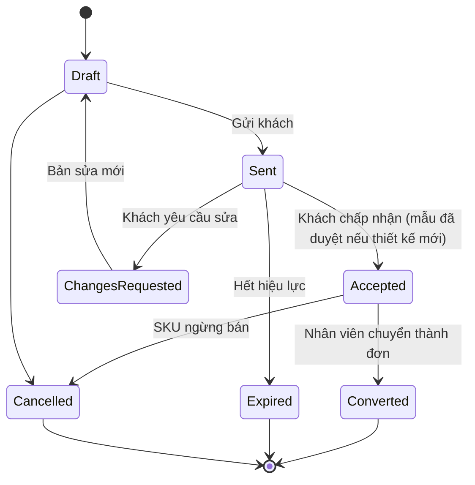
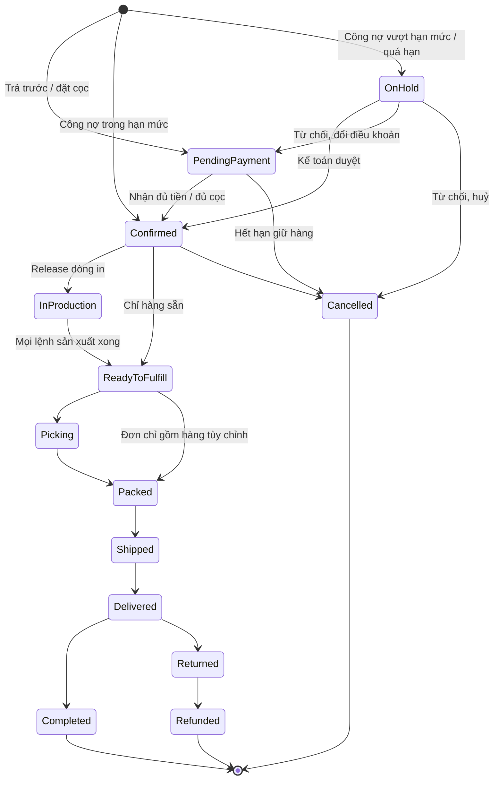

# 14 — Báo giá & Đặt hàng sỉ (Quote & Order)

> Đã chốt 2026-10-06: hệ thống **chỉ bán sỉ (B2B)** cho khách đã liên hệ từ trước. Không có khách vãng lai, giỏ hàng bán lẻ hay voucher. (Tên thư mục `14-cart-and-order` giữ nguyên để không gãy liên kết.)

## 1. Mục đích (Purpose)

- **Báo giá (Quote):** Sale lập đề nghị giá cho khách sỉ. Báo giá gồm: phôi, thiết kế đã xác nhận, bậc giá theo số lượng (bậc thấp nhất = MOQ), hiệu lực, điều khoản thanh toán. Thiết kế mới đi kèm **yêu cầu làm mẫu** ([19](../../warehouse/19-production/README.md)). Khách chấp nhận báo giá trên cổng, rồi **nhân viên chuyển báo giá thành đơn bán**.
- **Đặt hàng (Order):** đơn bán được tạo theo **hai cách**:
  1. **Từ báo giá đã chấp nhận** — Sale hoặc Điều phối chuyển. **Dòng in luôn đi đường này.**
  2. **Khách tự đặt trên cổng** — đặt nhanh **hàng sẵn** theo SKU / số lượng, theo giá riêng của khách.

  Muốn **đặt lại** một đơn cũ có thiết kế: hệ thống tạo **báo giá mới** theo giá hiện hành để Sale xử lý (§4.2).

Order là **chứng từ trung tâm của mảng bán hàng**, được [Order Management](../17-order-management/README.md) theo dõi suốt vòng đời.

---

## 2. Actor liên quan

| Actor | Vai trò |
|-------|---------|
| **Khách hàng sỉ (B2B Customer)** | Xem báo giá; **chấp nhận** (chọn số lượng) hoặc **yêu cầu sửa**. Đặt nhanh hàng sẵn; yêu cầu đặt lại. Chọn địa chỉ giao và điều khoản thanh toán được phép. |
| **Nhân viên Sale (Sales Staff)** | Lập, sửa, gửi báo giá; tạo bản sửa khi khách yêu cầu; huỷ báo giá. Tạo yêu cầu làm mẫu. **Chuyển báo giá đã chấp nhận thành đơn.** |
| **Điều phối đơn hàng (Order Coordinator)** | Xem báo giá; chuyển báo giá đã chấp nhận thành đơn |
| **Kế toán (Accountant)** | Duyệt / từ chối **đơn công nợ bị treo** vì vượt hạn mức hoặc khách quá hạn ([15](../15-payment/README.md) §4.4) |
| **Hệ thống** | Tính giá theo bảng giá riêng của khách, kiểm tồn phôi, kiểm tín dụng, giữ hàng (reservation), tự đánh dấu báo giá hết hiệu lực |
| **Quản trị bán hàng (E-commerce Admin)** | Cấu hình bảng giá theo khách / nhóm khách ([13](../13-catalog/README.md)) |

---

## 3. Input / Output

### Input

| Trường | Mô tả | Bắt buộc |
|--------|-------|----------|
| Khách sỉ | Hồ sơ khách `Active`: điều khoản thanh toán được phép, hạn mức, kỳ hạn, % cọc, chính sách thu phần còn lại, bảng giá riêng ([18](../18-customer-information/README.md)) | Có |
| Dòng báo giá | SKU phôi (đang bán được), thiết kế đã xác nhận nếu là hàng in ([12](../12-product-design/README.md)), **bậc giá** (số lượng tối thiểu ≥ 1, đơn giá VND nguyên dương) | Có |
| Hiệu lực, điều khoản thanh toán, % cọc | % cọc chỉ với báo giá đặt cọc, 0 < % < 100; để trống thì lấy % mặc định của khách | Có |
| Mẫu đã duyệt | Với dòng in có thiết kế mới: mẫu `Approved` ([19](../../warehouse/19-production/README.md)) | Có (thiết kế mới, khi khách chấp nhận) |
| Số lượng khách chấp nhận | Khách chọn số lượng cho từng dòng khi chấp nhận | Có (khi chấp nhận) |
| Dòng đơn tự đặt | SKU hàng sẵn, **đơn vị bán** (ví dụ *thùng*), số lượng | Có (đơn tự đặt) |
| Địa chỉ giao & người nhận | Từ sổ địa chỉ của khách | Có (khi tạo đơn) |
| Điều khoản thanh toán | **Trả trước 100%**, **đặt cọc**, **công nợ** — trong các điều khoản được phép của khách | Có (khi tạo đơn) |

### Output

| Kết quả | Dùng bởi |
|---------|----------|
| **Báo giá** (mã, số bản sửa, dòng, bậc giá, hiệu lực) | Khách, Sale |
| **Yêu cầu làm mẫu** (thiết kế mới) | [19 Production](../../warehouse/19-production/README.md) |
| **Order** (mã đơn, dòng đã chốt giá, địa chỉ, tổng tiền, điều khoản, chính sách thu phần còn lại) | 15 Payment, 17 Order Management |
| **Giữ hàng** (giữ phôi theo SKU) | [20 Inventory Control](../../warehouse/20-inventory-control/README.md) |
| **Hướng dẫn chuyển khoản** hoặc **ghi nhận công nợ** | 15 Payment |
| Thông báo cho Sale (khách chấp nhận / yêu cầu sửa / yêu cầu đặt lại) | Sale |

---

## 4. Luồng nghiệp vụ từng bước (Step-by-step)

### 4.1. Báo giá (Quote)

1. **Tiếp nhận yêu cầu** — khách liên hệ Sale (qua [chat](../16-sales-chat/README.md), điện thoại, hoặc yêu cầu trên cổng): loại ly / bao bì, số lượng, logo / thiết kế.
2. **Lập báo giá** — Sale chọn phôi, gắn thiết kế đã xác nhận ([12](../12-product-design/README.md)), nhập **bậc giá** (mặc định từ bảng giá riêng của khách), hiệu lực, điều khoản thanh toán đề xuất. Báo giá ở `Draft`, **bản sửa số 1**.
3. **Thiết kế mới → làm mẫu** — nếu cặp (thiết kế, phôi) chưa có mẫu được duyệt, Sale tạo **yêu cầu làm mẫu** ([19](../../warehouse/19-production/README.md)) song song.
4. **Gửi báo giá** → `Sent`; khách xem trên cổng. Hệ thống chỉ cho gửi khi:
   - mọi dòng đã có giá;
   - hiệu lực còn ở tương lai;
   - khách `Active`;
   - điều khoản được phép;
   - mọi SKU còn bán được.
5. **Khách phản hồi** (chỉ khách được làm; nhân viên không làm thay):
   - **Chấp nhận** → `Accepted`. Khách chọn **số lượng** từng dòng. Hệ thống kiểm:
     - báo giá còn hiệu lực;
     - khách `Active`, điều khoản được phép;
     - SKU còn bán được;
     - số lượng ≥ MOQ;
     - thiết kế mới đã có **mẫu được khách duyệt**.

     Bậc giá chọn theo **tổng số lượng của phôi đó** trên mọi dòng. Hệ thống báo Sale.
   - **Yêu cầu sửa** → `Changes Requested`. Sale mở lại → `Draft` **bản sửa mới** (số bản sửa +1), rồi gửi lại.
   - Hết hiệu lực mà chưa chấp nhận → `Expired`. Báo giá **được coi là hết hiệu lực ngay khi qua hạn**; hệ thống lưu lại trạng thái này định kỳ.
6. **Chuyển thành đơn** — Sale / Điều phối chuyển báo giá `Accepted` thành đơn bán (§4.3) → `Converted`.
   - Đơn lấy đúng số lượng, giá, điều khoản và % cọc khách đã chấp nhận.
   - Chuyển lại lần nữa thì trả về chính đơn đó, không tạo đơn thứ hai.
7. **Huỷ báo giá:**
   - Báo giá `Draft` huỷ tự do.
   - Báo giá `Accepted` chỉ huỷ được khi có SKU **không còn bán được**, bắt buộc lý do (≤ 500 ký tự).

### 4.2. Khách tự đặt & đặt lại trên cổng

8. **Đặt nhanh hàng sẵn** — từ [catalog](../13-catalog/README.md) trên cổng (giá riêng của khách), theo SKU / số lượng theo **đơn vị bán**. Hệ thống quy về đơn vị cơ sở (ví dụ 3 thùng × 1.000 = 3.000 cái) và kiểm tồn khả dụng.
9. **Dòng in không tự đặt được** — mọi dòng có thiết kế phải đi qua báo giá (§4.1).
10. **Đặt lại** — khách chọn một đơn cũ **có nguồn từ báo giá** → hệ thống tạo **báo giá mới ở `Draft`** và báo Sale:
    - giá theo bảng giá **hiện hành**; dòng không có giá để Sale định giá;
    - hiệu lực bằng độ dài hiệu lực của báo giá cũ, tính từ lúc đặt lại;
    - giữ điều khoản cũ nếu còn được phép, nếu không thì dùng điều khoản mặc định của khách.

    Đơn không có nguồn từ báo giá thì không đặt lại theo cách này.

### 4.3. Tạo đơn (Order)

11. **Kiểm tra cuối** — còn tồn phôi khả dụng? giá còn đúng (báo giá còn hiệu lực / bảng giá hiện hành)? đủ MOQ? SKU còn bán được?
12. **Địa chỉ giao & người nhận** — chọn từ sổ địa chỉ của khách ([18](../18-customer-information/README.md)).
13. **Chốt giá cuối** — subtotal + phí giao + thuế − chiết khấu = **tổng tiền đơn**. Giá dòng hàng được **chốt (price lock)** vào đơn.
14. **Điều khoản thanh toán** — chỉ trong các điều khoản được phép cho khách:
    - **Trả trước 100%** hoặc **đặt cọc** → Order `Pending Payment`, chuyển sang [15 Payment](../15-payment/README.md).
      - Đơn đặt cọc mang **chính sách thu phần còn lại**, copy từ khách, chỉ được siết lại ([15](../15-payment/README.md) BR-10).
      - Phần còn lại `ON_CREDIT` mà khách quá hạn / vượt hạn mức thì **từ chối đặt**.
    - **Công nợ** → hệ thống kiểm tín dụng: không quá hạn và dư nợ + giá trị đơn ≤ hạn mức → Order `Confirmed`. Nếu không → Order `On Hold` (tín dụng) chờ **kế toán** duyệt.
15. **Giữ hàng (Reservation)** — giữ phôi theo SKU cho các dòng (giảm ATP). Với đơn chờ thanh toán, giữ hàng có thời hạn.
16. **Kết quả:**
    - Tiền đủ (trả trước / cọc), hoặc công nợ hợp lệ / được duyệt → Order `Confirmed`; đẩy sang [Order Management](../17-order-management/README.md) để release. Dòng in → [sản xuất](../../warehouse/19-production/README.md), dòng sẵn → [Picking](../../warehouse/07-picking/README.md).
    - Hết hạn giữ hàng mà chưa thanh toán → Order `Cancelled`, giải phóng hàng. Riêng đơn đã bắt đầu in thì chuyển nhân viên quyết ([17](../17-order-management/README.md) §4.5).

> ⚠️ Giả định: ngưỡng hạn mức, kỳ hạn cụ thể cho từng khách do kế toán đặt ([15](../15-payment/README.md) BR-16); bảng giá riêng theo khách có bậc số lượng (D14). Xem [open-questions](../../open-questions/README.md).

---

## 5. Trạng thái / Vòng đời (Lifecycle)

### 5.1. Trạng thái Báo giá (Quote)

| Trạng thái | Ý nghĩa | Chuyển tiếp cho phép | Ai thực hiện |
|------------|---------|----------------------|--------------|
| `Draft` | Sale đang soạn (mỗi lần mở lại là một bản sửa mới) | → `Sent`, → `Cancelled` | Sale |
| `Sent` | Đã gửi khách, đang trong hiệu lực | → `Accepted`, → `Changes Requested`, → `Expired` | Khách / Hệ thống |
| `Changes Requested` | Khách yêu cầu sửa | → `Draft` (bản sửa mới) | Sale |
| `Accepted` | Khách chấp nhận, đã chọn số lượng (thiết kế mới: mẫu đã duyệt) | → `Converted`, → `Cancelled` (chỉ khi SKU không còn bán được) | Khách |
| `Converted` | Đã sinh đơn bán | *(cuối)* | Sale / Điều phối |
| `Expired` | Hết hiệu lực chưa chấp nhận | *(cuối)* | Hệ thống |
| `Cancelled` | Huỷ | *(cuối)* | Sale |

### 5.2. Trạng thái Order (tổng quát — chi tiết ở [17 Order Management](../17-order-management/README.md))

| Trạng thái | Ý nghĩa | Chuyển tiếp | Nguồn |
|------------|---------|-------------|-------|
| `Draft` | Đơn đang tạo | → `Pending Payment`, → `Confirmed`, → `On Hold`, → `Cancelled` | 14 |
| `Pending Payment` | Chờ tiền trả trước / tiền cọc | → `Confirmed`, → `Cancelled` | 15 Payment |
| `On Hold` | Tạm giữ; lúc tạo đơn là đơn công nợ vượt hạn mức / khách quá hạn chờ kế toán | → `Confirmed`, → `Pending Payment` (đổi sang trả trước / đặt cọc), → `Cancelled` | Kế toán |
| `Confirmed` | Đủ điều kiện thanh toán; phôi đã giữ | → `In Production` / `Ready to Fulfill`, → `Cancelled` | Hệ thống |
| `In Production` | Các dòng in đang sản xuất ([19](../../warehouse/19-production/README.md)) | → `Ready to Fulfill` (mọi lệnh sản xuất `Completed`) | 19 Production |
| `Ready to Fulfill` | Sẵn sàng cho kho xử lý | → `Picking` …, → `Packed` (đơn chỉ gồm hàng in) | 07 / 08 |
| `Picking` / `Packed` / `Shipped` / `Delivered` | Theo luồng Fulfillment (sau `Shipped` không theo dõi hành trình — xem 09) | | 07 / 08 / 09 |
| `Completed` | Giao xong, hết hạn đổi / trả, không còn nợ | → `Closed` | 17 Order Management |
| `Cancelled` | Huỷ (trước khi đóng gói) | *(cuối)* | Khách / Sale / Điều phối / Hệ thống |
| `Returned` / `Refunded` | Hoàn hàng / hoàn tiền (chỉ khi lỗi sản xuất) | | 17 / 15 Payment |

---

## 6. Ràng buộc nghiệp vụ (Business Rules) & Edge case

### Business rules

- **BR-01:** Chỉ **tài khoản khách sỉ đang hoạt động** mới được xem giá, nhận báo giá và đặt hàng. Không có guest checkout.
- **BR-02:** Dòng in phải có design snapshot **đã được khách xác nhận** (bất biến từ lúc xác nhận — [12](../12-product-design/README.md) BR-08). Hệ thống kiểm snapshot thuộc đúng khách, đúng sản phẩm của SKU phôi và file còn khớp checksum. Với **thiết kế mới**, báo giá chỉ được chấp nhận khi đã có **mẫu `Approved`** ([19](../../warehouse/19-production/README.md)).
- **BR-03:** Giá dòng hàng được **chốt vào Order** tại thời điểm tạo đơn; thay đổi bảng giá sau đó không ảnh hưởng đơn đã tạo. Báo giá giữ giá trong thời hạn hiệu lực.
- **BR-04:** Số lượng mỗi dòng phải **≥ MOQ** (bậc giá thấp nhất của báo giá / bảng giá). Bậc giá chọn theo **tổng số lượng của phôi** trên mọi dòng của báo giá.
- **BR-05:** Chỉ dùng **điều khoản thanh toán được phép** cho khách đó (trả trước, đặt cọc, công nợ). % cọc chỉ có ở báo giá đặt cọc, 0 < % < 100.
- **BR-06:** Đơn công nợ: khách **không có khoản quá hạn** và **dư nợ + giá trị đơn ≤ hạn mức**. Không đạt → `On Hold` cho tới khi **kế toán** duyệt; kế toán từ chối thì huỷ hoặc đổi sang trả trước / đặt cọc.
- **BR-07:** Giữ hàng có **thời hạn** với đơn chờ trả trước / chờ cọc. Hết hạn mà chưa thanh toán → giải phóng hàng, đơn `Cancelled` (đơn đã in thì chuyển nhân viên quyết).
- **BR-08:** Tổng tiền đơn = subtotal + phí giao + thuế − chiết khấu; mọi khoản phải minh bạch trước khi khách xác nhận.
- **BR-09:** Đơn `Confirmed` chỉ được sửa nội dung (SKU / số lượng / địa chỉ) qua [Order Management](../17-order-management/README.md), theo quy tắc và phê duyệt; không sửa tự do.
- **BR-10:** Sale giảm giá vượt hạn mức được cấp → phải có người có quyền duyệt trước khi gửi báo giá.
- **BR-11:** Số lượng dòng báo giá / đơn nhập theo **đơn vị bán** được phép của biến thể và phải là số nguyên. Reservation, allocation và lệnh sản xuất dùng số lượng đã quy về **đơn vị cơ sở**. Đơn vị bán và hệ số được chốt vào dòng đơn cùng giá (BR-03). ⚠️ Giả định — xem [open-questions](../../open-questions/README.md).
- **BR-12:** **Dòng có thiết kế chỉ vào đơn qua báo giá**; khách không tự đặt dòng in trên cổng.
- **BR-13:** **Chỉ khách** chấp nhận hoặc yêu cầu sửa báo giá. **Chỉ nhân viên** (Sale / Điều phối) chuyển báo giá thành đơn. Chuyển lại lần nữa trả về cùng một đơn.
- **BR-14:** Mọi thao tác trên báo giá gửi kèm **số phiên bản** người dùng đang xem. Ai đó đã đổi trước thì thao tác bị từ chối. Mỗi lần mở lại sau yêu cầu sửa là một **bản sửa** mới.
- **BR-15:** SKU phải **còn bán được** ở mọi bước: lập, sửa, gửi, chấp nhận, chuyển thành đơn. Hệ thống chỉ rõ từng dòng không đạt.

### Edge case

| Tình huống | Hướng xử lý |
|------------|-------------|
| Hết phôi khả dụng lúc tạo đơn | Chặn; báo dòng thiếu; Sale đề xuất giảm số lượng, đổi phôi, hoặc hẹn ngày khi có hàng (PO) |
| Khách chấp nhận báo giá khi mẫu chưa duyệt | Chặn chấp nhận; nhắc khách duyệt mẫu trước |
| Báo giá hết hiệu lực rồi khách mới đồng ý | Sale lập báo giá mới theo giá hiện hành |
| SKU ngừng bán sau khi khách đã chấp nhận | Không chuyển thành đơn được; Sale huỷ báo giá (ghi lý do) và báo giá lại phôi thay thế |
| Bảng giá thay đổi giữa lúc xem và lúc đặt (đơn tự đặt) | Hiển thị chênh lệch, yêu cầu khách xác nhận giá mới trước khi tạo đơn |
| Khách đặt dưới MOQ | Chặn dòng; hiển thị MOQ |
| Khách muốn đặt lại đơn có thiết kế | "Đặt lại" tạo báo giá mới theo giá hiện hành; Sale xử lý như báo giá thường |
| Đơn công nợ vượt hạn mức / khách quá hạn | `On Hold`; kế toán duyệt, hoặc từ chối và chuyển trả trước / đặt cọc |
| Đơn hỗn hợp: hàng sẵn + hàng in | Hàng sẵn pick song song trong lúc in, chờ tại khu đóng gói; giao trước chỉ khi Sale cho phép giao một phần ([17](../17-order-management/README.md) §4.2) |
| Trùng đơn (đặt lại 2 lần) | Huỷ một đơn với lý do `DUPLICATE_ORDER` ([17](../17-order-management/README.md)) |

---

## 7. Liên kết với các module khác

| Module | Quan hệ |
|--------|---------|
| [13 · Catalog](../13-catalog/README.md) | Sản phẩm, giá riêng theo khách & đơn vị bán, tình trạng còn hàng trên cổng khách hàng |
| [01 · Product Creation](../../warehouse/01-product-creation/README.md) | Đơn vị bán & hệ số quy đổi dùng để quy số lượng dòng đơn về đơn vị cơ sở |
| [12 · Product Design](../12-product-design/README.md) | Dòng in mang design snapshot đã xác nhận |
| [19 · Production](../../warehouse/19-production/README.md) | Yêu cầu làm mẫu cho thiết kế mới; mẫu `Approved` là điều kiện chấp nhận báo giá; dòng in sinh lệnh sản xuất khi release |
| [15 · Payment](../15-payment/README.md) | Điều khoản, chính sách thu phần còn lại, kiểm tín dụng; tiền đủ → `Confirmed` |
| [17 · Order Management](../17-order-management/README.md) | Theo dõi & thao tác đơn suốt vòng đời; release sang sản xuất / kho; huỷ đơn |
| [20 · Inventory Control](../../warehouse/20-inventory-control/README.md) | Giữ hàng theo SKU khi đặt; phân bổ bin / lô khi release |
| [16 · Sales Chat](../16-sales-chat/README.md) | Kênh trao đổi báo giá, mẫu, đơn với khách |
| [18 · Customer Information](../18-customer-information/README.md) | Hồ sơ khách sỉ: sổ địa chỉ, điều khoản thanh toán, hạn mức, bảng giá riêng |
