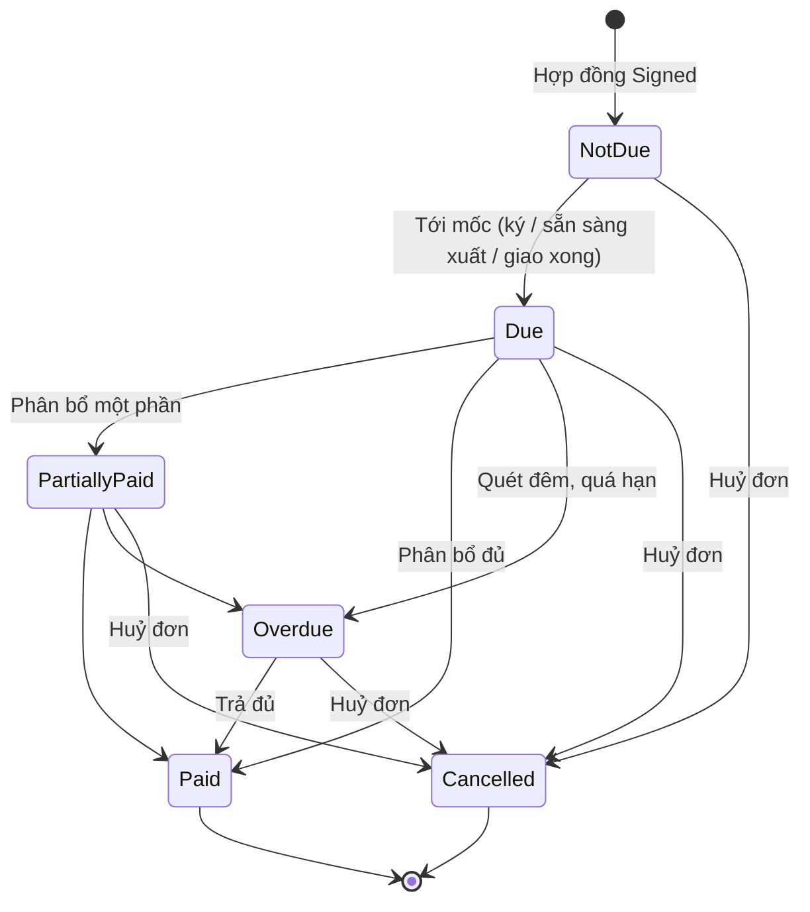
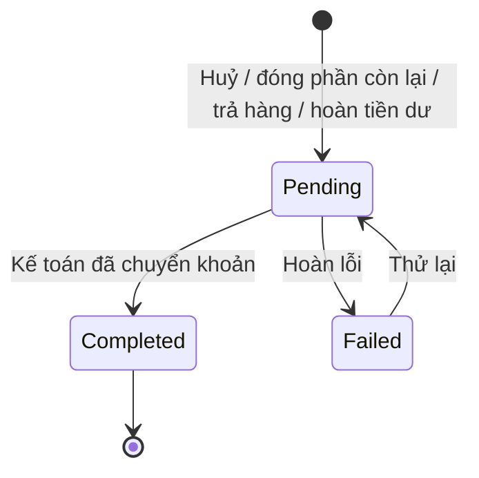

# 15 — Thanh toán theo hợp đồng & Công nợ (Contract Payment & Receivables)

> Đã chốt 2026-10-06: hệ thống **chỉ bán sỉ (B2B)**. Khách thanh toán bằng **chuyển khoản**. Không có cổng thanh toán online (thẻ / ví / QR), không có COD, và không có trạng thái "thanh toán thất bại" (chuyển khoản không có lỗi để báo về).
>
> Đã chốt 2026-11-04: khách thanh toán theo **lịch thanh toán của Hợp đồng mua bán** ([14](../14-cart-and-order/README.md)) — mỗi hợp đồng gồm một hoặc nhiều **đợt thanh toán (Payment Installment)**. Tiền vào được phân bổ cho **đợt thanh toán**, không còn điều khoản thanh toán chọn theo đơn.
>
> Đã chốt 2026-11-05: **phí khuôn / bản in** (cho mẫu mới — lần sản xuất đầu của SKU riêng) là **một dòng phí trên báo giá và hợp đồng** ([14](../14-cart-and-order/README.md)); nằm trong tổng giá trị hợp đồng nên **thu theo các đợt thanh toán như hàng hoá**, không có khoản thu riêng. Treo / gỡ treo đơn do **Nhân viên Sale** làm ([17](../17-order-management/README.md)); treo do tín dụng vẫn do Kế toán duyệt.

## 1. Mục đích (Purpose)

Ghi nhận **tiền khách chuyển khoản** vào một **sổ tiền vào (transfer ledger)** và phân bổ tiền đó cho **các đợt thanh toán của hợp đồng**. Ngoài ra module:

- theo dõi **trạng thái từng đợt** (chưa đến hạn, đến hạn, trả một phần, đã trả, quá hạn);
- theo dõi **công nợ phải thu** — các đợt trả sau giao (`AFTER_DELIVERY`) có kỳ hạn và khoản phí huỷ — cùng **hạn mức công nợ** của khách để cảnh báo / treo đơn;
- xử lý các luồng ngược: **đảo phân bổ** khi phân bổ sai, **hoàn tiền**.

Payment quyết định các mốc tiền của đơn:

- Đợt `ON_SIGNING` thu đủ → đơn `Pending Payment` tự chuyển `Confirmed` ([14](../14-cart-and-order/README.md)).
- Đợt `BEFORE_DELIVERY` chưa thu đủ → **chặn bàn giao vận chuyển** ([09](../../warehouse/09-shipping/README.md)).
- Đơn hoàn tất và mọi đợt thu đủ → hợp đồng `Completed`.

---

## 2. Actor liên quan

| Actor | Vai trò |
|-------|---------|
| **Khách hàng sỉ** | Chuyển khoản theo **thông tin chuyển khoản của từng đợt** trên cổng hoặc thẻ trong chat (tài khoản nhận, số tiền còn phải trả, nội dung = mã hợp đồng + mã đợt). Xem các đợt, công nợ của mình và vị thế tín dụng. |
| **Kế toán (Accountant)** | Ghi nhận tiền về theo sao kê, phân bổ, đảo phân bổ, hoàn tiền. **Duyệt / từ chối đơn treo vì tín dụng** (§4.3). Duyệt hạn mức và kỳ hạn công nợ của khách ([18](../18-customer-information/README.md)). |
| **Nhân viên Sale (Sales Staff)** | Gửi thông tin chuyển khoản theo đợt và **nhắc công nợ** cho khách qua [chat](../16-sales-chat/README.md). Xem công nợ của khách và tình trạng các đợt của đơn. Treo tay đơn khi khách quá hạn; gỡ treo đơn lý do thanh toán khi tiền đã đủ trở lại ([17](../17-order-management/README.md)). |
| **Hệ thống** | Sinh đợt khi hợp đồng `Signed`; chuyển đợt sang `Due` theo mốc; tự dùng tiền dư trả đợt vừa đến hạn; đánh dấu quá hạn mỗi đêm; tự xác nhận đơn khi đủ đợt `ON_SIGNING`; chặn bàn giao khi đợt `BEFORE_DELIVERY` chưa đủ; hoàn tất hợp đồng. |

---

## 3. Input / Output

### Input

| Trường | Mô tả | Bắt buộc |
|--------|-------|----------|
| **Khoản tiền về** | Khách, **mã tham chiếu sao kê** (≤ 100 ký tự, duy nhất), số tiền > 0, tiền tệ (VND), ngày nhận (không ở tương lai), ghi chú | Có |
| Chỉ định phân bổ | Các đợt thanh toán và / hoặc khoản phí huỷ được trả, mỗi mục một số tiền. Không chỉ định → trả mục đến hạn sớm nhất. | Không |
| **Lịch thanh toán của hợp đồng** | Các đợt (số tiền, mốc `ON_SIGNING` / `BEFORE_DELIVERY` / `AFTER_DELIVERY`, N ngày) — nhận từ [14](../14-cart-and-order/README.md) khi hợp đồng `Signed`. Số tiền các đợt chia từ **tổng giá trị hợp đồng** = dòng hàng + dòng phí khuôn / bản in (nếu có) | Có |
| Hạn mức & kỳ hạn công nợ của khách | Hạn mức (≥ 0), kỳ hạn mặc định (0–365 ngày) — [18](../18-customer-information/README.md) | Có |
| Sự kiện đơn hàng | Đơn sẵn sàng xuất, ngày giao xong, huỷ đơn, đóng phần còn lại ([17](../17-order-management/README.md), [09](../../warehouse/09-shipping/README.md)) | Có |
| Yêu cầu đảo phân bổ | Phân bổ cần đảo + lý do (≤ 500); có treo đơn hay không | Khi đảo |
| Yêu cầu hoàn tiền dư | Số tiền ≤ tiền dư chưa phân bổ + lý do | Khi hoàn |

### Output

| Kết quả | Dùng bởi |
|---------|----------|
| **Khoản tiền về** + các **dòng phân bổ** / **dòng đảo** (chỉ thêm, không sửa) | Kế toán, đối soát |
| **Tiền dư của khách (credit)** = phần chưa phân bổ | Tự trả đợt vừa đến hạn; hoàn khi khách yêu cầu |
| **Trạng thái các đợt thanh toán** (§5.1) và trạng thái thanh toán của đơn (§5.2) | 14, 17, khách |
| **Thông tin chuyển khoản theo đợt** (tài khoản nhận, số tiền đợt, nội dung = mã hợp đồng + mã đợt) | Cổng khách hàng; thẻ trong [16 Sales Chat](../16-sales-chat/README.md) |
| Tín hiệu **đủ đợt `ON_SIGNING`** (xác nhận đơn) và **đủ đợt `BEFORE_DELIVERY`** (mở chặn bàn giao) | 14, 17, 09 |
| **Công nợ phải thu** và **vị thế tín dụng** của khách: dư nợ, hạn mức còn lại, quá hạn | Kế toán, Sale, 14 (gửi / ký hợp đồng), khách |
| **Lệnh hoàn tiền** (`Pending`) | Kế toán |

---

## 4. Luồng nghiệp vụ từng bước (Step-by-step)

### 4.1. Sinh đợt & đến hạn

1. **Sinh đợt** — khi hợp đồng `Signed` ([14](../14-cart-and-order/README.md)), hệ thống tạo các **đợt thanh toán** theo lịch, tất cả ở `Not Due`.
2. **Đến hạn (`Due`)** theo mốc:

   | Mốc | Chuyển `Due` khi | Hạn trả (để tính quá hạn) |
   |-----|------------------|---------------------------|
   | `ON_SIGNING` | Hợp đồng `Signed` | Ngày ký + N ngày |
   | `BEFORE_DELIVERY` | Đơn `Ready to Fulfill` (hàng đã đủ, chuẩn bị xuất) | Không có ngày hạn; chặn bàn giao tới khi trả đủ |
   | `AFTER_DELIVERY` | Đơn giao thành công (`Delivered`) | Ngày giao thành công + N ngày (mặc định = kỳ hạn công nợ của khách) |

   > ⚠️ Giả định: đợt `BEFORE_DELIVERY` đến hạn khi đơn `Ready to Fulfill` và không có ngày quá hạn; với đơn giao nhiều lần, đợt `BEFORE_DELIVERY` phải trả đủ trước **lần bàn giao đầu tiên**, đợt `AFTER_DELIVERY` tính từ **lần giao cuối cùng** (hoặc ngày đóng phần còn lại). Xem [open-questions](../../open-questions/README.md).
3. Mỗi khi một đợt chuyển `Due`, hệ thống **tự lấy tiền dư** của khách trả đợt đó (§4.2 bước 6).
4. **Quét quá hạn** — **mỗi đêm 00:15**, đợt `Due` / `Partially Paid` đã qua hạn trả mà chưa trả đủ → `Overdue`.

### 4.2. Ghi nhận tiền về & phân bổ

5. Khách chuyển khoản theo **thông tin chuyển khoản** của đợt — hiển thị trên cổng, và là dữ liệu cho **thẻ "thông tin chuyển khoản theo đợt"** Sale gửi trong [chat](../16-sales-chat/README.md):
   - **tài khoản nhận** của doanh nghiệp (cấu hình sẵn trong hệ thống);
   - **số tiền** còn phải trả của đợt;
   - **nội dung chuyển khoản** = mã hợp đồng + mã đợt.

   Kế toán đối chiếu sao kê, **ghi nhận khoản tiền về**:
   - Một mã tham chiếu sao kê chỉ ghi một lần (BR-03).
   - Số tiền của khoản không bao giờ đổi.
6. Phân bổ ngay khi ghi nhận, theo thứ tự:
   - **(a)** các **đợt được chỉ định**, mỗi đợt đúng số tiền ghi;
   - **(b)** các **khoản phí huỷ được chỉ định**;
   - **(c)** không chỉ định gì → các đợt / khoản phí huỷ **đã đến hạn** của khách (`Due`, `Partially Paid`, `Overdue`), **hạn trả sớm nhất trước** (BR-06).

   Phần còn lại là **tiền dư của khách**.
7. Chỉ phân bổ được cho đợt đã đến hạn; tiền khách **trả sớm** cho đợt `Not Due` nằm ở tiền dư và **tự phân bổ khi đợt đó chuyển `Due`**. Không phân bổ cho đợt `Paid` / `Cancelled`, không vượt số còn phải thu của đợt.
8. **Kết quả phân bổ:**
   - Đợt trả một phần → `Partially Paid`; trả đủ → `Paid`.
   - Mọi đợt `ON_SIGNING` của hợp đồng `Paid` → đơn `Pending Payment` tự chuyển `Confirmed`.
   - Mọi đợt `BEFORE_DELIVERY` `Paid` → mở chặn bàn giao ([09](../../warehouse/09-shipping/README.md)).
   - Đơn đã hoàn tất và mọi đợt `Paid` → hợp đồng `Completed` ([14](../14-cart-and-order/README.md)).

### 4.3. Công nợ phải thu & hạn mức

9. **Công nợ phải thu** của khách gồm các đợt `AFTER_DELIVERY` đã đến hạn chưa trả đủ và các khoản phí huỷ chưa trả. Khách xem trên cổng; Sale nhắc qua chat.
10. **Kiểm tín dụng** trên phần trả sau giao (BR-10):
    - Khách có đợt / khoản **quá hạn** → `OVERDUE`.
    - Dư nợ + tổng các đợt `AFTER_DELIVERY` của hợp đồng mới > hạn mức → `OVER_LIMIT`.
    - Còn lại → `WITHIN_LIMIT`.

    Kiểm **hai lần**: lúc Sale **gửi hợp đồng** (chỉ cảnh báo) và lúc hợp đồng **`Signed`** (`OVERDUE` / `OVER_LIMIT` → đơn **`On Hold` lý do tín dụng**). Hợp đồng không có đợt `AFTER_DELIVERY` thì không kiểm.
11. **Đơn treo vì tín dụng** — kế toán quyết định:
    - **Duyệt** (bắt buộc ghi chú) → đơn tiếp tục: `Pending Payment` nếu còn đợt `ON_SIGNING` chưa đủ, nếu không thì `Confirmed`.
    - **Từ chối** (bắt buộc ghi chú) → đơn bị huỷ với lý do `CREDIT_REJECTED`; tiền đã thu (nếu có) được hoàn (§4.5).

    Mọi kết quả kiểm và quyết định được ghi lịch sử: `WITHIN_LIMIT` / `OVER_LIMIT` / `OVERDUE` / `APPROVED` / `REJECTED`.
12. **Khách phát sinh quá hạn sau khi đơn đã xác nhận** — hệ thống cảnh báo Sale; Sale có thể treo tay các đơn đang chạy của khách ([17](../17-order-management/README.md) §4.9).

### 4.4. Đảo phân bổ

13. Phân bổ sai (nhầm khách, nhầm đợt) → kế toán **đảo phân bổ**, bắt buộc lý do. Hệ thống:
    - thêm **một dòng đảo** (không sửa dòng cũ);
    - trả tiền về thành tiền dư của khách;
    - tính lại trạng thái đợt (`Paid` → `Partially Paid` / `Due` / `Overdue`).
14. Không đảo được khi:
    - đã đảo rồi;
    - đã yêu cầu hoàn số tiền đó;
    - đơn đã `Cancelled` / `Completed` / `Closed` / đang trả hàng / đã hoàn tiền.
15. Đảo làm một đơn đã `Confirmed` **không còn đủ đợt `ON_SIGNING`** thì:
    - kế toán phải chọn **treo đơn**, nếu không thao tác bị từ chối;
    - đơn → `On Hold` lý do **thanh toán**;
    - Sale chỉ gỡ treo được khi tiền đã đủ lại ([17](../17-order-management/README.md)).

    Đảo làm đợt `BEFORE_DELIVERY` thiếu tiền (khi chưa bàn giao) → bàn giao lại bị chặn tự động.

### 4.5. Hoàn tiền

16. Hệ thống tạo **lệnh hoàn tiền** `Pending` khi:
    - **huỷ đơn / đóng phần còn lại**: tiền đã thu vượt phần phải giữ (giá trị hàng đã giao + phí huỷ) — xem [17](../17-order-management/README.md) §4.8;
    - **trả hàng** được duyệt hoàn tiền ([17](../17-order-management/README.md) §4.10);
    - **khách yêu cầu hoàn tiền dư**: kế toán tạo, số tiền ≤ tiền dư, bắt buộc lý do.
17. Kế toán chuyển khoản hoàn cho khách. Lệnh hoàn kết thúc ở `Completed` hoặc `Failed`. Lệnh hoàn tiền dư `Failed` thì tiền quay lại thành tiền dư.

> ⚠️ Giả định: hệ thống hiện chỉ **tạo** lệnh hoàn `Pending`; bước kế toán đánh dấu đã hoàn (`Completed`) hoặc hoàn lỗi (`Failed`) chưa có màn hình. Việc chuyển khoản hoàn làm ngoài hệ thống. Xem [open-questions D15](../../open-questions/README.md).

### 4.6. Huỷ đơn, đóng phần còn lại & phí huỷ

18. **Huỷ đơn** ([17](../17-order-management/README.md) §4.8):
    - Các đợt chưa `Paid` của đơn → `Cancelled`.
    - Toàn bộ tiền đã phân bổ cho các đợt của đơn **trả phí huỷ trước** (nếu có phí).
    - Phần thừa → lệnh hoàn tiền. Phần phí còn thiếu → **khoản phí huỷ**, đến hạn ngay ngày huỷ, do khách trả (vòng đời như đợt, bắt đầu từ `Due`).
19. **Đóng phần còn lại** của đơn giao một phần: hệ thống **giảm số còn phải thu** của các đợt chưa trả đủ theo giá trị phần bị đóng (= số thùng bị đóng × số cái / thùng × đơn giá / cái — [14](../14-cart-and-order/README.md) BR-08; đợt muộn nhất trước — `AFTER_DELIVERY` trước), để khách không bao giờ trả nhiều hơn giá trị hàng đã nhận cộng phí (nếu có).

    > ⚠️ Giả định: **dòng phí khuôn / bản in** không thuộc "phần bị đóng" — đóng phần còn lại chỉ giảm theo giá trị hàng chưa giao, phí khuôn / bản in vẫn phải thu đủ (khuôn / bản in đã làm). Xem [open-questions](../../open-questions/README.md).

    > ⚠️ Giả định: giảm số phải thu khi đóng phần còn lại được hệ thống tự điều chỉnh trên các đợt, còn phụ lục / thanh lý hợp đồng tương ứng làm ngoài hệ thống; đợt chưa trả của đơn huỷ chuyển trạng thái `Cancelled` (bổ sung ngoài danh sách trạng thái đợt đã chốt). Xem [open-questions](../../open-questions/README.md).

---

## 5. Trạng thái / Vòng đời (Lifecycle)

### 5.1. Đợt thanh toán (Payment Installment)

| Trạng thái | Ý nghĩa | Chuyển tiếp cho phép | Ai thực hiện |
|------------|---------|----------------------|--------------|
| `Not Due` | Đã sinh khi hợp đồng `Signed`, chưa tới mốc | → `Due`, → `Cancelled` | Hệ thống |
| `Due` | Đã tới mốc, chờ khách trả (với `AFTER_DELIVERY`: là công nợ phải thu có kỳ hạn) | → `Partially Paid`, → `Paid`, → `Overdue`, → `Cancelled` | Hệ thống (phân bổ, quét đêm) |
| `Partially Paid` | Đã trả một phần | → `Paid`, → `Overdue`, → `Cancelled` | Hệ thống |
| `Overdue` | Quá hạn trả, chưa trả đủ; giữ `Overdue` cho tới khi trả đủ | → `Paid`, → `Cancelled` | Hệ thống |
| `Paid` | Đã trả đủ | *(cuối)* — đảo phân bổ tính lại trạng thái | Hệ thống |
| `Cancelled` ⚠️ | Đơn bị huỷ; đợt không còn phải thu (tiền đã thu xử lý theo §4.6) | *(cuối)* | Hệ thống (khi huỷ đơn) |

> **Khoản phí huỷ** dùng cùng vòng đời, bắt đầu từ `Due` (đến hạn ngay ngày huỷ / ngày đóng phần còn lại).

### 5.2. Trạng thái thanh toán của đơn

Trạng thái thanh toán **tính ra từ các đợt** (bỏ qua đợt `Cancelled`), không lưu riêng.

| Trạng thái | Ý nghĩa |
|------------|---------|
| `Unpaid` | Chưa thu gì |
| `Partially Paid` | Đã thu một phần tổng các đợt |
| `Paid` | Mọi đợt đã `Paid` |

> Hoàn tiền là **trạng thái của đơn** (`Refunded` / `Partially Refunded` — [17](../17-order-management/README.md)), không phải trạng thái thanh toán.

### 5.3. Lệnh hoàn tiền (Refund)

| Trạng thái | Ý nghĩa | Chuyển tiếp cho phép | Ai thực hiện |
|------------|---------|----------------------|--------------|
| `Pending` | Chờ kế toán chuyển khoản hoàn | → `Completed`, → `Failed` | Hệ thống tạo; kế toán |
| `Completed` | Đã hoàn | *(cuối)* | Kế toán |
| `Failed` | Hoàn không thành công; tiền dư trả lại cho khách | → `Pending` (thử lại) | Kế toán |

---

## 6. Ràng buộc nghiệp vụ (Business Rules) & Edge case

### Business rules

- **BR-01:** Khách chỉ thanh toán **theo lịch thanh toán của hợp đồng `Signed`**, bằng chuyển khoản. Không có điều khoản thanh toán theo đơn ngoài hợp đồng.
- **BR-02:** Tiền chỉ được ghi nhận khi kế toán **đối chiếu sao kê**; không ghi nhận theo lời khách báo.
- **BR-03:** Một **mã tham chiếu sao kê** chỉ ghi nhận **một lần**.
- **BR-04:** Sổ tiền **chỉ thêm**: khoản tiền về không đổi số tiền. Sửa sai bằng dòng đảo, không sửa dòng cũ. Số tiền khoản = tổng phân bổ ròng + đã hoàn + chưa phân bổ.
- **BR-05:** Chỉ phân bổ cho đợt **đã đến hạn** (`Due` / `Partially Paid` / `Overdue`) hoặc khoản phí huỷ, không vượt số còn phải thu. Tiền trả sớm nằm ở tiền dư và tự phân bổ khi đợt chuyển `Due`.
- **BR-06:** Tiền không chỉ định phân bổ vào **mục có hạn trả sớm nhất trước**.
- **BR-07:** Đơn chỉ `Confirmed` khi **mọi đợt `ON_SIGNING`** đã `Paid` (cùng các điều kiện ở [14](../14-cart-and-order/README.md) BR-15).
- **BR-08:** Còn đợt `BEFORE_DELIVERY` chưa `Paid` → **chặn bàn giao** cho đơn vị vận chuyển, với cả gửi kiện và giao nguyên chuyến.
- **BR-09:** Đợt `AFTER_DELIVERY` là **công nợ phải thu**: hạn trả = ngày giao + N ngày; quá hạn chưa trả đủ → `Overdue` (quét mỗi đêm), giữ `Overdue` tới khi trả đủ.
- **BR-10:** **Dư nợ (exposure)** = phần chưa thu của mọi đợt `AFTER_DELIVERY` thuộc các hợp đồng `Signed` (kể cả `Not Due`) + khoản phí huỷ chưa trả. **Hạn mức còn lại** = hạn mức − dư nợ, không âm.
- **BR-11:** Kiểm tín dụng lúc **gửi hợp đồng** chỉ cảnh báo; lúc **ký** thì `OVERDUE` / `OVER_LIMIT` → đơn `On Hold` lý do tín dụng. Chỉ **kế toán** duyệt / từ chối, bắt buộc ghi chú, ghi lịch sử.
- **BR-12:** Hạn mức và kỳ hạn công nợ do **kế toán duyệt** (ghi người và thời điểm — [18](../18-customer-information/README.md)). Hợp đồng đã ký giữ lịch thanh toán của nó dù hạn mức / kỳ hạn của khách đổi sau đó.
- **BR-13:** Đảo phân bổ làm đơn đã xác nhận thiếu đợt `ON_SIGNING` → bắt buộc **treo đơn** (lý do thanh toán); không âm thầm đưa đơn về chưa thanh toán.
- **BR-14:** Hoàn tiền không vượt số tiền đã thu. Hoàn tiền dư không vượt tiền dư chưa phân bổ.
- **BR-15:** Huỷ đơn: tiền đã thu **trả phí huỷ trước**, phần thừa hoàn, phần thiếu thành khoản phí huỷ; đợt chưa trả đủ → `Cancelled`.
- **BR-16:** Đóng phần còn lại **không bao giờ khiến khách trả nhiều hơn** giá trị hàng đã nhận cộng phí (phí huỷ, phí khuôn / bản in — nếu có).
- **BR-17:** **Phí khuôn / bản in** là một dòng phí của hợp đồng ([14](../14-cart-and-order/README.md)), tính vào tổng giá trị hợp đồng và **thu theo các đợt** như hàng hoá; không sinh đợt hay khoản thu riêng. Phí phát sinh khi số vòng in mẫu vượt số lần miễn phí ([17](../17-order-management/README.md)) **không** được ghi nhận trong module này (xử lý bằng phụ lục ngoài hệ thống — phạm vi sau).

### Edge case

| Tình huống | Hướng xử lý |
|------------|-------------|
| Khách chuyển thiếu so với đợt | Ghi nhận và phân bổ phần đã nhận; đợt `Partially Paid`; Sale nhắc khách chuyển nốt qua chat |
| Khách chuyển thừa | Phần thừa thành tiền dư: tự trả đợt đến hạn tiếp theo, hoặc hoàn theo yêu cầu |
| Khách trả sớm đợt chưa đến hạn | Tiền nằm ở tiền dư; tự phân bổ khi đợt chuyển `Due` |
| Nội dung chuyển khoản sai / thiếu mã hợp đồng | Kế toán ghi nhận không chỉ định → trả đợt đến hạn sớm nhất hoặc để làm tiền dư; phân bổ lại sau khi xác nhận với khách |
| Ghi nhận trùng một dòng sao kê | Từ chối (BR-03) |
| Phân bổ nhầm sang khách / đợt khác | Đảo phân bổ (§4.4), rồi phân bổ lại |
| Tiền về sau khi đơn đã huỷ | Không phân bổ được cho đợt `Cancelled`; tiền nằm ở tiền dư; hỏi khách: dùng cho đơn sau hoặc hoàn |
| Khách đang quá hạn ký hợp đồng mới có đợt trả sau | Đơn `On Hold` lý do tín dụng khi ký; kế toán duyệt hoặc từ chối (huỷ đơn) |
| Đơn đã `Packed` (đã kiểm đủ thùng & dán nhãn giao hàng) nhưng đợt `BEFORE_DELIVERY` chưa trả | Chặn bàn giao; hàng chờ tại kho (khu xuất hàng `DISPATCH`); Sale nhắc khách |
| Khách huỷ đơn trước khi gửi Đơn sản xuất | Hoàn toàn bộ tiền đã thu, không phí ([17](../17-order-management/README.md) BR-11) |
| Khách huỷ đơn khi đơn vị sản xuất đã làm hàng theo mẫu (Đơn sản xuất đã `In Production`) | Nhân viên huỷ có phí: tiền đã thu trả phí trước, phần thừa hoàn, phần thiếu thành khoản phí huỷ |
| Hợp đồng có dòng phí khuôn / bản in | Dòng phí nằm trong tổng giá trị hợp đồng; các đợt chia theo % tổng đó, thu như hàng hoá (BR-17) |
| Số vòng in mẫu vượt số lần miễn phí | Sale nhận cảnh báo ở [17](../17-order-management/README.md); không sinh khoản thu trong 15; phí phát sinh làm phụ lục ngoài hệ thống (BR-17) |
| Hàng lỗi sản xuất phát hiện sau giao | Đổi hàng hoặc hoàn một phần qua luồng trả hàng ([17](../17-order-management/README.md) §4.10) |

---

## 7. Liên kết với các module khác

| Module | Quan hệ |
|--------|---------|
| [14 · Quote, Order & Contract](../14-cart-and-order/README.md) | Hợp đồng `Signed` sinh các đợt (chia từ tổng giá trị gồm cả dòng phí khuôn / bản in); đủ đợt `ON_SIGNING` → đơn `Confirmed`; mọi đợt `Paid` → hợp đồng `Completed`; kiểm tín dụng lúc gửi / ký |
| [17 · Order Management](../17-order-management/README.md) | Treo / duyệt đơn tín dụng; Sale treo / gỡ treo lý do thanh toán; mốc `Ready to Fulfill` / `Delivered` làm đợt đến hạn; phí huỷ và tiền hoàn khi huỷ / đóng phần còn lại / trả hàng |
| [09 · Shipping](../../warehouse/09-shipping/README.md) | Chặn bàn giao khi đợt `BEFORE_DELIVERY` chưa thu đủ; ngày giao xong làm đợt `AFTER_DELIVERY` đến hạn |
| [16 · Sales Chat](../16-sales-chat/README.md) | Sale gửi thông tin chuyển khoản theo đợt, nhắc công nợ |
| [18 · Customer Information](../18-customer-information/README.md) | Hạn mức, kỳ hạn công nợ, lịch thanh toán mặc định; vị thế tín dụng hiển thị cho khách |
| Kế toán / Ngân hàng (ngoài hệ thống) | Đối soát sao kê; chuyển khoản hoàn |
