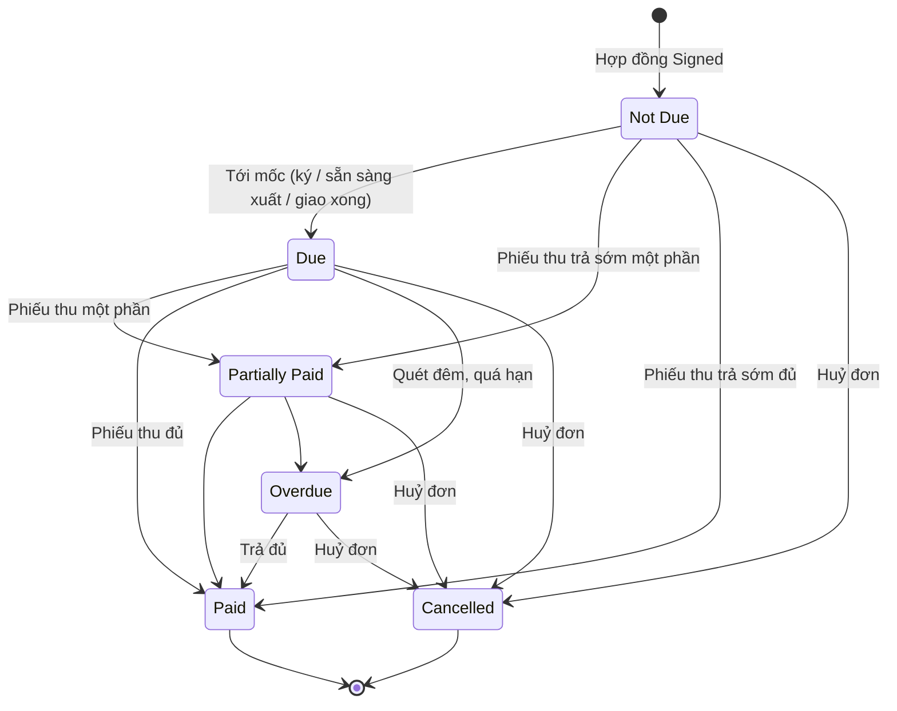
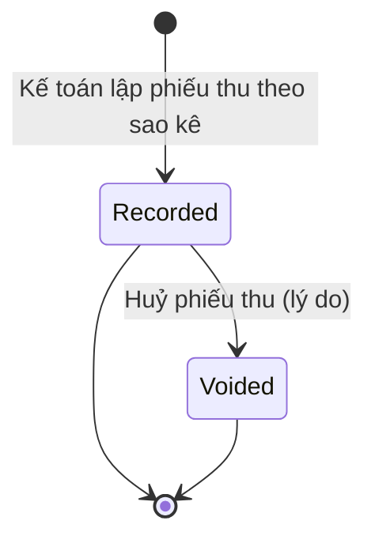

# 15 — Thanh toán theo hợp đồng & Công nợ (Contract Payment & Receivables)

> Đã chốt 2026-10-06: hệ thống **chỉ bán sỉ (B2B)**. Khách thanh toán bằng **chuyển khoản**. Không có cổng thanh toán online (thẻ / ví / QR), không có COD, và không có trạng thái "thanh toán thất bại" (chuyển khoản không có lỗi để báo về).
>
> Đã chốt 2026-11-04: khách thanh toán theo **lịch thanh toán của Hợp đồng mua bán** ([14](../14-cart-and-order/README.md)) — mỗi hợp đồng gồm một hoặc nhiều **đợt thanh toán (Payment Installment)**. Tiền khách trả được ghi nhận **theo đợt thanh toán**, không còn điều khoản thanh toán chọn theo đơn.
>
> Đã chốt 2026-11-05: **phí khuôn / bản in** (cho mẫu mới — lần sản xuất đầu của SKU riêng) là **một dòng phí trên báo giá và hợp đồng** ([14](../14-cart-and-order/README.md)); nằm trong tổng giá trị hợp đồng nên **thu theo các đợt thanh toán như hàng hoá**, không có khoản thu riêng. Treo / gỡ treo đơn do **Nhân viên Sale** làm ([17](../17-order-management/README.md)); treo do tín dụng vẫn do Kế toán duyệt.
>
> ✅ Đã chốt 2026-11-05 (phí vận chuyển & thuế): **phí vận chuyển** cũng là **một dòng phí của hợp đồng** do Sale nhập ([14](../14-cart-and-order/README.md) BR-20) và thu theo các đợt như hàng hoá. Hợp đồng ghi **thuế VAT từng dòng** và **tổng có thuế** ([14](../14-cart-and-order/README.md) BR-21); **các đợt thanh toán chia trên tổng có thuế**. *(Cập nhật 2026-11-06)* **Hoá đơn điện tử (VAT e-invoice)** do hệ thống phát hành qua **API của nhà cung cấp hoá đơn điện tử** ở module [21](../21-e-invoice/README.md), **theo từng lần giao thành công**, không theo đợt thanh toán; hoá đơn không ảnh hưởng các đợt và công nợ ở đây (BR-18, BR-19).
>
> ✅ Đã chốt 2026-11-06 (rút gọn phạm vi): module chỉ giữ phần **điều khiển đơn và kho** — lịch đợt & trạng thái đợt, công nợ & hạn mức, các cổng chặn. Thay **sổ tiền vào + phân bổ + tiền dư + đảo phân bổ** bằng **phiếu thu theo đợt** (huỷ phiếu thu khi ghi sai); thay **vòng đời lệnh hoàn tiền** bằng **số tiền phải hoàn** do hệ thống tính và **ghi nhận đã hoàn** do Kế toán nhập. Sổ sách tiền đầy đủ (kể cả khoản chưa xác định được đợt, tiền thừa) thuộc phần mềm kế toán ngoài hệ thống ([open-questions A5, D15, D36](../../open-questions/README.md)).

## 1. Mục đích (Purpose)

Ghi nhận **tiền khách chuyển khoản theo từng đợt thanh toán của hợp đồng** bằng **phiếu thu (Payment Receipt)**, sau khi Kế toán đối chiếu sao kê. Ngoài ra module:

- theo dõi **trạng thái từng đợt** (chưa đến hạn, đến hạn, trả một phần, đã trả, quá hạn);
- theo dõi **công nợ phải thu** — các đợt trả sau giao (`AFTER_DELIVERY`) có kỳ hạn và khoản phí huỷ — cùng **hạn mức công nợ** của khách để cảnh báo / treo đơn;
- xử lý các luồng ngược: **huỷ phiếu thu** khi ghi sai; tính **số tiền phải hoàn** và ghi nhận **đã hoàn**.

Payment quyết định các mốc tiền của đơn:

- Đợt `ON_SIGNING` thu đủ → đơn `Pending Payment` tự chuyển `Confirmed` ([14](../14-cart-and-order/README.md)).
- Đợt `BEFORE_DELIVERY` chưa thu đủ → **chặn bàn giao vận chuyển** ([09](../../warehouse/09-shipping/README.md)).
- Đơn hoàn tất và mọi đợt thu đủ → hợp đồng `Completed`.

---

## 2. Actor liên quan

| Actor | Vai trò |
|-------|---------|
| **Khách hàng sỉ** | Chuyển khoản theo **thông tin chuyển khoản của từng đợt** trên cổng hoặc thẻ trong chat (tài khoản nhận, số tiền còn phải trả, nội dung = mã hợp đồng + mã đợt). Xem các đợt, công nợ của mình và vị thế tín dụng. |
| **Kế toán (Accountant)** | Đối chiếu sao kê, **lập phiếu thu** cho các đợt / khoản phí huỷ; **huỷ phiếu thu** ghi sai; chuyển khoản hoàn (ngoài hệ thống) rồi **ghi nhận đã hoàn**. **Duyệt / từ chối đơn treo vì tín dụng** (§4.3). Duyệt hạn mức và kỳ hạn công nợ của khách ([18](../18-customer-information/README.md)). |
| **Nhân viên Sale (Sales Staff)** | Gửi thông tin chuyển khoản theo đợt và **nhắc công nợ** cho khách qua [chat](../16-sales-chat/README.md). Xem công nợ của khách và tình trạng các đợt của đơn. Treo tay đơn khi khách quá hạn; gỡ treo đơn lý do thanh toán khi tiền đã đủ trở lại ([17](../17-order-management/README.md)). |
| **Hệ thống** | Sinh đợt khi hợp đồng `Signed`; chuyển đợt sang `Due` theo mốc; tính lại trạng thái đợt khi lập / huỷ phiếu thu; đánh dấu quá hạn mỗi đêm; tự xác nhận đơn khi đủ đợt `ON_SIGNING`; chặn bàn giao khi đợt `BEFORE_DELIVERY` chưa đủ; tính **số tiền phải hoàn**; hoàn tất hợp đồng. |

---

## 3. Input / Output

### Input

| Trường | Mô tả | Bắt buộc |
|--------|-------|----------|
| **Phiếu thu** | Khách, **mã tham chiếu sao kê** (≤ 100 ký tự), ngày nhận (không ở tương lai), ghi chú; **các dòng**: đợt thanh toán hoặc khoản phí huỷ của **cùng khách**, mỗi dòng một số tiền > 0 (VND). Tổng phiếu = tổng các dòng | Có |
| **Lịch thanh toán của hợp đồng** | Các đợt (số tiền, mốc `ON_SIGNING` / `BEFORE_DELIVERY` / `AFTER_DELIVERY`, N ngày) — nhận từ [14](../14-cart-and-order/README.md) khi hợp đồng `Signed`. Số tiền các đợt chia từ **tổng giá trị hợp đồng (tổng có thuế)** = dòng hàng + dòng phí khuôn / bản in + dòng phí vận chuyển (nếu có) + tiền thuế VAT các dòng ([14](../14-cart-and-order/README.md) BR-09) | Có |
| Hạn mức & kỳ hạn công nợ của khách | Hạn mức (≥ 0), kỳ hạn mặc định (0–365 ngày) — [18](../18-customer-information/README.md) | Có |
| Sự kiện đơn hàng | Đơn sẵn sàng xuất, ngày giao thành công (từ webhook của hãng hoặc Quản lý kho ghi), huỷ đơn, đóng phần còn lại, trả hàng được duyệt hoàn tiền ([17](../17-order-management/README.md), [09](../../warehouse/09-shipping/README.md)) | Có |
| Yêu cầu huỷ phiếu thu | Phiếu thu cần huỷ + lý do (≤ 500); có treo đơn hay không | Khi huỷ |
| **Ghi nhận đã hoàn** | Đơn, số tiền đã hoàn (≤ số còn phải hoàn), ngày chuyển, mã tham chiếu sao kê (chiều chi), ghi chú | Khi hoàn |

### Output

| Kết quả | Dùng bởi |
|---------|----------|
| **Phiếu thu** (`Recorded` / `Voided`) và lịch sử huỷ (người, thời điểm, lý do) | Kế toán, đối soát |
| **Trạng thái các đợt thanh toán** (§5.1) và trạng thái thanh toán của đơn (§5.2) | 14, 17, khách |
| **Thông tin chuyển khoản theo đợt** (tài khoản nhận, số tiền còn phải trả của đợt, nội dung = mã hợp đồng + mã đợt) | Cổng khách hàng; thẻ trong [16 Sales Chat](../16-sales-chat/README.md) |
| Tín hiệu **đủ đợt `ON_SIGNING`** (xác nhận đơn) và **đủ đợt `BEFORE_DELIVERY`** (mở chặn bàn giao) | 14, 17, 09 |
| **Công nợ phải thu** và **vị thế tín dụng** của khách: dư nợ, hạn mức còn lại, quá hạn | Kế toán, Sale, 14 (gửi / ký hợp đồng), khách |
| **Số tiền phải hoàn** của đơn, **đã hoàn**, **còn phải hoàn** (§5.3) | Kế toán; [17](../17-order-management/README.md) (chuyển `Refunded` / `Partially Refunded`) |

---

## 4. Luồng nghiệp vụ từng bước (Step-by-step)

### 4.1. Sinh đợt & đến hạn

1. **Sinh đợt** — khi hợp đồng `Signed` ([14](../14-cart-and-order/README.md)), hệ thống tạo các **đợt thanh toán** theo lịch, tất cả ở `Not Due`.
2. **Đến hạn (`Due`)** theo mốc:

   | Mốc | Chuyển `Due` khi | Hạn trả (để tính quá hạn) |
   |-----|------------------|---------------------------|
   | `ON_SIGNING` | Hợp đồng `Signed` | Ngày ký + N ngày |
   | `BEFORE_DELIVERY` | Đơn `Ready to Fulfill` (hàng đã đủ, chuẩn bị xuất). **Gắn đợt giao *k***: khi đợt *k* "Sẵn sàng" ([17](../17-order-management/README.md) §5.5) | Không có ngày hạn; chặn bàn giao tới khi trả đủ — gắn đợt *k* thì chỉ chặn bàn giao của **đợt k** |
   | `AFTER_DELIVERY` | Đơn giao thành công (`Delivered`) — tự cập nhật từ webhook của hãng vận chuyển, hoặc Quản lý kho ghi tay ([09](../../warehouse/09-shipping/README.md)). **Gắn đợt giao *k***: khi **đợt k** giao thành công hết | Ngày giao thành công (của đơn, hoặc của đợt *k* khi gắn) + N ngày (mặc định = kỳ hạn công nợ của khách) |

   > ✅ Đã chốt 2026-11-05: đợt `BEFORE_DELIVERY` đến hạn khi đơn `Ready to Fulfill` và không có ngày quá hạn; với đơn giao nhiều lần, đợt `BEFORE_DELIVERY` **không gắn đợt giao** phải trả đủ trước **lần bàn giao đầu tiên**, đợt `AFTER_DELIVERY` **không gắn đợt giao** tính từ **lần giao cuối cùng** (hoặc ngày đóng phần còn lại). Xem [open-questions D23](../../open-questions/README.md).
   >
   > ✅ Đã chốt 2026-11-07 (lịch giao nhiều đợt): đợt `BEFORE_DELIVERY` / `AFTER_DELIVERY` **gắn được một đợt giao** của lịch giao ([14](../14-cart-and-order/README.md) BR-13, BR-23) — cách thanh toán phổ biến "trả theo giá trị từng đợt nhận hàng"; số tiền gợi ý = giá trị hàng của đợt giao (có thuế). Xem [open-questions D37](../../open-questions/README.md).
3. Đợt đã được trả trước (`Partially Paid` / `Paid` từ khi còn chưa đến hạn — §4.2 bước 6) **giữ trạng thái** khi tới mốc; đợt `Partially Paid` từ đây có hạn trả để tính quá hạn.
4. **Quét quá hạn** — **mỗi đêm 00:15**, đợt `Due` / `Partially Paid` đã tới mốc, đã qua hạn trả mà chưa trả đủ → `Overdue`.

### 4.2. Ghi nhận tiền về bằng phiếu thu

5. Khách chuyển khoản theo **thông tin chuyển khoản** của đợt — hiển thị trên cổng, và là dữ liệu cho **thẻ "thông tin chuyển khoản theo đợt"** Sale gửi trong [chat](../16-sales-chat/README.md):
   - **tài khoản nhận** của doanh nghiệp (cấu hình sẵn trong hệ thống);
   - **số tiền** còn phải trả của đợt;
   - **nội dung chuyển khoản** = mã hợp đồng + mã đợt.
6. Kế toán đối chiếu sao kê, **lập phiếu thu**:
   - chọn khách, nhập **mã tham chiếu sao kê**, ngày nhận;
   - thêm **một hoặc nhiều dòng**: mỗi dòng là một **đợt** (kể cả đợt **chưa đến hạn** — khách trả sớm) hoặc một **khoản phí huỷ** của khách đó, kèm số tiền;
   - mỗi dòng **không vượt số còn phải thu** của đợt / khoản; không ghi cho đợt `Paid` / `Cancelled`;
   - mã tham chiếu sao kê không trùng với phiếu thu khác còn hiệu lực (BR-03).

   Phiếu thu `Recorded` **không sửa được** (BR-04).

   > ✅ Đã chốt 2026-11-06: khoản tiền **không gắn được với đợt nào** (nội dung chuyển khoản sai, khách chuyển thừa, tiền về sau khi đơn đã huỷ) **không ghi vào hệ thống**: Kế toán chỉ lập phiếu thu cho phần đã xác định được đợt; phần còn lại xử lý ở phần mềm kế toán (hoàn cho khách hoặc trừ vào đơn sau theo thoả thuận). Xem [open-questions D36](../../open-questions/README.md).
7. **Kết quả** — hệ thống tính lại các đợt có trong phiếu:
   - Đợt trả một phần → `Partially Paid`; trả đủ → `Paid`.
   - Mọi đợt `ON_SIGNING` của hợp đồng `Paid` → đơn `Pending Payment` tự chuyển `Confirmed`.
   - Mọi đợt `BEFORE_DELIVERY` `Paid` → mở chặn bàn giao ([09](../../warehouse/09-shipping/README.md)); đợt gắn đợt giao *k* `Paid` → mở chặn cho **đợt k** (các đợt `BEFORE_DELIVERY` không gắn vẫn phải `Paid` trước lần bàn giao đầu tiên).
   - Đơn đã hoàn tất và mọi đợt `Paid` → hợp đồng `Completed` ([14](../14-cart-and-order/README.md)).

### 4.3. Công nợ phải thu & hạn mức

8. **Công nợ phải thu** của khách gồm các đợt `AFTER_DELIVERY` đã đến hạn chưa trả đủ và các khoản phí huỷ chưa trả. Khách xem trên cổng; Sale nhắc qua chat.
9. **Kiểm tín dụng** trên phần trả sau giao (BR-10):
   - Khách có đợt / khoản **quá hạn** → `OVERDUE`.
   - Dư nợ + tổng các đợt `AFTER_DELIVERY` của hợp đồng mới > hạn mức → `OVER_LIMIT`.
   - Còn lại → `WITHIN_LIMIT`.

   Kiểm **hai lần**: lúc Sale **gửi hợp đồng** (chỉ cảnh báo) và lúc hợp đồng **`Signed`** (`OVERDUE` / `OVER_LIMIT` → đơn **`On Hold` lý do tín dụng**). Hợp đồng không có đợt `AFTER_DELIVERY` thì không kiểm.
10. **Đơn treo vì tín dụng** — kế toán quyết định:
    - **Duyệt** (bắt buộc ghi chú) → đơn tiếp tục: `Pending Payment` nếu còn đợt `ON_SIGNING` chưa đủ, nếu không thì `Confirmed`.
    - **Từ chối** (bắt buộc ghi chú) → đơn bị huỷ với lý do `CREDIT_REJECTED`; tiền đã thu (nếu có) thành số tiền phải hoàn (§4.5).

    Mọi kết quả kiểm và quyết định được ghi lịch sử: `WITHIN_LIMIT` / `OVER_LIMIT` / `OVERDUE` / `APPROVED` / `REJECTED`.
11. **Khách phát sinh quá hạn sau khi đơn đã xác nhận** — hệ thống cảnh báo Sale; Sale có thể treo tay các đơn đang chạy của khách ([17](../17-order-management/README.md) §4.9).

### 4.4. Huỷ phiếu thu

12. Phiếu thu ghi sai (nhầm khách, nhầm đợt, sai số tiền) → kế toán **huỷ phiếu thu**, bắt buộc lý do. Hệ thống:
    - chuyển phiếu sang `Voided`, **giữ nguyên nội dung** và ghi người, thời điểm, lý do (không xoá);
    - **tính lại** trạng thái các đợt trong phiếu (`Paid` → `Partially Paid` / `Due` / `Overdue` / `Not Due`);
    - mã tham chiếu sao kê của phiếu được dùng lại cho phiếu lập đúng.
13. Không huỷ được khi đơn của đợt trong phiếu đã `Cancelled` / `Completed` / `Closed` / đang trả hàng / đã ghi nhận hoàn tiền.
14. Huỷ làm một đơn đã `Confirmed` **không còn đủ đợt `ON_SIGNING`** thì:
    - kế toán phải chọn **treo đơn**, nếu không thao tác bị từ chối;
    - đơn → `On Hold` lý do **thanh toán**;
    - Sale chỉ gỡ treo được khi tiền đã đủ lại ([17](../17-order-management/README.md)).

    Huỷ làm đợt `BEFORE_DELIVERY` thiếu tiền (khi chưa bàn giao) → bàn giao lại bị chặn tự động.

### 4.5. Hoàn tiền

15. Hệ thống tính **số tiền phải hoàn** của đơn khi:
    - **huỷ đơn / đóng phần còn lại**: tiền đã thu vượt phần phải giữ (giá trị hàng đã giao + phí huỷ) — xem [17](../17-order-management/README.md) §4.8 và §4.6 dưới đây;
    - **trả hàng** được duyệt hoàn tiền ([17](../17-order-management/README.md) §4.10);
    - **từ chối đơn treo tín dụng** mà đã có tiền thu (§4.3).
16. Kế toán **chuyển khoản hoàn ngoài hệ thống**, rồi **ghi nhận đã hoàn**: số tiền (≤ số còn phải hoàn), ngày chuyển, mã tham chiếu sao kê. Có thể ghi nhiều lần (hoàn nhiều đợt). Ghi sai → huỷ ghi nhận, bắt buộc lý do.
17. **Đã hoàn đủ** số phải hoàn → đơn chuyển `Refunded` / `Partially Refunded` theo [17](../17-order-management/README.md) (§4.10).

    > ✅ Đã chốt 2026-11-06: không còn **lệnh hoàn tiền** có vòng đời `Pending` / `Completed` / `Failed`; hệ thống chỉ tính số phải hoàn, Kế toán ghi nhận đã hoàn. Hoàn không thành công (sai tài khoản…) thì Kế toán chưa ghi nhận cho tới khi hoàn lại được. Xem [open-questions D15](../../open-questions/README.md).

### 4.6. Huỷ đơn, đóng phần còn lại & phí huỷ

18. **Huỷ đơn** ([17](../17-order-management/README.md) §4.8):
    - Các đợt chưa `Paid` của đơn → `Cancelled`.
    - Tổng tiền đã thu của các đợt của đơn **trả phí huỷ trước** (nếu có phí).
    - Phần thừa → **số tiền phải hoàn** (§4.5). Phần phí còn thiếu → **khoản phí huỷ**, đến hạn ngay ngày huỷ, do khách trả (vòng đời như đợt, bắt đầu từ `Due`; thu bằng phiếu thu).
19. **Đóng phần còn lại** của đơn giao một phần: hệ thống **giảm số còn phải thu** của các đợt chưa trả đủ theo giá trị phần bị đóng (= số thùng bị đóng × số cái / thùng × đơn giá / cái — [14](../14-cart-and-order/README.md) BR-08 — cộng tiền thuế VAT tương ứng của dòng; **đợt gắn với đợt giao bị đóng trước**, rồi đợt muộn nhất trước — `AFTER_DELIVERY` trước), để khách không bao giờ trả nhiều hơn giá trị hàng đã nhận cộng phí (nếu có). Đã thu vượt phần phải giữ → số tiền phải hoàn.

    > ✅ Đã chốt 2026-11-05: **dòng phí khuôn / bản in** không thuộc "phần bị đóng" — đóng phần còn lại chỉ giảm theo giá trị hàng chưa giao, phí khuôn / bản in vẫn phải thu đủ (khuôn / bản in đã làm). Xem [open-questions](../../open-questions/README.md).

    > ⚠️ Giả định: vì các đợt chia trên tổng có thuế ([14](../14-cart-and-order/README.md) BR-21), giá trị phần bị đóng được giảm **cả tiền thuế VAT** của phần hàng đó; **dòng phí vận chuyển** cũng không thuộc "phần bị đóng" (như phí khuôn / bản in). Xem [open-questions D32](../../open-questions/README.md).

    > ✅ Đã chốt 2026-11-05: giảm số phải thu khi đóng phần còn lại được hệ thống tự điều chỉnh trên các đợt, còn phụ lục / thanh lý hợp đồng tương ứng làm ngoài hệ thống; đợt chưa trả của đơn huỷ chuyển trạng thái `Cancelled` (bổ sung ngoài danh sách trạng thái đợt đã chốt). Xem [open-questions](../../open-questions/README.md).

---

## 5. Trạng thái / Vòng đời (Lifecycle)

### 5.1. Đợt thanh toán (Payment Installment)

| Trạng thái | Ý nghĩa | Chuyển tiếp cho phép | Ai thực hiện |
|------------|---------|----------------------|--------------|
| `Not Due` | Đã sinh khi hợp đồng `Signed`, chưa tới mốc | → `Due`, → `Partially Paid` / `Paid` (khách trả sớm), → `Cancelled` | Hệ thống |
| `Due` | Đã tới mốc, chờ khách trả (với `AFTER_DELIVERY`: là công nợ phải thu có kỳ hạn) | → `Partially Paid`, → `Paid`, → `Overdue`, → `Cancelled` | Hệ thống (phiếu thu, quét đêm) |
| `Partially Paid` | Đã trả một phần | → `Paid`, → `Overdue`, → `Cancelled` | Hệ thống |
| `Overdue` | Quá hạn trả, chưa trả đủ; giữ `Overdue` cho tới khi trả đủ | → `Paid`, → `Cancelled` | Hệ thống |
| `Paid` | Đã trả đủ | *(cuối)* — huỷ phiếu thu thì tính lại trạng thái | Hệ thống |
| `Cancelled` *(✅ đã chốt 2026-11-05)* | Đơn bị huỷ; đợt không còn phải thu (tiền đã thu xử lý theo §4.6) | *(cuối)* | Hệ thống (khi huỷ đơn) |

> **Khoản phí huỷ** dùng cùng vòng đời, bắt đầu từ `Due` (đến hạn ngay ngày huỷ / ngày đóng phần còn lại). Huỷ phiếu thu làm đợt quay lại trạng thái tương ứng với số tiền còn lại (không vẽ trong sơ đồ).

### 5.2. Trạng thái thanh toán của đơn

Trạng thái thanh toán **tính ra từ các đợt** (bỏ qua đợt `Cancelled`), không lưu riêng.

| Trạng thái | Ý nghĩa |
|------------|---------|
| `Unpaid` | Chưa thu gì |
| `Partially Paid` | Đã thu một phần tổng các đợt |
| `Paid` | Mọi đợt đã `Paid` |

> Hoàn tiền là **trạng thái của đơn** (`Refunded` / `Partially Refunded` — [17](../17-order-management/README.md)), không phải trạng thái thanh toán.

### 5.3. Phiếu thu (Payment Receipt) & hoàn tiền

**Phiếu thu:**

| Trạng thái | Ý nghĩa | Chuyển tiếp cho phép | Ai thực hiện |
|------------|---------|----------------------|--------------|
| `Recorded` | Đã ghi nhận theo sao kê; các đợt trong phiếu đã được tính | → `Voided` | Kế toán |
| `Voided` | Đã huỷ vì ghi sai, có lý do; giữ nguyên nội dung để tra cứu; không còn tính vào đợt | *(cuối)* | Kế toán |

**Hoàn tiền của đơn** — tính ra, không lưu trạng thái riêng:

| Tình trạng | Ý nghĩa |
|------------|---------|
| Chờ hoàn | Có số tiền phải hoàn, chưa ghi nhận đã hoàn |
| Hoàn một phần | Đã ghi nhận hoàn một phần số phải hoàn |
| Đã hoàn | Tổng đã hoàn = số phải hoàn → đơn `Refunded` / `Partially Refunded` ([17](../17-order-management/README.md)) |

---

## 6. Ràng buộc nghiệp vụ (Business Rules) & Edge case

### Business rules

- **BR-01:** Khách chỉ thanh toán **theo lịch thanh toán của hợp đồng `Signed`**, bằng chuyển khoản. Không có điều khoản thanh toán theo đơn ngoài hợp đồng.
- **BR-02:** Tiền chỉ được ghi nhận khi kế toán **đối chiếu sao kê** và lập **phiếu thu**; không ghi nhận theo lời khách báo.
- **BR-03:** Một **mã tham chiếu sao kê** chỉ dùng cho **một phiếu thu còn hiệu lực** (`Recorded`).
- **BR-04:** Phiếu thu **không sửa**: ghi sai thì **huỷ phiếu thu** (bắt buộc lý do, giữ lịch sử, không xoá) rồi lập phiếu mới *(✅ Đã chốt 2026-11-06)*.
- **BR-05:** Phiếu thu chỉ ghi cho **đợt chưa `Paid` / `Cancelled`** (kể cả đợt `Not Due` — khách trả sớm) hoặc **khoản phí huỷ** của **cùng một khách**; mỗi dòng không vượt số còn phải thu. Một phiếu thu được có nhiều dòng (khách chuyển một lần trả nhiều đợt). Không có **tiền dư** trong hệ thống *(✅ Đã chốt 2026-11-06)*.
- **BR-06:** Khoản tiền **không gắn được với đợt** (nội dung chuyển khoản sai, chuyển thừa, tiền về sau khi huỷ đơn) không ghi vào hệ thống; xử lý ở phần mềm kế toán *(✅ Đã chốt 2026-11-06 — [open-questions D36](../../open-questions/README.md))*.
- **BR-07:** Đơn chỉ `Confirmed` khi **mọi đợt `ON_SIGNING`** đã `Paid` (cùng các điều kiện ở [14](../14-cart-and-order/README.md) BR-15).
- **BR-08:** Còn đợt `BEFORE_DELIVERY` chưa `Paid` → **chặn bàn giao** cho đơn vị vận chuyển (ký bàn giao chuyến xe — mọi đơn giao nguyên chuyến, [09](../../warehouse/09-shipping/README.md)). Đợt **gắn đợt giao *k*** chỉ chặn bàn giao của đợt *k*; đợt **không gắn** chặn từ lần bàn giao đầu tiên *(✅ Đã chốt 2026-11-07)*.
- **BR-09:** Đợt `AFTER_DELIVERY` là **công nợ phải thu**: hạn trả = ngày giao thành công (của đơn — lần giao cuối; hoặc của **đợt giao gắn kèm** — lần giao cuối của đợt đó) + N ngày (ngày giao thành công đến từ webhook của hãng vận chuyển hoặc do Quản lý kho ghi — [09](../../warehouse/09-shipping/README.md)); quá hạn chưa trả đủ → `Overdue` (quét mỗi đêm), giữ `Overdue` tới khi trả đủ.
- **BR-10:** **Dư nợ (exposure)** = phần chưa thu của mọi đợt `AFTER_DELIVERY` thuộc các hợp đồng `Signed` (kể cả `Not Due`) + khoản phí huỷ chưa trả. **Hạn mức còn lại** = hạn mức − dư nợ, không âm.
- **BR-11:** Kiểm tín dụng lúc **gửi hợp đồng** chỉ cảnh báo; lúc **ký** thì `OVERDUE` / `OVER_LIMIT` → đơn `On Hold` lý do tín dụng. Chỉ **kế toán** duyệt / từ chối, bắt buộc ghi chú, ghi lịch sử.
- **BR-12:** Hạn mức và kỳ hạn công nợ do **kế toán duyệt** (ghi người và thời điểm — [18](../18-customer-information/README.md)). Hợp đồng đã ký giữ lịch thanh toán của nó dù hạn mức / kỳ hạn của khách đổi sau đó.
- **BR-13:** Huỷ phiếu thu làm đơn đã xác nhận thiếu đợt `ON_SIGNING` → bắt buộc **treo đơn** (lý do thanh toán); không âm thầm đưa đơn về chưa thanh toán.
- **BR-14:** **Hoàn tiền:** số tiền phải hoàn do hệ thống tính, không vượt tổng đã thu của đơn; tổng **ghi nhận đã hoàn** không vượt số phải hoàn. Chuyển khoản hoàn làm **ngoài hệ thống** *(✅ Đã chốt 2026-11-06)*.
- **BR-15:** Huỷ đơn: tiền đã thu **trả phí huỷ trước**, phần thừa thành số tiền phải hoàn, phần thiếu thành khoản phí huỷ; đợt chưa trả đủ → `Cancelled`.
- **BR-16:** Đóng phần còn lại **không bao giờ khiến khách trả nhiều hơn** giá trị hàng đã nhận (có thuế) cộng phí (phí huỷ, phí khuôn / bản in, phí vận chuyển — nếu có).
- **BR-17:** **Phí khuôn / bản in** là một dòng phí của hợp đồng ([14](../14-cart-and-order/README.md)), tính vào tổng giá trị hợp đồng và **thu theo các đợt** như hàng hoá; không sinh đợt hay khoản thu riêng. Phí phát sinh khi số vòng in mẫu vượt số lần miễn phí ([17](../17-order-management/README.md)) **không** được ghi nhận trong module này (xử lý bằng phụ lục ngoài hệ thống — phạm vi sau).
- **BR-18:** **Phí vận chuyển và thuế nằm trong tổng hợp đồng.** Dòng phí vận chuyển ([14](../14-cart-and-order/README.md) BR-20) và tiền thuế VAT của mọi dòng ([14](../14-cart-and-order/README.md) BR-21) được tính vào **tổng có thuế** của hợp đồng; các đợt thanh toán (số tiền hoặc %) **chia trên tổng có thuế**, tổng các đợt = tổng có thuế. Phí vận chuyển **thu theo các đợt** như hàng hoá; không sinh đợt hay khoản thu riêng *(✅ Đã chốt 2026-11-05)*.
- **BR-19:** **Hoá đơn điện tử (VAT e-invoice) phát hành ở module [21](../21-e-invoice/README.md)** qua API của nhà cung cấp hoá đơn điện tử, **mỗi lần giao thành công một hoá đơn** — không theo đợt thanh toán. Phát hành, điều chỉnh, thay thế hoá đơn **không đổi** các đợt thanh toán, công nợ hay trạng thái đơn ở module này; **phí huỷ không xuất hoá đơn GTGT** (⚠️ giả định — [21](../21-e-invoice/README.md) BR-12) *(✅ Đã chốt 2026-11-06, thay quyết định 2026-11-05 "hoá đơn xuất ở phần mềm ngoài, hệ thống chỉ cung cấp số liệu")*.

### Edge case

| Tình huống | Hướng xử lý |
|------------|-------------|
| Khách chuyển thiếu so với đợt | Lập phiếu thu đúng số đã nhận; đợt `Partially Paid`; Sale nhắc khách chuyển nốt qua chat |
| Khách chuyển một lần để trả nhiều đợt | Một phiếu thu nhiều dòng, mỗi đợt một số tiền (BR-05) |
| Khách chuyển thừa | Chỉ ghi đúng số còn phải thu của các đợt; phần thừa hoàn hoặc trừ đơn sau theo thoả thuận, **ngoài hệ thống** (BR-06) |
| Khách trả sớm đợt chưa đến hạn | Lập phiếu thu cho đợt `Not Due` → `Partially Paid` / `Paid`; tới mốc đợt giữ trạng thái đó |
| Nội dung chuyển khoản sai / thiếu mã hợp đồng | Kế toán xác nhận với khách trước, rồi lập phiếu thu cho đúng đợt; trong lúc chưa xác định, khoản tiền chưa ghi vào hệ thống (BR-06) |
| Ghi trùng một dòng sao kê | Từ chối (BR-03) |
| Ghi nhầm khách / đợt / số tiền | Huỷ phiếu thu (§4.4), rồi lập phiếu đúng |
| Tiền về sau khi đơn đã huỷ | Không ghi được cho đợt `Cancelled`; xử lý ngoài hệ thống (hoàn hoặc dùng cho đơn sau — BR-06) |
| Hoàn tiền cho khách bị lỗi (sai tài khoản) | Chưa ghi nhận đã hoàn; Kế toán hoàn lại rồi mới ghi nhận (§4.5) |
| Khách đang quá hạn ký hợp đồng mới có đợt trả sau | Đơn `On Hold` lý do tín dụng khi ký; kế toán duyệt hoặc từ chối (huỷ đơn) |
| Đơn đã `Packed` (đã kiểm đủ thùng & dán nhãn giao hàng) nhưng đợt `BEFORE_DELIVERY` chưa trả | Chặn bàn giao; hàng chờ tại kho (khu xuất hàng `DISPATCH`); Sale nhắc khách |
| Khách huỷ đơn trước khi gửi Đơn sản xuất | Hoàn toàn bộ tiền đã thu, không phí ([17](../17-order-management/README.md) BR-11) |
| Khách huỷ đơn khi đơn vị sản xuất đã làm hàng theo mẫu (Đơn sản xuất đã `In Production`) | Nhân viên huỷ có phí: tiền đã thu trả phí trước, phần thừa thành số tiền phải hoàn, phần thiếu thành khoản phí huỷ |
| Hợp đồng có dòng phí khuôn / bản in | Dòng phí nằm trong tổng giá trị hợp đồng; các đợt chia theo % tổng đó, thu như hàng hoá (BR-17) |
| Hợp đồng có dòng phí vận chuyển | Dòng phí (kèm thuế) nằm trong tổng có thuế; các đợt chia theo % tổng đó, thu như hàng hoá (BR-18) |
| Khách hỏi hoá đơn VAT của khoản vừa chuyển | Hoá đơn lập theo **lần giao thành công**, không theo đợt tiền ([21](../21-e-invoice/README.md)); đợt `ON_SIGNING` thu trước khi giao chưa có hoá đơn. Khách xem / tải hoá đơn đã phát hành trên trang đơn (BR-19) |
| Số vòng in mẫu vượt số lần miễn phí | Sale nhận cảnh báo ở [17](../17-order-management/README.md); không sinh khoản thu trong 15; phí phát sinh làm phụ lục ngoài hệ thống (BR-17) |
| Hàng lỗi sản xuất phát hiện sau giao | Đổi hàng hoặc hoàn một phần qua luồng trả hàng ([17](../17-order-management/README.md) §4.10) |

---

## 7. Liên kết với các module khác

| Module | Quan hệ |
|--------|---------|
| [14 · Quote, Order & Contract](../14-cart-and-order/README.md) | Hợp đồng `Signed` sinh các đợt (chia từ tổng có thuế, gồm cả dòng phí khuôn / bản in và phí vận chuyển; đợt có thể **gắn đợt giao** của lịch giao); đủ đợt `ON_SIGNING` → đơn `Confirmed`; mọi đợt `Paid` → hợp đồng `Completed`; kiểm tín dụng lúc gửi / ký |
| [17 · Order Management](../17-order-management/README.md) | Treo / duyệt đơn tín dụng; Sale treo / gỡ treo lý do thanh toán (kể cả sau khi huỷ phiếu thu); mốc `Ready to Fulfill` / `Delivered` làm đợt đến hạn; phí huỷ và số tiền phải hoàn khi huỷ / đóng phần còn lại / trả hàng; ghi nhận đã hoàn → đơn `Refunded` / `Partially Refunded` |
| [09 · Shipping](../../warehouse/09-shipping/README.md) | Chặn bàn giao khi đợt `BEFORE_DELIVERY` chưa thu đủ (theo đợt giao gắn kèm, nếu có); ngày giao thành công (của đơn hoặc của đợt giao gắn kèm) (từ webhook của hãng hoặc Quản lý kho ghi tay) làm đợt `AFTER_DELIVERY` đến hạn |
| [16 · Sales Chat](../16-sales-chat/README.md) | Sale gửi thông tin chuyển khoản theo đợt, nhắc công nợ |
| [18 · Customer Information](../18-customer-information/README.md) | Hạn mức, kỳ hạn công nợ, lịch thanh toán mặc định; vị thế tín dụng hiển thị cho khách |
| Kế toán / Ngân hàng (ngoài hệ thống) | Đối soát sao kê; sổ sách tiền đầy đủ (kể cả khoản chưa xác định được đợt, tiền thừa); chuyển khoản hoàn |
| [21 · E-invoice](../21-e-invoice/README.md) | Hoá đơn VAT điện tử phát hành theo lần giao qua nhà cung cấp hoá đơn điện tử; không ảnh hưởng đợt thanh toán, công nợ; phí huỷ không xuất hoá đơn GTGT (BR-19); 15 xem danh sách hoá đơn của đơn để tham chiếu |
