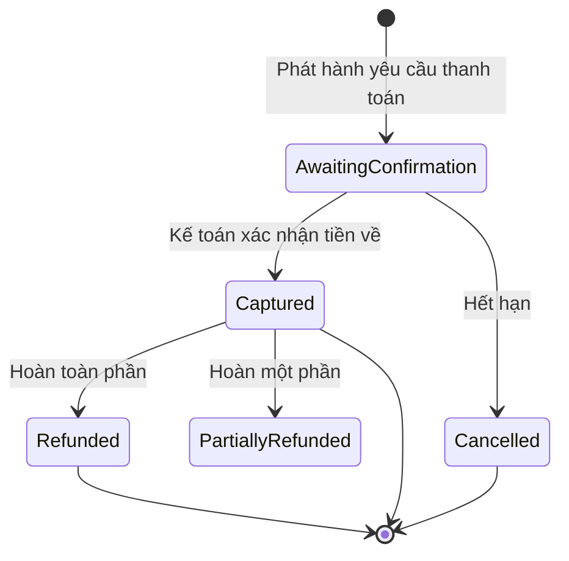
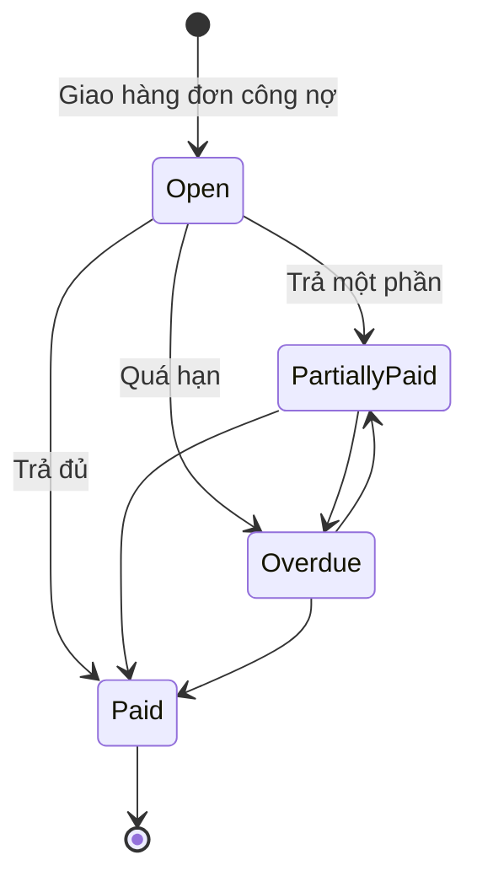

# 15 — Thanh toán & Công nợ khách sỉ (Payment & Receivables)

> Đã chốt 2026-10-06: hệ thống **chỉ bán sỉ (B2B)**. Khách sỉ thanh toán bằng **chuyển khoản**, theo một trong ba phương thức được cấu hình cho từng khách: **trả trước 100%**, **đặt cọc**, **công nợ có hạn mức**. Cổng thanh toán online (thẻ / ví) và COD bán lẻ **tạm gác**.

## 1. Mục đích (Purpose)

Xử lý **thu tiền cho đơn bán sỉ** và **công nợ phải thu** của khách: xác nhận tiền chuyển khoản (trả trước, tiền cọc, phần còn lại), ghi nhận và theo dõi **công nợ có hạn mức & kỳ hạn**, các luồng ngược (**hoàn tiền**) và **đối soát** với sao kê ngân hàng.

Payment quyết định thời điểm đơn hàng **đủ điều kiện thanh toán** để [xác nhận](../14-cart-and-order/README.md); đơn đặt cọc chỉ được release sang [sản xuất](../../warehouse/19-production/README.md) khi tiền cọc đã về.

---

## 2. Actor liên quan

| Actor | Vai trò |
|-------|---------|
| **Khách hàng sỉ** | Chuyển khoản theo đơn / theo kỳ công nợ; xem công nợ và lịch sử thanh toán trên cổng khách hàng — gồm **hạn mức công nợ, dư nợ hiện tại, hạn mức còn lại, kỳ hạn và cờ quá hạn của chính mình**, ở trang tài khoản và lúc chọn trả công nợ *(Quyết định 21/10/2026)* |
| **Nhân viên Sale (Sales Staff)** | Gửi thông tin thanh toán cho khách, nhắc thanh toán / nhắc công nợ qua [chat](../16-sales-chat/README.md) |
| **Kế toán (Accountant)** | Đối chiếu sao kê, xác nhận tiền về và **phân bổ vào đơn / khoản công nợ trên sổ chung** (§4.6), đảo phân bổ nhầm, theo dõi công nợ phải thu, duyệt hoàn tiền |
| **Người giữ quyền duyệt hạn mức** | Duyệt đơn công nợ vượt hạn mức; cấu hình hạn mức, kỳ hạn cho khách |
| **Hệ thống (Payment Service)** | Tạo yêu cầu thanh toán, ghi giao dịch, cập nhật `payment_status`, tính dư nợ, cảnh báo quá hạn |

---

## 3. Input / Output

### Input

| Trường | Mô tả | Bắt buộc |
|--------|-------|----------|
| Order + số tiền phải thu | Từ [14 Quote & Order](../14-cart-and-order/README.md) | Có |
| Phương thức thanh toán của đơn | Trả trước 100% / đặt cọc / công nợ — phải nằm trong các phương thức được phép của khách ([18](../18-customer-information/README.md)) | Có |
| % cọc | Theo cấu hình khách hoặc báo giá | Với đặt cọc |
| Hạn mức & kỳ hạn công nợ | Theo hồ sơ khách | Với công nợ |
| Sao kê / mã tham chiếu chuyển khoản | Nội dung chuyển khoản = mã đơn (hoặc mã kỳ công nợ) | Có (khi xác nhận tiền) |
| Yêu cầu hoàn tiền | Order, số tiền, lý do | Khi refund |

### Output

| Kết quả | Dùng bởi |
|---------|----------|
| **Payment transaction** (mã giao dịch, số tiền, loại: trả trước / cọc / phần còn lại / thanh toán công nợ / hoàn) | 17 Order Management, kế toán |
| **Cập nhật trạng thái đơn**: `Confirmed` / `Payment Failed`; `payment_status` | 14, 17 |
| **Khoản công nợ phải thu** theo đơn công nợ (số tiền, ngày đến hạn) | Kế toán, khách (trên cổng) |
| **Dư nợ của khách** và cảnh báo quá hạn | Kiểm hạn mức khi đặt đơn mới ([14](../14-cart-and-order/README.md)), Sale |
| **Refund transaction** | 17, kế toán |
| **Dữ liệu đối soát** với sao kê ngân hàng | Kế toán |

---

## 4. Các luồng thanh toán (Payment Flows)

### 4.1. Trả trước 100% bằng chuyển khoản

1. Order `Pending Payment` → hệ thống tạo **yêu cầu thanh toán**, hiển thị thông tin tài khoản & **nội dung chuyển khoản = mã đơn**; transaction `Awaiting Confirmation`.
2. Khách chuyển khoản.
3. Kế toán **đối chiếu sao kê**, xác nhận đã nhận đủ → transaction `Captured` → `payment_status = Paid` → Order `Confirmed`.
4. Quá hạn chưa nhận tiền → nhắc khách; hết thời hạn giữ đơn → Order `Cancelled`, giải phóng hàng.

### 4.2. Đặt cọc (Deposit)

1. Order `Pending Payment` → yêu cầu **tiền cọc** = % giá trị đơn (theo cấu hình khách hoặc báo giá).
2. Kế toán xác nhận tiền cọc về → transaction cọc `Captured` → `payment_status = Partially Paid` → Order `Confirmed`. **Chỉ khi đó** đơn mới được release sang [sản xuất](../../warehouse/19-production/README.md).
3. **Phần còn lại** thu theo **chính sách thu phần còn lại** của khách (cấu hình theo khách, chụp lại trên từng đơn; Sale chỉ được siết chặt hơn, không được nới lỏng):
   - **Chuyển khoản trước khi giao** — việc bàn giao cho hãng bị **chặn** cho tới khi đủ tiền; màn đóng gói chỉ **cảnh báo sớm** số còn phải thu, kho vẫn soạn và đóng hàng song song lúc chờ tiền *(Quyết định 19/10/2026)*.
   - **Thu khi giao (COD)** — số thu hộ được **cố định cho từng shipment lúc bàn giao** (ghi trên nhãn kiện / biên bản), hãng thu rồi chuyển trả; tiền hãng chuyển về ghi vào khoản phải thu thu hộ theo tham chiếu sao kê (một dòng sao kê có thể phủ nhiều kiện). Số COD **tính chặt**: lúc bàn giao hệ thống đọc trực tiếp sổ tiền và khoá đơn trong lúc tính, nên không bao giờ thu dư khách *(Quyết định 21/10/2026)*.
   - **Ghi công nợ** *(Quyết định 21/10/2026)* — chỉ cho khách được phép công nợ. Hệ thống kiểm hạn mức trên **phần còn lại (tổng đơn − tiền cọc) ngay lúc đặt đơn**; vượt hạn mức hoặc khách đang quá hạn → **báo lỗi để Sale đổi cách trả, không giữ đơn chờ duyệt** (để không có đơn nào bị kẹt sau khi đã sản xuất). Khi chính sách này lấy từ điều khoản của khách (đặt trên cổng, hoặc Sale không chọn riêng) mà phần còn lại không vừa hạn mức, đơn tự dùng *chuyển khoản trước khi giao* thay vì bị từ chối. Chỉ **tiền cọc** phải về trước khi bàn giao; không thu khi giao; mỗi lần giao ghi một khoản công nợ cho phần hàng đã giao (§4.3 bước 2), đến hạn sau kỳ hạn của khách.
   - **Giao nguyên chuyến (FTL)** — không được chọn *thu khi giao*; luôn phải trả đủ tiền trước khi bàn giao *(Quyết định 21/10/2026; thực hiện cùng chức năng chọn hình thức giao của đơn)*.
4. Đủ tiền → `payment_status = Paid`.

### 4.3. Công nợ có hạn mức (Credit / Receivable)

1. Đơn chọn phương thức công nợ → hệ thống kiểm **dư nợ hiện tại + giá trị đơn ≤ hạn mức** ([14](../14-cart-and-order/README.md) BR-06).
   - Trong hạn mức → Order `Confirmed`, `payment_status = On Credit`.
   - Vượt → Order `On Hold`; người có quyền duyệt chấp thuận (→ `Confirmed`) hoặc từ chối (khách chuyển sang trả trước / đặt cọc, hoặc huỷ).
2. Khi giao hàng (`Delivered`) → ghi **khoản công nợ phải thu**, **ngày đến hạn = ngày giao + kỳ hạn** của khách. Đơn giao nhiều lần thì **mỗi shipment đã giao ghi một khoản riêng** cho phần hàng của shipment đó, **trừ phần tiền khách đã trả trước** (tiền trả trước được áp vào các lần giao sớm nhất trước) — nhờ vậy đóng phần còn lại không bao giờ khiến khách phải trả nhiều hơn hàng đã nhận *(Quyết định 19/10/2026)*.
3. Khách chuyển khoản trả nợ (theo đơn hoặc gộp nhiều đơn); kế toán đối chiếu → phân bổ vào các khoản → khoản `Paid` / `Partially Paid`.
4. Quá hạn → khoản `Overdue`; nhắc khách; theo chính sách có thể **chặn đơn công nợ mới** cho tới khi thanh toán phần quá hạn.

### 4.4. Hoàn tiền (Refund)

1. Nguồn phát sinh (bán sỉ, sản phẩm in theo thiết kế):
   - Khách huỷ đơn **trước khi in** → hoàn tiền cọc / tiền trả trước (trừ phí theo chính sách nếu có);
   - Huỷ khi **đang in** → **cho huỷ, có tính phí sản xuất**; thành phẩm đã in xuất huỷ *(Quyết định 19/10/2026 — xem [17](../17-order-management/README.md) §4.5 bước 16a và bước 5 dưới đây)*;
   - Hàng **lỗi sản xuất** / giao thiếu được duyệt → hoàn một phần hoặc làm lại hàng.
2. Hoàn bằng chuyển khoản về tài khoản của khách; với đơn công nợ chưa thu → **ghi giảm công nợ** thay vì chuyển tiền.
3. Refund vượt hạn mức → cần kế toán / người có quyền duyệt.
4. Cập nhật đơn: `Refunded` / `Partially Refunded`; ghi log & thông báo khách.
5. **Phí khi đóng phần còn lại / huỷ sau khi đã in** *(Quyết định 21/10/2026, theo các quyết định về huỷ ngày 17/10 và 19/10)*: Sale có thể giữ một **phí đã thoả thuận**, tối đa bằng giá trị phần in bị đóng (vượt → bị từ chối); chưa bắt đầu in thì không tính phí. Tiền khách đã trả vượt giá trị mới của đơn **trả phí trước** (kể cả tiền cọc), phần còn lại **hoàn khách**; nếu vẫn thiếu thì ghi **khoản phải thu "phí huỷ"** (một khoản cho mỗi lần đóng). Lần đóng sau chỉ tính phần phí đã thực giữ hoặc đã trả, nên không bao giờ tính phí hai lần.

### 4.5. Đối soát (Reconciliation)

- **Sao kê ngân hàng:** đối chiếu từng khoản tiền về với yêu cầu thanh toán / khoản công nợ theo mã tham chiếu.
- **Tiền thu khi giao** (phần còn lại của đơn đặt cọc, nếu có): đối chiếu với biên bản bàn giao.
- Chênh lệch (thiếu, thừa, sai nội dung) → tạo ticket xử lý; không đóng tài chính đơn cho tới khi khớp.

> ⚠️ Giả định: ngưỡng hạn mức, kỳ hạn, % cọc mặc định, chính sách chặn khi quá hạn chưa chốt — câu hỏi D13. Xem [open-questions](../../open-questions/README.md). *(Đã chốt một phần 19–21/10/2026: thời điểm kiểm hạn mức cho phần còn lại của đơn đặt cọc ghi công nợ — §4.2 bước 3; các ngưỡng cụ thể vẫn mở.)*

### 4.6. Sổ tiền vào chung (customer transfer ledger)

> *(Quyết định 19/10/2026.)*

- Mọi khoản khách chuyển khoản — trả trước, tiền cọc, phần còn lại trước khi giao, trả công nợ — được ghi vào **một sổ duy nhất** (sổ chuyển khoản của khách). Kế toán **phân bổ** từng khoản chuyển vào một hoặc nhiều **đơn** hoặc **khoản công nợ**; không có đường ghi tiền riêng cho đơn, để cùng một khoản chuyển không bị ghi hai lần (BR-07).
- Tổng phân bổ cho một đơn **không vượt số còn phải thu** của đơn (đã trừ tiền đã nhận, công nợ đang mở và số COD đang trên đường).
- Phân bổ **chỉ thêm, không sửa** (BR-06). Phân bổ nhầm được sửa bằng **dòng đảo (số âm)** kèm lý do của kế toán, mỗi phân bổ đảo tối đa một lần.
- Đảo phân bổ khiến đơn đã `Confirmed` bị thiếu tiền → đơn chuyển `On Hold` (lý do thanh toán); hệ thống **không âm thầm bỏ trạng thái xác nhận**. Gỡ giữ chỉ được khi tiền đủ lại ([17](../17-order-management/README.md) §4.7).
- Hoàn tiền lấy từ **đúng một** nguồn: thanh toán, phân bổ, hoặc số dư có của khoản chuyển; hoàn khi huỷ chỉ yêu cầu **một lần cho mỗi đơn**.

---

## 5. Trạng thái / Vòng đời (Lifecycle)

### 5.1. Trạng thái Payment Transaction

| Trạng thái | Ý nghĩa |
|------------|---------|
| `Awaiting Confirmation` | Đã phát hành yêu cầu thanh toán, chờ kế toán xác nhận tiền về |
| `Captured` | Đã nhận tiền |
| `Cancelled` | Hết hạn / huỷ trước khi nhận tiền |
| `Refunded` / `Partially Refunded` | Đã hoàn toàn phần / một phần |

### 5.2. Trạng thái thanh toán của Order (payment_status)

| Trạng thái | Ý nghĩa |
|------------|---------|
| `Unpaid` | Chưa thu (đơn trả trước / đặt cọc vừa tạo) |
| `Partially Paid` | Đã nhận cọc, còn phần còn lại |
| `On Credit` | Đơn công nợ; tiền thu theo kỳ hạn |
| `Paid` | Đã thu đủ |
| `Refunded` / `Partially Refunded` | Đã hoàn |

### 5.3. Trạng thái khoản công nợ phải thu (Receivable)

| Trạng thái | Ý nghĩa | Chuyển tiếp |
|------------|---------|-------------|
| `Open` | Đã giao, chưa tới hạn | → `Partially Paid`, → `Paid`, → `Overdue` |
| `Partially Paid` | Đã trả một phần | → `Paid`, → `Overdue` |
| `Overdue` | Quá hạn chưa trả đủ | → `Partially Paid`, → `Paid` |
| `Paid` | Đã tất toán | *(cuối)* |

---

## 6. Ràng buộc nghiệp vụ (Business Rules) & Edge case

### Business rules

- **BR-01:** Đơn chỉ dùng phương thức thanh toán **được phép cho khách** đó.
- **BR-02:** Đơn trả trước chỉ `Confirmed` khi đã nhận đủ tiền; đơn đặt cọc chỉ `Confirmed` (và chỉ được release sang sản xuất) khi **đã nhận đủ tiền cọc**.
- **BR-03:** Đơn công nợ chỉ `Confirmed` khi **dư nợ + giá trị đơn ≤ hạn mức**, hoặc được người có quyền duyệt vượt hạn mức.
- **BR-04:** Tiền chuyển khoản chỉ được ghi nhận khi kế toán **đối chiếu sao kê**; không ghi nhận theo lời khách báo. Mọi khoản được ghi vào **một sổ chung** (§4.6).
- **BR-05:** Refund không vượt số tiền đã thu của đơn; với đơn công nợ chưa thu thì ghi giảm công nợ.
- **BR-06:** Mọi giao dịch (thu & hoàn) là **bất biến**, chỉ thêm giao dịch mới để điều chỉnh (phân bổ nhầm → dòng đảo, §4.6); đầy đủ audit log.
- **BR-07:** Idempotency: một khoản tiền về (cùng mã tham chiếu sao kê) không được ghi nhận hai lần — kiểm trên **toàn sổ**, kể cả các khoản ghi trước khi có sổ chung.
- **BR-08:** Số tiền thu khi giao (nếu có) ghi trên nhãn kiện / biên bản bàn giao = phần còn phải thu của đơn (đã trừ cọc). Với đơn nhiều shipment, tiền đã trả trước được áp vào các shipment theo thứ tự tạo; số COD được **tính chặt từ sổ tiền lúc bàn giao** *(Quyết định 21/10/2026)*.
- **BR-09:** Tiền khách trả công nợ được phân bổ vào **khoản đến hạn sớm nhất trước**, trừ khi khách ghi rõ trả cho đơn nào.
- **BR-10:** Đơn *chuyển khoản trước khi giao* không được bàn giao khi chưa đủ tiền; chặn tại bước **bàn giao** (đóng gói xong → giao hãng), báo sớm ở màn đóng gói *(Quyết định 19/10/2026)*.
- **BR-11:** Chính sách thu phần còn lại của đơn do khách quy định; Sale chỉ được **siết chặt hơn**, không nới lỏng (vd. khách có chính sách *trả trước khi giao* thì Sale không được chuyển đơn sang *thu khi giao*).
- **BR-12:** Khách chọn phương thức thanh toán của đơn **trong số các phương thức được phép** cho khách đó; cổng khách hàng cho khách đọc danh sách này *(Quyết định 21/10/2026, cụ thể hoá BR-01)*.

### Edge case

| Tình huống | Hướng xử lý |
|------------|-------------|
| Khách chuyển thiếu so với tiền cọc / trả trước | Ghi nhận phần đã nhận; đơn vẫn chờ; nhắc khách chuyển nốt |
| Khách chuyển thừa | Ghi có cho khách: trừ vào đơn sau / công nợ, hoặc hoàn lại theo yêu cầu |
| Nội dung chuyển khoản sai / thiếu mã đơn | Kế toán đối chiếu theo số tiền + tên khách; xác nhận với khách trước khi ghi nhận |
| Tiền về sau khi đơn đã hết hạn & bị huỷ | Hỏi khách: tạo lại đơn hoặc hoàn tiền; không "giữ tiền không đơn" |
| Kế toán phân bổ nhầm đơn / nhầm khách | Ghi dòng đảo kèm lý do (§4.6); đơn đã `Confirmed` bị thiếu tiền → `On Hold` chờ đủ tiền lại |
| Khách quá hạn công nợ muốn đặt đơn công nợ mới | Chặn hoặc `On Hold` theo chính sách D13; Sale đề xuất trả trước / đặt cọc |
| Khách huỷ đơn đã cọc khi chưa in | Hoàn cọc (trừ phí nếu chính sách quy định) |
| Khách huỷ đơn đã cọc khi đang in | Theo chính sách huỷ khi đang in ([17](../17-order-management/README.md)): giữ cọc bù phí sản xuất hoặc từ chối huỷ |
| Hàng lỗi sản xuất phát hiện sau giao | Làm lại hàng hoặc hoàn tiền / ghi giảm công nợ phần lỗi |

---

## 7. Liên kết với các module khác

| Module | Quan hệ |
|--------|---------|
| [14 · Quote & Order](../14-cart-and-order/README.md) | Nhận Order + số tiền + phương thức; kiểm hạn mức công nợ; trả kết quả → `Confirmed` / `On Hold` / `Payment Failed` |
| [17 · Order Management](../17-order-management/README.md) | Đồng bộ `payment_status`; điều kiện release; khởi tạo refund khi huỷ / lỗi sản xuất |
| [19 · Production](../../warehouse/19-production/README.md) | Đơn đặt cọc chỉ release sang sản xuất khi tiền cọc đã về |
| [09 · Shipping](../../warehouse/09-shipping/README.md) | Số tiền thu khi giao (nếu có) trên nhãn kiện / biên bản bàn giao; giao hàng làm phát sinh khoản công nợ |
| [16 · Sales Chat](../16-sales-chat/README.md) | Sale gửi thông tin thanh toán, nhắc thanh toán / công nợ |
| [18 · Customer Information](../18-customer-information/README.md) | Phương thức thanh toán được phép, hạn mức, kỳ hạn, dư nợ của khách |
| Kế toán / Ngân hàng | Đối soát sao kê |
