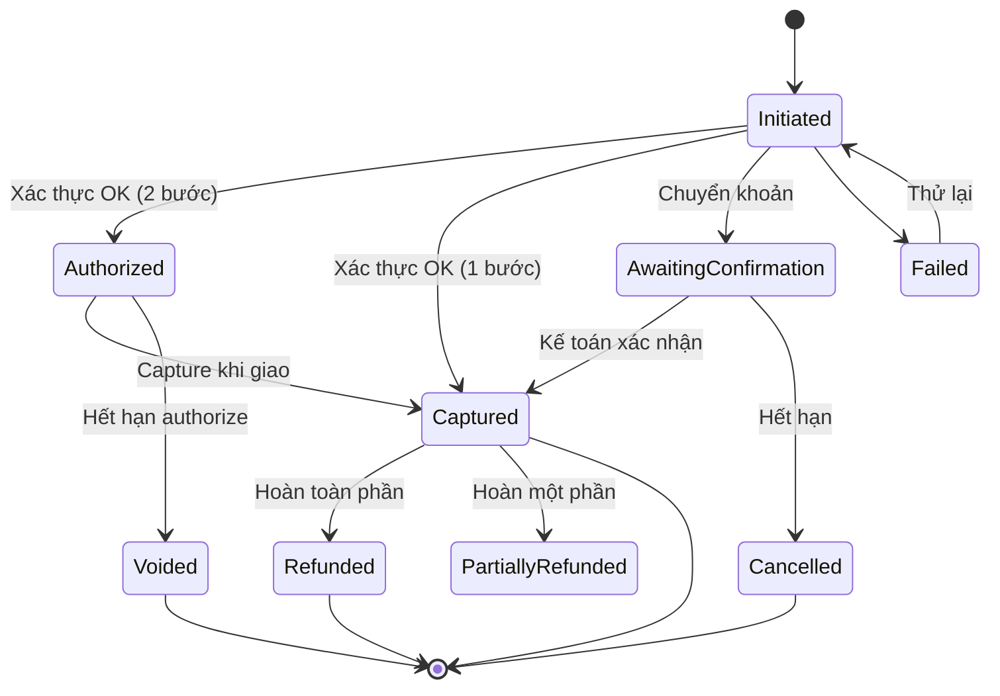

# 15 — Thanh toán (Payment)

## 1. Mục đích (Purpose)

Xử lý **thu tiền cho đơn hàng** và các luồng tài chính liên quan: thanh toán online (cổng thanh toán / ví / thẻ / chuyển khoản), **thanh toán khi nhận hàng (COD)**, đặt cọc, thanh toán một phần, và các luồng ngược: **hoàn tiền (refund)**, huỷ uỷ quyền (void), đối soát (reconciliation).

Payment quyết định thời điểm đơn hàng được [xác nhận](../14-cart-and-order/README.md) và đủ điều kiện chuyển sang [Fulfillment](../../warehouse/07-picking/README.md).

> ⚠️ Giả định lớn: Đề bài không liệt kê phương thức thanh toán cụ thể. Tài liệu này mô tả các luồng **phổ biến** (cổng thanh toán online, ví điện tử, thẻ, chuyển khoản, COD, đặt cọc). **Danh sách phương thức & nhà cung cấp cổng thanh toán cần Product Owner xác nhận.** Xem [open-questions](../../open-questions/README.md).

---

## 2. Actor liên quan

| Actor | Vai trò |
|-------|---------|
| **Khách hàng** | Chọn phương thức, thực hiện thanh toán, yêu cầu hoàn tiền |
| **Nhân viên Sale** | Gửi link thanh toán, xác nhận đã nhận chuyển khoản thủ công, hỗ trợ xử lý lỗi thanh toán qua [chat](../16-sales-chat/README.md) |
| **Kế toán / Tài chính** | Đối soát giao dịch với cổng thanh toán & hãng vận chuyển (COD), duyệt hoàn tiền vượt hạn mức |
| **Hệ thống (Payment Service + Gateway integration)** | Tạo giao dịch, gọi cổng, nhận webhook kết quả, ghi sổ giao dịch, xử lý refund |
| **Đơn vị vận chuyển (Carrier)** | Thu hộ tiền COD, chuyển tiền về (đối soát với [09 Shipping](../../warehouse/09-shipping/README.md)) |

---

## 3. Input / Output

### Input

| Trường | Mô tả | Bắt buộc |
|--------|-------|----------|
| Order + số tiền phải thu | Từ [14 Cart & Order](../14-cart-and-order/README.md) | Có |
| Phương thức thanh toán | Online gateway / ví / thẻ / chuyển khoản / COD / đặt cọc | Có |
| Thông tin thanh toán | Do cổng thanh toán thu thập (không lưu dữ liệu thẻ nhạy cảm — tuân thủ PCI) | Tuỳ phương thức |
| Mã giao dịch cổng / mã tham chiếu chuyển khoản | | Theo phương thức |
| Yêu cầu hoàn tiền | Order/khoản mục, số tiền, lý do | Khi refund |

### Output

| Kết quả | Dùng bởi |
|---------|----------|
| **Payment transaction** (mã giao dịch, số tiền, trạng thái, phương thức, thời gian) | 17 Order Management, kế toán |
| **Cập nhật trạng thái đơn**: `Confirmed` / `Payment Failed` / `Partially Paid` | 14 Cart & Order, 17 Order Management |
| **Biên nhận / hoá đơn thanh toán** cho khách | Khách hàng |
| **Refund transaction** & cập nhật đơn `Refunded` / `Partially Refunded` | 17 Order Management, kế toán |
| **Dữ liệu đối soát** (settlement report từ gateway; COD remittance từ carrier) | Kế toán |

---

## 4. Các luồng thanh toán (Payment Flows)

### 4.1. Thanh toán online qua cổng (Online gateway / redirect hoặc hosted)

1. Order `Pending Payment` → hệ thống tạo **payment transaction** trạng thái `Initiated`, số tiền = tổng đơn.
2. Chuyển khách sang cổng thanh toán (redirect) hoặc form nhúng; khách xác thực (OTP/3DS).
3. Cổng trả kết quả qua **redirect return** *và* **webhook** (nguồn tin cậy là webhook + truy vấn xác minh — verify).
4. **Thành công:** transaction `Captured` (hoặc `Authorized` nếu tách 2 bước) → Order `Confirmed` → reservation thành allocation → đẩy Fulfillment.
5. **Thất bại / huỷ / hết hạn:** transaction `Failed`/`Cancelled` → Order `Payment Failed`; cho khách **thử lại** (tạo transaction mới) trong thời hạn giữ đơn.

> Authorize–Capture (nếu áp dụng): `Authorized` khi đặt đơn (giữ tiền), `Captured` khi hàng sẵn sàng giao / khi ship. Quá hạn authorize chưa capture → tự void.

### 4.2. Ví điện tử / Thẻ nội địa / Thẻ quốc tế

Tương tự 4.1, khác ở giao diện & nhà cung cấp; đều đi qua Payment Service → gateway tương ứng; kết quả chuẩn hoá về cùng trạng thái transaction.

### 4.3. Chuyển khoản ngân hàng thủ công (Bank transfer / offline)

1. Order `Pending Payment` → hiển thị thông tin tài khoản & **nội dung chuyển khoản = mã đơn**.
2. Khách chuyển khoản; transaction ở `Awaiting Confirmation`.
3. Kế toán/Sale **đối chiếu sao kê**, xác nhận đã nhận đủ → transaction `Captured` → Order `Confirmed`.
4. Quá hạn không nhận được tiền → nhắc khách; hết hạn giữ đơn → `Cancelled`, giải phóng hàng.

### 4.4. Thanh toán khi nhận hàng (COD – Cash On Delivery)

1. Order `Pending Payment` với phương thức COD → kiểm tra điều kiện cho phép COD (hạn mức giá trị đơn, khu vực, lịch sử khách).
2. Nếu hợp lệ → Order `Confirmed` **ngay** (chưa thu tiền); `payment_status = Pending (COD)`.
3. Fulfillment & [Shipping](../../warehouse/09-shipping/README.md) tiến hành; số tiền thu hộ ghi trên vận đơn.
4. Carrier giao hàng & **thu tiền**; cập nhật `Delivered` + thu COD.
5. Carrier **chuyển tiền COD về** theo kỳ đối soát → kế toán khớp → transaction `Captured`; `payment_status = Paid`.
6. Giao thất bại / khách từ chối → không thu tiền; đơn `Returned`; không phát sinh refund (vì chưa thu).

### 4.5. Đặt cọc / Thanh toán một phần (Deposit / Partial payment)

1. Áp dụng cho đơn giá trị lớn / sản phẩm in ấn theo yêu cầu: khách trả **cọc** (ví dụ % cấu hình) để đơn vào sản xuất.
2. Transaction cọc `Captured` → `payment_status = Partially Paid` → Order `Confirmed` / `In Production`.
3. **Phần còn lại** thu trước khi giao (link thanh toán) hoặc chuyển thành COD phần còn lại — theo chính sách.
4. Đủ tiền → `payment_status = Paid`.

### 4.6. Hoàn tiền (Refund) & Huỷ uỷ quyền (Void)

1. Nguồn phát sinh: khách huỷ đơn (đủ điều kiện), hàng hoàn (RTO) từ [09 Shipping](../../warehouse/09-shipping/README.md), giao thiếu/sai, khiếu nại được duyệt.
2. **Void:** nếu tiền mới `Authorized` chưa `Captured` → huỷ uỷ quyền, không phát sinh dòng tiền.
3. **Refund:** nếu đã `Captured` → tạo **refund transaction** (toàn phần / một phần) về đúng phương thức gốc; nếu không hoàn được về nguồn gốc (COD, hết hạn) → hoàn qua phương thức thay thế (chuyển khoản) theo chính sách.
4. Refund vượt hạn mức → cần duyệt (kế toán / Manager).
5. Cập nhật đơn: `Refunded` / `Partially Refunded`; ghi log & thông báo khách.

### 4.7. Đối soát (Reconciliation)

- **Gateway settlement:** đối chiếu giao dịch hệ thống ↔ báo cáo cổng thanh toán (số tiền, phí, chênh lệch, giao dịch treo).
- **COD remittance:** đối chiếu tiền carrier chuyển về ↔ danh sách đơn `Delivered` COD.
- Chênh lệch → tạo ticket xử lý; không đóng tài chính đơn cho tới khi khớp.

---

## 5. Trạng thái / Vòng đời (Lifecycle)

### 5.1. Trạng thái Payment Transaction

| Trạng thái | Ý nghĩa |
|------------|---------|
| `Initiated` | Đã tạo, chờ khách thực hiện |
| `Awaiting Confirmation` | Chờ xác nhận thủ công (chuyển khoản) |
| `Authorized` | Đã giữ tiền, chưa trừ (authorize–capture) |
| `Captured` | Đã thu tiền thành công |
| `Failed` | Thất bại |
| `Cancelled` | Khách huỷ / hết hạn trước khi thu |
| `Voided` | Huỷ uỷ quyền khi chưa capture |
| `Refunded` / `Partially Refunded` | Đã hoàn toàn phần / một phần |

### 5.2. Trạng thái thanh toán của Order (payment_status)

| Trạng thái | Ý nghĩa |
|------------|---------|
| `Unpaid` | Chưa thu (Order vừa tạo) |
| `Pending (COD)` | Chờ thu khi giao |
| `Partially Paid` | Đã thu một phần (cọc) |
| `Paid` | Đã thu đủ |
| `Refunded` / `Partially Refunded` | Đã hoàn |
| `Failed` | Lần thanh toán gần nhất thất bại |

---

## 6. Ràng buộc nghiệp vụ (Business Rules) & Edge case

### Business rules

- **BR-01:** Đơn prepaid chỉ chuyển `Confirmed` khi transaction `Captured` (hoặc `Authorized` nếu chính sách cho fulfill trên authorize).
- **BR-02:** Đơn COD chuyển `Confirmed` ngay nhưng `payment_status = Pending (COD)`; chỉ `Paid` sau khi đối soát tiền carrier.
- **BR-03:** Không giao hàng (release picking) cho đơn prepaid chưa `Paid`/`Authorized` hợp lệ.  Xem [07 Picking BR-01](../../warehouse/07-picking/README.md).
- **BR-04:** Không lưu dữ liệu thẻ nhạy cảm trong hệ thống; dùng token hoá qua cổng (tuân thủ PCI-DSS).
- **BR-05:** Nguồn sự thật của kết quả thanh toán là **webhook + truy vấn xác minh** với cổng, không phải trang redirect trả về.
- **BR-06:** Refund không vượt số tiền đã `Captured` của đơn; tổng các refund ≤ tổng đã thu.
- **BR-07:** Mọi giao dịch (thu & hoàn) là **bất biến**, chỉ thêm giao dịch mới để điều chỉnh; đầy đủ audit log.
- **BR-08:** Idempotency: một lần thanh toán/cùng một tham chiếu không được ghi nhận hai lần (chống double charge).
- **BR-09:** Số tiền COD trên vận đơn = phần còn phải thu của đơn (đã trừ cọc nếu có).

### Edge case

| Tình huống | Hướng xử lý |
|------------|-------------|
| Webhook đến muộn / trùng | Xử lý idempotent theo mã giao dịch; đối chiếu trạng thái cuối cùng với cổng |
| Khách bị trừ tiền nhưng đơn vẫn `Payment Failed` | Đối soát; tự động/thủ công `Confirmed` hoặc refund; cảnh báo Finance |
| Thanh toán thành công sau khi đơn đã hết hạn & bị huỷ | Refund tự động hoặc tạo lại đơn theo chính sách; không "giữ tiền không đơn" |
| COD: carrier thu thiếu so với vận đơn | Ghi nhận công nợ carrier; đơn `Delivered` nhưng tài chính chưa đóng |
| Hoàn tiền về thẻ đã hết hạn / tài khoản đóng | Chuyển hoàn qua phương thức thay thế (chuyển khoản) + xác minh chủ tài khoản |
| Đơn nhiều lần thử thanh toán | Chỉ một transaction `Captured` được chấp nhận; các transaction khác `Failed`/`Cancelled` |
| Chênh lệch phí cổng khi đối soát | Ghi nhận phí là chi phí; không tự đổi số tiền đơn |
| Đơn hỗn hợp cọc + COD phần còn lại | `Partially Paid` → carrier thu phần còn lại → đối soát → `Paid` |
| Gian lận / chargeback | Đóng băng fulfillment nếu chưa giao; phối hợp cổng; cập nhật hồ sơ rủi ro khách ([18](../18-customer-information/README.md)) |

---

## 7. Liên kết với các module khác

| Module | Quan hệ |
|--------|---------|
| [14 · Cart & Order](../14-cart-and-order/README.md) | Nhận Order `Pending Payment` + số tiền; trả kết quả → `Confirmed` / `Payment Failed` |
| [17 · Order Management](../17-order-management/README.md) | Đồng bộ `payment_status`; khởi tạo refund khi huỷ/hoàn; hiển thị lịch sử giao dịch |
| [09 · Shipping](../../warehouse/09-shipping/README.md) | COD: số tiền thu hộ trên vận đơn; RTO kích hoạt refund |
| [07 · Picking](../../warehouse/07-picking/README.md) | Điều kiện thanh toán quyết định đơn có được release để fulfill |
| [16 · Sales Chat](../16-sales-chat/README.md) | Sale gửi link thanh toán; hỗ trợ khách khi lỗi thanh toán |
| [18 · Customer Information](../18-customer-information/README.md) | Hồ sơ rủi ro/gian lận; phương thức thanh toán đã lưu (token) |
| Kế toán / Cổng thanh toán / Ngân hàng (tích hợp) | Đối soát settlement & COD remittance |
