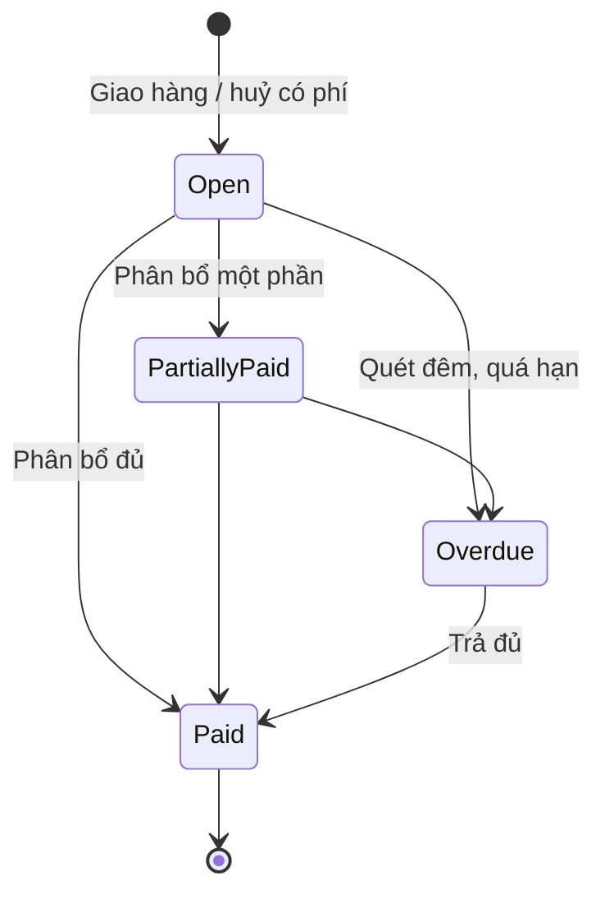

# 15 — Thanh toán & Công nợ khách sỉ (Payment & Receivables)

> Đã chốt 2026-10-06: hệ thống **chỉ bán sỉ (B2B)**. Khách sỉ thanh toán bằng **chuyển khoản**, theo một trong ba **điều khoản thanh toán** được cấu hình cho từng khách: **trả trước 100%**, **đặt cọc**, **công nợ có hạn mức**. Không có cổng thanh toán online (thẻ / ví), không có COD bán lẻ, và không có trạng thái "thanh toán thất bại" (chuyển khoản không có lỗi để báo về).

## 1. Mục đích (Purpose)

Ghi nhận **tiền khách chuyển khoản** vào một **sổ tiền vào (transfer ledger)**, phân bổ tiền đó cho **đơn hàng** hoặc **khoản công nợ phải thu**. Ngoài ra module:

- theo dõi **công nợ có hạn mức & kỳ hạn**, kể cả phần tiền nhà vận chuyển thu hộ;
- xử lý các luồng ngược: **đảo phân bổ** khi phân bổ sai, **hoàn tiền**.

Payment quyết định thời điểm đơn **đủ điều kiện thanh toán**:

- Tiền phân bổ cho đơn đủ theo điều khoản của đơn → hệ thống tự chuyển đơn `Confirmed` ([14](../14-cart-and-order/README.md)).
- Đơn đặt cọc chỉ được release sang [sản xuất](../../warehouse/19-production/README.md) khi tiền cọc đã về.

---

## 2. Actor liên quan

| Actor | Vai trò |
|-------|---------|
| **Khách hàng sỉ** | Chuyển khoản theo hướng dẫn trên cổng (số tiền, nội dung = mã đơn). Xem công nợ của mình (chỉ phần khách phải trả) và vị thế tín dụng. |
| **Kế toán (Accountant)** | Ghi nhận tiền về theo sao kê, phân bổ, đảo phân bổ, hoàn tiền dư cho khách, ghi nhận tiền nhà vận chuyển nộp lại. **Duyệt / từ chối đơn công nợ bị treo** ([17](../17-order-management/README.md) §4.6). **Duyệt điều khoản thanh toán** của khách (hạn mức, kỳ hạn). |
| **Nhân viên Sale (Sales Staff)** | Đặt điều khoản ban đầu khi tạo khách: chỉ trả trước hoặc đặt cọc ([18](../18-customer-information/README.md)). Xem công nợ; nhắc khách thanh toán qua [chat](../16-sales-chat/README.md). |
| **Điều phối đơn hàng (Order Coordinator)** | Xem công nợ. Gỡ treo đơn lý do thanh toán khi tiền đã đủ trở lại. |
| **Hệ thống** | Tự dùng tiền dư của khách trả khoản mới; tính trạng thái thanh toán của đơn; tự xác nhận đơn khi đủ tiền; đánh dấu quá hạn mỗi đêm; chặn bàn giao khi chưa thu đủ phần phải thu trước giao. |

---

## 3. Input / Output

### Input

| Trường | Mô tả | Bắt buộc |
|--------|-------|----------|
| **Khoản tiền về** | Khách, **mã tham chiếu sao kê** (≤ 100 ký tự, duy nhất), số tiền > 0, tiền tệ (mặc định VND), ngày nhận (không ở tương lai), ghi chú | Có |
| Chỉ định phân bổ | Các đơn (mỗi đơn một số tiền) và / hoặc các khoản công nợ được trả. Không chỉ định → trả khoản đến hạn sớm nhất. | Không |
| **Điều khoản thanh toán của khách** | Điều khoản được phép (trả trước / đặt cọc / công nợ, ít nhất một), điều khoản mặc định, % cọc (0 < % < 100), chính sách thu phần còn lại, hạn mức (≥ 0), kỳ hạn (0–365 ngày) — [18](../18-customer-information/README.md) | Có |
| Điều khoản của đơn | Copy từ khách khi đặt; chỉ được **siết lại** (BR-10) | Có |
| Yêu cầu đảo phân bổ | Phân bổ cần đảo + lý do (≤ 500); có treo đơn hay không | Khi đảo |
| Yêu cầu hoàn tiền dư | Số tiền ≤ tiền dư chưa phân bổ + lý do | Khi hoàn |
| Tiền nhà vận chuyển nộp lại | Khoản công nợ do nhà vận chuyển thu, dòng sao kê, số tiền | Khi đối soát thu hộ |

### Output

| Kết quả | Dùng bởi |
|---------|----------|
| **Khoản tiền về** + các **dòng phân bổ** / **dòng đảo** (chỉ thêm, không sửa) | Kế toán, đối soát |
| **Tiền dư của khách (credit)** = phần chưa phân bổ | Tự trả khoản công nợ mới; hoàn khi khách yêu cầu |
| **Trạng thái thanh toán của đơn** (§5.2) và tự xác nhận đơn | 14, 17 |
| **Khoản công nợ phải thu** (§5.1) | Kế toán, khách (trên cổng), kiểm hạn mức |
| **Vị thế tín dụng** của khách: dư nợ, hạn mức còn lại, quá hạn | 14 (đặt đơn), 17 (release), khách |
| **Lệnh hoàn tiền** (`Pending`) | Kế toán |

---

## 4. Các luồng thanh toán (Payment Flows)

### 4.1. Ghi nhận tiền về & phân bổ

1. Khách chuyển khoản theo **hướng dẫn chuyển khoản** trên cổng. Hướng dẫn cho biết:
   - số tiền cần chuyển và nội dung chuyển khoản (= mã đơn);
   - thời điểm cần chuyển: **để xác nhận đơn** (trả trước / tiền cọc), **trước khi giao** (phần còn lại), hoặc **chưa cần chuyển**.
2. Kế toán đối chiếu sao kê, **ghi nhận khoản tiền về**:
   - Một mã tham chiếu sao kê chỉ ghi một lần (BR-07).
   - Số tiền của khoản không bao giờ đổi.
3. Phân bổ ngay khi ghi nhận, theo thứ tự:
   - **(a)** các **đơn được chỉ định**, mỗi đơn đúng số tiền ghi;
   - **(b)** các **khoản công nợ được chỉ định**;
   - **(c)** không chỉ định gì → các khoản công nợ chưa trả của khách, **đến hạn sớm nhất trước** (BR-09).

   Chỉ định đơn mà không chỉ định khoản → phần còn lại để làm **tiền dư**.
4. Phần chưa phân bổ là **tiền dư của khách**.
   - Kế toán phân bổ sau cho một đơn hoặc một khoản.
   - Khi có khoản công nợ mới, hệ thống **tự lấy tiền dư trả trước**.
5. Không phân bổ được cho:
   - đơn đã huỷ;
   - đơn công nợ (đơn này trả qua khoản công nợ của nó);
   - đơn không ở trạng thái nhận tiền.
6. Tiền phân bổ cho đơn đủ theo điều khoản (đủ trả trước, đủ cọc) → đơn tự `Confirmed`.

### 4.2. Trả trước 100%

1. Đơn `Pending Payment`; hướng dẫn chuyển khoản "để xác nhận đơn" = toàn bộ giá trị đơn.
2. Phân bổ đủ → `Paid` → đơn `Confirmed`.
3. Hết hạn giữ hàng mà chưa đủ tiền → đơn `Cancelled`, giải phóng hàng ([14](../14-cart-and-order/README.md) BR-07).

### 4.3. Đặt cọc

1. Đơn `Pending Payment`; tiền cọc = % giá trị đơn (theo báo giá, hoặc % mặc định của khách).
2. Phân bổ đủ cọc → `Partially Paid` → đơn `Confirmed`. **Chỉ khi đó** đơn mới được release sang sản xuất.
3. **Phần còn lại** thu theo **chính sách thu phần còn lại** của đơn:

   | Chính sách | Thu thế nào | Chặn gì |
   |------------|-------------|---------|
   | `BEFORE_DELIVERY` | Khách chuyển khoản trước khi bàn giao | Bàn giao bị chặn cho tới khi đủ tiền (BR-11) |
   | `ON_DELIVERY` | Nhà vận chuyển thu khi giao. Hệ thống mở khoản công nợ **do nhà vận chuyển thu** (§4.6). | Không được kết hợp với giao nguyên chuyến ([17](../17-order-management/README.md)) |
   | `ON_CREDIT` | Phần còn lại thành **công nợ** của khách, đến hạn = ngày giao + kỳ hạn | Lúc đặt, kiểm như đơn công nợ: quá hạn hoặc vượt hạn mức thì **từ chối đặt**, không treo (BR-12) |

4. Thu đủ → `Paid`.

### 4.4. Công nợ có hạn mức

1. Lúc đặt đơn công nợ, hệ thống tính **vị thế tín dụng** (BR-13):
   - Khách có khoản **quá hạn** → `OVERDUE`.
   - Dư nợ + giá trị đơn > hạn mức → `OVER_LIMIT`.
   - Còn lại → `WITHIN_LIMIT` → đơn `Confirmed`, trạng thái thanh toán `On Credit`.
2. `OVERDUE` / `OVER_LIMIT` → đơn **`On Hold` lý do tín dụng**. Kế toán quyết định:
   - **Duyệt** (bắt buộc ghi chú) → đơn `Confirmed`.
   - **Từ chối** (bắt buộc ghi chú) kèm một hành động:

     | Hành động | Kết quả |
     |-----------|---------|
     | Huỷ đơn | Lý do `CREDIT_REJECTED` |
     | Chuyển sang trả trước | Chỉ khi khách được phép. Đơn về `Pending Payment`, giữ hàng có hạn lại. |
     | Chuyển sang đặt cọc | Chỉ khi khách được phép; % cọc mặc định của khách. Phần còn lại `ON_CREDIT` đổi thành `BEFORE_DELIVERY`. Đơn về `Pending Payment`, giữ hàng có hạn lại. |

   Mọi quyết định tín dụng được ghi lịch sử: `WITHIN_LIMIT` / `OVER_LIMIT` / `OVERDUE` / `APPROVED` / `REJECTED`.
3. Khi giao (`Delivered`) → mở **khoản công nợ** `CREDIT_ORDER`, đến hạn = ngày giao + kỳ hạn của đơn.
4. Khách chuyển khoản trả nợ → phân bổ như §4.1.
5. **Mỗi đêm 00:15** hệ thống đánh dấu `Overdue` các khoản quá hạn chưa trả đủ.
6. Khách đang có khoản quá hạn thì:
   - không release được đơn công nợ hoặc đơn `ON_CREDIT` ([17](../17-order-management/README.md));
   - đơn công nợ mới bị treo như bước 2.

### 4.5. Đảo phân bổ

1. Phân bổ sai (nhầm khách, nhầm đơn) → kế toán **đảo phân bổ**, bắt buộc lý do. Hệ thống:
   - thêm **một dòng đảo** (không sửa dòng cũ);
   - trả tiền về thành tiền dư của khách.
2. Không đảo được khi:
   - đã đảo rồi;
   - đã yêu cầu hoàn số tiền đó;
   - đơn đã `Cancelled` / `Completed` / `Closed` / đang trả hàng / đã hoàn tiền.
3. Đảo làm một đơn `Confirmed` **không còn đủ tiền** theo điều khoản thì:
   - kế toán phải chọn **treo đơn**, nếu không thao tác bị từ chối;
   - đơn → `On Hold` lý do **thanh toán**;
   - Điều phối chỉ gỡ treo được khi tiền đã đủ lại ([17](../17-order-management/README.md)).

### 4.6. Tiền nhà vận chuyển thu hộ

1. Đơn đặt cọc với chính sách `ON_DELIVERY`: khi giao, mở khoản công nợ `DEPOSIT_BALANCE` **do nhà vận chuyển thu**, đến hạn ngày giao.
2. Đây là **nợ của nhà vận chuyển**, không phải của khách:
   - không tính vào dư nợ / quá hạn của khách;
   - khách không thấy khoản này;
   - tiền khách chuyển khoản không trả được khoản này (BR-14).
3. Nhà vận chuyển nộp tiền → kế toán ghi **tiền nhà vận chuyển nộp** theo dòng sao kê.
   - Nộp thiếu → khoản `Partially Paid`, chờ phần còn lại.
   - Nộp thừa → thành tiền dư của khách.

### 4.7. Hoàn tiền

1. Hệ thống tạo **lệnh hoàn tiền** `Pending` khi:
   - **huỷ đơn / đóng phần còn lại**: tiền đã thu vượt phần phải giữ (phí huỷ) — xem [17](../17-order-management/README.md) §4.5;
   - **khách yêu cầu hoàn tiền dư**: kế toán tạo, số tiền ≤ tiền dư, bắt buộc lý do.
2. Kế toán chuyển khoản hoàn cho khách. Lệnh hoàn kết thúc ở `Completed` hoặc `Failed`. Lệnh hoàn tiền dư `Failed` thì tiền quay lại thành tiền dư.

> ⚠️ Giả định: hệ thống hiện chỉ **tạo** lệnh hoàn `Pending`; bước kế toán đánh dấu đã hoàn (`Completed`) hoặc hoàn lỗi (`Failed`) chưa có màn hình. Việc chuyển khoản hoàn làm ngoài hệ thống. Xem [open-questions D15](../../open-questions/README.md).

### 4.8. Phí huỷ

- Khi huỷ đơn có phí ([17](../17-order-management/README.md) §4.5), tiền đã thu **trả phí trước**.
- Phần phí còn thiếu thành khoản công nợ `CANCELLATION_FEE`, đến hạn ngay ngày huỷ, do khách trả.

---

## 5. Trạng thái / Vòng đời (Lifecycle)

### 5.1. Khoản công nợ phải thu (Receivable)

**Loại khoản:**

| Loại | Sinh khi | Ai trả | Đến hạn |
|------|----------|--------|---------|
| `CREDIT_ORDER` | Đơn công nợ được giao | Khách | Ngày giao + kỳ hạn |
| `DEPOSIT_BALANCE` | Phần còn lại của đơn đặt cọc: `ON_CREDIT` (khách trả) hoặc `ON_DELIVERY` (nhà vận chuyển thu) | Khách / Nhà vận chuyển | `ON_CREDIT`: ngày giao + kỳ hạn. `ON_DELIVERY`: ngày giao. |
| `CANCELLATION_FEE` | Phí huỷ / phí đóng phần còn lại chưa được tiền đã thu bù đủ | Khách | Ngày huỷ / ngày đóng |

**Trạng thái:**

| Trạng thái | Ý nghĩa | Chuyển tiếp cho phép | Ai thực hiện |
|------------|---------|----------------------|--------------|
| `Open` | Đã phát sinh, chưa trả | → `Partially Paid`, → `Paid`, → `Overdue` | Hệ thống (phân bổ, quét đêm) |
| `Partially Paid` | Đã trả một phần | → `Paid`, → `Overdue` | Hệ thống |
| `Overdue` | Quá hạn, chưa trả đủ; giữ `Overdue` cho tới khi trả đủ | → `Paid` | Hệ thống |
| `Paid` | Đã tất toán | *(cuối)* — đảo phân bổ tính lại trạng thái | Hệ thống |

### 5.2. Trạng thái thanh toán của Order

Trạng thái thanh toán **tính ra từ số tiền**, không lưu riêng.

| Trạng thái | Ý nghĩa |
|------------|---------|
| `Unpaid` | Chưa thu gì (đơn trả trước / đặt cọc) |
| `Partially Paid` | Đã thu một phần (thường là đã nhận cọc) |
| `On Credit` | Đơn công nợ; tiền thu theo kỳ hạn |
| `Paid` | Đã thu đủ |

> Hoàn tiền là **trạng thái của đơn** (`Refunded` / `Partially Refunded` — [17](../17-order-management/README.md)), không phải trạng thái thanh toán.

### 5.3. Lệnh hoàn tiền (Refund)

| Trạng thái | Ý nghĩa | Chuyển tiếp cho phép | Ai thực hiện |
|------------|---------|----------------------|--------------|
| `Pending` | Chờ kế toán chuyển khoản hoàn | → `Completed`, → `Failed` | Hệ thống tạo; kế toán |
| `Completed` | Đã hoàn | *(cuối)* | Kế toán |
| `Failed` | Hoàn không thành công; tiền dư trả lại cho khách | → `Pending` (thử lại) | Kế toán |

---

## 6. Ràng buộc nghiệp vụ (Business Rules) & Edge case

### Business rules

- **BR-01:** Đơn chỉ dùng **điều khoản thanh toán được phép** cho khách đó.
- **BR-02:** Đơn trả trước chỉ `Confirmed` khi đã nhận đủ tiền. Đơn đặt cọc chỉ `Confirmed` (và chỉ được release sang sản xuất) khi **đã nhận đủ tiền cọc**.
- **BR-03:** Đơn công nợ chỉ `Confirmed` khi khách **không có khoản quá hạn** và **dư nợ + giá trị đơn ≤ hạn mức**. Nếu không, đơn `On Hold` chờ **kế toán** duyệt / từ chối.
- **BR-04:** Tiền chỉ được ghi nhận khi kế toán **đối chiếu sao kê**; không ghi nhận theo lời khách báo.
- **BR-05:** Hoàn tiền không vượt số tiền đã thu. Hoàn tiền dư không vượt tiền dư chưa phân bổ.
- **BR-06:** Sổ tiền **chỉ thêm**: khoản tiền về không đổi số tiền. Sửa sai bằng dòng đảo, không sửa dòng cũ. Số tiền khoản = tổng phân bổ ròng + đã hoàn + chưa phân bổ.
- **BR-07:** Một **mã tham chiếu sao kê** chỉ ghi nhận **một lần** (kể cả tiền nhà vận chuyển nộp).
- **BR-08:** Số tiền nhà vận chuyển thu khi giao (nếu có) trên nhãn kiện / biên bản bàn giao = phần còn phải thu của đơn (đã trừ cọc), chốt lúc bàn giao.
- **BR-09:** Tiền trả công nợ phân bổ vào **khoản đến hạn sớm nhất trước**, trừ khi chỉ định rõ đơn / khoản.
- **BR-10:** Điều khoản và chính sách thu phần còn lại **copy từ khách** khi đặt đơn. Người đặt chỉ được **siết lại** (về `BEFORE_DELIVERY`), không được nới:
  - `ON_DELIVERY` chỉ khi đó là chính sách của khách;
  - `ON_CREDIT` chỉ khi khách được công nợ.
- **BR-11:** Phần phải thu **trước khi giao** chưa đủ → **chặn bàn giao** cho nhà vận chuyển.
- **BR-12:** Đơn đặt cọc `ON_CREDIT` mà khách quá hạn hoặc vượt hạn mức → **từ chối đặt**, kèm số hạn mức còn lại. Riêng khi chuyển từ báo giá, đơn tự đổi sang `BEFORE_DELIVERY`.
- **BR-13:** **Dư nợ (exposure)** = giá trị đơn công nợ chưa giao + phần còn lại `ON_CREDIT` chưa giao + các khoản công nợ chưa trả **do khách trả**. **Hạn mức còn lại** = hạn mức − dư nợ, không âm.
- **BR-14:** Khoản **do nhà vận chuyển thu** không tính vào dư nợ / quá hạn của khách, không hiện cho khách, và không trả bằng tiền khách chuyển khoản.
- **BR-15:** Đảo phân bổ làm đơn đã xác nhận thiếu tiền → bắt buộc **treo đơn** (lý do thanh toán); không âm thầm đưa đơn về chưa thanh toán.
- **BR-16:** Hạn mức, kỳ hạn, % cọc và điều khoản được phép do **kế toán duyệt** (ghi người và thời điểm duyệt). Sale chỉ đặt trả trước / đặt cọc khi tạo khách. Đơn đã đặt giữ điều khoản cũ.

### Edge case

| Tình huống | Hướng xử lý |
|------------|-------------|
| Khách chuyển thiếu so với tiền cọc / trả trước | Ghi nhận và phân bổ phần đã nhận; đơn vẫn `Pending Payment`; nhắc khách chuyển nốt |
| Khách chuyển thừa | Phần thừa thành tiền dư: tự trả khoản công nợ mới, phân bổ cho đơn sau, hoặc hoàn theo yêu cầu |
| Nội dung chuyển khoản sai / thiếu mã đơn | Kế toán ghi nhận không chỉ định → trả khoản đến hạn sớm nhất hoặc để làm tiền dư; phân bổ sau khi xác nhận với khách |
| Ghi nhận trùng một dòng sao kê | Từ chối (BR-07) |
| Phân bổ nhầm sang khách / đơn khác | Đảo phân bổ (§4.5), rồi phân bổ lại |
| Tiền về sau khi đơn đã huỷ | Không phân bổ được cho đơn huỷ; tiền nằm ở tiền dư; hỏi khách: dùng cho đơn mới hoặc hoàn |
| Khách quá hạn muốn đặt đơn công nợ mới | Đơn `On Hold` lý do tín dụng; kế toán từ chối và chuyển trả trước / đặt cọc, hoặc duyệt |
| Nhà vận chuyển nộp thiếu tiền thu hộ | Khoản `Partially Paid`; theo dõi phần còn lại với nhà vận chuyển, không đòi khách |
| Khách huỷ đơn đã cọc khi chưa in | Hoàn toàn bộ, không phí ([17](../17-order-management/README.md) BR-11) |
| Khách huỷ đơn đã cọc khi đã in | Nhân viên huỷ có phí: tiền cọc trả phí trước, phần thừa hoàn, phần thiếu thành công nợ `CANCELLATION_FEE` |
| Hàng lỗi sản xuất phát hiện sau giao | Làm lại hàng hoặc hoàn một phần qua luồng trả hàng ([17](../17-order-management/README.md) §4.7) |

---

## 7. Liên kết với các module khác

| Module | Quan hệ |
|--------|---------|
| [14 · Quote & Order](../14-cart-and-order/README.md) | Điều khoản và chính sách thu phần còn lại của đơn; kiểm tín dụng lúc đặt; tiền đủ → `Confirmed` |
| [17 · Order Management](../17-order-management/README.md) | Treo / duyệt đơn tín dụng; treo lý do thanh toán; chặn release khi khách quá hạn; phí huỷ và tiền hoàn khi huỷ / đóng phần còn lại |
| [19 · Production](../../warehouse/19-production/README.md) | Đơn đặt cọc chỉ release sang sản xuất khi tiền cọc đã về |
| [09 · Shipping](../../warehouse/09-shipping/README.md) | Chặn bàn giao khi chưa thu đủ phần phải thu trước giao; số tiền thu hộ chốt lúc bàn giao; giao hàng làm phát sinh khoản công nợ |
| [16 · Sales Chat](../16-sales-chat/README.md) | Sale nhắc thanh toán / công nợ |
| [18 · Customer Information](../18-customer-information/README.md) | Điều khoản thanh toán, hạn mức, kỳ hạn, % cọc, chính sách thu phần còn lại; vị thế tín dụng hiển thị cho khách |
| Kế toán / Ngân hàng | Đối soát sao kê; chuyển khoản hoàn |
