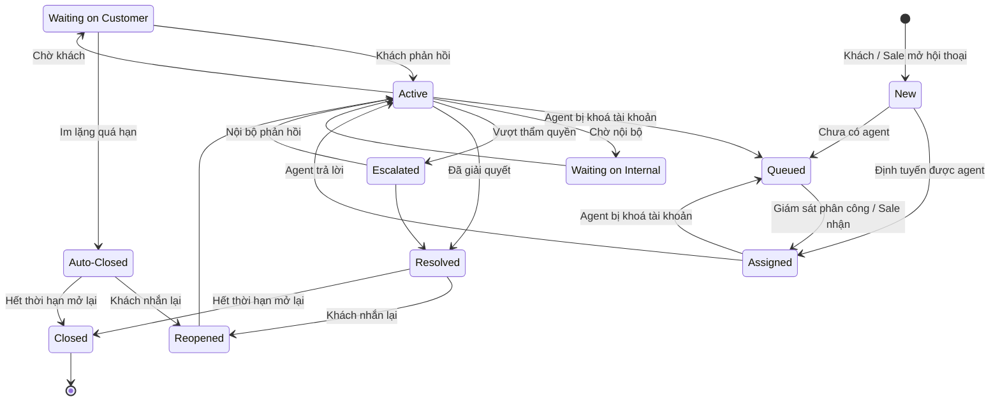

# 16 — Nhắn tin trực tiếp với Sale (Sales Chat / Messaging)

> Đã chốt 2026-11-04: Sales Chat **thuộc phạm vi giai đoạn này** (chốt [open-questions F7](../../open-questions/README.md)). Đây là kênh chính để khách liên hệ Sale trên cổng khách hàng, vì **khách không tự đặt hàng** — mọi nhu cầu mua, yêu cầu báo giá, đặt lại đều đi qua Sale.
>
> Đã chốt 2026-11-05: thêm **thẻ hành động duyệt mẫu in** của **Đơn sản xuất (Production Order)** ([17](../17-order-management/README.md)) — khách xem ảnh / video mẫu in thử, bấm **Duyệt** hoặc **Yêu cầu in lại** kèm ghi chú; cùng thao tác với mục mẫu thiết kế của tôi ([13](../13-catalog/README.md)). Sàn không hiển thị giá: khách thấy giá qua **thẻ báo giá** / hợp đồng. Theo dõi Đơn sản xuất và báo tiến độ cho khách là việc của Sale.
>
> ✅ Đã chốt 2026-11-05 (khách tự thiết kế): **khách tự thiết kế và tự gửi duyệt trên app** ([12](../12-product-design/README.md)) — chat **không** còn dùng để khách gửi mẫu cho Sale thiết kế hộ; bỏ việc Sale ghi nhận mẫu và thẻ "yêu cầu xác nhận thiết kế". Thêm **thẻ yêu cầu báo giá từ bản thiết kế**: hệ thống sinh khi khách bấm "Yêu cầu báo giá" trên bản đã duyệt, hoặc "Gửi duyệt và yêu cầu báo giá" trên bản nháp ([13](../13-catalog/README.md)); Sale nhận yêu cầu ngay nhưng **chỉ lập báo giá khi bản đã `Approved`** ([14](../14-cart-and-order/README.md)).
>
> ✅ Đã chốt 2026-11-25: **thẻ yêu cầu báo giá cả dự án** chứa được bản đang chờ duyệt, bị trả lại hoặc đã duyệt; **mỗi dòng hiện trạng thái** của bản (kèm lý do trả lại nếu có) và thẻ hiện **"đã duyệt x/y"**. Thẻ sinh cả khi khách **gửi duyệt cả bộ kèm yêu cầu báo giá**. Agent chỉ lập báo giá khi **mọi dòng đã `Approved`**; hệ thống **báo Sale** khi yêu cầu **đủ điều kiện báo giá**. Agent đóng được yêu cầu treo, kèm lý do ([12](../12-product-design/README.md) BR-25).
>
> ✅ Đã chốt 2026-11-28 (Sale phụ trách khách — chế độ chặt; đóng [open-questions F5](../../open-questions/README.md)): hội thoại định tuyến theo **Sale phụ trách khách** lưu trên hồ sơ ([18](../18-customer-information/README.md) §4.5) — người phụ trách, hoặc **người thay** khi người phụ trách nghỉ phép; khách chưa có người phụ trách thì vào **hàng chờ**. **Một khách, một đầu mối**: bỏ bước "Sale phụ trách chứng từ ngữ cảnh" (người gửi báo giá / hợp đồng) và bước "Sale đã chăm sóc khách gần nhất". Sale **nhận** hội thoại của khách chưa có người phụ trách thì thành người phụ trách; hội thoại của khách đã có chủ không nhận được. Chỉ người phụ trách, người thay, Sales Manager được **chủ động mở** hội thoại với khách đã có chủ. Đổi người phụ trách thì hội thoại đang mở đi theo; tài khoản Sale bị khoá thì hội thoại của họ về hàng chờ (§4.1, BR-12 – BR-14).

## 1. Mục đích (Purpose)

Kênh **hội thoại trực tiếp giữa khách sỉ và Sale phụ trách khách** ([18](../18-customer-information/README.md) §4.5) trên cổng khách hàng, để:

- tư vấn quy cách sản phẩm, hỏi hàng, đặt lại ([13](../13-catalog/README.md));
- nhận **yêu cầu báo giá từ bản thiết kế** khách tự làm trên app (thẻ yêu cầu báo giá) và trả lời câu hỏi về bản thiết kế (cách thiết kế, trạng thái duyệt, lý do bị trả lại) — việc thiết kế, gửi duyệt, duyệt nằm ở [12](../12-product-design/README.md), không làm qua chat;
- gửi **báo giá**, gửi **hợp đồng mua bán** của đơn ([14](../14-cart-and-order/README.md));
- gửi **thông tin chuyển khoản theo đợt thanh toán** của hợp đồng và **nhắc công nợ** ([15](../15-payment/README.md));
- gửi **mẫu in thử** của Đơn sản xuất để khách **duyệt mẫu in**, báo tiến độ sản xuất ([17](../17-order-management/README.md));
- xử lý phát sinh sau bán: tình trạng giao, đổi / huỷ / trả hàng, khiếu nại giao hàng ([17](../17-order-management/README.md), [09](../../warehouse/09-shipping/README.md)).

Chat **gắn ngữ cảnh (context-aware)**: mỗi hội thoại có thể tham chiếu **sản phẩm / quy cách / SKU riêng của khách**, **bản thiết kế** của khách, **báo giá**, **đơn hàng**, **hợp đồng** hoặc **Đơn sản xuất** (kèm vòng mẫu in) cụ thể, để Sale thấy ngay khách đang nói về việc gì.

---

## 2. Actor liên quan

| Actor | Vai trò |
|-------|---------|
| **Khách hàng sỉ (B2B Customer)** | Mở hội thoại trên cổng khách hàng (từ trang sản phẩm, mẫu thiết kế, báo giá, đơn, hợp đồng, hoặc nút "Chat với Sale"); **yêu cầu báo giá từ bản thiết kế** (hệ thống mở hội thoại kèm thẻ yêu cầu báo giá — [13](../13-catalog/README.md)); gửi câu hỏi, ảnh / file; nhận báo giá, hợp đồng, thông tin chuyển khoản, mẫu in thử; thao tác trên các thẻ hành động (chấp nhận báo giá, **duyệt mẫu in**) |
| **Nhân viên Sale (Sales Staff)** | Trả lời, tư vấn (kể cả hướng dẫn khách tự thiết kế); **nhận yêu cầu báo giá từ bản thiết kế** và lập báo giá khi bản đã duyệt (yêu cầu cả dự án: khi mọi dòng đã duyệt; đóng yêu cầu treo kèm lý do); gửi báo giá, hợp đồng, thông tin chuyển khoản theo đợt, nhắc công nợ, **thẻ duyệt mẫu in** (mẫu do Điều phối sản xuất tải lên); báo khách tiến độ Đơn sản xuất (Điều phối sản xuất ghi nhận ở 17); tạo yêu cầu đổi / huỷ / trả; chuyển tiếp nội bộ — trong module này gọi tắt là *agent*. Chỉ **chủ động mở** hội thoại với khách mình phụ trách hoặc đang lo thay; **nhận** hội thoại trong hàng chờ của khách chưa có người phụ trách — nhận xong thì thành người phụ trách (BR-12, BR-13) *(✅ 2026-11-28)* |
| **Người giữ quyền giám sát chat (Chat Supervision)** | Phân công hội thoại, giám sát SLA, tham gia khi cần escalate — là quyền gán cho Quản lý kinh doanh hoặc Sales Staff được chỉ định (xem [Role Registry](../../00-system-overview/README.md)) |
| **Quản lý kinh doanh (Sales Manager)** *(✅ 2026-11-28)* | Được báo khi có hội thoại vào hàng chờ của khách chưa có người phụ trách và khi một Sale nhận khách từ hàng chờ; **giao / đổi người phụ trách** khách ([18](../18-customer-information/README.md) §4.5) — hội thoại đang mở đi theo; chủ động mở hội thoại với mọi khách |
| **Kế toán (Accountant)**, **Quản lý kho (Warehouse Manager)**, **Quản lý kinh doanh (Sales Manager)**, **Điều phối sản xuất (Production Coordinator)** | Không chat trực tiếp với khách (trừ khi giữ quyền giám sát chat); agent chuyển câu hỏi nội bộ (đối soát tiền → Kế toán; nhập kho, xuất kho, kết quả giao → Quản lý kho; tiến độ sản xuất, mẫu in, ngày hoàn thành dự kiến, duyệt bản thiết kế của khách → Điều phối sản xuất; giá báo cho khách cần ý kiến → Quản lý kinh doanh (báo giá giảm quá ngưỡng so với giá tham chiếu thì Quản lý kinh doanh duyệt giá trong luồng báo giá, không qua chat — BR-04) — *✅ Chốt lại 2026-11-20: không còn duyệt Đơn sản xuất, duyệt thiết kế chuyển cho Điều phối sản xuất*) và chờ phản hồi |
| **Hệ thống (định tuyến & nhắc SLA)** | Định tuyến hội thoại tới Sale phụ trách khách hoặc người thay, không có thì vào hàng chờ (§4.1); chuyển hội thoại khi đổi người phụ trách, đưa về hàng chờ khi tài khoản Sale bị khoá; sinh **thẻ ngữ cảnh / thẻ hành động** từ chứng từ, gồm **thẻ yêu cầu báo giá** khi khách yêu cầu báo giá và cập nhật trạng thái bản thiết kế trên thẻ (từng dòng với thẻ nhiều dòng); **báo Sale** khi yêu cầu cả dự án đủ điều kiện báo giá; nhắc SLA; lưu lịch sử |

> ⚠️ Giả định: phạm vi là **chat 1–1 khách sỉ ↔ Sale trong cổng khách hàng**. Tích hợp kênh ngoài (Facebook Messenger, Zalo, email) và chatbot AI là phạm vi sau — xem [open-questions F1, F2](../../open-questions/README.md).

---

## 3. Input / Output

### Input

| Trường | Mô tả | Bắt buộc |
|--------|-------|----------|
| Người khởi tạo | Khách (từ trang sản phẩm, mẫu thiết kế, báo giá, đơn, hợp đồng, nút "Chat với Sale", hoặc **"Yêu cầu báo giá"** / **"Gửi duyệt và yêu cầu báo giá"** trên bản thiết kế, **"Yêu cầu báo giá cả dự án"** / **"Gửi duyệt cả bộ"** kèm yêu cầu báo giá trên dự án) hoặc Sale (chủ động) | Có |
| Ngữ cảnh đính kèm | Một trong: sản phẩm / quy cách / SKU riêng của khách ([13](../13-catalog/README.md)), bản thiết kế ([12](../12-product-design/README.md)), báo giá, đơn hàng, hợp đồng ([14](../14-cart-and-order/README.md)), Đơn sản xuất kèm vòng mẫu in ([17](../17-order-management/README.md)) — chỉ chứng từ thuộc đúng khách | Không |
| Vòng mẫu in | Của Đơn sản xuất `Sample Pending`: số vòng, **ảnh / video mẫu** Điều phối sản xuất tải lên, ngày gửi mẫu vật (nếu có) — dữ liệu cho thẻ duyệt mẫu in ([17](../17-order-management/README.md)) | Khi gửi thẻ duyệt mẫu in |
| **Yêu cầu báo giá** | Khi khách yêu cầu báo giá từ bản thiết kế ([13](../13-catalog/README.md)): bản thiết kế, SKU riêng (nếu đã sinh), **trạng thái bản thiết kế** (`Pending Review` / `Approved` — [12](../12-product-design/README.md)), **số thùng mong muốn** (gợi ý), **ngày giao mong muốn** (nếu có) — dữ liệu cho thẻ yêu cầu báo giá. **Cả dự án**: tên dự án, nhiều dòng (bản thiết kế, SKU riêng nếu đã sinh, **trạng thái từng bản** — `Pending Review` / `Draft` bị trả lại kèm lý do / `Approved`, số thùng mong muốn từng dòng), một ngày giao mong muốn chung | Khi khách yêu cầu báo giá |
| Nội dung tin nhắn | Chữ, ảnh, file (ảnh tham khảo, ảnh sản phẩm lỗi, file hợp đồng đã ký), link | Có |
| Thông tin khách | Hồ sơ từ [18 Customer Information](../18-customer-information/README.md) | Có (khách đã đăng nhập) |

### Output

| Kết quả | Dùng bởi |
|---------|----------|
| **Hội thoại (conversation / thread)** — lịch sử tin nhắn, người tham gia, ngữ cảnh, trạng thái | Sale, khách, người giám sát chat |
| **Thẻ hành động** trong hội thoại: **yêu cầu báo giá** (bản thiết kế, trạng thái, số thùng mong muốn, ngày giao mong muốn; **nhiều dòng** khi yêu cầu cả dự án, mỗi dòng có trạng thái, thẻ hiện "đã duyệt x/y"; Sale **Lập báo giá** khi bản `Approved` — với thẻ nhiều dòng, khi mọi dòng `Approved`), báo giá (khách chấp nhận — chọn số thùng từng dòng — / yêu cầu sửa), hợp đồng gửi khách, thông tin chuyển khoản theo đợt, nhắc công nợ, **duyệt mẫu in** (ảnh / video mẫu; Duyệt / Yêu cầu in lại kèm ghi chú), **hoá đơn** (chỉ xem / tải hoá đơn đã phát hành) | Khách, Sale; chứng từ ở 14, 15, 17, 21 |
| **Thông báo "đủ điều kiện báo giá"** — khi bản cuối cùng của yêu cầu báo giá cả dự án được duyệt | Sale |
| **Hành động phát sinh**: báo giá lập từ thẻ yêu cầu báo giá, báo giá, kết quả duyệt mẫu in, yêu cầu đổi / huỷ / trả | 14, 17 |
| **Ghi chú nội bộ (internal note)** — chỉ nhân viên thấy | Sale, người giám sát chat |
| **Chỉ số:** thời gian phản hồi đầu (FRT), thời gian xử lý, mức hài lòng (CSAT) | Người giám sát chat, báo cáo |
| **Lịch sử tương tác** gắn hồ sơ khách và chứng từ ngữ cảnh | [18 Customer Information](../18-customer-information/README.md), 12, 14, 17 |

---

## 4. Luồng nghiệp vụ từng bước (Step-by-step)

### 4.1. Mở hội thoại & định tuyến

1. **Khởi tạo** — khách bấm "Chat với Sale" (hoặc "Yêu cầu báo giá", "Gửi duyệt và yêu cầu báo giá", "Đặt lại") từ một trang; hệ thống tạo hội thoại và đính **ngữ cảnh** của trang đó. Sale cũng có thể chủ động mở hội thoại với khách, gắn ngữ cảnh chứng từ.
2. **Định tuyến (routing)** *(✅ Chốt lại 2026-11-28 — thay thứ tự "Sale phụ trách chứng từ ngữ cảnh → Sale đã chăm sóc khách gần nhất → hàng đợi chung")* — hệ thống gán agent theo quy tắc **"ai lo khách này hôm nay"** của hồ sơ khách ([18](../18-customer-information/README.md) §4.5 bước 15):

   | Trường hợp | Giao cho |
   |------------|----------|
   | Khách **có** người phụ trách đang làm | **Người phụ trách**, hoặc **người thay** nếu người phụ trách đang trong lịch nghỉ phép. Kể cả khi khách hỏi về báo giá, hợp đồng, đơn hay Đơn sản xuất do người khác gửi (Manager lập hộ, người thay gửi): **một khách, một đầu mối**; người gửi vẫn được ghi trên chứng từ |
   | Khách **chưa có** người phụ trách (khách mới Manager chưa giao, hoặc Sale cũ đã nghỉ mà chưa giao lại) | **Hàng chờ** (`Queued`): Sales Manager được báo và phân công, hoặc một Sale bấm **Nhận** — Sale nhận thành người phụ trách của khách (BR-13) |
   | Người phụ trách / người thay / Sales Manager **chủ động mở** hội thoại | Mở được; người phụ trách hoặc người thay mở thì hội thoại giao cho chính họ |
   | Sale **khác** chủ động mở hội thoại với khách **đã có chủ** | **Bị chặn**: "Khách này do [A] phụ trách. Nhờ A hoặc Sales Manager". Sale đó vẫn **xem** được hội thoại của khách (BR-12) |

   Bước "Sale đã chăm sóc khách gần nhất" bỏ đi: người phụ trách đã thay vai trò đó và rõ ràng hơn. Với Đơn sản xuất, hội thoại cũng về người phụ trách khách (Điều phối sản xuất không chat với khách).
3. **Chờ & phản hồi** — ngoài giờ / Sale không trực tuyến: hiển thị thời gian phản hồi dự kiến; tin nhắn được giữ trong hội thoại, khách nhận thông báo khi Sale trả lời. Trong giờ: agent nhận thông báo, mở hội thoại thấy ngữ cảnh + hồ sơ khách + lịch sử. Người phụ trách trả lời trễ SLA (kể cả khi đi vắng mà quên lập người thay) → người giám sát chat được cảnh báo và chuyển hội thoại; Sales Manager có thể đổi luôn người phụ trách (BR-09).

   **Khi người phụ trách đổi** *(✅ 2026-11-28)* — Sales Manager đổi người phụ trách khách (đổi lẻ, chuyển hàng loạt, duyệt yêu cầu đổi Sale — [18](../18-customer-information/README.md) §4.5, §4.7): mọi hội thoại **đang mở** của khách chuyển sang người mới, kèm **ghi chú nội bộ** "Chuyển từ A sang B: lý do"; khách nhận **một tin hệ thống** "Từ nay anh/chị được [B] hỗ trợ" (Manager tắt được khi đổi nội bộ) (BR-14).

   **Khi tài khoản Sale bị khoá / vô hiệu hoá** *(✅ 2026-11-28)* — hội thoại đang mở của người đó **về hàng chờ**, đánh dấu **ưu tiên cao**; Sales Manager được báo kèm số hội thoại cần giao; khách của người đó sang "Cần giao người phụ trách" ([18](../18-customer-information/README.md) BR-18). Một Sale nhận hội thoại thì thành người phụ trách của khách (BR-13).

> ⚠️ Giả định: giờ làm việc và mục tiêu FRT do người giám sát chat cấu hình. Xem [open-questions F3](../../open-questions/README.md).

### 4.2. Tư vấn & yêu cầu báo giá từ bản thiết kế

4. Hai bên nhắn tin, gửi ảnh / file. Agent có thể gửi **link sản phẩm / SKU riêng của khách** ([13](../13-catalog/README.md)).
5. **Yêu cầu báo giá từ bản thiết kế** — khách bấm **"Yêu cầu báo giá"** trên bản `Approved`, hoặc **"Gửi duyệt và yêu cầu báo giá"** trên bản `Draft` (đã qua tự kiểm) ([13](../13-catalog/README.md)) → hệ thống mở hội thoại gắn ngữ cảnh bản thiết kế và sinh **thẻ yêu cầu báo giá**: bản thiết kế, SKU riêng (nếu đã sinh), **trạng thái bản thiết kế**, số thùng mong muốn, ngày giao mong muốn.
   - Bản `Approved` → agent bấm **Lập báo giá** trên thẻ: báo giá `Draft` điền sẵn SKU riêng; ngày giao mong muốn → ngày giao khách yêu cầu; số thùng khách nêu chỉ là gợi ý ([14](../14-cart-and-order/README.md) BR-22).
   - Bản còn `Pending Review` → thẻ hiện "chờ duyệt thiết kế", agent **chưa lập báo giá** được; thẻ tự cập nhật khi Điều phối sản xuất duyệt (SKU riêng sinh) hoặc trả lại bản thiết kế ([12](../12-product-design/README.md)).
   - **Yêu cầu báo giá cả dự án** — khách bấm **"Yêu cầu báo giá cả dự án"** trên một dự án thiết kế, hoặc **"Gửi duyệt cả bộ"** kèm yêu cầu báo giá ([13](../13-catalog/README.md) §4.6, [12](../12-product-design/README.md) §4.10–§4.11) → hệ thống mở **một hội thoại** gắn ngữ cảnh dự án và sinh **thẻ yêu cầu báo giá nhiều dòng**: tên dự án; mỗi dòng một bản thiết kế với số thùng mong muốn và **trạng thái hiện tại** — `Pending Review` ("chờ duyệt thiết kế"), `Draft` bị trả lại (kèm lý do) hoặc `Approved` (kèm SKU riêng); một ngày giao mong muốn chung; chỉ báo **"đã duyệt x/y"**.
     - Còn dòng chưa `Approved` → agent **chưa lập báo giá** được, không báo giá một phần; từng dòng tự cập nhật khi Điều phối sản xuất duyệt hoặc trả lại bản đó.
     - Bản cuối cùng được duyệt → hệ thống **báo Sale** yêu cầu đã **đủ điều kiện báo giá**; agent bấm **Lập báo giá** → **một báo giá `Draft`** điền sẵn mọi SKU riêng của thẻ ([14](../14-cart-and-order/README.md) BR-22).
     - Khách bỏ dòng (trước khi có báo giá) → thẻ hiện danh sách mới, Sale được báo; bỏ hết dòng, hoặc khách xoá hết các bản trong thẻ → yêu cầu đóng. Đã có báo giá từ thẻ thì khách không sửa yêu cầu nữa ([12](../12-product-design/README.md) BR-25.4, BR-25.5, BR-25.7).
     - Yêu cầu treo (bản bị trả lại mà khách không sửa tiếp) → agent **đóng yêu cầu kèm lý do** (bắt buộc); khách cũng tự đóng được ([12](../12-product-design/README.md) BR-25.3).

   > ⚠️ Giả định: bản thiết kế bị trả lại sau "Gửi duyệt và yêu cầu báo giá" thì thẻ yêu cầu báo giá **vẫn mở**, hiện trạng thái `Draft` kèm lý do trả lại; khách sửa và gửi duyệt lại thì thẻ tiếp tục theo bản đó, không cần gửi yêu cầu mới. Khách xoá bản nháp (`Archived`) thì thẻ đóng. Xem [open-questions B40](../../open-questions/README.md).
6. **Thiết kế không làm qua chat** — agent tư vấn cách thiết kế, giải thích lý do bản bị trả lại; khách **tự** sửa, gửi duyệt, tạo bản sửa trên app ([12](../12-product-design/README.md)). Agent không nhận file mẫu để thiết kế hộ, không tạo bản thiết kế hay bản sửa thay khách (BR-05).

### 4.3. Báo giá, đơn & hợp đồng

7. Agent lập **báo giá** ([14](../14-cart-and-order/README.md)) và gửi **thẻ báo giá** vào hội thoại. Khách bấm **Chấp nhận** hoặc **Yêu cầu sửa** ngay trên thẻ — cùng thao tác như trên trang báo giá ở cổng.
8. Từ báo giá đã chấp nhận, agent tạo **đơn hàng** và **hợp đồng mua bán** ([14](../14-cart-and-order/README.md)), gửi **thẻ hợp đồng** (file hợp đồng, lịch các đợt thanh toán) cho khách. Khách có thể gửi lại file hợp đồng đã ký (bản scan hoặc PDF có chữ ký số) qua chat; agent tải file đó lên hợp đồng ở [14](../14-cart-and-order/README.md).

> ✅ Đã chốt 2026-11-05: "khách chấp nhận báo giá qua chat" nghĩa là khách bấm **Chấp nhận** trên thẻ báo giá trong hội thoại. Agent **không** tự đánh dấu chấp nhận thay khách dựa trên tin nhắn chữ. Xem [open-questions](../../open-questions/README.md).

### 4.4. Thanh toán theo đợt & công nợ

9. Khi một **đợt thanh toán** của hợp đồng đến hạn (`Due`), agent gửi **thẻ thông tin chuyển khoản** cho đợt đó: tài khoản nhận của doanh nghiệp, số tiền đợt, nội dung chuyển khoản (mã hợp đồng + mã đợt), hạn thanh toán, kèm **mã VietQR** chứa sẵn các thông tin đó để khách quét bằng ứng dụng ngân hàng và chuyển khoản — không phải cổng thanh toán ([15](../15-payment/README.md)) *(✅ Cập nhật 2026-11-15)*.
10. Đợt quá hạn hoặc công nợ phải thu sắp / đã quá hạn: agent gửi **nhắc công nợ** kèm thẻ thông tin chuyển khoản. Việc ghi nhận tiền về (phiếu thu theo đợt) do Kế toán làm ở [15](../15-payment/README.md); chat không ghi nhận thanh toán.

### 4.5. Duyệt mẫu in & tiến độ sản xuất

11. Khi Đơn sản xuất của đơn khách ở `Sample Pending` ([17](../17-order-management/README.md)), Điều phối sản xuất tải **ảnh / video mẫu in thử** lên vòng mẫu ở 17 *(cập nhật 2026-11-07)*; Sale gửi **thẻ duyệt mẫu in** vào hội thoại gắn ngữ cảnh Đơn sản xuất. Thẻ hiện: SKU riêng, số vòng, ảnh / video mẫu, ngày gửi mẫu vật (nếu đã gửi mẫu vật cho khách), kết quả các vòng trước.
12. Khách bấm ngay trên thẻ — cùng thao tác như ở mục mẫu thiết kế của tôi ([13](../13-catalog/README.md)):
    - **Duyệt** → Đơn sản xuất sang `In Production`;
    - **Yêu cầu in lại** kèm **ghi chú** (bắt buộc) → Điều phối sản xuất mở vòng mẫu mới và ghi lý do in lại ở [17](../17-order-management/README.md).

    Thẻ cập nhật kết quả dù khách thao tác trên thẻ hay trên sàn.
13. Khách nhắn rằng cần **sửa thiết kế** (đổi logo, màu, nội dung — không phải lỗi in) → agent hướng dẫn khách tự **tạo bản sửa** từ bản `Approved` trong mục mẫu thiết kế của tôi ([13](../13-catalog/README.md)) và gửi duyệt ([12](../12-product-design/README.md)); bản sửa được duyệt sinh SKU riêng mới, agent đổi SKU dòng đơn theo [17](../17-order-management/README.md); thẻ duyệt mẫu in không dùng để sửa thiết kế.
14. Sale báo khách **tiến độ Đơn sản xuất** (đã nhận đơn, ngày hoàn thành dự kiến, đã nhập kho một phần / đủ — do Điều phối sản xuất ghi nhận) qua chat ([17](../17-order-management/README.md)).

### 4.6. Sau bán, escalate & kết thúc

15. **Hỗ trợ sau bán** — khách nhắn về đơn đang giao / bị lỗi: agent tra [Order Management](../17-order-management/README.md), báo trạng thái đơn, tạo **yêu cầu đổi / huỷ / trả**. Khách hỏi hoá đơn: agent gửi **thẻ hoá đơn** của hoá đơn đã phát hành (số, ký hiệu, ngày lập, tổng có thuế, link tải XML / PDF) — hoá đơn lập theo từng lần giao thành công ([21](../21-e-invoice/README.md)); chat không phát hành hay sửa hoá đơn. Khách muốn đổi thiết kế của đơn đã chốt: đi theo quy trình thay đổi đơn ở [17](../17-order-management/README.md) (chỉ khi Đơn sản xuất liên quan chưa `In Production`).
16. **Chờ nội bộ** — câu hỏi cần Kế toán / Quản lý kho / Quản lý kinh doanh trả lời: agent chuyển nội bộ, hội thoại sang `Waiting on Internal`.
17. **Escalate** — vấn đề vượt thẩm quyền (ví dụ bồi thường; giá trên báo giá không phải escalate — giảm quá ngưỡng thì báo giá qua bước duyệt giá của 14, BR-04): chuyển người giám sát chat; hội thoại ghi nhận lý do & người xử lý tiếp.
18. **Kết thúc & đánh giá** — agent đánh dấu đã giải quyết; gửi khảo sát CSAT. Hội thoại **mở lại (reopen)** được nếu khách nhắn tiếp trong thời hạn.
19. **Lưu vết** — toàn bộ hội thoại + hành động gắn vào [hồ sơ khách](../18-customer-information/README.md) và vào chứng từ ngữ cảnh (bản thiết kế, báo giá, đơn, hợp đồng, Đơn sản xuất).

---

## 5. Trạng thái / Vòng đời (Lifecycle)

### Trạng thái hội thoại (Conversation)

| Trạng thái | Ý nghĩa | Chuyển tiếp cho phép | Ai thực hiện |
|------------|---------|----------------------|--------------|
| `New` | Vừa tạo, chưa gán agent | → `Assigned`, → `Queued` | Hệ thống |
| `Queued` | Khách chưa có người phụ trách, hoặc agent cũ bị khoá tài khoản (ưu tiên cao); chờ người giám sát phân công hoặc một Sale nhận (BR-13) | → `Assigned` | Người giám sát chat / Sales Manager (phân công); Sale (nhận) |
| `Assigned` | Đã gán agent, chưa trả lời | → `Active`, → `Queued` (agent bị khoá tài khoản) | Hệ thống / Agent |
| `Active` | Đang trao đổi | → `Waiting on Customer`, → `Waiting on Internal`, → `Escalated`, → `Resolved`, → `Queued` (agent bị khoá tài khoản) | Agent; Hệ thống (khi khoá tài khoản) |
| `Waiting on Customer` | Chờ khách phản hồi (ví dụ chờ khách sửa và gửi duyệt lại thiết kế, chấp nhận báo giá, gửi hợp đồng đã ký, duyệt mẫu in) | → `Active`, → `Auto-Closed` (quá hạn im lặng) | Hệ thống |
| `Waiting on Internal` | Chờ bộ phận khác (Kế toán, Quản lý kho, Quản lý kinh doanh) | → `Active` | Agent |
| `Escalated` | Đã chuyển người giám sát chat | → `Active`, → `Resolved` | Người giám sát chat |
| `Resolved` | Đã xử lý xong | → `Reopened`, → `Closed` | Agent |
| `Reopened` | Khách nhắn lại sau khi đã giải quyết | → `Active` | Hệ thống |
| `Auto-Closed` | Đóng do khách im lặng quá hạn | → `Reopened` (khách nhắn lại trong thời hạn), → `Closed` | Hệ thống |
| `Closed` | Đóng vĩnh viễn (hết thời hạn mở lại) | *(cuối)* | Hệ thống |

> ✅ 2026-11-28: tài khoản agent bị khoá / vô hiệu hoá thì mọi hội thoại đang mở của agent đó (kể cả đang `Waiting on Customer` / `Waiting on Internal` / `Reopened`) về `Queued`, ưu tiên cao (§4.1 bước 3). Đổi người phụ trách khách thì hội thoại đang mở **giữ trạng thái**, chỉ đổi agent.

---

## 6. Ràng buộc nghiệp vụ (Business Rules) & Edge case

### Business rules

- **BR-01:** Mọi hành động có hệ quả (khách gửi yêu cầu báo giá, lập báo giá từ thẻ yêu cầu báo giá, gửi báo giá, gửi hợp đồng, gửi thông tin chuyển khoản, khách chấp nhận báo giá trên thẻ, gửi thẻ duyệt mẫu in, khách Duyệt / Yêu cầu in lại trên thẻ, tạo yêu cầu đổi / huỷ / trả) phải **ghi log gắn hội thoại & gắn người thực hiện**.
- **BR-02:** **Ngữ cảnh phải thuộc đúng khách** của hội thoại. Khách chỉ gắn / xem được chứng từ và SKU của chính mình; Sale không gắn chứng từ của khách khác.
- **BR-03:** Chat **không tự thay đổi chứng từ**. Thẻ hành động gọi đúng thao tác của module sở hữu chứng từ, với đúng điều kiện và trạng thái ở đó: báo giá, hợp đồng ([14](../14-cart-and-order/README.md)); duyệt mẫu in, đổi / huỷ / trả ([17](../17-order-management/README.md)). Trạng thái bản thiết kế trên thẻ yêu cầu báo giá chỉ đọc từ [12](../12-product-design/README.md); chat không gửi duyệt, không duyệt bản thiết kế.
- **BR-04:** **Giá chỉ có hiệu lực trên báo giá.** Sale nhập giá trên báo giá; báo giá có bậc **giảm quá ngưỡng** so với giá tham chiếu (cấu hình, mặc định 10%) hoặc không có giá tham chiếu phải được **Quản lý kinh doanh duyệt giá** trước khi tới khách — trong lúc chờ, khách chưa nhận thẻ báo giá ([14](../14-cart-and-order/README.md) BR-10, BR-24; *✅ Chốt lại 2026-11-26 — thay "Sale tự quyết giá, không có bước duyệt; chỉ báo Quản lý kinh doanh sau khi gửi" của 2026-11-25*). Giảm giá / ưu đãi chỉ có hiệu lực khi được ghi trên báo giá đã gửi khách, không hứa qua tin nhắn.
- **BR-05:** **Thiết kế không làm qua chat** *(✅ Đã chốt 2026-11-05)*: khách **tự** tạo, sửa, gửi duyệt bản thiết kế và tạo bản sửa trên app ([12](../12-product-design/README.md)); agent không tạo bản thiết kế hay bản sửa thay khách. Ảnh / file khách gửi qua chat chỉ để trao đổi, không thành file thiết kế. Chỉ bản thiết kế đã duyệt (`Approved`) mới dùng để báo giá, đặt hàng.
- **BR-06:** **Thông tin chuyển khoản chỉ gửi bằng thẻ do hệ thống sinh** từ đợt thanh toán của hợp đồng (tài khoản nhận là tài khoản doanh nghiệp đã cấu hình, số tiền và nội dung lấy từ đợt). Không gõ tay số tài khoản nhận vào tin nhắn.
- **BR-07:** Ghi chú nội bộ không hiển thị cho khách; tách biệt rõ trong giao diện & dữ liệu.
- **BR-08:** Thông tin nhạy cảm (số thẻ, mật khẩu) không được yêu cầu / nhập qua chat; hệ thống che (masking) các mẫu nhạy cảm.
- **BR-09:** SLA phản hồi (FRT) & thời gian giải quyết được đo và cảnh báo; hội thoại quá hạn nổi bật trong hàng đợi.
- **BR-10:** **Thẻ duyệt mẫu in chỉ do hệ thống sinh** từ vòng mẫu in đang chờ khách của Đơn sản xuất `Sample Pending` thuộc đúng khách ([17](../17-order-management/README.md)). Chỉ khách (chủ sở hữu) bấm **Duyệt** / **Yêu cầu in lại**; agent **không** duyệt thay khách dựa trên tin nhắn chữ. Yêu cầu in lại bắt buộc ghi chú.
- **BR-11:** **Thẻ yêu cầu báo giá chỉ do hệ thống sinh** khi khách (chủ sở hữu) bấm "Yêu cầu báo giá" trên bản thiết kế `Approved`, hoặc "Gửi duyệt và yêu cầu báo giá" trên bản `Draft` đã qua tự kiểm, hoặc "Yêu cầu báo giá cả dự án" / "Gửi duyệt cả bộ" kèm yêu cầu báo giá trên một dự án thiết kế — khi đó thẻ có **nhiều dòng**, mỗi dòng một bản `Pending Review`, bị trả lại (`Draft`) hoặc `Approved` ([13](../13-catalog/README.md) BR-16, [12](../12-product-design/README.md) BR-25). Thẻ hiện **trạng thái hiện tại** của bản thiết kế (thẻ nhiều dòng: từng dòng, kèm lý do trả lại và "đã duyệt x/y"); agent chỉ **Lập báo giá** từ thẻ khi bản đã `Approved` (SKU riêng đã sinh) — thẻ nhiều dòng thì khi **mọi dòng** đã `Approved`, và hệ thống báo Sale lúc đó. Số thùng trên thẻ là gợi ý; ngày giao mong muốn điền vào ngày giao khách yêu cầu của báo giá ([14](../14-cart-and-order/README.md) BR-22). Yêu cầu báo giá không phải báo giá, không giữ hàng.
- **BR-12:** **Một khách, một đầu mối; chỉ người lo khách được chủ động chat** *(✅ Đã chốt 2026-11-28 — chế độ chặt)*. Hội thoại của khách đã có người phụ trách đang làm luôn giao cho **người phụ trách**, hoặc **người thay** trong lịch nghỉ phép ([18](../18-customer-information/README.md) BR-17), bất kể ngữ cảnh là chứng từ do ai gửi. Chỉ người phụ trách, người thay, Sales Manager (và System Admin) được **chủ động mở** hội thoại với khách đó; Sale khác bị chặn kèm thông báo "Khách này do [A] phụ trách. Nhờ A hoặc Sales Manager", nhưng vẫn **xem** được hội thoại ([18](../18-customer-information/README.md) BR-21). Chỉ agent đang được giao hội thoại trả lời khách.
- **BR-13:** **Nhận khách từ hàng chờ** *(✅ Đã chốt 2026-11-28)*. Chỉ hội thoại của khách **chưa có người phụ trách đang làm** (`UNASSIGNED` / `NEEDS_ASSIGNMENT`) mới vào hàng chờ và mới **nhận** được. Sale nhận → **thành người phụ trách** của khách (lý do "Nhận từ hàng chờ", ghi lịch sử phụ trách) và **Sales Manager được báo**; Manager đổi lại được. Hội thoại của khách đã có chủ không có trong hàng chờ; gọi nhận trực tiếp cũng bị từ chối — Sale không dùng "Nhận" để lấy khách của người khác. Quy tắc "nhận thì thành người phụ trách" bật mặc định, **tắt được bằng cấu hình**; khi tắt, chỉ Sales Manager giao người phụ trách.
- **BR-14:** **Hội thoại đi theo người phụ trách** *(✅ Đã chốt 2026-11-28)*. Đổi người phụ trách khách → mọi hội thoại đang mở của khách chuyển sang người mới, kèm ghi chú nội bộ "Chuyển từ A sang B: lý do", khách nhận tin hệ thống "Từ nay anh/chị được [B] hỗ trợ" trừ khi Manager tắt cho lần đổi nội bộ. Tài khoản Sale bị khoá / vô hiệu hoá → hội thoại đang mở của người đó về hàng chờ, ưu tiên cao, Sales Manager được báo. Khách viết lại sau khi hội thoại cũ đã đóng hẳn → hội thoại mới giao cho người phụ trách **hiện tại**, không phải agent của hội thoại cũ. **Khách không tự chọn Sale trong chat**: muốn đổi người hỗ trợ thì gửi yêu cầu, Sales Manager quyết ([18](../18-customer-information/README.md) §4.7).

### Edge case

| Tình huống | Hướng xử lý |
|------------|-------------|
| Khách rời trang giữa chừng | Lưu hội thoại; khách nhận thông báo khi Sale trả lời; mở lại thấy lịch sử |
| Nhiều agent cùng mở một hội thoại | Chỉ agent đang phụ trách được trả lời; người khác ở chế độ xem |
| Khách mở nhiều hội thoại cho cùng một việc | Cho phép gộp; giữ một hội thoại chính, tham chiếu chéo |
| Agent nghỉ phép, đã có lịch người thay | Trong lịch, hội thoại của khách được định tuyến tới người thay, nhãn "Bạn đang lo thay cho A"; hết lịch tự về lại người phụ trách ([18](../18-customer-information/README.md) BR-17) *(✅ Chốt lại 2026-11-28)*. ⚠️ Giả định: hội thoại **đang mở** lúc lịch thay bắt đầu / kết thúc giữ agent đang được giao, người giám sát chuyển tay nếu cần — xem [open-questions F9](../../open-questions/README.md) |
| Agent nghỉ phép mà quên lập người thay | Hội thoại vẫn về người phụ trách; trả lời trễ SLA thì người giám sát chat được cảnh báo và chuyển tay (BR-09); Manager lập lịch thay hoặc đổi người phụ trách |
| Agent nghỉ việc / bị khoá tài khoản giữa hội thoại đang mở | Hội thoại về hàng chờ, ưu tiên cao, toàn bộ ngữ cảnh & ghi chú giữ nguyên; Sales Manager được báo; khách sang "Cần giao người phụ trách"; Sale nhận hội thoại thì thành người phụ trách (BR-13, BR-14) *(✅ Chốt lại 2026-11-28 — thay "định tuyến lại sang agent khác")* |
| Khách đổi Sale (Manager đổi người phụ trách, chuyển hàng loạt, hoặc duyệt yêu cầu đổi Sale của khách) | Hội thoại đang mở chuyển sang người mới kèm ghi chú nội bộ "Chuyển từ A sang B: lý do"; khách nhận tin hệ thống "Từ nay anh/chị được [B] hỗ trợ" (tắt được khi đổi nội bộ) (BR-14) *(✅ 2026-11-28)* |
| Khách nhắn "cho tôi đổi Sale khác" trong chat | Agent không đổi được; hướng dẫn khách gửi **"Yêu cầu đổi người hỗ trợ"** trên trang tài khoản, Sales Manager quyết ([18](../18-customer-information/README.md) §4.7) |
| Khách quen nhắn chung chung (không gắn chứng từ) | Về người phụ trách (BR-12) |
| Khách hỏi về báo giá do Sale khác gửi (Manager lập hộ, người thay gửi) | Vẫn về người phụ trách: một khách một đầu mối; người gửi vẫn ghi trên báo giá (BR-12) |
| Khách mới, Sales Manager tạo hồ sơ mà chưa chọn Sale | Lần nhắn đầu vào hàng chờ; Manager giao hoặc một Sale nhận (BR-13) |
| Sale bấm "Nhận" hội thoại của khách đã có chủ (gọi thẳng, vượt giao diện) | Bị từ chối: chỉ khách chưa có người phụ trách mới nhận được (BR-13) |
| Sale khác chủ động mở chat với khách đã có chủ | Bị chặn, kèm tên người phụ trách; Sale đó vẫn xem được hội thoại (BR-12) |
| Người phụ trách chưa trả lời, khách hối | Cảnh báo SLA tới người giám sát chat (BR-09); chuyển hội thoại, Manager có thể đổi luôn người phụ trách |
| Khách viết lại sau khi hội thoại đã đóng hẳn | Hội thoại mới, giao người phụ trách **hiện tại** (BR-14) |
| Khách bị chặn / đóng | Không chat được nên không định tuyến; khách vẫn giữ người phụ trách ([18](../18-customer-information/README.md) BR-13) |
| Khách gửi file quá lớn / định dạng lạ | Từ chối theo giới hạn dung lượng & loại file của chat; hướng dẫn gửi lại |
| Khách gửi logo / file qua chat nhờ Sale thiết kế hộ | Agent hướng dẫn khách bấm "Thiết kế" trên quy cách và tự thiết kế trên app ([13](../13-catalog/README.md), [12](../12-product-design/README.md)); không thiết kế hộ (BR-05) |
| Agent muốn lập báo giá từ thẻ khi bản thiết kế còn `Pending Review` | Không lập được (BR-11); thẻ hiện "chờ duyệt thiết kế"; agent có thể nhờ Điều phối sản xuất xem sớm (`Waiting on Internal`; *✅ Chốt lại 2026-11-20*) |
| Bản thiết kế bị trả lại sau "Gửi duyệt và yêu cầu báo giá" | Thẻ hiện bản về `Draft` kèm lý do; agent giải thích cho khách, chờ khách sửa và gửi duyệt lại (`Waiting on Customer`) — ⚠️ giả định ở §4.2 |
| Thẻ yêu cầu báo giá cả dự án còn dòng chưa `Approved` | Agent không lập báo giá được, không báo giá một phần ([12](../12-product-design/README.md) BR-25.2); thẻ hiện "đã duyệt x/y" và dòng nào đang chặn |
| Một dòng của thẻ cả dự án bị trả lại | Dòng hiện `Draft` kèm lý do; yêu cầu vẫn mở. Khách sửa và gửi duyệt lại, hoặc bỏ dòng đó; agent giải thích và chờ (`Waiting on Customer`) |
| Khách để dòng bị trả lại mãi không sửa | Agent đóng yêu cầu kèm lý do ([12](../12-product-design/README.md) BR-25.3); khách muốn tiếp thì gửi yêu cầu mới |
| Khách bỏ dòng đúng lúc agent bấm Lập báo giá | Thao tác nào tới trước thì thắng: agent trước thì khách bị từ chối vì yêu cầu đã có báo giá; khách trước thì agent thấy thẻ mới và lập theo danh sách mới nếu mọi dòng còn lại đã `Approved` |
| Khách bấm chấp nhận trên thẻ báo giá đã hết hiệu lực / đã có bản sửa mới | Từ chối theo trạng thái báo giá ở [14](../14-cart-and-order/README.md); thẻ hiển thị trạng thái hiện tại |
| Khách nhắn "đồng ý báo giá" bằng chữ nhưng không bấm trên thẻ | Agent nhắc khách bấm Chấp nhận trên thẻ; không tự chấp nhận thay |
| Khách báo đã chuyển khoản, gửi ảnh biên lai qua chat | Agent chuyển Kế toán (`Waiting on Internal`); tiền chỉ được ghi nhận theo sao kê ở [15](../15-payment/README.md) |
| Khách muốn đổi thiết kế khi Đơn sản xuất đã `In Production` | Agent giải thích không đổi được; ghi nhận; đề xuất phương án (đơn mới với SKU từ bản sửa) |
| Khách nhắn "mẫu in ok" bằng chữ nhưng không bấm trên thẻ | Agent nhắc khách bấm **Duyệt** trên thẻ (hoặc ở mục mẫu thiết kế của tôi); không duyệt thay (BR-10) |
| Khách bấm trên thẻ duyệt mẫu in của vòng đã có kết quả / Đơn sản xuất đã huỷ | Từ chối theo trạng thái ở [17](../17-order-management/README.md); thẻ hiển thị kết quả / trạng thái hiện tại |
| Mẫu in lỗi rõ (lệch màu, sai vị trí) | Khách bấm **Yêu cầu in lại** kèm ghi chú; Điều phối sản xuất ghi lý do lỗi in của bên sản xuất (`PRINT_DEFECT`) ở [17](../17-order-management/README.md) (không tính vào số lần in mẫu miễn phí) |
| Tranh chấp "đã hứa giảm giá qua chat" | Lịch sử hội thoại là bằng chứng; ưu đãi chỉ có hiệu lực khi đã ghi trên báo giá (BR-04) |
| Spam / lạm dụng | Chặn theo tài khoản; cảnh báo người giám sát chat |

---

## 7. Liên kết với các module khác

| Module | Quan hệ |
|--------|---------|
| [12 · Quản lý mẫu & thiết kế](../12-product-design/README.md) | Bản thiết kế hoặc **dự án thiết kế** khách tự làm là ngữ cảnh hội thoại; trạng thái bản thiết kế (chờ duyệt / đã duyệt / bị trả lại) hiện trên thẻ yêu cầu báo giá, từng dòng với thẻ cả dự án (BR-25 của 12); chat không thiết kế, không gửi duyệt, không duyệt |
| [13 · Catalog](../13-catalog/README.md) | Khách mở chat từ sản phẩm / quy cách / SKU riêng / mẫu thiết kế / đơn cũ (hỏi hàng, đặt lại); **"Yêu cầu báo giá"** / **"Gửi duyệt và yêu cầu báo giá"** trên bản thiết kế và **"Yêu cầu báo giá cả dự án"** sinh thẻ yêu cầu báo giá; agent gửi link sản phẩm / SKU riêng; duyệt mẫu in làm được ở cả mục mẫu thiết kế của tôi và thẻ chat |
| [14 · Báo giá, Đơn hàng & Hợp đồng](../14-cart-and-order/README.md) | Lập báo giá từ thẻ yêu cầu báo giá (khi bản `Approved`; thẻ nhiều dòng của dự án → một báo giá nhiều dòng, khi mọi dòng đã `Approved`; số thùng gợi ý, ngày giao mong muốn → ngày giao khách yêu cầu); thẻ báo giá (khách chấp nhận / yêu cầu sửa); gửi hợp đồng, nhận file hợp đồng đã ký; giá trên báo giá do Sale nhập, giảm quá ngưỡng thì Quản lý kinh doanh duyệt giá trước khi gửi khách (BR-10, BR-24 của 14) |
| [15 · Thanh toán theo hợp đồng & Công nợ](../15-payment/README.md) | Thẻ thông tin chuyển khoản theo đợt; nhắc đợt đến hạn / quá hạn và công nợ phải thu |
| [21 · E-invoice](../21-e-invoice/README.md) | Thẻ hoá đơn (hoá đơn đã phát hành của từng lần giao, tải XML / PDF); chat không phát hành hay sửa hoá đơn |
| [17 · Order Management](../17-order-management/README.md) | Tra cứu đơn và trạng thái giao; tiến độ Đơn sản xuất; **thẻ duyệt mẫu in** (vòng mẫu, kết quả Duyệt / Yêu cầu in lại); tạo yêu cầu đổi / huỷ / trả; đổi thiết kế của đơn theo quy trình thay đổi đơn |
| [18 · Customer Information](../18-customer-information/README.md) | Hồ sơ khách, lịch sử tương tác & mua hàng; lưu vết hội thoại. **Sale phụ trách khách**, người thay và quy tắc "ai lo khách này hôm nay" quyết định định tuyến (§4.1); nhận hội thoại từ hàng chờ làm Sale thành người phụ trách; đổi người phụ trách / khoá tài khoản Sale kéo hội thoại theo; yêu cầu đổi Sale của khách đi qua 18 §4.7 |
| [09 · Shipping](../../warehouse/09-shipping/README.md) | Xử lý khiếu nại giao hàng, đơn trễ |
