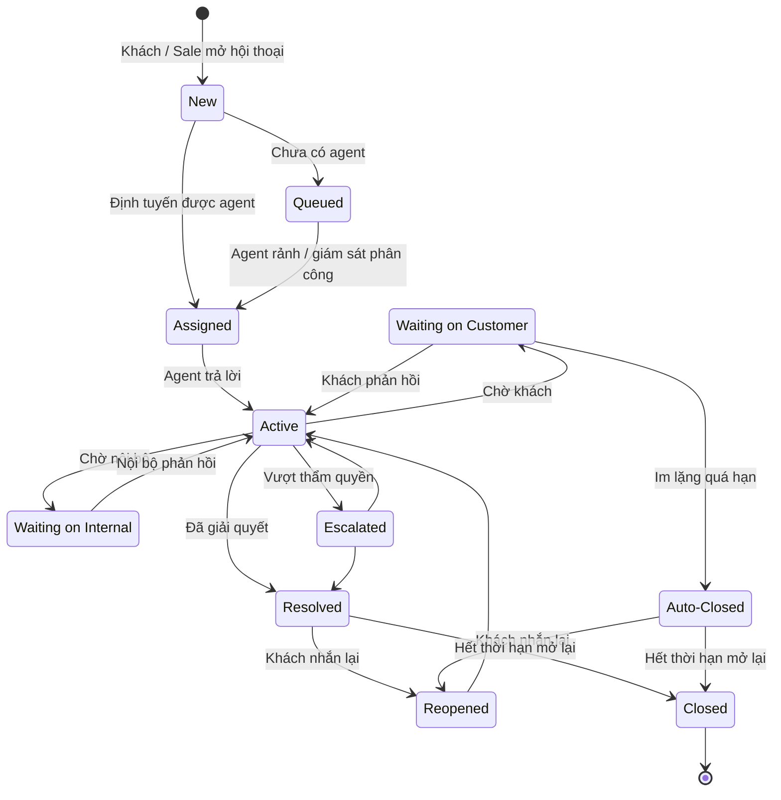

# 16 — Nhắn tin trực tiếp với Sale (Sales Chat / Messaging)

> Đã chốt 2026-11-04: Sales Chat **thuộc phạm vi giai đoạn này** (chốt [open-questions F7](../../open-questions/README.md)). Đây là kênh chính để khách liên hệ Sale trên cổng khách hàng, vì **khách không tự đặt hàng** — mọi nhu cầu mua, in theo mẫu, đặt lại đều đi qua Sale.

## 1. Mục đích (Purpose)

Kênh **hội thoại trực tiếp giữa khách sỉ và nhân viên Sale phụ trách** trên cổng khách hàng, để:

- tư vấn quy cách sản phẩm, yêu cầu in theo mẫu, hỏi hàng, yêu cầu báo giá SKU riêng, đặt lại ([13](../13-catalog/README.md));
- nhận **mẫu của khách** (logo, file, ảnh) và trao đổi, **xác nhận thiết kế** ([12](../12-product-design/README.md));
- gửi **báo giá**, gửi **hợp đồng mua bán** của đơn ([14](../14-cart-and-order/README.md));
- gửi **thông tin chuyển khoản theo đợt thanh toán** của hợp đồng và **nhắc công nợ** ([15](../15-payment/README.md));
- xử lý phát sinh sau bán: tình trạng giao, đổi / huỷ / trả hàng, khiếu nại giao hàng ([17](../17-order-management/README.md), [09](../../warehouse/09-shipping/README.md)).

Chat **gắn ngữ cảnh (context-aware)**: mỗi hội thoại có thể tham chiếu **sản phẩm / quy cách / SKU riêng của khách**, **mẫu thiết kế**, **báo giá**, **đơn hàng** hoặc **hợp đồng** cụ thể, để Sale thấy ngay khách đang nói về việc gì.

---

## 2. Actor liên quan

| Actor | Vai trò |
|-------|---------|
| **Khách hàng sỉ (B2B Customer)** | Mở hội thoại trên cổng khách hàng (từ trang sản phẩm, mẫu thiết kế, báo giá, đơn, hợp đồng, hoặc nút "Chat với Sale"); gửi câu hỏi, mẫu (logo / file / ảnh); nhận báo giá, yêu cầu xác nhận thiết kế, hợp đồng, thông tin chuyển khoản; thao tác trên các thẻ hành động (chấp nhận báo giá, mở trang xác nhận thiết kế) |
| **Nhân viên Sale (Sales Staff)** | Trả lời, tư vấn; ghi nhận yêu cầu thiết kế từ mẫu khách gửi; gửi báo giá, yêu cầu xác nhận thiết kế, hợp đồng, thông tin chuyển khoản theo đợt, nhắc công nợ; tạo yêu cầu đổi / huỷ / trả; chuyển tiếp nội bộ — trong module này gọi tắt là *agent* |
| **Người giữ quyền giám sát chat (Chat Supervision)** | Phân công hội thoại, giám sát SLA, tham gia khi cần escalate — là quyền gán cho Quản trị bán hàng hoặc Sales Staff được chỉ định (xem [Role Registry](../../00-system-overview/README.md)) |
| **Kế toán (Accountant)**, **Điều phối đơn hàng (Order Coordinator)** | Không chat trực tiếp với khách; agent chuyển câu hỏi nội bộ (đối soát tiền, tiến độ Yêu cầu sản xuất, giao hàng) và chờ phản hồi |
| **Hệ thống (định tuyến & nhắc SLA)** | Định tuyến hội thoại tới Sale phụ trách; sinh **thẻ ngữ cảnh / thẻ hành động** từ chứng từ; nhắc SLA; lưu lịch sử |

> ⚠️ Giả định: phạm vi là **chat 1–1 khách sỉ ↔ Sale trong cổng khách hàng**. Tích hợp kênh ngoài (Facebook Messenger, Zalo, email) và chatbot AI là phạm vi sau — xem [open-questions F1, F2](../../open-questions/README.md).

---

## 3. Input / Output

### Input

| Trường | Mô tả | Bắt buộc |
|--------|-------|----------|
| Người khởi tạo | Khách (từ trang sản phẩm, mẫu thiết kế, báo giá, đơn, hợp đồng, hoặc nút "Chat với Sale") hoặc Sale (chủ động) | Có |
| Ngữ cảnh đính kèm | Một trong: sản phẩm / quy cách / SKU riêng của khách ([13](../13-catalog/README.md)), mẫu thiết kế ([12](../12-product-design/README.md)), báo giá, đơn hàng, hợp đồng ([14](../14-cart-and-order/README.md)) — chỉ chứng từ thuộc đúng khách | Không |
| Nội dung tin nhắn | Chữ, ảnh, file (mẫu / logo, ảnh sản phẩm lỗi, bản scan hợp đồng), link | Có |
| Thông tin khách | Hồ sơ từ [18 Customer Information](../18-customer-information/README.md) | Có (khách đã đăng nhập) |

### Output

| Kết quả | Dùng bởi |
|---------|----------|
| **Hội thoại (conversation / thread)** — lịch sử tin nhắn, người tham gia, ngữ cảnh, trạng thái | Sale, khách, người giám sát chat |
| **Thẻ hành động** trong hội thoại: báo giá (khách chấp nhận — chọn số thùng từng dòng — / yêu cầu sửa), yêu cầu xác nhận thiết kế, hợp đồng gửi khách, thông tin chuyển khoản theo đợt, nhắc công nợ | Khách; chứng từ ở 12, 14, 15 |
| **Hành động phát sinh**: yêu cầu thiết kế ghi nhận từ mẫu khách gửi, báo giá, yêu cầu đổi / huỷ / trả | 12, 14, 17 |
| **Ghi chú nội bộ (internal note)** — chỉ nhân viên thấy | Sale, người giám sát chat |
| **Chỉ số:** thời gian phản hồi đầu (FRT), thời gian xử lý, mức hài lòng (CSAT) | Người giám sát chat, báo cáo |
| **Lịch sử tương tác** gắn hồ sơ khách và chứng từ ngữ cảnh | [18 Customer Information](../18-customer-information/README.md), 12, 14, 17 |

---

## 4. Luồng nghiệp vụ từng bước (Step-by-step)

### 4.1. Mở hội thoại & định tuyến

1. **Khởi tạo** — khách bấm "Chat với Sale" (hoặc "Yêu cầu báo giá", "Đặt lại", "Yêu cầu in theo mẫu") từ một trang; hệ thống tạo hội thoại và đính **ngữ cảnh** của trang đó. Sale cũng có thể chủ động mở hội thoại với khách, gắn ngữ cảnh chứng từ.
2. **Định tuyến (routing)** — hệ thống gán agent theo thứ tự:
   1. Sale phụ trách chứng từ ngữ cảnh (người lập báo giá / đơn / hợp đồng, người thiết kế của mẫu);
   2. Sale đã chăm sóc khách gần nhất;
   3. hàng đợi chung — người giám sát chat phân công.
3. **Chờ & phản hồi** — ngoài giờ / Sale không trực tuyến: hiển thị thời gian phản hồi dự kiến; tin nhắn được giữ trong hội thoại, khách nhận thông báo khi Sale trả lời. Trong giờ: agent nhận thông báo, mở hội thoại thấy ngữ cảnh + hồ sơ khách + lịch sử.

> ⚠️ Giả định: thứ tự định tuyến như trên, giờ làm việc và mục tiêu FRT do người giám sát chat cấu hình. Xem [open-questions F3, F5](../../open-questions/README.md).

### 4.2. Tư vấn, mẫu & thiết kế

4. Hai bên nhắn tin, gửi ảnh / file. Agent có thể gửi **link sản phẩm / SKU riêng của khách** ([13](../13-catalog/README.md)).
5. **Khách gửi mẫu** (logo, file, ảnh mẫu vật) → agent **ghi nhận yêu cầu thiết kế** ([12 §4.1](../12-product-design/README.md)), file khách gửi được đính vào mục mẫu của khách.
6. Khi bản thiết kế đã được duyệt kỹ thuật và gửi khách (`Submitted`), agent gửi **thẻ yêu cầu xác nhận thiết kế**; khách mở thẻ để xác nhận hoặc yêu cầu sửa trên trang thiết kế ([12 §4.5](../12-product-design/README.md)). Khách góp ý / đề nghị sửa thiết kế đã xác nhận qua chat → agent tạo bản sửa ([12 §4.7](../12-product-design/README.md)).

### 4.3. Báo giá, đơn & hợp đồng

7. Agent lập **báo giá** ([14](../14-cart-and-order/README.md)) và gửi **thẻ báo giá** vào hội thoại. Khách bấm **Chấp nhận** hoặc **Yêu cầu sửa** ngay trên thẻ — cùng thao tác như trên trang báo giá ở cổng.
8. Từ báo giá đã chấp nhận, agent tạo **đơn hàng** và **hợp đồng mua bán** ([14](../14-cart-and-order/README.md)), gửi **thẻ hợp đồng** (file hợp đồng, lịch các đợt thanh toán) cho khách. Khách có thể gửi lại bản scan đã ký qua chat; agent tải bản scan lên hợp đồng ở [14](../14-cart-and-order/README.md).

> ⚠️ Giả định: "khách chấp nhận báo giá qua chat" nghĩa là khách bấm **Chấp nhận** trên thẻ báo giá trong hội thoại. Agent **không** tự đánh dấu chấp nhận thay khách dựa trên tin nhắn chữ. Xem [open-questions](../../open-questions/README.md).

### 4.4. Thanh toán theo đợt & công nợ

9. Khi một **đợt thanh toán** của hợp đồng đến hạn (`Due`), agent gửi **thẻ thông tin chuyển khoản** cho đợt đó: tài khoản nhận của doanh nghiệp, số tiền đợt, nội dung chuyển khoản (mã hợp đồng + mã đợt), hạn thanh toán ([15](../15-payment/README.md)).
10. Đợt `Overdue` hoặc công nợ phải thu sắp / đã quá hạn: agent gửi **nhắc công nợ** kèm thẻ thông tin chuyển khoản. Việc ghi nhận tiền về và phân bổ cho đợt do Kế toán làm ở [15](../15-payment/README.md); chat không ghi nhận thanh toán.

### 4.5. Sau bán, escalate & kết thúc

11. **Hỗ trợ sau bán** — khách nhắn về đơn đang giao / bị lỗi: agent tra [Order Management](../17-order-management/README.md), báo trạng thái đơn, tạo **yêu cầu đổi / huỷ / trả**. Khách muốn đổi thiết kế của đơn đã chốt: đi theo quy trình thay đổi đơn ở [17](../17-order-management/README.md) (chỉ khi Yêu cầu sản xuất liên quan chưa `In Production`).
12. **Chờ nội bộ** — câu hỏi cần Kế toán / Điều phối / kho trả lời: agent chuyển nội bộ, hội thoại sang `Waiting on Internal`.
13. **Escalate** — vấn đề vượt thẩm quyền (giảm giá vượt hạn mức, bồi thường): chuyển người giám sát chat; hội thoại ghi nhận lý do & người xử lý tiếp.
14. **Kết thúc & đánh giá** — agent đánh dấu đã giải quyết; gửi khảo sát CSAT. Hội thoại **mở lại (reopen)** được nếu khách nhắn tiếp trong thời hạn.
15. **Lưu vết** — toàn bộ hội thoại + hành động gắn vào [hồ sơ khách](../18-customer-information/README.md) và vào chứng từ ngữ cảnh (mẫu thiết kế, báo giá, đơn, hợp đồng).

---

## 5. Trạng thái / Vòng đời (Lifecycle)

### Trạng thái hội thoại (Conversation)

| Trạng thái | Ý nghĩa | Chuyển tiếp cho phép | Ai thực hiện |
|------------|---------|----------------------|--------------|
| `New` | Vừa tạo, chưa gán agent | → `Assigned`, → `Queued` | Hệ thống |
| `Queued` | Chờ agent rảnh / ngoài giờ / chờ người giám sát phân công | → `Assigned` | Hệ thống / Người giám sát chat |
| `Assigned` | Đã gán agent, chưa trả lời | → `Active` | Hệ thống / Agent |
| `Active` | Đang trao đổi | → `Waiting on Customer`, → `Waiting on Internal`, → `Escalated`, → `Resolved` | Agent |
| `Waiting on Customer` | Chờ khách phản hồi (ví dụ chờ xác nhận thiết kế, chấp nhận báo giá, gửi hợp đồng đã ký) | → `Active`, → `Auto-Closed` (quá hạn im lặng) | Hệ thống |
| `Waiting on Internal` | Chờ bộ phận khác (Kế toán, Điều phối, kho) | → `Active` | Agent |
| `Escalated` | Đã chuyển người giám sát chat | → `Active`, → `Resolved` | Người giám sát chat |
| `Resolved` | Đã xử lý xong | → `Reopened`, → `Closed` | Agent |
| `Reopened` | Khách nhắn lại sau khi đã giải quyết | → `Active` | Hệ thống |
| `Auto-Closed` | Đóng do khách im lặng quá hạn | → `Reopened` (khách nhắn lại trong thời hạn), → `Closed` | Hệ thống |
| `Closed` | Đóng vĩnh viễn (hết thời hạn mở lại) | *(cuối)* | Hệ thống |

---

## 6. Ràng buộc nghiệp vụ (Business Rules) & Edge case

### Business rules

- **BR-01:** Mọi hành động có hệ quả (gửi báo giá, gửi hợp đồng, gửi thông tin chuyển khoản, khách chấp nhận báo giá trên thẻ, tạo yêu cầu đổi / huỷ / trả) phải **ghi log gắn hội thoại & gắn người thực hiện**.
- **BR-02:** **Ngữ cảnh phải thuộc đúng khách** của hội thoại. Khách chỉ gắn / xem được chứng từ và SKU của chính mình; Sale không gắn chứng từ của khách khác.
- **BR-03:** Chat **không tự thay đổi chứng từ**. Thẻ hành động gọi đúng thao tác của module sở hữu chứng từ, với đúng điều kiện và trạng thái ở đó: báo giá, hợp đồng ([14](../14-cart-and-order/README.md)); xác nhận thiết kế ([12](../12-product-design/README.md)); đổi / huỷ / trả ([17](../17-order-management/README.md)).
- **BR-04:** Sale chỉ áp giảm giá / ưu đãi **trong hạn mức** được cấp, và chỉ có hiệu lực khi được ghi trên báo giá; vượt hạn mức phải escalate.
- **BR-05:** Thiết kế: mẫu khách gửi qua chat chỉ là **mẫu tham khảo**. Sửa thiết kế hộ khách luôn tạo bản thiết kế / bản sửa ở [12](../12-product-design/README.md); khách phải **xác nhận** trước khi dùng để báo giá, đặt hàng.
- **BR-06:** **Thông tin chuyển khoản chỉ gửi bằng thẻ do hệ thống sinh** từ đợt thanh toán của hợp đồng (tài khoản nhận là tài khoản doanh nghiệp đã cấu hình, số tiền và nội dung lấy từ đợt). Không gõ tay số tài khoản nhận vào tin nhắn.
- **BR-07:** Ghi chú nội bộ không hiển thị cho khách; tách biệt rõ trong giao diện & dữ liệu.
- **BR-08:** Thông tin nhạy cảm (số thẻ, mật khẩu) không được yêu cầu / nhập qua chat; hệ thống che (masking) các mẫu nhạy cảm.
- **BR-09:** SLA phản hồi (FRT) & thời gian giải quyết được đo và cảnh báo; hội thoại quá hạn nổi bật trong hàng đợi.

### Edge case

| Tình huống | Hướng xử lý |
|------------|-------------|
| Khách rời trang giữa chừng | Lưu hội thoại; khách nhận thông báo khi Sale trả lời; mở lại thấy lịch sử |
| Nhiều agent cùng mở một hội thoại | Chỉ agent đang phụ trách được trả lời; người khác ở chế độ xem |
| Khách mở nhiều hội thoại cho cùng một việc | Cho phép gộp; giữ một hội thoại chính, tham chiếu chéo |
| Agent nghỉ giữa hội thoại đang mở | Định tuyến lại sang agent khác; chuyển toàn bộ ngữ cảnh & ghi chú |
| Khách gửi file quá lớn / định dạng lạ | Từ chối theo giới hạn dung lượng & loại file (như file mẫu ở [12](../12-product-design/README.md)); hướng dẫn gửi lại |
| Khách bấm chấp nhận trên thẻ báo giá đã hết hiệu lực / đã có bản sửa mới | Từ chối theo trạng thái báo giá ở [14](../14-cart-and-order/README.md); thẻ hiển thị trạng thái hiện tại |
| Khách nhắn "đồng ý báo giá" bằng chữ nhưng không bấm trên thẻ | Agent nhắc khách bấm Chấp nhận trên thẻ; không tự chấp nhận thay |
| Khách báo đã chuyển khoản, gửi ảnh biên lai qua chat | Agent chuyển Kế toán (`Waiting on Internal`); tiền chỉ được ghi nhận theo sao kê ở [15](../15-payment/README.md) |
| Khách muốn đổi thiết kế khi Yêu cầu sản xuất đã `In Production` | Agent giải thích không đổi được; ghi nhận; đề xuất phương án (đơn mới với SKU từ bản sửa) |
| Tranh chấp "đã hứa giảm giá qua chat" | Lịch sử hội thoại là bằng chứng; ưu đãi chỉ có hiệu lực khi đã ghi trên báo giá (BR-04) |
| Spam / lạm dụng | Chặn theo tài khoản; cảnh báo người giám sát chat |

---

## 7. Liên kết với các module khác

| Module | Quan hệ |
|--------|---------|
| [12 · Quản lý mẫu & thiết kế](../12-product-design/README.md) | Khách gửi mẫu qua chat → Sale ghi nhận yêu cầu thiết kế; thẻ yêu cầu xác nhận thiết kế; đề nghị sửa thiết kế đã xác nhận |
| [13 · Catalog](../13-catalog/README.md) | Khách mở chat từ sản phẩm / quy cách / SKU riêng / mẫu thiết kế / đơn cũ (hỏi hàng, yêu cầu báo giá, đặt lại, in theo mẫu); agent gửi link sản phẩm / SKU riêng |
| [14 · Báo giá, Đơn hàng & Hợp đồng](../14-cart-and-order/README.md) | Thẻ báo giá (khách chấp nhận / yêu cầu sửa); gửi hợp đồng, nhận bản scan đã ký; giảm giá trong hạn mức |
| [15 · Thanh toán theo hợp đồng & Công nợ](../15-payment/README.md) | Thẻ thông tin chuyển khoản theo đợt; nhắc đợt đến hạn / quá hạn và công nợ phải thu |
| [17 · Order Management](../17-order-management/README.md) | Tra cứu đơn và trạng thái giao; tạo yêu cầu đổi / huỷ / trả; đổi thiết kế của đơn theo quy trình thay đổi đơn |
| [18 · Customer Information](../18-customer-information/README.md) | Hồ sơ khách, lịch sử tương tác & mua hàng; lưu vết hội thoại |
| [09 · Shipping](../../warehouse/09-shipping/README.md) | Xử lý khiếu nại giao hàng, đơn trễ |
