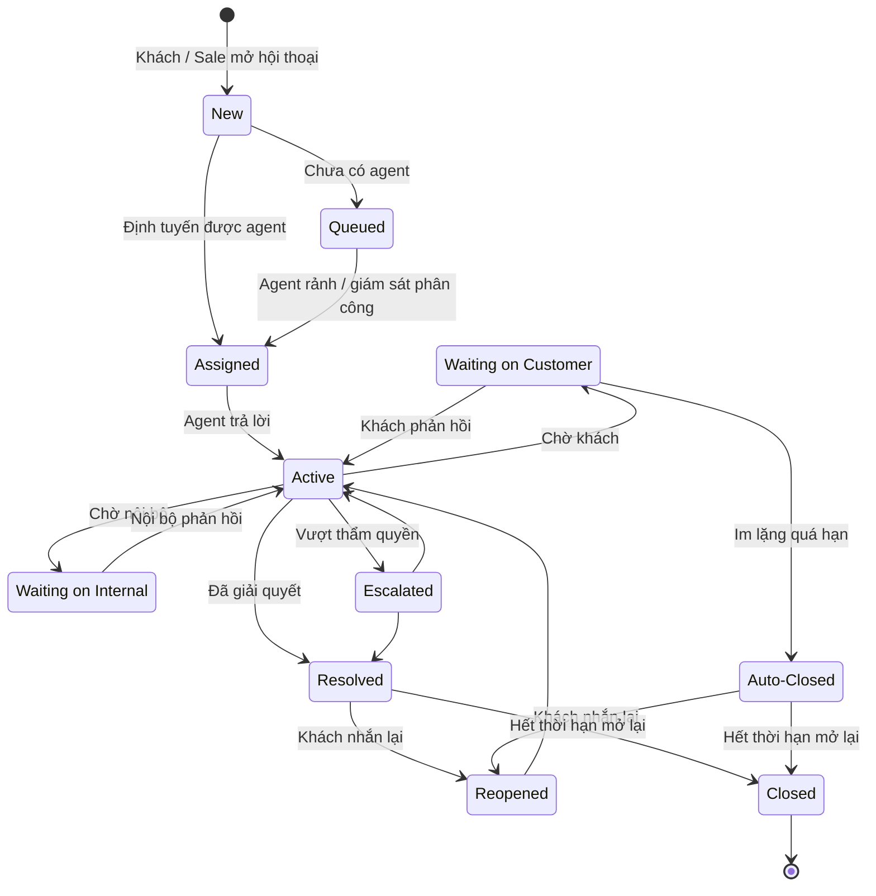

# 16 — Nhắn tin trực tiếp với Sale (Sales Chat / Messaging)

> Đã chốt 2026-11-04: Sales Chat **thuộc phạm vi giai đoạn này** (chốt [open-questions F7](../../open-questions/README.md)). Đây là kênh chính để khách liên hệ Sale trên cổng khách hàng, vì **khách không tự đặt hàng** — mọi nhu cầu mua, yêu cầu báo giá, đặt lại đều đi qua Sale.
>
> Đã chốt 2026-11-05: thêm **thẻ hành động duyệt mẫu in** của **Đơn sản xuất (Production Order)** ([17](../17-order-management/README.md)) — khách xem ảnh / video mẫu in thử, bấm **Duyệt** hoặc **Yêu cầu in lại** kèm ghi chú; cùng thao tác với mục mẫu thiết kế của tôi ([13](../13-catalog/README.md)). Sàn không hiển thị giá: khách thấy giá qua **thẻ báo giá** / hợp đồng. Theo dõi Đơn sản xuất và báo tiến độ cho khách là việc của Sale.
>
> ✅ Đã chốt 2026-11-05 (khách tự thiết kế): **khách tự thiết kế và tự gửi duyệt trên app** ([12](../12-product-design/README.md)) — chat **không** còn dùng để khách gửi mẫu cho Sale thiết kế hộ; bỏ việc Sale ghi nhận mẫu và thẻ "yêu cầu xác nhận thiết kế". Thêm **thẻ yêu cầu báo giá từ bản thiết kế**: hệ thống sinh khi khách bấm "Yêu cầu báo giá" trên bản đã duyệt, hoặc "Gửi duyệt và yêu cầu báo giá" trên bản nháp ([13](../13-catalog/README.md)); Sale nhận yêu cầu ngay nhưng **chỉ lập báo giá khi bản đã `Approved`** ([14](../14-cart-and-order/README.md)).

## 1. Mục đích (Purpose)

Kênh **hội thoại trực tiếp giữa khách sỉ và nhân viên Sale phụ trách** trên cổng khách hàng, để:

- tư vấn quy cách sản phẩm, hỏi hàng, đặt lại ([13](../13-catalog/README.md));
- nhận **yêu cầu báo giá từ bản thiết kế** khách tự làm trên app (thẻ yêu cầu báo giá) và trả lời câu hỏi về bản thiết kế (cách thiết kế, trạng thái duyệt, lý do bị trả lại) — việc thiết kế, gửi duyệt, duyệt nằm ở [12](../12-product-design/README.md), không làm qua chat;
- gửi **báo giá**, gửi **hợp đồng mua bán** của đơn ([14](../14-cart-and-order/README.md));
- gửi **thông tin chuyển khoản theo đợt thanh toán** của hợp đồng và **nhắc công nợ** ([15](../15-payment/README.md));
- gửi **mẫu in thử** của Đơn sản xuất để khách **duyệt mẫu in**, báo tiến độ sản xuất ([17](../17-order-management/README.md));
- xử lý phát sinh sau bán: tình trạng giao, đổi / huỷ / trả hàng, khiếu nại giao hàng ([17](../17-order-management/README.md), [09](../../warehouse/09-shipping/README.md)).

Chat **gắn ngữ cảnh (context-aware)**: mỗi hội thoại có thể tham chiếu **sản phẩm / quy cách / SKU riêng của khách**, **bản thiết kế** của khách, **báo giá**, **đơn hàng**, **hợp đồng** hoặc **Đơn sản xuất** (kèm vòng mẫu in) cụ thể, để Sale thấy ngay khách đang nói về việc gì.

---

## 2. Actor liên quan

| Actor | Vai trò |
|-------|---------|
| **Khách hàng sỉ (B2B Customer)** | Mở hội thoại trên cổng khách hàng (từ trang sản phẩm, mẫu thiết kế, báo giá, đơn, hợp đồng, hoặc nút "Chat với Sale"); **yêu cầu báo giá từ bản thiết kế** (hệ thống mở hội thoại kèm thẻ yêu cầu báo giá — [13](../13-catalog/README.md)); gửi câu hỏi, ảnh / file; nhận báo giá, hợp đồng, thông tin chuyển khoản, mẫu in thử; thao tác trên các thẻ hành động (chấp nhận báo giá, **duyệt mẫu in**) |
| **Nhân viên Sale (Sales Staff)** | Trả lời, tư vấn (kể cả hướng dẫn khách tự thiết kế); **nhận yêu cầu báo giá từ bản thiết kế** và lập báo giá khi bản đã duyệt; gửi báo giá, hợp đồng, thông tin chuyển khoản theo đợt, nhắc công nợ, **thẻ duyệt mẫu in**; báo khách tiến độ Đơn sản xuất; tạo yêu cầu đổi / huỷ / trả; chuyển tiếp nội bộ — trong module này gọi tắt là *agent* |
| **Người giữ quyền giám sát chat (Chat Supervision)** | Phân công hội thoại, giám sát SLA, tham gia khi cần escalate — là quyền gán cho Quản lý kinh doanh hoặc Sales Staff được chỉ định (xem [Role Registry](../../00-system-overview/README.md)) |
| **Kế toán (Accountant)**, **Quản lý kho (Warehouse Manager)**, **Quản lý kinh doanh (Sales Manager)** | Không chat trực tiếp với khách (trừ khi giữ quyền giám sát chat); agent chuyển câu hỏi nội bộ (đối soát tiền → Kế toán; nhập kho, xuất kho, kết quả giao → Quản lý kho; duyệt Đơn sản xuất, giảm giá vượt hạn mức, duyệt bản thiết kế của khách → Quản lý kinh doanh) và chờ phản hồi |
| **Hệ thống (định tuyến & nhắc SLA)** | Định tuyến hội thoại tới Sale phụ trách; sinh **thẻ ngữ cảnh / thẻ hành động** từ chứng từ, gồm **thẻ yêu cầu báo giá** khi khách yêu cầu báo giá và cập nhật trạng thái bản thiết kế trên thẻ; nhắc SLA; lưu lịch sử |

> ⚠️ Giả định: phạm vi là **chat 1–1 khách sỉ ↔ Sale trong cổng khách hàng**. Tích hợp kênh ngoài (Facebook Messenger, Zalo, email) và chatbot AI là phạm vi sau — xem [open-questions F1, F2](../../open-questions/README.md).

---

## 3. Input / Output

### Input

| Trường | Mô tả | Bắt buộc |
|--------|-------|----------|
| Người khởi tạo | Khách (từ trang sản phẩm, mẫu thiết kế, báo giá, đơn, hợp đồng, nút "Chat với Sale", hoặc **"Yêu cầu báo giá"** / **"Gửi duyệt và yêu cầu báo giá"** trên bản thiết kế) hoặc Sale (chủ động) | Có |
| Ngữ cảnh đính kèm | Một trong: sản phẩm / quy cách / SKU riêng của khách ([13](../13-catalog/README.md)), bản thiết kế ([12](../12-product-design/README.md)), báo giá, đơn hàng, hợp đồng ([14](../14-cart-and-order/README.md)), Đơn sản xuất kèm vòng mẫu in ([17](../17-order-management/README.md)) — chỉ chứng từ thuộc đúng khách | Không |
| Vòng mẫu in | Của Đơn sản xuất `Sample Pending`: số vòng, **ảnh / video mẫu** Sale tải lên, ngày gửi mẫu vật (nếu có) — dữ liệu cho thẻ duyệt mẫu in ([17](../17-order-management/README.md)) | Khi gửi thẻ duyệt mẫu in |
| **Yêu cầu báo giá** | Khi khách yêu cầu báo giá từ bản thiết kế ([13](../13-catalog/README.md)): bản thiết kế, SKU riêng (nếu đã sinh), **trạng thái bản thiết kế** (`Pending Review` / `Approved` — [12](../12-product-design/README.md)), **số thùng mong muốn** (gợi ý), **ngày giao mong muốn** (nếu có) — dữ liệu cho thẻ yêu cầu báo giá | Khi khách yêu cầu báo giá |
| Nội dung tin nhắn | Chữ, ảnh, file (ảnh tham khảo, ảnh sản phẩm lỗi, file hợp đồng đã ký), link | Có |
| Thông tin khách | Hồ sơ từ [18 Customer Information](../18-customer-information/README.md) | Có (khách đã đăng nhập) |

### Output

| Kết quả | Dùng bởi |
|---------|----------|
| **Hội thoại (conversation / thread)** — lịch sử tin nhắn, người tham gia, ngữ cảnh, trạng thái | Sale, khách, người giám sát chat |
| **Thẻ hành động** trong hội thoại: **yêu cầu báo giá** (bản thiết kế, trạng thái, số thùng mong muốn, ngày giao mong muốn; Sale **Lập báo giá** khi bản `Approved`), báo giá (khách chấp nhận — chọn số thùng từng dòng — / yêu cầu sửa), hợp đồng gửi khách, thông tin chuyển khoản theo đợt, nhắc công nợ, **duyệt mẫu in** (ảnh / video mẫu; Duyệt / Yêu cầu in lại kèm ghi chú), **hoá đơn** (chỉ xem / tải hoá đơn đã phát hành) | Khách, Sale; chứng từ ở 14, 15, 17, 21 |
| **Hành động phát sinh**: báo giá lập từ thẻ yêu cầu báo giá, báo giá, kết quả duyệt mẫu in, yêu cầu đổi / huỷ / trả | 14, 17 |
| **Ghi chú nội bộ (internal note)** — chỉ nhân viên thấy | Sale, người giám sát chat |
| **Chỉ số:** thời gian phản hồi đầu (FRT), thời gian xử lý, mức hài lòng (CSAT) | Người giám sát chat, báo cáo |
| **Lịch sử tương tác** gắn hồ sơ khách và chứng từ ngữ cảnh | [18 Customer Information](../18-customer-information/README.md), 12, 14, 17 |

---

## 4. Luồng nghiệp vụ từng bước (Step-by-step)

### 4.1. Mở hội thoại & định tuyến

1. **Khởi tạo** — khách bấm "Chat với Sale" (hoặc "Yêu cầu báo giá", "Gửi duyệt và yêu cầu báo giá", "Đặt lại") từ một trang; hệ thống tạo hội thoại và đính **ngữ cảnh** của trang đó. Sale cũng có thể chủ động mở hội thoại với khách, gắn ngữ cảnh chứng từ.
2. **Định tuyến (routing)** — hệ thống gán agent theo thứ tự:
   1. Sale phụ trách chứng từ ngữ cảnh (người lập báo giá / đơn / hợp đồng / Đơn sản xuất);
   2. Sale đã chăm sóc khách gần nhất;
   3. hàng đợi chung — người giám sát chat phân công.
3. **Chờ & phản hồi** — ngoài giờ / Sale không trực tuyến: hiển thị thời gian phản hồi dự kiến; tin nhắn được giữ trong hội thoại, khách nhận thông báo khi Sale trả lời. Trong giờ: agent nhận thông báo, mở hội thoại thấy ngữ cảnh + hồ sơ khách + lịch sử.

> ⚠️ Giả định: thứ tự định tuyến như trên, giờ làm việc và mục tiêu FRT do người giám sát chat cấu hình. Xem [open-questions F3, F5](../../open-questions/README.md).

### 4.2. Tư vấn & yêu cầu báo giá từ bản thiết kế

4. Hai bên nhắn tin, gửi ảnh / file. Agent có thể gửi **link sản phẩm / SKU riêng của khách** ([13](../13-catalog/README.md)).
5. **Yêu cầu báo giá từ bản thiết kế** — khách bấm **"Yêu cầu báo giá"** trên bản `Approved`, hoặc **"Gửi duyệt và yêu cầu báo giá"** trên bản `Draft` (đã qua tự kiểm) ([13](../13-catalog/README.md)) → hệ thống mở hội thoại gắn ngữ cảnh bản thiết kế và sinh **thẻ yêu cầu báo giá**: bản thiết kế, SKU riêng (nếu đã sinh), **trạng thái bản thiết kế**, số thùng mong muốn, ngày giao mong muốn.
   - Bản `Approved` → agent bấm **Lập báo giá** trên thẻ: báo giá `Draft` điền sẵn SKU riêng; ngày giao mong muốn → ngày giao khách yêu cầu; số thùng khách nêu chỉ là gợi ý ([14](../14-cart-and-order/README.md) BR-22).
   - Bản còn `Pending Review` → thẻ hiện "chờ duyệt thiết kế", agent **chưa lập báo giá** được; thẻ tự cập nhật khi Quản lý kinh doanh duyệt (SKU riêng sinh) hoặc trả lại bản thiết kế ([12](../12-product-design/README.md)).

   > ⚠️ Giả định: bản thiết kế bị trả lại sau "Gửi duyệt và yêu cầu báo giá" thì thẻ yêu cầu báo giá **vẫn mở**, hiện trạng thái `Draft` kèm lý do trả lại; khách sửa và gửi duyệt lại thì thẻ tiếp tục theo bản đó, không cần gửi yêu cầu mới. Khách xoá bản nháp (`Archived`) thì thẻ đóng. Xem [open-questions B40](../../open-questions/README.md).
6. **Thiết kế không làm qua chat** — agent tư vấn cách thiết kế, giải thích lý do bản bị trả lại; khách **tự** sửa, gửi duyệt, tạo bản sửa trên app ([12](../12-product-design/README.md)). Agent không nhận file mẫu để thiết kế hộ, không tạo bản thiết kế hay bản sửa thay khách (BR-05).

### 4.3. Báo giá, đơn & hợp đồng

7. Agent lập **báo giá** ([14](../14-cart-and-order/README.md)) và gửi **thẻ báo giá** vào hội thoại. Khách bấm **Chấp nhận** hoặc **Yêu cầu sửa** ngay trên thẻ — cùng thao tác như trên trang báo giá ở cổng.
8. Từ báo giá đã chấp nhận, agent tạo **đơn hàng** và **hợp đồng mua bán** ([14](../14-cart-and-order/README.md)), gửi **thẻ hợp đồng** (file hợp đồng, lịch các đợt thanh toán) cho khách. Khách có thể gửi lại file hợp đồng đã ký (bản scan hoặc PDF có chữ ký số) qua chat; agent tải file đó lên hợp đồng ở [14](../14-cart-and-order/README.md).

> ✅ Đã chốt 2026-11-05: "khách chấp nhận báo giá qua chat" nghĩa là khách bấm **Chấp nhận** trên thẻ báo giá trong hội thoại. Agent **không** tự đánh dấu chấp nhận thay khách dựa trên tin nhắn chữ. Xem [open-questions](../../open-questions/README.md).

### 4.4. Thanh toán theo đợt & công nợ

9. Khi một **đợt thanh toán** của hợp đồng đến hạn (`Due`), agent gửi **thẻ thông tin chuyển khoản** cho đợt đó: tài khoản nhận của doanh nghiệp, số tiền đợt, nội dung chuyển khoản (mã hợp đồng + mã đợt), hạn thanh toán ([15](../15-payment/README.md)).
10. Đợt `Overdue` hoặc công nợ phải thu sắp / đã quá hạn: agent gửi **nhắc công nợ** kèm thẻ thông tin chuyển khoản. Việc ghi nhận tiền về (phiếu thu theo đợt) do Kế toán làm ở [15](../15-payment/README.md); chat không ghi nhận thanh toán.

### 4.5. Duyệt mẫu in & tiến độ sản xuất

11. Khi Đơn sản xuất của đơn khách ở `Sample Pending` ([17](../17-order-management/README.md)), Sale tải **ảnh / video mẫu in thử** lên vòng mẫu ở 17 rồi gửi **thẻ duyệt mẫu in** vào hội thoại gắn ngữ cảnh Đơn sản xuất. Thẻ hiện: SKU riêng, số vòng, ảnh / video mẫu, ngày gửi mẫu vật (nếu Sale đã gửi mẫu vật cho khách), kết quả các vòng trước.
12. Khách bấm ngay trên thẻ — cùng thao tác như ở mục mẫu thiết kế của tôi ([13](../13-catalog/README.md)):
    - **Duyệt** → Đơn sản xuất sang `In Production`;
    - **Yêu cầu in lại** kèm **ghi chú** (bắt buộc) → Sale mở vòng mẫu mới và ghi lý do in lại ở [17](../17-order-management/README.md).

    Thẻ cập nhật kết quả dù khách thao tác trên thẻ hay trên sàn.
13. Khách nhắn rằng cần **sửa thiết kế** (đổi logo, màu, nội dung — không phải lỗi in) → agent hướng dẫn khách tự **tạo bản sửa** từ bản `Approved` trong mục mẫu thiết kế của tôi ([13](../13-catalog/README.md)) và gửi duyệt ([12](../12-product-design/README.md)); bản sửa được duyệt sinh SKU riêng mới, agent đổi SKU dòng đơn theo [17](../17-order-management/README.md); thẻ duyệt mẫu in không dùng để sửa thiết kế.
14. Sale báo khách **tiến độ Đơn sản xuất** (đã nhận đơn, ngày hoàn thành dự kiến, đã nhập kho một phần / đủ) qua chat ([17](../17-order-management/README.md)).

### 4.6. Sau bán, escalate & kết thúc

15. **Hỗ trợ sau bán** — khách nhắn về đơn đang giao / bị lỗi: agent tra [Order Management](../17-order-management/README.md), báo trạng thái đơn, tạo **yêu cầu đổi / huỷ / trả**. Khách hỏi hoá đơn: agent gửi **thẻ hoá đơn** của hoá đơn đã phát hành (số, ký hiệu, ngày lập, tổng có thuế, link tải XML / PDF) — hoá đơn lập theo từng lần giao thành công ([21](../21-e-invoice/README.md)); chat không phát hành hay sửa hoá đơn. Khách muốn đổi thiết kế của đơn đã chốt: đi theo quy trình thay đổi đơn ở [17](../17-order-management/README.md) (chỉ khi Đơn sản xuất liên quan chưa `In Production`).
16. **Chờ nội bộ** — câu hỏi cần Kế toán / Quản lý kho / Quản lý kinh doanh trả lời: agent chuyển nội bộ, hội thoại sang `Waiting on Internal`.
17. **Escalate** — vấn đề vượt thẩm quyền (giảm giá vượt hạn mức, bồi thường): chuyển người giám sát chat; hội thoại ghi nhận lý do & người xử lý tiếp.
18. **Kết thúc & đánh giá** — agent đánh dấu đã giải quyết; gửi khảo sát CSAT. Hội thoại **mở lại (reopen)** được nếu khách nhắn tiếp trong thời hạn.
19. **Lưu vết** — toàn bộ hội thoại + hành động gắn vào [hồ sơ khách](../18-customer-information/README.md) và vào chứng từ ngữ cảnh (bản thiết kế, báo giá, đơn, hợp đồng, Đơn sản xuất).

---

## 5. Trạng thái / Vòng đời (Lifecycle)

### Trạng thái hội thoại (Conversation)

| Trạng thái | Ý nghĩa | Chuyển tiếp cho phép | Ai thực hiện |
|------------|---------|----------------------|--------------|
| `New` | Vừa tạo, chưa gán agent | → `Assigned`, → `Queued` | Hệ thống |
| `Queued` | Chờ agent rảnh / ngoài giờ / chờ người giám sát phân công | → `Assigned` | Hệ thống / Người giám sát chat |
| `Assigned` | Đã gán agent, chưa trả lời | → `Active` | Hệ thống / Agent |
| `Active` | Đang trao đổi | → `Waiting on Customer`, → `Waiting on Internal`, → `Escalated`, → `Resolved` | Agent |
| `Waiting on Customer` | Chờ khách phản hồi (ví dụ chờ khách sửa và gửi duyệt lại thiết kế, chấp nhận báo giá, gửi hợp đồng đã ký, duyệt mẫu in) | → `Active`, → `Auto-Closed` (quá hạn im lặng) | Hệ thống |
| `Waiting on Internal` | Chờ bộ phận khác (Kế toán, Quản lý kho, Quản lý kinh doanh) | → `Active` | Agent |
| `Escalated` | Đã chuyển người giám sát chat | → `Active`, → `Resolved` | Người giám sát chat |
| `Resolved` | Đã xử lý xong | → `Reopened`, → `Closed` | Agent |
| `Reopened` | Khách nhắn lại sau khi đã giải quyết | → `Active` | Hệ thống |
| `Auto-Closed` | Đóng do khách im lặng quá hạn | → `Reopened` (khách nhắn lại trong thời hạn), → `Closed` | Hệ thống |
| `Closed` | Đóng vĩnh viễn (hết thời hạn mở lại) | *(cuối)* | Hệ thống |

---

## 6. Ràng buộc nghiệp vụ (Business Rules) & Edge case

### Business rules

- **BR-01:** Mọi hành động có hệ quả (khách gửi yêu cầu báo giá, lập báo giá từ thẻ yêu cầu báo giá, gửi báo giá, gửi hợp đồng, gửi thông tin chuyển khoản, khách chấp nhận báo giá trên thẻ, gửi thẻ duyệt mẫu in, khách Duyệt / Yêu cầu in lại trên thẻ, tạo yêu cầu đổi / huỷ / trả) phải **ghi log gắn hội thoại & gắn người thực hiện**.
- **BR-02:** **Ngữ cảnh phải thuộc đúng khách** của hội thoại. Khách chỉ gắn / xem được chứng từ và SKU của chính mình; Sale không gắn chứng từ của khách khác.
- **BR-03:** Chat **không tự thay đổi chứng từ**. Thẻ hành động gọi đúng thao tác của module sở hữu chứng từ, với đúng điều kiện và trạng thái ở đó: báo giá, hợp đồng ([14](../14-cart-and-order/README.md)); duyệt mẫu in, đổi / huỷ / trả ([17](../17-order-management/README.md)). Trạng thái bản thiết kế trên thẻ yêu cầu báo giá chỉ đọc từ [12](../12-product-design/README.md); chat không gửi duyệt, không duyệt bản thiết kế.
- **BR-04:** Sale chỉ áp giảm giá / ưu đãi **trong hạn mức** được cấp, và chỉ có hiệu lực khi được ghi trên báo giá; vượt hạn mức phải escalate.
- **BR-05:** **Thiết kế không làm qua chat** *(✅ Đã chốt 2026-11-05)*: khách **tự** tạo, sửa, gửi duyệt bản thiết kế và tạo bản sửa trên app ([12](../12-product-design/README.md)); agent không tạo bản thiết kế hay bản sửa thay khách. Ảnh / file khách gửi qua chat chỉ để trao đổi, không thành file thiết kế. Chỉ bản thiết kế đã duyệt (`Approved`) mới dùng để báo giá, đặt hàng.
- **BR-06:** **Thông tin chuyển khoản chỉ gửi bằng thẻ do hệ thống sinh** từ đợt thanh toán của hợp đồng (tài khoản nhận là tài khoản doanh nghiệp đã cấu hình, số tiền và nội dung lấy từ đợt). Không gõ tay số tài khoản nhận vào tin nhắn.
- **BR-07:** Ghi chú nội bộ không hiển thị cho khách; tách biệt rõ trong giao diện & dữ liệu.
- **BR-08:** Thông tin nhạy cảm (số thẻ, mật khẩu) không được yêu cầu / nhập qua chat; hệ thống che (masking) các mẫu nhạy cảm.
- **BR-09:** SLA phản hồi (FRT) & thời gian giải quyết được đo và cảnh báo; hội thoại quá hạn nổi bật trong hàng đợi.
- **BR-10:** **Thẻ duyệt mẫu in chỉ do hệ thống sinh** từ vòng mẫu in đang chờ khách của Đơn sản xuất `Sample Pending` thuộc đúng khách ([17](../17-order-management/README.md)). Chỉ khách (chủ sở hữu) bấm **Duyệt** / **Yêu cầu in lại**; agent **không** duyệt thay khách dựa trên tin nhắn chữ. Yêu cầu in lại bắt buộc ghi chú.
- **BR-11:** **Thẻ yêu cầu báo giá chỉ do hệ thống sinh** khi khách (chủ sở hữu) bấm "Yêu cầu báo giá" trên bản thiết kế `Approved`, hoặc "Gửi duyệt và yêu cầu báo giá" trên bản `Draft` đã qua tự kiểm ([13](../13-catalog/README.md) BR-16). Thẻ hiện **trạng thái hiện tại** của bản thiết kế; agent chỉ **Lập báo giá** từ thẻ khi bản đã `Approved` (SKU riêng đã sinh). Số thùng trên thẻ là gợi ý; ngày giao mong muốn điền vào ngày giao khách yêu cầu của báo giá ([14](../14-cart-and-order/README.md) BR-22). Yêu cầu báo giá không phải báo giá, không giữ hàng.

### Edge case

| Tình huống | Hướng xử lý |
|------------|-------------|
| Khách rời trang giữa chừng | Lưu hội thoại; khách nhận thông báo khi Sale trả lời; mở lại thấy lịch sử |
| Nhiều agent cùng mở một hội thoại | Chỉ agent đang phụ trách được trả lời; người khác ở chế độ xem |
| Khách mở nhiều hội thoại cho cùng một việc | Cho phép gộp; giữ một hội thoại chính, tham chiếu chéo |
| Agent nghỉ giữa hội thoại đang mở | Định tuyến lại sang agent khác; chuyển toàn bộ ngữ cảnh & ghi chú |
| Khách gửi file quá lớn / định dạng lạ | Từ chối theo giới hạn dung lượng & loại file của chat; hướng dẫn gửi lại |
| Khách gửi logo / file qua chat nhờ Sale thiết kế hộ | Agent hướng dẫn khách bấm "Thiết kế" trên quy cách và tự thiết kế trên app ([13](../13-catalog/README.md), [12](../12-product-design/README.md)); không thiết kế hộ (BR-05) |
| Agent muốn lập báo giá từ thẻ khi bản thiết kế còn `Pending Review` | Không lập được (BR-11); thẻ hiện "chờ duyệt thiết kế"; agent có thể nhờ Quản lý kinh doanh xem sớm (`Waiting on Internal`) |
| Bản thiết kế bị trả lại sau "Gửi duyệt và yêu cầu báo giá" | Thẻ hiện bản về `Draft` kèm lý do; agent giải thích cho khách, chờ khách sửa và gửi duyệt lại (`Waiting on Customer`) — ⚠️ giả định ở §4.2 || Khách bấm chấp nhận trên thẻ báo giá đã hết hiệu lực / đã có bản sửa mới | Từ chối theo trạng thái báo giá ở [14](../14-cart-and-order/README.md); thẻ hiển thị trạng thái hiện tại |
| Khách nhắn "đồng ý báo giá" bằng chữ nhưng không bấm trên thẻ | Agent nhắc khách bấm Chấp nhận trên thẻ; không tự chấp nhận thay |
| Khách báo đã chuyển khoản, gửi ảnh biên lai qua chat | Agent chuyển Kế toán (`Waiting on Internal`); tiền chỉ được ghi nhận theo sao kê ở [15](../15-payment/README.md) |
| Khách muốn đổi thiết kế khi Đơn sản xuất đã `In Production` | Agent giải thích không đổi được; ghi nhận; đề xuất phương án (đơn mới với SKU từ bản sửa) |
| Khách nhắn "mẫu in ok" bằng chữ nhưng không bấm trên thẻ | Agent nhắc khách bấm **Duyệt** trên thẻ (hoặc ở mục mẫu thiết kế của tôi); không duyệt thay (BR-10) |
| Khách bấm trên thẻ duyệt mẫu in của vòng đã có kết quả / Đơn sản xuất đã huỷ | Từ chối theo trạng thái ở [17](../17-order-management/README.md); thẻ hiển thị kết quả / trạng thái hiện tại |
| Mẫu in lỗi rõ (lệch màu, sai vị trí) | Khách bấm **Yêu cầu in lại** kèm ghi chú; Sale ghi lý do lỗi in của bên sản xuất ở [17](../17-order-management/README.md) (không tính vào số lần in mẫu miễn phí) |
| Tranh chấp "đã hứa giảm giá qua chat" | Lịch sử hội thoại là bằng chứng; ưu đãi chỉ có hiệu lực khi đã ghi trên báo giá (BR-04) |
| Spam / lạm dụng | Chặn theo tài khoản; cảnh báo người giám sát chat |

---

## 7. Liên kết với các module khác

| Module | Quan hệ |
|--------|---------|
| [12 · Quản lý mẫu & thiết kế](../12-product-design/README.md) | Bản thiết kế khách tự làm là ngữ cảnh hội thoại; trạng thái bản thiết kế (chờ duyệt / đã duyệt / bị trả lại) hiện trên thẻ yêu cầu báo giá; chat không thiết kế, không gửi duyệt, không duyệt |
| [13 · Catalog](../13-catalog/README.md) | Khách mở chat từ sản phẩm / quy cách / SKU riêng / mẫu thiết kế / đơn cũ (hỏi hàng, đặt lại); **"Yêu cầu báo giá"** / **"Gửi duyệt và yêu cầu báo giá"** trên bản thiết kế sinh thẻ yêu cầu báo giá; agent gửi link sản phẩm / SKU riêng; duyệt mẫu in làm được ở cả mục mẫu thiết kế của tôi và thẻ chat |
| [14 · Báo giá, Đơn hàng & Hợp đồng](../14-cart-and-order/README.md) | Lập báo giá từ thẻ yêu cầu báo giá (khi bản `Approved`; số thùng gợi ý, ngày giao mong muốn → ngày giao khách yêu cầu); thẻ báo giá (khách chấp nhận / yêu cầu sửa); gửi hợp đồng, nhận file hợp đồng đã ký; giảm giá trong hạn mức |
| [15 · Thanh toán theo hợp đồng & Công nợ](../15-payment/README.md) | Thẻ thông tin chuyển khoản theo đợt; nhắc đợt đến hạn / quá hạn và công nợ phải thu |
| [21 · E-invoice](../21-e-invoice/README.md) | Thẻ hoá đơn (hoá đơn đã phát hành của từng lần giao, tải XML / PDF); chat không phát hành hay sửa hoá đơn |
| [17 · Order Management](../17-order-management/README.md) | Tra cứu đơn và trạng thái giao; tiến độ Đơn sản xuất; **thẻ duyệt mẫu in** (vòng mẫu, kết quả Duyệt / Yêu cầu in lại); tạo yêu cầu đổi / huỷ / trả; đổi thiết kế của đơn theo quy trình thay đổi đơn |
| [18 · Customer Information](../18-customer-information/README.md) | Hồ sơ khách, lịch sử tương tác & mua hàng; lưu vết hội thoại |
| [09 · Shipping](../../warehouse/09-shipping/README.md) | Xử lý khiếu nại giao hàng, đơn trễ |
