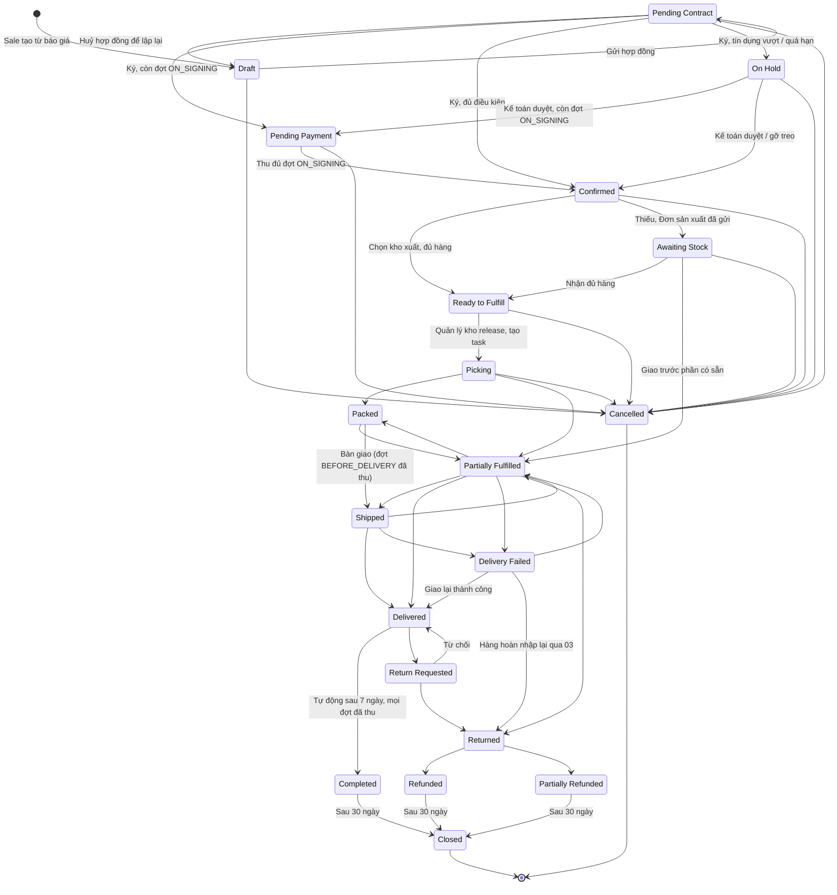
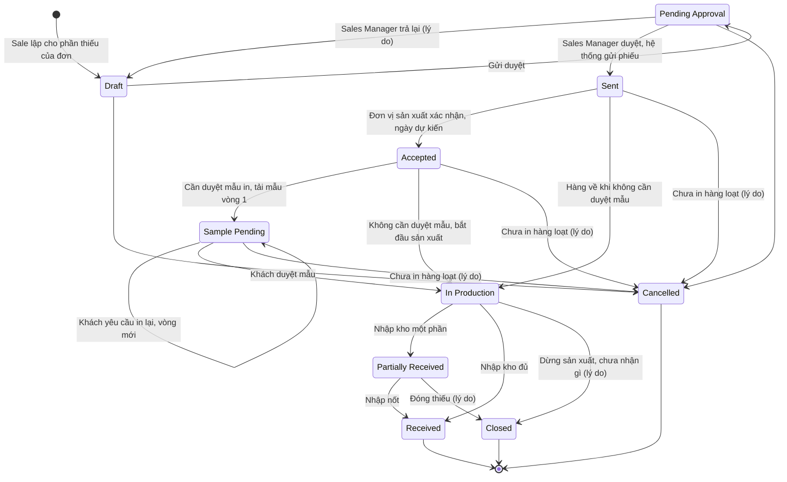
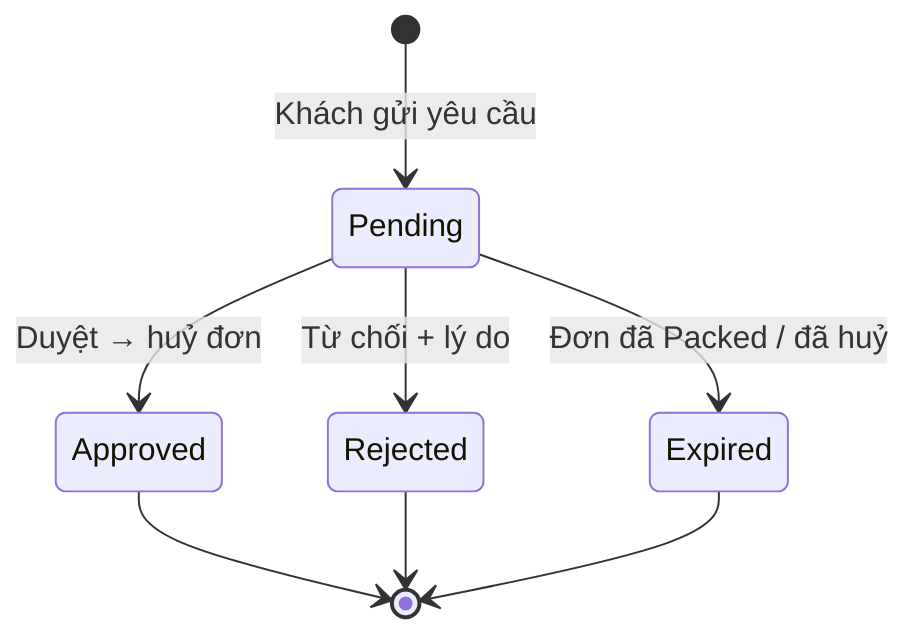

# 17 — Quản lý đơn hàng (Order Management)

> Đã chốt 2026-11-04: **sản xuất nằm ngoài hệ thống** (đơn vị sản xuất). Khi thiếu thành phẩm, Sale lập **Đơn sản xuất (Production Order)** — chứng từ thuộc module này — và đơn chờ ở `Awaiting Stock` cho tới khi hàng nhập kho. Đơn chỉ được giữ hàng và xử lý xuất kho sau khi **Hợp đồng mua bán** đã ký và đủ điều kiện thanh toán theo hợp đồng ([14](../14-cart-and-order/README.md), [15](../15-payment/README.md)).
>
> Đã chốt 2026-11-04 (bổ sung): **không còn hàng trơn** — mọi dòng đơn là **SKU thành phẩm riêng của khách**. **Đơn sản xuất chỉ phát sinh từ đơn bán** (Sale lập cho phần thiếu). Thành phẩm về kho đã được đơn vị sản xuất **đóng thùng sẵn (LPN)** và **chỉ xuất nguyên thùng**: không mở thùng, không lấy lẻ; thùng thành phẩm chính là kiện giao ([08 · Kiểm thùng & Dán nhãn giao hàng](../../warehouse/08-packing/README.md)).
>
> Đã chốt 2026-11-05: dòng đơn và dòng Đơn sản xuất tính bằng **số thùng** ([14](../14-cart-and-order/README.md) BR-08). **Mọi thùng đúng số cái chuẩn** của SKU — thùng lệch số chuẩn không được nhận vào kho ([03](../../warehouse/03-receipt/README.md)). Giữ hàng / phân bổ cho một dòng = **chọn đủ N thùng** của SKU (ưu tiên **FIFO** theo ngày nhập); thiếu thùng thì phần thiếu (tính theo thùng) đi Đơn sản xuất ([open-questions C32](../../open-questions/README.md)).
>
> Đã chốt 2026-11-05 (bổ sung):
> - "Yêu cầu sản xuất" đổi tên thành **Đơn sản xuất (Production Order)** — **một chứng từ chung** cho xưởng của công ty và đối tác ngoài, gửi theo **kênh kết nối** của đơn vị sản xuất; **Sale lập, Quản lý kinh doanh (Sales Manager) duyệt và gửi**; có bước **khách duyệt mẫu in** (§4.3).
> - Bỏ hai role Điều phối đơn hàng và Inventory Planner: việc phía khách / sản xuất chuyển cho **Sale**, việc trong kho (release, task lấy hàng, khu chờ xuất, kết quả giao) chuyển cho **Quản lý kho** của kho xuất (§2).
> - **Mỗi đơn bán có đúng một kho xuất**; mọi Đơn sản xuất của đơn giao về kho đó; không tách giao từ hai kho, không chuyển kho (module chuyển kho đã bỏ).
> - Ly / bao bì **không có hạn dùng**: phân bổ thùng theo **FIFO**; lô = lô sản xuất (gắn Đơn sản xuất) để truy vết.
> - Hàng trả / hàng hoàn nhập lại qua [03](../../warehouse/03-receipt/README.md) bằng **phiếu nhập loại Hàng hoàn** vào khu `QUARANTINE`.

## 1. Mục đích (Purpose)

Trung tâm **theo dõi và điều hành vòng đời đơn hàng**, từ lúc Sale tạo đơn ([14](../14-cart-and-order/README.md)) đến khi hoàn tất / đóng. Module này:

- giám sát trạng thái đơn;
- **chọn kho xuất** (một kho cho mỗi đơn), **kiểm tồn SKU riêng tại kho xuất** (hàng dư từ đơn trước, hàng trả) và giữ hàng **theo số thùng** (nguyên thùng) khi đơn `Confirmed`;
- lập, duyệt, gửi và theo dõi **Đơn sản xuất** cho phần thiếu của đơn, gồm **duyệt mẫu in** với khách;
- cảnh báo **sức chứa kho** khi lập Đơn sản xuất / chọn kho xuất ([06](../../warehouse/06-warehouse-map-slotting/README.md));
- quyết định dùng **khu chờ xuất (`STAGING`)** cho đơn chưa xuất ngay;
- chuyển đơn cho kho thực hiện [Fulfillment](../../warehouse/07-picking/README.md);
- **treo / gỡ treo đơn**;
- xử lý **huỷ đơn** (yêu cầu huỷ, phí huỷ), **giao một phần** (nhiều đợt từ cùng kho xuất), **đổi / trả hàng**;
- là nguồn thông tin đơn cho khách, Sale, kho, kế toán.

Order Management là **lớp điều hành** (orchestration): nó không tự lấy hàng, kiểm thùng, giao hàng hay sản xuất mà **ra lệnh** cho các module thực thi (và gửi Đơn sản xuất cho đơn vị sản xuất), rồi **hợp nhất trạng thái** từ chúng.

---

## 2. Actor liên quan

| Actor | Vai trò |
|-------|---------|
| **Nhân viên Sale (Sales Staff)** | Tra cứu đơn, CSKH. **Chọn kho xuất** khi đơn `Confirmed` (hệ thống gợi ý). **Chọn cách giao** (gửi kiện / nguyên chuyến). **Lập, gửi duyệt, theo dõi Đơn sản xuất**: ghi nhận đơn vị sản xuất `Accepted` và ngày hoàn thành dự kiến, tiến độ, các **vòng mẫu in** (tải ảnh / video, ngày gửi mẫu vật, lý do in lại), bật / tắt cờ duyệt mẫu in; **đóng thiếu / huỷ** Đơn sản xuất. Báo khách ngày giao mới. **Treo / gỡ treo đơn** (trừ treo tín dụng). **Duyệt / từ chối yêu cầu huỷ** của khách; huỷ đơn thay khách. **Quyết định cho phép giao một phần**; **đóng phần còn lại**. Duyệt / từ chối yêu cầu trả hàng. |
| **Quản lý kinh doanh (Sales Manager)** | **Duyệt và gửi Đơn sản xuất** (không phải người lập) hoặc **trả lại** cho Sale kèm lý do. Quyền "Duyệt Đơn sản xuất" mặc định gán Sales Manager, cấp lại được qua phân quyền. Xem dashboard bán hàng (§4.11). |
| **Quản lý kho (Warehouse Manager)** *(của kho xuất)* | **Release đơn** cho kho, tạo tác vụ lấy hàng & giao người; **quyết định giữ hàng ở khu chờ xuất**; **chuyển tác vụ sang khu xuất hàng**. **Ghi nhận kết quả giao** (`Delivered` / `Delivery Failed` / hàng hoàn). Quyết định hàng hoàn / hàng trả trong khu `QUARANTINE` ([03](../../warehouse/03-receipt/README.md), [20](../../warehouse/20-inventory-control/README.md)). Theo dõi bảng sức chứa kho và **nhận thông báo** khi Đơn sản xuất được gửi về kho mình ([06](../../warehouse/06-warehouse-map-slotting/README.md) §4.6). Xem dashboard bán hàng. |
| **Kế toán (Accountant)** | **Duyệt / từ chối đơn treo vì tín dụng** ([15](../15-payment/README.md) §4.3); hoàn tiền; đối soát; **xem chi tiết & lịch sử đơn (chỉ đọc)** *(Quyết định 21/10/2026)* |
| **Nhân viên kho (Warehouse Staff)** | Nhận lệnh xuất; lấy nguyên thùng theo LPN; kiểm đủ thùng & dán nhãn giao hàng; bàn giao; nhập kho thành phẩm (theo thùng) theo Đơn sản xuất và nhập hàng hoàn ([03](../../warehouse/03-receipt/README.md)) |
| **Đơn vị sản xuất** *(ngoài hệ thống — xưởng của công ty hoặc đối tác ngoài)* | Nhận phiếu Đơn sản xuất kèm bộ file thiết kế đã chốt qua kênh kết nối; xác nhận nhận đơn và ngày hoàn thành dự kiến; in **mẫu thử** khi đơn cần duyệt mẫu in; sản xuất, đóng thùng đúng số chuẩn, giao về **đúng kho nhận** |
| **Khách hàng sỉ** | Xem đơn, hợp đồng, các đợt thanh toán trên cổng (trạng thái rút gọn, §5.2). **Duyệt mẫu in** hoặc **yêu cầu in lại** kèm ghi chú (trên sàn — mục mẫu thiết kế của tôi, [13](../13-catalog/README.md) — hoặc thẻ hành động trong [chat](../16-sales-chat/README.md)). **Gửi yêu cầu huỷ**, gửi yêu cầu trả hàng (trên cổng hoặc qua chat). |
| **Hệ thống** | Hợp nhất trạng thái từ Payment / Đơn sản xuất / Receipt / Picking / Kiểm thùng & Dán nhãn / Shipping. **Gợi ý kho xuất** và hiện **còn trống dự kiến** của các kho; **cảnh báo sức chứa**. Kiểm tồn và giữ đủ số thùng của dòng tại kho xuất. Khi Đơn sản xuất được duyệt: **xuất phiếu và gửi qua kênh** của đơn vị sản xuất. **Cảnh báo vượt số lần in mẫu miễn phí**. Giữ hàng nhập theo Đơn sản xuất cho đơn liên quan khi cất hàng xong. Đóng yêu cầu huỷ không còn quyết được. Tự hoàn tất và tự đóng đơn mỗi đêm. Thông báo Sale / Sales Manager / Quản lý kho. |

---

## 3. Input / Output

### Input

| Nguồn | Dữ liệu |
|-------|---------|
| [14 Quote, Order & Contract](../14-cart-and-order/README.md) | Đơn và hợp đồng (dòng hàng kèm **ngày giao khách yêu cầu** của từng dòng, dòng phí khuôn / bản in, địa chỉ, tổng tiền, lịch thanh toán, ngày giao dự kiến, **số lần in mẫu miễn phí**); đơn chuyển `Confirmed` |
| [15 Payment](../15-payment/README.md) | Trạng thái các đợt thanh toán, đảo phân bổ, vị thế tín dụng |
| [20 Inventory Control](../../warehouse/20-inventory-control/README.md) | Tồn khả dụng theo SKU riêng / kho, theo **số thùng** (từng thùng LPN, mỗi thùng đúng số cái chuẩn); kết quả giữ hàng |
| [06 Warehouse Map & Slotting](../../warehouse/06-warehouse-map-slotting/README.md) | **Bảng sức chứa kho** từng kho (m³): sức chứa, đang chiếm, sắp về, **còn trống dự kiến** |
| [01 Product Creation](../../warehouse/01-product-creation/README.md) | Quy cách thùng của SKU (số cái / thùng, kích thước D × R × C → thể tích thùng) |
| Danh mục **Đơn vị sản xuất** | Tên, mã, liên hệ nhận đơn, **kênh kết nối** (phiếu PDF / email; API là phạm vi sau) |
| [03 Receipt](../../warehouse/03-receipt/README.md) | Số thùng thành phẩm đã nhập theo từng Đơn sản xuất (thùng lệch số chuẩn không nhận); phiếu nhập Hàng hoàn |
| [12 Design Management](../12-product-design/README.md) | Design snapshot và bộ file đã chốt của SKU theo mẫu khách — đính kèm Đơn sản xuất |
| [07](../../warehouse/07-picking/README.md)/[08](../../warehouse/08-packing/README.md)/[09](../../warehouse/09-shipping/README.md) | Cập nhật picked / short, packed (đã kiểm đủ thùng & dán nhãn giao hàng), đã bàn giao, kết quả giao |
| Khách / Sale | Yêu cầu huỷ (kèm mã lý do), yêu cầu trả hàng, đổi địa chỉ, **duyệt mẫu in / yêu cầu in lại** |

### Output

| Kết quả | Dùng bởi |
|---------|----------|
| **Trạng thái đơn hợp nhất** + dòng thời gian sự kiện | Khách, Sale, kho, kế toán |
| **Kho xuất** của đơn | 20, 07, 03 (kho nhận của Đơn sản xuất), 06 (sắp xuất) |
| **Giữ hàng** theo SKU riêng, theo số thùng (nguyên thùng), tại kho xuất, cho đơn `Confirmed` | [20 Inventory Control](../../warehouse/20-inventory-control/README.md) |
| **Đơn sản xuất** (kèm ngày cần hàng) + phiếu Đơn sản xuất (PDF) kèm bộ file thiết kế, gửi qua kênh của đơn vị sản xuất | Đơn vị sản xuất; [03 Receipt](../../warehouse/03-receipt/README.md) (nhập kho theo Đơn sản xuất); [06](../../warehouse/06-warehouse-map-slotting/README.md) (phần "sắp về" của bảng sức chứa) |
| **Mẫu in chờ duyệt** (ảnh / video từng vòng) | Khách ([13](../13-catalog/README.md) mẫu thiết kế của tôi, [16](../16-sales-chat/README.md) thẻ hành động) |
| **Lệnh xuất kho (release)** — danh sách thùng (LPN) đã phân bổ, kèm chỉ định lấy về **khu chờ xuất** (`STAGING`) hay thẳng **khu xuất hàng** (`DISPATCH`) | [07 Picking](../../warehouse/07-picking/README.md) |
| **Yêu cầu huỷ** và quyết định | Khách, Sale |
| **Tiền hoàn / phí huỷ** khi huỷ, đóng phần còn lại hoặc trả hàng | [15 Payment](../15-payment/README.md) |
| **Dashboard bán hàng** — đơn & doanh thu theo ngày, SKU bán chạy, đơn theo trạng thái (§4.11) | Sales Manager, Kế toán, Quản lý kho, System Admin |

---

## 4. Luồng nghiệp vụ từng bước (Step-by-step)

### 4.1. Tiếp nhận đơn đã xác nhận

1. Đơn từ [14](../14-cart-and-order/README.md) vào xử lý khi `Confirmed`: hợp đồng `Signed`, mọi đợt `ON_SIGNING` đã thu đủ ([15](../15-payment/README.md)), không bị treo tín dụng. Trước đó (`Draft`, `Pending Contract`, `Pending Payment`) đơn chỉ được theo dõi, chưa chọn kho xuất, chưa giữ hàng.

### 4.2. Chọn kho xuất, kiểm tồn & release

2. **Chọn kho xuất** — mỗi đơn có **đúng một kho xuất** (BR-22). Khi đơn `Confirmed`, hệ thống hiện cho Sale, theo từng kho: **tồn khả dụng** (số thùng) của từng SKU riêng trong đơn và **còn trống dự kiến** (m³) theo bảng sức chứa kho ([06](../../warehouse/06-warehouse-map-slotting/README.md)); hệ thống **gợi ý** kho đang có hàng dư của SKU, hoặc kho còn chỗ cho phần phải sản xuất. **Sale chọn kho xuất.**
   - Thể tích phần phải sản xuất (số thùng thiếu × thể tích thùng) lớn hơn còn trống dự kiến của kho được chọn → **cảnh báo** Sale, không chặn (BR-25).
   - Hàng dư của SKU nằm ở kho khác kho xuất **không dùng cho đơn này**; không có chuyển kho.
   - **Đổi kho xuất** chỉ được khi đơn chưa có hàng giữ và chưa có Đơn sản xuất nào từ `Sent` trở đi; đổi kho thì đổi kho nhận của các Đơn sản xuất chưa gửi (`Draft` / `Pending Approval`).

   > ⚠️ Giả định: kho xuất chỉ đổi được trước khi có hàng giữ / Đơn sản xuất đã gửi. Xem [open-questions](../../open-questions/README.md).
3. **Kiểm tồn & giữ hàng** — hệ thống kiểm **tồn khả dụng của SKU riêng tại kho xuất** cho từng dòng — có thể còn **hàng dư** từ đơn trước hoặc **hàng trả** đã đưa lại tồn khả dụng — và **giữ phần có sẵn** cho đơn ([20](../../warehouse/20-inventory-control/README.md)). Luôn kiểm tồn trước khi lập Đơn sản xuất.
   - **Giữ theo số thùng** — dòng đơn tính bằng số thùng và mọi thùng đúng số cái chuẩn của SKU, nên giữ hàng cho dòng cần N thùng = **chọn đủ N thùng (LPN)** của SKU tại kho xuất, ưu tiên **FIFO** theo ngày nhập (BR-21). Có sẵn ít hơn N thùng thì giữ hết số thùng có sẵn; phần còn lại (tính theo thùng) là phần thiếu.
4. **Chọn cách giao** — Sale chọn **gửi kiện** (`PARCEL`, mặc định — mỗi thùng là một kiện) hoặc **giao nguyên chuyến** (`FULL_TRUCKLOAD` — thuê nguyên xe tải / container, có lập kế hoạch xếp hàng 3D theo kích thước / khối lượng thùng — [09](../../warehouse/09-shipping/README.md)). Đổi được tới khi **dán nhãn giao hàng cho thùng đầu tiên** của đơn; sau đó khoá (BR-16).
   > ⚠️ Giả định: khách không tự chọn giao nguyên chuyến trên cổng khách hàng; phí vận chuyển cho đơn giao nguyên chuyến chưa xác định. Xem [open-questions](../../open-questions/README.md).
5. **Kết quả kiểm tồn:**
   - **Đủ hàng** → đơn `Ready to Fulfill`; **Quản lý kho của kho xuất release** đơn: hàng giữ được phân bổ vào **các thùng (LPN) cụ thể** (bin, lô) ([20](../../warehouse/20-inventory-control/README.md)), tạo tác vụ lấy hàng và giao người → [Picking](../../warehouse/07-picking/README.md).
   - **Thiếu hàng** → Sale lập **Đơn sản xuất** cho phần thiếu (§4.3); khi Đơn sản xuất được duyệt và gửi (`Sent`) → đơn `Awaiting Stock`. Hoặc Sale thoả thuận lại số thùng với khách (theo quy tắc sửa đơn §4.7). Sale báo khách ngày giao dự kiến mới nếu trễ so với hợp đồng.

### 4.3. Đơn sản xuất (Production Order)

Đơn sản xuất là **một chứng từ chung** cho mọi đơn vị sản xuất (xưởng của công ty hoặc đối tác ngoài); quy trình không phân nhánh theo loại đơn vị, chỉ khác **kênh kết nối** khai báo trong danh mục **Đơn vị sản xuất** (tên, mã, liên hệ nhận đơn, kênh kết nối: phiếu PDF / email ở giai đoạn này; API là phạm vi sau).

> ⚠️ Giả định: danh mục Đơn vị sản xuất do Sales Manager khai báo và duy trì. Xem [open-questions](../../open-questions/README.md).

6. **Lập Đơn sản xuất** (`Draft`) — **Sale lập, chỉ từ đơn bán**: đơn `Confirmed` thiếu thành phẩm sau khi đã kiểm tồn SKU riêng tại kho xuất (bước 3); hệ thống điền sẵn các dòng thiếu. Không có Đơn sản xuất bổ sung tồn.

   | Phần | Nội dung |
   |------|----------|
   | **Đầu đơn** | Mã; **đơn bán liên quan**; khách; **đơn vị sản xuất** (chọn từ danh mục); **kho nhận = kho xuất của đơn bán** (không sửa riêng); **ngày cần hàng** — mặc định = **ngày giao khách yêu cầu** của dòng đơn (chép từ báo giá — [14](../14-cart-and-order/README.md) BR-19), trống nếu khách không nêu (BR-26); người lập; người duyệt |
   | **Dòng** | **SKU riêng của khách**; **số thùng** = phần thiếu của dòng đơn; số cái / thùng; **tổng số cái** = số thùng × số cái / thùng (để đơn vị sản xuất đóng đúng số chuẩn mỗi thùng); quy cách thùng; **bộ file thiết kế đã chốt** — link tải có kiểm checksum ([12](../12-product-design/README.md)); yêu cầu đóng thùng / dán nhãn |
   | **Tuỳ chọn** | Đơn giá gia công; ghi chú |
   | **Cờ "cần duyệt mẫu in"** | Sale bật / tắt theo từng đơn khi lập. **Mặc định bật** khi Đơn sản xuất có SKU **sản xuất lần đầu** (SKU chưa có Đơn sản xuất nào tới `In Production`); tắt khi mặc định bật thì **bắt buộc lý do** |
   | **Vòng mẫu in** | Danh sách các vòng mẫu (bước 9) |

   **Cảnh báo sức chứa** — khi lập, hệ thống hiện **còn trống dự kiến**, **chờ duyệt** và **còn trống nếu duyệt hết** của kho nhận ([06](../../warehouse/06-warehouse-map-slotting/README.md) §4.6); thể tích Đơn sản xuất (Σ số thùng × thể tích thùng D × R × C — [01](../../warehouse/01-product-creation/README.md)) lớn hơn còn trống dự kiến, hoặc lớn hơn còn trống nếu duyệt hết (các Đơn sản xuất khác đang chờ duyệt về cùng kho) → **cảnh báo**, không chặn (BR-25).

   > ⚠️ Giả định: **ngày cần hàng** của Đơn sản xuất lấy mặc định từ ngày giao khách yêu cầu của dòng đơn; Sale chỉnh được khi Đơn sản xuất còn `Draft` (kể cả sau khi bị trả lại), còn ngày giao khách yêu cầu trên dòng đơn không đổi. Xem [open-questions B33](../../open-questions/README.md).
7. **Gửi duyệt & duyệt** — Sale gửi duyệt → `Pending Approval`. **Sales Manager** (người duyệt ≠ người lập — BR-23) xem lại **bảng sức chứa tính tại thời điểm duyệt** cùng cảnh báo nếu vượt (BR-25, không chặn):
   - **Duyệt** → `Sent`: hệ thống xuất **phiếu Đơn sản xuất (PDF)** kèm bộ file thiết kế và **gửi qua kênh kết nối** của đơn vị sản xuất; đơn bán → `Awaiting Stock`; **thông báo cho Quản lý kho của kho nhận** (số thùng, thể tích, ngày cần hàng), kèm `WARN` nếu lần gửi này làm còn trống dự kiến của kho chuyển sang âm ([06](../../warehouse/06-warehouse-map-slotting/README.md) §4.6).
   - **Trả lại** → `Draft`, bắt buộc lý do; Sale sửa và gửi duyệt lại.
8. **Đơn vị sản xuất nhận đơn** → `Accepted` — đơn vị sản xuất xác nhận nhận đơn và **ngày hoàn thành dự kiến**; Sale ghi nhận tay.
9. **Duyệt mẫu in** *(chỉ khi bật cờ)* — đơn vị sản xuất in vài **mẫu thử** theo bộ file đã chốt. Sale tải **ảnh / video** mẫu của vòng 1 lên → `Sample Pending`. Mỗi **vòng mẫu**:
   - Sale tải ảnh / video mẫu; **mẫu vật tuỳ chọn** — Sale ghi ngày gửi mẫu vật cho khách.
   - Khách xem trên sàn (mục **mẫu thiết kế của tôi** — [13](../13-catalog/README.md)) hoặc **thẻ hành động trong chat** ([16](../16-sales-chat/README.md)) và chọn:
     - **Duyệt** → Đơn sản xuất `In Production`; hệ thống gửi **thông báo mẫu đã duyệt** tới đơn vị sản xuất qua kênh kết nối để bắt đầu in hàng loạt, Sale theo dõi xác nhận (⚠️ giả định — xem [open-questions](../../open-questions/README.md));
     - **Yêu cầu in lại** kèm ghi chú → Sale ghi **lý do in lại** và mở **vòng mới** (Đơn sản xuất vẫn `Sample Pending`).
   - Mỗi vòng ghi: **số vòng**, ảnh / video, ngày gửi mẫu vật, kết quả (duyệt / yêu cầu in lại), ghi chú của khách, **lý do in lại**:

     | Mã lý do in lại | Nghĩa | Tính vào số lần in mẫu miễn phí |
     |-----------------|-------|--------------------------------|
     | `PRINT_DEFECT` | Lỗi in của đơn vị sản xuất | Không |
     | `CUSTOMER_CHANGE` | Khách đổi ý (màu, vị trí, chi tiết in…) với cùng bộ file | Có |

   - **Số lần in mẫu miễn phí** lấy từ điều khoản hợp đồng của đơn bán ([14](../14-cart-and-order/README.md)). Mở vòng mới làm số lần in mẫu tính phí vượt số lần miễn phí → hệ thống **cảnh báo** Sale, **không chặn**; phí phát sinh xử lý bằng phụ lục ngoài hệ thống (phạm vi sau).
   - Khách cần **sửa file thiết kế** (không phải lỗi in) → quay về [12](../12-product-design/README.md), sinh SKU mới; Sale đổi SKU của dòng đơn (§4.7 bước 25), huỷ Đơn sản xuất hiện tại và lập Đơn sản xuất mới với SKU mới.

   > ⚠️ Giả định: số lần in mẫu tính trên từng Đơn sản xuất, gồm cả vòng đầu; vòng in lại `PRINT_DEFECT` không tính. Khách chỉ ghi chú khi yêu cầu in lại; **Sale phân loại** lý do `PRINT_DEFECT` / `CUSTOMER_CHANGE`. Xem [open-questions](../../open-questions/README.md).
10. **Sản xuất hàng loạt** → `In Production`:
    - có cờ duyệt mẫu in: hệ thống chuyển khi khách **duyệt mẫu** (bước 9);
    - không có cờ: Sale chuyển từ `Accepted` khi đơn vị sản xuất báo bắt đầu (có thể cập nhật ngày hoàn thành dự kiến).

    Tiến độ do Sale ghi nhận tay; hệ thống không tích hợp hệ thống sản xuất (kênh API là phạm vi sau).
11. **Nhập kho thành phẩm** — đơn vị sản xuất giao hàng **đã đóng thùng sẵn** về **kho nhận** (= kho xuất của đơn bán); kho nhập **theo Đơn sản xuất** ([03](../../warehouse/03-receipt/README.md)) theo **số thùng**: quét / dán nhãn LPN, ghi lô sản xuất, cất nguyên thùng vào bin. Thùng có số cái khác số chuẩn **không được nhận** (trả lại đơn vị sản xuất; phần đó của Đơn sản xuất vẫn mở). Kho đầy → nhận vào khu tạm `OVERFLOW` ([06](../../warehouse/06-warehouse-map-slotting/README.md)), cất lên bin khi có chỗ. Hệ thống cập nhật số thùng đã nhận từng dòng:
    - nhận một phần → `Partially Received`; nhận đủ mọi dòng → `Received`;
    - Đơn sản xuất **không có cờ duyệt mẫu in** còn ở `Sent` / `Accepted` mà hàng đã về → hệ thống chuyển `In Production` trước rồi mới ghi nhận. Đơn sản xuất **có cờ** mà mẫu chưa được duyệt (`Sent` / `Accepted` / `Sample Pending`) → **không nhập theo đơn này** được;
    - các thùng nhận được **giữ cho đơn liên quan ngay khi cất hàng xong** ([05](../../warehouse/05-putaway/README.md)) — tồn chỉ khả dụng sau Putaway.
12. **Đóng thiếu** — Sale **đóng** → `Closed` (bắt buộc lý do) khi: Đơn sản xuất `Partially Received` mà đơn vị sản xuất không giao nốt; hoặc `In Production` mà đơn vị sản xuất dừng hẳn khi chưa giao gì. Phần thiếu của đơn được xử lý theo §4.4 bước 16.
13. **Huỷ** — Đơn sản xuất **chưa in hàng loạt** (`Draft` / `Pending Approval` / `Sent` / `Accepted` / `Sample Pending`) huỷ được → `Cancelled` (bắt buộc lý do), ví dụ đơn bán bị huỷ, khách sửa file thiết kế, hoặc hàng đã có (hàng trả về kho xuất). Đơn đã gửi thì Sale báo đơn vị sản xuất dừng qua kênh kết nối.

> Đã chốt 2026-11-05: phiếu Đơn sản xuất (PDF) gửi qua kênh kết nối của đơn vị sản xuất (email ở giai đoạn này); phản hồi `Accepted`, tiến độ và mẫu in do Sale ghi nhận tay; không tích hợp hệ thống sản xuất. Đơn sản xuất `In Production` mà đơn vị sản xuất dừng hẳn khi chưa giao gì thì **đóng** (`Closed`), không huỷ.

### 4.4. Chờ hàng & khu chờ xuất (Staging)

14. **Đích lấy hàng** — mỗi tác vụ lấy hàng (pick task) Quản lý kho release gồm các thùng (LPN) đã phân bổ, lấy nguyên thùng, có **đích** là `DISPATCH` (khu xuất hàng — mặc định) hoặc `STAGING` (khu chờ xuất) ([07](../../warehouse/07-picking/README.md)). **Quản lý kho quyết định** có giữ hàng ở khu chờ xuất hay không. Lấy về `STAGING` chỉ **chuyển vị trí**: khoản phân bổ vẫn `Held`, **chưa trừ tồn**; tác vụ / dòng ở trạng thái `Staged`; hàng được **gom và giữ riêng cho đơn**.

    > ⚠️ Giả định: tồn ở `STAGING` đã gắn đơn, không khả dụng cho đơn khác. Xem [open-questions](../../open-questions/README.md).
15. **Đơn `Awaiting Stock`** — phần có sẵn tại kho xuất đã được giữ. Chỉ tạo được tác vụ lấy hàng khi **đích là `STAGING`**, hoặc khi Sale **cho phép giao một phần** (§4.5):
    - **Dùng khu chờ xuất** → lấy trước phần có sẵn về `STAGING`.
    - **Không dùng** → phần có sẵn nằm tại bin (đã giữ cho đơn) tới khi đủ hàng.
16. **Đủ hàng** — khi mọi Đơn sản xuất của đơn đã `Received` và hệ thống đã giữ đủ thùng → đơn `Ready to Fulfill`:
    - Đơn đã có tác vụ về `STAGING` → các thùng còn lại được **lấy bổ sung vào cùng tác vụ** về `STAGING`. Khi đủ, Quản lý kho **chuyển cả tác vụ sang khu xuất hàng** một lần: lúc đó mới **trừ tồn**, khoản phân bổ thành `Consumed`, thùng sang khu xuất hàng.
    - Đơn chưa có tác vụ → Quản lý kho release tác vụ đích `DISPATCH` (hoặc `STAGING` nếu chưa xuất ngay).

    Đơn sản xuất bị đóng thiếu (`Closed`) mà đơn vẫn thiếu → Sale lập Đơn sản xuất mới cho phần còn thiếu, hoặc (nếu cho phép giao một phần) giao phần đã có rồi đóng phần còn lại (§4.8).
17. **Chờ đợt `BEFORE_DELIVERY`** — đơn đủ hàng nhưng khách chưa trả đợt thu trước giao: Quản lý kho có thể cho lấy hàng về `STAGING` chờ rồi mới chuyển sang khu xuất hàng, hoặc vẫn kiểm thùng & dán nhãn — bàn giao vận chuyển bị chặn tới khi đợt `Paid` ([15](../15-payment/README.md) BR-08). Đơn đủ hàng, xuất ngay → lấy thẳng sang khu xuất hàng, không qua `STAGING`.

### 4.5. Giao một phần

18. **Giao một phần** — Sale quyết định **cho phép giao một phần** theo từng đơn (mặc định tắt; bật / tắt, ghi chú ≤ 500 ký tự; mọi lần quyết định được ghi lại); kho chỉ làm theo *(Quyết định 19/10 và 21/10/2026)*. Mọi đợt giao đều **từ cùng kho xuất** của đơn — **không tách giao từ hai kho** (BR-22).
    - Có cho phép: các thùng có sẵn được kiểm, dán nhãn giao hàng và **bàn giao trước** trong lúc chờ phần thiếu từ Đơn sản xuất; đơn → `Partially Fulfilled`.
    - Không cho phép: không được để lại hàng khi bàn giao.
    - Quyết định **khoá** từ khi đơn `Shipped` trở đi, hoặc khi đã có hàng rời kho trên một chuyến xe.
    - Nhiều đơn đi chung một xe: xử lý ở lập kế hoạch chuyến xe ([09](../../warehouse/09-shipping/README.md)); mỗi thùng vẫn thuộc một đơn.

### 4.6. Theo dõi fulfillment & hoàn tất

19. **Theo dõi Fulfillment** — hợp nhất cập nhật: `Picking` → `Packed` → `Shipped` → `Delivered`. Bàn giao bị chặn khi còn đợt `BEFORE_DELIVERY` chưa thu đủ. Sau `Shipped` hệ thống không theo dõi hành trình; kết quả giao do **Quản lý kho** cập nhật khi hãng báo lại ([09](../../warehouse/09-shipping/README.md)).
20. **`Delivered`** — Quản lý kho cập nhật khi hãng báo giao thành công. Đơn đã có shipment thì kết quả giao ghi **theo từng shipment** *(Quyết định 19/10/2026)*. Giao xong làm đợt `AFTER_DELIVERY` đến hạn ([15](../15-payment/README.md) §4.1). Hãng hoàn hàng về (RTO) → Quản lý kho ghi nhận; hàng nhập lại kho xuất qua [03](../../warehouse/03-receipt/README.md) bằng **phiếu nhập Hàng hoàn** vào `QUARANTINE` (BR-18).
21. **Tự hoàn tất** *(Quyết định 21/10/2026)* — mỗi đêm (00:30) hệ thống chuyển `Delivered` → `Completed` khi đủ ba điều kiện:
    - hết **thời hạn đổi / trả 7 ngày** kể từ khi giao;
    - mọi đợt thanh toán của hợp đồng đã `Paid` (không còn tiền phải thu);
    - không có yêu cầu trả hàng đang mở.
22. **Tự đóng** — `Completed`, `Refunded` hoặc `Partially Refunded` → `Closed` sau **30 ngày**.

### 4.7. Sửa đơn (Order amendment)

23. Yêu cầu từ khách / Sale: đổi số thùng, thêm / bớt dòng, đổi địa chỉ.
24. **Quy tắc theo trạng thái:**

    | Đơn đang ở | Cho phép sửa gì |
    |-----------|-----------------|
    | `Draft` | Sửa tự do ([14](../14-cart-and-order/README.md)) |
    | `Pending Contract` | Sale huỷ hợp đồng đã gửi → đơn về `Draft` để sửa, rồi lập hợp đồng thay thế |
    | `Pending Payment` → `Picking` | Đổi địa chỉ giao (khi chưa dán nhãn giao hàng); **đổi SKU của dòng** khi khách sửa thiết kế (bước 25); đổi dòng / số thùng / giá cần phụ lục hợp đồng — phạm vi sau; hoặc huỷ (§4.8) |
    | `Packed` trở đi | Không sửa, không huỷ; xử lý sau giao qua trả hàng (§4.10) |

25. **Đổi SKU của dòng đã chốt** — khách sửa thiết kế đã xác nhận ([12](../12-product-design/README.md)) — kể cả khi đang duyệt mẫu in mà cần sửa file — sinh SKU theo mẫu mới; Sale đổi SKU của dòng đơn sang SKU mới, **giữ số thùng, số cái / thùng và đơn giá / cái** (thành tiền không đổi). Chỉ cho phép khi SKU mới có **cùng số cái / thùng**, **Đơn sản xuất liên quan chưa `In Production`** (Đơn sản xuất `Draft` / `Pending Approval` / `Sent` / `Accepted` / `Sample Pending` được huỷ và lập lại với SKU mới) và hàng của dòng chưa được lấy. Mỗi lần đổi ghi lịch sử.

    > ⚠️ Giả định: đổi SKU theo mẫu mới (cùng số thùng, cùng số cái / thùng, cùng giá) không cần phụ lục hợp đồng; hợp đồng đã ký giữ nguyên. SKU mới khác số cái / thùng làm đổi thành tiền → cần phụ lục (phạm vi sau). Xem [open-questions](../../open-questions/README.md).

26. Sửa có ảnh hưởng tiền → tạo khoản thu thêm / hoàn tiền tương ứng ([15](../15-payment/README.md)).

### 4.8. Huỷ đơn (Cancellation)

27. **Trước khi ký hợp đồng** (`Draft`, `Pending Contract`) — Sale huỷ đơn (kèm mã lý do); hợp đồng chưa ký bị huỷ theo.
28. **Khách gửi yêu cầu huỷ** — từ `Pending Contract` tới **trước khi thùng đầu tiên của đơn được dán nhãn giao hàng** ([08](../../warehouse/08-packing/README.md) BR-04), khách gửi **yêu cầu huỷ** trên cổng hoặc qua chat:
    - Mỗi đơn chỉ có **một yêu cầu đang chờ**.
    - Hệ thống báo Sale.
    - Sale:
      - **Duyệt** → huỷ đơn ngay, kèm phí nếu có (bước 30);
      - **Từ chối**, bắt buộc ghi lý do.
    - Đơn tiến tới mức không huỷ được nữa (đã có thùng dán nhãn giao hàng, hoặc đã huỷ) trong lúc yêu cầu còn chờ → yêu cầu tự **hết hiệu lực** (`Expired`), kèm ghi chú hướng khách sang trả hàng.

    > ⚠️ Giả định: khách **không tự huỷ ngay** trên cổng (đơn do Sale chốt và gắn hợp đồng); mọi huỷ từ phía khách đi qua yêu cầu huỷ. Xem [open-questions](../../open-questions/README.md).
29. **Mã lý do huỷ** (BR-13) — khách chỉ chọn 3 lý do đầu *(Quyết định 21/10/2026)*:

    | Mã | Nghĩa | Khách được chọn |
    |----|-------|-----------------|
    | `CUSTOMER_REQUEST` | Khách yêu cầu | ✓ (mặc định) |
    | `DUPLICATE_ORDER` | Đặt trùng | ✓ |
    | `OTHER` | Lý do khác — **bắt buộc ghi chú** | ✓ |
    | `PAYMENT_NOT_RECEIVED` | Không nhận được tiền theo hợp đồng | |
    | `OUT_OF_STOCK` | Không đủ hàng | |
    | `SUSPECTED_FRAUD` | Nghi gian lận | |
    | `CREDIT_REJECTED` | Kế toán từ chối tín dụng | |
    | `PRODUCTION_ISSUE` | Đơn vị sản xuất không đáp ứng được | |

30. **Nhân viên huỷ & phí huỷ** — Sale huỷ đơn (kèm mã lý do) hoặc duyệt yêu cầu huỷ.

    **Chưa có Đơn sản xuất nào của đơn tới `In Production`:** **hoàn toàn bộ**, không được tính phí (BR-11); Đơn sản xuất `Draft` / `Pending Approval` / `Sent` / `Accepted` / `Sample Pending` bị huỷ.

    > ⚠️ Giả định: huỷ đơn trước khi có Đơn sản xuất tới `In Production` thì hoàn toàn bộ, **kể cả dòng phí khuôn / bản in** ([14](../14-cart-and-order/README.md)) dù mẫu in thử đã làm; giữ lại phí khuôn khi huỷ là phạm vi sau. Xem [open-questions](../../open-questions/README.md).

    **Đơn vị sản xuất đã in hàng loạt** (Đơn sản xuất `In Production` trở đi): chỉ nhân viên huỷ, được tính phí.
    - Phí theo **% số tiền đã thu**, hoặc theo **số tiền thoả thuận** (số nguyên dương, ≤ tổng đơn, kèm lý do ≤ 500 ký tự và chi tiết ≤ 2.000 ký tự).
    - Tiền đã thu **trả phí trước**. Phần thừa thành **lệnh hoàn tiền** (`Pending`). Phần phí còn thiếu thành **khoản phí huỷ** ([15](../15-payment/README.md) §4.6).
    - Đơn sản xuất `In Production` không huỷ được trong hệ thống: Sale báo đơn vị sản xuất dừng qua kênh kết nối; hàng đã làm nếu giao về vẫn nhập kho theo Đơn sản xuất (BR-07); không giao gì thì Sale đóng Đơn sản xuất (`Closed`).
31. **Mốc khoá huỷ** *(Quyết định 21/10/2026: đơn `Packed` không huỷ được; 2026-11-04: mốc dời về thùng đầu tiên dán nhãn)* — Khi **một thùng của đơn đã được kiểm và dán nhãn giao hàng** (hoặc đã bàn giao), đơn **không huỷ được nữa**; mọi thay đổi đi qua **trả hàng** (§4.10).
32. **Dừng tác vụ kho khi huỷ** — huỷ pick task, put-back nguyên thùng đã lấy (kể cả thùng ở khu `STAGING`), huỷ nhãn giao hàng / gỡ thùng khỏi kế hoạch xếp hàng, huỷ Đơn sản xuất chưa in hàng loạt, nhả giữ hàng ([20](../../warehouse/20-inventory-control/README.md)).
33. **Đóng phần còn lại** — Đơn `Partially Fulfilled` mà phần còn lại sẽ không giao nữa → Sale **đóng phần còn lại** (kèm mã lý do nội bộ; đơn đang treo thì phải gỡ treo trước):
    - Mọi thùng chưa giao bị đóng; đơn đi theo trạng thái các chuyến đã giao, không chuyển thẳng `Completed` *(Quyết định 21/10/2026)*.
    - Đơn sản xuất liên quan: chưa in hàng loạt → huỷ; `In Production` / `Partially Received` → đóng (`Closed`).
    - Phí chỉ tính khi phần bị đóng có hàng đơn vị sản xuất đã làm, ≤ giá trị các thùng bị đóng (số thùng × số cái / thùng × đơn giá / cái), kèm lý do và chi tiết.
    - Số phải thu của các đợt được giảm tương ứng; tiền thừa trả phí trước, phần còn lại hoàn; thiếu thì thành khoản phí huỷ ([15](../15-payment/README.md) §4.6).

### 4.9. Treo đơn (On Hold)

34. **Lý do treo:**

    | Lý do | Ai đặt | Ai gỡ |
    |-------|--------|-------|
    | `CREDIT` — tín dụng (vượt hạn mức / quá hạn) | Hệ thống, lúc hợp đồng `Signed` | Kế toán duyệt / từ chối ([15](../15-payment/README.md) §4.3) |
    | `PAYMENT` — thiếu đợt `ON_SIGNING` sau khi đảo phân bổ | Kế toán (khi đảo) hoặc Sale | Sale, **chỉ khi tiền đã đủ lại** |
    | `ADDRESS`, `INVENTORY`, `CUSTOMER`, `FRAUD`, `OTHER` (bắt buộc ghi chú) | Sale | Sale |

35. Sale treo tay được đơn ở `Confirmed`, `Awaiting Stock`, `Ready to Fulfill`, `Picking`, `Partially Fulfilled`, `Packed`. Đơn đang treo thì không treo thêm lần nữa.
36. **Gỡ treo** (bắt buộc ghi chú) → đơn **quay về trạng thái trước khi treo**, rồi cập nhật theo các chuyến hàng đã có *(Quyết định 19/10/2026)*. Khách chỉ thấy lý do công khai ("đang được xem xét"), không thấy mã lý do nội bộ hay ghi chú.

### 4.10. Đổi / Trả hàng & Hoàn tiền (Returns & Refunds)

37. Khách tạo **yêu cầu trả hàng** (trong hạn chính sách) qua cổng khách hàng / chat, nêu lý do → đơn `Return Requested`.
38. Sale duyệt → phát hành **RMA**; hướng dẫn khách gửi hàng về **kho xuất của đơn** (hoặc hẹn lấy). Từ chối → đơn quay về `Delivered`.
39. Kho **nhận hàng trả** qua [03 Receipt](../../warehouse/03-receipt/README.md) bằng **phiếu nhập loại Hàng hoàn**: phiếu tham chiếu yêu cầu trả của đơn; quét LPN từng thùng (chỉ nhận thùng thuộc đơn đó); nhập thẳng vào khu `QUARANTINE`. **Quản lý kho** quyết định ([20](../../warehouse/20-inventory-control/README.md)):
    - **gỡ cách ly**, đưa lại tồn khả dụng (cất về bin qua [05](../../warehouse/05-putaway/README.md)) — hàng này là SKU riêng, chỉ dùng cho đơn sau của chính khách;
    - hoặc **ghi giảm** bằng điều chỉnh tồn có duyệt; lỗi sản xuất thì đổi trả với đơn vị sản xuất (ngoài hệ thống).
40. **Hoàn tiền** ([15](../15-payment/README.md)) toàn phần / một phần; đơn → `Returned` → `Refunded` / `Partially Refunded`.
41. **Đổi hàng (exchange):** = trả + Sale tạo báo giá / đơn mới (hoặc bù trừ giá trị), tuỳ thoả thuận.
> ✅ Đã chốt 2026-10-06: ly và bao bì in theo thiết kế **chỉ đổi / trả khi lỗi sản xuất**, không đổi / trả vì đổi ý.

### 4.11. Dashboard bán hàng

42. **Ai xem** — Quản lý kinh doanh (Sales Manager), Kế toán, System Admin, Quản lý kho; phạm vi **toàn hệ thống**. Sale **không** xem (chưa có góc nhìn "khách của tôi" cho Sale).
43. **Kỳ báo cáo** — tính theo **lịch Việt Nam** (Asia/Ho_Chi_Minh); mặc định **30 ngày** tính đến hôm nay, tối đa **366 ngày**.
44. **Chỉ số:**

    | Chỉ số | Cách tính |
    |--------|-----------|
    | **Đơn & doanh thu theo ngày** | Mỗi ngày (kể cả ngày không có đơn): số đơn, doanh thu. **Doanh thu = tổng tiền đơn đã tạo − đơn đã huỷ**, ghi vào **ngày tạo đơn**. Đơn treo vẫn tính; đơn nháp không tính |
    | **Tổng kỳ** | Số đơn, doanh thu, **giá trị đơn trung bình**, so sánh % với kỳ liền trước cùng độ dài |
    | **SKU bán chạy** | Xếp theo doanh thu rồi số thùng; mặc định 10, tối đa 100 |
    | **Đơn theo trạng thái** | Số đơn hiện tại ở từng trạng thái (§5.1), không theo kỳ |

45. Chỉ tính đơn **VND**; chỉ nhóm **theo ngày** (theo tuần / tháng, khách hàng mua nhiều nhất, xuất file: phạm vi sau — [open-questions D18](../../open-questions/README.md)).
46. Người có quyền xuất báo cáo có thể yêu cầu **tính lại** số liệu tổng hợp.

Báo cáo khác: bảng sức chứa kho ([06](../../warehouse/06-warehouse-map-slotting/README.md)), công nợ phải thu ([15](../15-payment/README.md)), danh sách Đơn sản xuất theo trạng thái (§5.3).

---

## 5. Trạng thái / Vòng đời (Lifecycle)

### 5.1. Trạng thái đơn (nội bộ)

| Trạng thái | Ý nghĩa | Chuyển tiếp cho phép | Ai thực hiện |
|------------|---------|----------------------|--------------|
| `Draft` | Sale vừa tạo đơn từ báo giá, đang lập hợp đồng | → `Pending Contract`, → `Cancelled` | Sale |
| `Pending Contract` | Hợp đồng đã gửi, chờ ký | → `Pending Payment`, → `Confirmed`, → `On Hold` (tín dụng), → `Draft` (huỷ hợp đồng để lập lại), → `Cancelled` | Sale / Hệ thống |
| `Pending Payment` | Hợp đồng đã ký, chờ đợt `ON_SIGNING` | → `Confirmed`, → `Cancelled` | Hệ thống ([15](../15-payment/README.md)) / Sale |
| `Confirmed` | Hợp đồng đã ký, đủ điều kiện theo hợp đồng; Sale chọn kho xuất, hệ thống kiểm tồn & giữ hàng tại kho xuất; Đơn sản xuất (nếu thiếu) đang lập / chờ duyệt | → `Ready to Fulfill`, → `Awaiting Stock`, → `On Hold`, → `Cancelled` | Sale / Hệ thống |
| `Awaiting Stock` | Thiếu thành phẩm; có Đơn sản xuất đang mở (đã gửi) | → `Ready to Fulfill`, → `Partially Fulfilled` (giao trước phần có sẵn), → `On Hold`, → `Cancelled` | Hệ thống (nhận đủ hàng) / Sale |
| `Ready to Fulfill` | Đủ hàng tại kho xuất, chờ / đã được Quản lý kho release | → `Picking`, → `On Hold`, → `Cancelled` | Hệ thống / Quản lý kho → 07 |
| `Picking` | Kho đang lấy nguyên thùng (về khu chờ xuất hoặc khu xuất hàng) | → `Packed`, → `Partially Fulfilled`, → `On Hold`, → `Cancelled` | 07 |
| `Packed` | Đã kiểm đủ thùng & dán nhãn giao hàng; **không huỷ được nữa**; bàn giao bị chặn nếu đợt `BEFORE_DELIVERY` chưa thu đủ | → `Shipped`, → `Partially Fulfilled`, → `On Hold` | 08 / 09 |
| `Partially Fulfilled` | Đã giao một phần (từ kho xuất), phần còn lại chờ hoặc bị đóng | → `Packed`, → `Shipped`, → `Delivery Failed`, → `Delivered`, → `Returned`, → `On Hold` | 07 / 08 / 09 |
| `On Hold` | Tạm giữ (§4.9) | → trạng thái trước khi treo; → `Pending Payment` / `Confirmed` (kế toán duyệt tín dụng); → `Cancelled` | Hệ thống / Sale / Kế toán |
| `Shipped` | Đã bàn giao đơn vị vận chuyển; không theo dõi hành trình | → `Delivered`, → `Delivery Failed`, → `Partially Fulfilled` | 09 (Quản lý kho) |
| `Delivery Failed` | Hãng báo giao không thành công | → `Delivered`, → `Returned` (hàng hoàn nhập lại qua 03), → `Partially Fulfilled` | 09 (Quản lý kho) |
| `Delivered` | Hãng báo giao thành công | → `Completed` (tự động, §4.6), → `Return Requested` | 09 (Quản lý kho) / khách |
| `Return Requested` | Khách yêu cầu trả | → `Returned`, → `Delivered` (từ chối) | Sale |
| `Returned` | Hàng đã về kho (phiếu nhập Hàng hoàn, khu `QUARANTINE`) | → `Refunded`, → `Partially Refunded` | 03 / 15 |
| `Refunded` / `Partially Refunded` | Đã hoàn tiền | → `Closed` (tự động sau 30 ngày) | 15 |
| `Completed` | Hoàn tất, hết hạn đổi / trả, mọi đợt đã thu | → `Closed` (tự động sau 30 ngày) | Hệ thống |
| `Cancelled` | Huỷ trước khi thùng đầu tiên của đơn được dán nhãn giao hàng | *(cuối)* | Sale / Kế toán (từ chối tín dụng) |
| `Closed` | Đóng hoàn toàn | *(cuối)* | Hệ thống |

> Treo tay được từ `Confirmed`, `Awaiting Stock`, `Ready to Fulfill`, `Picking`, `Partially Fulfilled`, `Packed`. Gỡ treo quay về đúng trạng thái trước đó. Sơ đồ chỉ vẽ nhánh treo tín dụng để dễ đọc.

### 5.2. Trạng thái đơn khách thấy trên cổng

| Khách thấy | Gồm trạng thái nội bộ |
|------------|------------------------|
| Chờ ký hợp đồng | `Pending Contract` |
| Chờ thanh toán | `Pending Payment` |
| Đang xem xét | `On Hold` (hiện "chờ duyệt tín dụng" nếu treo vì tín dụng chưa quyết) |
| Đã xác nhận | `Confirmed` |
| Đang chờ hàng | `Awaiting Stock` |
| Đang chuẩn bị | `Ready to Fulfill`, `Picking`, `Partially Fulfilled`, `Packed` |
| Đang giao | `Shipped`, `Delivery Failed` |
| Đã giao | `Delivered`, `Completed`; `Closed` nếu từng hoàn tất |
| Đã huỷ | `Cancelled` |
| Trả hàng | `Return Requested`, `Returned`, `Refunded`, `Partially Refunded`; `Closed` nếu chưa từng hoàn tất |

Đơn `Draft` không hiện cho khách. Ngoài trạng thái, cổng hiển thị cho khách:

- **hợp đồng** của đơn (bản gửi ký / bản đã ký — [14](../14-cart-and-order/README.md));
- **các đợt thanh toán** và thông tin chuyển khoản từng đợt ([15](../15-payment/README.md));
- **tình trạng giao** của đơn: chưa giao / đang giao / giao một phần / giao thất bại / đã giao / đã trả;
- **tình trạng hàng** từng dòng: có sẵn / đang chờ sản xuất / **chờ duyệt mẫu in** / đã nhập kho;
- **các thao tác khách được làm lúc này**: duyệt mẫu in / yêu cầu in lại, gửi yêu cầu huỷ, gửi yêu cầu trả hàng, mở chat với Sale.

### 5.3. Đơn sản xuất (Production Order)

| Trạng thái | Ý nghĩa | Chuyển tiếp cho phép | Ai thực hiện |
|------------|---------|----------------------|--------------|
| `Draft` | Sale đang lập cho phần thiếu của một đơn `Confirmed` (hoặc sửa sau khi bị trả lại) | → `Pending Approval`, → `Cancelled` | Sale |
| `Pending Approval` | Chờ Sales Manager duyệt | → `Sent` (duyệt — hệ thống xuất phiếu, gửi qua kênh kết nối), → `Draft` (trả lại, bắt buộc lý do), → `Cancelled` | Sales Manager / Sale (huỷ) |
| `Sent` | Đã gửi đơn vị sản xuất, chờ xác nhận nhận đơn | → `Accepted`, → `In Production` (hàng về khi không cần duyệt mẫu in), → `Cancelled` | Sale / Hệ thống (nhập kho) |
| `Accepted` | Đơn vị sản xuất đã xác nhận nhận đơn và ngày hoàn thành dự kiến | → `Sample Pending` (cần duyệt mẫu in — Sale tải mẫu vòng 1), → `In Production` (không cần duyệt mẫu in), → `Cancelled` | Sale / Hệ thống (nhập kho) |
| `Sample Pending` | Đang duyệt mẫu in: các vòng mẫu, chờ khách duyệt; chưa in hàng loạt | → `In Production` (khách duyệt mẫu), → `Cancelled` (bắt buộc lý do) | Khách / Sale (vòng mẫu, huỷ) |
| `In Production` | Đang sản xuất hàng loạt; không huỷ được | → `Partially Received`, → `Received`, → `Closed` (đơn vị sản xuất dừng hẳn khi chưa giao gì) | Sale / Hệ thống (nhập kho) |
| `Partially Received` | Đã nhập kho một phần (một số thùng) | → `Received`, → `Closed` (đóng thiếu) | Hệ thống (nhập kho) / Sale (đóng thiếu) |
| `Received` | Đã nhập đủ mọi dòng | *(cuối)* | Hệ thống |
| `Cancelled` | Huỷ trước khi in hàng loạt, bắt buộc lý do | *(cuối)* | Sale |
| `Closed` | Đóng thiếu, hoặc dừng khi chưa nhận gì; bắt buộc lý do | *(cuối)* | Sale |

### 5.4. Yêu cầu huỷ (Cancellation request)

| Trạng thái | Ý nghĩa | Chuyển tiếp cho phép | Ai thực hiện |
|------------|---------|----------------------|--------------|
| `Pending` | Khách đã gửi, chờ quyết | → `Approved`, → `Rejected`, → `Expired` | Khách tạo |
| `Approved` | Đã duyệt; đơn bị huỷ (kèm phí nếu có) | *(cuối)* | Sale |
| `Rejected` | Từ chối, có lý do | *(cuối)* | Sale |
| `Expired` | Đơn đã tới mức không huỷ được, hoặc đã bị huỷ theo đường khác | *(cuối)* | Hệ thống |

---

## 6. Ràng buộc nghiệp vụ (Business Rules) & Edge case

### Business rules

- **BR-01:** Trạng thái đơn là **hợp nhất** từ các module thực thi. Chỉ chuyển theo bảng §5.1 (cả ứng dụng lẫn cơ sở dữ liệu cùng chặn).
- **BR-02:** Đơn chỉ được chọn kho xuất, giữ hàng và chuyển cho kho khi `Confirmed`: hợp đồng `Signed`, mọi đợt `ON_SIGNING` đã thu đủ, không bị treo tín dụng.
- **BR-03:** Không release cho kho khi đơn `On Hold` hoặc chưa giữ đủ thùng cho phần sẽ xuất. Release do Quản lý kho của kho xuất thực hiện.
- **BR-04:** Đơn `Awaiting Stock` phải luôn có ít nhất một **Đơn sản xuất** đang mở đã gửi (`Sent` / `Accepted` / `Sample Pending` / `In Production` / `Partially Received`) cho phần thiếu.
- **BR-05:** **Đơn sản xuất chỉ phát sinh từ đơn bán**, do **Sale lập** cho phần thiếu sau khi đã kiểm tồn SKU riêng tại kho xuất (hàng dư, hàng trả). Đầu đơn có đơn bán liên quan, khách, đơn vị sản xuất (từ danh mục), **kho nhận = kho xuất của đơn bán**, ngày cần hàng, người lập, người duyệt. Dòng là SKU riêng của khách của đơn, **số thùng** nguyên ≥ 1 (kèm số cái / thùng, tổng số cái, quy cách thùng), yêu cầu đóng thùng / dán nhãn, và bắt buộc đính kèm **design snapshot và bộ file đã chốt** ([12](../12-product-design/README.md)).
- **BR-06:** Đơn sản xuất chỉ **huỷ** khi chưa in hàng loạt (`Draft` / `Pending Approval` / `Sent` / `Accepted` / `Sample Pending`); chỉ **đóng** từ `In Production` (dừng hẳn, chưa nhận gì) hoặc `Partially Received` (đóng thiếu); cả hai bắt buộc lý do. `Received` do hệ thống chuyển khi nhập đủ.
- **BR-07:** Hàng nhập theo Đơn sản xuất được **giữ cho đơn liên quan**. Đơn đó đã huỷ / đóng phần còn lại thì các thùng thành **hàng dư** — tồn khả dụng của SKU riêng tại kho đó, chỉ khách sở hữu được báo giá / đặt.
- **BR-08:** Quản lý kho quyết định dùng **khu chờ xuất** cho đơn; tồn tại `STAGING` đã gắn đơn, không khả dụng cho đơn khác. Lấy về `STAGING` chưa trừ tồn (phân bổ vẫn `Held`); chỉ khi **chuyển cả tác vụ sang khu xuất hàng** mới trừ tồn (`Consumed`). Đơn `Awaiting Stock` chỉ tạo tác vụ lấy hàng đích `STAGING`, hoặc khi được giao một phần.
- **BR-09:** Huỷ đơn sau khi đã có tác vụ kho phải **đảo ngược có kiểm soát** (put-back nguyên thùng kể cả ở `STAGING`, huỷ nhãn giao hàng, huỷ Đơn sản xuất chưa in hàng loạt, nhả giữ hàng), không để tồn / tiền "treo".
- **BR-10:** Mọi thay đổi đơn ảnh hưởng tiền phải sinh dòng tương ứng ở [Payment](../15-payment/README.md); tổng thu − tổng hoàn = giá trị thực nhận của đơn.
- **BR-11:** **Không tính phí huỷ khi đơn vị sản xuất chưa in hàng loạt** (chưa có Đơn sản xuất nào của đơn tới `In Production`): hoàn toàn bộ. Sau đó chỉ **nhân viên** huỷ được, có thể tính phí theo % tiền đã thu, hoặc số tiền thoả thuận ≤ tổng đơn kèm lý do và chi tiết.
- **BR-12:** **Mốc huỷ là thùng đầu tiên dán nhãn giao hàng.** Khách gửi yêu cầu huỷ tới trước mốc này; từ khi một thùng của đơn đã được kiểm & dán nhãn giao hàng (hoặc đã bàn giao) thì không huỷ, chỉ trả hàng — khớp [08](../../warehouse/08-packing/README.md) BR-04, không có ngoại lệ.
- **BR-13:** Huỷ luôn có **mã lý do**. Khách chỉ dùng `CUSTOMER_REQUEST` / `DUPLICATE_ORDER` / `OTHER`. `OTHER` bắt buộc ghi chú.
- **BR-14:** Mỗi đơn chỉ có **một yêu cầu huỷ đang chờ**. Yêu cầu không còn quyết được thì tự `Expired`, không treo vô thời hạn.
- **BR-15:** Đơn chỉ giao một phần khi Sale **cho phép giao một phần** cho đơn đó; quyết định khoá từ khi `Shipped`.
- **BR-16:** Cách giao chỉ đổi được tới khi dán nhãn giao hàng cho thùng đầu tiên của đơn (hoặc khi đơn đã quá bước lấy hàng).
- **BR-17:** Treo tay bắt buộc mã lý do (`OTHER` kèm ghi chú). Gỡ treo bắt buộc ghi chú. Treo vì tín dụng chỉ gỡ qua kế toán. Treo vì thanh toán chỉ gỡ khi tiền đã đủ lại.
- **BR-18:** Hàng trả và hàng hãng hoàn về (RTO) **luôn** nhập lại kho xuất qua [Receipt](../../warehouse/03-receipt/README.md) bằng **phiếu nhập loại Hàng hoàn** (tham chiếu shipment / yêu cầu trả; chỉ nhận thùng thuộc đơn) vào khu `QUARANTINE` trước khi xử lý / hoàn tiền; Quản lý kho quyết định gỡ cách ly hoặc ghi giảm có duyệt ([20](../../warehouse/20-inventory-control/README.md)). Sản phẩm in theo thiết kế chỉ đổi / trả khi lỗi sản xuất.
- **BR-19:** Đơn `Completed` / `Closed` là bất biến về nội dung; khiếu nại sau đó xử lý bằng chứng từ mới.
- **BR-20:** Tự hoàn tất sau **7 ngày** kể từ giao, khi mọi đợt đã thu đủ và không có yêu cầu trả; tự đóng sau **30 ngày**. Chạy mỗi đêm.
- **BR-21:** **Chỉ xuất nguyên thùng, tính theo số thùng.** Giữ hàng, phân bổ, lấy hàng, put-back đều theo thùng (LPN); không mở thùng, không lấy lẻ. Mọi thùng đúng số cái chuẩn của SKU, nên phân bổ cho dòng đơn N thùng = **chọn đủ N thùng** của SKU tại kho xuất (ưu tiên **FIFO** theo ngày nhập); thiếu thùng thì phần thiếu đi Đơn sản xuất (§4.2).
- **BR-22:** **Mỗi đơn bán có đúng một kho xuất**, Sale chọn khi `Confirmed` (hệ thống gợi ý). Chỉ giữ hàng có sẵn **tại kho xuất**; hàng dư của khách ở kho khác không dùng cho đơn đó. **Mọi Đơn sản xuất của đơn có kho nhận = kho xuất**; đơn vị sản xuất phải giao đúng kho nhận. **Không bao giờ tách giao từ hai kho**; đơn vẫn giao nhiều đợt (giao một phần) từ cùng kho xuất. Kho xuất chỉ đổi được khi đơn chưa có hàng giữ và chưa có Đơn sản xuất từ `Sent` trở đi (⚠️ giả định, §4.2).
- **BR-23:** Đơn sản xuất chỉ được gửi cho đơn vị sản xuất sau khi **được duyệt**; **người duyệt ≠ người lập**. Quyền "Duyệt Đơn sản xuất" mặc định gán Sales Manager, cấp lại được qua phân quyền. Trả lại bắt buộc lý do. Khi duyệt, hệ thống xuất phiếu và gửi qua kênh kết nối của đơn vị sản xuất.
- **BR-24:** **Duyệt mẫu in.** Cờ "cần duyệt mẫu in" do Sale bật / tắt theo từng Đơn sản xuất; **mặc định bật** khi có SKU sản xuất lần đầu; tắt khi mặc định bật thì bắt buộc lý do. Có cờ thì Đơn sản xuất chỉ sang `In Production` khi **khách duyệt mẫu**, và chưa nhập kho theo đơn đó được trước khi mẫu được duyệt. Mỗi vòng mẫu ghi số vòng, ảnh / video, ngày gửi mẫu vật, kết quả, lý do in lại (`PRINT_DEFECT` / `CUSTOMER_CHANGE`). Vòng in lại `PRINT_DEFECT` không tính vào **số lần in mẫu miễn phí** của hợp đồng ([14](../14-cart-and-order/README.md)); vượt số lần miễn phí → **cảnh báo** Sale, không chặn.
- **BR-25:** **Cảnh báo sức chứa.** Khi Sale chọn kho xuất hoặc lập Đơn sản xuất, **và khi Sales Manager duyệt** (tính lại tại thời điểm duyệt), hệ thống hiện **còn trống dự kiến**, **chờ duyệt** và **còn trống nếu duyệt hết** của kho ([06](../../warehouse/06-warehouse-map-slotting/README.md) §4.6); thể tích Đơn sản xuất (số thùng × thể tích thùng) vượt → **cảnh báo**, không chặn. Đơn sản xuất được gửi thì thông báo Quản lý kho của kho nhận. Hàng về mà kho đầy → nhận vào khu tạm `OVERFLOW`, cất lên bin khi có chỗ.
- **BR-26:** **Ngày giao khách yêu cầu** của dòng đơn cố định từ lúc đơn được tạo (chép từ báo giá — [14](../14-cart-and-order/README.md) BR-19); hệ thống không có thao tác đổi ngày này trên đơn đã tạo. Khi Sale lập Đơn sản xuất, **ngày cần hàng** mặc định = ngày giao khách yêu cầu của dòng (trống nếu khách không nêu). ⚠️ Giả định: Sale chỉnh được ngày cần hàng khi Đơn sản xuất còn `Draft` — xem [open-questions B33](../../open-questions/README.md). Đơn vị sản xuất trễ so với ngày cần hàng → Sale báo khách ngày giao mới (bảng edge case bên dưới) *(Quyết định PROD-DUE 02/11/2026)*.

### Edge case

| Tình huống | Hướng xử lý |
|------------|-------------|
| Đơn `Confirmed` thiếu thành phẩm | Giữ phần có sẵn tại kho xuất (nguyên thùng); Sale lập Đơn sản xuất cho phần thiếu, Sales Manager duyệt & gửi → `Awaiting Stock`; Sale báo khách ngày giao mới nếu trễ hợp đồng |
| SKU riêng còn hàng dư từ đơn trước / hàng trả **tại kho xuất** | Giữ các thùng đó cho đơn trước; Đơn sản xuất chỉ cho phần còn thiếu |
| Hàng dư của SKU nằm ở **kho khác** kho xuất | Không dùng cho đơn này (không chuyển kho); Sale cân nhắc chọn kho đang có hàng dư làm kho xuất (hệ thống gợi ý) trước khi giữ hàng |
| Kho xuất được chọn không đủ chỗ cho hàng sắp về | Hệ thống cảnh báo (không chặn); Sale chọn kho khác (khi còn đổi được) hoặc vẫn lập; hàng về mà kho đầy thì nhận vào `OVERFLOW` |
| Cần đổi kho xuất sau khi đã giữ hàng / Đơn sản xuất đã gửi | Không đổi được (⚠️ giả định §4.2); đơn giao từ kho xuất đã chọn |
| Sales Manager trả lại Đơn sản xuất | Về `Draft` kèm lý do; Sale sửa và gửi duyệt lại; đơn bán vẫn `Confirmed` |
| Người lập Đơn sản xuất cũng có quyền duyệt | Không tự duyệt được; người khác có quyền duyệt (BR-23) |
| Đơn vị sản xuất không xác nhận nhưng đã giao hàng (không cần duyệt mẫu) | Kho nhập theo Đơn sản xuất; hệ thống chuyển `In Production` trước rồi ghi nhận |
| Đơn sản xuất cần duyệt mẫu mà hàng đã về khi mẫu chưa duyệt | Không nhập theo đơn đó; Sale liên hệ đơn vị sản xuất và khách để chốt mẫu trước |
| Khách yêu cầu in lại nhiều lần | Mỗi lần mở vòng mới; vượt số lần in mẫu miễn phí của hợp đồng (không tính vòng `PRINT_DEFECT`) → cảnh báo Sale, không chặn; phí phát sinh xử lý bằng phụ lục ngoài hệ thống (phạm vi sau) |
| Mẫu in bị lỗi do đơn vị sản xuất | Sale ghi lý do `PRINT_DEFECT`, mở vòng mới; vòng này không tính vào số lần miễn phí |
| Khách muốn sửa file thiết kế khi đang duyệt mẫu | Quay về [12](../12-product-design/README.md) sinh SKU mới; Sale đổi SKU dòng đơn (bước 25), huỷ Đơn sản xuất `Sample Pending`, lập Đơn sản xuất mới (cờ duyệt mẫu mặc định bật) |
| SKU đặt lại (đã từng sản xuất) | Cờ duyệt mẫu in mặc định tắt; Sale vẫn bật được nếu cần |
| Đơn vị sản xuất giao về sai kho (không phải kho nhận) | Kho đó không nhập theo Đơn sản xuất này; đơn vị sản xuất giao lại đúng kho nhận |
| Đơn vị sản xuất giao thùng có số cái khác số chuẩn | Kho không nhận thùng đó, trả lại đơn vị sản xuất ([03](../../warehouse/03-receipt/README.md)); phần tương ứng của Đơn sản xuất vẫn mở, đơn tiếp tục chờ hàng |
| Đơn vị sản xuất giao thiếu và không giao nốt | Sale đóng thiếu Đơn sản xuất (`Closed`), lập Đơn sản xuất mới cho phần còn thiếu; hoặc giao phần đã có (nếu được giao một phần) rồi đóng phần còn lại |
| Đơn vị sản xuất trễ so với ngày cần hàng | Sale cập nhật ngày dự kiến; báo khách qua chat |
| Hàng nhập theo Đơn sản xuất phát hiện lỗi sau khi nhận | Chuyển khu `QUARANTINE`, đổi trả với đơn vị sản xuất ngoài hệ thống ([03](../../warehouse/03-receipt/README.md), [20](../../warehouse/20-inventory-control/README.md)); đơn tiếp tục chờ hàng đạt |
| Khách huỷ khi Đơn sản xuất chưa in hàng loạt (kể cả đang duyệt mẫu) | Huỷ Đơn sản xuất, nhả giữ hàng, **hoàn toàn bộ** (kể cả dòng phí khuôn / bản in — ⚠️ giả định §4.8) |
| Khách huỷ khi đơn vị sản xuất đã in hàng loạt | Sale từ chối, hoặc duyệt có phí; hàng làm xong nhập về xử lý theo BR-07 |
| Đơn đủ hàng nhưng đợt `BEFORE_DELIVERY` chưa trả | Lấy hàng về `STAGING` chờ, hoặc kiểm thùng & dán nhãn rồi chờ; bàn giao bị chặn tới khi đợt `Paid` |
| Khách đổi địa chỉ khi đơn đã `Shipped` | CSKH liên hệ hãng (ngoài hệ thống) nhờ chuyển hướng nếu hãng hỗ trợ; nếu không → chờ giao thất bại / RTO rồi gửi lại |
| Hãng hoàn hàng (RTO) | Quản lý kho ghi nhận; nhập lại kho xuất bằng phiếu Hàng hoàn vào `QUARANTINE`; Quản lý kho gỡ cách ly hoặc ghi giảm có duyệt |
| Short pick → chỉ giao được một phần | Theo [07](../../warehouse/07-picking/README.md); nếu phần còn lại không giao nữa → **đóng phần còn lại** (§4.8) |
| Khách gửi yêu cầu huỷ rồi đơn kịp `Packed` | Yêu cầu tự `Expired`; khách đi luồng trả hàng |
| Giao `Delivered` nhưng khách khiếu nại không nhận | CSKH xác minh với hãng (ngoài hệ thống); đơn không tự hoàn tất khi còn yêu cầu trả hàng mở |
| Hàng trả về không nguyên vẹn | Nhập `QUARANTINE` qua phiếu Hàng hoàn; hoàn một phần / từ chối hoàn theo chính sách; ghi hồ sơ khách |
| Trùng đơn | Huỷ một đơn với lý do `DUPLICATE_ORDER` + hoàn tiền nếu đã thu |
| Nghi gian lận sau khi đã ship | Không thu hồi giữa đường; đánh dấu rủi ro; phối hợp [Payment](../15-payment/README.md) & hãng vận chuyển |
| Đơn đã giao nhưng khách chưa trả đợt `AFTER_DELIVERY` | Đơn `Delivered`, chưa tự hoàn tất; theo dõi công nợ ([15](../15-payment/README.md)); quá hạn → đơn mới có đợt trả sau bị treo tín dụng khi ký |

---

## 7. Liên kết với các module khác

| Module | Quan hệ |
|--------|---------|
| [14 · Quote, Order & Contract](../14-cart-and-order/README.md) | Nguồn đơn và hợp đồng; đơn `Confirmed` khi hợp đồng ký và đủ đợt `ON_SIGNING`; dòng phí khuôn / bản in và **số lần in mẫu miễn phí** của hợp đồng dùng cho duyệt mẫu in; **ngày giao khách yêu cầu** của dòng đơn là ngày cần hàng mặc định của Đơn sản xuất |
| [15 · Payment](../15-payment/README.md) | Trạng thái các đợt; đợt `BEFORE_DELIVERY` chặn bàn giao; duyệt tín dụng; treo vì thanh toán; tiền hoàn và phí huỷ |
| [20 · Inventory Control](../../warehouse/20-inventory-control/README.md) | Kiểm tồn & giữ hàng tại kho xuất theo số thùng (chọn đủ N thùng, FIFO) khi `Confirmed`; phân bổ thùng (LPN) khi release; nhả giữ khi huỷ; khu `QUARANTINE`, gỡ cách ly / ghi giảm có duyệt |
| [03 · Receipt](../../warehouse/03-receipt/README.md) | Nhập kho thành phẩm theo Đơn sản xuất tại kho nhận (LPN; thùng lệch số chuẩn không nhận); **phiếu nhập Hàng hoàn** cho hàng trả / RTO vào `QUARANTINE` |
| [05 · Putaway](../../warehouse/05-putaway/README.md) | Thùng nhập theo Đơn sản xuất được giữ cho đơn liên quan khi cất xong; hàng hoàn gỡ cách ly cất về bin |
| [06 · Warehouse Map & Slotting](../../warehouse/06-warehouse-map-slotting/README.md) | **Bảng sức chứa kho** (còn trống dự kiến — gồm phần sắp về của Đơn sản xuất) dùng khi chọn kho xuất / lập Đơn sản xuất; khu `STAGING`, `DISPATCH`, `QUARANTINE`, `OVERFLOW` |
| [01 · Product Creation](../../warehouse/01-product-creation/README.md) | Quy cách thùng (số cái / thùng, thể tích thùng) để lập dòng Đơn sản xuất và tính thể tích |
| [12 · Design Management](../12-product-design/README.md) | Design snapshot và bộ file đã chốt đính kèm Đơn sản xuất; khách sửa file thiết kế khi duyệt mẫu → SKU mới |
| [13 · Catalog](../13-catalog/README.md) | Mục **mẫu thiết kế của tôi** hiện mẫu in chờ duyệt để khách Duyệt / Yêu cầu in lại |
| [07 Picking](../../warehouse/07-picking/README.md) / [08 Kiểm thùng & Dán nhãn giao hàng](../../warehouse/08-packing/README.md) / [09 Shipping](../../warehouse/09-shipping/README.md) | Quản lý kho release lệnh xuất nguyên thùng (về khu chờ xuất hoặc khu xuất hàng); đẩy cập nhật fulfillment về; `Packed` (đã kiểm đủ thùng & dán nhãn) là mốc hết huỷ; Quản lý kho ghi nhận kết quả giao |
| [16 · Sales Chat](../16-sales-chat/README.md) | Kênh tiếp nhận yêu cầu huỷ / trả hàng, báo ngày giao mới; **thẻ hành động duyệt mẫu in** |
| [18 · Customer Information](../18-customer-information/README.md) | Lịch sử đơn gắn hồ sơ khách |
| [00 · System Overview](../../00-system-overview/README.md) | Order Management điều hành luồng Fulfillment; vai trò Sale, Sales Manager, Quản lý kho |
