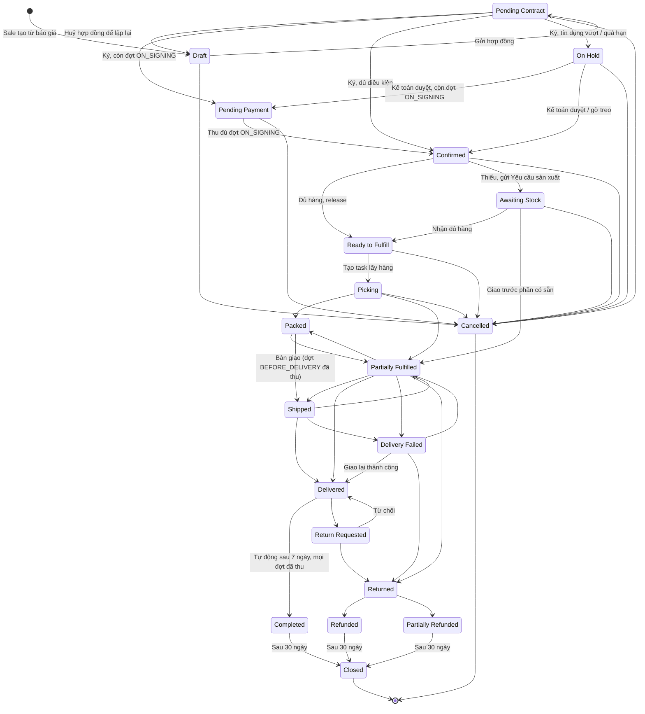
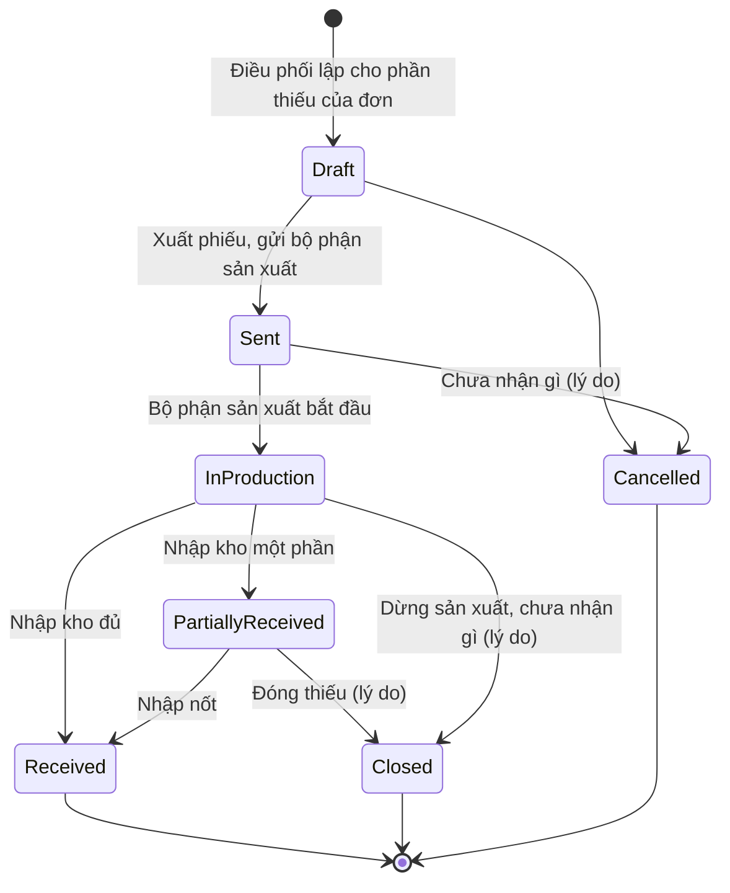
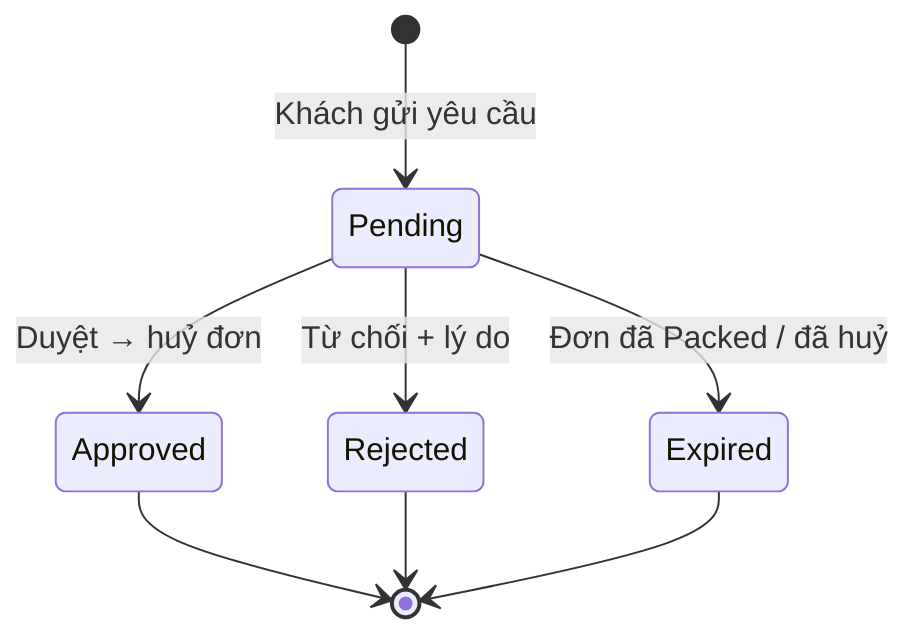

# 17 — Quản lý đơn hàng (Order Management)

> Đã chốt 2026-11-04: **sản xuất nằm ngoài hệ thống** (bộ phận sản xuất). Khi thiếu thành phẩm, Điều phối gửi **Yêu cầu sản xuất (Production Request)** — chứng từ thuộc module này — và đơn chờ ở `Awaiting Stock` cho tới khi hàng nhập kho. Đơn chỉ vào điều phối sau khi **Hợp đồng mua bán** đã ký và đủ điều kiện thanh toán theo hợp đồng ([14](../14-cart-and-order/README.md), [15](../15-payment/README.md)).
>
> Đã chốt 2026-11-04 (bổ sung): **không còn hàng trơn** — mọi dòng đơn là **SKU thành phẩm riêng của khách**. **Yêu cầu sản xuất chỉ phát sinh từ đơn** (Điều phối lập cho phần thiếu). Thành phẩm về kho đã được bộ phận sản xuất **đóng thùng sẵn (LPN)** và **chỉ xuất nguyên thùng**: không mở thùng, không lấy lẻ; thùng thành phẩm chính là kiện giao ([08 · Kiểm thùng & Dán nhãn giao hàng](../../warehouse/08-packing/README.md)).
>
> Đã chốt 2026-11-05: dòng đơn và dòng Yêu cầu sản xuất tính bằng **số thùng** ([14](../14-cart-and-order/README.md) BR-08). **Mọi thùng đúng số cái chuẩn** của SKU — thùng lệch số chuẩn không được nhận vào kho ([03](../../warehouse/03-receipt/README.md)). Giữ hàng / phân bổ cho một dòng = **chọn đủ N thùng** của SKU (ưu tiên FEFO / FIFO); thiếu thùng thì phần thiếu (tính theo thùng) đi Yêu cầu sản xuất ([open-questions C32](../../open-questions/README.md)).

## 1. Mục đích (Purpose)

Trung tâm **theo dõi và điều hành vòng đời đơn hàng**, từ lúc Sale tạo đơn ([14](../14-cart-and-order/README.md)) đến khi hoàn tất / đóng. Module này:

- giám sát trạng thái đơn;
- **kiểm tồn SKU riêng** (hàng dư từ đơn trước, hàng trả) và giữ hàng **theo số thùng** (nguyên thùng) khi đơn `Confirmed`;
- lập và theo dõi **Yêu cầu sản xuất** cho phần thiếu của đơn;
- quyết định dùng **khu chờ xuất (`STAGING`)** cho đơn chưa xuất ngay;
- điều phối [Fulfillment](../../warehouse/07-picking/README.md);
- **treo / gỡ treo đơn**;
- xử lý **huỷ đơn** (yêu cầu huỷ, phí huỷ), **giao một phần**, **đổi / trả hàng**;
- là nguồn thông tin đơn cho khách, Sale, kho, kế toán.

Order Management là **lớp điều phối** (orchestration): nó không tự lấy hàng, kiểm thùng, giao hàng hay sản xuất mà **ra lệnh** cho các module thực thi (và gửi yêu cầu cho bộ phận sản xuất), rồi **hợp nhất trạng thái** từ chúng.

---

## 2. Actor liên quan

| Actor | Vai trò |
|-------|---------|
| **Nhân viên Sale (Sales Staff)** | Tra cứu đơn, CSKH. **Duyệt / từ chối yêu cầu huỷ** của khách. Huỷ đơn thay khách. **Đóng phần còn lại** của đơn giao một phần. **Quyết định cho phép giao một phần**. Báo khách ngày giao mới khi chờ sản xuất. |
| **Điều phối đơn hàng (Order Coordinator)** | Chọn kho xuất, **chọn cách giao** (gửi kiện / nguyên chuyến), release đơn cho kho. **Lập, gửi, cập nhật tiến độ, đóng / huỷ Yêu cầu sản xuất** cho phần thiếu của đơn (chỉ Điều phối lập). **Quyết định dùng khu chờ xuất** cho đơn. **Treo / gỡ treo đơn**. Ghi nhận giao thành công / thất bại. Duyệt / từ chối yêu cầu huỷ, huỷ đơn, đóng phần còn lại. |
| **Kế toán (Accountant)** | **Duyệt / từ chối đơn treo vì tín dụng** ([15](../15-payment/README.md) §4.3); hoàn tiền; đối soát; **xem chi tiết & lịch sử đơn (chỉ đọc)** *(Quyết định 21/10/2026)* |
| **Nhân viên kho (Warehouse Staff)** | Nhận lệnh xuất; lấy nguyên thùng theo LPN; kiểm đủ thùng & dán nhãn giao hàng; bàn giao; nhập kho thành phẩm (theo thùng) theo Yêu cầu sản xuất ([03](../../warehouse/03-receipt/README.md)) |
| **Bộ phận sản xuất** *(ngoài hệ thống)* | Nhận phiếu Yêu cầu sản xuất kèm bộ file thiết kế đã chốt, sản xuất, giao thành phẩm về kho |
| **Khách hàng sỉ** | Xem đơn, hợp đồng, các đợt thanh toán trên cổng (trạng thái rút gọn, §5.2). **Gửi yêu cầu huỷ**, gửi yêu cầu trả hàng (trên cổng hoặc qua [chat](../16-sales-chat/README.md)). |
| **Hệ thống** | Hợp nhất trạng thái từ Payment / Yêu cầu sản xuất / Receipt / Picking / Kiểm thùng & Dán nhãn / Shipping. Kiểm tồn và giữ đủ số thùng của dòng khi đơn `Confirmed`. Giữ hàng nhập theo Yêu cầu sản xuất cho đơn liên quan khi cất hàng xong. Đóng yêu cầu huỷ không còn quyết được. Tự hoàn tất và tự đóng đơn mỗi đêm. Thông báo Sale / Điều phối. |

---

## 3. Input / Output

### Input

| Nguồn | Dữ liệu |
|-------|---------|
| [14 Quote, Order & Contract](../14-cart-and-order/README.md) | Đơn và hợp đồng (dòng hàng, địa chỉ, tổng tiền, lịch thanh toán, ngày giao dự kiến); đơn chuyển `Confirmed` |
| [15 Payment](../15-payment/README.md) | Trạng thái các đợt thanh toán, đảo phân bổ, vị thế tín dụng |
| [20 Inventory Control](../../warehouse/20-inventory-control/README.md) | Tồn khả dụng theo SKU riêng / kho, theo **số thùng** (từng thùng LPN, mỗi thùng đúng số cái chuẩn); kết quả giữ hàng |
| [03 Receipt](../../warehouse/03-receipt/README.md) | Số thùng thành phẩm đã nhập theo từng Yêu cầu sản xuất (thùng lệch số chuẩn không nhận) |
| [12 Design Management](../12-product-design/README.md) | Design snapshot và bộ file đã chốt của SKU theo mẫu khách — đính kèm Yêu cầu sản xuất |
| [07](../../warehouse/07-picking/README.md)/[08](../../warehouse/08-packing/README.md)/[09](../../warehouse/09-shipping/README.md) | Cập nhật picked / short, packed (đã kiểm đủ thùng & dán nhãn giao hàng), đã bàn giao, kết quả giao |
| Khách / Sale | Yêu cầu huỷ (kèm mã lý do), yêu cầu trả hàng, đổi địa chỉ |

### Output

| Kết quả | Dùng bởi |
|---------|----------|
| **Trạng thái đơn hợp nhất** + dòng thời gian sự kiện | Khách, Sale, kho, kế toán |
| **Giữ hàng** theo SKU riêng, theo số thùng (nguyên thùng), cho đơn `Confirmed` | [20 Inventory Control](../../warehouse/20-inventory-control/README.md) |
| **Yêu cầu sản xuất** + phiếu yêu cầu (PDF) kèm bộ file thiết kế | Bộ phận sản xuất; [03 Receipt](../../warehouse/03-receipt/README.md) (nhập kho theo yêu cầu) |
| **Lệnh xuất kho (release)** — danh sách thùng (LPN) đã phân bổ, kèm chỉ định lấy về **khu chờ xuất** (`STAGING`) hay thẳng **khu kiểm & dán nhãn** (`PACKING`) | [07 Picking](../../warehouse/07-picking/README.md) |
| **Yêu cầu huỷ** và quyết định | Khách, Sale, Điều phối |
| **Tiền hoàn / phí huỷ** khi huỷ, đóng phần còn lại hoặc trả hàng | [15 Payment](../15-payment/README.md) |
| **Dashboard bán hàng** — đơn & doanh thu theo ngày, SKU bán chạy, đơn theo trạng thái (§4.11) | Quản trị bán hàng, Kế toán, Quản lý kho, Điều phối, System Admin |

---

## 4. Luồng nghiệp vụ từng bước (Step-by-step)

### 4.1. Tiếp nhận đơn đã xác nhận

1. Đơn từ [14](../14-cart-and-order/README.md) vào điều phối khi `Confirmed`: hợp đồng `Signed`, mọi đợt `ON_SIGNING` đã thu đủ ([15](../15-payment/README.md)), không bị treo tín dụng. Trước đó (`Draft`, `Pending Contract`, `Pending Payment`) đơn chỉ được theo dõi, chưa giữ hàng.

### 4.2. Kiểm tồn thành phẩm & release

2. **Kiểm tồn & giữ hàng** — khi đơn `Confirmed`, hệ thống kiểm **tồn khả dụng của SKU riêng** từng dòng — có thể còn **hàng dư** từ đơn trước hoặc **hàng trả** đã đưa lại tồn khả dụng — và **giữ phần có sẵn** cho đơn ([20](../../warehouse/20-inventory-control/README.md)). Luôn kiểm tồn trước khi lập Yêu cầu sản xuất.
   - **Giữ theo số thùng** — dòng đơn tính bằng số thùng và mọi thùng đúng số cái chuẩn của SKU, nên giữ hàng cho dòng cần N thùng = **chọn đủ N thùng (LPN)** của SKU, ưu tiên **FEFO / FIFO** (BR-21). Có sẵn ít hơn N thùng thì giữ hết số thùng có sẵn; phần còn lại (tính theo thùng) là phần thiếu.
3. **Chọn kho xuất** — Điều phối chọn theo tồn khả dụng, khoảng cách, tải kho.
4. **Chọn cách giao** — Điều phối chọn **gửi kiện** (`PARCEL`, mặc định — mỗi thùng là một kiện) hoặc **giao nguyên chuyến** (`FULL_TRUCKLOAD` — thuê nguyên xe tải / container, có lập kế hoạch xếp hàng 3D theo kích thước / khối lượng thùng — [09](../../warehouse/09-shipping/README.md)). Đổi được tới khi **dán nhãn giao hàng cho thùng đầu tiên** của đơn; sau đó khoá (BR-16).
   > ⚠️ Giả định: khách không tự chọn giao nguyên chuyến trên cổng khách hàng; phí vận chuyển cho đơn giao nguyên chuyến chưa xác định. Xem [open-questions](../../open-questions/README.md).
5. **Kết quả kiểm tồn:**
   - **Đủ hàng** → Điều phối **release** → đơn `Ready to Fulfill`; hàng giữ được phân bổ vào **các thùng (LPN) cụ thể** (bin, lô) ([20](../../warehouse/20-inventory-control/README.md)); lệnh xuất → [Picking](../../warehouse/07-picking/README.md).
   - **Thiếu hàng** → Điều phối lập **Yêu cầu sản xuất** cho phần thiếu (§4.3) và gửi → đơn `Awaiting Stock`; hoặc Sale thoả thuận lại số thùng với khách (theo quy tắc sửa đơn §4.7). Sale báo khách ngày giao dự kiến mới nếu trễ so với hợp đồng.

### 4.3. Yêu cầu sản xuất (Production Request)

6. **Lập yêu cầu** (`Draft`) — **chỉ Điều phối lập, chỉ từ đơn**: đơn `Confirmed` thiếu thành phẩm sau khi đã kiểm tồn SKU riêng (bước 2); hệ thống điền sẵn các dòng thiếu. Không có Yêu cầu sản xuất bổ sung tồn; Inventory Planner không lập Yêu cầu sản xuất.

   Mỗi dòng gồm: **SKU riêng của khách**, **số thùng** = phần thiếu của dòng đơn (kèm số cái = số thùng × số cái / thùng, để bộ phận sản xuất đóng đúng số chuẩn mỗi thùng), **design snapshot** đính kèm dưới dạng link tải bộ file đã chốt có kiểm checksum ([12](../12-product-design/README.md)), **ngày cần hàng**, **kho nhận** (mặc định là kho xuất của đơn), **đơn liên quan**.
7. **Gửi** → `Sent` — hệ thống xuất **phiếu yêu cầu (PDF)** kèm bộ file thiết kế; Điều phối gửi cho bộ phận sản xuất.
8. **Cập nhật tiến độ** — khi bộ phận sản xuất báo đã bắt đầu, Điều phối chuyển → `In Production` (có thể ghi ngày dự kiến xong).

   > ⚠️ Giả định: hệ thống xuất phiếu yêu cầu (PDF) gửi bộ phận sản xuất; tiến độ do Điều phối cập nhật tay; không tích hợp hệ thống sản xuất. Xem [open-questions](../../open-questions/README.md).
9. **Nhập kho thành phẩm** — bộ phận sản xuất giao hàng **đã đóng thùng sẵn** về kho nhận; kho nhập **theo Yêu cầu sản xuất** ([03](../../warehouse/03-receipt/README.md)) theo **số thùng**: quét / dán nhãn LPN, ghi lô, cất nguyên thùng vào bin. Thùng có số cái khác số chuẩn **không được nhận** (trả lại bộ phận sản xuất; phần đó của Yêu cầu sản xuất vẫn mở). Hệ thống cập nhật số thùng đã nhận từng dòng:
   - nhận một phần → `Partially Received`; nhận đủ mọi dòng → `Received`;
   - nhập theo yêu cầu còn ở `Sent` thì hệ thống chuyển `In Production` trước rồi mới ghi nhận;
   - các thùng nhận được **giữ cho đơn liên quan ngay khi cất hàng xong** ([05](../../warehouse/05-putaway/README.md)) — tồn chỉ khả dụng sau Putaway.
10. **Đóng thiếu** — yêu cầu `Partially Received` mà bộ phận sản xuất không giao nốt → Điều phối **đóng** → `Closed` (bắt buộc lý do). Phần thiếu của đơn được xử lý theo §4.4 bước 14.
11. **Huỷ** — yêu cầu `Draft` / `Sent` (chưa nhận gì) huỷ được → `Cancelled` (bắt buộc lý do), ví dụ đơn bị huỷ, hoặc hàng đã có (hàng trả về kho).

### 4.4. Chờ hàng & khu chờ xuất (Staging)

12. **Đích lấy hàng** — mỗi tác vụ lấy hàng (pick task) Điều phối release gồm các thùng (LPN) đã phân bổ, lấy nguyên thùng, có **đích** là `PACKING` (khu kiểm & dán nhãn — mặc định) hoặc `STAGING` (khu chờ xuất) ([07](../../warehouse/07-picking/README.md)). Lấy về `STAGING` chỉ **chuyển vị trí**: khoản phân bổ vẫn `Held`, **chưa trừ tồn**; tác vụ / dòng ở trạng thái `Staged`; hàng được **gom và giữ riêng cho đơn**.

    > ⚠️ Giả định: Điều phối quyết định có dùng khu chờ xuất cho đơn hay không; tồn ở `STAGING` đã gắn đơn, không khả dụng cho đơn khác. Xem [open-questions](../../open-questions/README.md).
13. **Đơn `Awaiting Stock`** — phần có sẵn đã được giữ. Chỉ tạo được tác vụ lấy hàng khi **đích là `STAGING`**, hoặc khi Sale **cho phép giao một phần** (§4.5):
    - **Dùng khu chờ xuất** → lấy trước phần có sẵn về `STAGING`.
    - **Không dùng** → phần có sẵn nằm tại bin (đã giữ cho đơn) tới khi đủ hàng.
14. **Đủ hàng** — khi mọi Yêu cầu sản xuất của đơn đã `Received` và hệ thống đã giữ đủ thùng → đơn `Ready to Fulfill`:
    - Đơn đã có tác vụ về `STAGING` → các thùng còn lại được **lấy bổ sung vào cùng tác vụ** về `STAGING`. Khi đủ, Điều phối hoặc Quản lý kho **chuyển cả tác vụ sang khu kiểm & dán nhãn** một lần: lúc đó mới **trừ tồn**, khoản phân bổ thành `Consumed`, thùng sang khu `PACKING`.
    - Đơn chưa có tác vụ → Điều phối release tác vụ đích `PACKING` (hoặc `STAGING` nếu chưa xuất ngay).

    Yêu cầu bị đóng thiếu (`Closed`) mà đơn vẫn thiếu → Điều phối lập yêu cầu mới cho phần còn thiếu, hoặc (nếu Sale cho phép giao một phần) giao phần đã có rồi đóng phần còn lại (§4.8).
15. **Chờ đợt `BEFORE_DELIVERY`** — đơn đủ hàng nhưng khách chưa trả đợt thu trước giao: Điều phối có thể cho lấy hàng về `STAGING` chờ rồi mới chuyển sang khu kiểm & dán nhãn, hoặc vẫn kiểm thùng & dán nhãn — bàn giao vận chuyển bị chặn tới khi đợt `Paid` ([15](../15-payment/README.md) BR-08). Đơn đủ hàng, xuất ngay → lấy thẳng sang khu `PACKING`, không qua `STAGING`.

### 4.5. Giao một phần

16. **Giao một phần** — Sale quyết định **cho phép giao một phần** theo từng đơn (mặc định tắt; bật / tắt, ghi chú ≤ 500 ký tự; mọi lần quyết định được ghi lại); kho chỉ làm theo *(Quyết định 19/10 và 21/10/2026)*.
    - Có cho phép: các thùng có sẵn được kiểm, dán nhãn giao hàng và **bàn giao trước** trong lúc chờ phần thiếu từ Yêu cầu sản xuất; đơn → `Partially Fulfilled`.
    - Không cho phép: không được để lại hàng khi bàn giao.
    - Quyết định **khoá** từ khi đơn `Shipped` trở đi, hoặc khi đã có hàng rời kho trên một chuyến xe.
    - Nhiều đơn đi chung một xe: xử lý ở lập kế hoạch chuyến xe ([09](../../warehouse/09-shipping/README.md)); mỗi thùng vẫn thuộc một đơn.

### 4.6. Theo dõi fulfillment & hoàn tất

17. **Theo dõi Fulfillment** — hợp nhất cập nhật: `Picking` → `Packed` → `Shipped` → `Delivered`. Bàn giao bị chặn khi còn đợt `BEFORE_DELIVERY` chưa thu đủ. Sau `Shipped` hệ thống không theo dõi hành trình; kết quả giao do Điều phối cập nhật khi hãng báo lại ([09](../../warehouse/09-shipping/README.md)).
18. **`Delivered`** — Điều phối cập nhật khi hãng báo giao thành công. Đơn đã có shipment thì kết quả giao ghi **theo từng shipment** *(Quyết định 19/10/2026)*. Giao xong làm đợt `AFTER_DELIVERY` đến hạn ([15](../15-payment/README.md) §4.1).
19. **Tự hoàn tất** *(Quyết định 21/10/2026)* — mỗi đêm (00:30) hệ thống chuyển `Delivered` → `Completed` khi đủ ba điều kiện:
    - hết **thời hạn đổi / trả 7 ngày** kể từ khi giao;
    - mọi đợt thanh toán của hợp đồng đã `Paid` (không còn tiền phải thu);
    - không có yêu cầu trả hàng đang mở.
20. **Tự đóng** — `Completed`, `Refunded` hoặc `Partially Refunded` → `Closed` sau **30 ngày**.

### 4.7. Sửa đơn (Order amendment)

21. Yêu cầu từ khách / Sale: đổi số thùng, thêm / bớt dòng, đổi địa chỉ.
22. **Quy tắc theo trạng thái:**

    | Đơn đang ở | Cho phép sửa gì |
    |-----------|-----------------|
    | `Draft` | Sửa tự do ([14](../14-cart-and-order/README.md)) |
    | `Pending Contract` | Sale huỷ hợp đồng đã gửi → đơn về `Draft` để sửa, rồi lập hợp đồng thay thế |
    | `Pending Payment` → `Picking` | Đổi địa chỉ giao (khi chưa dán nhãn giao hàng); **đổi SKU của dòng** khi khách sửa thiết kế (bước 23); đổi dòng / số thùng / giá cần phụ lục hợp đồng — phạm vi sau; hoặc huỷ (§4.8) |
    | `Packed` trở đi | Không sửa, không huỷ; xử lý sau giao qua trả hàng (§4.10) |

23. **Đổi SKU của dòng đã chốt** — khách sửa thiết kế đã xác nhận ([12](../12-product-design/README.md)) sinh SKU theo mẫu mới; Sale / Điều phối đổi SKU của dòng đơn sang SKU mới, **giữ số thùng, số cái / thùng và đơn giá / cái** (thành tiền không đổi). Chỉ cho phép khi SKU mới có **cùng số cái / thùng**, **Yêu cầu sản xuất liên quan chưa `In Production`** (yêu cầu `Draft` / `Sent` được huỷ và lập lại với SKU mới) và hàng của dòng chưa được lấy. Mỗi lần đổi ghi lịch sử.

    > ⚠️ Giả định: đổi SKU theo mẫu mới (cùng số thùng, cùng số cái / thùng, cùng giá) không cần phụ lục hợp đồng; hợp đồng đã ký giữ nguyên. SKU mới khác số cái / thùng làm đổi thành tiền → cần phụ lục (phạm vi sau). Xem [open-questions](../../open-questions/README.md).

24. Sửa có ảnh hưởng tiền → tạo khoản thu thêm / hoàn tiền tương ứng ([15](../15-payment/README.md)).

### 4.8. Huỷ đơn (Cancellation)

25. **Trước khi ký hợp đồng** (`Draft`, `Pending Contract`) — Sale huỷ đơn (kèm mã lý do); hợp đồng chưa ký bị huỷ theo.
26. **Khách gửi yêu cầu huỷ** — từ `Pending Contract` tới **trước khi thùng đầu tiên của đơn được dán nhãn giao hàng** ([08](../../warehouse/08-packing/README.md) BR-04), khách gửi **yêu cầu huỷ** trên cổng hoặc qua chat:
    - Mỗi đơn chỉ có **một yêu cầu đang chờ**.
    - Hệ thống báo Sale và Điều phối.
    - Sale hoặc Điều phối:
      - **Duyệt** → huỷ đơn ngay, kèm phí nếu có (bước 28);
      - **Từ chối**, bắt buộc ghi lý do.
    - Đơn tiến tới mức không huỷ được nữa (đã có thùng dán nhãn giao hàng, hoặc đã huỷ) trong lúc yêu cầu còn chờ → yêu cầu tự **hết hiệu lực** (`Expired`), kèm ghi chú hướng khách sang trả hàng.

    > ⚠️ Giả định: khách **không tự huỷ ngay** trên cổng (đơn do Sale chốt và gắn hợp đồng); mọi huỷ từ phía khách đi qua yêu cầu huỷ. Xem [open-questions](../../open-questions/README.md).
27. **Mã lý do huỷ** (BR-13) — khách chỉ chọn 3 lý do đầu *(Quyết định 21/10/2026)*:

    | Mã | Nghĩa | Khách được chọn |
    |----|-------|-----------------|
    | `CUSTOMER_REQUEST` | Khách yêu cầu | ✓ (mặc định) |
    | `DUPLICATE_ORDER` | Đặt trùng | ✓ |
    | `OTHER` | Lý do khác — **bắt buộc ghi chú** | ✓ |
    | `PAYMENT_NOT_RECEIVED` | Không nhận được tiền theo hợp đồng | |
    | `OUT_OF_STOCK` | Không đủ hàng | |
    | `SUSPECTED_FRAUD` | Nghi gian lận | |
    | `CREDIT_REJECTED` | Kế toán từ chối tín dụng | |
    | `PRODUCTION_ISSUE` | Bộ phận sản xuất không đáp ứng được | |

28. **Nhân viên huỷ & phí huỷ** — Sale / Điều phối huỷ đơn (kèm mã lý do) hoặc duyệt yêu cầu huỷ.

    **Chưa có Yêu cầu sản xuất nào của đơn tới `In Production`:** **hoàn toàn bộ**, không được tính phí (BR-11); yêu cầu `Draft` / `Sent` bị huỷ.

    **Bộ phận sản xuất đã bắt đầu** (`In Production` trở đi): chỉ nhân viên huỷ, được tính phí.
    - Phí theo **% số tiền đã thu**, hoặc theo **số tiền thoả thuận** (số nguyên dương, ≤ tổng đơn, kèm lý do ≤ 500 ký tự và chi tiết ≤ 2.000 ký tự).
    - Tiền đã thu **trả phí trước**. Phần thừa thành **lệnh hoàn tiền** (`Pending`). Phần phí còn thiếu thành **khoản phí huỷ** ([15](../15-payment/README.md) §4.6).
    - Yêu cầu sản xuất `In Production` không huỷ được trong hệ thống: Điều phối báo bộ phận sản xuất dừng (ngoài hệ thống); hàng đã làm nếu giao về vẫn nhập kho theo yêu cầu (BR-07).
29. **Mốc khoá huỷ** *(Quyết định 21/10/2026: đơn `Packed` không huỷ được; 2026-11-04: mốc dời về thùng đầu tiên dán nhãn)* — Khi **một thùng của đơn đã được kiểm và dán nhãn giao hàng** (hoặc đã bàn giao), đơn **không huỷ được nữa**; mọi thay đổi đi qua **trả hàng** (§4.10).
30. **Dừng tác vụ kho khi huỷ** — huỷ pick task, put-back nguyên thùng đã lấy (kể cả thùng ở khu `STAGING`), huỷ nhãn giao hàng / gỡ thùng khỏi kế hoạch xếp hàng, huỷ Yêu cầu sản xuất `Draft` / `Sent`, nhả giữ hàng ([20](../../warehouse/20-inventory-control/README.md)).
31. **Đóng phần còn lại** — Đơn `Partially Fulfilled` mà phần còn lại sẽ không giao nữa → Sale / Điều phối **đóng phần còn lại** (kèm mã lý do nội bộ; đơn đang treo thì phải gỡ treo trước):
    - Mọi thùng chưa giao bị đóng; đơn đi theo trạng thái các chuyến đã giao, không chuyển thẳng `Completed` *(Quyết định 21/10/2026)*.
    - Yêu cầu sản xuất liên quan: `Draft` / `Sent` → huỷ; `Partially Received` → đóng thiếu.
    - Phí chỉ tính khi phần bị đóng có hàng bộ phận sản xuất đã làm, ≤ giá trị các thùng bị đóng (số thùng × số cái / thùng × đơn giá / cái), kèm lý do và chi tiết.
    - Số phải thu của các đợt được giảm tương ứng; tiền thừa trả phí trước, phần còn lại hoàn; thiếu thì thành khoản phí huỷ ([15](../15-payment/README.md) §4.6).

### 4.9. Treo đơn (On Hold)

32. **Lý do treo:**

    | Lý do | Ai đặt | Ai gỡ |
    |-------|--------|-------|
    | `CREDIT` — tín dụng (vượt hạn mức / quá hạn) | Hệ thống, lúc hợp đồng `Signed` | Kế toán duyệt / từ chối ([15](../15-payment/README.md) §4.3) |
    | `PAYMENT` — thiếu đợt `ON_SIGNING` sau khi đảo phân bổ | Kế toán (khi đảo) hoặc Điều phối | Điều phối, **chỉ khi tiền đã đủ lại** |
    | `ADDRESS`, `INVENTORY`, `CUSTOMER`, `FRAUD`, `OTHER` (bắt buộc ghi chú) | Điều phối | Điều phối |

33. Điều phối treo tay được đơn ở `Confirmed`, `Awaiting Stock`, `Ready to Fulfill`, `Picking`, `Partially Fulfilled`, `Packed`. Đơn đang treo thì không treo thêm lần nữa.
34. **Gỡ treo** (bắt buộc ghi chú) → đơn **quay về trạng thái trước khi treo**, rồi cập nhật theo các chuyến hàng đã có *(Quyết định 19/10/2026)*. Khách chỉ thấy lý do công khai ("đang được xem xét"), không thấy mã lý do nội bộ hay ghi chú.

### 4.10. Đổi / Trả hàng & Hoàn tiền (Returns & Refunds)

35. Khách tạo **yêu cầu trả hàng** (trong hạn chính sách) qua cổng khách hàng / chat, nêu lý do → đơn `Return Requested`.
36. Duyệt → phát hành **RMA**; hướng dẫn khách gửi hàng về (hoặc hẹn lấy). Từ chối → đơn quay về `Delivered`.
37. Kho **nhận hàng trả** qua luồng [Receipt](../../warehouse/03-receipt/README.md) dạng "return": đếm và nhập vào khu `QUARANTINE` chờ xử lý ([20](../../warehouse/20-inventory-control/README.md)) — đưa lại tồn khả dụng, huỷ, hoặc đổi trả với bộ phận sản xuất (ngoài hệ thống) nếu lỗi sản xuất.
38. **Hoàn tiền** ([15](../15-payment/README.md)) toàn phần / một phần; đơn → `Returned` → `Refunded` / `Partially Refunded`.
39. **Đổi hàng (exchange):** = trả + Sale tạo báo giá / đơn mới (hoặc bù trừ giá trị), tuỳ thoả thuận.
> ✅ Đã chốt 2026-10-06: ly và bao bì in theo thiết kế **chỉ đổi / trả khi lỗi sản xuất**, không đổi / trả vì đổi ý.

### 4.11. Dashboard bán hàng

40. **Ai xem** — Quản trị bán hàng, Kế toán, System Admin, Quản lý kho, Điều phối đơn hàng; phạm vi **toàn hệ thống**. Sale và Inventory Planner **không** xem (chưa có góc nhìn "khách của tôi" cho Sale).
41. **Kỳ báo cáo** — tính theo **lịch Việt Nam** (Asia/Ho_Chi_Minh); mặc định **30 ngày** tính đến hôm nay, tối đa **366 ngày**.
42. **Chỉ số:**

    | Chỉ số | Cách tính |
    |--------|-----------|
    | **Đơn & doanh thu theo ngày** | Mỗi ngày (kể cả ngày không có đơn): số đơn, doanh thu. **Doanh thu = tổng tiền đơn đã tạo − đơn đã huỷ**, ghi vào **ngày tạo đơn**. Đơn treo vẫn tính; đơn nháp không tính |
    | **Tổng kỳ** | Số đơn, doanh thu, **giá trị đơn trung bình**, so sánh % với kỳ liền trước cùng độ dài |
    | **SKU bán chạy** | Xếp theo doanh thu rồi số thùng; mặc định 10, tối đa 100 |
    | **Đơn theo trạng thái** | Số đơn hiện tại ở từng trạng thái (§5.1), không theo kỳ |

43. Chỉ tính đơn **VND**; chỉ nhóm **theo ngày** (theo tuần / tháng, khách hàng mua nhiều nhất, xuất file: phạm vi sau — [open-questions D18](../../open-questions/README.md)).
44. Người có quyền xuất báo cáo có thể yêu cầu **tính lại** số liệu tổng hợp.

Báo cáo khác: cảnh báo hạn dùng ([20](../../warehouse/20-inventory-control/README.md)), công nợ phải thu ([15](../15-payment/README.md)), danh sách Yêu cầu sản xuất theo trạng thái (§5.3).

---

## 5. Trạng thái / Vòng đời (Lifecycle)

### 5.1. Trạng thái đơn (nội bộ)

| Trạng thái | Ý nghĩa | Chuyển tiếp cho phép | Ai thực hiện |
|------------|---------|----------------------|--------------|
| `Draft` | Sale vừa tạo đơn từ báo giá, đang lập hợp đồng | → `Pending Contract`, → `Cancelled` | Sale |
| `Pending Contract` | Hợp đồng đã gửi, chờ ký | → `Pending Payment`, → `Confirmed`, → `On Hold` (tín dụng), → `Draft` (huỷ hợp đồng để lập lại), → `Cancelled` | Sale / Hệ thống |
| `Pending Payment` | Hợp đồng đã ký, chờ đợt `ON_SIGNING` | → `Confirmed`, → `Cancelled` | Hệ thống ([15](../15-payment/README.md)) / Sale |
| `Confirmed` | Hợp đồng đã ký, đủ điều kiện theo hợp đồng; hệ thống kiểm tồn & giữ hàng | → `Ready to Fulfill`, → `Awaiting Stock`, → `On Hold`, → `Cancelled` | Điều phối |
| `Awaiting Stock` | Thiếu thành phẩm; có Yêu cầu sản xuất đang mở | → `Ready to Fulfill`, → `Partially Fulfilled` (giao trước phần có sẵn), → `On Hold`, → `Cancelled` | Hệ thống (nhận đủ hàng) / Điều phối |
| `Ready to Fulfill` | Đủ hàng, đã release cho kho | → `Picking`, → `On Hold`, → `Cancelled` | Điều phối → 07 |
| `Picking` | Kho đang lấy nguyên thùng (về khu chờ xuất hoặc khu kiểm & dán nhãn) | → `Packed`, → `Partially Fulfilled`, → `On Hold`, → `Cancelled` | 07 |
| `Packed` | Đã kiểm đủ thùng & dán nhãn giao hàng; **không huỷ được nữa**; bàn giao bị chặn nếu đợt `BEFORE_DELIVERY` chưa thu đủ | → `Shipped`, → `Partially Fulfilled`, → `On Hold` | 08 / 09 |
| `Partially Fulfilled` | Đã giao một phần, phần còn lại chờ hoặc bị đóng | → `Packed`, → `Shipped`, → `Delivery Failed`, → `Delivered`, → `Returned`, → `On Hold` | 07 / 08 / 09 |
| `On Hold` | Tạm giữ (§4.9) | → trạng thái trước khi treo; → `Pending Payment` / `Confirmed` (kế toán duyệt tín dụng); → `Cancelled` | Hệ thống / Điều phối / Kế toán |
| `Shipped` | Đã bàn giao đơn vị vận chuyển; không theo dõi hành trình | → `Delivered`, → `Delivery Failed`, → `Partially Fulfilled` | 09 (Điều phối) |
| `Delivery Failed` | Hãng báo giao không thành công | → `Delivered`, → `Returned`, → `Partially Fulfilled` | 09 (Điều phối) |
| `Delivered` | Hãng báo giao thành công | → `Completed` (tự động, §4.6), → `Return Requested` | 09 (Điều phối) / khách |
| `Return Requested` | Khách yêu cầu trả | → `Returned`, → `Delivered` (từ chối) | Sale / Điều phối |
| `Returned` | Hàng đã về kho | → `Refunded`, → `Partially Refunded` | 03 / 15 |
| `Refunded` / `Partially Refunded` | Đã hoàn tiền | → `Closed` (tự động sau 30 ngày) | 15 |
| `Completed` | Hoàn tất, hết hạn đổi / trả, mọi đợt đã thu | → `Closed` (tự động sau 30 ngày) | Hệ thống |
| `Cancelled` | Huỷ trước khi thùng đầu tiên của đơn được dán nhãn giao hàng | *(cuối)* | Sale / Điều phối / Kế toán (từ chối tín dụng) |
| `Closed` | Đóng hoàn toàn | *(cuối)* | Hệ thống |

> Treo tay được từ `Confirmed`, `Awaiting Stock`, `Ready to Fulfill`, `Picking`, `Partially Fulfilled`, `Packed`. Gỡ treo quay về đúng trạng thái trước đó. Sơ đồ chỉ vẽ nhánh treo tín dụng để dễ đọc.

### 5.2. Trạng thái đơn khách thấy trên cổng

| Khách thấy | Gồm trạng thái nội bộ |
|------------|------------------------|
| Chờ ký hợp đồng | `Pending Contract` |
| Chờ thanh toán | `Pending Payment` |
| Đang xem xét | `On Hold` (hiện "chờ duyệt tín dụng" nếu treo vì tín dụng chưa quyết) |
| Đã xác nhận | `Confirmed` |
| Đang chờ hàng | `Awaiting Stock` |
| Đang chuẩn bị | `Ready to Fulfill`, `Picking`, `Partially Fulfilled`, `Packed` |
| Đang giao | `Shipped`, `Delivery Failed` |
| Đã giao | `Delivered`, `Completed`; `Closed` nếu từng hoàn tất |
| Đã huỷ | `Cancelled` |
| Trả hàng | `Return Requested`, `Returned`, `Refunded`, `Partially Refunded`; `Closed` nếu chưa từng hoàn tất |

Đơn `Draft` không hiện cho khách. Ngoài trạng thái, cổng hiển thị cho khách:

- **hợp đồng** của đơn (bản gửi ký / bản đã ký — [14](../14-cart-and-order/README.md));
- **các đợt thanh toán** và thông tin chuyển khoản từng đợt ([15](../15-payment/README.md));
- **tình trạng giao** của đơn: chưa giao / đang giao / giao một phần / giao thất bại / đã giao / đã trả;
- **tình trạng hàng** từng dòng: có sẵn / đang chờ sản xuất / đã nhập kho;
- **các thao tác khách được làm lúc này**: gửi yêu cầu huỷ, gửi yêu cầu trả hàng, mở chat với Sale.

### 5.3. Yêu cầu sản xuất (Production Request)

| Trạng thái | Ý nghĩa | Chuyển tiếp cho phép | Ai thực hiện |
|------------|---------|----------------------|--------------|
| `Draft` | Đang lập cho phần thiếu của một đơn `Confirmed` | → `Sent`, → `Cancelled` | Điều phối |
| `Sent` | Đã xuất phiếu và gửi bộ phận sản xuất | → `In Production`, → `Cancelled` | Điều phối |
| `In Production` | Bộ phận sản xuất đã bắt đầu (cập nhật tay); không huỷ được | → `Partially Received`, → `Received`, → `Closed` (bộ phận sản xuất dừng hẳn khi chưa giao gì — ⚠️ giả định) | Điều phối / Hệ thống (nhập kho) |
| `Partially Received` | Đã nhập kho một phần (một số thùng) | → `Received`, → `Closed` | Hệ thống (nhập kho) / Điều phối (đóng thiếu) |
| `Received` | Đã nhập đủ mọi dòng | *(cuối)* | Hệ thống |
| `Cancelled` | Huỷ khi chưa nhận gì, bắt buộc lý do | *(cuối)* | Điều phối |
| `Closed` | Đóng thiếu (hoặc dừng khi chưa nhận gì), bắt buộc lý do | *(cuối)* | Điều phối |

> ⚠️ Giả định: Yêu cầu sản xuất đã `In Production` mà bộ phận sản xuất dừng hẳn (ví dụ đơn bị huỷ) khi chưa giao gì thì Điều phối **đóng** yêu cầu (`Closed`, bắt buộc lý do), không huỷ. Xem [open-questions](../../open-questions/README.md).

### 5.4. Yêu cầu huỷ (Cancellation request)

| Trạng thái | Ý nghĩa | Chuyển tiếp cho phép | Ai thực hiện |
|------------|---------|----------------------|--------------|
| `Pending` | Khách đã gửi, chờ quyết | → `Approved`, → `Rejected`, → `Expired` | Khách tạo |
| `Approved` | Đã duyệt; đơn bị huỷ (kèm phí nếu có) | *(cuối)* | Sale / Điều phối |
| `Rejected` | Từ chối, có lý do | *(cuối)* | Sale / Điều phối |
| `Expired` | Đơn đã tới mức không huỷ được, hoặc đã bị huỷ theo đường khác | *(cuối)* | Hệ thống |

---

## 6. Ràng buộc nghiệp vụ (Business Rules) & Edge case

### Business rules

- **BR-01:** Trạng thái đơn là **hợp nhất** từ các module thực thi. Chỉ chuyển theo bảng §5.1 (cả ứng dụng lẫn cơ sở dữ liệu cùng chặn).
- **BR-02:** Đơn chỉ được giữ hàng và điều phối khi `Confirmed`: hợp đồng `Signed`, mọi đợt `ON_SIGNING` đã thu đủ, không bị treo tín dụng.
- **BR-03:** Không release cho kho khi đơn `On Hold` hoặc chưa giữ đủ thùng cho phần sẽ xuất.
- **BR-04:** Đơn `Awaiting Stock` phải luôn có ít nhất một **Yêu cầu sản xuất** đang mở (`Sent` / `In Production` / `Partially Received`) cho phần thiếu.
- **BR-05:** **Yêu cầu sản xuất chỉ phát sinh từ đơn**, do Điều phối lập cho phần thiếu sau khi đã kiểm tồn SKU riêng (hàng dư, hàng trả). Dòng yêu cầu là SKU riêng của khách của đơn, **số thùng** nguyên ≥ 1 (kèm số cái tương ứng), ngày cần hàng, kho nhận, đơn liên quan, và bắt buộc đính kèm **design snapshot và bộ file đã chốt** ([12](../12-product-design/README.md)).
- **BR-06:** Yêu cầu sản xuất chỉ **huỷ** khi `Draft` / `Sent` (chưa nhận gì); chỉ **đóng thiếu** từ `Partially Received`; cả hai bắt buộc lý do. `Received` do hệ thống chuyển khi nhập đủ.
- **BR-07:** Hàng nhập theo Yêu cầu sản xuất được **giữ cho đơn liên quan**. Đơn đó đã huỷ / đóng phần còn lại thì các thùng thành **hàng dư** — tồn khả dụng của SKU riêng, chỉ khách sở hữu được báo giá / đặt.
- **BR-08:** Điều phối quyết định dùng **khu chờ xuất** cho đơn; tồn tại `STAGING` đã gắn đơn, không khả dụng cho đơn khác. Lấy về `STAGING` chưa trừ tồn (phân bổ vẫn `Held`); chỉ khi **chuyển cả tác vụ sang khu kiểm & dán nhãn** mới trừ tồn (`Consumed`). Đơn `Awaiting Stock` chỉ tạo tác vụ lấy hàng đích `STAGING`, hoặc khi được giao một phần.
- **BR-09:** Huỷ đơn sau khi đã có tác vụ kho phải **đảo ngược có kiểm soát** (put-back nguyên thùng kể cả ở `STAGING`, huỷ nhãn giao hàng, huỷ Yêu cầu sản xuất `Draft` / `Sent`, nhả giữ hàng), không để tồn / tiền "treo".
- **BR-10:** Mọi thay đổi đơn ảnh hưởng tiền phải sinh dòng tương ứng ở [Payment](../15-payment/README.md); tổng thu − tổng hoàn = giá trị thực nhận của đơn.
- **BR-11:** **Không tính phí huỷ khi bộ phận sản xuất chưa bắt đầu** (chưa có Yêu cầu sản xuất nào của đơn tới `In Production`): hoàn toàn bộ. Sau đó chỉ **nhân viên** huỷ được, có thể tính phí theo % tiền đã thu, hoặc số tiền thoả thuận ≤ tổng đơn kèm lý do và chi tiết.
- **BR-12:** **Mốc huỷ là thùng đầu tiên dán nhãn giao hàng.** Khách gửi yêu cầu huỷ tới trước mốc này; từ khi một thùng của đơn đã được kiểm & dán nhãn giao hàng (hoặc đã bàn giao) thì không huỷ, chỉ trả hàng — khớp [08](../../warehouse/08-packing/README.md) BR-04, không có ngoại lệ.
- **BR-13:** Huỷ luôn có **mã lý do**. Khách chỉ dùng `CUSTOMER_REQUEST` / `DUPLICATE_ORDER` / `OTHER`. `OTHER` bắt buộc ghi chú.
- **BR-14:** Mỗi đơn chỉ có **một yêu cầu huỷ đang chờ**. Yêu cầu không còn quyết được thì tự `Expired`, không treo vô thời hạn.
- **BR-15:** Đơn chỉ giao một phần khi Sale **cho phép giao một phần** cho đơn đó; quyết định khoá từ khi `Shipped`.
- **BR-16:** Cách giao chỉ đổi được tới khi dán nhãn giao hàng cho thùng đầu tiên của đơn (hoặc khi đơn đã quá bước lấy hàng).
- **BR-17:** Treo tay bắt buộc mã lý do (`OTHER` kèm ghi chú). Gỡ treo bắt buộc ghi chú. Treo vì tín dụng chỉ gỡ qua kế toán. Treo vì thanh toán chỉ gỡ khi tiền đã đủ lại.
- **BR-18:** Hàng trả **luôn** nhập lại kho qua [Receipt](../../warehouse/03-receipt/README.md) vào khu `QUARANTINE` trước khi xử lý / hoàn tiền. Sản phẩm in theo thiết kế chỉ đổi / trả khi lỗi sản xuất.
- **BR-19:** Đơn `Completed` / `Closed` là bất biến về nội dung; khiếu nại sau đó xử lý bằng chứng từ mới.
- **BR-20:** Tự hoàn tất sau **7 ngày** kể từ giao, khi mọi đợt đã thu đủ và không có yêu cầu trả; tự đóng sau **30 ngày**. Chạy mỗi đêm.
- **BR-21:** **Chỉ xuất nguyên thùng, tính theo số thùng.** Giữ hàng, phân bổ, lấy hàng, put-back đều theo thùng (LPN); không mở thùng, không lấy lẻ. Mọi thùng đúng số cái chuẩn của SKU, nên phân bổ cho dòng đơn N thùng = **chọn đủ N thùng** của SKU (ưu tiên FEFO / FIFO); thiếu thùng thì phần thiếu đi Yêu cầu sản xuất (§4.2).

### Edge case

| Tình huống | Hướng xử lý |
|------------|-------------|
| Đơn `Confirmed` thiếu thành phẩm | Giữ phần có sẵn (nguyên thùng); Điều phối gửi Yêu cầu sản xuất cho phần thiếu → `Awaiting Stock`; Sale báo khách ngày giao mới nếu trễ hợp đồng |
| SKU riêng còn hàng dư từ đơn trước / hàng trả | Giữ các thùng đó cho đơn trước; Yêu cầu sản xuất chỉ cho phần còn thiếu |
| Bộ phận sản xuất giao thùng có số cái khác số chuẩn | Kho không nhận thùng đó, trả lại bộ phận sản xuất ([03](../../warehouse/03-receipt/README.md)); phần tương ứng của Yêu cầu sản xuất vẫn mở, đơn tiếp tục chờ hàng |
| Bộ phận sản xuất giao thiếu và không giao nốt | Điều phối đóng thiếu yêu cầu (`Closed`), lập yêu cầu mới cho phần còn thiếu; hoặc giao phần đã có (nếu được giao một phần) rồi đóng phần còn lại |
| Bộ phận sản xuất trễ so với ngày cần hàng | Điều phối cập nhật ngày dự kiến; Sale báo khách qua chat |
| Hàng nhập theo yêu cầu phát hiện lỗi sau khi nhận | Chuyển khu `QUARANTINE`, đổi trả với bộ phận sản xuất ngoài hệ thống ([03](../../warehouse/03-receipt/README.md), [20](../../warehouse/20-inventory-control/README.md)); đơn tiếp tục chờ hàng đạt |
| Khách huỷ khi Yêu cầu sản xuất còn `Sent` | Huỷ yêu cầu, nhả giữ hàng, **hoàn toàn bộ** |
| Khách huỷ khi bộ phận sản xuất đã bắt đầu | Nhân viên từ chối, hoặc duyệt có phí; hàng làm xong nhập về xử lý theo BR-07 |
| Đơn đủ hàng nhưng đợt `BEFORE_DELIVERY` chưa trả | Lấy hàng về `STAGING` chờ, hoặc kiểm thùng & dán nhãn rồi chờ; bàn giao bị chặn tới khi đợt `Paid` |
| Khách đổi địa chỉ khi đơn đã `Shipped` | CSKH liên hệ hãng (ngoài hệ thống) nhờ chuyển hướng nếu hãng hỗ trợ; nếu không → chờ giao thất bại / RTO rồi gửi lại |
| Short pick → chỉ giao được một phần | Theo [07](../../warehouse/07-picking/README.md); nếu phần còn lại không giao nữa → **đóng phần còn lại** (§4.8) |
| Khách gửi yêu cầu huỷ rồi đơn kịp `Packed` | Yêu cầu tự `Expired`; khách đi luồng trả hàng |
| Giao `Delivered` nhưng khách khiếu nại không nhận | CSKH xác minh với hãng (ngoài hệ thống); đơn không tự hoàn tất khi còn yêu cầu trả hàng mở |
| Hàng trả về không nguyên vẹn | Nhập `QUARANTINE`; hoàn một phần / từ chối hoàn theo chính sách; ghi hồ sơ khách |
| Trùng đơn | Huỷ một đơn với lý do `DUPLICATE_ORDER` + hoàn tiền nếu đã thu |
| Nghi gian lận sau khi đã ship | Không thu hồi giữa đường; đánh dấu rủi ro; phối hợp [Payment](../15-payment/README.md) & hãng vận chuyển |
| Đơn đã giao nhưng khách chưa trả đợt `AFTER_DELIVERY` | Đơn `Delivered`, chưa tự hoàn tất; theo dõi công nợ ([15](../15-payment/README.md)); quá hạn → đơn mới có đợt trả sau bị treo tín dụng khi ký |

---

## 7. Liên kết với các module khác

| Module | Quan hệ |
|--------|---------|
| [14 · Quote, Order & Contract](../14-cart-and-order/README.md) | Nguồn đơn và hợp đồng; đơn `Confirmed` khi hợp đồng ký và đủ đợt `ON_SIGNING` |
| [15 · Payment](../15-payment/README.md) | Trạng thái các đợt; đợt `BEFORE_DELIVERY` chặn bàn giao; duyệt tín dụng; treo vì thanh toán; tiền hoàn và phí huỷ |
| [20 · Inventory Control](../../warehouse/20-inventory-control/README.md) | Kiểm tồn & giữ hàng theo số thùng (chọn đủ N thùng) khi `Confirmed`; phân bổ thùng (LPN) khi release; nhả giữ khi huỷ; khu `QUARANTINE` |
| [03 · Receipt](../../warehouse/03-receipt/README.md) | Nhập kho thành phẩm theo số thùng (LPN; thùng lệch số chuẩn không nhận) theo Yêu cầu sản xuất; hàng trả nhập lại kho trước khi hoàn tiền |
| [05 · Putaway](../../warehouse/05-putaway/README.md) | Thùng nhập theo Yêu cầu sản xuất được giữ cho đơn liên quan khi cất xong |
| [12 · Design Management](../12-product-design/README.md) | Design snapshot và bộ file đã chốt đính kèm Yêu cầu sản xuất |
| [06 · Warehouse Map & Slotting](../../warehouse/06-warehouse-map-slotting/README.md) | Khu chờ xuất `STAGING`, khu kiểm & dán nhãn `PACKING`, `QUARANTINE` |
| [07 Picking](../../warehouse/07-picking/README.md) / [08 Kiểm thùng & Dán nhãn giao hàng](../../warehouse/08-packing/README.md) / [09 Shipping](../../warehouse/09-shipping/README.md) | Nhận lệnh xuất nguyên thùng (về khu chờ xuất hoặc khu kiểm & dán nhãn); đẩy cập nhật fulfillment về; `Packed` (đã kiểm đủ thùng & dán nhãn) là mốc hết huỷ |
| [16 · Sales Chat](../16-sales-chat/README.md) | Kênh tiếp nhận yêu cầu huỷ / trả hàng, báo ngày giao mới |
| [18 · Customer Information](../18-customer-information/README.md) | Lịch sử đơn gắn hồ sơ khách |
| [00 · System Overview](../../00-system-overview/README.md) | Order Management điều phối luồng Fulfillment |
