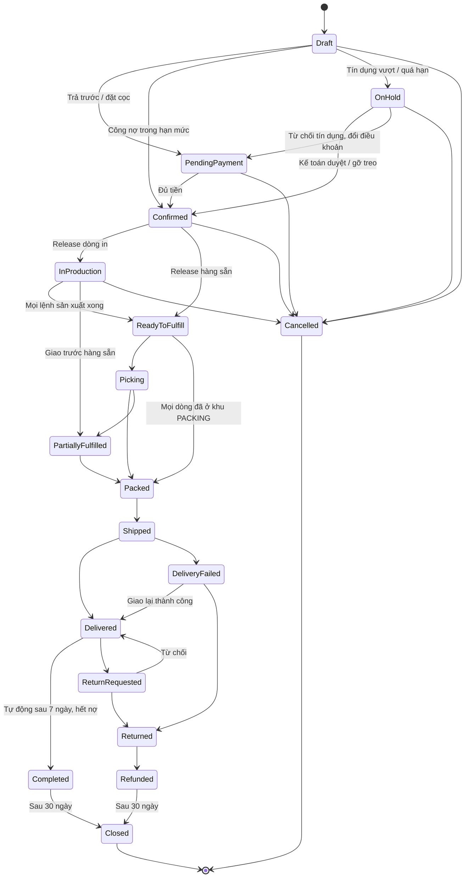
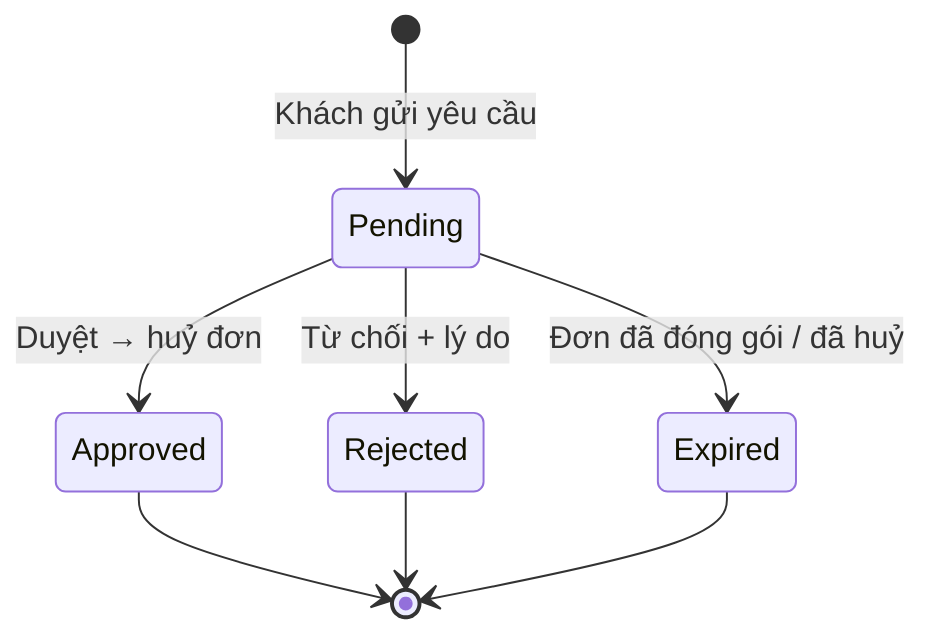

# 17 — Quản lý đơn hàng (Order Management)

## 1. Mục đích (Purpose)

Trung tâm **theo dõi và điều hành vòng đời đơn hàng**, từ lúc tạo ([14](../14-cart-and-order/README.md)) đến khi hoàn tất / đóng. Module này:

- giám sát trạng thái đơn;
- điều phối [Fulfillment](../../warehouse/07-picking/README.md);
- **treo / gỡ treo đơn**;
- xử lý **huỷ đơn** (khách tự huỷ hoặc gửi yêu cầu huỷ, phí huỷ), **giao một phần**, **đổi / trả hàng**;
- là nguồn thông tin đơn cho khách, Sale, kho, kế toán.

Order Management là **lớp điều phối** (orchestration): nó không tự pick / pack / ship mà **ra lệnh** cho các module thực thi và **hợp nhất trạng thái** từ chúng.

---

## 2. Actor liên quan

| Actor | Vai trò |
|-------|---------|
| **Nhân viên Sale (Sales Staff)** | Tra cứu đơn, CSKH. **Duyệt / từ chối yêu cầu huỷ** của khách. Huỷ đơn thay khách. **Đóng phần còn lại** của đơn giao một phần. **Quyết định cho phép giao một phần**. |
| **Điều phối đơn hàng (Order Coordinator)** | Release đơn cho kho, chọn kho xuất, **chọn cách giao** (gửi kiện / nguyên chuyến). **Treo / gỡ treo đơn**. Ghi nhận giao thành công / thất bại. Duyệt / từ chối yêu cầu huỷ, huỷ đơn, đóng phần còn lại. |
| **Kế toán (Accountant)** | **Duyệt / từ chối đơn treo vì tín dụng** ([15](../15-payment/README.md) §4.4); hoàn tiền; đối soát; **xem chi tiết & lịch sử đơn (chỉ đọc)** *(Quyết định 21/10/2026)* |
| **Nhân viên kho (Warehouse Staff)** | Nhận lệnh xuất; cập nhật picked / packed / shipped |
| **Khách hàng sỉ** | Xem đơn trên cổng (trạng thái rút gọn, §5.2). **Tự huỷ** đơn chưa vào sản xuất / kho, hoặc **gửi yêu cầu huỷ**. Gửi yêu cầu trả hàng. Đặt lại từ đơn cũ ([14](../14-cart-and-order/README.md)). |
| **Hệ thống** | Hợp nhất trạng thái từ Payment / Production / Picking / Packing / Shipping. Treo đơn khi tín dụng / thiết kế lệch. Đóng yêu cầu huỷ không còn quyết được. Tự hoàn tất và tự đóng đơn mỗi đêm. Thông báo Sale / Điều phối. |

---

## 3. Input / Output

### Input

| Nguồn | Dữ liệu |
|-------|---------|
| [14 Quote & Order](../14-cart-and-order/README.md) | Order mới tạo (dòng hàng, địa chỉ, phí, tổng tiền, design snapshot, điều khoản thanh toán) |
| [15 Payment](../15-payment/README.md) | Tiền đã phân bổ, trạng thái thanh toán, đảo phân bổ, vị thế tín dụng |
| [07](../../warehouse/07-picking/README.md)/[08](../../warehouse/08-packing/README.md)/[09](../../warehouse/09-shipping/README.md) | Cập nhật picked / short, packed, đã bàn giao, kết quả giao |
| [19 Production](../../warehouse/19-production/README.md) | Trạng thái lệnh sản xuất; "sản xuất xong" khi mọi lệnh của đơn `Completed` |
| Khách / Sale | Yêu cầu huỷ (kèm mã lý do), yêu cầu trả hàng, đổi địa chỉ |

### Output

| Kết quả | Dùng bởi |
|---------|----------|
| **Trạng thái đơn hợp nhất** + dòng thời gian sự kiện | Khách, Sale, kho, kế toán |
| **Lệnh xuất kho (release)** | 07 Picking |
| **Dòng in được release** (sinh lệnh sản xuất tại kho xuất đã chọn) | [19 Production](../../warehouse/19-production/README.md) |
| **Yêu cầu huỷ** và quyết định | Khách, Sale, Điều phối |
| **Tiền hoàn / phí huỷ** khi huỷ hoặc đóng phần còn lại | [15 Payment](../15-payment/README.md) |
| **Thông báo trong ứng dụng**: đơn đã bắt đầu in mà thanh toán thất bại / không về, cần nhân viên quyết huỷ ([00 §6](../../00-system-overview/README.md)) | Sale, Điều phối |
| **Dashboard bán hàng** — đơn & doanh thu theo ngày, SKU bán chạy, đơn theo trạng thái (§4.8) | Quản trị bán hàng, Kế toán, Quản lý kho, Điều phối, System Admin |

---

## 4. Luồng nghiệp vụ từng bước (Step-by-step)

### 4.1. Tiếp nhận & xác nhận đơn

1. Nhận Order từ [14](../14-cart-and-order/README.md).
2. Theo dõi [Payment](../15-payment/README.md): đơn `Confirmed` khi **đủ điều kiện thanh toán** theo điều khoản của đơn:
   - trả trước đủ;
   - **đã nhận cọc**;
   - **đơn công nợ trong hạn mức và khách không quá hạn**.

   Đơn công nợ không đạt → `On Hold` lý do tín dụng (§4.6).

### 4.2. Phân bổ & release fulfillment

3. **Chọn kho xuất** — Điều phối chọn theo tồn khả dụng, khoảng cách, tải kho. Dòng in chỉ giao cho kho có **khu xưởng in (`PRODUCTION`)** (khi có trạm in: thêm điều kiện trạm `Active` đúng kỹ thuật in — [B10, B16](../../open-questions/README.md)).
   > ⚠️ Giả định: xưởng in đặt trong kho, nên kho không có xưởng không xuất được dòng in. Xem [open-questions](../../open-questions/README.md).
4. **Chọn cách giao** — Điều phối chọn **gửi kiện** (`PARCEL`, mặc định) hoặc **giao nguyên chuyến** (`FULL_TRUCKLOAD` — thuê nguyên xe tải / container, có lập kế hoạch xếp hàng 3D — xem [09 §4.2](../../warehouse/09-shipping/README.md#42-giao-nguyên-chuyến--lập-kế-hoạch-xếp-hàng-3d-load-planning)).
   - Đổi được tới khi **mở kiện đầu tiên**; sau đó khoá (BR-13).
   - Giao nguyên chuyến không kết hợp với đơn đặt cọc thu phần còn lại khi giao.
   > ⚠️ Giả định: khách không tự chọn giao nguyên chuyến trên cổng khách hàng; phí vận chuyển cho đơn giao nguyên chuyến chưa xác định. Xem [open-questions](../../open-questions/README.md).
5. **Release** — Không release khi:
   - đơn đặt cọc chưa nhận đủ cọc;
   - có dòng thiết kế mới chưa có mẫu được duyệt;
   - đơn công nợ / `ON_CREDIT` mà khách đang có khoản quá hạn.

   Khi release:
   - **Mỗi dòng in sinh một lệnh sản xuất** ([19](../../warehouse/19-production/README.md)) tại kho xuất đã chọn; đơn → `In Production`.
   - Đơn không có dòng in → `Ready to Fulfill`.
   - Phôi giữ theo SKU được phân bổ vào bin và lô ([20](../../warehouse/20-inventory-control/README.md) §5.6).
6. **Đơn hỗn hợp** — Dòng hàng sẵn được pick **song song** trong lúc in và chờ tại khu `PACKING`. Khi **mọi lệnh sản xuất** đã `Completed` → `Ready to Fulfill`:
   - Còn dòng hàng sẵn chưa pick → release **lệnh xuất** → [Picking](../../warehouse/07-picking/README.md); đơn → `Picking`.
   - Mọi dòng đã ở khu `PACKING` → đơn đi thẳng `Ready to Fulfill` → `Packed`, **không qua `Picking`**.
7. **Giao một phần** — Sale quyết định **cho phép giao một phần** theo từng đơn (mặc định tắt; bật / tắt, ghi chú ≤ 500 ký tự; mọi lần quyết định được ghi lại); kho chỉ làm theo *(Quyết định 19/10 và 21/10/2026)*.
   - Nhiều đơn đi chung một xe: xử lý ở lập kế hoạch chuyến xe ([09 §4.2](../../warehouse/09-shipping/README.md)); mỗi kiện vẫn thuộc một đơn.
   - Có cho phép: hàng sẵn được đóng gói và **bàn giao trước** trong lúc dòng in còn sản xuất (PACK-EARLY); đơn → `Partially Fulfilled`.
   - Không cho phép: không được để lại hàng khi bàn giao.
   - Quyết định **khoá** từ khi đơn `Shipped` trở đi. Cũng không tắt được khi đã có hàng giao trước dòng in, hoặc đã có hàng rời kho trên một chuyến xe.
8. **Theo dõi Fulfillment** — hợp nhất cập nhật: `Picking` → `Packed` → `Shipped` → `Delivered`. Sau `Shipped` hệ thống không theo dõi hành trình; kết quả giao do Điều phối cập nhật khi hãng báo lại ([09](../../warehouse/09-shipping/README.md)).

### 4.3. Hoàn tất & đóng đơn

9. **`Delivered`** — Điều phối cập nhật khi hãng báo giao thành công. Đơn đã có shipment thì kết quả giao ghi **theo từng shipment** *(Quyết định 19/10/2026)*.
10. **Đối soát tài chính** ([15](../15-payment/README.md)):
    - trả trước: đã `Paid`;
    - đặt cọc: thu phần còn lại theo chính sách của đơn;
    - công nợ: mở **khoản công nợ phải thu**.
11. **Tự hoàn tất** *(Quyết định 21/10/2026)* — mỗi đêm (00:30) hệ thống chuyển `Delivered` → `Completed` khi đủ ba điều kiện:
    - hết **thời hạn đổi / trả 7 ngày** kể từ khi giao;
    - đơn **không còn tiền phải thu**;
    - không có yêu cầu trả hàng đang mở.
12. **Tự đóng** — `Completed`, `Refunded` hoặc `Partially Refunded` → `Closed` sau **30 ngày**.

### 4.4. Sửa đơn (Order amendment)

13. Yêu cầu từ khách / Sale: đổi số lượng, thêm / bớt dòng, đổi địa chỉ.
14. **Quy tắc theo trạng thái:**

    | Đơn đang ở | Cho phép sửa gì |
    |-----------|-----------------|
    | `Pending Payment` | Huỷ và đặt lại; đổi địa chỉ |
    | `Confirmed` / `In Production` (lệnh sản xuất chưa tới `Printing`) | Đổi địa chỉ; đổi số lượng / dòng kèm điều chỉnh thanh toán (thu thêm / hoàn bớt); huỷ |
    | `In Production` (lệnh sản xuất đã `Printing` trở đi) | Đổi địa chỉ; không đổi dòng tùy chỉnh đã in; huỷ chỉ do nhân viên, có thể tính phí (§4.5) |
    | `Ready to Fulfill` / `Picking` | Hạn chế: đổi địa chỉ nếu chưa tạo nhãn; huỷ cần dừng pick + put-back |
    | `Packed` trở đi | Không sửa, không huỷ; xử lý sau giao qua trả hàng (§4.7) |

15. Sửa có ảnh hưởng tiền → tạo khoản thu thêm / hoàn tiền tương ứng ([15](../15-payment/README.md)).

### 4.5. Huỷ đơn (Cancellation)

16. **Khách tự huỷ** — đơn còn ở `Draft`, `Pending Payment` hoặc `Confirmed` (chưa release) thì khách huỷ ngay trên cổng.
17. **Khách gửi yêu cầu huỷ** — đơn đã release nhưng **chưa đóng gói xong** → khách gửi **yêu cầu huỷ**:
    - Mỗi đơn chỉ có **một yêu cầu đang chờ**.
    - Hệ thống báo Sale và Điều phối.
    - Sale hoặc Điều phối:
      - **Duyệt** → huỷ đơn ngay, kèm phí nếu có (bước 19);
      - **Từ chối**, bắt buộc ghi lý do.
    - Đơn tiến tới mức không huỷ được nữa (đóng gói xong, hoặc đã huỷ) trong lúc yêu cầu còn chờ → yêu cầu tự **hết hiệu lực** (`Expired`), kèm ghi chú hướng khách sang trả hàng.
18. **Mã lý do huỷ** (BR-12) — khách chỉ chọn 3 lý do đầu *(Quyết định 21/10/2026)*:

    | Mã | Nghĩa | Khách được chọn |
    |----|-------|-----------------|
    | `CUSTOMER_REQUEST` | Khách yêu cầu | ✓ (mặc định) |
    | `DUPLICATE_ORDER` | Đặt trùng | ✓ |
    | `OTHER` | Lý do khác — **bắt buộc ghi chú** | ✓ |
    | `PAYMENT_NOT_RECEIVED` | Không nhận được tiền | |
    | `PAYMENT_FAILED` | Thanh toán không thành công | |
    | `OUT_OF_STOCK` | Hết hàng | |
    | `SUSPECTED_FRAUD` | Nghi gian lận | |
    | `CREDIT_REJECTED` | Kế toán từ chối tín dụng | |
    | `PRODUCTION_ISSUE` | Sự cố sản xuất | |

19. **Nhân viên huỷ & phí huỷ** — Sale / Điều phối huỷ đơn (kèm mã lý do) hoặc duyệt yêu cầu huỷ.

    **Trước khi bắt đầu in:** **hoàn toàn bộ**, không được tính phí (BR-11).

    **Sau khi đã in:** được huỷ, tính phí sản xuất; hàng đã in xuất huỷ (`SCRAP`) *(Quyết định 19/10/2026)*.
    - Được tính phí theo **% số tiền đã thu**, hoặc theo **số tiền thoả thuận**.
    - Số tiền thoả thuận phải là số nguyên dương, ≤ tổng đơn, kèm lý do (≤ 500 ký tự) và chi tiết (≤ 2.000 ký tự).
    - Tiền đã thu **trả phí trước**. Phần thừa thành **lệnh hoàn tiền** (`Pending`). Phần phí còn thiếu thành **khoản công nợ phí huỷ** ([15](../15-payment/README.md) §4.8).
20. **Hệ thống không tự huỷ đơn đã in** — Thanh toán thất bại, hoặc hết hạn giữ hàng, ở một đơn **đã bắt đầu in** thì hệ thống **chuyển cho nhân viên quyết** và báo Sale / Điều phối, không tự huỷ.
21. **Mốc đóng gói** *(Quyết định 21/10/2026: đơn `Packed` không huỷ được)* — Khi **một kiện của đơn đã đóng gói xong** (hoặc đã bàn giao), đơn **không huỷ được nữa**; mọi thay đổi đi qua **trả hàng** (§4.7).
    - Ngoại lệ: hàng sẵn đóng gói trước dòng in (PACK-EARLY) trong lúc đơn còn `In Production`, chưa bàn giao gì.
22. **Dừng tác vụ kho khi huỷ** — huỷ pick task, put-back hàng đã lấy, huỷ nhãn kiện / gỡ kiện khỏi kế hoạch xếp hàng, dừng lệnh sản xuất ([19](../../warehouse/19-production/README.md)).
23. **Đóng phần còn lại** — Đơn `Partially Fulfilled` mà phần còn lại sẽ không giao nữa → Sale / Điều phối **đóng phần còn lại** (kèm mã lý do — Sale chọn trong 6 lý do của màn hình *(Quyết định 21/10/2026)*; đơn đang treo thì phải gỡ treo trước):
    - Mọi đơn vị chưa giao bị đóng; đơn đi theo trạng thái các chuyến đã giao, không chuyển thẳng `Completed` *(Quyết định 21/10/2026)*.
    - Phí chỉ tính khi đã in, ≤ giá trị các đơn vị in bị đóng, kèm lý do và chi tiết.
    - Tiền thừa trả phí trước, phần còn lại hoàn. Thiếu thì thành công nợ phí.
    - Hàng in chưa giao bị xuất huỷ.

### 4.6. Treo đơn (On Hold)

24. **Lý do treo:**

    | Lý do | Ai đặt | Ai gỡ |
    |-------|--------|-------|
    | `CREDIT` — tín dụng (vượt hạn mức / quá hạn) | Hệ thống, lúc đặt đơn công nợ | Kế toán duyệt / từ chối ([15](../15-payment/README.md) §4.4) |
    | `DESIGN_MISMATCH` — thiết kế lệch checksum lúc đóng gói | Hệ thống ([08](../../warehouse/08-packing/README.md)) | Quản lý kho xác minh lại thiết kế ([08](../../warehouse/08-packing/README.md) §4.4) |
    | `PAYMENT` — thiếu tiền sau khi đảo phân bổ | Kế toán (khi đảo) hoặc Điều phối | Điều phối, **chỉ khi tiền đã đủ lại** |
    | `ADDRESS`, `INVENTORY`, `CUSTOMER`, `FRAUD`, `OTHER` (bắt buộc ghi chú) | Điều phối | Điều phối |

25. Điều phối treo tay được đơn ở `Confirmed`, `In Production`, `Ready to Fulfill`, `Picking`, `Partially Fulfilled`, `Packed`. Đơn đang treo thì không treo thêm lần nữa.
26. **Gỡ treo** (bắt buộc ghi chú) → đơn **quay về trạng thái trước khi treo**, rồi cập nhật theo các chuyến hàng đã có *(Quyết định 19/10/2026)*. Khách chỉ thấy lý do công khai ("đang được xem xét"), không thấy mã lý do nội bộ hay ghi chú.

### 4.7. Đổi / Trả hàng & Hoàn tiền (Returns & Refunds)

27. Khách tạo **yêu cầu trả hàng** (trong hạn chính sách) qua cổng khách hàng / chat, nêu lý do → đơn `Return Requested`.
28. Duyệt → phát hành **RMA**; hướng dẫn khách gửi hàng về (hoặc hẹn lấy). Từ chối → đơn quay về `Delivered`.
29. Kho **nhận hàng trả** qua luồng [Receipt](../../warehouse/03-receipt/README.md) dạng "return": kiểm tra tình trạng → nhập lại tồn (`Available` / `Quarantine`) hoặc huỷ.
30. **Hoàn tiền** ([15](../15-payment/README.md)) toàn phần / một phần; đơn → `Returned` → `Refunded` / `Partially Refunded`.
31. **Đổi hàng (exchange):** = trả + tạo đơn mới (hoặc bù trừ giá trị), tuỳ chính sách.
> ✅ Đã chốt 2026-10-06: ly và bao bì in theo thiết kế **chỉ đổi / trả khi lỗi sản xuất**, không đổi / trả vì đổi ý.

### 4.8. Dashboard bán hàng

1. **Ai xem** — Quản trị bán hàng, Kế toán, System Admin, Quản lý kho, Điều phối đơn hàng; phạm vi **toàn hệ thống**. Sale, Inventory Planner, Procurement **không** xem (chưa có góc nhìn "khách của tôi" cho Sale).
2. **Kỳ báo cáo** — tính theo **lịch Việt Nam** (Asia/Ho_Chi_Minh); mặc định **30 ngày** tính đến hôm nay, tối đa **366 ngày**.
3. **Chỉ số:**

   | Chỉ số | Cách tính |
   |--------|-----------|
   | **Đơn & doanh thu theo ngày** | Mỗi ngày (kể cả ngày không có đơn): số đơn, doanh thu. **Doanh thu = tổng tiền đơn đã đặt − đơn đã huỷ**, ghi vào **ngày đặt đơn**. Đơn treo vẫn tính; đơn nháp không tính |
   | **Tổng kỳ** | Số đơn, doanh thu, **giá trị đơn trung bình**, so sánh % với kỳ liền trước cùng độ dài |
   | **SKU bán chạy** | Xếp theo doanh thu rồi số lượng; mặc định 10, tối đa 100 |
   | **Đơn theo trạng thái** | Số đơn hiện tại ở từng trạng thái (§5.1), không theo kỳ |

4. Chỉ tính đơn **VND**; chỉ nhóm **theo ngày** (theo tuần / tháng, khách hàng mua nhiều nhất, xuất file: phạm vi sau — [open-questions D18](../../open-questions/README.md)).
5. Người có quyền xuất báo cáo có thể yêu cầu **tính lại** số liệu tổng hợp.

Báo cáo khác: dashboard xưởng ([19 §4.10](../../warehouse/19-production/README.md)), PO theo trạng thái và chi tiêu theo NCC ([02](../../warehouse/02-purchase-order/README.md)), cảnh báo tồn ([20](../../warehouse/20-inventory-control/README.md)), công nợ phải thu ([15](../15-payment/README.md)).

---

## 5. Trạng thái / Vòng đời (Lifecycle)

### 5.1. Trạng thái đơn (nội bộ)

| Trạng thái | Ý nghĩa | Chuyển tiếp chính | Nguồn |
|------------|---------|-------------------|-------|
| `Draft` | Đơn đang tạo, chưa chốt điều khoản | → `Pending Payment`, → `Confirmed`, → `On Hold` (tín dụng), → `Cancelled` | 14 |
| `Pending Payment` | Chờ tiền trả trước / tiền cọc (đơn công nợ không qua bước này) | → `Confirmed`, → `Cancelled` | 15 |
| `Confirmed` | Đủ điều kiện thanh toán; phôi đã giữ | → `In Production`, → `Ready to Fulfill`, → `On Hold`, → `Cancelled` | 15 / Điều phối (release) |
| `In Production` | Các dòng in đang sản xuất ([19](../../warehouse/19-production/README.md)) | → `Ready to Fulfill`, → `Partially Fulfilled` (giao trước hàng sẵn), → `On Hold`, → `Cancelled` | 19 |
| `Ready to Fulfill` | Đã release cho kho | → `Picking`, → `Packed`, → `Partially Fulfilled`, → `On Hold`, → `Cancelled` | 17 → 07 / 08 |
| `Picking` | Kho đang lấy hàng | → `Packed`, → `Partially Fulfilled`, → `On Hold`, → `Cancelled` | 07 |
| `Partially Fulfilled` | Đã giao một phần, phần còn lại chờ hoặc bị đóng | → `Packed`, → `Shipped`, → `Delivery Failed`, → `Delivered`, → `Returned`, → `On Hold` | 07 / 08 / 09 |
| `Packed` | Đã đóng gói; **không huỷ được nữa** | → `Shipped`, → `Partially Fulfilled`, → `On Hold` | 08 |
| `On Hold` | Tạm giữ (§4.6) | → trạng thái trước khi treo; → `Pending Payment` (đổi điều khoản sau từ chối tín dụng); → `Cancelled` | Hệ thống / Điều phối / Kế toán |
| `Shipped` | Đã bàn giao đơn vị vận chuyển; không theo dõi hành trình | → `Delivered`, → `Delivery Failed`, → `Partially Fulfilled` | 09 |
| `Delivery Failed` | Hãng báo giao không thành công | → `Delivered`, → `Returned`, → `Partially Fulfilled` | 09 (Điều phối) |
| `Delivered` | Hãng báo giao thành công | → `Completed` (tự động, §4.3), → `Return Requested` | 09 (Điều phối) / khách |
| `Return Requested` | Khách yêu cầu trả | → `Returned`, → `Delivered` (từ chối) | 17 |
| `Returned` | Hàng đã về kho | → `Refunded`, → `Partially Refunded` | 03 / 15 |
| `Refunded` / `Partially Refunded` | Đã hoàn tiền | → `Closed` (tự động sau 30 ngày) | 15 |
| `Completed` | Hoàn tất, hết hạn đổi / trả, không còn nợ | → `Closed` (tự động sau 30 ngày) | Hệ thống |
| `Cancelled` | Huỷ trước khi đóng gói | *(cuối)* | Khách / Sale / Điều phối / Hệ thống |
| `Closed` | Đóng hoàn toàn | *(cuối)* | Hệ thống |

> Treo được từ `Confirmed`, `In Production`, `Ready to Fulfill`, `Picking`, `Partially Fulfilled`, `Packed`. Gỡ treo quay về đúng trạng thái trước đó. Sơ đồ chỉ vẽ một nhánh để dễ đọc.

### 5.2. Trạng thái đơn khách thấy trên cổng

| Khách thấy | Gồm trạng thái nội bộ |
|------------|------------------------|
| Chờ thanh toán | `Draft`, `Pending Payment` |
| Đang xem xét | `On Hold` (hiện "chờ duyệt tín dụng" nếu treo vì tín dụng chưa quyết) |
| Đã xác nhận | `Confirmed` |
| Đang sản xuất | `In Production` |
| Đang chuẩn bị | `Ready to Fulfill`, `Picking`, `Partially Fulfilled`, `Packed` |
| Đang giao | `Shipped`, `Delivery Failed` |
| Đã giao | `Delivered`, `Completed`; `Closed` nếu từng hoàn tất |
| Đã huỷ | `Cancelled` |
| Trả hàng | `Return Requested`, `Returned`, `Refunded`, `Partially Refunded`; `Closed` nếu chưa từng hoàn tất |

Ngoài trạng thái, cổng hiển thị cho khách:

- **tình trạng giao** của đơn: chưa giao / đang giao / giao một phần / giao thất bại / đã giao / đã trả;
- **tình trạng sản xuất** của từng dòng: không cần in / chưa bắt đầu / đang in / xong / đã huỷ;
- **hướng dẫn chuyển khoản** ([15](../15-payment/README.md) §4.1);
- **các thao tác khách được làm lúc này**: huỷ ngay, gửi yêu cầu huỷ, đặt lại.

### 5.3. Yêu cầu huỷ (Cancellation request)

| Trạng thái | Ý nghĩa | Chuyển tiếp cho phép | Ai thực hiện |
|------------|---------|----------------------|--------------|
| `Pending` | Khách đã gửi, chờ quyết | → `Approved`, → `Rejected`, → `Expired` | Khách tạo |
| `Approved` | Đã duyệt; đơn bị huỷ (kèm phí nếu có) | *(cuối)* | Sale / Điều phối |
| `Rejected` | Từ chối, có lý do | *(cuối)* | Sale / Điều phối |
| `Expired` | Đơn đã tới mức không huỷ được, hoặc đã bị huỷ theo đường khác | *(cuối)* | Hệ thống |

---

## 6. Ràng buộc nghiệp vụ (Business Rules) & Edge case

### Business rules

- **BR-01:** Trạng thái đơn là **hợp nhất** từ các module thực thi. Chỉ chuyển theo bảng §5.1 (cả ứng dụng lẫn cơ sở dữ liệu cùng chặn).
- **BR-02:** Không release khi:
  - chưa đủ điều kiện thanh toán;
  - khách có khoản quá hạn (đơn công nợ / `ON_CREDIT`);
  - đơn `On Hold`;
  - có dòng thiết kế mới chưa có mẫu duyệt;
  - không đủ tồn phân bổ.
- **BR-03:** Huỷ đơn sau khi đã có tác vụ kho phải **đảo ngược có kiểm soát** (put-back tồn, huỷ nhãn kiện, dừng lệnh sản xuất), không để tồn / tiền "treo".
- **BR-04:** Mọi thay đổi đơn ảnh hưởng tiền phải sinh dòng tương ứng ở [Payment](../15-payment/README.md); tổng thu − tổng hoàn = giá trị thực nhận của đơn.
- **BR-05:** Đơn `Completed` / `Closed` là bất biến về nội dung; khiếu nại sau đó xử lý bằng chứng từ mới.
- **BR-06:** Đơn hỗn hợp chỉ giao một phần khi Sale **cho phép giao một phần** cho đơn đó; quyết định khoá từ khi `Shipped`.
- **BR-07:** Hàng trả **luôn** nhập lại kho qua [Receipt](../../warehouse/03-receipt/README.md) trước khi cộng tồn / hoàn tiền hàng nguyên vẹn.
- **BR-08:** Sản phẩm in theo thiết kế chỉ đổi / trả khi lỗi sản xuất.
- **BR-09:** Dòng có **thiết kế mới** chỉ được release sang sản xuất khi đã có **mẫu được khách duyệt** ([19](../../warehouse/19-production/README.md) BR-08).
- **BR-10:** **Mốc huỷ là đóng gói.**
  - Khách tự huỷ chỉ khi đơn ở `Draft` / `Pending Payment` / `Confirmed`.
  - Sau đó, tới khi đóng gói xong, khách gửi yêu cầu huỷ.
  - Từ khi một kiện đã đóng gói xong (hoặc đã bàn giao) thì không huỷ, chỉ trả hàng (ngoại lệ PACK-EARLY §4.5).
- **BR-11:** **Không tính phí huỷ trước khi bắt đầu in**: hoàn toàn bộ. Sau khi đã in, chỉ **nhân viên** huỷ được, có thể tính phí:
  - phí theo % tiền đã thu, hoặc số tiền thoả thuận ≤ tổng đơn;
  - số tiền thoả thuận bắt buộc kèm lý do và chi tiết.
- **BR-12:** Huỷ luôn có **mã lý do**. Khách chỉ dùng `CUSTOMER_REQUEST` / `DUPLICATE_ORDER` / `OTHER`. `OTHER` bắt buộc ghi chú.
- **BR-13:** Cách giao chỉ đổi được tới khi mở kiện đầu tiên (hoặc khi đơn đã quá bước lấy hàng). Giao nguyên chuyến không kết hợp với đơn đặt cọc thu phần còn lại khi giao.
- **BR-14:** Mỗi đơn chỉ có **một yêu cầu huỷ đang chờ**. Yêu cầu không còn quyết được thì tự `Expired`, không treo vô thời hạn.
- **BR-15:** Treo tay bắt buộc mã lý do (`OTHER` kèm ghi chú). Gỡ treo bắt buộc ghi chú. Treo vì tín dụng / thiết kế chỉ gỡ qua luồng riêng của nó. Treo vì thanh toán chỉ gỡ khi tiền đã đủ lại.
- **BR-16:** Tự hoàn tất sau **7 ngày** kể từ giao, khi không còn nợ và không có yêu cầu trả; tự đóng sau **30 ngày**. Chạy mỗi đêm.

### Edge case

| Tình huống | Hướng xử lý |
|------------|-------------|
| Thanh toán OK nhưng hết hàng khi phân bổ | `On Hold` lý do `INVENTORY`; liên hệ khách: chờ nhập / đổi biến thể / huỷ + hoàn tiền |
| Khách đổi địa chỉ khi đơn đã `Shipped` | CSKH liên hệ hãng (ngoài hệ thống) nhờ chuyển hướng nếu hãng hỗ trợ; nếu không → chờ giao thất bại / RTO rồi gửi lại |
| Short pick → chỉ giao được một phần | Theo [07](../../warehouse/07-picking/README.md); nếu phần còn lại không giao nữa → **đóng phần còn lại** (§4.5) |
| Khách huỷ khi đang `In Production` (lệnh chưa `Printing`) | Khách gửi yêu cầu huỷ → Sale / Điều phối duyệt → huỷ lệnh sản xuất, put-back phôi, **hoàn toàn bộ** |
| Khách muốn huỷ khi đã in | Khách gửi yêu cầu huỷ; nhân viên từ chối, hoặc duyệt có phí; thành phẩm cá nhân hoá xuất huỷ |
| Thanh toán lỗi / hết hạn giữ hàng ở đơn đã in | Hệ thống không tự huỷ; chuyển Sale / Điều phối quyết |
| Khách gửi yêu cầu huỷ rồi đơn kịp đóng gói xong | Yêu cầu tự `Expired`; khách đi luồng trả hàng |
| Lệnh sản xuất `On Hold` vì thiếu phôi | Xử lý như thiếu hàng: liên hệ khách chờ, đổi biến thể, hoặc huỷ dòng + hoàn tiền |
| Lệnh sản xuất quá hạn so với cam kết (dashboard xưởng) | Sale báo khách ngày giao mới; Quản lý kho tách một phần đưa gia công ngoài ([19](../../warehouse/19-production/README.md) §4.8) |
| Giao `Delivered` nhưng khách khiếu nại không nhận | Trạng thái tranh chấp; CSKH xác minh với hãng (ngoài hệ thống); đơn không tự hoàn tất khi còn yêu cầu trả hàng mở |
| Hàng trả về không nguyên vẹn | Nhập `Quarantine`; hoàn một phần / từ chối hoàn theo chính sách; ghi hồ sơ khách |
| Trùng đơn (khách đặt 2 lần) | Huỷ một đơn với lý do `DUPLICATE_ORDER` + hoàn tiền |
| Nghi gian lận sau khi đã ship | Không thu hồi giữa đường; đánh dấu rủi ro; phối hợp [Payment](../15-payment/README.md) & carrier |
| Đơn công nợ đã giao nhưng khách chưa trả | Đơn `Delivered`, chưa tự hoàn tất vì còn nợ; theo dõi công nợ ([15](../15-payment/README.md)); quá hạn → chặn release đơn công nợ mới |

---

## 7. Liên kết với các module khác

| Module | Quan hệ |
|--------|---------|
| [14 · Quote & Order](../14-cart-and-order/README.md) | Nguồn đơn; đặt lại từ đơn cũ tạo báo giá mới |
| [15 · Payment](../15-payment/README.md) | Trạng thái thanh toán; duyệt tín dụng; treo vì thanh toán; tiền hoàn và phí huỷ |
| [07 Picking](../../warehouse/07-picking/README.md) / [08 Packing](../../warehouse/08-packing/README.md) / [09 Shipping](../../warehouse/09-shipping/README.md) | Nhận lệnh xuất; đẩy cập nhật fulfillment về; đóng gói xong là mốc hết huỷ; thiết kế lệch → treo |
| [03 · Receipt](../../warehouse/03-receipt/README.md) | Hàng trả (return / RTO) nhập lại kho qua Receipt trước khi hoàn tiền |
| [12 · Product Design](../12-product-design/README.md) | Đổi thiết kế sau khi đặt; xác minh lại thiết kế khi lệch checksum |
| [19 · Production](../../warehouse/19-production/README.md) | Release dòng in sinh lệnh sản xuất; dừng lệnh khi huỷ / đóng phần còn lại; mốc "đã in" quyết định phí huỷ |
| [20 · Inventory Control](../../warehouse/20-inventory-control/README.md) | Giữ hàng theo SKU → phân bổ khi release; nhả giữ khi huỷ |
| [16 · Sales Chat](../16-sales-chat/README.md) | Kênh tiếp nhận yêu cầu khách |
| [18 · Customer Information](../18-customer-information/README.md) | Lịch sử đơn gắn hồ sơ khách; điều khoản thanh toán |
| [00 · System Overview §5](../../00-system-overview/README.md) | Order Management điều phối luồng Fulfillment |
