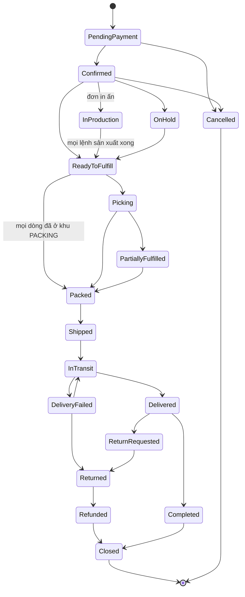

# 17 — Quản lý đơn hàng (Order Management)

## 1. Mục đích (Purpose)

Trung tâm **theo dõi và điều hành vòng đời đơn hàng** từ lúc tạo ([14](../14-cart-and-order/README.md)) đến khi hoàn tất/đóng: giám sát trạng thái, điều phối [Fulfillment](../../warehouse/07-picking/README.md), xử lý **sửa đơn, huỷ đơn, đổi/trả hàng, hoàn tiền**, và là nguồn thông tin đơn cho khách, Sale, kho, kế toán.

Order Management là **lớp điều phối** (orchestration): nó không tự pick/pack/ship mà **ra lệnh** và **hợp nhất trạng thái** từ các module thực thi.

---

## 2. Actor liên quan

| Actor | Vai trò |
|-------|---------|
| **Nhân viên Sale (Sales Staff)** | Tra cứu đơn, xử lý yêu cầu khách (sửa/huỷ/đổi/trả), liên hệ khách (CSKH) |
| **Điều phối đơn hàng (Order Coordinator)** | Duyệt & release đơn cho kho, xử lý đơn treo, phân bổ kho xuất, gộp/tách đơn |
| **Nhân viên kho (Warehouse Staff)** | Nhận lệnh xuất; cập nhật picked/packed/shipped |
| **Kế toán (Accountant)** | Đối soát thanh toán/COD/hoàn tiền theo đơn |
| **Khách hàng** | Xem trạng thái & lịch sử đơn, gửi yêu cầu (huỷ/đổi/trả) qua storefront hoặc [chat](../16-sales-chat/README.md) |
| **Hệ thống** | Hợp nhất trạng thái từ Payment/Picking/Packing/Shipping; áp quy tắc chuyển trạng thái; thông báo |

---

## 3. Input / Output

### Input

| Nguồn | Dữ liệu |
|-------|---------|
| [14 Cart & Order](../14-cart-and-order/README.md) | Order mới tạo (dòng hàng, địa chỉ, phí, tổng tiền, design snapshot) |
| [15 Payment](../15-payment/README.md) | `payment_status`, giao dịch, kết quả refund |
| [07](../../warehouse/07-picking/README.md)/[08](../../warehouse/08-packing/README.md)/[09](../../warehouse/09-shipping/README.md) | Cập nhật picked/short, packed, shipped/in-transit/delivered/returned |
| Khách / Sale | Yêu cầu sửa đơn, huỷ, đổi/trả, đổi địa chỉ |
| [19 Production](../../warehouse/19-production/README.md) | Trạng thái lệnh sản xuất, ngày xong dự kiến; sự kiện "mọi lệnh sản xuất của đơn `Completed`" |

### Output

| Kết quả | Dùng bởi |
|---------|----------|
| **Trạng thái đơn hợp nhất** + dòng thời gian sự kiện (order timeline) | Khách, Sale, kho, kế toán |
| **Lệnh xuất kho (fulfillment order / release)** | 07 Picking |
| **Dòng đơn tùy chỉnh cần sản xuất** (kèm kho xuất đã chọn) | 19 Production |
| **Phiếu huỷ / RMA (Return Merchandise Authorization) / yêu cầu hoàn tiền** | 15 Payment, kho (nhận trả) |
| **Phân bổ kho xuất** (đơn giao từ kho nào) | Mảng kho vận |
| **Thông báo khách** (xác nhận, đang giao, giao thành công, hoàn tiền) | Khách |
| **Báo cáo** (đơn theo trạng thái, SLA fulfillment, tỷ lệ huỷ/hoàn) | Quản lý |

---

## 4. Luồng nghiệp vụ từng bước (Step-by-step)

### 4.1. Tiếp nhận & xác nhận đơn

1. Nhận Order từ [14](../14-cart-and-order/README.md) ở `Pending Payment`.
2. Theo dõi [Payment](../15-payment/README.md): khi `Confirmed` (prepaid `Paid`/`Authorized`, hoặc COD hợp lệ) → đơn vào diện xử lý.
3. **Kiểm tra & làm giàu đơn:** địa chỉ hợp lệ, rủi ro gian lận, đủ tồn để phân bổ, phân loại đơn (thường / in ấn / hỗn hợp).

### 4.2. Phân bổ & release fulfillment

4. **Chọn kho xuất (fulfillment sourcing)** — theo tồn khả dụng, khoảng cách đến khách, tải kho, chính sách vùng. Có thể tách đơn giao từ nhiều kho (split fulfillment). Dòng tùy chỉnh chỉ được giao cho kho có **khu xưởng in (`PRODUCTION`) và trạm in `Active` đúng kỹ thuật in** của sản phẩm.
   > ⚠️ Giả định: xưởng in đặt trong kho, nên kho không có xưởng không xuất được dòng tùy chỉnh. Xem [open-questions](../../open-questions/README.md).

   Với đơn sỉ khối lượng lớn, Order Coordinator có thể chỉ định **giao nguyên chuyến** (thuê nguyên xe tải / container, có lập kế hoạch xếp hàng 3D — xem [09 §4.2](../../warehouse/09-shipping/README.md#42-giao-nguyên-chuyến--lập-kế-hoạch-xếp-hàng-3d-load-planning)) thay cho gửi kiện qua hãng.
   > ⚠️ Giả định: khách không tự chọn giao nguyên chuyến trên storefront; phí vận chuyển và thu COD cho đơn giao nguyên chuyến chưa xác định. Xem [open-questions](../../open-questions/README.md).
5. **Đơn in ấn / hỗn hợp:** mỗi dòng tùy chỉnh sinh một **lệnh sản xuất** tại kho xuất ([19 Production](../../warehouse/19-production/README.md)); đơn → `In Production`. Dòng hàng thường của đơn hỗn hợp được release pick **song song** và chờ tại khu `PACKING`.
6. **Release** — khi **mọi lệnh sản xuất** của đơn đã `Completed` (hoặc đơn không có dòng tùy chỉnh) → đơn `Ready to Fulfill`:
   - Còn dòng hàng thường chưa pick → release **lệnh xuất** → [Picking](../../warehouse/07-picking/README.md); đơn → `Picking`.
   - Mọi dòng đã ở khu `PACKING` (đơn chỉ gồm hàng tùy chỉnh, hoặc hàng thường đã pick song song) → sinh packing task ngay; đơn đi thẳng `Ready to Fulfill` → `Packed`, **không qua `Picking`**.
7. **Theo dõi Fulfillment** — hợp nhất cập nhật: `Picking` → `Packed` → `Shipped` → `In Transit` → `Delivered`. Xử lý short pick (backorder / giao một phần).

### 4.3. Hoàn tất & đóng đơn

8. **`Delivered`** từ [Shipping](../../warehouse/09-shipping/README.md).
9. **Đối soát tài chính:** prepaid → đã `Paid`; COD → chờ đối soát tiền carrier ([15 §4.7](../15-payment/README.md)).
10. Khi giao xong & tài chính khớp & hết thời hạn đổi/trả (hoặc khách xác nhận) → **`Completed` / `Closed`**.

### 4.4. Sửa đơn (Order amendment)

11. Yêu cầu từ khách/Sale: đổi số lượng, thêm/bớt dòng, đổi địa chỉ, đổi phương thức giao.
12. **Quy tắc theo trạng thái:**
    | Đơn đang ở | Cho phép sửa gì |
    |-----------|-----------------|
    | `Pending Payment` | Gần như tự do (thực chất quay lại giỏ) |
    | `Confirmed` / `In Production` (lệnh sản xuất chưa tới `In Progress`) | Đổi địa chỉ; đổi số lượng/dòng kèm điều chỉnh thanh toán (thu thêm/hoàn bớt); huỷ |
    | `In Production` (lệnh sản xuất đã `In Progress` trở đi) | Đổi địa chỉ; không đổi dòng tùy chỉnh đã in; huỷ theo chính sách tính phí sản xuất |
    | `Ready to Fulfill` / `Picking` | Hạn chế: đổi địa chỉ nếu chưa tạo nhãn; huỷ cần dừng pick + put-back |
    | `Packed` / `Shipped` | Không sửa nội dung; chỉ can thiệp qua carrier (đổi địa chỉ nếu hãng hỗ trợ) hoặc xử lý sau giao |
13. Sửa có ảnh hưởng tiền → tạo giao dịch thu thêm / refund tương ứng ([15](../15-payment/README.md)).

### 4.5. Huỷ đơn (Cancellation)

14. Nguồn: khách yêu cầu, hết hạn thanh toán, hết hàng không thể fulfill, nghi gian lận.
15. **Trước khi giao:** dừng mọi tác vụ kho (huỷ pick task, put-back hàng đã lấy, void nhãn vận đơn), hoàn tiền/void theo [15](../15-payment/README.md) → đơn `Cancelled`.
16. **Sau khi shipped:** không huỷ — chuyển sang luồng **trả hàng/hoàn tiền** khi hàng về.

### 4.6. Đổi / Trả hàng & Hoàn tiền (Returns & Refunds)

17. Khách tạo **yêu cầu trả hàng (return request)** (trong hạn chính sách) qua storefront/chat, nêu lý do (lỗi, không đúng mô tả, đổi ý…).
18. Duyệt → phát hành **RMA**; hướng dẫn khách gửi hàng về (hoặc hẹn lấy).
19. Kho **nhận hàng trả** qua luồng [Receipt](../../warehouse/03-receipt/README.md) dạng "return": kiểm tra tình trạng → nhập lại tồn (`Available`/`Quarantine`) hoặc huỷ.
20. **Hoàn tiền** ([15](../15-payment/README.md)) toàn phần/một phần theo chính sách (trừ phí ship, phí đổi ý…); đơn → `Returned` / `Refunded` / `Partially Refunded`.
21. **Đổi hàng (exchange):** = trả + tạo đơn mới (hoặc bù trừ giá trị), tuỳ chính sách.
> ⚠️ Giả định: Sản phẩm in ấn cá nhân hoá thường **không áp dụng đổi/trả vì đổi ý** (chỉ nhận đổi/trả khi lỗi sản xuất). Chính sách chi tiết cần xác nhận — xem [open-questions](../../open-questions/README.md).

---

## 5. Trạng thái / Vòng đời (Lifecycle)

| Trạng thái | Ý nghĩa | Chuyển tiếp chính | Nguồn |
|------------|---------|-------------------|-------|
| `Pending Payment` | Chờ thanh toán | → `Confirmed`, → `Payment Failed`, → `Cancelled` | 15 |
| `Payment Failed` | Thanh toán lỗi | → `Pending Payment`, → `Cancelled` | 15 |
| `Confirmed` | Đã thanh toán/COD hợp lệ, hàng đã giữ | → `In Production`, → `Ready to Fulfill`, → `On Hold`, → `Cancelled` | System |
| `In Production` | Đang sản xuất/in (đơn tùy chỉnh) | → `Ready to Fulfill` (mọi lệnh sản xuất `Completed`), → `Cancelled` | 19 |
| `On Hold` | Tạm giữ (nghi gian lận, thiếu hàng, chờ khách xác nhận sửa) | → `Confirmed`/`Ready to Fulfill`, → `Cancelled` | OPS |
| `Ready to Fulfill` | Đã release cho kho | → `Picking`, → `Packed` (mọi dòng đã ở khu `PACKING` — đơn chỉ gồm hàng tùy chỉnh hoặc hàng thường đã pick song song) | 17 → 07 / 08 |
| `Picking` | Kho đang lấy hàng | → `Partially Fulfilled`, → `Packed` | 07 |
| `Partially Fulfilled` | Giao một phần, phần còn lại backorder | → `Packed` (phần còn lại), → `Completed` (chốt) | 07/08 |
| `Packed` | Đã đóng gói | → `Shipped` | 08 |
| `Shipped` | Đã bàn giao vận chuyển | → `In Transit` | 09 |
| `In Transit` | Đang giao | → `Delivered`, → `Delivery Failed` | 09 |
| `Delivery Failed` | Giao không thành công | → `In Transit` (giao lại), → `Returned` (RTO) | 09 |
| `Delivered` | Giao thành công | → `Completed`, → `Return Requested` | 09 / khách |
| `Return Requested` | Khách yêu cầu trả | → `Returned`, → `Completed` (từ chối) | 17 |
| `Returned` | Hàng đã về kho | → `Refunded`, → `Partially Refunded` | 03 / 15 |
| `Refunded` / `Partially Refunded` | Đã hoàn tiền | → `Closed` | 15 |
| `Completed` | Hoàn tất, tài chính khớp, hết hạn đổi/trả | → `Closed` | 17 |
| `Cancelled` | Huỷ trước khi giao | *(cuối)* | Khách / OPS / System |
| `Closed` | Đóng hoàn toàn | *(cuối)* | 17 |

---

## 6. Ràng buộc nghiệp vụ (Business Rules) & Edge case

### Business rules

- **BR-01:** Trạng thái đơn là **hợp nhất** từ các module thực thi; Order Management không "nhảy cóc" trạng thái ngoài sơ đồ vòng đời.
- **BR-02:** Không release fulfillment khi: thanh toán chưa hợp lệ (prepaid), địa chỉ không hợp lệ, đơn `On Hold`, hoặc không đủ tồn phân bổ.
- **BR-03:** Huỷ đơn sau khi đã có tác vụ kho phải **đảo ngược có kiểm soát** (put-back tồn, void nhãn) — không để tồn/tiền "treo".
- **BR-04:** Mọi thay đổi đơn ảnh hưởng tiền phải sinh giao dịch tương ứng ở [Payment](../15-payment/README.md); tổng thu − tổng hoàn = giá trị thực nhận của đơn.
- **BR-05:** Đơn `Completed`/`Closed` là bất biến về nội dung; khiếu nại sau đó xử lý bằng chứng từ mới (đơn hoàn, phiếu bồi thường).
- **BR-06:** Đơn hỗn hợp (thường + in ấn): cho phép fulfill từng phần; trạng thái tổng phản ánh phần chậm nhất trừ khi chính sách split-ship.
- **BR-07:** Hàng trả **luôn** nhập lại kho qua [Receipt](../../warehouse/03-receipt/README.md) (kiểm tra tình trạng) trước khi cộng tồn / hoàn tiền hàng nguyên vẹn.
- **BR-08:** Thời hạn & điều kiện đổi/trả theo chính sách; sản phẩm cá nhân hoá có ngoại lệ riêng.

### Edge case

| Tình huống | Hướng xử lý |
|------------|-------------|
| Thanh toán OK nhưng hết hàng khi phân bổ | `On Hold`; liên hệ khách: chờ nhập/đổi biến thể/huỷ + hoàn tiền |
| Khách đổi địa chỉ khi đơn đã `Shipped` | Nhờ carrier chuyển hướng nếu hỗ trợ; nếu không → chờ giao thất bại/RTO rồi gửi lại |
| Short pick → chỉ giao được một phần | `Partially Fulfilled`; phần còn lại backorder hoặc huỷ + hoàn tiền phần thiếu |
| Khách huỷ khi đang `In Production` (lệnh sản xuất chưa `In Progress`) | Huỷ lệnh sản xuất, put-back phôi về bin, hoàn tiền theo 15 |
| Khách huỷ khi đang `In Production` (đã in) | Theo chính sách: từ chối huỷ hoặc huỷ có tính phí sản xuất; thành phẩm cá nhân hoá xuất huỷ |
| Lệnh sản xuất `On Hold` vì thiếu phôi / vượt ngưỡng in lại | Xử lý như thiếu hàng: liên hệ khách chờ, đổi biến thể, hoặc huỷ dòng + hoàn tiền |
| Ngày xong dự kiến của lệnh sản xuất trễ so với cam kết | Thông báo khách ngày giao mới qua Sale; đề nghị xưởng nâng ưu tiên |
| Giao `Delivered` nhưng khách khiếu nại không nhận | Trạng thái tranh chấp; đối chiếu POD; xử lý CSKH; không auto-close |
| Hàng trả về không nguyên vẹn | Nhập `Quarantine`; hoàn một phần / từ chối hoàn theo chính sách; ghi hồ sơ khách |
| Trùng đơn (khách bấm đặt 2 lần) | Phát hiện theo giỏ/khoảng thời gian; gộp hoặc huỷ 1 đơn + hoàn tiền |
| Nghi gian lận sau khi đã ship | Không thu hồi giữa đường; đánh dấu rủi ro; phối hợp [Payment](../15-payment/README.md) & carrier |
| COD delivered nhưng tiền carrier chưa về | Đơn `Delivered`, chưa `Completed`; theo dõi công nợ carrier |

---

## 7. Liên kết với các module khác

| Module | Quan hệ |
|--------|---------|
| [14 · Cart & Order](../14-cart-and-order/README.md) | Nguồn đơn; sửa đơn ở `Pending Payment` ~ quay lại giỏ |
| [15 · Payment](../15-payment/README.md) | Đồng bộ `payment_status`; khởi tạo thu thêm / refund / void |
| [07 Picking](../../warehouse/07-picking/README.md) / [08 Packing](../../warehouse/08-packing/README.md) / [09 Shipping](../../warehouse/09-shipping/README.md) | Nhận lệnh xuất; đẩy cập nhật trạng thái fulfillment về |
| [19 · Production](../../warehouse/19-production/README.md) | Dòng tùy chỉnh sinh lệnh sản xuất tại kho xuất có xưởng; nhận trạng thái & ngày xong dự kiến; đơn rời `In Production` khi mọi lệnh `Completed` |
| [03 · Receipt](../../warehouse/03-receipt/README.md) | Hàng trả (return/RTO) nhập lại kho qua Receipt trước khi hoàn tiền |
| [12 · Product Design](../12-product-design/README.md) | Quản lý yêu cầu thay đổi thiết kế; liên kết file sản xuất cho đơn in ấn |
| [16 · Sales Chat](../16-sales-chat/README.md) | Kênh tiếp nhận yêu cầu khách; tra cứu & chia sẻ trạng thái đơn |
| [18 · Customer Information](../18-customer-information/README.md) | Lịch sử đơn gắn hồ sơ khách; hồ sơ rủi ro ảnh hưởng xử lý đơn |
| [00 · System Overview §5](../../00-system-overview/README.md) | Order Management điều phối luồng Fulfillment |
