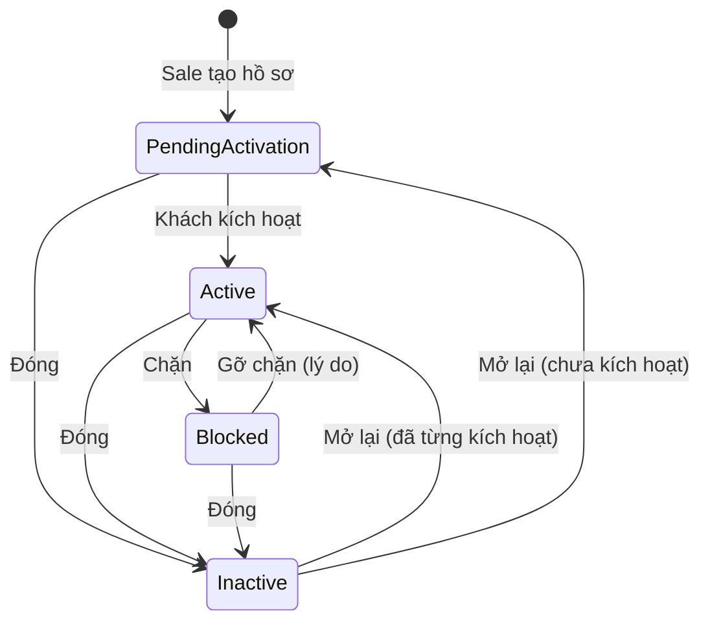

# 18 — Quản lý thông tin khách hàng sỉ (Customer Information Management)

> Đã chốt 2026-10-06: hệ thống **chỉ bán sỉ (B2B)**. Khách là **doanh nghiệp đã liên hệ từ trước**, do Sale tạo hồ sơ; không có đăng ký tự do và không có khách vãng lai (guest).
>
> Đã chốt 2026-11-04: khách thanh toán theo **lịch thanh toán của Hợp đồng mua bán** ([14](../14-cart-and-order/README.md), [15](../15-payment/README.md)). Hồ sơ khách cung cấp **lịch thanh toán mặc định**, **hạn mức & kỳ hạn công nợ** và **thông tin pháp lý** để lập hợp đồng.
>
> Đã chốt 2026-11-05: role phụ trách bán hàng là **Quản lý kinh doanh (Sales Manager)** (đổi tên role, việc giữ nguyên). Sàn **không hiển thị giá** ([13](../13-catalog/README.md)): **bảng giá riêng** của khách là **giá nội bộ** — Quản lý kinh doanh khai báo, chỉ nhân viên xem, làm giá gợi ý khi Sale lập báo giá; khách chỉ thấy giá trên báo giá / đơn / hợp đồng ([14](../14-cart-and-order/README.md)).

## 1. Mục đích (Purpose)

Quản lý **hồ sơ khách sỉ (customer profile)** và dữ liệu đi kèm:

- **Thông tin doanh nghiệp:** tên, mã số thuế, **thông tin pháp lý để lập hợp đồng** (địa chỉ đăng ký kinh doanh, người đại diện).
- **Tài khoản đăng nhập cổng** của khách.
- **Sổ địa chỉ.**
- **Điều khoản thương mại:** **lịch thanh toán mặc định** cho hợp đồng, **hạn mức công nợ, kỳ hạn công nợ**, **bảng giá riêng (giá nội bộ — chỉ nhân viên xem)**.
- **Nhóm khách.**
- **Lịch sử thay đổi** và **lịch sử đơn hàng, hợp đồng & tương tác.**

Đây là **nguồn dữ liệu khách hàng dùng chung** cho báo giá, đơn hàng & hợp đồng ([14](../14-cart-and-order/README.md)), thanh toán ([15](../15-payment/README.md)), chat với Sale ([16](../16-sales-chat/README.md)) và điều hành đơn ([17](../17-order-management/README.md)).

> ⚠️ Giả định: các phần sau **chưa có trong hệ thống**, được giữ làm **phạm vi giai đoạn sau** (xem [open-questions D16](../../open-questions/README.md)):
> - nhiều người liên hệ / người đặt hàng có quyền riêng trên cổng (hiện **mỗi khách một tài khoản đăng nhập**);
> - 2FA;
> - tuỳ chọn nhận tin & consent marketing;
> - hồ sơ rủi ro;
> - yêu cầu quyền riêng tư (tải / ẩn danh dữ liệu) và hợp nhất hồ sơ trùng (§4.5, §4.6).

---

## 2. Actor liên quan

| Actor | Vai trò |
|-------|---------|
| **Khách hàng sỉ** | Kích hoạt tài khoản từ lời mời. Sửa tên công ty và số điện thoại. Quản lý sổ địa chỉ. Đổi mật khẩu, xem / thu hồi phiên đăng nhập. Xem công nợ và vị thế tín dụng: hạn mức, dư nợ, hạn mức còn lại, kỳ hạn, cờ quá hạn của chính mình *(Quyết định 21/10/2026; hồ sơ rủi ro vẫn là dữ liệu nội bộ)*. |
| **Nhân viên Sale (Sales Staff)** | **Tạo hồ sơ khách sỉ** và gửi / gửi lại lời mời kích hoạt. Nhập **thông tin pháp lý**. Đặt **lịch thanh toán mặc định** ban đầu (chỉ gồm đợt `ON_SIGNING` / `BEFORE_DELIVERY`). Xem hồ sơ, sửa thông tin thay khách, quản lý địa chỉ. |
| **Quản lý kinh doanh (Sales Manager)** | Tạo hồ sơ khách. **Đổi trạng thái khách** (chặn / gỡ chặn / đóng / mở lại). Quản lý **nhóm khách** và gán khách vào nhóm. Quản lý địa chỉ. Khai báo **bảng giá riêng (giá nội bộ)** của khách ([13](../13-catalog/README.md)). |
| **Kế toán (Accountant)** | **Duyệt hạn mức và kỳ hạn công nợ**; duyệt lịch thanh toán mặc định có đợt `AFTER_DELIVERY` ([15](../15-payment/README.md) BR-12) |
| **Hệ thống** | Chuẩn hoá & chống trùng mã số thuế. Gửi lời mời, quản lý hạn link. Đồng bộ trạng thái tài khoản đăng nhập theo trạng thái khách. Ghi lịch sử thay đổi. Gắn đơn / hợp đồng / tương tác vào hồ sơ. |

---

## 3. Input / Output

### Input

| Nhóm | Dữ liệu | Nguồn |
|------|---------|-------|
| Định danh doanh nghiệp | Tên công ty; **mã số thuế (không bắt buộc)**: 10 số, 10-3 (đơn vị phụ thuộc) hoặc 12 số (CCCD của đại diện hộ kinh doanh) | Sale |
| **Thông tin pháp lý** | **Địa chỉ đăng ký kinh doanh** (trụ sở), **người đại diện theo pháp luật** và **chức vụ**; tài khoản ngân hàng của khách (không bắt buộc) | Sale |
| Tài khoản đăng nhập | Email người liên hệ (khoá đăng nhập; không đổi được), số điện thoại; mật khẩu do khách đặt khi kích hoạt | Sale / Khách |
| Điều khoản thương mại | **Lịch thanh toán mặc định** (các đợt: tên, %, mốc `ON_SIGNING` / `BEFORE_DELIVERY` / `AFTER_DELIVERY`, N ngày; tổng 100%), **hạn mức công nợ** (≥ 0), **kỳ hạn công nợ** (0–365 ngày) | Sale (ban đầu) + Kế toán duyệt |
| Bảng giá riêng (giá nội bộ) | Bậc giá theo số thùng + đơn giá / cái cho từng SKU riêng của khách; chỉ nhân viên xem, không hiện trên sàn | Quản lý kinh doanh ([13](../13-catalog/README.md)) |
| Sổ địa chỉ | Địa chỉ **giao hàng** và **xuất hoá đơn** (nhiều địa chỉ mỗi loại), mỗi loại một địa chỉ mặc định. Địa chỉ Việt Nam hai cấp (phường / xã, tỉnh / thành); bắt buộc tên người nhận, điện thoại, địa chỉ chi tiết | Khách / Sale |
| Nhóm khách | Mã nhóm (cố định), tên, mô tả | Quản lý kinh doanh |
| Dữ liệu phái sinh | Lịch sử báo giá, đơn & hợp đồng, **dư nợ & quá hạn**, thiết kế đã xác nhận và SKU theo mẫu của khách, lịch sử chat | 12, 14, 15, 16, 17 |

> ⚠️ Giả định: thông tin pháp lý (địa chỉ đăng ký kinh doanh, người đại diện, chức vụ) lưu trên hồ sơ khách, có thể bổ sung sau khi tạo nhưng **bắt buộc trước khi lập hợp đồng**; tài khoản ngân hàng của khách chỉ dùng để hoàn tiền. Xem [open-questions](../../open-questions/README.md).

### Output

| Kết quả | Dùng bởi |
|---------|----------|
| **Customer profile** | 14, 15, 16, 17, báo cáo |
| **Thông tin pháp lý** (bên mua) điền sẵn vào hợp đồng | [14](../14-cart-and-order/README.md) |
| **Địa chỉ & người nhận** cho đơn | [14](../14-cart-and-order/README.md) |
| **Lịch thanh toán mặc định** cho báo giá và hợp đồng | [14](../14-cart-and-order/README.md) |
| **Hạn mức & kỳ hạn công nợ** | [14](../14-cart-and-order/README.md) (cảnh báo khi gửi hợp đồng), [15](../15-payment/README.md) (kiểm tín dụng, hạn đợt trả sau) |
| **Bảng giá riêng (giá nội bộ)** — giá gợi ý cho báo giá, chỉ nhân viên xem | [13](../13-catalog/README.md), [14](../14-cart-and-order/README.md) |
| **Nhóm khách** | Phân loại khách để lọc, tra cứu; không quyết định giá |
| **Lịch sử trạng thái** (kèm lý do) và **lịch sử thay đổi** tên công ty / mã số thuế / thông tin pháp lý | Quản lý kinh doanh, Sale |
| **Tình trạng lời mời** (chờ kích hoạt / hết hạn / đã kích hoạt…) | Sale |

---

## 4. Luồng nghiệp vụ từng bước (Step-by-step)

### 4.1. Tạo hồ sơ & mời kích hoạt

1. **Sale (hoặc Quản lý kinh doanh) tạo hồ sơ khách sỉ** sau khi khách liên hệ. Nhập:
   - tên công ty, mã số thuế (nếu có);
   - thông tin pháp lý: địa chỉ đăng ký kinh doanh, người đại diện, chức vụ (có thể bổ sung sau);
   - email và số điện thoại người liên hệ;
   - địa chỉ;
   - **lịch thanh toán mặc định** ban đầu: chỉ gồm đợt `ON_SIGNING` / `BEFORE_DELIVERY` (% tối đa 2 chữ số thập phân, tổng 100%). Đợt `AFTER_DELIVERY` (công nợ) không đặt được ở bước này.

   Hệ thống chuẩn hoá mã số thuế và chặn trùng (BR-01). Hồ sơ ở `Pending Activation`.

   > ⚠️ Giả định: số đợt và tỷ lệ mỗi đợt do Sale nhập theo từng hợp đồng, có mẫu mặc định theo khách ở đây. Xem [open-questions](../../open-questions/README.md).
2. **Lời mời kích hoạt** — gửi tới email người liên hệ sau khi lưu hồ sơ:
   - Link có hiệu lực **72 giờ**.
   - Kết quả gửi được ghi lại (`Sent` / `Failed`).
3. **Gửi lại lời mời** — Sale gửi lại:
   - lần gửi mới **thu hồi link cũ**;
   - phải cách lần trước **ít nhất 1 phút**, trừ khi link cũ đã hết hạn;
   - mỗi tài khoản chỉ có **một lời mời đang mở**.

   Sale xem được tình trạng lời mời: chờ kích hoạt / hết hạn / đã kích hoạt / chưa có tài khoản / không khả dụng (khách bị chặn hoặc đã đóng).
4. **Kích hoạt** — người liên hệ mở link, đặt mật khẩu → hồ sơ `Active`. Đây là cách duy nhất đi từ `Pending Activation` sang `Active`.
5. **Hạn mức & kỳ hạn công nợ** — muốn cho khách trả sau giao, **kế toán** đặt **hạn mức** (> 0) và **kỳ hạn** (N ngày mặc định cho đợt `AFTER_DELIVERY`); khi đó lịch thanh toán mặc định mới được có đợt `AFTER_DELIVERY`. Mỗi lần duyệt ghi người và thời điểm. Hợp đồng đã ký giữ lịch thanh toán của nó.

### 4.2. Quản lý dữ liệu hồ sơ

6. **Khách tự sửa** trên cổng: **tên công ty** và **số điện thoại**. Mã số thuế và thông tin pháp lý chỉ nhân viên sửa; email không đổi được.
7. **Lịch sử thay đổi** — mọi thay đổi **tên công ty**, **mã số thuế** và **thông tin pháp lý** được ghi lại (giá trị cũ, giá trị mới, ai sửa, lúc nào). Hợp đồng đã lập giữ thông tin tại thời điểm lập.
8. **Sổ địa chỉ:**
   - Địa chỉ đầu tiên của mỗi loại thành địa chỉ mặc định.
   - Mỗi loại có tối đa một địa chỉ mặc định.
   - Xoá hoặc bỏ mặc định địa chỉ mặc định → hệ thống tự chọn một địa chỉ khác cùng loại làm mặc định.
9. **Bảo mật** — đổi mật khẩu, xem & thu hồi phiên đăng nhập.

### 4.3. Trạng thái khách

10. Quản lý kinh doanh đổi trạng thái (§5). Mỗi lần đổi ghi vào **lịch sử trạng thái** kèm lý do.
    - **Chặn** (`Blocked`) và **đóng** (`Inactive`) → tài khoản đăng nhập bị **tạm khoá**.
    - Về `Active` hoặc `Pending Activation` → tài khoản **được mở lại**.
11. **Gỡ chặn** và **mở lại khách đã đóng** đều **bắt buộc lý do**.
    - Mở lại: tài khoản đã từng kích hoạt thì về `Active`; chưa từng kích hoạt thì về `Pending Activation` (gửi lại lời mời).

### 4.4. Dữ liệu phái sinh & nhóm khách

12. **Gắn lịch sử** — mỗi đơn và hợp đồng ([14](../14-cart-and-order/README.md), [17](../17-order-management/README.md)), mỗi hội thoại ([16](../16-sales-chat/README.md)), mỗi thiết kế và SKU theo mẫu ([12](../12-product-design/README.md)) liên kết với hồ sơ.
13. **Nhóm khách** — Quản lý kinh doanh tạo nhóm và gán khách vào nhóm (mỗi khách tối đa một nhóm).
    - **Mã nhóm** viết hoa, **không đổi** sau khi tạo; chỉ sửa tên và mô tả.
    - Giá gợi ý chỉ lấy từ **bảng giá riêng (giá nội bộ) của khách** cho SKU riêng của khách đó ([13](../13-catalog/README.md)); nhóm khách không quyết định giá.

    > ⚠️ Giả định: sau khi bỏ hàng trơn (chốt 2026-11-04), nhóm khách **không còn dùng để định giá**; vẫn giữ làm phân loại khách (lọc, tra cứu). Cần xác nhận giữ hay bỏ hẳn nhóm khách. Xem [open-questions D14](../../open-questions/README.md).
14. **Dư nợ & vị thế tín dụng** — cập nhật từ [Payment](../15-payment/README.md). Khách tự xem trên cổng: hạn mức, dư nợ, hạn mức còn lại, các đợt quá hạn.

### 4.5. Quyền riêng tư dữ liệu (Data privacy) — phạm vi sau

15. **Yêu cầu truy cập / tải dữ liệu** — khách yêu cầu bản sao dữ liệu cá nhân → hệ thống xuất tập hợp dữ liệu.
16. **Yêu cầu xoá** — ẩn danh (anonymize) dữ liệu cá nhân **trong giới hạn nghĩa vụ lưu trữ**: chứng từ đơn hàng / hợp đồng / kế toán phải giữ theo luật, nên ẩn danh thay vì xoá cứng.

### 4.6. Hợp nhất hồ sơ trùng (Merge) — phạm vi sau

17. Phát hiện trùng → Quản lý kinh doanh xem xét → **merge**: giữ một hồ sơ chính, gộp địa chỉ / đơn / tương tác, giữ log merge.

---

## 5. Trạng thái / Vòng đời (Lifecycle)

### Trạng thái hồ sơ khách

| Trạng thái | Ý nghĩa | Chuyển tiếp cho phép | Ai thực hiện |
|------------|---------|----------------------|--------------|
| `Pending Activation` | Đã tạo hồ sơ, chờ người liên hệ kích hoạt từ lời mời | → `Active` (kích hoạt), → `Inactive` | Khách (kích hoạt); Quản lý kinh doanh |
| `Active` | Bình thường: xem tình trạng còn hàng, nhận báo giá, ký hợp đồng | → `Blocked`, → `Inactive` | Quản lý kinh doanh |
| `Blocked` | Bị chặn (vi phạm, rủi ro): không đăng nhập, không nhận báo giá / đơn mới | → `Active` (gỡ chặn, **bắt buộc lý do**), → `Inactive` | Quản lý kinh doanh |
| `Inactive` | Đã đóng; dữ liệu giữ nguyên | → `Active` / `Pending Activation` (mở lại, **bắt buộc lý do**) | Quản lý kinh doanh |

> Trạng thái `Anonymized` và `Merged` thuộc phạm vi sau (§4.5, §4.6).

---

## 6. Ràng buộc nghiệp vụ (Business Rules) & Edge case

### Business rules

- **BR-01:** **Mã số thuế không bắt buộc**. Nếu nhập thì:
  - đúng một trong ba dạng: 10 số, 10-3, hoặc 12 số;
  - hệ thống bỏ khoảng trắng / dấu chấm và đổi 13 số thành 10-3;
  - **duy nhất trên mọi hồ sơ**, kể cả hồ sơ đã đóng;
  - đã có thì không xoá được.

  Email là khoá đăng nhập; mỗi khách **một tài khoản đăng nhập**.
- **BR-02:** Chỉ **Sale / Quản lý kinh doanh** tạo hồ sơ khách; không có đăng ký tự do và guest checkout. Chỉ hồ sơ `Active` mới xem tình trạng còn hàng, nhận báo giá và hợp đồng (sàn không hiển thị giá — [13](../13-catalog/README.md)).
- **BR-03:** **Hạn mức và kỳ hạn công nợ** chỉ do **kế toán** duyệt; mọi thay đổi ghi người và thời điểm duyệt. Lịch thanh toán mặc định chỉ có đợt `AFTER_DELIVERY` khi khách có hạn mức > 0. Lúc tạo khách, Sale chỉ đặt được đợt `ON_SIGNING` / `BEFORE_DELIVERY`.
- **BR-04:** Lịch thanh toán mặc định: mỗi đợt có % > 0 và đúng một mốc; **tổng 100%**. Đây chỉ là mẫu — lịch ràng buộc nằm trong từng hợp đồng ([14](../14-cart-and-order/README.md)).
- **BR-05:** **Thông tin pháp lý** (địa chỉ đăng ký kinh doanh, người đại diện, chức vụ) phải đủ trước khi Sale lập hợp đồng cho khách.
- **BR-06:** Truy cập hồ sơ khách theo **quyền tối thiểu**; khách chỉ xem hồ sơ của chính mình.
- **BR-07:** Lời mời có hạn **72 giờ**. Gửi lại thì thu hồi link cũ, cách lần trước tối thiểu 1 phút. Mỗi tài khoản chỉ có một lời mời đang mở.
- **BR-08:** Mọi đổi trạng thái ghi lịch sử kèm lý do. **Gỡ chặn** và **mở lại** bắt buộc lý do. Không ai đặt tay trạng thái `Pending Activation`.
- **BR-09:** Hồ sơ `Blocked` / `Inactive` không đăng nhập và không nhận báo giá / đơn mới; đơn và hợp đồng đang chạy vẫn xử lý tới khi kết thúc.
- **BR-10:** Thay đổi **tên công ty**, **mã số thuế** và **thông tin pháp lý** luôn được ghi lịch sử (cũ / mới / ai / khi nào).
- **BR-11:** Mã nhóm khách cố định sau khi tạo; mỗi khách tối đa một nhóm.

### Edge case

| Tình huống | Hướng xử lý |
|------------|-------------|
| Người liên hệ của khách nghỉ việc | Sale cập nhật thông tin liên hệ; lịch sử đơn vẫn gắn công ty (nhiều người liên hệ: phạm vi sau) |
| Người đại diện theo pháp luật của khách thay đổi | Sale cập nhật thông tin pháp lý (ghi lịch sử); hợp đồng đã lập / đã ký giữ thông tin cũ |
| Thiếu thông tin pháp lý khi cần lập hợp đồng | Chặn lập hợp đồng; Sale bổ sung qua chat với khách rồi cập nhật hồ sơ |
| Một người muốn tự đăng ký trên cổng mà chưa liên hệ Sale | Không có đăng ký tự do: chuyển thành yêu cầu liên hệ cho Sale xử lý |
| Email lời mời gửi lỗi | Lời mời ghi `Failed`; Sale gửi lại |
| Khách không kích hoạt trong 72 giờ | Link hết hạn; Sale gửi lại (không cần chờ 1 phút) |
| Tạo khách trùng mã số thuế với hồ sơ đã đóng | Chặn; mở lại hồ sơ cũ (kèm lý do) thay vì tạo mới |
| Hộ kinh doanh không có mã số thuế doanh nghiệp | Để trống, hoặc nhập 12 số CCCD của người đại diện |
| Nghi tài khoản bị chiếm (login lạ) | Thu hồi phiên; Quản lý kinh doanh tạm chặn (`Blocked`) nếu cần |
| Khách quá hạn công nợ kéo dài | Kế toán hạ hạn mức (có thể về 0 — hợp đồng mới không có đợt trả sau); hợp đồng mới có đợt trả sau bị treo tín dụng khi ký ([15](../15-payment/README.md)) |
| Kế toán hạ hạn mức khi khách đang có hợp đồng đã ký | Hợp đồng đã ký giữ nguyên lịch thanh toán; hạn mức mới chỉ áp cho hợp đồng sau |

---

## 7. Liên kết với các module khác

| Module | Quan hệ |
|--------|---------|
| [14 · Quote, Order & Contract](../14-cart-and-order/README.md) | Cung cấp thông tin pháp lý cho hợp đồng, sổ địa chỉ, người nhận, lịch thanh toán mặc định, hạn mức |
| [15 · Payment](../15-payment/README.md) | Kế toán duyệt hạn mức & kỳ hạn; dư nợ, quá hạn, vị thế tín dụng; hạn đợt trả sau giao |
| [16 · Sales Chat](../16-sales-chat/README.md) | Hồ sơ & lịch sử tương tác hiển thị cho Sale |
| [17 · Order Management](../17-order-management/README.md) | Lịch sử đơn gắn hồ sơ |
| [12 · Design Management](../12-product-design/README.md) | Chủ sở hữu thiết kế và SKU theo mẫu là khách này |
| [13 · Catalog](../13-catalog/README.md) | Bảng giá riêng của khách là giá nội bộ (giá gợi ý cho Sale), không hiển thị trên sàn; trạng thái hồ sơ quyết định khách xem tình trạng còn hàng |
| [00 · System Overview](../../00-system-overview/README.md) | Persona khách hàng |
