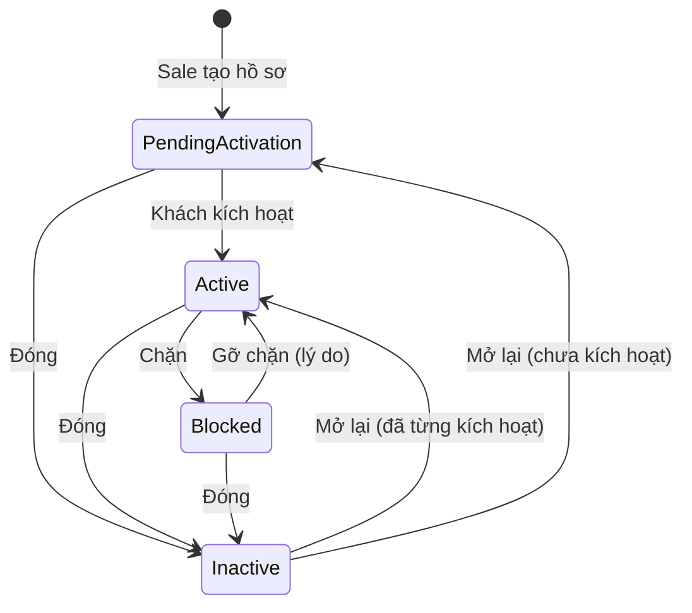
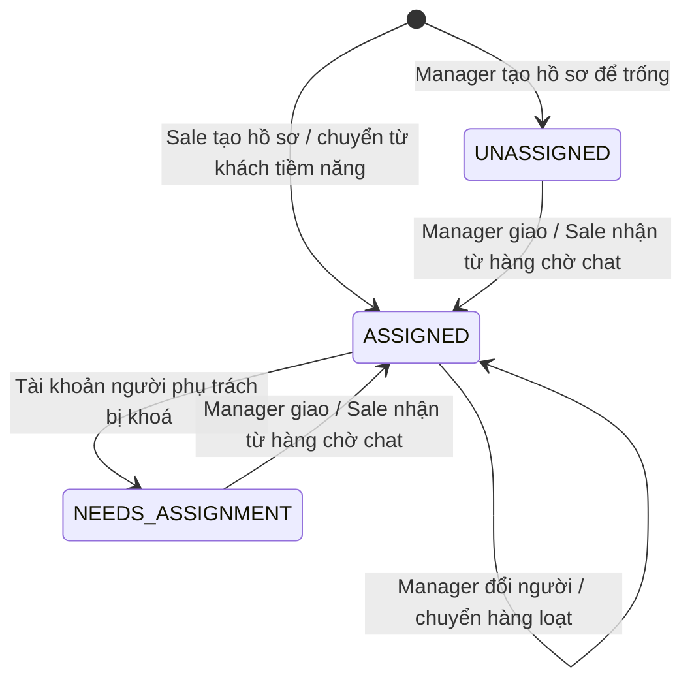
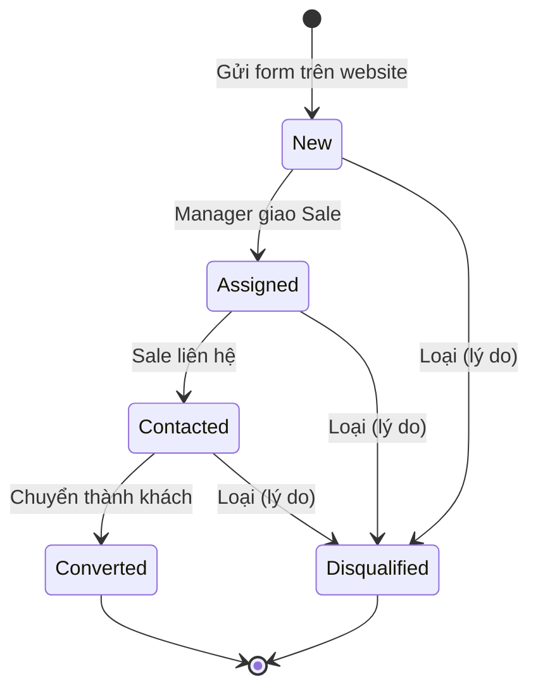
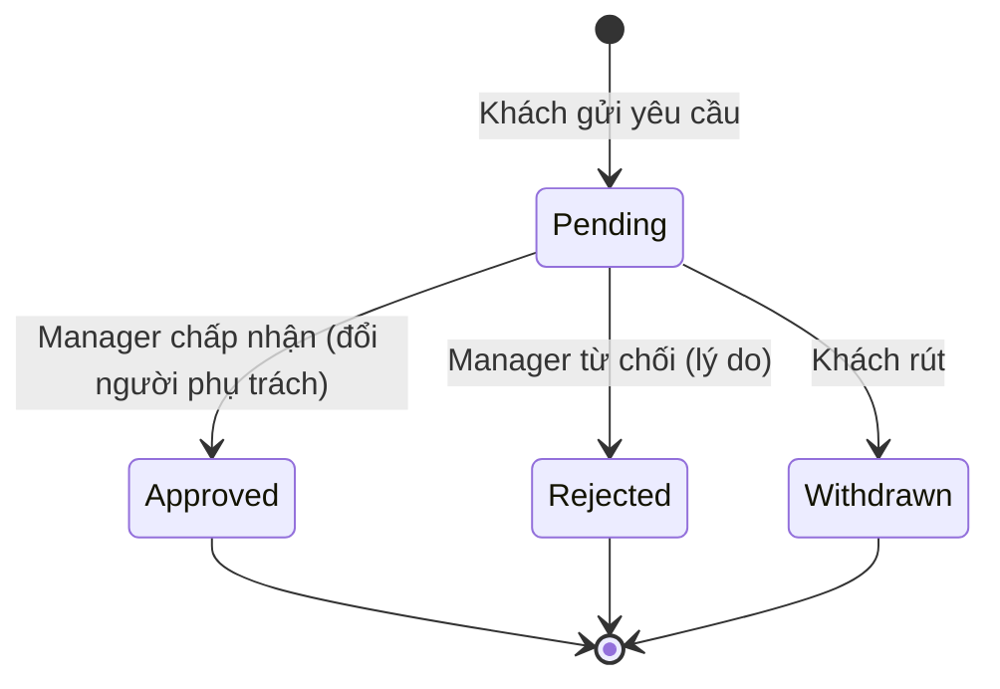

# 18 — Quản lý thông tin khách hàng sỉ (Customer Information Management)

> Đã chốt 2026-10-06: hệ thống **chỉ bán sỉ (B2B)**. Khách là **doanh nghiệp đã liên hệ từ trước**, do Sale tạo hồ sơ; không có đăng ký tự do và không có khách vãng lai (guest).
>
> Đã chốt 2026-11-04: khách thanh toán theo **lịch thanh toán của Hợp đồng mua bán** ([14](../14-cart-and-order/README.md), [15](../15-payment/README.md)). Hồ sơ khách cung cấp **lịch thanh toán mặc định**, **hạn mức & kỳ hạn công nợ** và **thông tin pháp lý** để lập hợp đồng.
>
> Đã chốt 2026-11-05: role phụ trách bán hàng là **Quản lý kinh doanh (Sales Manager)** (đổi tên role, việc giữ nguyên). Sàn **không hiển thị giá** ([13](../13-catalog/README.md)): **bảng giá riêng** của khách là **giá nội bộ** — Quản lý kinh doanh khai báo, chỉ nhân viên xem, làm giá gợi ý khi Sale lập báo giá; khách chỉ thấy giá trên báo giá / đơn / hợp đồng ([14](../14-cart-and-order/README.md)).
>
> ✅ Đã chốt 2026-11-28 (Sale phụ trách khách — chế độ chặt): mỗi khách có **một Sale phụ trách** (account owner) lưu trên hồ sơ, kèm **lịch sử phụ trách** chỉ ghi thêm. Chỉ **Sales Manager / System Admin** giao hoặc đổi người phụ trách, luôn kèm lý do; Sale nghỉ phép thì có **người thay** (tối đa 60 ngày) mà không đổi người phụ trách; Sale nghỉ việc / bị khoá tài khoản thì khách của họ chuyển sang **"Cần giao người phụ trách"**; Manager **chuyển khách hàng loạt** (kể cả chuyển tạm chờ Sale quay lại). Mọi Sale vẫn **xem** được mọi khách, nhưng chỉ người phụ trách, người đang thay, Sales Manager và System Admin được **lập / gửi** báo giá, hợp đồng và chủ động chat với khách đã có chủ ([14](../14-cart-and-order/README.md) BR-25, [16](../16-sales-chat/README.md) BR-12). **Một quy tắc duy nhất** chọn người nhận việc và thông báo về khách: người phụ trách → người thay → Sales Manager, **không bao giờ báo cho mọi Sale** ([00 §6](../../00-system-overview/README.md)). Thêm: **mã số thuế bắt buộc** khi tạo hồ sơ mới (thay quyết định 2026-10-12 "không bắt buộc") kèm **cảnh báo khách có thể trùng**; form **"Yêu cầu mở tài khoản doanh nghiệp"** trên website tạo **khách tiềm năng** (lead) cho Sales Manager giao Sale — vẫn **không mở đăng ký tự do**; khách **yêu cầu đổi Sale**, Sales Manager quyết (§4.5–§4.7).

## 1. Mục đích (Purpose)

Quản lý **hồ sơ khách sỉ (customer profile)** và dữ liệu đi kèm:

- **Thông tin doanh nghiệp:** tên, mã số thuế, **thông tin pháp lý để lập hợp đồng** (địa chỉ đăng ký kinh doanh, người đại diện).
- **Tài khoản đăng nhập cổng** của khách.
- **Sổ địa chỉ.**
- **Điều khoản thương mại:** **lịch thanh toán mặc định** cho hợp đồng, **hạn mức công nợ, kỳ hạn công nợ**, **bảng giá riêng (giá nội bộ — chỉ nhân viên xem)**.
- **Nhóm khách.**
- **Sale phụ trách khách** và **lịch sử phụ trách**; **người thay** khi Sale vắng; **chuyển khách** khi Sale nghỉ *(✅ 2026-11-28)*.
- **Khách tiềm năng (lead)** từ form "Yêu cầu mở tài khoản doanh nghiệp" trên website, và **yêu cầu đổi Sale** của khách *(✅ 2026-11-28)*.
- **Lịch sử thay đổi** và **lịch sử đơn hàng, hợp đồng & tương tác.**

Đây là **nguồn dữ liệu khách hàng dùng chung** cho báo giá, đơn hàng & hợp đồng ([14](../14-cart-and-order/README.md)), thanh toán ([15](../15-payment/README.md)), chat với Sale ([16](../16-sales-chat/README.md)) và điều hành đơn ([17](../17-order-management/README.md)). Hồ sơ khách cũng là nơi trả lời câu hỏi **"Sale nào lo khách này?"** cho mọi module (§4.5).

> ⚠️ Giả định: các phần sau **chưa có trong hệ thống**, được giữ làm **phạm vi giai đoạn sau** (xem [open-questions D16](../../open-questions/README.md)):
> - nhiều người liên hệ / người đặt hàng có quyền riêng trên cổng (hiện **mỗi khách một tài khoản đăng nhập**);
> - 2FA;
> - tuỳ chọn nhận tin & consent marketing;
> - hồ sơ rủi ro;
> - yêu cầu quyền riêng tư (tải / ẩn danh dữ liệu) và hợp nhất hồ sơ trùng (§4.8, §4.9).

---

## 2. Actor liên quan

| Actor | Vai trò |
|-------|---------|
| **Khách hàng sỉ** | Kích hoạt tài khoản từ lời mời. Sửa tên công ty và số điện thoại. Quản lý sổ địa chỉ. Đổi mật khẩu, xem / thu hồi phiên đăng nhập. Xem công nợ và vị thế tín dụng: hạn mức, dư nợ, hạn mức còn lại, kỳ hạn, cờ quá hạn của chính mình *(Quyết định 21/10/2026; hồ sơ rủi ro vẫn là dữ liệu nội bộ)*. Gửi **đề nghị cấp hạn mức** ([15](../15-payment/README.md) §4.3 bước 11a) *(✅ Đã chốt 2026-11-26)*. Xem **"Sale phụ trách của bạn"** (tên, người đang lo thay nếu có) trên trang tài khoản và gửi **yêu cầu đổi người hỗ trợ** (§4.7) *(✅ 2026-11-28)*. |
| **Người gửi yêu cầu mở tài khoản** *(✅ 2026-11-28)* | Doanh nghiệp chưa có tài khoản, tự tìm đến website: điền form **"Yêu cầu mở tài khoản doanh nghiệp / Yêu cầu tư vấn"** (không cần đăng nhập) → thành **khách tiềm năng** (§4.6). Không tự tạo được tài khoản. |
| **Nhân viên Sale (Sales Staff)** | **Tạo hồ sơ khách sỉ** (thành **người phụ trách** của khách — BR-14) và gửi / gửi lại lời mời kích hoạt. Nhập **thông tin pháp lý**. Đặt **lịch thanh toán mặc định** ban đầu (chỉ gồm đợt `ON_SIGNING` / `BEFORE_DELIVERY`). Xem **mọi** hồ sơ (lọc "Khách của tôi"), sửa thông tin thay khách, quản lý địa chỉ. Ghi ý kiến cho đề nghị cấp hạn mức của khách, hoặc tạo đề nghị thay khách ([15](../15-payment/README.md) §4.3 bước 11a). **Lập lịch người thay** cho lần vắng của chính mình, huỷ lịch mình đã lập. Liên hệ và **chuyển thành khách** các khách tiềm năng được giao; loại khách tiềm năng của mình kèm lý do. **Không** đổi được người phụ trách của khách *(✅ 2026-11-28)*. |
| **Quản lý kinh doanh (Sales Manager)** | Tạo hồ sơ khách (chọn ngay một Sale phụ trách, hoặc để trống). **Đổi trạng thái khách** (chặn / gỡ chặn / đóng / mở lại). Quản lý **nhóm khách** và gán khách vào nhóm. Quản lý địa chỉ. Khai báo **bảng giá riêng (giá nội bộ)** của khách ([13](../13-catalog/README.md)). *(✅ 2026-11-28)* **Giao / đổi Sale phụ trách** (kèm lý do), **chuyển khách hàng loạt** và **trả lại lô chuyển tạm**; lập / huỷ **lịch người thay** cho bất kỳ Sale nào; xem **bảng tải** từng Sale, đặt **tạm dừng nhận khách mới** và **sức chứa** khách mới / tháng; **giao khách tiềm năng** cho Sale, loại khách tiềm năng; **duyệt ngoại lệ mã số thuế**; **quyết yêu cầu đổi Sale** của khách. Có thể tự là người phụ trách khách (BR-26). |
| **System Admin** | Cùng quyền giao / đổi / chuyển người phụ trách như Sales Manager (quyền `customer-sales-owners:UPDATE`); **khoá / vô hiệu hoá tài khoản** nhân viên ngay khi cần, khách của người đó tự chuyển sang "Cần giao người phụ trách" (BR-18) *(✅ 2026-11-28)*. |
| **Kế toán (Accountant)** | **Duyệt hạn mức và kỳ hạn công nợ** — duyệt **đề nghị cấp hạn mức** ([15](../15-payment/README.md) §4.3 bước 11a), hoặc sửa trên trang khách ở back office; duyệt lịch thanh toán mặc định có đợt `AFTER_DELIVERY` ([15](../15-payment/README.md) BR-12). Xem hồ sơ khách (chỉ đọc), kể cả Sale phụ trách |
| **Hệ thống** | Chuẩn hoá & chống trùng mã số thuế; **cảnh báo khách có thể trùng** (điện thoại, email, tên). Gửi lời mời, quản lý hạn link. Đồng bộ trạng thái tài khoản đăng nhập theo trạng thái khách. Ghi lịch sử thay đổi và **lịch sử phụ trách**. Gắn đơn / hợp đồng / tương tác vào hồ sơ. *(✅ 2026-11-28)* Trả lời **"ai lo khách này hôm nay"** cho mọi module (§4.5 bước 15); chuyển khách sang "Cần giao người phụ trách" khi tài khoản Sale bị khoá / vô hiệu hoá; tự kết thúc lịch người thay khi hết hạn; **gợi ý** Sale còn trống nhất khi giao; chống spam form khách tiềm năng. |

---

## 3. Input / Output

### Input

| Nhóm | Dữ liệu | Nguồn |
|------|---------|-------|
| Định danh doanh nghiệp | Tên công ty; **mã số thuế** — **bắt buộc khi tạo hồ sơ mới** *(✅ Chốt lại 2026-11-28)*: 10 số, 10-3 (đơn vị phụ thuộc) hoặc 12 số (CCCD của chủ hộ kinh doanh chưa có mã số thuế); không có thì phải có **ngoại lệ do Sales Manager duyệt** kèm lý do (BR-01) | Sale; ngoại lệ: Sales Manager |
| **Sale phụ trách** *(✅ 2026-11-28)* | Một Sale đang làm, có quyền chat với khách; mặc định là Sale tạo hồ sơ, Sales Manager tạo thì chọn hoặc để trống; tạo từ khách tiềm năng thì là Sale được giao lead (BR-14) | Hệ thống / Sales Manager |
| **Đổi người phụ trách** *(✅ 2026-11-28)* | Sale mới, **lý do** (*Sale nghỉ việc / Chia lại tải / Khách yêu cầu / Đổi khu vực / Khác* — kèm ghi chú), có gửi tin báo khách hay không; chuyển hàng loạt thêm: từ Sale nào, sang một hoặc nhiều Sale, tất cả hay một phần khách, **chuyển tạm** hay không (§4.5) | Sales Manager / System Admin |
| **Lịch người thay** *(✅ 2026-11-28)* | Sale vắng, người thay (Sale đang làm, khác người vắng), từ ngày – đến ngày (tối đa 60 ngày), lý do (BR-17) | Sale (lần vắng của mình) / Sales Manager |
| **Thiết lập phân công** *(✅ 2026-11-28)* | Theo từng Sale: **tạm dừng nhận khách mới** (có / không), **sức chứa** số khách mới tối đa mỗi tháng (§4.5 bước 22) | Sales Manager |
| **Yêu cầu mở tài khoản** (khách tiềm năng) *(✅ 2026-11-28)* | Tên công ty, mã số thuế (10 hoặc 13 số), người liên hệ, chức vụ, điện thoại, email, tỉnh / thành, sản phẩm quan tâm (ly / hộp / túi / tô), sản lượng dự kiến mỗi tháng, ghi chú, **đồng ý xử lý dữ liệu cá nhân** (Nghị định 13/2023) (§4.6) | Người gửi trên website |
| **Yêu cầu đổi Sale** *(✅ 2026-11-28)* | Lý do (*phản hồi chậm / không hài lòng cách tư vấn / muốn làm việc với người quen / khác*), ghi chú, **tuỳ chọn** Sale muốn được hỗ trợ (chọn từ danh sách Sale đang làm, chỉ hiện tên) (§4.7) | Khách |
| **Thông tin pháp lý** | **Địa chỉ đăng ký kinh doanh** (trụ sở), **người đại diện theo pháp luật** và **chức vụ**; tài khoản ngân hàng của khách (không bắt buộc) | Sale |
| **Email nhận hoá đơn** *(✅ Đã chốt 2026-11-06)* | Email nhận hoá đơn điện tử, mặc định = email người liên hệ, nhân viên sửa được; bắt buộc trước khi phát hành hoá đơn ([21](../21-e-invoice/README.md) BR-06) | Sale |
| Tài khoản đăng nhập | Email người liên hệ (khoá đăng nhập; không đổi được), số điện thoại; mật khẩu do khách đặt khi kích hoạt | Sale / Khách |
| Điều khoản thương mại | **Lịch thanh toán mặc định** (các đợt: tên, %, mốc `ON_SIGNING` / `BEFORE_DELIVERY` / `AFTER_DELIVERY`, N ngày; tổng 100%), **hạn mức công nợ** (≥ 0), **kỳ hạn công nợ** (0–365 ngày) | Sale (ban đầu) + Kế toán duyệt |
| Bảng giá riêng (giá nội bộ) | Bậc giá theo số thùng + đơn giá / cái cho từng SKU riêng của khách; chỉ nhân viên xem, không hiện trên sàn | Quản lý kinh doanh ([13](../13-catalog/README.md)) |
| Sổ địa chỉ | Địa chỉ **giao hàng** và **xuất hoá đơn** (nhiều địa chỉ mỗi loại), mỗi loại một địa chỉ mặc định. Địa chỉ Việt Nam hai cấp (phường / xã, tỉnh / thành); bắt buộc tên người nhận, điện thoại, địa chỉ chi tiết | Khách / Sale |
| Nhóm khách | Mã nhóm (cố định), tên, mô tả | Quản lý kinh doanh |
| Dữ liệu phái sinh | Lịch sử báo giá, đơn & hợp đồng, **dư nợ & quá hạn**, bản thiết kế khách tự làm (kể cả bản đã duyệt) và SKU theo mẫu của khách, lịch sử chat | 12, 14, 15, 16, 17 |

> ✅ Đã chốt 2026-11-05: thông tin pháp lý (địa chỉ đăng ký kinh doanh, người đại diện, chức vụ) lưu trên hồ sơ khách, có thể bổ sung sau khi tạo nhưng **bắt buộc trước khi lập hợp đồng**; tài khoản ngân hàng của khách chỉ dùng để hoàn tiền. Xem [open-questions](../../open-questions/README.md).

### Output

| Kết quả | Dùng bởi |
|---------|----------|
| **Customer profile** | 14, 15, 16, 17, báo cáo |
| **Thông tin pháp lý** (bên mua) điền sẵn vào hợp đồng | [14](../14-cart-and-order/README.md) |
| **Địa chỉ & người nhận** cho đơn | [14](../14-cart-and-order/README.md) |
| **Thông tin bên mua cho hoá đơn** — tên công ty, mã số thuế, địa chỉ xuất hoá đơn mặc định (không có thì địa chỉ đăng ký kinh doanh), email nhận hoá đơn | [21](../21-e-invoice/README.md) |
| **Lịch thanh toán mặc định** cho báo giá và hợp đồng | [14](../14-cart-and-order/README.md) |
| **Hạn mức & kỳ hạn công nợ** | [14](../14-cart-and-order/README.md) (cảnh báo khi gửi hợp đồng), [15](../15-payment/README.md) (kiểm tín dụng, hạn đợt trả sau) |
| **Bảng giá riêng (giá nội bộ)** — giá gợi ý cho báo giá, chỉ nhân viên xem | [13](../13-catalog/README.md), [14](../14-cart-and-order/README.md) |
| **Nhóm khách** | Phân loại khách để lọc, tra cứu; không quyết định giá |
| **Lịch sử trạng thái** (kèm lý do) và **lịch sử thay đổi** tên công ty / mã số thuế / thông tin pháp lý | Quản lý kinh doanh, Sale |
| **Tình trạng lời mời** (chờ kích hoạt / hết hạn / đã kích hoạt…) | Sale |
| **Sale phụ trách hiện tại** (tên, từ ngày, trạng thái phụ trách, người đang lo thay nếu có) và **lịch sử phụ trách** (từ ai sang ai, lý do, ghi chú, người đổi, lúc nào, lô chuyển) *(✅ 2026-11-28)* | Nhân viên (trang khách, danh sách khách — lọc "Khách của tôi", "Cần giao người phụ trách", theo Sale); khách chỉ thấy tên người phụ trách và người thay |
| **Người lo việc của khách hôm nay** — người phụ trách, người thay, hoặc (khi không có ai) các Sales Manager kèm nhãn "cần phân công" (§4.5 bước 15) *(✅ 2026-11-28)* | Định tuyến chat ([16](../16-sales-chat/README.md)), người nhận thông báo ([00 §6](../../00-system-overview/README.md)), quyền lập / gửi báo giá, hợp đồng ([14](../14-cart-and-order/README.md)) |
| **Cảnh báo khách có thể trùng** — khách trùng điện thoại / email / tên, kèm Sale đang phụ trách *(✅ 2026-11-28)* | Người tạo hồ sơ |
| **Khách tiềm năng** và **bảng tải từng Sale** *(✅ 2026-11-28)* | Sales Manager (giao), Sale (lead được giao) |
| **Yêu cầu đổi Sale** và kết quả *(✅ 2026-11-28)* | Sales Manager (quyết); khách (xem trạng thái) |

---

## 4. Luồng nghiệp vụ từng bước (Step-by-step)

### 4.1. Tạo hồ sơ & mời kích hoạt

1. **Sale (hoặc Quản lý kinh doanh) tạo hồ sơ khách sỉ** sau khi khách liên hệ — Sale tự tìm được khách (gọi, gặp, giới thiệu), hoặc chuyển từ một **khách tiềm năng** được giao (§4.6). Nhập:
   - tên công ty, **mã số thuế** — bắt buộc *(✅ Chốt lại 2026-11-28)*; hộ kinh doanh chưa có mã số thuế nhập **12 số CCCD của chủ hộ**; không có cả hai thì Sales Manager **duyệt ngoại lệ** kèm lý do (BR-01);
   - thông tin pháp lý: địa chỉ đăng ký kinh doanh, người đại diện, chức vụ (có thể bổ sung sau);
   - email và số điện thoại người liên hệ;
   - địa chỉ;
   - **lịch thanh toán mặc định** ban đầu: chỉ gồm đợt `ON_SIGNING` / `BEFORE_DELIVERY` (% tối đa 2 chữ số thập phân, tổng 100%). Đợt `AFTER_DELIVERY` (công nợ) không đặt được ở bước này;
   - Sales Manager tạo thì chọn **Sale phụ trách** ngay, hoặc để trống (BR-14).

   Hệ thống chuẩn hoá mã số thuế và chặn trùng (BR-01). Trong lúc nhập, hệ thống **cảnh báo khách có thể trùng** — cùng số điện thoại, email, hoặc tên công ty sau khi chuẩn hoá — và cho biết khách đó **đang do Sale nào phụ trách**; cảnh báo không chặn, trùng mã số thuế thì chặn (BR-22) *(✅ 2026-11-28)*. Hồ sơ ở `Pending Activation`; **người phụ trách** là Sale tạo hồ sơ, Sale được giao lead, hoặc Sale do Manager chọn (BR-14).

   > ✅ Đã chốt 2026-11-05: số đợt và tỷ lệ mỗi đợt do Sale nhập theo từng hợp đồng, có mẫu mặc định theo khách ở đây. Xem [open-questions](../../open-questions/README.md).
2. **Lời mời kích hoạt** — gửi tới email người liên hệ sau khi lưu hồ sơ:
   - Link có hiệu lực **72 giờ**.
   - Kết quả gửi được ghi lại (`Sent` / `Failed`).
3. **Gửi lại lời mời** — Sale gửi lại:
   - lần gửi mới **thu hồi link cũ**;
   - phải cách lần trước **ít nhất 1 phút**, trừ khi link cũ đã hết hạn;
   - mỗi tài khoản chỉ có **một lời mời đang mở**.

   Sale xem được tình trạng lời mời: chờ kích hoạt / hết hạn / đã kích hoạt / chưa có tài khoản / không khả dụng (khách bị chặn hoặc đã đóng).
4. **Kích hoạt** — người liên hệ mở link, đặt mật khẩu → hồ sơ `Active`. Đây là cách duy nhất đi từ `Pending Activation` sang `Active`.
5. **Hạn mức & kỳ hạn công nợ** — muốn cho khách trả sau giao, **kế toán** đặt **hạn mức** (> 0) và **kỳ hạn** (N ngày mặc định cho đợt `AFTER_DELIVERY`); khi đó lịch thanh toán mặc định mới được có đợt `AFTER_DELIVERY`. Mỗi lần duyệt ghi người và thời điểm. Hợp đồng đã ký giữ lịch thanh toán của nó.

   Kế toán cấp và sửa hạn mức, kỳ hạn bằng form **"Sửa hạn mức & kỳ hạn"** trên **trang khách** ở back office — mở được với mọi khách, không chỉ khách có đơn treo; Kế toán được xem hồ sơ khách (chỉ đọc) để mở trang này. Đơn treo vì tín dụng có **lối tắt** tới form này ([15](../15-payment/README.md) §4.3) *(✅ Đã chốt 2026-11-25)*.

   **Đề nghị cấp hạn mức** *(✅ Đã chốt 2026-11-26)*: khách **xin** (hoặc xin nâng) hạn mức từ cổng, hoặc Sale tạo đề nghị thay khách; Sale ghi ý kiến, **Kế toán quyết** trên số liệu lịch sử trả do hệ thống tính. Duyệt thì hạn mức & kỳ hạn của khách được ghi ngay (như khi sửa tay, ghi người và thời điểm duyệt); hạn mức duyệt không cao hơn mức xin. Chi tiết luồng, trạng thái và số liệu ở [15](../15-payment/README.md) §4.3 bước 11a, §5.4, BR-21. Form "Sửa hạn mức & kỳ hạn" vẫn giữ cho thay đổi không qua đề nghị.

### 4.2. Quản lý dữ liệu hồ sơ

6. **Khách tự sửa** trên cổng: **tên công ty** và **số điện thoại**. Mã số thuế và thông tin pháp lý chỉ nhân viên sửa; email không đổi được.
7. **Lịch sử thay đổi** — mọi thay đổi **tên công ty**, **mã số thuế** và **thông tin pháp lý** được ghi lại (giá trị cũ, giá trị mới, ai sửa, lúc nào). Hợp đồng đã lập giữ thông tin tại thời điểm lập.
8. **Sổ địa chỉ:**
   - Địa chỉ đầu tiên của mỗi loại thành địa chỉ mặc định.
   - Mỗi loại có tối đa một địa chỉ mặc định.
   - Xoá hoặc bỏ mặc định địa chỉ mặc định → hệ thống tự chọn một địa chỉ khác cùng loại làm mặc định.
9. **Bảo mật** — đổi mật khẩu, xem & thu hồi phiên đăng nhập.

### 4.3. Trạng thái khách

10. Quản lý kinh doanh đổi trạng thái (§5). Mỗi lần đổi ghi vào **lịch sử trạng thái** kèm lý do.
    - **Chặn** (`Blocked`) và **đóng** (`Inactive`) → tài khoản đăng nhập bị **tạm khoá**.
    - Về `Active` hoặc `Pending Activation` → tài khoản **được mở lại**.
11. **Gỡ chặn** và **mở lại khách đã đóng** đều **bắt buộc lý do**.
    - Mở lại: tài khoản đã từng kích hoạt thì về `Active`; chưa từng kích hoạt thì về `Pending Activation` (gửi lại lời mời).

### 4.4. Dữ liệu phái sinh & nhóm khách

12. **Gắn lịch sử** — mỗi đơn và hợp đồng ([14](../14-cart-and-order/README.md), [17](../17-order-management/README.md)), mỗi hội thoại ([16](../16-sales-chat/README.md)), mỗi thiết kế và SKU theo mẫu ([12](../12-product-design/README.md)) liên kết với hồ sơ.
13. **Nhóm khách** — Quản lý kinh doanh tạo nhóm và gán khách vào nhóm (mỗi khách tối đa một nhóm).
    - **Mã nhóm** viết hoa, **không đổi** sau khi tạo; chỉ sửa tên và mô tả.
    - Giá gợi ý lấy từ **bảng giá riêng (giá nội bộ) của khách** cho SKU riêng của khách đó, không có thì từ **giá chuẩn của quy cách** ([13](../13-catalog/README.md) §4.2, *✅ Chốt lại 2026-11-26*); nhóm khách không quyết định giá.

    > ⚠️ Giả định: sau khi bỏ hàng trơn (chốt 2026-11-04), nhóm khách **không còn dùng để định giá**; vẫn giữ làm phân loại khách (lọc, tra cứu). Cần xác nhận giữ hay bỏ hẳn nhóm khách. Xem [open-questions D14](../../open-questions/README.md).
14. **Dư nợ & vị thế tín dụng** — cập nhật từ [Payment](../15-payment/README.md). Khách tự xem trên cổng: hạn mức, dư nợ, hạn mức còn lại, các đợt quá hạn.

### 4.5. Sale phụ trách khách (Sales owner) *(✅ Đã chốt 2026-11-28)*

> ✅ Đã chốt 2026-11-28 (thay "Sale phụ trách một chứng từ là người gửi nó" của 2026-11-25): trước đây hệ thống **không lưu** khách thuộc Sale nào; "Sale phụ trách" được tính lại theo từng chứng từ, mỗi nơi một kiểu (chat lấy người gửi báo giá, theo dõi đơn lấy người gửi hợp đồng), nên một đơn có thể có hai "Sale phụ trách", và khi Sale nghỉ việc thì không ai nhận lại khách của họ. Nay **người phụ trách thuộc về khách**, lưu trên hồ sơ kèm lịch sử; chứng từ vẫn ghi **người gửi** để truy vết và **Sale phụ trách lúc lập** để tính doanh số ([14](../14-cart-and-order/README.md) §4.4). Cách làm theo mô hình "Salesperson" trên hồ sơ khách của Odoo: trường nội bộ, chỉ người có quyền trong công ty sửa, khách chỉ xem.

15. **Ai lo khách này hôm nay** — một quy tắc duy nhất, mọi module dùng chung: định tuyến chat ([16](../16-sales-chat/README.md) §4.1), người nhận thông báo ([00 §6](../../00-system-overview/README.md)), quyền lập / gửi báo giá, hợp đồng ([14](../14-cart-and-order/README.md) BR-25):
    1. người phụ trách **đang làm** và có **lịch người thay** hiệu lực hôm nay → **người thay** (ghi rõ "lo thay cho A");
    2. người phụ trách đang làm → **người phụ trách**;
    3. khách **chưa có** người phụ trách, hoặc người phụ trách **không còn làm** (tài khoản bị khoá / vô hiệu hoá) → **không ai**: việc và thông báo đi tới các **Sales Manager đang làm** (không còn Manager nào thì **System Admin**), kèm nhãn **"cần phân công"**. **Không bao giờ báo cho mọi Sale** — báo cho cả phòng làm lộ thông tin khách và mở đường cho tranh giành khách (BR-20).
16. **Trạng thái phụ trách** của khách (§5): **Đã có người phụ trách** (`ASSIGNED`), **Cần giao người phụ trách** (`NEEDS_ASSIGNMENT` — người phụ trách đã nghỉ / bị khoá; hệ thống vẫn nhớ người cũ để xem lịch sử), **Chưa có người phụ trách** (`UNASSIGNED` — chưa từng có). Danh sách khách lọc được theo **"Khách của tôi"**, **"Cần giao người phụ trách"**, theo từng Sale; cột "Sale liên hệ gần nhất" (người gần nhất gửi báo giá / hợp đồng) vẫn giữ làm cột phụ, không phải người phụ trách.
17. **Giao / đổi người phụ trách** — chỉ **Sales Manager / System Admin** (BR-15). Chọn Sale mới (đang làm, có quyền chat với khách — không giao cho Kế toán, kho hay tài khoản đã khoá), chọn **lý do** *Sale nghỉ việc / Chia lại tải / Khách yêu cầu / Đổi khu vực / Khác* kèm ghi chú, chọn có **gửi tin cho khách** hay không. Hai người cùng đổi một khách thì người sau bị từ chối, tải lại rồi làm lại. Đổi xong (BR-16):
    - **hội thoại đang mở** của khách chuyển sang người mới, kèm **ghi chú nội bộ** "Chuyển từ A sang B: lý do" ([16](../16-sales-chat/README.md));
    - khách nhận **một tin hệ thống** trong chat: "Từ nay anh/chị được [B] hỗ trợ" — tắt được khi đổi nội bộ;
    - báo giá nháp / chưa phản hồi, hợp đồng chờ ký, đơn đang chạy: **thông báo về sau** (khách chấp nhận / yêu cầu sửa báo giá, hợp đồng chưa ký, chưa thu đủ, chọn kho…) đi tới **người mới**; người mới sửa / gửi lại được báo giá, hợp đồng của khách ([14](../14-cart-and-order/README.md) BR-25);
    - chứng từ đã lập **giữ nguyên** người gửi và Sale phụ trách lúc lập: doanh số đã chốt vẫn thuộc người cũ;
    - mọi lần đổi ghi vào **lịch sử phụ trách** (từ ai, sang ai, lý do, ghi chú, người đổi, lúc nào); lịch sử **chỉ ghi thêm**, không sửa, không xoá.
18. **Người thay khi vắng (nghỉ phép)** — Sale lập lịch cho **lần vắng của chính mình**, Sales Manager lập cho **bất kỳ Sale nào**: "B lo thay A từ ngày X tới Y", kèm lý do (BR-17).
    - Người thay phải là Sale đang làm, khác A; mỗi Sale **không có hai lịch chồng nhau**; tối đa **60 ngày** (cấu hình).
    - Trong lịch thay, mọi việc của khách của A đi tới B (bước 15); B thấy nhãn **"Bạn đang lo thay cho A"**. **Người phụ trách không đổi.**
    - Hết lịch thì **tự trả về A**, không ai phải làm gì. Sale huỷ được lịch mình đã lập; Manager huỷ được mọi lịch và xem mọi lịch.
19. **Sale nghỉ việc / bị khoá tài khoản** — System Admin khoá hoặc vô hiệu hoá tài khoản **ngay**, không bắt giao khách trước (an ninh — [00 §2.5.1](../../00-system-overview/README.md)). Hộp xác nhận khoá ghi rõ người đó đang phụ trách bao nhiêu khách, bao nhiêu hội thoại mở và khách tiềm năng đang giữ. Sau khi khoá, hệ thống (BR-18):
    - chuyển khách của người đó sang **"Cần giao người phụ trách"** (vẫn nhớ người cũ);
    - đưa **hội thoại đang mở** của người đó **về hàng chờ**, ưu tiên cao ([16](../16-sales-chat/README.md));
    - **huỷ các lịch thay** mà người đó là người thay; A đang được thay mà bị khoá thì khách của A cũng sang "Cần giao";
    - báo **Sales Manager**, kèm số khách và số hội thoại cần giao.

    Trong lúc chờ giao, việc và thông báo về các khách này đi tới Sales Manager (bước 15); khách nhắn thì vào hàng chờ chat, một Sale **nhận** được hội thoại và thành người phụ trách ([16](../16-sales-chat/README.md) BR-13).
20. **Chuyển khách hàng loạt** — Sales Manager chọn **"từ Sale A"** và **"sang Sale B"**, hoặc **chia đều** cho nhiều Sale; chuyển **tất cả** hay **một phần** khách của A; lý do bắt buộc (BR-19).
    - Lô chạy cho từng khách, ghi lịch sử từng khách và gắn **mã lô**; bấm lại cùng một lô không chuyển hai lần.
    - Lô chỉ chuyển khách **đang** thuộc A lúc chạy: khách vừa bị người khác đổi tay được **bỏ qua và báo lại** trong kết quả lô (số đã chuyển, danh sách bỏ qua kèm lý do).
    - **Chuyển tạm — chờ A quay lại** (nghỉ dài: thai sản, ốm dài, quá 60 ngày của người thay): lô được đánh dấu tạm. Khi A đi làm lại, Manager **trả lại lô** trong **một thao tác**: chỉ những khách **vẫn đang** thuộc người nhận của lô về lại A (lý do "Trở lại sau nghỉ"); khách đã được chuyển tiếp lần nữa vì lý do khác thì không tự trả, Manager quyết.
21. **Tài khoản Sale được mở lại** — khách đã giao cho người khác **không tự quay về** (BR-18). Manager xem lịch sử, muốn trả khách nào thì chuyển như bình thường. Không có cách nào Sale tự lấy lại khách: mọi lần đổi người phụ trách đều do Manager làm, có lý do và lịch sử.
22. **Bảng tải & phân công** — màn **"Phân công khách"** của Sales Manager, mỗi Sale một dòng: số khách đang phụ trách, số khách có đơn đang chạy, báo giá đang mở, hợp đồng chờ ký, hội thoại đang mở và số hội thoại trễ SLA, doanh số 30 ngày, khách mới trong tháng, đang nghỉ phép không (và ai thay), có **tạm dừng nhận khách mới** không, **sức chứa** khách mới tối đa mỗi tháng. Khi giao khách tiềm năng hoặc khách mới, hệ thống **gợi ý** Sale còn trống nhất trong số Sale không tạm dừng; **Manager vẫn là người chọn** (BR-25). Cách làm theo "Pause assignment" và "Capacity" của đội bán hàng trong Odoo.
23. **Khách xem người phụ trách** — trang tài khoản trên cổng có thẻ **"Sale phụ trách của bạn"**: tên, người đang lo thay (nếu có), nút chat; **không** hiện email hay số điện thoại của nhân viên. Khi đổi người, khách thấy tin hệ thống trong chat (bước 17).
24. **Dữ liệu khách đang có** — khi triển khai, mỗi khách cũ được điền người phụ trách = Sale của **chứng từ gửi gần nhất** (người gửi báo giá, hoặc người gửi hợp đồng — chưa có thì người ghi nhận đã ký), mỗi khách một dòng lịch sử lý do "Điền dữ liệu ban đầu". Người đó không còn làm → "Cần giao người phụ trách"; khách chưa có chứng từ nào → "Chưa có người phụ trách", Manager giao.

### 4.6. Khách tiềm năng (Lead) — yêu cầu mở tài khoản từ website *(✅ Đã chốt 2026-11-28)*

> ✅ Đã chốt 2026-11-28 (thay "muốn tự đăng ký thì thành yêu cầu liên hệ" — chưa có chỗ nào để liên hệ): vẫn **không mở đăng ký tự do**. Bao bì in theo mẫu là hàng B2B: phải xác minh doanh nghiệp (mã số thuế, người đại diện) trước khi báo giá, ký hợp đồng, cấp hạn mức; các xưởng in bao bì sỉ thường làm theo kiểu "để lại thông tin → Sale gọi lại" (web-to-print bán lẻ như Vistaprint, Printgo cho đăng ký tự do vì trả tiền ngay — không phải mô hình này). Odoo làm tương tự: form liên hệ trên website tạo **lead**, lead được giao Sale theo quy tắc của đội. Kênh Sale tự tìm khách rồi tạo hồ sơ (§4.1) giữ nguyên.

25. **Gửi yêu cầu** — người chưa có tài khoản mở trang **"Mở tài khoản doanh nghiệp / Yêu cầu tư vấn"** (lối vào: trang đăng nhập "Chưa có tài khoản? Gửi yêu cầu mở tài khoản", đầu trang, chân trang, trang sản phẩm khi chưa đăng nhập, các câu báo lỗi đăng nhập "liên hệ Sales"), điền form (§3) và **đồng ý xử lý dữ liệu cá nhân**, bấm gửi. Màn kết quả: "Đã nhận yêu cầu, Sale sẽ liên hệ trong 1 ngày làm việc". **Không tạo tài khoản**.
26. **Chống spam** — giới hạn số lần gửi theo địa chỉ IP; ô bẫy ẩn (honeypot); cùng mã số thuế hoặc email gửi lại trong **24 giờ** không tạo lead mới; giới hạn độ dài từng ô. Người gửi luôn nhận **cùng một câu trả lời** dù yêu cầu được nhận hay bị lọc (BR-23).
27. **Mã số thuế đã là khách** — không tạo lead; hệ thống báo **người lo khách đó** (bước 15) và trả câu trung tính cho người gửi, **không lộ** đó là khách cũ. Chặn cách lách "khách cũ giả làm khách mới để đổi Sale" (đổi Sale đi qua §4.7).
28. **Giao lead** — lead mới (`New`) chỉ nằm trong **hàng chờ của Sales Manager**, Manager được báo; không có hộp chung cho mọi Sale "ai nhanh tay thì lấy". Manager giao cho một Sale (dùng bảng tải, bước 22) → `Assigned`; Sale được báo. Sale chỉ thấy lead **được giao cho mình**; Manager thấy mọi lead.
29. **Liên hệ** — Sale gọi lại, **xác minh doanh nghiệp** (mã số thuế, người đại diện), ghi chú → `Contacted`.
30. **Chuyển thành khách** — Sale bấm "Chuyển thành khách": form tạo hồ sơ (§4.1) **điền sẵn** từ lead; lưu xong → lead `Converted`, **người phụ trách = Sale được giao lead** (lý do "Từ khách tiềm năng"); trang khách có liên kết "Từ khách tiềm năng #…".
31. **Loại lead** — không phải doanh nghiệp thật, không có nhu cầu, trùng…: Manager hoặc Sale được giao loại, **bắt buộc lý do** → `Disqualified`. Lead đã chuyển thành khách hoặc đã loại không xử lý lại được (BR-23).

### 4.7. Khách yêu cầu đổi Sale *(✅ Đã chốt 2026-11-28)*

> ✅ Đã chốt 2026-11-28: khách được **yêu cầu**, Sales Manager **quyết**. Khách không tự chọn Sale trên web, Sale không tự lấy khách. Việc đổi có người quản lý duyệt, có lịch sử ai duyệt và khi nào, và có giải thích cho khách — như các hướng dẫn chuyển giao khách B2B thường nêu; trong Odoo "Salesperson" cũng là trường nội bộ, cổng khách chỉ cho xem.

32. **Gửi yêu cầu** — trên thẻ "Sale phụ trách của bạn" (bước 23), khách bấm **"Yêu cầu đổi người hỗ trợ"**: chọn lý do (*phản hồi chậm / không hài lòng cách tư vấn / muốn làm việc với người quen / khác*), ghi chú tuỳ ý, **tuỳ chọn** người muốn được hỗ trợ (danh sách Sale đang làm, chỉ hiện tên) → `Pending`. Khách xem trạng thái yêu cầu gần nhất trên thẻ và rút được khi chưa có quyết định → `Withdrawn`.
33. **Ai thấy** — yêu cầu vào hàng chờ của **Sales Manager** (Manager được báo). Sale đang phụ trách **không thấy** yêu cầu cho tới khi Manager quyết, để tránh gây sức ép lên khách.
34. **Manager xem xét** — bảng tải (bước 22); lịch sử của khách: đơn, khiếu nại, hội thoại trễ SLA của Sale hiện tại; **cờ cảnh báo** khi Sale được khách nêu tên **đã nhắn hoặc liên hệ khách gần đây** (dấu hiệu Sale "vận động" khách xin đổi).
35. **Quyết định**:
    - **Chấp nhận** → Manager chọn Sale mới (thường là người khách nêu, không bắt buộc), người phụ trách đổi với lý do **"Khách yêu cầu"** như bước 17; báo khách, báo **cả hai** Sale → `Approved`.
    - **Từ chối** → bắt buộc lý do, khách xem được lý do → `Rejected`.
36. **Giới hạn** — mỗi khách chỉ **một** yêu cầu đang chờ; sau khi Manager quyết, **30 ngày** mới gửi được yêu cầu mới; mọi yêu cầu nằm trong lịch sử khách (BR-24). Doanh số đã chốt vẫn thuộc Sale cũ (bước 17), nên đổi người không làm mất phần đã làm và bớt tranh chấp hoa hồng.
37. Khách nói muốn đổi Sale **trong chat** → agent hướng dẫn khách gửi yêu cầu trên thẻ "Sale phụ trách của bạn"; Sales Manager cũng có thể đổi thẳng với lý do "Khách yêu cầu" (bước 17).

### 4.8. Quyền riêng tư dữ liệu (Data privacy) — phạm vi sau

38. **Yêu cầu truy cập / tải dữ liệu** — khách yêu cầu bản sao dữ liệu cá nhân → hệ thống xuất tập hợp dữ liệu.
39. **Yêu cầu xoá** — ẩn danh (anonymize) dữ liệu cá nhân **trong giới hạn nghĩa vụ lưu trữ**: chứng từ đơn hàng / hợp đồng / kế toán phải giữ theo luật, nên ẩn danh thay vì xoá cứng.

### 4.9. Hợp nhất hồ sơ trùng (Merge) — phạm vi sau

40. Phát hiện trùng → Quản lý kinh doanh xem xét → **merge**: giữ một hồ sơ chính, gộp địa chỉ / đơn / tương tác, giữ log merge. *(Cảnh báo khách có thể trùng khi tạo hồ sơ — §4.1 bước 1 — đã có từ 2026-11-28; gộp hai hồ sơ đã tạo vẫn là phạm vi sau.)*

---

## 5. Trạng thái / Vòng đời (Lifecycle)

### Trạng thái hồ sơ khách

| Trạng thái | Ý nghĩa | Chuyển tiếp cho phép | Ai thực hiện |
|------------|---------|----------------------|--------------|
| `Pending Activation` | Đã tạo hồ sơ, chờ người liên hệ kích hoạt từ lời mời | → `Active` (kích hoạt), → `Inactive` | Khách (kích hoạt); Quản lý kinh doanh |
| `Active` | Bình thường: xem tình trạng còn hàng, nhận báo giá, ký hợp đồng | → `Blocked`, → `Inactive` | Quản lý kinh doanh |
| `Blocked` | Bị chặn (vi phạm, rủi ro): không đăng nhập, không nhận báo giá / đơn mới | → `Active` (gỡ chặn, **bắt buộc lý do**), → `Inactive` | Quản lý kinh doanh |
| `Inactive` | Đã đóng; dữ liệu giữ nguyên | → `Active` / `Pending Activation` (mở lại, **bắt buộc lý do**) | Quản lý kinh doanh |

> Trạng thái `Anonymized` và `Merged` thuộc phạm vi sau (§4.8, §4.9).

### Trạng thái phụ trách của khách *(✅ Đã chốt 2026-11-28)*

Độc lập với trạng thái hồ sơ ở trên: khách `Blocked` / `Inactive` vẫn giữ người phụ trách để xem lịch sử (BR-13).

| Trạng thái | Ý nghĩa | Chuyển tiếp cho phép | Ai thực hiện |
|------------|---------|----------------------|--------------|
| `UNASSIGNED` — Chưa có người phụ trách | Khách chưa từng có người phụ trách (Manager tạo hồ sơ để trống; khách cũ chưa có chứng từ nào) | → `ASSIGNED` | Sales Manager / System Admin (giao); Sale nhận hội thoại của khách từ hàng chờ chat ([16](../16-sales-chat/README.md) BR-13) |
| `ASSIGNED` — Đã có người phụ trách | Có một Sale đang làm phụ trách | → `ASSIGNED` (đổi người, chuyển hàng loạt, trả lô tạm), → `NEEDS_ASSIGNMENT` | Sales Manager / System Admin (đổi); Hệ thống (khi tài khoản người phụ trách bị khoá / vô hiệu hoá) |
| `NEEDS_ASSIGNMENT` — Cần giao người phụ trách | Người phụ trách đã nghỉ / bị khoá; hệ thống nhớ người cũ | → `ASSIGNED` | Sales Manager / System Admin (giao, chuyển hàng loạt); Sale nhận hội thoại từ hàng chờ chat |

### Khách tiềm năng (Lead) *(✅ Đã chốt 2026-11-28)*

| Trạng thái | Ý nghĩa | Chuyển tiếp cho phép | Ai thực hiện |
|------------|---------|----------------------|--------------|
| `New` | Vừa gửi từ website, nằm trong hàng chờ của Sales Manager | → `Assigned`, → `Disqualified` | Sales Manager |
| `Assigned` | Đã giao cho một Sale | → `Contacted`, → `Disqualified` | Sale được giao; Sales Manager (loại) |
| `Contacted` | Sale đã liên hệ, đang xác minh doanh nghiệp | → `Converted`, → `Disqualified` | Sale được giao; Sales Manager (loại) |
| `Converted` | Đã thành hồ sơ khách (người phụ trách = Sale được giao) | *(cuối)* | Sale được giao |
| `Disqualified` | Đã loại, có lý do | *(cuối)* | Sales Manager hoặc Sale được giao |

### Yêu cầu đổi Sale *(✅ Đã chốt 2026-11-28)*

| Trạng thái | Ý nghĩa | Chuyển tiếp cho phép | Ai thực hiện |
|------------|---------|----------------------|--------------|
| `Pending` | Khách vừa gửi, chờ Sales Manager quyết; Sale đang phụ trách không thấy | → `Approved`, → `Rejected`, → `Withdrawn` | Sales Manager (quyết); khách (rút) |
| `Approved` | Đã đổi người phụ trách (lý do "Khách yêu cầu") | *(cuối)* | Sales Manager |
| `Rejected` | Từ chối, có lý do khách xem được | *(cuối)* | Sales Manager |
| `Withdrawn` | Khách rút trước khi có quyết định | *(cuối)* | Khách |

---

## 6. Ràng buộc nghiệp vụ (Business Rules) & Edge case

### Business rules

- **BR-01:** **Mã số thuế bắt buộc khi tạo hồ sơ** *(✅ Chốt lại 2026-11-28 — thay "mã số thuế không bắt buộc" của 2026-10-12: không có mã số thuế thì một công ty bị tạo thành hai hồ sơ, vì chỉ email là duy nhất)*:
  - đúng một trong ba dạng: 10 số, 10-3 (đơn vị phụ thuộc), hoặc 12 số (**CCCD của chủ hộ kinh doanh** chưa có mã số thuế);
  - hệ thống bỏ khoảng trắng / dấu chấm và đổi 13 số thành 10-3;
  - **duy nhất trên mọi hồ sơ**, kể cả hồ sơ đã đóng;
  - đã có thì không xoá được;
  - không có mã số thuế lẫn CCCD → chỉ tạo được khi **Sales Manager duyệt ngoại lệ**, ghi lý do; ngoại lệ được lưu trên hồ sơ.

  Email là khoá đăng nhập; mỗi khách **một tài khoản đăng nhập**. Mã số thuế cũng **bắt buộc trước khi phát hành hoá đơn** (BR-12), kể cả với hồ sơ được ngoại lệ.

  > ⚠️ Giả định: luật bắt buộc chỉ áp cho hồ sơ **tạo mới** từ 2026-11-28; hồ sơ đã có mà chưa có mã số thuế vẫn dùng và sửa được như cũ, chỉ phải bổ sung trước khi phát hành hoá đơn (BR-12). Xem [open-questions D41](../../open-questions/README.md).
- **BR-02:** Chỉ **Sale / Quản lý kinh doanh** tạo hồ sơ khách; **không có đăng ký tự do** và guest checkout. Người chưa có tài khoản chỉ gửi được **yêu cầu mở tài khoản** — thành khách tiềm năng, Sales Manager giao Sale, Sale xác minh rồi tạo hồ sơ (§4.6, BR-23) *(✅ 2026-11-28)*. Chỉ hồ sơ `Active` mới xem tình trạng còn hàng, nhận báo giá và hợp đồng (sàn không hiển thị giá — [13](../13-catalog/README.md)).
- **BR-03:** **Hạn mức và kỳ hạn công nợ** chỉ do **kế toán** duyệt — sửa trực tiếp, hoặc duyệt **đề nghị cấp hạn mức** của khách / Sale ([15](../15-payment/README.md) BR-21; hạn mức duyệt không cao hơn mức xin) *(✅ Đã chốt 2026-11-26)*; mọi thay đổi ghi người và thời điểm duyệt. Lịch thanh toán mặc định chỉ có đợt `AFTER_DELIVERY` khi khách có hạn mức > 0. Lúc tạo khách, Sale chỉ đặt được đợt `ON_SIGNING` / `BEFORE_DELIVERY`.
- **BR-04:** Lịch thanh toán mặc định: mỗi đợt có % > 0 và đúng một mốc; **tổng 100%**. Đây chỉ là mẫu — lịch ràng buộc nằm trong từng hợp đồng ([14](../14-cart-and-order/README.md)).
- **BR-05:** **Thông tin pháp lý** (địa chỉ đăng ký kinh doanh, người đại diện, chức vụ) phải đủ trước khi Sale lập hợp đồng cho khách.
- **BR-06:** Truy cập hồ sơ khách theo **quyền tối thiểu**; khách chỉ xem hồ sơ của chính mình.
- **BR-07:** Lời mời có hạn **72 giờ**. Gửi lại thì thu hồi link cũ, cách lần trước tối thiểu 1 phút. Mỗi tài khoản chỉ có một lời mời đang mở.
- **BR-08:** Mọi đổi trạng thái ghi lịch sử kèm lý do. **Gỡ chặn** và **mở lại** bắt buộc lý do. Không ai đặt tay trạng thái `Pending Activation`.
- **BR-09:** Hồ sơ `Blocked` / `Inactive` không đăng nhập và không nhận báo giá / đơn mới; đơn và hợp đồng đang chạy vẫn xử lý tới khi kết thúc.
- **BR-10:** Thay đổi **tên công ty**, **mã số thuế** và **thông tin pháp lý** luôn được ghi lịch sử (cũ / mới / ai / khi nào).
- **BR-11:** Mã nhóm khách cố định sau khi tạo; mỗi khách tối đa một nhóm.
- **BR-12:** **Thông tin xuất hoá đơn** *(✅ Đã chốt 2026-11-06)*: trước khi Kế toán phát hành hoá đơn cho khách ([21](../21-e-invoice/README.md) BR-06), hồ sơ phải có **mã số thuế** (10 số, 10-3, hoặc 12 số với hộ kinh doanh) và **email nhận hoá đơn**; thiếu thì hoá đơn bị chặn phát hành và Sale bổ sung. Địa chỉ trên hoá đơn lấy **địa chỉ xuất hoá đơn mặc định**, không có thì lấy **địa chỉ đăng ký kinh doanh**. Hoá đơn đã phát hành giữ thông tin tại lúc lập, không đổi theo hồ sơ.

  > ⚠️ Giả định: mọi khách đều nhận hoá đơn có mã số thuế; cách chọn địa chỉ trên hoá đơn như trên. Xem [open-questions G14](../../open-questions/README.md).

**Sale phụ trách khách** *(✅ Đã chốt 2026-11-28 — chế độ chặt)*

- **BR-13:** **Một khách, một người phụ trách.** Mỗi khách có **tối đa một** Sale phụ trách cho cả công ty, dù khách có nhiều người liên hệ (mua hàng, kế toán). Trạng thái phụ trách luôn khớp với người phụ trách (§5): `ASSIGNED` thì có người phụ trách đang làm; `NEEDS_ASSIGNMENT` thì nhớ người cũ; `UNASSIGNED` thì chưa từng có. Người phụ trách phải là **tài khoản nhân viên đang làm có quyền chat với khách** — không giao cho Kế toán, kho, hay tài khoản đã khoá. Khách `Blocked` / `Inactive` vẫn giữ người phụ trách để xem lịch sử.
- **BR-14:** **Người phụ trách khi tạo hồ sơ:** Sale tạo → chính Sale đó; Sales Manager tạo → Manager chọn một Sale, hoặc để trống (`UNASSIGNED`); chuyển từ khách tiềm năng → Sale được giao lead. Người phụ trách được ghi vào lịch sử ngay khi tạo.
- **BR-15:** **Chỉ Sales Manager / System Admin giao hoặc đổi người phụ trách** (quyền `customer-sales-owners:UPDATE`). Sale **không** tự đổi người phụ trách của khách, kể cả sang chính mình; chỉ có hai đường Sale thành người phụ trách mà không qua Manager: **tạo hồ sơ** (BR-14) và **nhận hội thoại** của khách chưa có người phụ trách từ hàng chờ chat ([16](../16-sales-chat/README.md) BR-13). Mỗi lần đổi **bắt buộc lý do** (*Sale nghỉ việc / Chia lại tải / Khách yêu cầu / Đổi khu vực / Khác*) kèm ghi chú. **Lịch sử phụ trách chỉ ghi thêm**: không ai sửa hay xoá được, kể cả System Admin. Hai người cùng đổi một khách → người sau bị từ chối, phải tải lại.
- **BR-16:** **Đổi người phụ trách kéo theo** (§4.5 bước 17): hội thoại đang mở chuyển sang người mới kèm ghi chú nội bộ; khách nhận một tin hệ thống trong chat (tắt được khi đổi nội bộ); việc và thông báo về sau đi tới người mới. **Chứng từ đã lập không đổi**: người gửi và Sale phụ trách lúc lập của báo giá, hợp đồng giữ nguyên, nên doanh số đã chốt vẫn thuộc người cũ ([14](../14-cart-and-order/README.md) BR-26).
- **BR-17:** **Người thay khi vắng:** người thay là Sale đang làm, khác người vắng; từ ngày ≤ đến ngày; tối đa **60 ngày** (cấu hình); một Sale không có hai lịch thay chồng nhau. Sale chỉ lập / huỷ lịch cho lần vắng của **chính mình**; Sales Manager lập / huỷ cho bất kỳ ai và xem mọi lịch. Lịch thay **không đổi người phụ trách**, có hạn và được ghi vết — không dùng được để lấy khách lâu dài. Hết lịch tự trả về người phụ trách.
- **BR-18:** **Tài khoản Sale bị khoá / vô hiệu hoá:** khoá được ngay, không bắt giao khách trước. Hệ thống chuyển khách của người đó sang `NEEDS_ASSIGNMENT`, đưa hội thoại đang mở của họ về hàng chờ (ưu tiên cao), huỷ các lịch mà họ là người thay, và báo Sales Manager kèm số khách, số hội thoại cần giao. **Tài khoản được mở lại thì khách không tự quay về**: Manager quyết có giao lại không.
- **BR-19:** **Chuyển hàng loạt:** chỉ Sales Manager / System Admin; lý do bắt buộc; ghi lịch sử từng khách kèm mã lô; **chạy lại cùng một lô không chuyển hai lần**; chỉ chuyển khách **đang** thuộc Sale nguồn lúc chạy — khách đã bị đổi tay được bỏ qua và báo lại. Lô **chuyển tạm** trả lại được bằng một thao tác, và chỉ trả những khách **vẫn đang** thuộc người nhận của lô.
- **BR-20:** **Một quy tắc chọn người lo việc** (§4.5 bước 15): người phụ trách → người thay (khi có lịch) → khi không có người phụ trách đang làm: các **Sales Manager đang làm**, không còn ai thì **System Admin**, kèm nhãn "cần phân công". Mọi thông báo về một khách đi theo quy tắc này ([00 §6](../../00-system-overview/README.md)); **không thông báo nào gửi cho mọi Sale**.
- **BR-21:** **Xem thì rộng, làm thì theo người phụ trách:** mọi Sale vẫn **xem** được mọi khách, báo giá, đơn, hội thoại (phạm vi `ALL` — [00 §2.5.3](../../00-system-overview/README.md)), để hỗ trợ khi cần; có góc nhìn "Khách của tôi". Với khách **đã có người phụ trách đang làm**, chỉ **người phụ trách, người đang thay, Sales Manager và System Admin** được **lập, sửa, gửi, huỷ** báo giá, **lập, sửa, gửi, huỷ** hợp đồng ([14](../14-cart-and-order/README.md) BR-25) và **chủ động mở hội thoại** ([16](../16-sales-chat/README.md) BR-12); Sale khác bị chặn kèm thông báo "Khách này do [A] phụ trách. Nhờ A hoặc Sales Manager". Khách **chưa có** người phụ trách đang làm thì Sale nào cũng làm được. Việc vận hành sau khi ký **không bị chặn** nhưng được ghi vết và báo người phụ trách ([17](../17-order-management/README.md) BR-32).
- **BR-22:** **Chống tạo trùng khách:** trùng **mã số thuế** → chặn (BR-01); trùng **số điện thoại, email**, hoặc **tên công ty sau khi chuẩn hoá** → cảnh báo kèm tên Sale đang phụ trách khách kia, không chặn. Khách đã có chủ không thể "tạo lại" để lấy về mình: mã số thuế bắt buộc và duy nhất nên hồ sơ thứ hai không tạo được.
- **BR-23:** **Khách tiềm năng:** form công khai trên website, không cần đăng nhập, bắt buộc đồng ý xử lý dữ liệu cá nhân; chống spam (giới hạn theo IP, ô bẫy, cùng mã số thuế / email trong 24 giờ không tạo lead mới, giới hạn độ dài); người gửi luôn nhận cùng một câu trả lời. Mã số thuế đã là khách → không tạo lead, báo người lo khách đó. Lead mới chỉ trong hàng chờ của Sales Manager; **Manager giao**, Sale chỉ thấy lead của mình. Loại lead bắt buộc lý do. Chuyển thành khách thì người phụ trách = Sale được giao lead. Lead `Converted` / `Disqualified` không xử lý lại được.
- **BR-24:** **Yêu cầu đổi Sale:** chỉ khách gửi (từ trang tài khoản), chỉ **Sales Manager quyết**; mỗi khách **một** yêu cầu đang chờ; sau khi Manager quyết, **30 ngày** mới gửi lại được; từ chối bắt buộc lý do. Sale đang phụ trách không thấy yêu cầu tới khi có quyết định. Sale khách nêu tên chỉ là **gợi ý**; hệ thống cảnh báo khi Sale đó đã liên hệ khách gần đây. Khách **không tự chọn** Sale.
- **BR-25:** **Bảng tải, tạm dừng, sức chứa:** hệ thống chỉ **gợi ý** Sale còn trống nhất trong số Sale không tạm dừng nhận khách mới; Manager luôn là người chọn. Tạm dừng và sức chứa không chặn Manager giao.
- **BR-26:** **Sales Manager làm Sale:** Manager có thể là người phụ trách khách. Bước duyệt giá báo giá vẫn theo luật bốn mắt: Manager không tự duyệt giá báo giá mình gửi duyệt ([14](../14-cart-and-order/README.md) BR-24).

  > ⚠️ Giả định: luật chế độ chặt (BR-21) **không chặn** Sales Manager, nhưng Manager chỉ lập / gửi được báo giá, hợp đồng khi role có quyền tương ứng; mặc định Quản lý kinh doanh vẫn **chỉ đọc** báo giá, đơn (quyết định 2026-11-25, [00 §2.1](../../00-system-overview/README.md)) cho tới khi System Admin cấp thêm. Xem [open-questions D42](../../open-questions/README.md).

### Edge case

| Tình huống | Hướng xử lý |
|------------|-------------|
| Người liên hệ của khách nghỉ việc | Sale cập nhật thông tin liên hệ; lịch sử đơn vẫn gắn công ty (nhiều người liên hệ: phạm vi sau) |
| Người đại diện theo pháp luật của khách thay đổi | Sale cập nhật thông tin pháp lý (ghi lịch sử); hợp đồng đã lập / đã ký giữ thông tin cũ |
| Thiếu thông tin pháp lý khi cần lập hợp đồng | Chặn lập hợp đồng; Sale bổ sung qua chat với khách rồi cập nhật hồ sơ |
| Một người muốn tự đăng ký trên cổng mà chưa liên hệ Sale | Không có đăng ký tự do: người đó gửi **"Yêu cầu mở tài khoản doanh nghiệp"** trên website → khách tiềm năng trong hàng chờ của Sales Manager → Manager giao Sale → Sale liên hệ, xác minh, tạo hồ sơ (§4.6) *(✅ Chốt lại 2026-11-28)* |
| Email lời mời gửi lỗi | Lời mời ghi `Failed`; Sale gửi lại |
| Khách không kích hoạt trong 72 giờ | Link hết hạn; Sale gửi lại (không cần chờ 1 phút) |
| Tạo khách trùng mã số thuế với hồ sơ đã đóng | Chặn; mở lại hồ sơ cũ (kèm lý do) thay vì tạo mới |
| Hộ kinh doanh không có mã số thuế doanh nghiệp | Nhập 12 số CCCD của chủ hộ; không có thì Sales Manager duyệt ngoại lệ kèm lý do (BR-01, *✅ Chốt lại 2026-11-28 — trước đây được để trống*); trước khi phát hành hoá đơn vẫn phải có (BR-12) |
| Kế toán phát hành hoá đơn nhưng khách thiếu mã số thuế / email nhận hoá đơn | Hoá đơn bị chặn phát hành ([21](../21-e-invoice/README.md)); Sale bổ sung qua chat với khách rồi cập nhật hồ sơ |
| Nghi tài khoản bị chiếm (login lạ) | Thu hồi phiên; Quản lý kinh doanh tạm chặn (`Blocked`) nếu cần |
| Khách quá hạn công nợ kéo dài | Kế toán hạ hạn mức (có thể về 0 — hợp đồng mới không có đợt trả sau); hợp đồng mới có đợt trả sau bị treo tín dụng khi ký ([15](../15-payment/README.md)) |
| Kế toán hạ hạn mức khi khách đang có hợp đồng đã ký | Hợp đồng đã ký giữ nguyên lịch thanh toán; hạn mức mới chỉ áp cho hợp đồng sau |

**Sale phụ trách khách, khách tiềm năng, yêu cầu đổi Sale** *(✅ Đã chốt 2026-11-28)*

| Tình huống | Hướng xử lý |
|------------|-------------|
| Sale tạo hồ sơ khách mới | Sale đó là người phụ trách (BR-14) |
| Sales Manager tạo hồ sơ, chưa chọn Sale | Khách "Chưa có người phụ trách"; lần nhắn đầu vào hàng chờ chat, Manager giao hoặc một Sale nhận hội thoại ([16](../16-sales-chat/README.md) BR-13) |
| Sale tạo hồ sơ cho công ty đã có người phụ trách | Trùng mã số thuế → chặn; trùng điện thoại / email / tên → cảnh báo kèm tên người đang phụ trách (BR-22) |
| Người phụ trách nghỉ phép | Người thay nhận mọi việc trong lịch (BR-17); hết lịch tự trả về |
| Nghỉ phép mà quên lập người thay | Hội thoại vẫn về người phụ trách; trả lời trễ SLA thì người giám sát chat được cảnh báo và chuyển tay ([16](../16-sales-chat/README.md) BR-09); Manager lập lịch thay cho người vắng được |
| Sale nghỉ việc, tài khoản bị khoá | Khách sang "Cần giao người phụ trách", hội thoại về hàng chờ, Manager được báo (BR-18) |
| Manager chưa kịp giao khách của người nghỉ | Việc và thông báo về các khách đó đi tới Manager (BR-20); khách nhắn thì vào hàng chờ, Sale nhận được hội thoại ([16](../16-sales-chat/README.md) BR-13) |
| Người phụ trách bị khoá giữa lịch thay | Như Sale nghỉ việc (BR-18): khách sang "Cần giao", không ở lại với người thay |
| Người thay bị khoá giữa lịch | Lịch thay bị huỷ (BR-18); việc về lại người phụ trách |
| Người phụ trách là Sales Manager, rồi chính Manager nghỉ | Như Sale nghỉ việc; thông báo dự phòng tới các Manager còn lại, không còn Manager nào thì System Admin (BR-20) |
| Chuyển hàng loạt đúng lúc có người đổi tay một khách | Khách đó được bỏ qua và báo lại trong kết quả lô (BR-19) |
| Bấm chuyển hàng loạt hai lần (mạng chậm, bấm lại) | Cùng một lô, không chuyển hai lần (BR-19) |
| Hai Manager cùng đổi người phụ trách một khách | Người sau bị từ chối, tải lại rồi làm lại (BR-15) |
| Chuyển khách khi đang có hội thoại mở | Hội thoại đi theo người mới, kèm ghi chú nội bộ (BR-16) |
| Chuyển khách khi có báo giá chờ khách phản hồi, hợp đồng chờ ký hoặc đơn đang chạy | Thông báo về sau đi tới người mới; báo giá, hợp đồng vẫn ghi người gửi cũ; người mới sửa / gửi lại được; doanh số đơn đã ký vẫn thuộc người cũ (BR-16) |
| Chuyển khách khi có báo giá đang chờ duyệt giá | Duyệt giá do Manager làm, không đổi; kết quả duyệt báo cho Sale đã gửi duyệt và người phụ trách mới ([14](../14-cart-and-order/README.md) BR-24) |
| Sale nghỉ dài (thai sản, ốm dài) rồi quay lại | Manager chuyển khách theo lô **tạm**; khi Sale đi làm lại, trả lại lô trong một thao tác; khách đã chuyển tiếp vì lý do khác thì Manager quyết (BR-19) |
| Tài khoản Sale nghỉ việc được mở lại | Khách không tự quay về (BR-18) |
| Sale muốn tự lấy khách của người khác | Không có thao tác nào cho phép: chỉ Manager đổi người phụ trách (BR-15); lập báo giá / hợp đồng, chủ động chat với khách của người khác bị chặn (BR-21) |
| Khách bị chặn / đóng | Giữ người phụ trách để xem lịch sử; khách không chat được nên không định tuyến (BR-13) |
| Báo cáo doanh số theo Sale sau khi chuyển khách | Theo Sale phụ trách lúc lập ghi trên chứng từ, không theo người phụ trách hiện tại ([14](../14-cart-and-order/README.md) BR-26) |
| Khách cũ chưa có chứng từ nào khi triển khai | "Chưa có người phụ trách"; Manager giao (§4.5 bước 24) |
| Khách tiềm năng có mã số thuế của khách đã có | Không tạo lead; người lo khách đó được báo; người gửi nhận câu trả lời như mọi lần gửi (BR-23) |
| Cùng một doanh nghiệp gửi form nhiều lần | Cùng mã số thuế hoặc email trong 24 giờ không tạo lead mới (BR-23) |
| Bot điền form | Ô bẫy ẩn và giới hạn theo IP lọc đi; người gửi không biết bị lọc (BR-23) |
| Lead không phải doanh nghiệp thật / không có nhu cầu | Manager hoặc Sale được giao loại, kèm lý do (BR-23) |
| Sale đang giữ lead (`Assigned` / `Contacted`) bị khoá tài khoản | Hộp xác nhận khoá hiện số lead đang giữ (§4.5 bước 19). ⚠️ Giả định: lead giữ nguyên người được giao, Sales Manager giao lại bằng tay; hệ thống không tự đưa lead về hàng chờ. Xem [open-questions D44](../../open-questions/README.md) |
| Khách xin đổi Sale khi đang có một yêu cầu chờ | Từ chối; chờ quyết định hoặc rút yêu cầu cũ (BR-24) |
| Khách xin đổi Sale lần nữa ngay sau khi bị từ chối | Chưa được trong 30 ngày kể từ quyết định (BR-24) |
| Khách nêu tên một Sale vừa nhắn riêng cho khách | Manager thấy cờ cảnh báo "Sale này đã liên hệ khách gần đây" khi xét (BR-24) |
| Khách nói muốn đổi Sale trong chat | Agent hướng dẫn khách gửi yêu cầu trên trang tài khoản; Manager cũng đổi thẳng được với lý do "Khách yêu cầu" (§4.7 bước 37) |

---

## 7. Liên kết với các module khác

| Module | Quan hệ |
|--------|---------|
| [14 · Quote, Order & Contract](../14-cart-and-order/README.md) | Cung cấp thông tin pháp lý cho hợp đồng, sổ địa chỉ, người nhận, lịch thanh toán mặc định, hạn mức. **Sale phụ trách khách** quyết định ai được lập / gửi báo giá, hợp đồng (chế độ chặt — 14 BR-25) và được chụp lên chứng từ lúc lập (14 BR-26) |
| [15 · Payment](../15-payment/README.md) | Kế toán duyệt hạn mức & kỳ hạn (kể cả qua đề nghị cấp hạn mức — 15 BR-21); dư nợ, quá hạn, vị thế tín dụng; hạn đợt trả sau giao. Thông báo cho "Sale phụ trách" của 15 đi theo quy tắc BR-20 |
| [16 · Sales Chat](../16-sales-chat/README.md) | Hồ sơ & lịch sử tương tác hiển thị cho Sale. Hội thoại định tuyến tới **người phụ trách / người thay**, không có thì vào hàng chờ; nhận hội thoại của khách chưa có người phụ trách làm Sale đó thành người phụ trách; đổi người phụ trách hoặc khoá tài khoản Sale thì hội thoại đi theo (BR-16, BR-18) |
| [17 · Order Management](../17-order-management/README.md) | Lịch sử đơn gắn hồ sơ. Việc vận hành do người khác người phụ trách làm thì ghi "làm hộ" và báo người phụ trách (17 BR-32) |
| [21 · E-invoice](../21-e-invoice/README.md) | Thông tin bên mua trên hoá đơn: tên công ty, mã số thuế, địa chỉ xuất hoá đơn / đăng ký kinh doanh, email nhận hoá đơn (BR-12) |
| [12 · Design Management](../12-product-design/README.md) | Khách này tự tạo và là chủ sở hữu các bản thiết kế và SKU theo mẫu sinh ra từ đó |
| [13 · Catalog](../13-catalog/README.md) | Bảng giá riêng của khách là giá nội bộ (giá gợi ý cho Sale), không hiển thị trên sàn; trạng thái hồ sơ quyết định khách xem tình trạng còn hàng |
| [00 · System Overview](../../00-system-overview/README.md) | Persona khách hàng; vai trò Sales Staff / Sales Manager với người phụ trách, người thay, khách tiềm năng (§2.1); khoá tài khoản nhân viên phát việc bàn giao khách (§2.5.1); người nhận thông báo theo quy tắc BR-20 (§6) |
