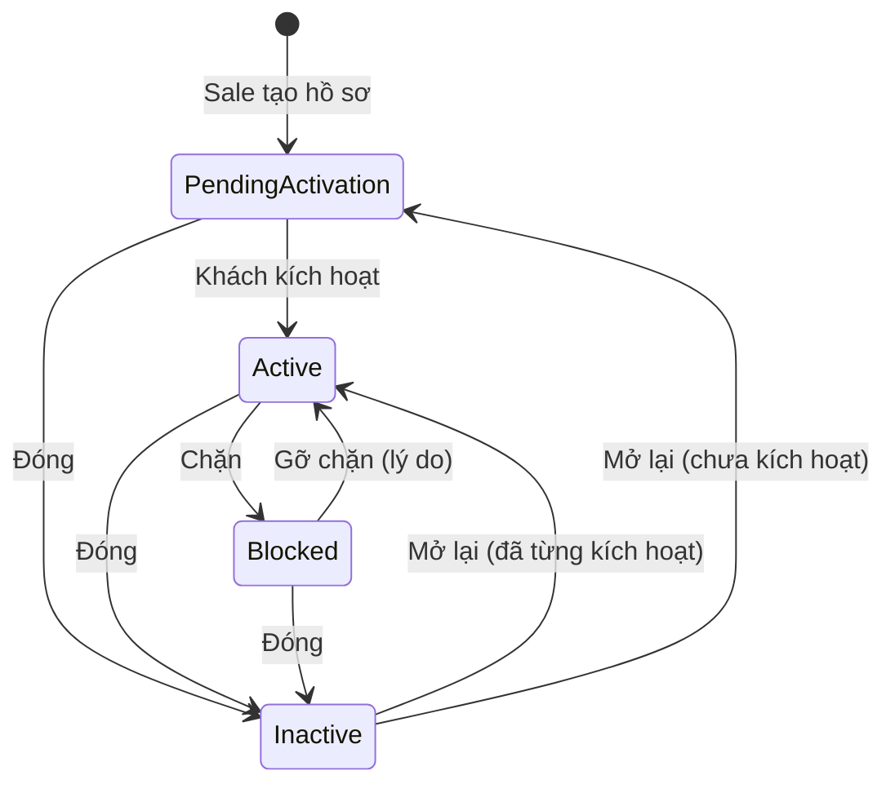

# 18 — Quản lý thông tin khách hàng sỉ (Customer Information Management)

> Đã chốt 2026-10-06: hệ thống **chỉ bán sỉ (B2B)**. Khách là **doanh nghiệp đã liên hệ từ trước**, do Sale tạo hồ sơ; không có đăng ký tự do và không có khách vãng lai (guest).

## 1. Mục đích (Purpose)

Quản lý **hồ sơ khách sỉ (customer profile)** và dữ liệu đi kèm:

- **Thông tin doanh nghiệp:** tên, mã số thuế.
- **Tài khoản đăng nhập cổng** của khách.
- **Sổ địa chỉ.**
- **Điều khoản thương mại:** điều khoản thanh toán được phép, **hạn mức công nợ, kỳ hạn**, % cọc, chính sách thu phần còn lại, **bảng giá riêng**.
- **Nhóm khách.**
- **Lịch sử thay đổi** và **lịch sử đơn hàng & tương tác.**

Đây là **nguồn dữ liệu khách hàng dùng chung** cho báo giá & đặt hàng ([14](../14-cart-and-order/README.md)), thanh toán ([15](../15-payment/README.md)), chăm sóc ([16](../16-sales-chat/README.md)) và điều hành đơn ([17](../17-order-management/README.md)).

> ⚠️ Giả định: các phần sau **chưa có trong hệ thống**, được giữ làm **phạm vi giai đoạn sau** (xem [open-questions D16](../../open-questions/README.md)):
> - nhiều người liên hệ / người đặt hàng có quyền riêng trên cổng (hiện **mỗi khách một tài khoản đăng nhập**);
> - 2FA;
> - tuỳ chọn nhận tin & consent marketing;
> - hồ sơ rủi ro;
> - yêu cầu quyền riêng tư (tải / ẩn danh dữ liệu) và hợp nhất hồ sơ trùng (§4.5, §4.6).

---

## 2. Actor liên quan

| Actor | Vai trò |
|-------|---------|
| **Khách hàng sỉ** | Kích hoạt tài khoản từ lời mời. Sửa tên công ty và số điện thoại. Quản lý sổ địa chỉ. Đổi mật khẩu, xem / thu hồi phiên đăng nhập. Xem công nợ và vị thế tín dụng. |
| **Nhân viên Sale (Sales Staff)** | **Tạo hồ sơ khách sỉ** và gửi / gửi lại lời mời kích hoạt. Đặt điều khoản ban đầu (chỉ trả trước / đặt cọc). Xem hồ sơ, sửa thông tin thay khách, quản lý địa chỉ. |
| **Quản trị bán hàng (E-commerce Admin)** | Tạo hồ sơ khách. **Đổi trạng thái khách** (chặn / gỡ chặn / đóng / mở lại). Quản lý **nhóm khách** và gán khách vào nhóm. Quản lý địa chỉ. |
| **Kế toán (Accountant)** | **Duyệt điều khoản thanh toán**: điều khoản được phép, hạn mức, kỳ hạn, % cọc, chính sách thu phần còn lại ([15](../15-payment/README.md) BR-16) |
| **Hệ thống** | Chuẩn hoá & chống trùng mã số thuế. Gửi lời mời, quản lý hạn link. Đồng bộ trạng thái tài khoản đăng nhập theo trạng thái khách. Ghi lịch sử thay đổi. Gắn đơn / tương tác vào hồ sơ. |

---

## 3. Input / Output

### Input

| Nhóm | Dữ liệu | Nguồn |
|------|---------|-------|
| Định danh doanh nghiệp | Tên công ty; **mã số thuế (không bắt buộc)**: 10 số, 10-3 (đơn vị phụ thuộc) hoặc 12 số (CCCD của đại diện hộ kinh doanh) | Sale |
| Tài khoản đăng nhập | Email người liên hệ (khoá đăng nhập; không đổi được), số điện thoại; mật khẩu do khách đặt khi kích hoạt | Sale / Khách |
| Điều khoản thương mại | Điều khoản được phép (trả trước / đặt cọc / công nợ, ít nhất một), điều khoản mặc định, % cọc, chính sách thu phần còn lại, **hạn mức**, **kỳ hạn**, **bảng giá riêng** | Sale (ban đầu) + Kế toán duyệt |
| Sổ địa chỉ | Địa chỉ **giao hàng** và **xuất hoá đơn** (nhiều địa chỉ mỗi loại), mỗi loại một địa chỉ mặc định. Địa chỉ Việt Nam hai cấp (phường / xã, tỉnh / thành); bắt buộc tên người nhận, điện thoại, địa chỉ chi tiết | Khách / Sale |
| Nhóm khách | Mã nhóm (cố định), tên, mô tả | Quản trị bán hàng |
| Dữ liệu phái sinh | Lịch sử báo giá & đơn, **dư nợ & quá hạn**, thiết kế và mẫu đã duyệt, lịch sử chat | 12, 14, 15, 16, 17, 19 |

### Output

| Kết quả | Dùng bởi |
|---------|----------|
| **Customer profile** | 14, 15, 16, 17, báo cáo |
| **Địa chỉ & người nhận** cho đơn | 14 Quote & Order |
| **Điều khoản thương mại** | 13 Catalog, 14 Quote & Order, 15 Payment |
| **Nhóm khách** | Giá nhóm khi chưa có bảng giá riêng ([13](../13-catalog/README.md)) |
| **Lịch sử trạng thái** (kèm lý do) và **lịch sử thay đổi** tên công ty / mã số thuế | Quản trị bán hàng, Sale |
| **Tình trạng lời mời** (chờ kích hoạt / hết hạn / đã kích hoạt…) | Sale |

---

## 4. Luồng nghiệp vụ từng bước (Step-by-step)

### 4.1. Tạo hồ sơ & mời kích hoạt

1. **Sale (hoặc Quản trị bán hàng) tạo hồ sơ khách sỉ** sau khi khách liên hệ. Nhập:
   - tên công ty, mã số thuế (nếu có);
   - email và số điện thoại người liên hệ;
   - địa chỉ;
   - điều khoản ban đầu: **chỉ trả trước, hoặc đặt cọc** (% cọc tối đa 2 chữ số thập phân). Công nợ không đặt được ở bước này.

   Hệ thống chuẩn hoá mã số thuế và chặn trùng (BR-01). Hồ sơ ở `Pending Activation`.
2. **Lời mời kích hoạt** — gửi tới email người liên hệ sau khi lưu hồ sơ:
   - Link có hiệu lực **72 giờ**.
   - Kết quả gửi được ghi lại (`Sent` / `Failed`).
3. **Gửi lại lời mời** — Sale gửi lại:
   - lần gửi mới **thu hồi link cũ**;
   - phải cách lần trước **ít nhất 1 phút**, trừ khi link cũ đã hết hạn;
   - mỗi tài khoản chỉ có **một lời mời đang mở**.

   Sale xem được tình trạng lời mời: chờ kích hoạt / hết hạn / đã kích hoạt / chưa có tài khoản / không khả dụng (khách bị chặn hoặc đã đóng).
4. **Kích hoạt** — người liên hệ mở link, đặt mật khẩu → hồ sơ `Active`. Đây là cách duy nhất đi từ `Pending Activation` sang `Active`.
5. **Điều khoản công nợ** — muốn cho khách mua công nợ, **kế toán** đặt hạn mức, kỳ hạn và các điều khoản; mỗi lần duyệt ghi người và thời điểm. Đơn đã đặt giữ điều khoản cũ.

### 4.2. Quản lý dữ liệu hồ sơ

6. **Khách tự sửa** trên cổng: **tên công ty** và **số điện thoại**. Mã số thuế chỉ nhân viên sửa; email không đổi được.
7. **Lịch sử thay đổi** — mọi thay đổi **tên công ty** và **mã số thuế** được ghi lại (giá trị cũ, giá trị mới, ai sửa, lúc nào).
8. **Sổ địa chỉ:**
   - Địa chỉ đầu tiên của mỗi loại thành địa chỉ mặc định.
   - Mỗi loại có tối đa một địa chỉ mặc định.
   - Xoá hoặc bỏ mặc định địa chỉ mặc định → hệ thống tự chọn một địa chỉ khác cùng loại làm mặc định.
9. **Bảo mật** — đổi mật khẩu, xem & thu hồi phiên đăng nhập.

### 4.3. Trạng thái khách

10. Quản trị bán hàng đổi trạng thái (§5). Mỗi lần đổi ghi vào **lịch sử trạng thái** kèm lý do.
    - **Chặn** (`Blocked`) và **đóng** (`Inactive`) → tài khoản đăng nhập bị **tạm khoá**.
    - Về `Active` hoặc `Pending Activation` → tài khoản **được mở lại**.
11. **Gỡ chặn** và **mở lại khách đã đóng** đều **bắt buộc lý do**.
    - Mở lại: tài khoản đã từng kích hoạt thì về `Active`; chưa từng kích hoạt thì về `Pending Activation` (gửi lại lời mời).

### 4.4. Dữ liệu phái sinh & nhóm khách

12. **Gắn lịch sử** — mỗi đơn ([17](../17-order-management/README.md)), mỗi hội thoại ([16](../16-sales-chat/README.md)), mỗi thiết kế ([12](../12-product-design/README.md)) liên kết với hồ sơ.
13. **Nhóm khách** — Quản trị bán hàng tạo nhóm và gán khách vào nhóm (mỗi khách tối đa một nhóm).
    - **Mã nhóm** viết hoa, **không đổi** sau khi tạo; chỉ sửa tên và mô tả.
    - Giá áp dụng theo thứ tự: **giá riêng của khách**, rồi **giá nhóm**, rồi **giá gốc** ([13](../13-catalog/README.md)).
14. **Dư nợ & vị thế tín dụng** — cập nhật từ [Payment](../15-payment/README.md). Khách tự xem trên cổng: hạn mức, dư nợ, hạn mức còn lại, quá hạn.

### 4.5. Quyền riêng tư dữ liệu (Data privacy) — phạm vi sau

15. **Yêu cầu truy cập / tải dữ liệu** — khách yêu cầu bản sao dữ liệu cá nhân → hệ thống xuất tập hợp dữ liệu.
16. **Yêu cầu xoá** — ẩn danh (anonymize) dữ liệu cá nhân **trong giới hạn nghĩa vụ lưu trữ**: chứng từ đơn hàng / kế toán phải giữ theo luật, nên ẩn danh thay vì xoá cứng.

### 4.6. Hợp nhất hồ sơ trùng (Merge) — phạm vi sau

17. Phát hiện trùng → Quản trị bán hàng xem xét → **merge**: giữ một hồ sơ chính, gộp địa chỉ / đơn / tương tác, giữ log merge.

---

## 5. Trạng thái / Vòng đời (Lifecycle)

### Trạng thái hồ sơ khách

| Trạng thái | Ý nghĩa | Chuyển tiếp cho phép | Ai thực hiện |
|------------|---------|----------------------|--------------|
| `Pending Activation` | Đã tạo hồ sơ, chờ người liên hệ kích hoạt từ lời mời | → `Active` (kích hoạt), → `Inactive` | Khách (kích hoạt); Quản trị bán hàng |
| `Active` | Bình thường: xem giá, nhận báo giá, đặt hàng | → `Blocked`, → `Inactive` | Quản trị bán hàng |
| `Blocked` | Bị chặn (vi phạm, rủi ro): không đăng nhập, không mua | → `Active` (gỡ chặn, **bắt buộc lý do**), → `Inactive` | Quản trị bán hàng |
| `Inactive` | Đã đóng; dữ liệu giữ nguyên | → `Active` / `Pending Activation` (mở lại, **bắt buộc lý do**) | Quản trị bán hàng |

> Trạng thái `Anonymized` và `Merged` thuộc phạm vi sau (§4.5, §4.6).

---

## 6. Ràng buộc nghiệp vụ (Business Rules) & Edge case

### Business rules

- **BR-01:** **Mã số thuế không bắt buộc**. Nếu nhập thì:
  - đúng một trong ba dạng: 10 số, 10-3, hoặc 12 số;
  - hệ thống bỏ khoảng trắng / dấu chấm và đổi 13 số thành 10-3;
  - **duy nhất trên mọi hồ sơ**, kể cả hồ sơ đã đóng;
  - đã có thì không xoá được.

  Email là khoá đăng nhập; mỗi khách **một tài khoản đăng nhập**.
- **BR-01a:** Chỉ **Sale / Quản trị bán hàng** tạo hồ sơ khách; không có đăng ký tự do và guest checkout. Chỉ hồ sơ `Active` mới xem giá, nhận báo giá và đặt hàng.
- **BR-02:** Hạn mức, kỳ hạn, % cọc, chính sách thu phần còn lại và điều khoản được phép chỉ do **kế toán** duyệt; mọi thay đổi ghi người và thời điểm duyệt. Lúc tạo khách, Sale chỉ đặt được trả trước / đặt cọc.
- **BR-03:** Truy cập hồ sơ khách theo **quyền tối thiểu**; khách chỉ xem hồ sơ của chính mình.
- **BR-04:** Lời mời có hạn **72 giờ**. Gửi lại thì thu hồi link cũ, cách lần trước tối thiểu 1 phút. Mỗi tài khoản chỉ có một lời mời đang mở.
- **BR-05:** Mọi đổi trạng thái ghi lịch sử kèm lý do. **Gỡ chặn** và **mở lại** bắt buộc lý do. Không ai đặt tay trạng thái `Pending Activation`.
- **BR-06:** Hồ sơ `Blocked` / `Inactive` không đăng nhập và không tạo đơn mới; đơn đang chạy vẫn xử lý tới khi kết thúc.
- **BR-07:** Thay đổi **tên công ty** và **mã số thuế** luôn được ghi lịch sử (cũ / mới / ai / khi nào).
- **BR-08:** Mã nhóm khách cố định sau khi tạo; mỗi khách tối đa một nhóm.

### Edge case

| Tình huống | Hướng xử lý |
|------------|-------------|
| Người liên hệ của khách nghỉ việc | Sale cập nhật thông tin liên hệ; lịch sử đơn vẫn gắn công ty (nhiều người liên hệ: phạm vi sau) |
| Một người muốn tự đăng ký trên cổng mà chưa liên hệ Sale | Không có đăng ký tự do: chuyển thành yêu cầu liên hệ cho Sale xử lý |
| Email lời mời gửi lỗi | Lời mời ghi `Failed`; Sale gửi lại |
| Khách không kích hoạt trong 72 giờ | Link hết hạn; Sale gửi lại (không cần chờ 1 phút) |
| Tạo khách trùng mã số thuế với hồ sơ đã đóng | Chặn; mở lại hồ sơ cũ (kèm lý do) thay vì tạo mới |
| Hộ kinh doanh không có mã số thuế doanh nghiệp | Để trống, hoặc nhập 12 số CCCD của người đại diện |
| Nghi tài khoản bị chiếm (login lạ) | Thu hồi phiên; Quản trị bán hàng tạm chặn (`Blocked`) nếu cần |
| Khách quá hạn công nợ kéo dài | Kế toán hạ hạn mức hoặc chỉ cho trả trước; đơn công nợ mới bị treo ([15](../15-payment/README.md)) |

---

## 7. Liên kết với các module khác

| Module | Quan hệ |
|--------|---------|
| [14 · Quote & Order](../14-cart-and-order/README.md) | Cung cấp thông tin khách, sổ địa chỉ, người nhận, điều khoản thanh toán, hạn mức |
| [15 · Payment](../15-payment/README.md) | Kế toán duyệt điều khoản; dư nợ, quá hạn, vị thế tín dụng |
| [16 · Sales Chat](../16-sales-chat/README.md) | Hồ sơ & lịch sử tương tác hiển thị cho Sale |
| [17 · Order Management](../17-order-management/README.md) | Lịch sử đơn gắn hồ sơ |
| [12 · Product Design](../12-product-design/README.md) | Chủ sở hữu bản thiết kế là tài khoản đăng nhập của khách |
| [13 · Catalog](../13-catalog/README.md) | Bảng giá riêng / nhóm khách quyết định giá hiển thị |
| [00 · System Overview §3](../../00-system-overview/README.md) | Persona khách hàng |
