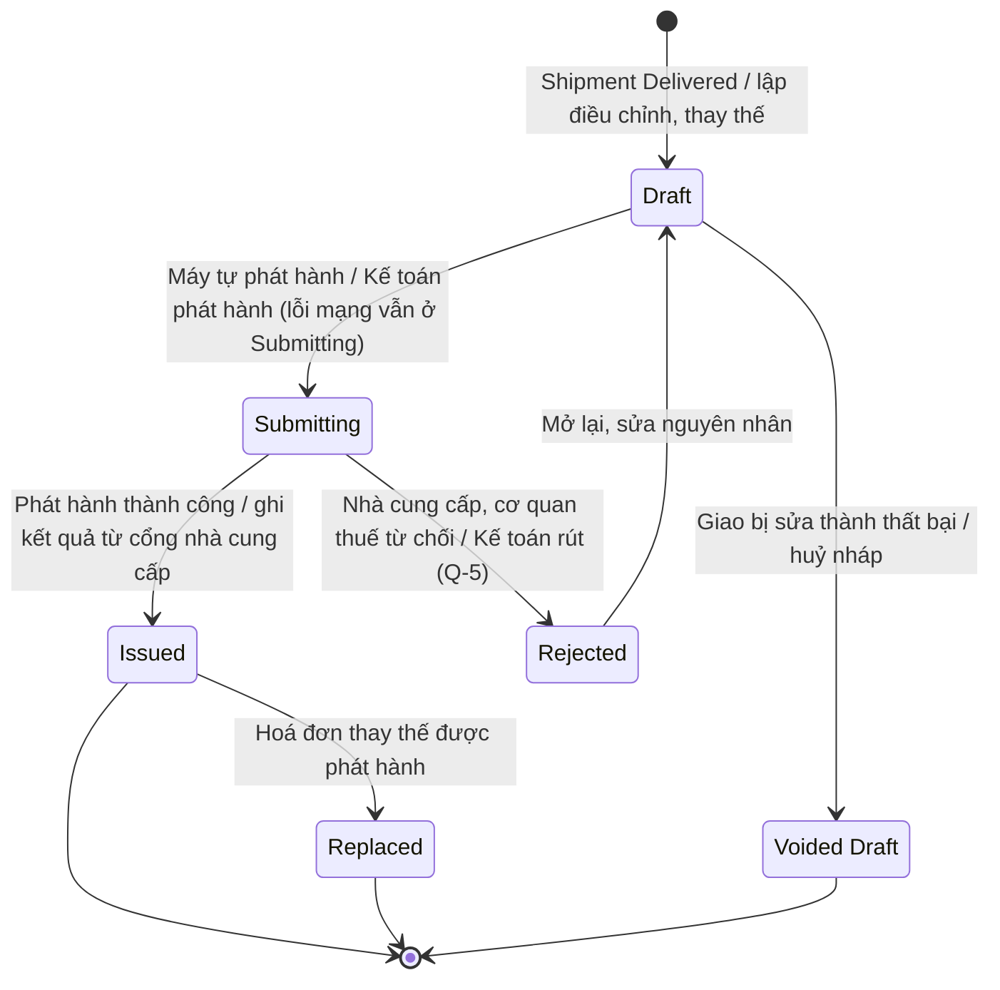

# 21 — Hoá đơn điện tử (E-invoice)

> ✅ Đã chốt 2026-11-06: hệ thống **tự phát hành hoá đơn VAT điện tử** cho khách bằng cách **tích hợp API của nhà cung cấp hoá đơn điện tử** — thay quyết định ngày 2026-11-05 "hoá đơn điện tử xuất ở phần mềm hoá đơn ngoài hệ thống, hệ thống chỉ cung cấp số liệu" ([open-questions G6](../../open-questions/README.md)). Hoá đơn gom **theo lần giao thành công** (mỗi shipment `Delivered` một hoá đơn), không theo đợt thanh toán.
>
> ✅ Chốt 2026-11-24 (Q-1, Q-22) — thay "Kế toán bấm phát hành; hệ thống không tự phát hành khi giao xong": **hoá đơn gốc tự phát hành ngay trong ngày giao** khi công tắc **tự phát hành** của nhà cung cấp đang dùng bật (mặc định bật cho SePay); Kế toán vẫn phát hành tay được (nháp máy giữ lại, hoặc khi công tắc tắt). **Ngày hoá đơn = ngày phát hành**; hạn phát hành = **hết ngày giao**; phát hành muộn gắn nhãn **"Lập trễ N ngày"**.
>
> **Nhà cung cấp dịch vụ hoá đơn điện tử** nằm **ngoài hệ thống** (đang dùng: **SePay eInvoice**): ký số hoá đơn, nộp cơ quan thuế, cấp số hoá đơn. Hệ thống gọi API của nhà cung cấp, lưu kết quả và **tự gửi e-mail hoá đơn** cho khách (Q-14).

## 1. Mục đích (Purpose)

Phát hành **hoá đơn giá trị gia tăng điện tử (VAT e-invoice)** cho khách sỉ khi hàng đã giao, qua API của nhà cung cấp hoá đơn điện tử, và giao hoá đơn cho khách. Cụ thể:

- **tạo hoá đơn nháp** cho mỗi lần giao thành công (shipment `Delivered` — [09](../../warehouse/09-shipping/README.md)), gồm các thùng của lần giao đó theo dòng đơn, kèm thuế suất và tiền thuế;
- **phát hành** qua nhà cung cấp hoá đơn điện tử **ngay trong ngày giao** — máy tự phát hành nháp gốc đủ điều kiện, Kế toán phát hành nháp bị giữ lại và các hoá đơn điều chỉnh / thay thế; theo dõi kết quả phát hành (nhà cung cấp xử lý bất đồng bộ);
- lập **hoá đơn điều chỉnh** hoặc **hoá đơn thay thế** khi trả hàng, giao bị sửa thành thất bại hoặc có sai sót — hoá đơn đã phát hành **không sửa, không xoá**;
- lưu **file XML** (bản có giá trị pháp lý) và **file PDF** (bản để xem, in), cho khách xem / tải trên cổng và **gửi e-mail hoá đơn** (kèm PDF, XML) tới e-mail nhận hoá đơn của khách.

Hoá đơn **không quyết định thanh toán**: các đợt thanh toán, công nợ và các cổng chặn theo tiền vẫn ở [15](../15-payment/README.md). Thời điểm lập hoá đơn bán hàng hoá là lúc chuyển giao hàng (NĐ 254/2026/NĐ-CP Điều 9 khoản 1), không phụ thuộc đã thu tiền hay chưa — nên số và ngày hoá đơn không trùng với các đợt tiền.

---

## 2. Actor liên quan

| Actor | Vai trò |
|-------|---------|
| **Kế toán (Accountant)** | Xem hoá đơn nháp, nhất là nháp **máy giữ lại** vì cảnh báo; **phát hành tay** (bắt nhập lý do khi lập trễ), phát hành lại khi lỗi, **tra lại** kết quả; **rút** hoá đơn kẹt ở nhà cung cấp theo BR-13; **ghi kết quả / bản giảm làm trên cổng nhà cung cấp** (BR-14); lập **hoá đơn điều chỉnh / thay thế**, chạy **"Lập bản giảm do giao thất bại"**; gán **nhóm thuế** cho sản phẩm thiếu nhóm thuế ([01](../../warehouse/01-product-creation/README.md)); **gửi lại e-mail hoá đơn**; xem lượt phát hành còn lại và cấu hình (chỉ đọc) |
| **Quản trị hệ thống (System Admin)** | Trên màn hình: chọn **nhà cung cấp đang dùng**, **mẫu số + ký hiệu hoá đơn** theo năm, **bật / tắt tự phát hành**. Thông tin xác thực của SePay (client id, client secret), môi trường (thử nghiệm / production), ngưỡng cảnh báo lượt phát hành đặt bằng **biến môi trường trên server** — Admin **không nhập** trên màn hình *(✅ Chốt 2026-11-24, Q-22)* |
| **Nhân viên Sale (Sales Staff)** | Xem hoá đơn của đơn mình phụ trách (⚠️ backend chưa cấp quyền `einvoices` cho Sales Staff — hiện chỉ **Sales Manager** xem được *(✅ Cập nhật 2026-11-14 — đồng bộ code backend, WF-05)*); gửi **thẻ hoá đơn** cho khách qua [chat](../16-sales-chat/README.md); bổ sung **mã số thuế** khi hoá đơn bị chặn vì thiếu, **e-mail nhận hoá đơn** khi được báo thiếu ([18](../18-customer-information/README.md)), rồi **gửi lại e-mail hoá đơn** |
| **Quản lý kinh doanh (Sales Manager)** | Gán / đổi **nhóm thuế** của sản phẩm ở mọi trạng thái (BR-07); gửi lại e-mail hoá đơn |
| **Khách hàng sỉ** | Xem và tải **XML / PDF** các hoá đơn đã phát hành trên trang đơn ở cổng ([17](../17-order-management/README.md) §5.2); nhận **e-mail hoá đơn** (kèm PDF, XML) và thông báo hoá đơn đã phát hành; nhận thẻ hoá đơn trong chat |
| **Hệ thống** | Tạo hoá đơn nháp khi shipment `Delivered`; **tự phát hành** nháp gốc đủ điều kiện ngay sau khi lập; báo Kế toán nháp bị giữ, sắp đến hạn, quá hạn; huỷ nháp khi kết quả giao bị sửa trước khi phát hành; **tự lập bản giảm toàn bộ** khi giao bị sửa thành thất bại sau khi đã phát hành; gọi nhà cung cấp, **hỏi lại kết quả** theo mã giao dịch; lưu số hoá đơn, ký hiệu, file XML / PDF, kiểm chữ ký số trên XML; **gửi e-mail hoá đơn**; kiểm lượt phát hành còn lại; tra lại hằng ngày (30 ngày) giao dịch đã rút |
| **Nhà cung cấp hoá đơn điện tử (ngoài hệ thống)** | Nhận dữ liệu hoá đơn, **ký số**, nộp cơ quan thuế, cấp số hoá đơn, trả kết quả và file; tự thử lại khi lỗi hạ tầng. Không gửi kết quả về qua webhook — hệ thống phải tự hỏi lại. **Không gửi e-mail hoá đơn** cho bên mua: hệ thống không đưa e-mail bên mua sang nhà cung cấp *(✅ Chốt 2026-11-24, Q-14)* |

---

## 3. Input / Output

### Input

| Trường | Mô tả | Bắt buộc |
|--------|-------|----------|
| **Shipment `Delivered`** | Từ [09](../../warehouse/09-shipping/README.md): mã shipment (thuộc đúng một đơn — [08](../../warehouse/08-packing/README.md) BR-03), các thùng LPN đã giao theo dòng đơn, **ngày giao thành công** (thời điểm hãng báo giao thành công — từ webhook, hoặc Quản lý kho ghi theo hãng báo lại) | Có |
| **Dòng đơn & dòng phí** | Từ [14](../14-cart-and-order/README.md): SKU, tên hàng, số cái / thùng, **đơn giá / cái**, **thuế suất VAT** đã chốt của dòng (thuế suất của hợp đồng — dùng để đối chiếu); **nhóm thuế** của sản phẩm ([01](../../warehouse/01-product-creation/README.md) — để lấy thuế suất tại ngày giao); dòng phí khuôn / bản in, dòng phí vận chuyển (nếu có) kèm thuế suất | Có |
| **Thông tin bên mua** | Từ hồ sơ khách ([18](../18-customer-information/README.md)), chụp lại lúc tạo nháp: tên công ty, **mã số thuế**, địa chỉ trên hoá đơn, **email nhận hoá đơn** | Có (tên, mã số thuế, địa chỉ: bắt buộc trước khi phát hành; e-mail: thiếu chỉ cảnh báo — BR-06) |
| **Cấu hình nhà cung cấp hoá đơn điện tử** | Trên màn hình Admin: nhà cung cấp đang dùng, mẫu số + ký hiệu theo năm, công tắc tự phát hành. Trên server (biến môi trường): thông tin xác thực, môi trường, ngưỡng cảnh báo lượt (BR-10) | Có (cấu hình) |
| Yêu cầu điều chỉnh / thay thế | Hoá đơn gốc, loại (điều chỉnh tăng / giảm / thông tin, thay thế), các dòng và số tiền chênh lệch (điều chỉnh) hoặc toàn bộ nội dung mới (thay thế), lý do; với sai sót: văn bản thoả thuận với bên mua | Khi điều chỉnh / thay thế |
| **Lý do lập trễ** | Kế toán phát hành tay hoá đơn gốc sau ngày giao (BR-02) | Khi lập trễ |
| Yêu cầu rút hoá đơn kẹt ở nhà cung cấp | Lý do; với ca nhà cung cấp không xác nhận được kết quả: tham chiếu **văn bản của bộ phận hỗ trợ nhà cung cấp** (BR-13) | Khi rút |
| **Kết quả / bản giảm làm trên cổng nhà cung cấp** | Mẫu số, ký hiệu, số, ngày hoá đơn, mã cơ quan thuế, **tệp XML** (bắt buộc), tệp PDF, ghi chú (BR-14) | Khi ghi từ cổng |
| **Kết quả từ nhà cung cấp** | **Mã giao dịch / mã theo dõi**; kết quả đang xử lý / thành công / thất bại kèm thông điệp; khi thành công: số hoá đơn, ký hiệu, ngày hoá đơn, file XML / PDF | Có (khi phát hành) |

### Output

| Kết quả | Dùng bởi |
|---------|----------|
| **Hoá đơn** (mã hoá đơn nội bộ, loại, trạng thái, shipment & đơn tham chiếu, bên mua, các dòng, thuế suất, tiền thuế, tổng chưa thuế, tổng tiền thuế, tổng có thuế, **ngày giao**, **ngày hoá đơn**, **hạn phát hành**, cảnh báo — gồm nhãn **"Lập trễ N ngày"**; khi đã phát hành: số hoá đơn, ký hiệu, mẫu số, file XML / PDF) | Kế toán, Sale, khách |
| **Danh sách hoá đơn của đơn** (gốc, điều chỉnh, thay thế, hoá đơn phần phí còn lại) | Trang đơn ở cổng khách ([17](../17-order-management/README.md)), [15](../15-payment/README.md) (tham chiếu khi xem công nợ) |
| **E-mail hoá đơn** (kèm PDF và XML) do **hệ thống** gửi tới e-mail nhận hoá đơn của khách; gửi lại được (§4.3) | Khách |
| **Thẻ hoá đơn** (số, ký hiệu, ngày, tổng có thuế, link tải XML / PDF) | [16 Sales Chat](../16-sales-chat/README.md) |
| **Thông báo** cho Kế toán: nháp bị máy giữ lại (kèm lý do), sắp đến hạn phát hành, quá hạn, chờ kết quả quá lâu, phát hành bị từ chối, lập trễ, sắp hết / hết lượt, giao thất bại chưa lập được bản giảm, cần làm trên cổng nhà cung cấp, nguy cơ trùng (giao dịch đã rút lại được phát hành); cho Sale: hoá đơn đã phát hành nhưng khách thiếu e-mail; cho khách: hoá đơn đã phát hành | Hộp thông báo ([00 §6](../../00-system-overview/README.md)) |
| **Nhật ký gọi nhà cung cấp** (yêu cầu, mã giao dịch, kết quả, thời điểm) | Kế toán |
| **Nhắc trong khối điều kiện hoàn tất / đóng đơn**: chuyến giao thất bại còn hoá đơn gốc hiệu lực chưa giảm (thông tin, không chặn — Q-16) | [17](../17-order-management/README.md) |

### Dữ liệu tối thiểu cần lưu

| Thực thể | Trường chính |
|----------|--------------|
| `EInvoice` | `id`, `code` (mã hoá đơn nội bộ — gửi nhà cung cấp làm mã tham chiếu), `type` (`ORIGINAL` / `ADJUSTMENT` / `REPLACEMENT`), `correction_basis?` (`ERROR` sai sót / `RETURN` trả hàng / `TRADE_DISCOUNT` chiết khấu / `DELIVERY_FAILED` giao thất bại — tăng / giảm theo dấu số lượng), `adjusted` (cờ đã có điều chỉnh), `original_invoice_id?`, `order_id`, `shipment_id?`, `status`, `buyer_snapshot`, `delivered_on?` (ngày giao — chỉ hoá đơn gốc), `issue_date` (ngày hoá đơn = ngày phát hành), `issue_due_at` (hạn phát hành), `warnings` (cảnh báo, ví dụ `ISSUED_LATE`, `BUYER_EMAIL_MISSING`, `TAX_CLASS_UNKNOWN`, `SIGNATURE_INVALID`), `subtotal`, `tax_total`, `grand_total`, `reason?`, `transaction_id?`, `invoice_series?`, `template_code?`, `invoice_number?`, `xml_file?`, `pdf_file?`, `issued_via?` (qua API / ghi từ cổng nhà cung cấp), `reversed_at?` (đã giảm toàn bộ do giao thất bại), `issued_by?`, `issued_at?` |
| `EInvoiceLine` | `einvoice_id`, `line_no`, `order_line_id?` / `fee_type?`, `item_name`, `unit`, `quantity` (số cái), `cartons?` (số thùng — ghi chú), `unit_price`, `amount`, `tax_rate`, `tax_amount` |
| `EInvoiceProviderCall` (nhật ký) | `einvoice_id`, `action` (`CREATE` / `CHECK` / `ADJUST` / `REPLACE` / `GET`), `requested_at`, `tracking_code?`, `result` (`PENDING` / `SUCCESS` / `FAILED` / `UNKNOWN`), `message?` |
| `EInvoiceConfig` | Lưu trong hệ thống: `provider` (nhà cung cấp đang dùng), `auto_issue` (công tắc tự phát hành), mẫu số + ký hiệu theo năm (`template_code`, `invoice_series`). Đặt bằng biến môi trường trên server: `environment`, `client_id`, `client_secret`, tài khoản nhà cung cấp, ngưỡng cảnh báo lượt *(✅ Chốt 2026-11-24, Q-22)* |

---

## 4. Luồng nghiệp vụ từng bước (Step-by-step)

### 4.1. Tạo hoá đơn nháp khi giao thành công

1. Shipment chuyển `Delivered` ([09](../../warehouse/09-shipping/README.md) §4.3 — từ webhook của hãng hoặc Quản lý kho ghi tay) → hệ thống tạo **một hoá đơn gốc `Draft`** cho shipment đó, nếu shipment chưa có hoá đơn gốc còn hiệu lực (BR-01).
2. Hệ thống điền sẵn:
   - **bên mua**: chụp từ hồ sơ khách ([18](../18-customer-information/README.md)) — tên công ty, mã số thuế, địa chỉ trên hoá đơn, email nhận hoá đơn; thiếu e-mail thì nháp mang cảnh báo `BUYER_EMAIL_MISSING` (không chặn — BR-06);
   - **dòng hàng**: gom các thùng của shipment theo dòng đơn — tên hàng (tên SKU), đơn vị tính **cái**, số lượng = số thùng × số cái / thùng, đơn giá / cái của dòng đơn và **thuế suất có hiệu lực tại ngày giao** theo nhóm thuế của sản phẩm (BR-07); thuế suất này khác thuế suất đã chốt của dòng đơn ([14](../14-cart-and-order/README.md) BR-21) thì hoá đơn nháp gắn cờ `TAX_RATE_DIFFERS_FROM_CONTRACT` để Kế toán xem; sản phẩm **thiếu nhóm thuế** → tính **10%** và gắn cảnh báo `TAX_CLASS_UNKNOWN`; tiền thuế = thành tiền dòng × thuế suất, làm tròn tới đồng; ghi chú số thùng;
   - **dòng phí** của đơn: phí khuôn / bản in (từng SKU) nằm trên **hoá đơn gốc đầu tiên** của đơn; phí vận chuyển **chia theo từng lần giao** theo tỷ lệ giá trị hàng của lần giao (phần được miễn theo [15](../15-payment/README.md) không lập hoá đơn) — xem callout dưới;
   - **ngày giao** (`delivered_on`) = ngày giao thành công của shipment, theo **thời điểm hãng báo giao thành công** (không phải thời điểm hệ thống nhận sự kiện); **hạn phát hành** = hết ngày giao (giờ Việt Nam). **Ngày hoá đơn** ghi khi phát hành = **ngày phát hành** (BR-02).

   > ✅ Đã chốt 2026-11-06, cập nhật 2026-11-24 (Q-1): thời điểm chuyển giao hàng là khi **hãng vận chuyển báo giao thành công cho khách**: lấy thời điểm hãng báo trong sự kiện webhook; hãng không có webhook thì lấy ngày giao do Quản lý kho ghi theo thông tin hãng báo lại ([09](../../warehouse/09-shipping/README.md) §4.3, §4.5). Ngày này là **ngày giao** — quyết định **hạn phát hành** và **thuế suất**; webhook về trễ không làm đổi ngày giao. Hoá đơn mang **ngày phát hành** (thay "ngày lập hoá đơn = ngày giao thành công"). Xem [open-questions G8](../../open-questions/README.md).

   > ✅ Cập nhật 2026-11-25 — đồng bộ code backend, WF-05 (thay giả định "hai dòng phí nằm trên hoá đơn gốc đầu tiên"): **phí khuôn / bản in** của mỗi SKU nằm trên hoá đơn gốc đầu tiên được lập; **phí vận chuyển** mỗi lần giao mang một phần theo tỷ lệ giá trị hàng, lần giao cuối mang phần còn lại để tổng các hoá đơn khớp phí tới đồng; phần phí vận chuyển được **miễn** do chuyến bị hoàn (Q-19) không lập hoá đơn. Khi đơn không còn gì để giao (đóng phần còn lại — [17](../17-order-management/README.md) §4.8, hoặc lô cuối bị hãng hoàn về) mà còn phần phí chưa có hoá đơn, hệ thống lập **hoá đơn phần phí còn lại** (không gắn shipment; ngày giao = ngày đóng); **phí khuôn của đơn bị hoàn toàn bộ vẫn có hoá đơn** vì khuôn đã làm (BE-62). Tổng các hoá đơn có thể lệch vài đồng so với hợp đồng do làm tròn tiền thuế từng hoá đơn, không điều chỉnh phần lệch. Xem [open-questions G9](../../open-questions/README.md).

   > ✅ Đã chốt 2026-11-25, cập nhật theo Q-22 (2026-11-24): báo giá, đơn, hợp đồng và các đợt thanh toán dùng thuế suất **chốt ngày lập báo giá**; hoá đơn dùng thuế suất **có hiệu lực tại ngày giao** (kể cả khi phát hành trễ). Hai thuế suất khác nhau → hoá đơn nháp gắn cờ `TAX_RATE_DIFFERS_FROM_CONTRACT` cho Kế toán; hệ thống **không tính lại** các đợt thanh toán, Kế toán xử lý phần chênh lệch ngoài hệ thống. PDF hợp đồng ghi phần chênh lệch tiền thuế được thanh toán thêm hoặc hoàn lại theo hoá đơn ([14](../14-cart-and-order/README.md) §4.3 bước 13). Xem [open-questions D34](../../open-questions/README.md).
3. **Tự phát hành** *(✅ Chốt 2026-11-24, Q-1, Q-22)*: khi công tắc tự phát hành của nhà cung cấp đang dùng **bật**, hệ thống phát hành nháp **gốc** ngay sau khi lập (job chạy khoảng 30 giây một lần) nếu bên mua đủ tên, mã số thuế, địa chỉ và nháp **không có cảnh báo cần người xem** — thiếu e-mail không giữ lại. Trước khi gửi, hệ thống kiểm lại nháp theo quy tắc hiện tại (thuế suất ngày giao, nhóm thuế, bên mua). Nháp **bị giữ lại** (cảnh báo thuế như `TAX_CLASS_UNKNOWN`, `TAX_RATE_DIFFERS_FROM_CONTRACT`; thiếu thông tin bên mua; không có ký hiệu cho năm; hết lượt — BR-09…) → **báo Kế toán ngay**, một lần cho mỗi lý do. Điều chỉnh / thay thế không tự phát hành — Kế toán phát hành.
4. Hoá đơn còn chưa phát hành (nháp, bị từ chối, đang chờ nhà cung cấp) → **cảnh báo trước hạn** cho Kế toán (mặc định 4 giờ trước khi hết ngày giao); **quá hạn** → nhắc lại mỗi ngày đến khi phát hành.

   > ✅ Chốt 2026-11-24 (Q-1, Q-10) — thay giả định "nhắc nháp tồn đọng sau 1 ngày; phát hành muộn vẫn mang ngày lập = ngày giao": hạn phát hành = **hết ngày giao** (NĐ 254/2026/NĐ-CP Điều 9 khoản 1; "ngày làm việc tiếp theo" chỉ áp cho bán hàng ban đêm khi chưa có phần mềm tự lập hoá đơn). Hoá đơn gốc phát hành sau ngày giao mang **ngày phát hành** và nhãn **"Lập trễ N ngày"** (N = số ngày từ ngày giao tới ngày phát hành); Kế toán phát hành tay muộn **phải nhập lý do** (`EINVOICE_LATE_ISSUE_REASON_REQUIRED`), máy tự phát hành không bao giờ bị giữ vì trễ. Hệ thống **không so thứ tự số trong dãy** và **không có chức năng "sửa ngày giao"**. Xem [open-questions G8](../../open-questions/README.md).

### 4.2. Phát hành qua nhà cung cấp hoá đơn điện tử

5. Kế toán mở nháp (nháp máy giữ lại, nháp điều chỉnh / thay thế, hoặc mọi nháp khi công tắc tự phát hành tắt), kiểm tra, bấm **Phát hành**. Hệ thống kiểm lại như khi tự phát hành, trước khi gọi nhà cung cấp:
   - bên mua có **tên, mã số thuế, địa chỉ** (BR-06) — thiếu thì chặn, báo Sale bổ sung ở [18](../18-customer-information/README.md), Kế toán **làm mới thông tin bên mua** trên nháp rồi phát hành; thiếu **e-mail** chỉ cảnh báo;
   - còn **lượt phát hành** ở nhà cung cấp (BR-09) — hết thì chặn **trước khi gửi**;
   - nháp theo quy tắc hiện tại (thuế suất ngày giao, nhóm thuế, bên mua theo hồ sơ): có cảnh báo **mới** Kế toán chưa xem → chặn, Kế toán xem và xác nhận rồi phát hành;
   - hoá đơn gốc phát hành **sau ngày giao** → bắt nhập **lý do lập trễ** (§4.1 bước 4);
   - có **mẫu số + ký hiệu** cho năm của ngày hoá đơn.
6. Hệ thống chuyển hoá đơn sang **`Submitting`** (ghi mã giao dịch) **trước** khi gọi nhà cung cấp, rồi gửi hoá đơn (tạo và phát hành, không qua bước nháp ở nhà cung cấp), dùng **mã hoá đơn nội bộ** làm mã tham chiếu (BR-04). **Lỗi mạng / nhà cung cấp không phản hồi** → hoá đơn vẫn `Submitting`, hệ thống tra lại theo mã giao dịch, **không** quay về `Draft` *(✅ Chốt 2026-11-24, Q-22)*.
7. **Hỏi lại kết quả** theo mã giao dịch (khoảng 30 giây một lần); nhà cung cấp tự thử lại lỗi hạ tầng tối đa khoảng 2 giờ. Kết quả:

   | Nhà cung cấp trả | Hệ thống |
   |-----------|----------|
   | Đang xử lý, hoặc **"đã phát hành, chưa có số"** | Giữ `Submitting`, hỏi lại tiếp. Đây là trạng thái **chờ**, **không bao giờ rút** (BR-13) |
   | Thành công | → `Issued`: lưu số hoá đơn, ký hiệu, mẫu số, ngày hoá đơn; tải và lưu **XML / PDF**; kiểm **chữ ký số** của bên bán trên XML. Gửi lúc gần nửa đêm mà nhà cung cấp đánh số sang ngày sau → ngày hoá đơn ghi đúng ngày nhà cung cấp đánh số |
   | Từ chối (thông điệp nêu lý do, ví dụ sai thông tin bên mua, sai ký hiệu) | → `Rejected`: báo Kế toán kèm thông điệp |
   | Chưa nhận được giao dịch, còn trong thời gian cho phép | Hệ thống tự gửi lại **cùng mã giao dịch** (không thành hoá đơn thứ hai — BR-04) |
   | Nhà cung cấp báo **không nhận được giao dịch** và đã quá thời gian lưu mã giao dịch | Giữ `Submitting`, gắn cờ **"nhà cung cấp không biết giao dịch"**: **không tự gửi lại** (BR-05), báo Kế toán liên hệ nhà cung cấp *(✅ Cập nhật 2026-11-14 — đồng bộ code backend, WF-05)* |
   | Chờ quá lâu (mặc định 30 phút) | Vẫn hỏi lại; báo Kế toán một lần |

8. **`Rejected`** → Kế toán **mở lại thành nháp** (`Draft`), sửa nguyên nhân (thông tin bên mua ở [18](../18-customer-information/README.md) rồi làm mới trên nháp; cấu hình ký hiệu…) → Kế toán **phát hành lại**. Trước khi gửi lại, hệ thống tra nhà cung cấp theo mã hoá đơn nội bộ: chưa có hoá đơn → gửi lại cùng mã; đã có → lấy kết quả đó, không gửi trùng (BR-04).
9. **Cờ "nhà cung cấp không biết giao dịch"** → Kế toán bấm **Tra lại** bất cứ lúc nào (hệ thống hỏi theo mã giao dịch → `Issued` / `Rejected` nếu nhà cung cấp đã có kết quả); chỉ khi nhà cung cấp **xác nhận không giữ hoá đơn** mới bấm **Gửi lại như giao dịch mới** — hệ thống hỏi lại nhà cung cấp trước, còn giữ thì từ chối (BR-04, BR-05).
10. **Rút hoá đơn kẹt ở nhà cung cấp** *(✅ Chốt 2026-11-24, Q-5)*: Kế toán chỉ rút được (`Submitting` → `Rejected`, rồi mở lại và phát hành dưới giao dịch mới) khi đủ điều kiện ở BR-13; nút **Rút** chỉ hiện khi rút được, kèm thời điểm sớm nhất được rút. Sau khi rút, hệ thống **tra lại giao dịch cũ mỗi ngày trong 30 ngày**; nhà cung cấp lại báo đã phát hành → báo Kế toán **nguy cơ trùng** để xử lý với nhà cung cấp.
11. **Ghi kết quả từ cổng nhà cung cấp** *(✅ Chốt 2026-11-24, Q-8)*: hoá đơn `Submitting` không tự ra kết quả (nhà cung cấp giữ hoá đơn có số mà chưa có mã cơ quan thuế, trả lời không rõ mãi, nhà cung cấp không còn gọi được…) → Kế toán xem trên cổng nhà cung cấp và ghi vào hệ thống:
    - **đã phát hành**: số hoá đơn, mã cơ quan thuế, **tệp XML** (bắt buộc — hệ thống đối chiếu mẫu số, ký hiệu, số, mã số thuế bên bán và hỏi lại nhà cung cấp nếu còn gọi được) → `Issued`;
    - **cơ quan thuế từ chối**: ghi chú → `Rejected` (chỉ sau thời gian chờ như khi rút; giao dịch cũ được tra lại như giao dịch đã rút).

### 4.3. Giao hoá đơn cho khách

12. Hoá đơn `Issued` (trừ hoá đơn **chữ ký số lỗi** — BR-15) → hệ thống:
    - hiển thị trên **trang đơn** ở cổng khách: số, ký hiệu, ngày hoá đơn, tổng có thuế, tải **XML** và **PDF** ([17](../17-order-management/README.md) §5.2);
    - gửi **thông báo "hoá đơn đã phát hành"** vào hộp thông báo của tài khoản khách;
    - **gửi e-mail hoá đơn** kèm **PDF và XML** tới e-mail nhận hoá đơn của khách (lấy từ hồ sơ khách — [18](../18-customer-information/README.md)), có thử lại khi gửi lỗi;
    - cho Sale gửi **thẻ hoá đơn** vào hội thoại của đơn ([16](../16-sales-chat/README.md)).
13. **Khách thiếu e-mail** khi hoá đơn phát hành → hoá đơn vẫn phát hành, e-mail không gửi; hệ thống báo Sale bổ sung e-mail ở [18](../18-customer-information/README.md) rồi bấm **Gửi lại e-mail hoá đơn**. Lệnh gửi lại cũng dùng khi e-mail cũ sai hoặc thất lạc; gửi tới e-mail nhận hoá đơn **hiện tại** của khách; dùng quyền sửa hồ sơ pháp lý khách (Sale, Quản lý kinh doanh, Kế toán).

    > ✅ Chốt 2026-11-24 (Q-14) — thay giả định "nhà cung cấp hoá đơn điện tử gửi email hoá đơn; hệ thống không tự gửi": **hệ thống tự gửi e-mail hoá đơn**; e-mail bên mua **không** đưa sang nhà cung cấp (nếu đưa, nhà cung cấp cũng gửi và khách nhận hai e-mail, kể cả khi hệ thống giữ lại hoá đơn chữ ký lỗi). E-mail không phải nội dung bắt buộc của hoá đơn (NĐ 254/2026/NĐ-CP Điều 10 khoản 1). E-mail nhận hoá đơn lấy từ **thông tin pháp lý của khách** ([18](../18-customer-information/README.md)). Xem [open-questions G11](../../open-questions/README.md).

    > ⚠️ Giả định: Q-14 còn một vế "ghi e-mail nhận hoá đơn vào hợp đồng" mà hệ thống **chưa làm** — bản hợp đồng không in e-mail này. Tạm thời e-mail chỉ nằm ở thông tin pháp lý của khách. Xem [open-questions G15](../../open-questions/README.md).

### 4.4. Điều chỉnh & thay thế

14. Hoá đơn `Issued` **không sửa, không xoá** (BR-03). Khi có thay đổi, Kế toán lập chứng từ mới tham chiếu hoá đơn gốc, mỗi chứng từ đi cùng vòng đời §5 (nháp → phát hành → kết quả). Điều chỉnh / thay thế luôn gửi qua **đúng nhà cung cấp đã phát hành hoá đơn gốc** và mang **ngày phát hành** của chính nó:

    | Tình huống | Chứng từ |
    |------------|----------|
    | **Trả hàng được duyệt hoàn tiền** ([17](../17-order-management/README.md) §4.10) | **Điều chỉnh giảm** trên hoá đơn của shipment chứa các thùng bị trả: dòng hàng, số lượng, tiền hàng, tiền thuế giảm. Hệ thống tạo sẵn nháp khi trả hàng được duyệt hoàn tiền. Hoá đơn của shipment đó **chưa phát hành** → phần trả được giữ lại, lập điều chỉnh khi hoá đơn đó phát hành (không trừ vào hoá đơn của lần giao khác). Hoá đơn là **hoá đơn thay thế** → làm trên cổng nhà cung cấp rồi ghi vào hệ thống (BR-08, BR-14) |
    | Kết quả giao bị **sửa tay `Delivered` → `Delivery Failed`** sau khi hoá đơn đã phát hành ([09](../../warehouse/09-shipping/README.md) §4.3 bước 5) | **Hệ thống tự lập nháp bản giảm toàn bộ** phần hoá đơn còn tính (trừ các điều chỉnh đã phát hành), huỷ các điều chỉnh chưa gửi của hoá đơn đó, và báo Kế toán phát hành. **Không lập được** (đang có điều chỉnh ở nhà cung cấp, nháp chiết khấu gộp nhiều hoá đơn, điều chỉnh đã hạ giá dòng…) → báo Kế toán; khi hết vướng, Kế toán chạy **"Lập bản giảm do giao thất bại"** (cùng quy tắc với máy). Hoá đơn **thay thế** → làm trên cổng nhà cung cấp (BR-14). Hoá đơn còn **`Submitting`** → chờ kết quả: phát hành thì giảm như trên, bị từ chối thì huỷ *(✅ Cập nhật 2026-11-25 — đồng bộ code backend, WF-05: HĐ-3, BE-11)* |
    | Sai **tên / địa chỉ bên mua**, mã số thuế đúng | **Thông báo sai sót** Mẫu 04/SS-HĐĐT gửi cơ quan thuế — **không lập hoá đơn mới**, hoá đơn giữ nguyên (TT 91/2026/TT-BTC Điều 10 khoản 1 điểm a). Mẫu 04/SS-HĐĐT **làm ngoài hệ thống** (trên cổng nhà cung cấp / cổng cơ quan thuế) vì API của nhà cung cấp đang dùng không có chức năng này *(✅ Chốt 2026-11-24, Q-22)* |
    | Sai **số tiền / thuế suất / số lượng** | **Điều chỉnh tăng / giảm**, hoặc **thay thế** — Kế toán chọn theo BR-08; cần **văn bản thoả thuận** với bên mua (tệp PDF đã ký, số, ngày) trước khi phát hành; hệ thống in sẵn bản nháp **biên bản thoả thuận điều chỉnh hoá đơn** |
    | Sai nghiêm trọng cần lập lại toàn bộ (ví dụ sai mã số thuế) | **Thay thế** — hoá đơn mới ghi lại toàn bộ nội dung |
    | **Sai sót trên hoá đơn thay thế** | **Thay thế tiếp** — hoá đơn thay thế không điều chỉnh (BR-08) *(✅ Chốt 2026-11-24, Q-9)* |
    | **Chữ ký số lỗi** trên XML nhà cung cấp trả về | Hoá đơn vẫn `Issued` (đã tồn tại theo luật) nhưng **không hiện cho khách**, không gửi e-mail; báo Kế toán lập **thay thế** (BR-15) |

    > ✅ Cập nhật 2026-11-25 — đồng bộ code backend, WF-05 (thay giả định cũ): trả hàng xử lý bằng **hoá đơn điều chỉnh giảm do bên bán lập**; kết quả giao sửa từ thành công sang thất bại sau khi đã phát hành xử lý bằng **bản giảm toàn bộ** do hệ thống tự lập (HĐ-3). Lô hàng **hãng hoàn về** không phải "trả hàng" về mặt hoá đơn (Q-2): chuyến chưa từng `Delivered` thì không có hoá đơn. Xem [open-questions G12, G13](../../open-questions/README.md).
15. **Quy tắc điều chỉnh / thay thế** (BR-08): hoá đơn gốc điều chỉnh được **nhiều lần**; hoá đơn đã có điều chỉnh **không thay thế** được (điều chỉnh tiếp); mỗi hoá đơn chỉ bị thay thế **một lần** (thành `Replaced`); **hoá đơn thay thế không điều chỉnh**: sai sót → thay thế tiếp, trả hàng / giao thất bại → làm trên cổng nhà cung cấp (BR-14).
16. Khi hoá đơn điều chỉnh / thay thế được phát hành: hoá đơn gốc **giữ `Issued` và gắn cờ "có điều chỉnh"** (vẫn hiệu lực, có thể điều chỉnh tiếp) hoặc → `Replaced` (hết hiệu lực, hoá đơn thay thế là hoá đơn hiệu lực của shipment). Khách thấy cả hoá đơn gốc và các hoá đơn điều chỉnh / thay thế trên trang đơn.
17. **Bản giảm / điều chỉnh không gửi được qua API nhà cung cấp** *(✅ Chốt 2026-11-24, Q-8)* — nhà cung cấp đã phát hành hoá đơn gốc không còn dùng được, nhà cung cấp không hỗ trợ lập điều chỉnh, bản giảm trên hoá đơn thay thế, bản bị từ chối nhiều lần cùng lý do: Kế toán **huỷ nháp có lý do** ("Huỷ bản không gửi được" — cần quyền sửa và duyệt), lập trên **cổng nhà cung cấp**, rồi **ghi số hoá đơn + tệp XML / PDF** vào hệ thống (BR-14). Bản ghi từ cổng là hoá đơn điều chỉnh `Issued`, ghi nguồn "ghi từ cổng nhà cung cấp".

### 4.5. Huỷ nháp

18. Hoá đơn **chưa gửi nhà cung cấp** (`Draft`; hoá đơn `Rejected` mở lại thành `Draft`) bị **huỷ** (`Voided Draft`) khi:
    - kết quả giao của shipment bị sửa từ `Delivered` sang `Delivery Failed` ([09](../../warehouse/09-shipping/README.md)) — hệ thống tự huỷ, ghi lý do;
    - kết quả giao bị sửa lại `Delivery Failed` → `Delivered` **cùng ngày giao** khi bản giảm toàn bộ chưa gửi đi — hệ thống huỷ bản giảm, hoá đơn gốc hiệu lực trở lại (không sinh hoá đơn thứ ba cho một lần giao); sửa lại sang **ngày khác** thì coi là lần giao mới: bản giảm được phát hành và lập hoá đơn gốc mới;
    - Kế toán huỷ nháp lập sai (nháp điều chỉnh / thay thế; nháp gốc có cảnh báo thuế để lập lại sau khi gán nhóm thuế), bắt buộc lý do;
    - Kế toán huỷ bản giảm không gửi được qua nhà cung cấp (§4.4 bước 17).

    Kết quả giao sau đó được ghi lại thành `Delivered` → hệ thống tạo nháp hoá đơn gốc mới (BR-01). Gửi lại hàng cho khách là **đơn mới** (không có "Giao lại" trên đơn cũ — [17](../17-order-management/README.md)), có hoá đơn theo đơn mới.

---

## 5. Trạng thái / Vòng đời (Lifecycle)

### 5.1. Hoá đơn (E-invoice)

Áp dụng cho mọi loại: hoá đơn gốc, hoá đơn điều chỉnh, hoá đơn thay thế. Cờ "có điều chỉnh" và trạng thái `Replaced` chỉ có ở hoá đơn đã `Issued` bị điều chỉnh / thay thế.

| Trạng thái | Ý nghĩa | Chuyển tiếp cho phép | Ai thực hiện |
|------------|---------|----------------------|--------------|
| `Draft` | Nháp trong hệ thống, chưa gửi nhà cung cấp | → `Submitting`, → `Voided Draft` | Hệ thống tạo, **tự phát hành** nháp gốc đủ điều kiện; Kế toán phát hành / huỷ |
| `Submitting` | Đã chuyển sang gửi nhà cung cấp, có mã giao dịch; đang chờ kết quả — kể cả khi lỗi mạng lúc gửi, hoặc nhà cung cấp báo "đã phát hành, chưa có số". Có thể kèm **cờ "nhà cung cấp không biết giao dịch"** — không tự gửi lại (BR-05) | → `Issued`, → `Rejected` | Hệ thống (hỏi lại kết quả); Kế toán tra lại / gửi như giao dịch mới / **rút** (BR-13) / **ghi kết quả từ cổng nhà cung cấp** (BR-14) |
| `Rejected` | Nhà cung cấp hoặc cơ quan thuế từ chối kèm lý do, hoặc Kế toán đã **rút** khỏi nhà cung cấp; chưa có hoá đơn ở nhà cung cấp | → `Draft` (mở lại để sửa) | Kế toán |
| `Issued` | Đã phát hành: có số hoá đơn, ký hiệu, XML / PDF; **bất biến**. Có thể kèm **cờ "có điều chỉnh"** (vẫn hiệu lực, điều chỉnh tiếp được), nhãn **"Lập trễ N ngày"**, cảnh báo **chữ ký lỗi** | → `Replaced` | Hệ thống |
| `Replaced` | Đã bị thay thế bởi hoá đơn thay thế đã phát hành; hết hiệu lực | *(cuối)* | Hệ thống |
| `Voided Draft` | Nháp bị huỷ, chưa từng phát hành | *(cuối)* | Hệ thống / Kế toán |

> Tên trạng thái theo code backend (`EInvoiceStatus`): `DRAFT`, `SUBMITTING`, `ISSUED`, `REJECTED`, `VOIDED_DRAFT`, `REPLACED`; "nhà cung cấp không biết giao dịch", "có điều chỉnh", "lập trễ" (`ISSUED_LATE`) và "chữ ký lỗi" là **cờ / cảnh báo**, không phải trạng thái. `Submitting` không quay về `Draft` *(✅ Cập nhật 2026-11-25 — đồng bộ code backend, WF-05; Q-5, Q-22)*.

### 5.2. Trạng thái hoá đơn khách thấy

| Trạng thái nội bộ | Khách thấy |
|-------------------|-----------|
| `Draft`, `Submitting`, `Rejected`, `Voided Draft` | Không hiển thị |
| `Issued` có cảnh báo chữ ký lỗi | Không hiển thị, không gửi e-mail (BR-15) |
| `Issued` | "Đã phát hành" — tải XML / PDF |
| `Issued` có cờ điều chỉnh | "Đã phát hành — có điều chỉnh" — kèm các hoá đơn điều chỉnh |
| `Replaced` | "Đã bị thay thế" — kèm hoá đơn thay thế |

---

## 6. Ràng buộc nghiệp vụ (Business Rules) & Edge case

### Business rules

- **BR-01:** **Mỗi shipment `Delivered` có đúng một hoá đơn gốc còn hiệu lực** (không `Voided Draft`, không `Replaced` mà chưa có hoá đơn thay thế, không đã giảm toàn bộ do giao thất bại). Hoá đơn gom theo **lần giao**, không theo đợt thanh toán; một đơn giao nhiều lần có nhiều hoá đơn. Shipment chưa từng `Delivered` (thất bại, hãng hoàn về) không có hoá đơn. Ngoại lệ không gắn shipment: **hoá đơn phần phí còn lại** của đơn (§4.1).
- **BR-02:** **Phát hành trong ngày giao** *(✅ Chốt 2026-11-24, Q-1, Q-10, Q-22 — thay "Kế toán phát hành; hệ thống chỉ tạo nháp, không tự phát hành")*: hoá đơn gốc **tự phát hành** ngay khi lập nếu công tắc tự phát hành của nhà cung cấp đang dùng bật (mặc định bật cho SePay; Admin tắt được) và nháp đủ điều kiện (§4.1 bước 3); Kế toán **vẫn phát hành tay** được. **Ngày hoá đơn = ngày phát hành** (với mọi loại hoá đơn); hạn = **hết ngày giao**. Hoá đơn gốc phát hành sau ngày giao gắn nhãn **"Lập trễ N ngày"**; Kế toán phát hành tay muộn phải nhập lý do. Không so thứ tự số trong dãy; không có chức năng sửa ngày giao. Quyền phát hành, tra lại, rút, lập điều chỉnh / thay thế gán mặc định cho Kế toán ([00 §2.3](../../00-system-overview/README.md)).
- **BR-03:** Hoá đơn `Issued` **bất biến** — không sửa, không xoá. Mọi thay đổi bằng **hoá đơn điều chỉnh** hoặc **hoá đơn thay thế** tham chiếu hoá đơn gốc (§4.4).
- **BR-04:** **Chống phát hành trùng:** mỗi hoá đơn có **mã hoá đơn nội bộ** duy nhất, gửi nhà cung cấp làm **mã tham chiếu**; nhà cung cấp từ chối mã đã tồn tại. Trước khi phát hành lại, hệ thống **tra nhà cung cấp theo mã** — đã có hoá đơn thì lấy kết quả, không gửi lại. Mã giao dịch đã rút không bao giờ dùng lại.
- **BR-05:** Hoá đơn gắn cờ **"nhà cung cấp không biết giao dịch"** **không được tự gửi lại**: chỉ gửi như giao dịch mới khi nhà cung cấp xác nhận không giữ hoá đơn, hệ thống hỏi lại trước khi gửi (theo hướng dẫn của nhà cung cấp) *(✅ Cập nhật 2026-11-14 — đồng bộ code backend, WF-05)*.
- **BR-06:** **Thông tin bên mua:** tên công ty, **mã số thuế** (10 số, 10-3, hoặc 12 số với hộ kinh doanh — [18](../18-customer-information/README.md) BR-01), địa chỉ trên hoá đơn **bắt buộc** trước khi phát hành — thiếu thì chặn. **E-mail nhận hoá đơn thiếu chỉ cảnh báo**, không chặn phát hành tay lẫn tự phát hành; hệ thống báo Sale bổ sung rồi gửi lại e-mail (§4.3) *(✅ Chốt 2026-11-24, Q-22)*. Thông tin bên mua **chụp lại** vào hoá đơn; đổi hồ sơ khách sau đó không đổi hoá đơn đã phát hành.

  > ⚠️ Giả định: mọi khách đều nhận hoá đơn có mã số thuế (khách là doanh nghiệp / hộ kinh doanh có mã số thuế hoặc CCCD 12 số); **địa chỉ trên hoá đơn** lấy **địa chỉ xuất hoá đơn mặc định**, không có thì lấy **địa chỉ đăng ký kinh doanh**. Xem [open-questions G14](../../open-questions/README.md).
- **BR-07:** **Thuế suất** *(✅ Chốt 2026-11-24, Q-21, Q-22; cập nhật 2026-11-25 — đồng bộ code backend, WF-05)*:
  - thuế suất trên hoá đơn là thuế suất **có hiệu lực tại ngày giao** theo nhóm thuế của sản phẩm, kể cả khi phát hành trễ; khác thuế suất đã chốt của dòng ([14](../14-cart-and-order/README.md) BR-21) thì gắn cờ `TAX_RATE_DIFFERS_FROM_CONTRACT` (§4.1);
  - nhóm thuế phổ thông (ly, cốc, bao bì, phí in, phí vận chuyển) **giảm còn 8%** từ 01/07/2025 **đến hết 31/12/2026** (NĐ 174/2025/NĐ-CP), sau đó 10%;
  - sản phẩm **thiếu nhóm thuế** → tính **10%** kèm cảnh báo `TAX_CLASS_UNKNOWN`; cảnh báo này **chặn tự phát hành** — Kế toán gán nhóm thuế, huỷ nháp và lập lại, hoặc xem rồi phát hành tay;
  - **nhóm thuế sửa được ở mọi trạng thái sản phẩm** (Kế toán, Quản lý kinh doanh, Admin — [01](../../warehouse/01-product-creation/README.md)), có ghi nhật ký, đã gán thì không xoá về trống; nhóm thuế mới **chỉ áp cho báo giá và nháp hoá đơn lập sau**, không đổi nháp, báo giá, đơn đã có (D34);
  - hoá đơn dùng **mẫu hoá đơn GTGT** và ký hiệu theo cấu hình; dòng thuế suất 0% (nhóm `EXEMPT`) **chưa phát hành được** qua hệ thống (`EINVOICE_TAX_EXEMPT_NOT_SUPPORTED`) — Kế toán sửa nhóm thuế hoặc lập ngoài hệ thống.

  > ⚠️ Giả định: ánh xạ nhóm `EXEMPT` (không chịu thuế — KCT, hay 0%) và mức 0% cho khách khu chế xuất chưa chốt; hiện không sản phẩm nào thuộc nhóm `EXEMPT`. Xem [open-questions D35](../../open-questions/README.md).
- **BR-08:** **Điều chỉnh / thay thế** *(✅ Chốt 2026-11-24, Q-9 — thay "thay thế một lần cho mỗi hoá đơn gốc")*: hoá đơn gốc điều chỉnh được nhiều lần; hoá đơn đã có điều chỉnh không thay thế được; mỗi hoá đơn chỉ bị thay thế một lần; **hoá đơn thay thế không điều chỉnh** — sai sót trên hoá đơn thay thế thì **lập thay thế tiếp** (TT 91/2026/TT-BTC Điều 10 khoản 6 điểm a); trả hàng / giao thất bại trên hoá đơn thay thế làm trên cổng nhà cung cấp (BR-14). Điều chỉnh / thay thế gửi qua nhà cung cấp đã phát hành hoá đơn gốc.
- **BR-09:** **Lượt phát hành** *(✅ Chốt 2026-11-24, Q-22)*: hệ thống hỏi lượt còn lại ở nhà cung cấp (nhà cung cấp có cung cấp số lượt); dưới ngưỡng cấu hình (mặc định 50) → cảnh báo Kế toán mỗi ngày một lần; **hết lượt → chặn trước khi gửi** (`EINVOICE_QUOTA_EXHAUSTED`), nháp **nằm chờ**, không gửi đi để bị từ chối; **nạp lượt xong máy tự phát hành** các nháp gốc đang chờ (khi tự phát hành bật). Nháp chưa gửi nhà cung cấp không tốn lượt.
- **BR-10:** **Bảo mật kết nối** *(✅ Chốt 2026-11-24, Q-22)*: thông tin xác thực nhà cung cấp (SePay: client id, client secret, môi trường) đặt bằng **biến môi trường** trên server, chỉ dùng **phía server**, không nhập và không hiển thị trên màn hình; mọi lần gọi nhà cung cấp ghi nhật ký (§3 Output). Thử nghiệm dùng **môi trường thử nghiệm (sandbox)** của nhà cung cấp (tách biệt hoàn toàn với production, không nộp cơ quan thuế thật).
- **BR-11:** **Hoá đơn không ảnh hưởng thanh toán:** phát hành, điều chỉnh, thay thế hoá đơn không đổi đợt thanh toán, công nợ hay trạng thái đơn ([15](../15-payment/README.md)) — **trừ một điều kiện**: đơn chỉ tự chuyển `Completed` khi mọi lần giao đã có hoá đơn phát hành ([17](../17-order-management/README.md) §4.6 bước 21) *(✅ Cập nhật 2026-11-14 — đồng bộ code backend, WF-05)*. Bản giảm chưa phát hành / chưa lập được (trả hàng, giao thất bại) **không chặn** đóng đơn, chỉ được **nhắc** trong khối điều kiện hoàn tất / đóng của đơn (Q-16). Hoàn tiền khi trả hàng vẫn đi theo [15](../15-payment/README.md) §4.5.
- **BR-12:** **Phí huỷ** ([15](../15-payment/README.md) §4.6) **không xuất hoá đơn GTGT** trong module này.

  > ⚠️ Giả định: phí huỷ là tiền bồi thường / phạt vi phạm hợp đồng, thuộc diện **không phải kê khai, tính nộp thuế (KKKNT)**, nên không lập hoá đơn GTGT. Xem [open-questions G10](../../open-questions/README.md).
- **BR-13:** **Rút hoá đơn kẹt ở nhà cung cấp** *(✅ Chốt 2026-11-24, Q-5)*: hoá đơn nhà cung cấp báo **"đã phát hành, chưa có số"**, đang xử lý, hoặc **từng xác nhận đang giữ** là đang chờ — **không bao giờ rút**; lối ra là kết quả của nhà cung cấp hoặc ghi kết quả từ cổng (BR-14). Chỉ rút khi: (a) nhà cung cấp, hỏi ngay lúc rút, **không có giao dịch** và đã qua thời gian chờ từ lần gửi cuối (mặc định 3 giờ); hoặc (b) nhà cung cấp báo **không xác nhận được kết quả**, đã chờ đủ (mặc định 1 ngày) và Kế toán nhập tham chiếu **văn bản của bộ phận hỗ trợ nhà cung cấp** — ghi với **mã lý do riêng**. Luôn bắt nhập lý do. Giao dịch đã rút được tra lại **mỗi ngày trong 30 ngày**; được phát hành sau đó → báo Kế toán nguy cơ trùng.
- **BR-14:** **Làm trên cổng nhà cung cấp rồi ghi lại** *(✅ Chốt 2026-11-24, Q-8)*: việc không làm được qua API nhà cung cấp (bản giảm / điều chỉnh không gửi được, trả hàng hoặc giao thất bại trên hoá đơn thay thế, hoá đơn `Submitting` không bao giờ ra kết quả) → Kế toán làm trên cổng nhà cung cấp và ghi **số hoá đơn + tệp XML** (bắt buộc, hệ thống đối chiếu mẫu số, ký hiệu, số, ngày, mã cơ quan thuế) và PDF vào hệ thống. Mẫu 04/SS-HĐĐT cũng làm ngoài hệ thống (§4.4).
- **BR-15:** **Hoá đơn chữ ký lỗi** *(✅ Cập nhật 2026-11-25 — đồng bộ code backend, WF-05)*: XML nhà cung cấp trả về có chữ ký số của bên bán không hợp lệ → hoá đơn vẫn `Issued`, **không hiện cho khách**, không gửi e-mail; Kế toán lập hoá đơn thay thế.

### Edge case

| Tình huống | Hướng xử lý |
|------------|-------------|
| Khách thiếu mã số thuế / tên / địa chỉ khi phát hành | Chặn phát hành (BR-06); Sale bổ sung ở [18](../18-customer-information/README.md); Kế toán làm mới thông tin bên mua trên nháp rồi phát hành |
| Khách thiếu e-mail nhận hoá đơn | Vẫn phát hành (kể cả tự phát hành), không gửi e-mail; báo Sale bổ sung e-mail rồi **gửi lại e-mail hoá đơn** (BR-06, §4.3) |
| Nháp gốc có cảnh báo (thiếu nhóm thuế, thuế suất khác hợp đồng…) | Máy không tự phát hành, báo Kế toán ngay; Kế toán xử lý và phát hành tay, phát hành sau ngày giao thì nhập lý do lập trễ (§4.1 bước 3) |
| Sản phẩm thiếu nhóm thuế | Dòng tính 10%, cảnh báo `TAX_CLASS_UNKNOWN`, chặn tự phát hành; Kế toán / Quản lý kinh doanh gán nhóm thuế (mọi trạng thái sản phẩm), huỷ nháp và lập lại (BR-07) |
| Hoá đơn gốc chưa phát hành tới cuối ngày giao | Cảnh báo trước hạn, quá hạn nhắc mỗi ngày; phát hành sau đó mang ngày phát hành, nhãn "Lập trễ N ngày" (BR-02) |
| Nhà cung cấp từ chối vì sai thông tin bên mua / ký hiệu | `Rejected` kèm thông điệp; mở lại thành nháp, sửa nguồn (hồ sơ khách / cấu hình), làm mới nháp, phát hành lại cùng mã (BR-04) |
| Nhà cung cấp không phản hồi / lỗi mạng khi gửi | Hoá đơn ở **`Submitting`**, hệ thống tra lại theo mã giao dịch; nhà cung cấp chưa nhận thì gửi lại cùng mã — không gửi trùng (BR-04) *(✅ Chốt 2026-11-24, Q-22 — thay "giữ Draft")* |
| Nhà cung cấp báo "đã phát hành, chưa có số" | Giữ `Submitting`, chờ; **không rút** (BR-13); kéo dài thì Kế toán ghi kết quả từ cổng nhà cung cấp (BR-14) |
| Nhà cung cấp báo không xác nhận được kết quả | Chờ đủ thời gian, Kế toán liên hệ bộ phận hỗ trợ; có văn bản thì rút với mã lý do riêng (BR-13) |
| Nhà cung cấp báo không nhận được giao dịch, quá thời gian lưu mã | Giữ `Submitting` kèm cờ, không tự gửi lại (BR-05); Kế toán liên hệ nhà cung cấp, tra lại hoặc gửi như giao dịch mới khi được xác nhận |
| Giao dịch đã rút lại được nhà cung cấp phát hành | Phát hiện khi tra lại hằng ngày (30 ngày); báo Kế toán nguy cơ trùng, xử lý với nhà cung cấp (BR-13) |
| Gửi gần nửa đêm, nhà cung cấp đánh số sang ngày sau | Ngày hoá đơn ghi đúng ngày nhà cung cấp đánh số |
| Hết lượt phát hành | **Chặn trước khi gửi**, báo Kế toán; nháp nằm chờ, nạp lượt xong máy tự phát hành (BR-09) |
| Một xe chở nhiều đơn | Mỗi shipment thuộc một đơn ([08](../../warehouse/08-packing/README.md) BR-03), mỗi shipment `Delivered` một hoá đơn |
| Đơn giao nhiều lần (theo **lịch giao nhiều đợt** — [14](../14-cart-and-order/README.md) BR-23 — hoặc giao một phần) | Mỗi lần giao thành công (mỗi shipment) một hoá đơn; một đợt giao đi nhiều xe thì có nhiều hoá đơn; phí khuôn ở hoá đơn đầu tiên, phí vận chuyển chia theo từng lần giao (§4.1) |
| Đóng phần còn lại ([17](../17-order-management/README.md) §4.8) | Phần không giao không có hoá đơn, không phải điều chỉnh; phần phí chưa có hoá đơn (nếu có) lập trên **hoá đơn phần phí còn lại** (§4.1) |
| Đơn bị hãng hoàn toàn bộ, có phí khuôn | Không có hoá đơn hàng; phí khuôn **vẫn lập hoá đơn** (hoá đơn phần phí còn lại); phí vận chuyển được miễn không lập hoá đơn (BE-62, Q-19) |
| Kết quả giao sửa từ thành công sang thất bại, hoá đơn còn `Draft` / `Rejected` | Hệ thống tự huỷ nháp (§4.5) |
| Kết quả giao sửa từ thành công sang thất bại, hoá đơn còn `Submitting` | Chờ kết quả: phát hành thì lập bản giảm toàn bộ, bị từ chối thì huỷ |
| Kết quả giao sửa từ thành công sang thất bại, hoá đơn đã `Issued` | Hệ thống tự lập nháp **bản giảm toàn bộ**, báo Kế toán phát hành; không lập được thì báo Kế toán, hết vướng thì Kế toán chạy "Lập bản giảm do giao thất bại"; đơn vẫn đóng được, khối điều kiện của đơn nhắc hoá đơn chưa giảm (§4.4, BR-11) |
| Sửa nhầm thất bại rồi sửa lại thành `Delivered` cùng ngày | Bản giảm chưa gửi bị huỷ, hoá đơn gốc hiệu lực trở lại; không sinh thêm hoá đơn (§4.5) |
| Chuyến giao thất bại, gửi lại hàng cho khách | Chuyến thất bại không có hoá đơn; gửi lại là **đơn mới**, hoá đơn theo đơn mới (không có "Giao lại" trên đơn cũ) |
| Sự kiện giao thành công của hãng về trễ (sang ngày hôm sau) | Ngày giao vẫn là **thời điểm hãng báo giao thành công** (§4.1); hoá đơn mang ngày phát hành — phát hành sau ngày giao thì gắn nhãn "Lập trễ" |
| Hàng hoàn về kho (RTO) | Shipment chưa từng `Delivered` thì không có hoá đơn; không phải điều chỉnh (Q-2) |
| Khách trả một phần số thùng của một lần giao | Điều chỉnh giảm đúng số thùng trả trên hoá đơn của shipment đó; hoá đơn đó chưa phát hành thì chờ nó phát hành rồi mới giảm (§4.4) |
| Trả hàng / giao thất bại trên **hoá đơn thay thế** | Không điều chỉnh qua hệ thống; Kế toán làm trên cổng nhà cung cấp rồi ghi số + XML (BR-08, BR-14) |
| Sai sót trên **hoá đơn thay thế** | Lập **thay thế tiếp** (BR-08) |
| Bản giảm không gửi được qua API nhà cung cấp | Kế toán huỷ nháp có lý do, làm trên cổng nhà cung cấp, ghi số + tệp XML / PDF (§4.4 bước 17, BR-14) |
| Chữ ký số trên XML không hợp lệ | Hoá đơn vẫn `Issued`, không hiện cho khách, không gửi e-mail; Kế toán lập thay thế (BR-15) |
| Khách đổi tên công ty / địa chỉ sau khi hoá đơn đã phát hành | Hoá đơn cũ giữ nguyên (BR-06); hoá đơn sau dùng thông tin mới |
| Thuế suất luật định đổi giữa ngày lập báo giá và ngày giao (ví dụ hết thời hạn giảm 8% sau 31/12/2026) | Hoá đơn dùng thuế suất tại **ngày giao**, gắn cờ `TAX_RATE_DIFFERS_FROM_CONTRACT`; các đợt thanh toán không tính lại, Kế toán xử lý phần chênh lệch ngoài hệ thống (§4.1; D34) |
| Kế toán muốn gộp nhiều lần giao vào một hoá đơn | Không hỗ trợ: mỗi shipment một hoá đơn (BR-01) |

---

## 7. Liên kết với các module khác

| Module | Quan hệ |
|--------|---------|
| [09 · Shipping](../../warehouse/09-shipping/README.md) | Shipment `Delivered` (kèm ngày giao thành công) sinh hoá đơn nháp, ngày giao quyết định hạn phát hành và thuế suất; kết quả giao bị sửa tay → huỷ nháp hoặc bản giảm toàn bộ |
| [14 · Quote, Order & Contract](../14-cart-and-order/README.md) | Dòng đơn (SKU, số cái / thùng, đơn giá / cái), dòng phí khuôn / bản in và phí vận chuyển, **thuế suất đã chốt** từng dòng (BR-21) — dùng để đối chiếu với thuế suất tại ngày giao; e-mail nhận hoá đơn lấy từ thông tin pháp lý của khách ([18](../18-customer-information/README.md)), hợp đồng chưa ghi (⚠️ G15) |
| [15 · Payment](../15-payment/README.md) | Hoá đơn không ảnh hưởng đợt thanh toán, công nợ (BR-11); phần phí vận chuyển được miễn không lập hoá đơn; phí huỷ không xuất hoá đơn GTGT (BR-12); 15 xem danh sách hoá đơn của đơn để tham chiếu |
| [17 · Order Management](../17-order-management/README.md) | Trả hàng được duyệt hoàn tiền → nháp điều chỉnh giảm; đóng phần còn lại → hoá đơn phần phí còn lại; khối điều kiện hoàn tất / đóng nhắc hoá đơn chưa giảm (không chặn); trang đơn ở cổng khách hiển thị hoá đơn và cho tải XML / PDF |
| [18 · Customer Information](../18-customer-information/README.md) | Thông tin bên mua: tên công ty, mã số thuế, địa chỉ xuất hoá đơn / đăng ký kinh doanh, **email nhận hoá đơn** (thiếu chỉ cảnh báo); quyền sửa hồ sơ pháp lý dùng cho "gửi lại e-mail hoá đơn" |
| [16 · Sales Chat](../16-sales-chat/README.md) | Thẻ hoá đơn Sale gửi khách |
| [08 · Kiểm thùng & Dán nhãn](../../warehouse/08-packing/README.md) | Mỗi shipment thuộc đúng một đơn (BR-03) — cơ sở để mỗi shipment một hoá đơn |
| [01 · Product Creation](../../warehouse/01-product-creation/README.md) | Nhóm thuế của sản phẩm — nguồn thuế suất của dòng đơn và hoá đơn; sửa được ở mọi trạng thái sản phẩm, chỉ áp cho báo giá và nháp lập sau (BR-07) |
| [00 · System Overview](../../00-system-overview/README.md) | Quyền phát hành hoá đơn (§2.3), nhà cung cấp là đối tác ngoài (§2.4), thông báo trong ứng dụng (§6) |
| Nhà cung cấp hoá đơn điện tử (ngoài hệ thống — đang dùng SePay) | Nhận dữ liệu hoá đơn (không kèm e-mail bên mua), ký số, nộp cơ quan thuế, cấp số, trả XML / PDF; cổng nhà cung cấp dùng cho việc không làm được qua API (BR-14) và Mẫu 04/SS-HĐĐT |
