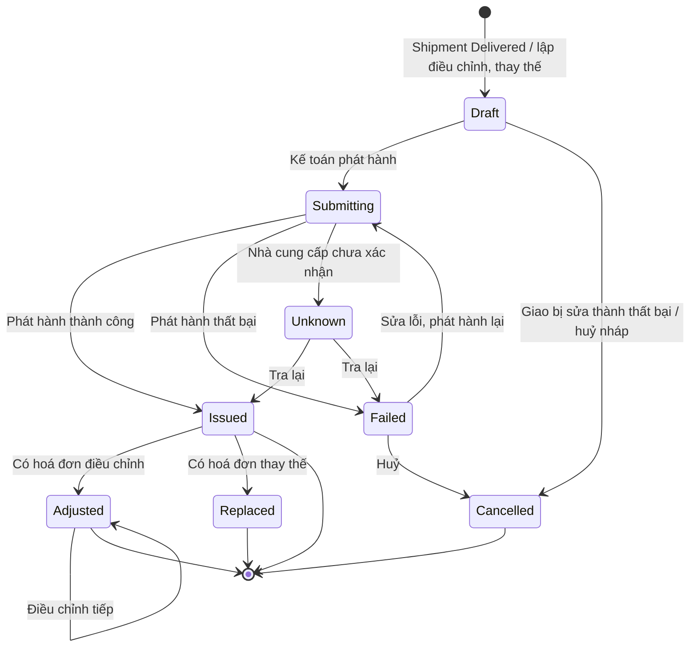

# 21 — Hoá đơn điện tử (E-invoice)

> ✅ Đã chốt 2026-11-06: hệ thống **tự phát hành hoá đơn VAT điện tử** cho khách bằng cách **tích hợp API của nhà cung cấp hoá đơn điện tử** — thay quyết định ngày 2026-11-05 "hoá đơn điện tử xuất ở phần mềm hoá đơn ngoài hệ thống, hệ thống chỉ cung cấp số liệu" ([open-questions G6](../../open-questions/README.md)). Hoá đơn gom **theo lần giao thành công** (mỗi shipment `Delivered` một hoá đơn), không theo đợt thanh toán. **Kế toán bấm phát hành**; hệ thống không tự phát hành khi giao xong.
>
> **Nhà cung cấp dịch vụ hoá đơn điện tử** nằm **ngoài hệ thống**: ký số hoá đơn, nộp cơ quan thuế, cấp số hoá đơn. Hệ thống gọi API của nhà cung cấp và lưu kết quả.

## 1. Mục đích (Purpose)

Phát hành **hoá đơn giá trị gia tăng điện tử (VAT e-invoice)** cho khách sỉ khi hàng đã giao, qua API của nhà cung cấp hoá đơn điện tử, và giao hoá đơn cho khách. Cụ thể:

- **tạo hoá đơn nháp** cho mỗi lần giao thành công (shipment `Delivered` — [09](../../warehouse/09-shipping/README.md)), gồm các thùng của lần giao đó theo dòng đơn, kèm thuế suất và tiền thuế;
- để **Kế toán** kiểm tra và **phát hành** qua nhà cung cấp hoá đơn điện tử; theo dõi kết quả phát hành (nhà cung cấp xử lý bất đồng bộ);
- lập **hoá đơn điều chỉnh** hoặc **hoá đơn thay thế** khi trả hàng hoặc có sai sót — hoá đơn đã phát hành **không sửa, không xoá**;
- lưu **file XML** (bản có giá trị pháp lý) và **file PDF** (bản để xem, in), cho khách xem / tải trên cổng.

Hoá đơn **không quyết định thanh toán**: các đợt thanh toán, công nợ và các cổng chặn theo tiền vẫn ở [15](../15-payment/README.md). Thời điểm lập hoá đơn bán hàng hoá là lúc chuyển giao hàng, không phụ thuộc đã thu tiền hay chưa — nên số và ngày hoá đơn không trùng với các đợt tiền.

---

## 2. Actor liên quan

| Actor | Vai trò |
|-------|---------|
| **Kế toán (Accountant)** | Xem hoá đơn nháp, **phát hành** (hoặc phát hành lại khi lỗi), **tra lại** kết quả khi nhà cung cấp chưa xác nhận được; lập **hoá đơn điều chỉnh / thay thế**; xem lịch sử gửi email của nhà cung cấp và lượt phát hành còn lại |
| **Quản trị hệ thống (System Admin)** | Cấu hình **kết nối nhà cung cấp hoá đơn điện tử**: môi trường (thử nghiệm / production), thông tin xác thực (client id, client secret — không hiển thị lại sau khi lưu), tài khoản nhà cung cấp, **mẫu số** và **ký hiệu hoá đơn**, ngưỡng cảnh báo lượt phát hành |
| **Nhân viên Sale (Sales Staff)** | Xem hoá đơn của đơn mình phụ trách; gửi **thẻ hoá đơn** cho khách qua [chat](../16-sales-chat/README.md); bổ sung mã số thuế / email nhận hoá đơn của khách khi hoá đơn bị chặn vì thiếu ([18](../18-customer-information/README.md)) |
| **Khách hàng sỉ** | Xem và tải **XML / PDF** các hoá đơn đã phát hành trên trang đơn ở cổng ([17](../17-order-management/README.md) §5.2); nhận thông báo hoá đơn đã phát hành; nhận thẻ hoá đơn trong chat |
| **Hệ thống** | Tạo hoá đơn nháp khi shipment `Delivered`; huỷ nháp khi kết quả giao bị sửa trước khi phát hành; gọi nhà cung cấp khi Kế toán phát hành; **hỏi lại kết quả** theo mã theo dõi; lưu số hoá đơn, ký hiệu, file XML / PDF; kiểm lượt phát hành còn lại; nhắc Kế toán nháp tồn đọng |
| **Nhà cung cấp hoá đơn điện tử (ngoài hệ thống)** | Nhận dữ liệu hoá đơn, **ký số**, nộp cơ quan thuế, cấp số hoá đơn, trả kết quả và file; tự thử lại khi lỗi hạ tầng. Không gửi kết quả về qua webhook — hệ thống phải tự hỏi lại |

---

## 3. Input / Output

### Input

| Trường | Mô tả | Bắt buộc |
|--------|-------|----------|
| **Shipment `Delivered`** | Từ [09](../../warehouse/09-shipping/README.md): mã shipment (thuộc đúng một đơn — [08](../../warehouse/08-packing/README.md) BR-03), các thùng LPN đã giao theo dòng đơn, **ngày giao thành công** (thời điểm hãng báo giao thành công — từ webhook, hoặc Quản lý kho ghi theo hãng báo lại) | Có |
| **Dòng đơn & dòng phí** | Từ [14](../14-cart-and-order/README.md): SKU, tên hàng, số cái / thùng, **đơn giá / cái**, **thuế suất VAT** đã chốt của dòng; dòng phí khuôn / bản in, dòng phí vận chuyển (nếu có) kèm thuế suất | Có |
| **Thông tin bên mua** | Từ hồ sơ khách ([18](../18-customer-information/README.md)), chụp lại lúc tạo nháp: tên công ty, **mã số thuế**, địa chỉ trên hoá đơn, **email nhận hoá đơn** | Có (mã số thuế, email: bắt buộc trước khi phát hành — BR-06) |
| **Cấu hình kết nối nhà cung cấp hoá đơn điện tử** | Môi trường, thông tin xác thực, tài khoản nhà cung cấp, mẫu số, ký hiệu hoá đơn | Có (cấu hình) |
| Yêu cầu điều chỉnh / thay thế | Hoá đơn gốc, loại (điều chỉnh tăng / giảm / thông tin, thay thế), các dòng và số tiền chênh lệch (điều chỉnh) hoặc toàn bộ nội dung mới (thay thế), lý do | Khi điều chỉnh / thay thế |
| **Kết quả từ nhà cung cấp** | **Mã theo dõi**; kết quả đang xử lý / thành công / thất bại kèm thông điệp; khi thành công: số hoá đơn, ký hiệu, ngày lập, file XML / PDF | Có (khi phát hành) |

### Output

| Kết quả | Dùng bởi |
|---------|----------|
| **Hoá đơn** (mã hoá đơn nội bộ, loại, trạng thái, shipment & đơn tham chiếu, bên mua, các dòng, thuế suất, tiền thuế, tổng chưa thuế, tổng tiền thuế, tổng có thuế, ngày lập; khi đã phát hành: số hoá đơn, ký hiệu, mẫu số, file XML / PDF) | Kế toán, Sale, khách |
| **Danh sách hoá đơn của đơn** (gốc, điều chỉnh, thay thế) | Trang đơn ở cổng khách ([17](../17-order-management/README.md)), [15](../15-payment/README.md) (tham chiếu khi xem công nợ) |
| **Thẻ hoá đơn** (số, ký hiệu, ngày, tổng có thuế, link tải XML / PDF) | [16 Sales Chat](../16-sales-chat/README.md) |
| **Thông báo**: hoá đơn nháp chờ phát hành, phát hành lỗi / chưa xác nhận, sắp hết lượt (cho Kế toán); hoá đơn đã phát hành (cho khách) | Hộp thông báo ([00 §6](../../00-system-overview/README.md)) |
| **Nhật ký gọi nhà cung cấp** (yêu cầu, mã theo dõi, kết quả, thời điểm) và **lịch sử gửi email** do nhà cung cấp trả về | Kế toán |

### Dữ liệu tối thiểu cần lưu

| Thực thể | Trường chính |
|----------|--------------|
| `EInvoice` | `id`, `code` (mã hoá đơn nội bộ — gửi nhà cung cấp làm mã tham chiếu), `type` (`ORIGINAL` / `ADJUST_INCREASE` / `ADJUST_DECREASE` / `ADJUST_INFO` / `REPLACEMENT`), `original_invoice_id?`, `order_id`, `shipment_id?`, `status`, `buyer_snapshot`, `issue_date`, `subtotal`, `tax_total`, `grand_total`, `reason?`, `tracking_code?`, `invoice_series?`, `template_code?`, `invoice_number?`, `xml_file?`, `pdf_file?`, `issued_by?`, `issued_at?` |
| `EInvoiceLine` | `einvoice_id`, `line_no`, `order_line_id?` / `fee_type?`, `item_name`, `unit`, `quantity` (số cái), `cartons?` (số thùng — ghi chú), `unit_price`, `amount`, `tax_rate`, `tax_amount` |
| `EInvoiceProviderCall` (nhật ký) | `einvoice_id`, `action` (`CREATE` / `CHECK` / `ADJUST` / `REPLACE` / `GET`), `requested_at`, `tracking_code?`, `result` (`PENDING` / `SUCCESS` / `FAILED` / `UNKNOWN`), `message?` |
| `EInvoiceConfig` | `environment`, `client_id`, `client_secret` (mã hoá), `provider_account_id`, `template_code`, `invoice_series`, `quota_warning_threshold` |

---

## 4. Luồng nghiệp vụ từng bước (Step-by-step)

### 4.1. Tạo hoá đơn nháp khi giao thành công

1. Shipment chuyển `Delivered` ([09](../../warehouse/09-shipping/README.md) §4.3 — từ webhook của hãng hoặc Quản lý kho ghi tay) → hệ thống tạo **một hoá đơn gốc `Draft`** cho shipment đó, nếu shipment chưa có hoá đơn gốc còn hiệu lực (BR-01).
2. Hệ thống điền sẵn:
   - **bên mua**: chụp từ hồ sơ khách ([18](../18-customer-information/README.md)) — tên công ty, mã số thuế, địa chỉ trên hoá đơn, email nhận hoá đơn;
   - **dòng hàng**: gom các thùng của shipment theo dòng đơn — tên hàng (tên SKU), đơn vị tính **cái**, số lượng = số thùng × số cái / thùng, đơn giá / cái và **thuế suất đã chốt** của dòng đơn ([14](../14-cart-and-order/README.md) BR-21); tiền thuế = thành tiền dòng × thuế suất, làm tròn tới đồng; ghi chú số thùng;
   - **dòng phí** khuôn / bản in và phí vận chuyển của đơn (nếu có): đưa vào **hoá đơn gốc đầu tiên** của đơn;
   - **ngày lập** = ngày giao thành công của shipment, theo **thời điểm hãng báo giao thành công** (không phải thời điểm hệ thống nhận sự kiện).

   > ✅ Đã chốt 2026-11-06: thời điểm chuyển giao hàng — và là **ngày lập hoá đơn** — là khi **hãng vận chuyển báo giao thành công cho khách**: lấy thời điểm hãng báo trong sự kiện webhook; hãng không có webhook thì lấy ngày giao do Quản lý kho ghi theo thông tin hãng báo lại ([09](../../warehouse/09-shipping/README.md) §4.3, §4.5). Webhook về trễ không làm đổi ngày lập. Xem [open-questions G8](../../open-questions/README.md).

   > ⚠️ Giả định: **dòng phí khuôn / bản in và dòng phí vận chuyển** nằm trên **hoá đơn gốc đầu tiên** của đơn, cùng thuế suất đã chốt của dòng phí; tổng các hoá đơn của đơn có thể lệch vài đồng so với tổng hợp đồng do làm tròn tiền thuế từng hoá đơn và không điều chỉnh phần lệch này. Xem [open-questions G9](../../open-questions/README.md).

   > ⚠️ Giả định: thuế suất trên hoá đơn lấy từ **thuế suất đã chốt vào dòng đơn**; nếu luật đổi thuế suất giữa ngày lập đơn và ngày giao thì xử lý theo câu hỏi đang mở. Xem [open-questions D34](../../open-questions/README.md).
3. Hệ thống gửi thông báo **"hoá đơn nháp chờ phát hành"** cho Kế toán. Nháp chưa phát hành **sau 1 ngày** kể từ ngày lập → nhắc lại. Hoá đơn phát hành muộn vẫn mang **ngày lập = ngày giao thành công**, nên Kế toán cần phát hành sớm, tốt nhất trong ngày giao.

   > ⚠️ Giả định: mốc nhắc nháp tồn đọng là **1 ngày**; có thể cần nhắc ngay **trong ngày giao** để tránh lập hoá đơn lùi ngày, và cần xác nhận nhà cung cấp chấp nhận ngày lập trước ngày phát hành. Xem [open-questions G8](../../open-questions/README.md).

### 4.2. Phát hành qua nhà cung cấp hoá đơn điện tử

4. Kế toán mở nháp, kiểm tra, bấm **Phát hành**. Hệ thống kiểm trước khi gọi nhà cung cấp:
   - bên mua có **mã số thuế** và **email nhận hoá đơn** (BR-06) — thiếu thì chặn, báo Sale bổ sung ở [18](../18-customer-information/README.md), Kế toán **làm mới thông tin bên mua** trên nháp rồi phát hành;
   - còn **lượt phát hành** ở nhà cung cấp (BR-09);
   - cấu hình kết nối nhà cung cấp hoá đơn điện tử đầy đủ.
5. Hệ thống gửi hoá đơn sang nhà cung cấp (tạo và phát hành, không qua bước nháp ở nhà cung cấp), dùng **mã hoá đơn nội bộ** làm mã tham chiếu (BR-04) → nhận **mã theo dõi** → hoá đơn `Submitting`.
6. **Hỏi lại kết quả** theo mã theo dõi — dày lúc đầu (vài giây một lần), thưa dần; nhà cung cấp tự thử lại lỗi hạ tầng tối đa khoảng 2 giờ. Kết quả:

   | Nhà cung cấp trả | Hệ thống |
   |-----------|----------|
   | `Pending` | Giữ `Submitting`, hỏi lại tiếp |
   | `Success` | → `Issued`: lưu số hoá đơn, ký hiệu, mẫu số, ngày lập; tải và lưu **XML / PDF** |
   | `Failed` (thông điệp nêu lý do, ví dụ sai thông tin bên mua, sai ký hiệu) | → `Failed`: báo Kế toán kèm thông điệp |
   | Thông điệp báo **chưa xác nhận được kết quả phát hành** | → `Unknown`: **chặn phát hành lại** (BR-05), báo Kế toán liên hệ nhà cung cấp |

7. **`Failed`** → sửa nguyên nhân (thông tin bên mua ở [18](../18-customer-information/README.md) rồi làm mới trên nháp; cấu hình ký hiệu…) → Kế toán **phát hành lại**. Trước khi gửi lại, hệ thống tra nhà cung cấp theo mã hoá đơn nội bộ: chưa có hoá đơn → gửi lại cùng mã; đã có → lấy kết quả đó, không gửi trùng (BR-04).
8. **`Unknown`** → sau khi nhà cung cấp xác nhận, Kế toán bấm **Tra lại**: hệ thống tra nhà cung cấp theo mã hoá đơn nội bộ → `Issued` hoặc `Failed`.

### 4.3. Giao hoá đơn cho khách

9. Hoá đơn `Issued` → hệ thống:
   - hiển thị trên **trang đơn** ở cổng khách: số, ký hiệu, ngày lập, tổng có thuế, tải **XML** và **PDF** ([17](../17-order-management/README.md) §5.2);
   - gửi **thông báo "hoá đơn đã phát hành"** vào hộp thông báo của tài khoản khách;
   - cho Sale gửi **thẻ hoá đơn** vào hội thoại của đơn ([16](../16-sales-chat/README.md)).
10. **Email hoá đơn** cho khách: email nhận hoá đơn được gửi kèm dữ liệu sang nhà cung cấp; Kế toán xem **lịch sử gửi email** (đã gửi / lỗi) do nhà cung cấp trả về.

    > ⚠️ Giả định: **Nhà cung cấp hoá đơn điện tử gửi email hoá đơn** tới email nhận hoá đơn của bên mua sau khi phát hành; hệ thống không tự gửi email. Tài liệu API của nhà cung cấp chưa nói rõ khi nào email được gửi. Xem [open-questions G11](../../open-questions/README.md).

### 4.4. Điều chỉnh & thay thế

11. Hoá đơn `Issued` **không sửa, không xoá** (BR-03). Khi có thay đổi, Kế toán lập chứng từ mới tham chiếu hoá đơn gốc, mỗi chứng từ đi cùng vòng đời §5 (nháp → phát hành → kết quả):

    | Tình huống | Chứng từ |
    |------------|----------|
    | **Trả hàng được duyệt hoàn tiền** ([17](../17-order-management/README.md) §4.10) | **Điều chỉnh giảm** trên hoá đơn của shipment chứa các thùng bị trả: dòng hàng, số lượng, tiền hàng, tiền thuế giảm. Hệ thống tạo sẵn nháp khi trả hàng được duyệt hoàn tiền |
    | Kết quả giao bị **sửa tay `Delivered` → `Delivery Failed`** sau khi hoá đơn đã phát hành ([09](../../warehouse/09-shipping/README.md) §4.3 bước 5) | **Điều chỉnh giảm toàn bộ** hoá đơn của shipment; hệ thống tạo sẵn nháp và báo Kế toán |
    | Sai **thông tin bên mua** không đổi tiền (tên, địa chỉ) | **Điều chỉnh thông tin** |
    | Sai **số tiền / thuế suất / số lượng** | **Điều chỉnh tăng / giảm**, hoặc **thay thế** — Kế toán chọn |
    | Sai nghiêm trọng cần lập lại toàn bộ (ví dụ sai mã số thuế) | **Thay thế** — hoá đơn mới ghi lại toàn bộ nội dung |

    > ⚠️ Giả định: trả hàng xử lý bằng **hoá đơn điều chỉnh giảm do bên bán lập**; kết quả giao sửa từ thành công sang thất bại sau khi đã phát hành xử lý bằng **điều chỉnh giảm toàn bộ**. Cách xử lý theo quy định hiện hành cần Kế toán xác nhận. Xem [open-questions G12, G13](../../open-questions/README.md).
12. **Quy tắc của nhà cung cấp** (BR-08): điều chỉnh làm được **nhiều lần**; thay thế chỉ **một lần** cho mỗi hoá đơn gốc; hoá đơn đã điều chỉnh **không thay thế** được; hoá đơn đã bị thay thế **không điều chỉnh** được.
13. Khi điều chỉnh / thay thế `Issued`: hoá đơn gốc → `Adjusted` (vẫn hiệu lực, có thể điều chỉnh tiếp) hoặc `Replaced` (hết hiệu lực, hoá đơn thay thế là hoá đơn hiệu lực của shipment). Khách thấy cả hoá đơn gốc và các hoá đơn điều chỉnh / thay thế trên trang đơn.

### 4.5. Huỷ nháp

14. Hoá đơn **chưa gửi nhà cung cấp** (`Draft`, `Failed` chưa từng tạo được ở nhà cung cấp) bị **huỷ** (`Cancelled`) khi:
    - kết quả giao của shipment bị sửa từ `Delivered` sang `Delivery Failed` ([09](../../warehouse/09-shipping/README.md)) — hệ thống tự huỷ, ghi lý do;
    - Kế toán huỷ nháp lập sai (nháp điều chỉnh / thay thế), bắt buộc lý do.

    Shipment sau đó giao lại thành công (`Delivered`) → hệ thống tạo nháp hoá đơn gốc mới (BR-01).

---

## 5. Trạng thái / Vòng đời (Lifecycle)

### 5.1. Hoá đơn (E-invoice)

Áp dụng cho mọi loại: hoá đơn gốc, hoá đơn điều chỉnh, hoá đơn thay thế. `Adjusted` / `Replaced` chỉ có ở hoá đơn đã `Issued` bị điều chỉnh / thay thế.

| Trạng thái | Ý nghĩa | Chuyển tiếp cho phép | Ai thực hiện |
|------------|---------|----------------------|--------------|
| `Draft` | Nháp trong hệ thống, chưa gửi nhà cung cấp | → `Submitting`, → `Cancelled` | Hệ thống tạo; Kế toán phát hành / huỷ |
| `Submitting` | Đã gửi nhà cung cấp, có mã theo dõi; đang chờ kết quả | → `Issued`, → `Failed`, → `Unknown` | Hệ thống (hỏi lại kết quả) |
| `Failed` | Nhà cung cấp từ chối, kèm lý do | → `Submitting` (phát hành lại), → `Cancelled` | Kế toán |
| `Unknown` | Nhà cung cấp chưa xác nhận được kết quả phát hành; **không được gửi lại** | → `Issued`, → `Failed` (tra lại sau khi nhà cung cấp xác nhận) | Kế toán |
| `Issued` | Đã phát hành: có số hoá đơn, ký hiệu, XML / PDF; **bất biến** | → `Adjusted`, → `Replaced` | Hệ thống |
| `Adjusted` | Đã có ít nhất một hoá đơn điều chỉnh `Issued`; vẫn hiệu lực | → `Adjusted` (điều chỉnh tiếp) | Hệ thống |
| `Replaced` | Đã bị thay thế bởi hoá đơn thay thế `Issued`; hết hiệu lực | *(cuối)* | Hệ thống |
| `Cancelled` | Nháp bị huỷ, chưa từng phát hành | *(cuối)* | Hệ thống / Kế toán |

### 5.2. Trạng thái hoá đơn khách thấy

| Trạng thái nội bộ | Khách thấy |
|-------------------|-----------|
| `Draft`, `Submitting`, `Failed`, `Unknown`, `Cancelled` | Không hiển thị |
| `Issued` | "Đã phát hành" — tải XML / PDF |
| `Adjusted` | "Đã phát hành — có điều chỉnh" — kèm các hoá đơn điều chỉnh |
| `Replaced` | "Đã bị thay thế" — kèm hoá đơn thay thế |

---

## 6. Ràng buộc nghiệp vụ (Business Rules) & Edge case

### Business rules

- **BR-01:** **Mỗi shipment `Delivered` có đúng một hoá đơn gốc còn hiệu lực** (không `Cancelled`, không `Replaced` mà chưa có hoá đơn thay thế). Hoá đơn gom theo **lần giao**, không theo đợt thanh toán; một đơn giao nhiều lần có nhiều hoá đơn. Shipment chưa từng `Delivered` (thất bại, hoàn hàng) không có hoá đơn.
- **BR-02:** **Kế toán phát hành**; hệ thống chỉ tạo nháp, không tự phát hành *(✅ Đã chốt 2026-11-06)*. Quyền phát hành, tra lại, lập điều chỉnh / thay thế gán mặc định cho Kế toán ([00 §2.3](../../00-system-overview/README.md)).
- **BR-03:** Hoá đơn `Issued` **bất biến** — không sửa, không xoá. Mọi thay đổi bằng **hoá đơn điều chỉnh** hoặc **hoá đơn thay thế** tham chiếu hoá đơn gốc (§4.4).
- **BR-04:** **Chống phát hành trùng:** mỗi hoá đơn có **mã hoá đơn nội bộ** duy nhất, gửi nhà cung cấp làm **mã tham chiếu**; nhà cung cấp từ chối mã đã tồn tại. Trước khi phát hành lại, hệ thống **tra nhà cung cấp theo mã** — đã có hoá đơn thì lấy kết quả, không gửi lại.
- **BR-05:** Hoá đơn `Unknown` **không được gửi lại** cho tới khi tra lại có kết quả `Issued` / `Failed` (theo hướng dẫn của nhà cung cấp).
- **BR-06:** **Thông tin bên mua bắt buộc trước khi phát hành:** tên công ty, **mã số thuế** (10 số, 10-3, hoặc 12 số với hộ kinh doanh — [18](../18-customer-information/README.md) BR-01), địa chỉ trên hoá đơn, **email nhận hoá đơn**. Thiếu thì chặn phát hành. Thông tin bên mua **chụp lại** vào hoá đơn; đổi hồ sơ khách sau đó không đổi hoá đơn đã phát hành.

  > ⚠️ Giả định: mọi khách đều nhận hoá đơn có mã số thuế (khách là doanh nghiệp / hộ kinh doanh có mã số thuế hoặc CCCD 12 số); **địa chỉ trên hoá đơn** lấy **địa chỉ xuất hoá đơn mặc định**, không có thì lấy **địa chỉ đăng ký kinh doanh**. Xem [open-questions G14](../../open-questions/README.md).
- **BR-07:** **Thuế suất** trên hoá đơn gửi nhà cung cấp theo mã của nhà cung cấp cho các mức: 10%, 8%, 5%, 0%, **không chịu thuế (KCT)**, **không kê khai, tính nộp thuế (KKKNT)**; ánh xạ từ thuế suất đã chốt của dòng ([14](../14-cart-and-order/README.md) BR-21). Hoá đơn dùng **mẫu hoá đơn GTGT** và ký hiệu theo cấu hình.

  > ⚠️ Giả định: ánh xạ nhóm thuế của sản phẩm sang mã thuế suất của nhà cung cấp phụ thuộc việc làm rõ `EXEMPT` (KCT hay 0%) và mức 0% cho khách khu chế xuất. Xem [open-questions D35](../../open-questions/README.md).
- **BR-08:** **Điều chỉnh / thay thế theo quy tắc nhà cung cấp:** điều chỉnh được nhiều lần; thay thế một lần cho mỗi hoá đơn gốc; hoá đơn đã điều chỉnh không thay thế được; hoá đơn đã bị thay thế không điều chỉnh được.
- **BR-09:** **Lượt phát hành:** hệ thống kiểm lượt còn lại ở nhà cung cấp trước khi phát hành; dưới ngưỡng cấu hình → cảnh báo Kế toán; hết lượt → chặn phát hành. Nháp chưa gửi nhà cung cấp không tốn lượt.
- **BR-10:** **Bảo mật kết nối:** thông tin xác thực nhà cung cấp chỉ lưu và dùng **phía server**, không hiển thị lại sau khi lưu; mọi lần gọi nhà cung cấp ghi nhật ký (§3 Output). Thử nghiệm dùng **môi trường thử nghiệm (sandbox)** của nhà cung cấp (tách biệt hoàn toàn với production, không nộp cơ quan thuế thật).
- **BR-11:** **Hoá đơn không ảnh hưởng thanh toán:** phát hành, điều chỉnh, thay thế hoá đơn không đổi đợt thanh toán, công nợ hay trạng thái đơn ([15](../15-payment/README.md)). Hoàn tiền khi trả hàng vẫn đi theo [15](../15-payment/README.md) §4.5.
- **BR-12:** **Phí huỷ** ([15](../15-payment/README.md) §4.6) **không xuất hoá đơn GTGT** trong module này.

  > ⚠️ Giả định: phí huỷ là tiền bồi thường / phạt vi phạm hợp đồng, thuộc diện **không phải kê khai, tính nộp thuế (KKKNT)**, nên không lập hoá đơn GTGT. Xem [open-questions G10](../../open-questions/README.md).

### Edge case

| Tình huống | Hướng xử lý |
|------------|-------------|
| Khách thiếu mã số thuế hoặc email nhận hoá đơn khi phát hành | Chặn phát hành (BR-06); Sale bổ sung ở [18](../18-customer-information/README.md); Kế toán làm mới thông tin bên mua trên nháp rồi phát hành |
| Nhà cung cấp trả `Failed` vì sai thông tin bên mua / ký hiệu | `Failed` kèm thông điệp; sửa nguồn (hồ sơ khách / cấu hình), làm mới nháp, phát hành lại cùng mã (BR-04) |
| Nhà cung cấp không phản hồi / lỗi mạng khi gửi | Giữ `Draft`; Kế toán phát hành lại — hệ thống tra theo mã trước, không gửi trùng (BR-04) |
| Nhà cung cấp báo "chưa xác nhận được kết quả phát hành" | `Unknown`, chặn gửi lại (BR-05); Kế toán liên hệ nhà cung cấp rồi bấm Tra lại |
| Hết lượt phát hành | Chặn phát hành, báo Kế toán (BR-09); nháp giữ nguyên, phát hành sau khi mua thêm lượt |
| Một xe chở nhiều đơn | Mỗi shipment thuộc một đơn ([08](../../warehouse/08-packing/README.md) BR-03), mỗi shipment `Delivered` một hoá đơn |
| Đơn giao nhiều lần (theo **lịch giao nhiều đợt** — [14](../14-cart-and-order/README.md) BR-23 — hoặc giao một phần) | Mỗi lần giao thành công (mỗi shipment) một hoá đơn; một đợt giao đi nhiều xe thì có nhiều hoá đơn; dòng phí nằm ở hoá đơn đầu tiên (⚠️ §4.1) |
| Đóng phần còn lại ([17](../17-order-management/README.md) §4.8) | Phần không giao chưa có hoá đơn, không phải điều chỉnh |
| Kết quả giao sửa từ thành công sang thất bại, hoá đơn còn `Draft` | Hệ thống tự huỷ nháp (§4.5) |
| Kết quả giao sửa từ thành công sang thất bại, hoá đơn đã `Issued` | Hệ thống tạo nháp **điều chỉnh giảm toàn bộ**, báo Kế toán (⚠️ §4.4) |
| Shipment giao thất bại rồi giao lại thành công | Hoá đơn tạo khi lần đầu `Delivered`; trước đó không có hoá đơn |
| Sự kiện giao thành công của hãng về trễ (sang ngày hôm sau) | Ngày lập vẫn là **thời điểm hãng báo giao thành công**, không phải ngày hệ thống nhận (§4.1) |
| Hàng hoàn về kho (RTO) | Shipment chưa từng `Delivered` thì không có hoá đơn; không phải điều chỉnh |
| Khách trả một phần số thùng của một lần giao | Điều chỉnh giảm đúng số thùng trả trên hoá đơn của shipment đó (⚠️ §4.4) |
| Khách đổi tên công ty / địa chỉ sau khi hoá đơn đã phát hành | Hoá đơn cũ giữ nguyên (BR-06); hoá đơn sau dùng thông tin mới |
| Thuế suất luật định đổi giữa ngày lập đơn và ngày giao | Theo câu hỏi đang mở D34 |
| Kế toán muốn gộp nhiều lần giao vào một hoá đơn | Không hỗ trợ: mỗi shipment một hoá đơn (BR-01) |

---

## 7. Liên kết với các module khác

| Module | Quan hệ |
|--------|---------|
| [09 · Shipping](../../warehouse/09-shipping/README.md) | Shipment `Delivered` (kèm ngày giao thành công) sinh hoá đơn nháp; kết quả giao bị sửa tay → huỷ nháp hoặc điều chỉnh giảm |
| [14 · Quote, Order & Contract](../14-cart-and-order/README.md) | Dòng đơn (SKU, số cái / thùng, đơn giá / cái), dòng phí khuôn / bản in và phí vận chuyển, **thuế suất đã chốt** từng dòng (BR-21) |
| [15 · Payment](../15-payment/README.md) | Hoá đơn không ảnh hưởng đợt thanh toán, công nợ (BR-11); phí huỷ không xuất hoá đơn GTGT (BR-12); 15 xem danh sách hoá đơn của đơn để tham chiếu |
| [17 · Order Management](../17-order-management/README.md) | Trả hàng được duyệt hoàn tiền → nháp điều chỉnh giảm; trang đơn ở cổng khách hiển thị hoá đơn và cho tải XML / PDF |
| [18 · Customer Information](../18-customer-information/README.md) | Thông tin bên mua: tên công ty, mã số thuế, địa chỉ xuất hoá đơn / đăng ký kinh doanh, **email nhận hoá đơn** |
| [16 · Sales Chat](../16-sales-chat/README.md) | Thẻ hoá đơn Sale gửi khách |
| [08 · Kiểm thùng & Dán nhãn](../../warehouse/08-packing/README.md) | Mỗi shipment thuộc đúng một đơn (BR-03) — cơ sở để mỗi shipment một hoá đơn |
| [01 · Product Creation](../../warehouse/01-product-creation/README.md) | Nhóm thuế của sản phẩm — nguồn thuế suất của dòng đơn |
| [00 · System Overview](../../00-system-overview/README.md) | Quyền phát hành hoá đơn (§2.3), nhà cung cấp là đối tác ngoài (§2.4), thông báo trong ứng dụng (§6) |
| Nhà cung cấp hoá đơn điện tử (ngoài hệ thống) | Nhận dữ liệu hoá đơn, ký số, nộp cơ quan thuế, cấp số, trả XML / PDF; gửi email hoá đơn (⚠️ G11) |
