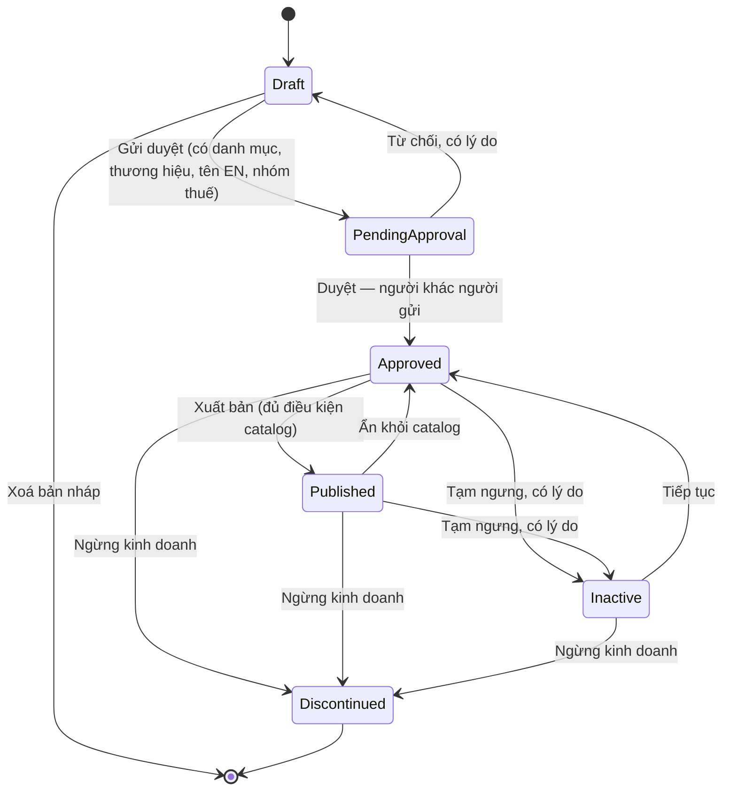
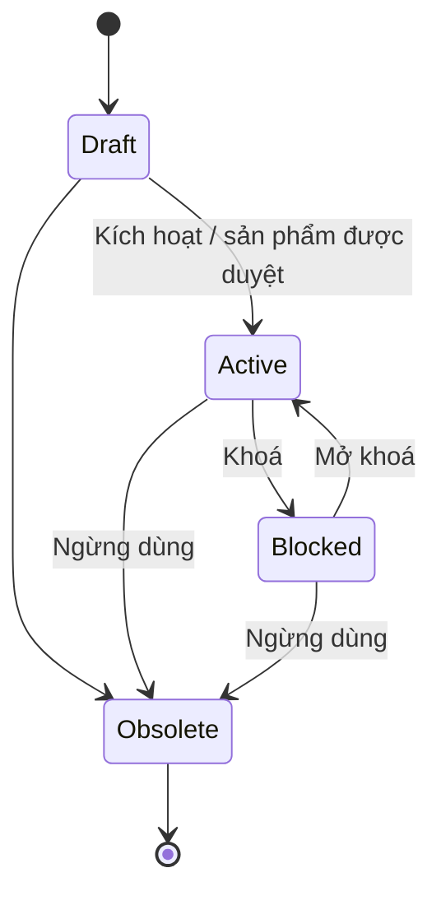

# 01 — Tạo sản phẩm (Product Creation)

## 1. Mục đích (Purpose)

Khai báo và duy trì **dữ liệu gốc về sản phẩm (product master data)** — nguồn dữ liệu dùng chung cho toàn hệ thống: mua hàng, quản lý tồn kho, vận hành kho, sản xuất in và catalog trên cổng khách hàng.

Đây là bước **khởi tạo vòng đời sản phẩm**. Không thể lập PO, nhận hàng, báo giá hay đăng bán một mặt hàng chưa được tạo và duyệt ở module này.

Module gồm:

- **Danh mục dùng chung (master lists)** — cây danh mục (category), thương hiệu (brand), từ điển thuộc tính (attribute dictionary) kèm mẫu thuộc tính gợi ý theo danh mục.
- **Sản phẩm & biến thể (Product / Variant)** — thông tin để bán: định danh, danh mục, thương hiệu, nhóm thuế, thuộc tính, SKU, hình ảnh, đơn vị bán.
- **Hàng tồn kho (Inventory Item)** — hồ sơ hàng vật lý của từng SKU: đơn vị tính, quy đổi, thông số logistics, chính sách tồn, thông tin mua hàng tham chiếu.
- **Duyệt và vòng đời** — gửi duyệt, duyệt bốn mắt, tạm ngưng, ngừng kinh doanh, lịch sử thay đổi.

Hai lớp dữ liệu liên kết **1:1** theo từng SKU:

| Lớp dữ liệu | Nội dung | Ai cập nhật | Phục vụ chủ yếu |
|-------------|----------|-------------|-----------------|
| **Sản phẩm & Biến thể (Product / Variant)** | Định danh, danh mục, thương hiệu, nhóm thuế, thuộc tính biến thể, SKU, hình ảnh, đơn vị bán & giá | Quản trị bán hàng, Sale, System Admin | 12 Product Design, 13 Catalog, 14 Cart & Order |
| **Hàng tồn kho (Inventory Item)** | Đơn vị cơ sở, đơn vị quy đổi, mã vạch, thông số logistics, lớp lưu trữ, cờ QC, chính sách tồn (lô / hạn dùng / serial, ngưỡng), thông tin mua hàng tham chiếu | Quản lý kho, Inventory Planner (logistics & chính sách tồn); người sửa sản phẩm (quy đổi, mua hàng) | 02 → 11, 19, 20 (mảng kho vận) |

> ⚠️ Giả định: Với sản phẩm tùy chỉnh (`CUSTOMIZABLE`), Inventory Item của SKU là **phôi** (hàng chưa in). Thiết kế của khách đi kèm dòng đơn dưới dạng design snapshot, không sinh SKU/Inventory Item mới; tồn và ATP tính theo phôi. Xem [open-questions B9](../../open-questions/README.md).

---

## 2. Actor liên quan

| Actor | Vai trò trong module |
|-------|----------------------|
| **Quản trị bán hàng (E-commerce Admin)** | Toàn quyền trên sản phẩm, biến thể và từ điển thuộc tính: tạo, sửa, gửi duyệt; **duyệt / từ chối** sản phẩm của người khác; kích hoạt / ngừng dùng biến thể; **đăng ảnh** do người khác tải lên; **xuất bản / ẩn** sản phẩm trên catalog; xoá sản phẩm nháp. Quản lý danh mục, thương hiệu, thuộc tính. |
| **Nhân viên Sale (Sales Staff)** | Tạo, sửa và **gửi duyệt** sản phẩm; thêm, sửa, khoá biến thể; tải ảnh; xem từ điển thuộc tính. Không duyệt, không xuất bản. |
| **Quản trị hệ thống (System Admin)** | Mọi quyền trên. Thêm: **tạm ngưng / tiếp tục / ngừng kinh doanh** sản phẩm (chỉ System Admin). |
| **Quản lý kho (Warehouse Manager) / Nhân viên kế hoạch tồn kho (Inventory Planner)** | Cập nhật **thông số logistics** và **chính sách tồn** trên Inventory Item ([20](../20-inventory-control/README.md)) |
| **Nhân viên mua hàng (Procurement Staff)** | Không thao tác trong module này. Chọn SKU **còn mua được** khi lập PO; giá, MOQ, lead time lấy từ **danh mục hàng của NCC** ([02](../02-purchase-order/README.md)). |
| **Hệ thống** | Tự tạo Inventory Item khi sinh SKU; sinh mã SKU theo tổ hợp thuộc tính; cảnh báo sản phẩm có thể trùng; quét virus ảnh tải lên; ghi lịch sử thay đổi; chặn PO / đơn mới cho sản phẩm tạm ngưng, ngừng kinh doanh. |

- **Bốn mắt (maker–checker)** là luật cứng: người duyệt sản phẩm phải khác người gửi duyệt; người đăng ảnh phải khác người tải ảnh lên.

---

## 3. Input / Output

### Input

| Nhóm | Lớp dữ liệu | Trường dữ liệu | Bắt buộc |
|------|-------------|----------------|----------|
| **Định danh** | Product | **Mã sản phẩm** (chữ in hoa, số, `_`, `-`; tối đa 50 ký tự; không đổi được), **tên tiếng Việt** (≤ 255), **tên tiếng Anh** (≤ 300), **loại** (`STANDARD` — hàng trơn / `CUSTOMIZABLE` — in theo yêu cầu) | Có |
| **Phân loại** | Product | **Danh mục chính** (một), **thương hiệu** — phải đang hoạt động khi chọn mới | Có trước khi gửi duyệt |
| **Nhóm thuế (tax class)** | Product | `STANDARD` / `REDUCED` / `EXEMPT` | Có |
| **Thuộc tính biến thể (variant axes)** | Product / Variant | Chọn từ từ điển thuộc tính loại `SELECT` hoặc `COLOR` (ví dụ Dung tích × Chất liệu) → tổ hợp sinh ra các **SKU** | Không (không có trục → một biến thể mặc định) |
| **Thuộc tính mô tả (descriptive)** | Product | Giá trị các thuộc tính khác (đường kính miệng, độ dày…) theo kiểu dữ liệu của thuộc tính | Không |
| **Hình ảnh** | Variant | Ảnh JPEG / PNG / WebP ≤ 10 MB, ≤ 25 megapixel; tối đa 20 ảnh mỗi biến thể; một **ảnh bìa** | Có ít nhất một ảnh đã đăng trước khi xuất bản |
| **Đơn vị cơ sở (base UoM)** | Inventory Item | Đơn vị ghi tồn, mặc định `EACH` (cái) | Có (mặc định) |
| **Đơn vị quy đổi (UoM conversion)** | Inventory Item | Đơn vị đóng gói kèm **hệ số nguyên ≥ 1** quy về đơn vị cơ sở (ví dụ *thùng* = 1.000 cái); một **đơn vị mua mặc định** và một **đơn vị giao mặc định** | Không (mặc định chỉ có đơn vị cơ sở) |
| **Đơn vị bán (sales unit)** | Variant | Đơn vị khách được đặt, chọn từ đơn vị quy đổi; đơn vị khác đơn vị cơ sở mang **giá riêng** (VND nguyên dương). ⚠️ Catalog và đơn chưa dùng đơn vị bán và giá này (phạm vi sau — [13](../../ecommerce/13-catalog/README.md)) | Không (mặc định: đơn vị cơ sở, giá gốc của SKU) |
| **Giá gốc (base price)** | Variant | Giá bán theo SKU, VND nguyên dương; giá theo khách / nhóm khách khai báo ở [13](../../ecommerce/13-catalog/README.md) | Có trước khi xuất bản |
| **Thông số logistics** | Inventory Item | **Mã vạch** (≤ 64, duy nhất), khối lượng, kích thước (D×R×C), khối lượng & kích thước kiện, **số kiện mỗi đơn vị** (bộ kiện — [08](../08-packing/README.md)), quy cách đóng gói | Không (nếu nhập: số dương) — xem ⚠️ BR-03 |
| **Lớp lưu trữ (storage class)** | Inventory Item | `NORMAL` / `COLD` / `HAZMAT` / `FRAGILE` / `OVERSIZE` — quyết định loại bin được phép cất ([06](../06-warehouse-map-slotting/README.md)) | Có (mặc định `NORMAL`) |
| **Yêu cầu QC khi nhận (QC required)** | Inventory Item | Bật → hàng nhận qua khu QC trước khi cất ([03](../03-receipt/README.md)) | Không (mặc định tắt) |
| **Cho phép xoay (rotatable)** | Inventory Item | Giá trị mặc định cho cờ xoay của kiện ([08](../08-packing/README.md)), dùng khi lập kế hoạch xếp xe ([09](../09-shipping/README.md)) | Không (mặc định cho phép) |
| **Chính sách tồn (inventory policy)** | Inventory Item | **Kiểu theo dõi** `NONE` / `LOT` / `SERIAL` / `LOT_SERIAL`; **theo dõi hạn dùng** (cần theo lô + FEFO); **hạn dùng tối đa** (1–36.500 ngày, chỉ khi theo dõi hạn dùng); **cách xuất** `FIFO` / `FEFO` (mặc định FEFO); **ngưỡng đặt lại** (reorder point), **tồn an toàn** (safety stock), **mức đặt lên tới** (max qty) | Không (mặc định: không lô, không serial, FEFO, ngưỡng 0) |
| **Thông tin mua hàng tham chiếu** | Inventory Item | NCC mặc định (đang hoạt động), giá mua tham chiếu + tiền tệ, lead time (≥ 0 ngày), MOQ (≥ 1) | Không |

### Output

| Kết quả | Mô tả | Được dùng bởi |
|---------|-------|---------------|
| **Product record** | Sản phẩm + danh sách biến thể, trạng thái, phiên bản, lịch sử thay đổi | Toàn hệ thống |
| **SKU (Variant)** | Biến thể bán được; mã hàng hoá nhỏ nhất dùng trên mọi chứng từ | 02, 03, 05, 07, 10/11, 12, 13, 14, 19, 20 |
| **Inventory Item** | Hồ sơ hàng vật lý của SKU (1:1), **tạo tự động** khi sinh SKU | 03, 05, 06, 07, 08, 09, 10, 11, 19, 20; 13 (ATP) |
| **Tình trạng mua / bán được** | Hệ thống trả lời một SKU có được đưa vào PO / báo giá / đơn không, kèm lý do (`PRODUCT_NOT_APPROVED`, `PRODUCT_INACTIVE`, `PRODUCT_DISCONTINUED`, `VARIANT_NOT_ACTIVE`) | 02, 14, 17 |
| **Danh sách sản phẩm có thể trùng** | Cảnh báo khi tạo / sửa (§4.3) | Người tạo, người duyệt |
| **Sự kiện** | Sản phẩm được duyệt; sản phẩm ngừng kinh doanh; nội dung catalog thay đổi (xuất bản, ẩn, tạm ngưng, đổi giá); chính sách tồn thay đổi | 13 Catalog, 20 Inventory Control |

---

## 4. Luồng nghiệp vụ từng bước (Step-by-step)

### 4.1. Danh mục dùng chung

1. **Cây danh mục** — mã danh mục (chữ in hoa, số, `_`, `-`; ≤ 50) **không đổi được**.
   - Cây sâu tối đa **11 cấp** (gốc + 10 cấp con).
   - **Di chuyển** một danh mục mang theo **cả nhánh con**. Không được chuyển vào chính nó hoặc nhánh con của nó.
   - Danh mục chỉ có **đang hoạt động / ngưng**. Danh mục ngưng không chọn được cho sản phẩm mới; sản phẩm đã gắn thì giữ.
2. **Thương hiệu** — mã không đổi được; chỉ có **đang hoạt động / ngưng**, như danh mục.
3. **Từ điển thuộc tính** — mỗi thuộc tính có mã (chữ in hoa, số, `_`; ≤ 50) và **kiểu dữ liệu**:

   | Kiểu | Có danh sách giá trị | Làm trục biến thể |
   |------|----------------------|-------------------|
   | `TEXT`, `NUMBER`, `BOOLEAN` | Không | Không |
   | `SELECT` | Có | **Có** |
   | `MULTISELECT` | Có | Không |
   | `COLOR` | Có (mã màu `#RRGGBB`) | **Có** |

   - Thuộc tính hoặc giá trị **thôi dùng** bằng cách **ngưng** (giá trị ngưng không dùng được cho biến thể mới).
   - Xoá hẳn chỉ khi **không sản phẩm / danh mục nào dùng**.
4. **Mẫu thuộc tính theo danh mục** — danh sách thuộc tính gợi ý (vai trò mặc định: trục biến thể / mô tả, bắt buộc, thứ tự). Chỉ để **điền sẵn form**, không ép trên sản phẩm. Thuộc tính không làm trục được thì không đặt làm trục trong mẫu.

### 4.2. Khởi tạo bản nháp

1. **Tạo sản phẩm** — Quản trị bán hàng / Sale nhập mã, tên tiếng Việt, tên tiếng Anh, loại, nhóm thuế, danh mục chính, thương hiệu → `Draft`.
2. **Khai báo trục biến thể** — chọn các thuộc tính `SELECT` / `COLOR` làm trục (chỉ khi `Draft` và chưa biến thể nào có giá trị trục).
3. **Sinh biến thể** — hệ thống sinh **ma trận tổ hợp** (tối đa **100 tổ hợp mới mỗi lần**).
   - Không có trục: một **biến thể mặc định**, SKU = mã sản phẩm.
   - Có trục: SKU = `MÃSP-GIÁTRỊ-GIÁTRỊ` (ví dụ `LYPP-500ML-TRONG`). SKU trùng hoặc dài quá 64 ký tự thì bị từ chối, không tự thêm hậu tố. Cũng được nhập SKU tay.
   - **SKU duy nhất toàn hệ thống**; mỗi tổ hợp chỉ có một biến thể trong sản phẩm.
   - Mỗi SKU **tự động có một Inventory Item**; người dùng không tạo thủ công.
4. **Nhập thuộc tính mô tả, ảnh, đơn vị quy đổi, đơn vị bán, thông tin mua hàng tham chiếu** (có thể làm cả sau khi duyệt — §4.6).
5. **Logistics & chính sách tồn** — Quản lý kho / Planner nhập trên Inventory Item (§4.7).

### 4.3. Cảnh báo sản phẩm trùng

1. Khi tạo, sửa, xem sản phẩm (và ngay lúc gõ tên), hệ thống tìm sản phẩm **cùng thương hiệu, cùng danh mục chính, chưa ngừng kinh doanh**, có **tên trùng sau khi chuẩn hoá** (chữ thường, bỏ dấu tiếng Việt, `đ` → `d`, bỏ ký tự không phải chữ / số).
2. Kết quả là **cảnh báo, không chặn**. Chưa có thương hiệu hoặc danh mục thì không kiểm. Lỗi khi tìm không làm hỏng thao tác lưu.

### 4.4. Gửi duyệt & duyệt (maker–checker)

1. **Gửi duyệt** — người tạo gửi → `Pending Approval`. Hệ thống kiểm theo thứ tự: có **danh mục**, có **thương hiệu**, có **tên tiếng Anh** và **nhóm thuế**.
2. **Duyệt** — Quản trị bán hàng / System Admin **khác người gửi** duyệt → `Approved`.
   - Hệ thống kiểm lại tên tiếng Anh và nhóm thuế.
   - Mọi biến thể `Draft` được **kích hoạt** (`Active`) cùng lúc.
   - `Approved` là trạng thái **dùng được cho nghiệp vụ nội bộ**: PO, nhận hàng, báo giá.
3. **Từ chối** — người duyệt ghi **lý do (bắt buộc)** → về `Draft`; thông tin gửi duyệt bị xoá, lý do được lưu.

### 4.5. Xuất bản lên catalog

1. **Xuất bản** — Quản trị bán hàng / System Admin xuất bản sản phẩm `Approved` → `Published`. Hệ thống kiểm:
   - đã có **nội dung catalog** (listing);
   - sản phẩm `Approved` hoặc `Published`;
   - có danh mục;
   - có **ít nhất một SKU `Active`**;
   - **mọi SKU `Active` có giá**;
   - có **ít nhất một ảnh đã đăng** (bốn mắt).
2. **Slug** (đường dẫn trên cổng khách hàng) mặc định là mã sản phẩm viết thường; **khoá sau lần xuất bản đầu tiên**. SEO và slug (trước lần đầu) sửa được ở mọi trạng thái trừ `Discontinued`.
3. **Ẩn khỏi catalog** — `Published` → `Approved`. Chi tiết hiển thị: [13 · Catalog](../../ecommerce/13-catalog/README.md).

### 4.6. Bảo trì sau khi duyệt

1. **Thông tin chính** (tên, loại, nhóm thuế, danh mục, thương hiệu) **chỉ sửa được khi `Draft`**. Mã sản phẩm không bao giờ sửa được.
2. **Biến thể, ảnh, thuộc tính mô tả, đơn vị quy đổi, đơn vị bán, thông tin mua hàng** sửa được ở mọi trạng thái **trừ `Pending Approval` và `Discontinued`**. Trục biến thể chỉ đổi khi `Draft`.
3. **Thêm biến thể** cho sản phẩm đã duyệt → biến thể mới ở `Draft`; người có quyền duyệt biến thể **kích hoạt** riêng (sản phẩm phải `Approved` / `Published`). Không cần duyệt lại sản phẩm.
4. **Ảnh** — tải lên (Sale / Quản trị bán hàng) → hệ thống **quét virus** (máy quét không chạy được thì coi như chưa sạch) → **người khác** đăng ảnh (sản phẩm `Approved` / `Published`). Ảnh đầu tiên là ảnh bìa; chọn ảnh bìa khác thì ảnh cũ thôi làm bìa.
5. **Khoá lạc quan** — mọi thao tác sửa / đổi trạng thái gửi kèm **phiên bản** đang đọc; lệch phiên bản (người khác vừa sửa) → từ chối, phải tải lại.
6. **Lịch sử thay đổi** — mọi thay đổi ghi một dòng **không sửa, không xoá**: loại thay đổi, đối tượng (sản phẩm / biến thể / ảnh / quy đổi…), trạng thái trước → sau, lý do, các trường đổi, người, thời điểm. Xem được theo từng sản phẩm.

### 4.7. Hàng tồn kho của SKU (Inventory Item)

1. **Logistics** — Quản lý kho / Planner nhập mã vạch, khối lượng, kích thước, kiện, lớp lưu trữ, cờ QC, cờ xoay. **Đơn vị cơ sở không đổi được khi SKU còn tồn.**
2. **Chính sách tồn** — kiểu theo dõi, hạn dùng, cách xuất, ngưỡng.
   - Tồn an toàn ≤ ngưỡng đặt lại ≤ mức đặt lên tới; tất cả ≥ 0.
   - Theo dõi hạn dùng đòi theo lô và FEFO.
   - Thay đổi mâu thuẫn với tồn đang có (ví dụ bỏ theo dõi lô khi tồn đang ghi lô, hoặc đang kiểm kê) → từ chối.
   - Ngưỡng dùng cho cảnh báo `REORDER` / `SAFETY` ([20](../20-inventory-control/README.md)).
3. **Đơn vị quy đổi** — hệ số nguyên ≥ 1. Thôi dùng bằng cách ngưng; đơn vị cơ sở không ngưng được. Khi đã có chứng từ dùng đơn vị đó, **hệ số và tên của đơn vị bị khoá**.

### 4.8. Tạm ngưng, tiếp tục, ngừng kinh doanh, xoá

1. **Tạm ngưng** — System Admin chuyển `Approved` / `Published` → `Inactive`, **lý do bắt buộc** (≤ 500 ký tự): ẩn khỏi catalog, chặn PO và đơn mới.
2. **Tiếp tục** — System Admin chuyển `Inactive` → `Approved` (không về thẳng `Published`; muốn bán lại phải **xuất bản lại**).
3. **Ngừng kinh doanh** — System Admin chuyển `Approved` / `Published` / `Inactive` → `Discontinued`, **lý do bắt buộc** (≤ 500 ký tự).
   - Hệ thống **cảnh báo, không chặn** nếu còn **dòng PO đang mở** hoặc **dòng đơn chưa giao**, kèm danh sách chứng từ.
   - **Mọi biến thể → `Obsolete`** (kể cả biến thể mặc định).
   - PO và đơn mới bị chặn; chứng từ đang mở vẫn xử lý tiếp.
4. **Xoá** — chỉ sản phẩm `Draft` mà **chưa SKU nào được chứng từ nào tham chiếu**. Sản phẩm khác: tạm ngưng hoặc ngừng kinh doanh.

### 4.9. Cấu hình tùy chỉnh (phạm vi sau)

> ⚠️ Giả định: **cấu hình in** của sản phẩm `CUSTOMIZABLE` thuộc **phạm vi giai đoạn sau**. Xem [open-questions B8, B18](../../open-questions/README.md).
> - vùng in (print area) và toạ độ, lề an toàn, tràn lề;
> - template 2D, model 3D;
> - ràng buộc file (DPI tối thiểu, hệ màu RGB / CMYK, định dạng, dung lượng, số màu, font);
> - **kỹ thuật in** (print method).
>
> Cơ sở dữ liệu đã có chỗ lưu nhưng chưa có chức năng. Hiện thông số in đi theo **bộ file thiết kế** do nhân viên tải lên ở [12](../../ecommerce/12-product-design/README.md), và xuất bản **không kiểm** vùng in / template.

---

## 5. Trạng thái / Vòng đời (Lifecycle)

### 5.1. Trạng thái sản phẩm (Product status)

| Trạng thái | Ý nghĩa | Chuyển tiếp cho phép | Ai thực hiện |
|------------|---------|----------------------|--------------|
| `Draft` | Đang soạn; sửa được mọi thông tin (trừ mã) | → `Pending Approval` (gửi duyệt); xoá (nếu chưa SKU nào được tham chiếu) | Quản trị bán hàng / Sale (xoá: Quản trị bán hàng / System Admin) |
| `Pending Approval` | Chờ duyệt; không sửa được | → `Approved` (duyệt); → `Draft` (từ chối, có lý do) | Quản trị bán hàng / System Admin (≠ người gửi) |
| `Approved` | Đã duyệt; **dùng được cho nghiệp vụ nội bộ** (PO, nhận hàng, báo giá, đơn); chưa hiện trên catalog | → `Published`, → `Inactive`, → `Discontinued` | Quản trị bán hàng (xuất bản); System Admin |
| `Published` | Đang hiển thị trên catalog | → `Approved` (ẩn), → `Inactive`, → `Discontinued` | Quản trị bán hàng (ẩn); System Admin |
| `Inactive` | Tạm ngưng: ẩn khỏi catalog, chặn PO & đơn mới | → `Approved` (tiếp tục), → `Discontinued` | System Admin |
| `Discontinued` | Ngừng kinh doanh vĩnh viễn; mọi biến thể `Obsolete` | *(cuối)* | System Admin |

### 5.2. Trạng thái biến thể (SKU)

| Trạng thái | Ý nghĩa | Chuyển tiếp cho phép | Ai thực hiện |
|------------|---------|----------------------|--------------|
| `Draft` | Mới tạo; SKU và giá trị trục còn sửa được | → `Active` (kích hoạt — sản phẩm `Approved` / `Published`; hoặc tự động khi sản phẩm được duyệt), → `Obsolete` | Quản trị bán hàng / System Admin; Hệ thống |
| `Active` | Mua / bán / nhập / xuất được | → `Blocked`, → `Obsolete` | Quản trị bán hàng / Sale (khoá); Quản trị bán hàng / System Admin (ngừng dùng) |
| `Blocked` | Tạm khoá (ví dụ nghi vấn chất lượng): không đưa vào PO, báo giá, đơn mới | → `Active`, → `Obsolete` | Quản trị bán hàng / System Admin |
| `Obsolete` | Ngừng dùng vĩnh viễn; không nhận ảnh mới | *(cuối)* | Quản trị bán hàng / System Admin; Hệ thống (khi sản phẩm ngừng kinh doanh) |

- **SKU và giá trị trục bị khoá khi biến thể rời `Draft`.**
- **Biến thể mặc định** không chuyển riêng sang `Obsolete` được (chỉ theo sản phẩm khi ngừng kinh doanh).

---

## 6. Ràng buộc nghiệp vụ (Business Rules) & Edge case

### Business rules

- **BR-01:** **Mã sản phẩm không bao giờ đổi.** **SKU và giá trị trục bị khoá khi biến thể rời `Draft`**; chỉ được đổi thuộc tính mô tả. SKU duy nhất toàn hệ thống, tối đa 64 ký tự (chữ in hoa, số, `.`, `_`, `-`).
- **BR-02:** Chỉ xoá được sản phẩm `Draft` mà chưa SKU nào được chứng từ tham chiếu. Sản phẩm khác chỉ được tạm ngưng / ngừng kinh doanh; thuộc tính đang dùng chỉ được ngưng.
- **BR-03:** Thông số logistics (khối lượng, kích thước) **không bắt buộc** trong hệ thống hiện tại; nếu nhập thì phải dương. ⚠️ Giả định: nên khai báo trước khi nhận hàng vì gợi ý vị trí ([06](../06-warehouse-map-slotting/README.md)), đóng gói ([08](../08-packing/README.md)) và ước tính tải ([09](../09-shipping/README.md)) dùng dữ liệu này. Xem [open-questions C21](../../open-questions/README.md).
- **BR-04:** Chỉ sản phẩm `Published` hiển thị trên catalog. Chỉ SKU `Active` của sản phẩm `Approved` / `Published` được đưa vào PO, báo giá, đơn mới.
- **BR-05:** Xuất bản đòi: nội dung catalog, danh mục, ít nhất một SKU `Active`, giá cho mọi SKU `Active`, ít nhất một ảnh đã đăng. Slug khoá sau lần xuất bản đầu.
- **BR-06:** Giá bán (thuộc Variant, VND) và giá mua tham chiếu (thuộc Inventory Item) là hai trường độc lập; module này chỉ lưu, không tính margin. Giá trên PO lấy từ danh mục hàng của NCC ([02](../02-purchase-order/README.md)).
- **BR-07:** Mỗi SKU có **đúng một** Inventory Item (1:1), tạo tự động khi sinh SKU. Không bán combo / bundle ([G7](../../open-questions/README.md)).
- **BR-08:** Inventory Item chỉ chứa dữ liệu hàng vật lý, kiểm soát tồn và mua hàng tham chiếu; **không** chứa nội dung bán hàng.
- **BR-09:** Tồn kho và mọi chứng từ kho lưu số lượng theo **đơn vị cơ sở**. Hệ số quy đổi là số nguyên ≥ 1. Không sinh SKU mới cho từng quy cách.
- **BR-10:** Đơn vị quy đổi đã có chứng từ dùng thì **không sửa được hệ số**. Đổi quy cách = khai báo đơn vị mới, ngưng đơn vị cũ.
- **BR-11:** Đơn vị bán của Variant chọn trong danh sách đơn vị quy đổi của Inventory Item. Giá của **đơn vị cơ sở** là **giá gốc trong catalog**, không nhập hai lần; chỉ đơn vị bán khác (ví dụ *thùng*) mới có giá riêng *(Quyết định 19/10/2026)*. ⚠️ Giả định: khách chỉ đặt số nguyên đơn vị bán. Xem [open-questions A9](../../open-questions/README.md).
- **BR-12:** **Bốn mắt:** người duyệt sản phẩm ≠ người gửi duyệt; người đăng ảnh ≠ người tải ảnh.
- **BR-13:** Gửi duyệt đòi danh mục, thương hiệu, tên tiếng Anh và nhóm thuế. Thông tin chính chỉ sửa khi `Draft`; sản phẩm `Pending Approval` không sửa được gì.
- **BR-14:** Tạm ngưng và ngừng kinh doanh chỉ do **System Admin**, lý do bắt buộc. Ngừng kinh doanh **cảnh báo** chứng từ đang mở nhưng **không chặn**.
- **BR-15:** Mọi sửa đổi gửi kèm phiên bản (khoá lạc quan); mọi thay đổi ghi lịch sử không sửa, không xoá.
- **BR-16:** Cảnh báo trùng sản phẩm chỉ **cảnh báo**, không chặn.
- **BR-17:** Đơn vị cơ sở không đổi khi SKU còn tồn. Chính sách tồn mâu thuẫn với tồn đang có thì bị từ chối.
- **BR-18:** Ảnh phải qua quét virus; máy quét không chạy được thì ảnh không được nhận là sạch.

### Edge case cần lưu ý

| Tình huống | Hướng xử lý |
|------------|-------------|
| Gõ tên trùng một sản phẩm cùng thương hiệu, danh mục | Hiện danh sách sản phẩm có thể trùng; người dùng tự quyết, không bị chặn |
| Hai người cùng sửa một sản phẩm | Người lưu sau bị từ chối vì lệch phiên bản; tải lại rồi sửa |
| Sai tên / danh mục sau khi đã duyệt | Không sửa được thông tin chính; tạo sản phẩm mới đúng, ngừng kinh doanh sản phẩm cũ (cảnh báo chứng từ mở) |
| Thêm biến thể mới vào sản phẩm đang `Published` | Biến thể mới ở `Draft`, kích hoạt riêng; SKU hiện có không ảnh hưởng |
| Sinh ma trận quá 100 tổ hợp | Từ chối; sinh theo từng phần |
| Mã SKU sinh tự động bị trùng hoặc quá 64 ký tự | Từ chối; nhập SKU tay |
| Gộp / tách SKU do sai khai báo | Không sửa trực tiếp; tạo SKU mới + điều chỉnh tồn có duyệt ([20](../20-inventory-control/README.md)), ngừng dùng SKU cũ |
| Sản phẩm `Discontinued` nhưng còn tồn kho / PO mở | PO và đơn đang mở tiếp tục; PO và đơn mới bị chặn; tồn còn lại xử lý bằng điều chỉnh / chuyển kho |
| Đổi đơn vị cơ sở khi đã có tồn | Không cho đổi; tạo SKU mới |
| NCC đổi quy cách thùng (1.000 → 500 cái/thùng) | Khai báo đơn vị quy đổi mới; ngưng đơn vị cũ (BR-10) |
| Ảnh nhiễm virus / máy quét không chạy | Ảnh bị từ chối, tải lại sau |
| Người tải ảnh tự đăng ảnh của mình | Từ chối; người khác đăng |
| Tạm ngưng rồi tiếp tục sản phẩm đang bán | Về `Approved`, phải xuất bản lại mới hiện trên catalog |

---

## 7. Liên kết với các module khác

| Module | Quan hệ |
|--------|---------|
| [02 · Purchase Order](../02-purchase-order/README.md) | PO chỉ chọn SKU **còn mua được** (biến thể `Active` của sản phẩm `Approved` / `Published`); giá, MOQ, quy cách, lead time lấy từ danh mục hàng của NCC; thông tin mua hàng trên Inventory Item chỉ là tham chiếu |
| [03 · Receipt](../03-receipt/README.md) | Nhận hàng theo SKU; chính sách lô / hạn dùng / serial quyết định thông tin phải ghi; cờ QC quyết định luồng nhận; đơn vị quy đổi để kiểm đếm theo thùng |
| [05 · Putaway](../05-putaway/README.md) & [06 · Slotting](../06-warehouse-map-slotting/README.md) | Lớp lưu trữ và kích thước / khối lượng SKU để chọn bin phù hợp |
| [07 · Picking](../07-picking/README.md) / [08 · Packing](../08-packing/README.md) | Đơn vị quy đổi, số kiện mỗi đơn vị (bộ kiện); cờ cho phép xoay làm giá trị mặc định cho kiện |
| [09 · Shipping](../09-shipping/README.md) | Ước tính tải dùng kích thước / khối lượng và cờ xoay |
| [12 · Product Design](../../ecommerce/12-product-design/README.md) | Thiết kế gắn với sản phẩm `CUSTOMIZABLE` và phôi (SKU); cấu hình in là phạm vi sau (§4.9) |
| [13 · Catalog](../../ecommerce/13-catalog/README.md) | Nội dung catalog, slug, giá gốc theo SKU, giá theo khách / nhóm khách, trạng thái `Published`; ATP tính trên Inventory Item |
| [14 · Cart & Order](../../ecommerce/14-cart-and-order/README.md) | Báo giá / đơn chỉ nhận SKU bán được; số lượng theo đơn vị bán, quy về đơn vị cơ sở |
| [10/11 · Transfer](../10-inter-warehouse-transfer/README.md) | Chứng từ chuyển kho tham chiếu SKU |
| [19 · Production](../19-production/README.md) | Inventory Item của SKU tùy chỉnh là phôi được cấp cho xưởng |
| [20 · Inventory Control](../20-inventory-control/README.md) | Ngưỡng đặt lại, tồn an toàn, mức đặt lên tới, FEFO / FIFO, lô / hạn dùng để sinh cảnh báo tồn và phân bổ; chỉ SKU còn mua được mới có cảnh báo đặt lại |
