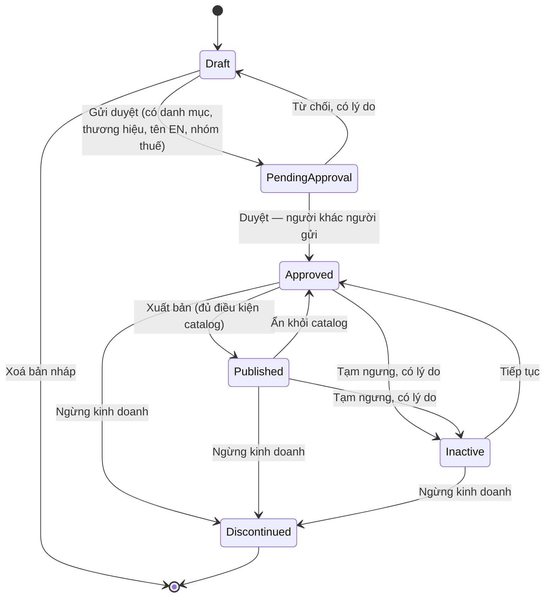
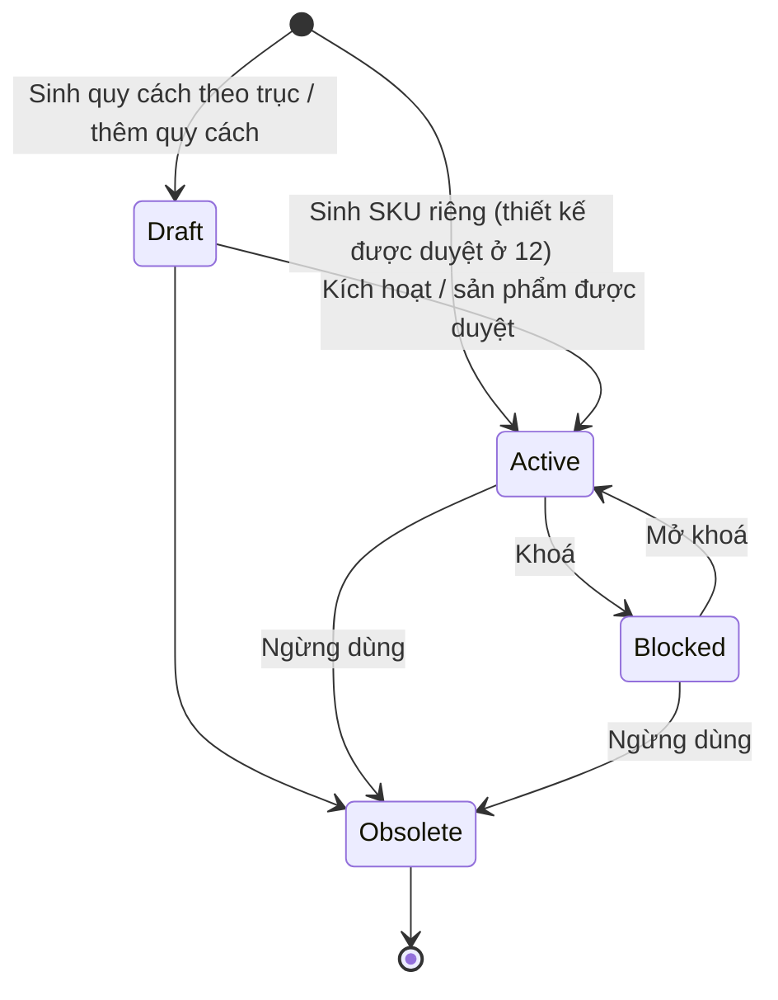

# 01 — Tạo sản phẩm (Product Creation)

## 1. Mục đích (Purpose)

Khai báo và duy trì **dữ liệu gốc về sản phẩm (product master data)** — nguồn dữ liệu dùng chung cho toàn hệ thống: quản lý tồn kho, vận hành kho, Đơn sản xuất (Production Order), báo giá, đơn hàng và catalog trên cổng khách hàng.

Đây là bước **khởi tạo vòng đời sản phẩm**. Không thể lập thiết kế, nhập kho, báo giá, đặt hàng hay đăng bán một mặt hàng chưa được tạo và duyệt ở module này.

> **Đã chốt 2026-11-04 (cập nhật lần 2):** kho chỉ chứa **thành phẩm đã sản xuất theo mẫu của khách**, do đơn vị sản xuất (xưởng của công ty hoặc đối tác ngoài, ngoài hệ thống) **đóng thùng sẵn** rồi nhập vào. Không có hàng bán chung cho mọi khách; mọi sản phẩm là loại `CUSTOMIZABLE`. Hàng có tồn duy nhất là **SKU thành phẩm theo mẫu của khách**, nhập và xuất **nguyên thùng**.

Module gồm:

- **Danh mục dùng chung (master lists)** — cây danh mục (category), thương hiệu (brand), từ điển thuộc tính (attribute dictionary) kèm mẫu thuộc tính gợi ý theo danh mục.
- **Sản phẩm & quy cách (Product / Variant)** — loại ly / bao bì nhận in: định danh, danh mục, thương hiệu, nhóm thuế, thuộc tính, các **quy cách** (biến thể theo trục), hình ảnh.
- **SKU thành phẩm theo mẫu của khách (customer-exclusive SKU)** — SKU riêng của một khách, do hệ thống sinh khi Quản lý kinh doanh duyệt bản thiết kế khách tự làm ở [12](../../ecommerce/12-product-design/README.md) (§4.8).
- **Cấu hình in của quy cách** — khuôn 2D, vùng in, lề an toàn, lề tràn, model 3D, ràng buộc file để khách tự thiết kế ở [12](../../ecommerce/12-product-design/README.md) (§4.10).
- **Hàng tồn kho (Inventory Item)** — hồ sơ hàng vật lý của từng SKU: đơn vị tính, quy đổi, **quy cách thùng**, thông số logistics, chính sách tồn.
- **Duyệt và vòng đời** — gửi duyệt, duyệt bốn mắt, tạm ngưng, ngừng kinh doanh, lịch sử thay đổi.

### Sản phẩm, quy cách và SKU riêng

| Đối tượng | Ý nghĩa | Có tồn, có giá, được báo giá / đặt | Ai thấy trên cổng khách hàng |
|-----------|---------|-------------------------------------|------------------------------|
| **Sản phẩm (`Product.type = CUSTOMIZABLE`)** | Loại ly / bao bì nhận in logo, nhận diện thương hiệu của khách | Không | Mọi khách (khi sản phẩm `Published`) |
| **Quy cách** — biến thể sinh theo trục (§4.2) | Ví dụ ly PP 500 ml trong. **Chỉ là khuôn để in**: mang **cấu hình in** (§4.10) để khách tự thiết kế ở [12](../../ecommerce/12-product-design/README.md) và làm khuôn dữ liệu (kể cả quy cách thùng) cho SKU riêng | **Không** — không tồn, không giá, không báo giá / đặt trực tiếp | Mọi khách (để xem và bấm **"Thiết kế"** khi quy cách đã có khuôn in — [13](../../ecommerce/13-catalog/README.md), [12](../../ecommerce/12-product-design/README.md)) |
| **SKU thành phẩm theo mẫu của khách** (SKU riêng) | SKU gắn **một khách** và **một design snapshot** (§4.8) | **Có** — thứ duy nhất có tồn, có giá (trên báo giá / đơn / hợp đồng), được báo giá / đặt / nhập / xuất | **Chỉ khách sở hữu** (không hiện giá) |

> ⚠️ Giả định: mỗi bản thiết kế gắn với **một sản phẩm `CUSTOMIZABLE` + một quy cách**. Xem [open-questions](../../open-questions/README.md).

Hai lớp dữ liệu liên kết **1:1** theo từng SKU (quy cách và SKU riêng đều là biến thể, đều có Inventory Item):

| Lớp dữ liệu | Nội dung | Ai cập nhật | Phục vụ chủ yếu |
|-------------|----------|-------------|-----------------|
| **Sản phẩm & Biến thể (Product / Variant)** | Định danh, danh mục, thương hiệu, nhóm thuế, thuộc tính, mã SKU, hình ảnh, đơn vị bán; với quy cách: **cấu hình in** (§4.10); với SKU riêng: khách sở hữu, design snapshot, quy cách gốc | Quản lý kinh doanh, Sale, System Admin; Hệ thống (sinh SKU riêng) | 12 Product Design, 13 Catalog, 14 Quote/Order, 17 Order Management |
| **Hàng tồn kho (Inventory Item)** | Đơn vị cơ sở, đơn vị quy đổi, **quy cách thùng**, mã vạch, thông số logistics, cờ cho phép xoay, chính sách tồn (luôn theo lô) | Quản lý kho (quy cách thùng, logistics); người sửa sản phẩm (quy đổi) | 03 → 11, 20 (mảng kho vận) |

---

## 2. Actor liên quan

| Actor | Vai trò trong module |
|-------|----------------------|
| **Quản lý kinh doanh (Sales Manager)** | Toàn quyền trên sản phẩm, quy cách và từ điển thuộc tính: tạo, sửa, gửi duyệt; **duyệt / từ chối** sản phẩm của người khác; kích hoạt / ngừng dùng biến thể; **đăng ảnh** do người khác tải lên; **xuất bản / ẩn** sản phẩm trên catalog; xoá sản phẩm nháp. Quản lý danh mục, thương hiệu, thuộc tính. **Khai báo cấu hình in** của quy cách (khuôn 2D, vùng in, lề, model 3D, ràng buộc file — §4.10). Khoá / ngừng dùng SKU riêng. |
| **Nhân viên Sale (Sales Staff)** | Tạo, sửa và **gửi duyệt** sản phẩm; thêm, sửa, khoá quy cách; tải ảnh; xem từ điển thuộc tính; xem SKU riêng của khách mình phụ trách. Không duyệt, không xuất bản. |
| **Quản trị hệ thống (System Admin)** | Mọi quyền trên. Thêm: **tạm ngưng / tiếp tục / ngừng kinh doanh** sản phẩm (chỉ System Admin). |
| **Quản lý kho (Warehouse Manager)** | Cập nhật **quy cách thùng** (kích thước → thể tích thùng), **thông số logistics** trên Inventory Item ([20](../20-inventory-control/README.md)). Chính sách tồn cố định — luôn theo lô (§4.7), không cấu hình |
| **Khách hàng sỉ (B2B Customer)** | Không thao tác trong module này. Trên cổng khách hàng thấy các quy cách của sản phẩm đang bán (quy cách có khuôn in thì tự thiết kế được — [12](../../ecommerce/12-product-design/README.md)) và **SKU riêng của chính mình** (số cái / thùng), **không hiện giá** — giá chỉ có trên báo giá / đơn / hợp đồng ([13](../../ecommerce/13-catalog/README.md), [14](../../ecommerce/14-cart-and-order/README.md)). |
| **Hệ thống** | Tự tạo Inventory Item khi sinh biến thể; sinh mã quy cách theo tổ hợp thuộc tính; **sinh SKU riêng** khi bản thiết kế được duyệt ở [12](../../ecommerce/12-product-design/README.md); cảnh báo sản phẩm có thể trùng; quét virus ảnh, file khuôn và model 3D tải lên; ghi lịch sử thay đổi; chặn báo giá / đơn / Đơn sản xuất mới cho sản phẩm tạm ngưng, ngừng kinh doanh. |

- **Bốn mắt (maker–checker)** là luật cứng: người duyệt sản phẩm phải khác người gửi duyệt; người đăng ảnh phải khác người tải ảnh lên.

---

## 3. Input / Output

### Input

| Nhóm | Lớp dữ liệu | Trường dữ liệu | Bắt buộc |
|------|-------------|----------------|----------|
| **Định danh** | Product | **Mã sản phẩm** (chữ in hoa, số, `_`, `-`; tối đa 50 ký tự; không đổi được), **tên tiếng Việt** (≤ 255), **tên tiếng Anh** (≤ 300). Loại luôn là `CUSTOMIZABLE` (hệ thống gán, không chọn) | Có |
| **Phân loại** | Product | **Danh mục chính** (một), **thương hiệu** — phải đang hoạt động khi chọn mới | Có trước khi gửi duyệt |
| **Nhóm thuế (tax class)** | Product | `STANDARD` / `REDUCED` / `EXEMPT` (mức thuế suất, không liên quan loại sản phẩm). ⚠️ Nghĩa của `EXEMPT` (không chịu thuế — KCT — hay thuế suất 0%) và cách áp 0% cho khách khu chế xuất chưa chốt — [open-questions D35](../../open-questions/README.md) | Có |
| **Thuộc tính biến thể (variant axes)** | Product / Variant | Chọn từ từ điển thuộc tính loại `SELECT` hoặc `COLOR` (ví dụ Dung tích × Chất liệu) → tổ hợp sinh ra các **quy cách** | Không (không có trục → một quy cách mặc định) |
| **Thuộc tính mô tả (descriptive)** | Product | Giá trị các thuộc tính khác (đường kính miệng, độ dày…) theo kiểu dữ liệu của thuộc tính | Không |
| **Hình ảnh** | Variant | Ảnh JPEG / PNG / WebP ≤ 10 MB, ≤ 25 megapixel; tối đa 20 ảnh mỗi biến thể; một **ảnh bìa** | Có ít nhất một ảnh đã đăng trước khi xuất bản |
| **Cấu hình in (print config)** | Variant (quy cách) | **Khuôn 2D** (bản trải phẳng theo kích thước thật), **vùng in**, **lề an toàn**, **lề tràn**, **model 3D**, **ràng buộc file** (độ phân giải tối thiểu, định dạng, dung lượng) — §4.10 | Khuôn 2D + vùng in: có thì khách mới thiết kế được; model 3D không bắt buộc |
| **Thiết kế đã duyệt** | Variant (SKU riêng) | Sự kiện bản thiết kế được Quản lý kinh doanh duyệt ở [12](../../ecommerce/12-product-design/README.md): khách sở hữu, quy cách, design snapshot | Có (để sinh SKU riêng) |
| **Đơn vị cơ sở (base UoM)** | Inventory Item | Đơn vị ghi tồn, mặc định `EACH` (cái) | Có (mặc định) |
| **Đơn vị quy đổi (UoM conversion)** | Inventory Item | Đơn vị đóng gói kèm **hệ số nguyên ≥ 1** quy về đơn vị cơ sở (ví dụ *thùng* = 1.000 cái); một **đơn vị giao mặc định** | Có đơn vị *thùng* (cho quy cách thùng) |
| **Quy cách thùng (carton spec)** | Inventory Item | **Đơn vị thùng** (một đơn vị quy đổi; hệ số = **số cái chuẩn / thùng**, cố định cho SKU), **kích thước thùng** (D×R×C — hệ thống tính **thể tích thùng** m³), **khối lượng thùng đầy** | **Có** với SKU riêng (kế thừa từ quy cách — §4.8, BR-03) |
| **Đơn vị bán (sales unit)** | Variant | Với SKU riêng, đơn vị bán **luôn là đơn vị thùng** của quy cách thùng: khách đặt theo **số thùng**, giá ghi **theo cái** (BR-11) | Có với SKU riêng (hệ thống gán theo quy cách thùng) |
| **Thông số logistics khác** | Inventory Item | **Mã vạch** (≤ 64, duy nhất), khối lượng và kích thước một đơn vị cơ sở | Không (nếu nhập: số dương) |
| **Cho phép xoay (rotatable)** | Inventory Item | Thùng được xoay hay không; dùng khi lập kế hoạch xếp xe ([09](../09-shipping/README.md)) và khi kiểm **thùng vừa bin** lúc cất hàng — thùng cho phép xoay được xoay ngang (đổi D và R) ([06](../06-warehouse-map-slotting/README.md) §4.4) | Không (mặc định cho phép) |
| **Chính sách tồn (inventory policy)** | Inventory Item | **Luôn theo dõi theo lô** (`LOT`) cho mọi SKU riêng — cố định, không cấu hình; không có chế độ không ghi lô, không theo dõi serial *(✅ Đã chốt 2026-11-05)*. **Lô** là **lô sản xuất** = **mã Đơn sản xuất**, hệ thống tự gán khi nhập kho ([03](../03-receipt/README.md)), dùng để truy vết. Không theo dõi hạn dùng; cách xuất **cố định FIFO** theo ngày nhập, không cấu hình (BR-17) | Không nhập (hệ thống gán) |

### Output

| Kết quả | Mô tả | Được dùng bởi |
|---------|-------|---------------|
| **Product record** | Sản phẩm + danh sách biến thể, trạng thái, phiên bản, lịch sử thay đổi | Toàn hệ thống |
| **Quy cách (Variant)** | Khuôn để khách thiết kế và sinh SKU riêng; hiển thị trên catalog (không giá) | 12, 13 |
| **Cấu hình in** | Khuôn 2D, vùng in, lề, model 3D, ràng buộc file của quy cách (§4.10): trình thiết kế, xem trước 3D, preflight và xuất file in PDF/X dùng | 12, 13 |
| **SKU riêng** | SKU thành phẩm của một khách, gắn design snapshot; mã hàng hoá nhỏ nhất dùng trên mọi chứng từ kho và bán hàng; tồn, nhập, xuất theo SKU này | 03, 05, 07, 08, 09, 11, 13, 14, 17, 20 |
| **Inventory Item** | Hồ sơ hàng vật lý của biến thể (1:1), **tạo tự động** khi sinh biến thể; với SKU riêng: quy cách thùng dùng cho nhập theo thùng, cất, nhãn giao và xếp xe; **thể tích thùng** dùng kiểm còn chỗ khi cất và tính bảng sức chứa kho ([06](../06-warehouse-map-slotting/README.md)) | 03, 05, 06, 07, 08, 09, 11, 20; 13 (ATP); 17 (thể tích Đơn sản xuất) |
| **Tình trạng bán được** | Hệ thống trả lời một SKU riêng có được đưa vào báo giá / đơn / Đơn sản xuất không (và có đúng khách sở hữu không), kèm lý do (`PRODUCT_NOT_APPROVED`, `PRODUCT_INACTIVE`, `PRODUCT_DISCONTINUED`, `VARIANT_NOT_ACTIVE`) | 13, 14, 17 |
| **Danh sách sản phẩm có thể trùng** | Cảnh báo khi tạo / sửa (§4.3) | Người tạo, người duyệt |
| **Sự kiện** | Sản phẩm được duyệt; SKU riêng được sinh; sản phẩm ngừng kinh doanh; nội dung catalog thay đổi (xuất bản, ẩn, tạm ngưng) | 13 Catalog, 20 Inventory Control |

---

## 4. Luồng nghiệp vụ từng bước (Step-by-step)

### 4.1. Danh mục dùng chung

1. **Cây danh mục** — mã danh mục (chữ in hoa, số, `_`, `-`; ≤ 50) **không đổi được**.
   - Cây sâu tối đa **11 cấp** (gốc + 10 cấp con).
   - **Di chuyển** một danh mục mang theo **cả nhánh con**. Không được chuyển vào chính nó hoặc nhánh con của nó.
   - Danh mục chỉ có **đang hoạt động / ngưng**. Danh mục ngưng không chọn được cho sản phẩm mới; sản phẩm đã gắn thì giữ.
2. **Thương hiệu** — mã không đổi được; chỉ có **đang hoạt động / ngưng**, như danh mục.
3. **Từ điển thuộc tính** — mỗi thuộc tính có mã (chữ in hoa, số, `_`; ≤ 50) và **kiểu dữ liệu**:

   | Kiểu | Có danh sách giá trị | Làm trục biến thể |
   |------|----------------------|-------------------|
   | `TEXT`, `NUMBER`, `BOOLEAN` | Không | Không |
   | `SELECT` | Có | **Có** |
   | `MULTISELECT` | Có | Không |
   | `COLOR` | Có (mã màu `#RRGGBB`) | **Có** |

   - Thuộc tính hoặc giá trị **thôi dùng** bằng cách **ngưng** (giá trị ngưng không dùng được cho biến thể mới).
   - Xoá hẳn chỉ khi **không sản phẩm / danh mục nào dùng**.
4. **Mẫu thuộc tính theo danh mục** — danh sách thuộc tính gợi ý (vai trò mặc định: trục biến thể / mô tả, bắt buộc, thứ tự). Chỉ để **điền sẵn form**, không ép trên sản phẩm. Thuộc tính không làm trục được thì không đặt làm trục trong mẫu.

### 4.2. Khởi tạo bản nháp

1. **Tạo sản phẩm** — Quản lý kinh doanh / Sale nhập mã, tên tiếng Việt, tên tiếng Anh, nhóm thuế, danh mục chính, thương hiệu → `Draft` (loại `CUSTOMIZABLE`).
2. **Khai báo trục biến thể** — chọn các thuộc tính `SELECT` / `COLOR` làm trục (chỉ khi `Draft` và chưa biến thể nào có giá trị trục).
3. **Sinh quy cách** — hệ thống sinh **ma trận tổ hợp** (tối đa **100 tổ hợp mới mỗi lần**).
   - Không có trục: một **quy cách mặc định**, mã = mã sản phẩm.
   - Có trục: mã = `MÃSP-GIÁTRỊ-GIÁTRỊ` (ví dụ `LYPP-500ML-TRONG`). Mã trùng hoặc dài quá 64 ký tự thì bị từ chối, không tự thêm hậu tố. Cũng được nhập mã tay.
   - **Mã biến thể (SKU) duy nhất toàn hệ thống**; mỗi tổ hợp chỉ có một quy cách trong sản phẩm.
   - Mỗi biến thể **tự động có một Inventory Item**; người dùng không tạo thủ công.
4. **Nhập thuộc tính mô tả, ảnh, đơn vị quy đổi** (có thể làm cả sau khi duyệt — §4.6).
5. **Quy cách thùng & logistics** — Quản lý kho nhập trên Inventory Item của quy cách (§4.7); SKU riêng sinh sau sẽ kế thừa (§4.8).

### 4.3. Cảnh báo sản phẩm trùng

1. Khi tạo, sửa, xem sản phẩm (và ngay lúc gõ tên), hệ thống tìm sản phẩm **cùng thương hiệu, cùng danh mục chính, chưa ngừng kinh doanh**, có **tên trùng sau khi chuẩn hoá** (chữ thường, bỏ dấu tiếng Việt, `đ` → `d`, bỏ ký tự không phải chữ / số).
2. Kết quả là **cảnh báo, không chặn**. Chưa có thương hiệu hoặc danh mục thì không kiểm. Lỗi khi tìm không làm hỏng thao tác lưu.

### 4.4. Gửi duyệt & duyệt (maker–checker)

1. **Gửi duyệt** — người tạo gửi → `Pending Approval`. Hệ thống kiểm theo thứ tự: có **danh mục**, có **thương hiệu**, có **tên tiếng Anh** và **nhóm thuế**.
2. **Duyệt** — Quản lý kinh doanh / System Admin **khác người gửi** duyệt → `Approved`.
   - Hệ thống kiểm lại tên tiếng Anh và nhóm thuế.
   - Mọi biến thể `Draft` được **kích hoạt** (`Active`) cùng lúc.
   - `Approved` là trạng thái **dùng được cho nghiệp vụ nội bộ**: lập thiết kế trên quy cách, và (qua SKU riêng) báo giá, đơn, Đơn sản xuất, nhập kho.
3. **Từ chối** — người duyệt ghi **lý do (bắt buộc)** → về `Draft`; thông tin gửi duyệt bị xoá, lý do được lưu.

### 4.5. Xuất bản lên catalog

1. **Xuất bản** — Quản lý kinh doanh / System Admin xuất bản sản phẩm `Approved` → `Published`. Hệ thống kiểm:
   - đã có **nội dung catalog** (listing);
   - sản phẩm `Approved` hoặc `Published`;
   - có danh mục;
   - có **ít nhất một quy cách `Active`**;
   - có **ít nhất một ảnh đã đăng** (bốn mắt).

   Không kiểm giá: quy cách không có giá; giá chỉ có ở SKU riêng (§4.8).
2. **Slug** (đường dẫn trên cổng khách hàng) mặc định là mã sản phẩm viết thường; **khoá sau lần xuất bản đầu tiên**. SEO và slug (trước lần đầu) sửa được ở mọi trạng thái trừ `Discontinued`.
3. **Ẩn khỏi catalog** — `Published` → `Approved`. Chi tiết hiển thị: [13 · Catalog](../../ecommerce/13-catalog/README.md).
4. Sản phẩm `Published` hiển thị các quy cách cho mọi khách (không giá). SKU riêng **không hiện cho khách khác**; chỉ khách sở hữu thấy SKU của mình (BR-20). Sàn **không hiển thị giá**, kể cả với SKU riêng (BR-06).

### 4.6. Bảo trì sau khi duyệt

1. **Thông tin chính** (tên, nhóm thuế, danh mục, thương hiệu) **chỉ sửa được khi `Draft`**. Mã sản phẩm không bao giờ sửa được.
2. **Biến thể, ảnh, thuộc tính mô tả, đơn vị quy đổi** sửa được ở mọi trạng thái **trừ `Pending Approval` và `Discontinued`**. Trục biến thể chỉ đổi khi `Draft`.
3. **Thêm quy cách** cho sản phẩm đã duyệt → quy cách mới ở `Draft`; người có quyền duyệt biến thể **kích hoạt** riêng (sản phẩm phải `Approved` / `Published`). Không cần duyệt lại sản phẩm.
4. **Ảnh** — tải lên (Sale / Quản lý kinh doanh) → hệ thống **quét virus** (máy quét không chạy được thì coi như chưa sạch) → **người khác** đăng ảnh (sản phẩm `Approved` / `Published`). Ảnh đầu tiên là ảnh bìa; chọn ảnh bìa khác thì ảnh cũ thôi làm bìa.
5. **Khoá lạc quan** — mọi thao tác sửa / đổi trạng thái gửi kèm **phiên bản** đang đọc; lệch phiên bản (người khác vừa sửa) → từ chối, phải tải lại.
6. **Lịch sử thay đổi** — mọi thay đổi ghi một dòng **không sửa, không xoá**: loại thay đổi, đối tượng (sản phẩm / biến thể / ảnh / quy đổi…), trạng thái trước → sau, lý do, các trường đổi, người, thời điểm. Xem được theo từng sản phẩm.

### 4.7. Hàng tồn kho của biến thể (Inventory Item)

1. **Quy cách thùng** — Quản lý kho khai báo:
   - **đơn vị thùng**: một đơn vị quy đổi, hệ số = **số cái chuẩn trong một thùng** (ví dụ *thùng* = 1.000 cái);
   - **kích thước thùng** (D×R×C) và **khối lượng thùng đầy**. Hệ thống tính **thể tích thùng** = D × R × C (m³) *(Đã chốt 2026-11-05)*.

   Quy cách thùng là căn cứ để kiểm đếm theo thùng khi nhập ([03](../03-receipt/README.md)), cất ([05](../05-putaway/README.md)), in nhãn giao ([08](../08-packing/README.md)) và lập kế hoạch xếp xe 3D ([09](../09-shipping/README.md)). **Thể tích và khối lượng thùng** là căn cứ kiểm **còn chỗ** khi cất (theo thể tích + tải trọng của bin — [05](../05-putaway/README.md)) và tính **Bảng sức chứa kho** (Đang chiếm, Sắp về — [06](../06-warehouse-map-slotting/README.md)). *(Đã chốt 2026-11-05)* **Mọi thùng đúng số cái chuẩn**: đơn vị sản xuất đóng thùng đúng số chuẩn; thùng có số lượng khác số chuẩn **không được nhận** ([03](../03-receipt/README.md)). Không có thùng ít hơn số chuẩn; mọi thùng của một SKU cùng kích thước và khối lượng.
2. **Logistics khác** — mã vạch, khối lượng và kích thước một đơn vị, cờ xoay. **Đơn vị cơ sở không đổi được khi SKU còn tồn.**
3. **Chính sách tồn** — *(✅ Đã chốt 2026-11-05)* **mọi SKU riêng bắt buộc theo dõi theo lô**; chính sách cố định, không cấu hình. Không có chế độ không ghi lô, không theo dõi serial.
   - **Lô** là **lô sản xuất** = **mã Đơn sản xuất** của phiếu nhập; hệ thống **tự gán** khi nhập kho theo Đơn sản xuất ([03](../03-receipt/README.md) BR-03), người dùng không nhập / sửa. Thùng hàng hoàn **giữ lô gốc**. Lô dùng để truy vết ([20](../20-inventory-control/README.md)).
   - *(Đã chốt 2026-11-05)* Ly / bao bì **không có hạn dùng**: không theo dõi hạn dùng, không có cách xuất để chọn — phân bổ thùng luôn theo **FIFO** (ngày nhập).
4. **Đơn vị quy đổi** — hệ số nguyên ≥ 1. Thôi dùng bằng cách ngưng; đơn vị cơ sở không ngưng được. Khi đã có chứng từ dùng đơn vị đó, **hệ số và tên của đơn vị bị khoá**.

### 4.8. Sinh SKU thành phẩm theo mẫu của khách

1. **Kích hoạt** — khi **Quản lý kinh doanh duyệt** một bản thiết kế khách tự làm ở [12](../../ecommerce/12-product-design/README.md) (thiết kế → `Approved`), hệ thống xuất bộ file, sinh **design snapshot** và **một SKU riêng** trong **cùng một bước**, trong sản phẩm `CUSTOMIZABLE` của thiết kế.
2. **Dữ liệu của SKU:**
   - **khách sở hữu** (owner) — khách chủ sở hữu bản thiết kế;
   - **design snapshot** — tham chiếu bất biến tới bản thiết kế chốt;
   - **quy cách** — giá trị trục biến thể sao chép từ quy cách của thiết kế;
   - **mã SKU** tự sinh = **mã sản phẩm – mã khách – số thứ tự** (ví dụ `LYPPIN-KH0012-01`), duy nhất toàn hệ thống, ≤ 64 ký tự.
3. **Inventory Item** được tạo tự động (1:1). Đơn vị cơ sở, đơn vị quy đổi, **quy cách thùng**, thông số logistics và cờ cho phép xoay **sao chép từ Inventory Item của quy cách**; sau đó sửa riêng được (§4.7). Chính sách tồn luôn theo lô (§4.7).
4. SKU sinh ra ở **`Active`** ngay (thiết kế đã qua preflight và Quản lý kinh doanh duyệt ở 12), không qua duyệt sản phẩm lần nữa.
5. **Giá** — SKU riêng **chưa có giá** khi sinh; giá có trên **báo giá / đơn / hợp đồng** do Sale lập sau khi thương lượng với khách ([14](../../ecommerce/14-cart-and-order/README.md)). Quản lý kinh doanh có thể khai báo **bảng giá riêng nội bộ** ([13](../../ecommerce/13-catalog/README.md)) — chỉ nhân viên xem, làm giá gợi ý cho Sale. Module này không lưu giá.
6. **Phạm vi sử dụng** — chỉ khách sở hữu thấy SKU trên cổng khách hàng; chỉ báo giá / đơn / Đơn sản xuất **của khách sở hữu** được dùng SKU này. Tồn, nhập kho, lấy hàng, xuất kho đều theo SKU này, **nguyên thùng**.
7. **Sửa thiết kế** — **bản sửa** thiết kế được duyệt ([12](../../ecommerce/12-product-design/README.md)) → sinh **SKU riêng mới**. SKU cũ **vẫn `Active`** (tồn cũ vẫn bán được cho khách đó); Quản lý kinh doanh ngừng dùng (`Obsolete`) SKU cũ khi không còn cần.

> ✅ Đã chốt 2026-11-05: chi tiết sinh SKU riêng — snapshot và SKU sinh trong cùng một bước khi bản thiết kế được duyệt (cập nhật 2026-11-05 — khách tự thiết kế, Quản lý kinh doanh duyệt thay cho khách xác nhận); mã = mã sản phẩm – mã khách – số thứ tự; `Active` ngay, không qua duyệt sản phẩm; chưa có giá tới khi có báo giá; bản sửa thiết kế sinh SKU mới, SKU cũ vẫn `Active`; quy cách hoặc sản phẩm không còn dùng được (`Blocked`, `Obsolete`, sản phẩm `Inactive` / `Discontinued`) thì không sinh SKU và thiết kế không gửi duyệt được. Xem [open-questions](../../open-questions/README.md).

> ✅ Đã chốt 2026-11-05: quy cách phải có **quy cách thùng** trước khi thiết kế trên quy cách đó được **gửi duyệt** (preflight ở [12](../../ecommerce/12-product-design/README.md) §4.3), để SKU riêng sinh ra luôn có quy cách thùng; SKU riêng chưa có quy cách thùng thì không đưa vào Đơn sản xuất được. Xem [open-questions](../../open-questions/README.md).

### 4.9. Tạm ngưng, tiếp tục, ngừng kinh doanh, xoá

1. **Tạm ngưng** — System Admin chuyển `Approved` / `Published` → `Inactive`, **lý do bắt buộc** (≤ 500 ký tự): ẩn khỏi catalog, chặn báo giá, đơn và Đơn sản xuất mới.
2. **Tiếp tục** — System Admin chuyển `Inactive` → `Approved` (không về thẳng `Published`; muốn hiện lại phải **xuất bản lại**).
3. **Ngừng kinh doanh** — System Admin chuyển `Approved` / `Published` / `Inactive` → `Discontinued`, **lý do bắt buộc** (≤ 500 ký tự).
   - Hệ thống **cảnh báo, không chặn** nếu còn **dòng Đơn sản xuất đang mở** hoặc **dòng đơn chưa giao**, kèm danh sách chứng từ.
   - **Mọi biến thể → `Obsolete`** (kể cả quy cách mặc định và SKU riêng).
   - Báo giá, đơn và Đơn sản xuất mới bị chặn; chứng từ đang mở vẫn xử lý tiếp.
4. **Xoá** — chỉ sản phẩm `Draft` mà **chưa biến thể nào được chứng từ nào tham chiếu**. Sản phẩm khác: tạm ngưng hoặc ngừng kinh doanh.

### 4.10. Cấu hình in của quy cách (print config)

> ✅ Đã chốt 2026-11-05 (khách tự thiết kế): cấu hình in **vào phạm vi hiện tại** — là "khuôn" để khách tự thiết kế trên app ở [12](../../ecommerce/12-product-design/README.md). Xem [open-questions B8, B18](../../open-questions/README.md).

1. Với mỗi **quy cách** của sản phẩm `CUSTOMIZABLE`, **Quản lý kinh doanh** khai báo **cấu hình in**:

   | Thành phần | Mô tả | Bắt buộc |
   |------------|-------|----------|
   | **Khuôn 2D (template 2D)** | Bản trải phẳng bề mặt in theo **kích thước thật** của quy cách | Có (để khách thiết kế) |
   | **Vùng in (print area)** | Vùng được in trên khuôn 2D (toạ độ, kích thước) | Có (để khách thiết kế) |
   | **Lề an toàn (safe zone)** | Khoảng lùi vào trong mép vùng in; chữ, logo phải nằm trong lề này | Có |
   | **Lề tràn (bleed)** | Phần nới ra ngoài mép vùng in để nền in tràn, không hở mép sau khi in | Có |
   | **Model 3D** | Mô hình 3D của quy cách để khách **xem trước 3D** | Không |
   | **Ràng buộc file** | **Độ phân giải tối thiểu** ở kích thước in thật, **định dạng** ảnh tải lên, **dung lượng tối đa** mỗi file | Có (hệ thống điền mặc định, Quản lý kinh doanh chỉnh được) |

   > ⚠️ Giả định: mặc định **300 DPI** ở kích thước in thật; định dạng tải lên **PNG / JPG / SVG / PDF**; dung lượng tối đa **50 MB mỗi file**. Xem [open-questions B34](../../open-questions/README.md).
2. File khuôn và model 3D tải lên phải qua **quét virus** như ảnh sản phẩm (BR-18).
3. Quy cách **chưa có khuôn** (khuôn 2D + vùng in) thì khách **không bắt đầu thiết kế được** trên quy cách đó (không có nút "Thiết kế" — [13](../../ecommerce/13-catalog/README.md)). Quy cách vẫn hiện trên catalog; xuất bản sản phẩm **không kiểm** cấu hình in (§4.5).

   > ⚠️ Giả định: quy cách **thiếu model 3D** thì khách chỉ xem trước 2D, vẫn thiết kế và gửi duyệt được. Xem [open-questions B36](../../open-questions/README.md).
4. Trình thiết kế, xem trước 3D, **preflight** (độ phân giải, vùng in / lề an toàn, định dạng, dung lượng) và **xuất file in PDF/X** ở [12](../../ecommerce/12-product-design/README.md) đều dựa trên cấu hình in này. Quy cách thùng vẫn bắt buộc trước khi gửi duyệt thiết kế (§4.8, [open-questions B25](../../open-questions/README.md)).
5. **Sửa cấu hình in** không ảnh hưởng bản thiết kế đã duyệt và SKU riêng (snapshot bất biến — [12](../../ecommerce/12-product-design/README.md) BR-08).

   > ⚠️ Giả định: bản thiết kế chưa duyệt (`Draft`, `Pending Review`) theo cấu hình in **hiện hành**; preflight chạy lại theo cấu hình mới khi khách gửi duyệt. Xem [open-questions B39](../../open-questions/README.md).
6. **Phạm vi sau:** **kỹ thuật in** (print method); hệ màu, số màu, font bắt buộc; tự tách màu theo kỹ thuật in.

---

## 5. Trạng thái / Vòng đời (Lifecycle)

### 5.1. Trạng thái sản phẩm (Product status)

| Trạng thái | Ý nghĩa | Chuyển tiếp cho phép | Ai thực hiện |
|------------|---------|----------------------|--------------|
| `Draft` | Đang soạn; sửa được mọi thông tin (trừ mã) | → `Pending Approval` (gửi duyệt); xoá (nếu chưa biến thể nào được tham chiếu) | Quản lý kinh doanh / Sale (xoá: Quản lý kinh doanh / System Admin) |
| `Pending Approval` | Chờ duyệt; không sửa được | → `Approved` (duyệt); → `Draft` (từ chối, có lý do) | Quản lý kinh doanh / System Admin (≠ người gửi) |
| `Approved` | Đã duyệt; **dùng được cho nghiệp vụ nội bộ** (thiết kế, và qua SKU riêng: báo giá, đơn, Đơn sản xuất, nhập kho); chưa hiện trên catalog | → `Published`, → `Inactive`, → `Discontinued` | Quản lý kinh doanh (xuất bản); System Admin |
| `Published` | Đang hiển thị trên catalog | → `Approved` (ẩn), → `Inactive`, → `Discontinued` | Quản lý kinh doanh (ẩn); System Admin |
| `Inactive` | Tạm ngưng: ẩn khỏi catalog, chặn báo giá, đơn và Đơn sản xuất mới | → `Approved` (tiếp tục), → `Discontinued` | System Admin |
| `Discontinued` | Ngừng kinh doanh vĩnh viễn; mọi biến thể `Obsolete` | *(cuối)* | System Admin |

### 5.2. Trạng thái biến thể (quy cách và SKU riêng)

| Trạng thái | Ý nghĩa | Chuyển tiếp cho phép | Ai thực hiện |
|------------|---------|----------------------|--------------|
| `Draft` | Quy cách mới tạo; mã và giá trị trục còn sửa được | → `Active` (kích hoạt — sản phẩm `Approved` / `Published`; hoặc tự động khi sản phẩm được duyệt), → `Obsolete` | Quản lý kinh doanh / System Admin; Hệ thống |
| `Active` | Quy cách: khách thiết kế được (khi đã có khuôn in — §4.10). SKU riêng: báo giá, đặt, nhập, xuất được; được sinh thẳng ở trạng thái này | → `Blocked`, → `Obsolete` | Quản lý kinh doanh / Sale (khoá); Quản lý kinh doanh / System Admin (ngừng dùng); Hệ thống (sinh SKU riêng) |
| `Blocked` | Tạm khoá (ví dụ nghi vấn chất lượng): không đưa vào thiết kế, báo giá, đơn, Đơn sản xuất mới | → `Active`, → `Obsolete` | Quản lý kinh doanh / System Admin |
| `Obsolete` | Ngừng dùng vĩnh viễn; không nhận ảnh mới | *(cuối)* | Quản lý kinh doanh / System Admin; Hệ thống (khi sản phẩm ngừng kinh doanh) |

- **Mã và giá trị trục bị khoá khi biến thể rời `Draft`.**
- **Quy cách mặc định** không chuyển riêng sang `Obsolete` được (chỉ theo sản phẩm khi ngừng kinh doanh).

---

## 6. Ràng buộc nghiệp vụ (Business Rules) & Edge case

### Business rules

- **BR-01:** **Mã sản phẩm không bao giờ đổi.** **Mã biến thể (SKU) và giá trị trục bị khoá khi biến thể rời `Draft`**; chỉ được đổi thuộc tính mô tả. SKU duy nhất toàn hệ thống, tối đa 64 ký tự (chữ in hoa, số, `.`, `_`, `-`).
- **BR-02:** Chỉ xoá được sản phẩm `Draft` mà chưa biến thể nào được chứng từ tham chiếu. Sản phẩm khác chỉ được tạm ngưng / ngừng kinh doanh; thuộc tính đang dùng chỉ được ngưng.
- **BR-03:** **Quy cách thùng** *(Đã chốt 2026-11-04)*: SKU riêng phải có quy cách thùng — đơn vị thùng (**số cái chuẩn / thùng, cố định cho SKU** — BR-10, BR-11), kích thước thùng (→ thể tích thùng), khối lượng thùng đầy — kế thừa từ quy cách khi sinh (✅ đã chốt 2026-11-05, §4.8). Các thông số logistics khác (khối lượng, kích thước một đơn vị) không bắt buộc; nếu nhập thì phải dương. Xem [open-questions C21](../../open-questions/README.md).
- **BR-04:** Chỉ sản phẩm `Published` hiển thị trên catalog. Chỉ **SKU riêng** `Active` của sản phẩm `Approved` / `Published` được đưa vào báo giá, đơn, Đơn sản xuất mới; quy cách không bao giờ.
- **BR-05:** Xuất bản đòi: nội dung catalog, danh mục, ít nhất một quy cách `Active`, ít nhất một ảnh đã đăng. Slug khoá sau lần xuất bản đầu.
- **BR-06:** Module này **không lưu giá**. Quy cách không có giá; SKU riêng có giá trên báo giá / đơn / hợp đồng ([14](../../ecommerce/14-cart-and-order/README.md)); bảng giá riêng nội bộ ([13](../../ecommerce/13-catalog/README.md)) chỉ là giá gợi ý cho Sale. Sàn không hiển thị giá *(Đã chốt 2026-11-05)*.
- **BR-07:** Mỗi biến thể có **đúng một** Inventory Item (1:1), tạo tự động khi sinh biến thể. Không bán combo / bundle ([G7](../../open-questions/README.md)).
- **BR-08:** Inventory Item chỉ chứa dữ liệu hàng vật lý và kiểm soát tồn; **không** chứa nội dung bán hàng.
- **BR-09:** Tồn kho có thể ghi nội bộ theo **đơn vị cơ sở** (cái) để truy vết; mọi màn hình nghiệp vụ, chứng từ và tồn khả dụng của SKU riêng hiển thị theo **số thùng** kèm số cái *(Đã chốt 2026-11-05)*. Hệ số quy đổi là số nguyên ≥ 1. Không sinh SKU mới cho từng quy cách đóng gói.
- **BR-10:** Đơn vị quy đổi đã có chứng từ dùng thì **không sửa được hệ số**. Với quy cách (khuôn), đổi quy cách thùng = khai báo đơn vị mới, ngưng đơn vị cũ. ✅ Đã chốt 2026-11-05: **số cái / thùng của SKU riêng bị khoá** khi SKU đã có tồn hoặc chứng từ (báo giá, đơn, Đơn sản xuất — dòng báo giá / đơn chốt số cái / thùng lúc lập, [14](../../ecommerce/14-cart-and-order/README.md) BR-08); quy cách thùng mới chỉ áp dụng cho SKU riêng sinh sau (bản sửa thiết kế được duyệt). Xem [open-questions](../../open-questions/README.md).
- **BR-11:** **Đơn vị bán là thùng, giá theo cái** *(Đã chốt 2026-11-05)*. Mỗi SKU riêng có **số cái chuẩn / thùng cố định** (hệ số của đơn vị thùng trong quy cách thùng). Số lượng trên báo giá, đơn, hợp đồng và Đơn sản xuất là **số thùng** (số nguyên ≥ 1); số cái của dòng = số thùng × số cái / thùng, hiển thị kèm. Đơn giá ghi **theo cái**; thành tiền dòng = số thùng × số cái / thùng × đơn giá cái; MOQ và bậc giá tính theo số thùng ([13](../../ecommerce/13-catalog/README.md), [14](../../ecommerce/14-cart-and-order/README.md)). Phân bổ một dòng = chọn **đủ N thùng** của SKU theo FIFO — ngày nhập ([07](../07-picking/README.md), [20](../20-inventory-control/README.md)). Xem [open-questions A9, C32](../../open-questions/README.md).
- **BR-12:** **Bốn mắt:** người duyệt sản phẩm ≠ người gửi duyệt; người đăng ảnh ≠ người tải ảnh.
- **BR-13:** Gửi duyệt đòi danh mục, thương hiệu, tên tiếng Anh và nhóm thuế. Thông tin chính chỉ sửa khi `Draft`; sản phẩm `Pending Approval` không sửa được gì.
- **BR-14:** Tạm ngưng và ngừng kinh doanh chỉ do **System Admin**, lý do bắt buộc. Ngừng kinh doanh **cảnh báo** chứng từ đang mở nhưng **không chặn**.
- **BR-15:** Mọi sửa đổi gửi kèm phiên bản (khoá lạc quan); mọi thay đổi ghi lịch sử không sửa, không xoá.
- **BR-16:** Cảnh báo trùng sản phẩm chỉ **cảnh báo**, không chặn.
- **BR-17:** Đơn vị cơ sở không đổi khi SKU còn tồn. **Lô bắt buộc** *(✅ Đã chốt 2026-11-05)*: mọi SKU riêng theo dõi theo lô, không cấu hình, không có chế độ không ghi lô, không serial; lô là lô sản xuất = **mã Đơn sản xuất**, hệ thống tự gán khi nhập ([03](../03-receipt/README.md) BR-03); hàng hoàn giữ lô gốc. **Không theo dõi hạn dùng** *(Đã chốt 2026-11-05)*: cách xuất cố định FIFO theo ngày nhập.
- **BR-18:** Ảnh phải qua quét virus; máy quét không chạy được thì ảnh không được nhận là sạch.
- **BR-19:** **Một loại sản phẩm** *(Đã chốt 2026-11-04)*: mọi sản phẩm là `CUSTOMIZABLE`. **Quy cách chỉ là khuôn để in**: không tồn, không giá, không báo giá / đặt trực tiếp. Tồn, nhập, xuất, báo giá và đặt **chỉ qua SKU riêng**.
- **BR-20:** **SKU riêng** *(Đã chốt 2026-11-04; cập nhật 2026-11-05)*: sinh tự động khi bản thiết kế được duyệt ở [12](../../ecommerce/12-product-design/README.md); gắn **đúng một khách** và **đúng một design snapshot**, không đổi được. Chỉ khách sở hữu thấy; chỉ báo giá / đơn / Đơn sản xuất của khách sở hữu được dùng SKU này. Mỗi lần một bản thiết kế được duyệt (kể cả bản sửa) sinh một SKU mới; nhiều SKU riêng được phép có cùng giá trị trục trong một sản phẩm.
- **BR-21:** **Cấu hình in** *(✅ Đã chốt 2026-11-05)*: do **Quản lý kinh doanh** khai báo theo từng quy cách (khuôn 2D, vùng in, lề an toàn, lề tràn, model 3D, ràng buộc file — §4.10). Quy cách chưa có khuôn 2D + vùng in thì khách không thiết kế được; sửa cấu hình in không làm đổi snapshot / SKU riêng đã sinh. Kỹ thuật in là phạm vi sau.

### Edge case cần lưu ý

| Tình huống | Hướng xử lý |
|------------|-------------|
| Gõ tên trùng một sản phẩm cùng thương hiệu, danh mục | Hiện danh sách sản phẩm có thể trùng; người dùng tự quyết, không bị chặn |
| Hai người cùng sửa một sản phẩm | Người lưu sau bị từ chối vì lệch phiên bản; tải lại rồi sửa |
| Sai tên / danh mục sau khi đã duyệt | Không sửa được thông tin chính; tạo sản phẩm mới đúng, ngừng kinh doanh sản phẩm cũ (cảnh báo chứng từ mở) |
| Thêm quy cách mới vào sản phẩm đang `Published` | Quy cách mới ở `Draft`, kích hoạt riêng; biến thể hiện có không ảnh hưởng |
| Sinh ma trận quá 100 tổ hợp | Từ chối; sinh theo từng phần |
| Mã quy cách sinh tự động bị trùng hoặc quá 64 ký tự | Từ chối; nhập mã tay (SKU riêng: hệ thống tăng số thứ tự) |
| Gộp / tách SKU do sai khai báo | Không sửa trực tiếp; tạo SKU mới + điều chỉnh tồn có duyệt ([20](../20-inventory-control/README.md)), ngừng dùng SKU cũ |
| Sản phẩm `Discontinued` nhưng còn tồn kho / Đơn sản xuất đang mở | Đơn sản xuất và đơn đang mở tiếp tục; báo giá, đơn và Đơn sản xuất mới bị chặn; tồn còn lại xử lý bằng điều chỉnh tồn có duyệt ([20](../20-inventory-control/README.md)) |
| Đổi đơn vị cơ sở khi đã có tồn | Không cho đổi; tạo SKU mới |
| Đơn vị sản xuất đổi quy cách thùng (1.000 → 500 cái/thùng) | Khai báo đơn vị thùng mới trên quy cách, ngưng đơn vị cũ (BR-10). SKU riêng đã có tồn / chứng từ giữ số cái / thùng cũ; dùng quy cách thùng mới thì cần SKU riêng mới (✅ đã chốt 2026-11-05, BR-10) |
| Thùng sản xuất về có số cái khác số chuẩn của SKU | Không nhận thùng đó; trả lại đơn vị sản xuất ([03](../03-receipt/README.md)) |
| Quy cách chưa có quy cách thùng khi khách gửi duyệt thiết kế | Preflight không đạt, chặn gửi duyệt; Quản lý kho khai báo quy cách thùng trước (✅ đã chốt 2026-11-05, §4.8) |
| Quy cách chưa có khuôn in (khuôn 2D + vùng in) | Khách không bắt đầu thiết kế được trên quy cách đó; Quản lý kinh doanh khai báo cấu hình in (§4.10, BR-21) |
| Quy cách có khuôn nhưng chưa có model 3D | Khách chỉ xem trước 2D, vẫn thiết kế được (⚠️ giả định §4.10) |
| Đổi khuôn / vùng in / ràng buộc file khi quy cách đã có bản thiết kế | Bản `Approved` và SKU riêng không ảnh hưởng (snapshot bất biến); bản chưa duyệt theo cấu hình mới (⚠️ giả định §4.10) |
| Ảnh nhiễm virus / máy quét không chạy | Ảnh bị từ chối, tải lại sau |
| Người tải ảnh tự đăng ảnh của mình | Từ chối; người khác đăng |
| Tạm ngưng rồi tiếp tục sản phẩm đang hiển thị | Về `Approved`, phải xuất bản lại mới hiện trên catalog |
| Bản sửa của một thiết kế đã có SKU được duyệt | Sinh SKU mới; SKU cũ giữ tồn và bán tiếp cho khách đó; Quản lý kinh doanh ngừng dùng SKU cũ khi hết nhu cầu |
| Sale định báo giá SKU riêng của khách A cho khách B | Từ chối (khác khách sở hữu); khách B cần thiết kế riêng ở [12](../../ecommerce/12-product-design/README.md) |
| Sale định báo giá trực tiếp một quy cách | Từ chối (BR-19); khách cần tự thiết kế và được duyệt để có SKU riêng ([12](../../ecommerce/12-product-design/README.md)) |
| Đổi quy cách thùng / logistics của quy cách sau khi đã sinh SKU riêng | Không lan sang SKU đã sinh; sửa riêng Inventory Item của từng SKU nếu cần |

---

## 7. Liên kết với các module khác

| Module | Quan hệ |
|--------|---------|
| [03 · Receipt](../03-receipt/README.md) | Nhập kho SKU riêng theo **số thùng**; quy cách thùng (số cái chuẩn / thùng) là căn cứ kiểm đếm — thùng lệch số chuẩn không nhận; mọi thùng mang lô = mã Đơn sản xuất, hệ thống tự gán (BR-17) |
| [05 · Putaway](../05-putaway/README.md) & [06 · Slotting](../06-warehouse-map-slotting/README.md) | **Kích thước thùng** (D × R × C) và cờ cho phép xoay để kiểm thùng vừa bin; **thể tích / khối lượng thùng** để kiểm còn chỗ (thể tích + tải trọng) khi chọn bin; thể tích thùng tính Bảng sức chứa kho |
| [07 · Picking](../07-picking/README.md) | Lấy nguyên thùng theo LPN của SKU riêng; phân bổ đủ số thùng của dòng đơn |
| [08 · Outbound Check & Labeling](../08-packing/README.md) | Kích thước / khối lượng thùng từ quy cách thùng in trên nhãn giao hàng |
| [09 · Shipping](../09-shipping/README.md) | Kế hoạch xếp xe 3D dùng kích thước / khối lượng thùng và cờ xoay |
| [11 · Intra-warehouse Transfer](../11-intra-warehouse-transfer/README.md) | Di chuyển nguyên thùng trong kho tham chiếu SKU riêng |
| [12 · Design Management](../../ecommerce/12-product-design/README.md) | Khách tự thiết kế trên **cấu hình in** của quy cách (khuôn 2D, vùng in, lề, model 3D, ràng buộc file — §4.10); quy cách thùng là điều kiện gửi duyệt; Quản lý kinh doanh duyệt thiết kế → sinh SKU riêng gắn design snapshot (§4.8) |
| [13 · Catalog](../../ecommerce/13-catalog/README.md) | Nội dung catalog, slug, trạng thái `Published`; hiển thị quy cách cho mọi khách, nút "Thiết kế" trên quy cách có khuôn in; sàn không hiển thị giá; bảng giá riêng nội bộ (giá gợi ý cho Sale) cho SKU riêng; chỉ khách sở hữu thấy SKU riêng; ATP tính trên Inventory Item |
| [14 · Quote, Order & Contract](../../ecommerce/14-cart-and-order/README.md) | Báo giá / đơn chỉ nhận SKU riêng bán được, của đúng khách sở hữu; số lượng theo **số thùng**, đơn giá theo cái (BR-11) |
| [16 · Sales Chat](../../ecommerce/16-sales-chat/README.md) | Khách gửi yêu cầu báo giá từ bản thiết kế đã duyệt (SKU riêng) qua chat với Sale ([12](../../ecommerce/12-product-design/README.md) §4.8) |
| [17 · Order Management](../../ecommerce/17-order-management/README.md) | Đơn sản xuất chỉ nhận SKU riêng bán được và có quy cách thùng; thể tích thùng × số thùng là thể tích Đơn sản xuất dùng so với Bảng sức chứa kho |
| [20 · Inventory Control](../20-inventory-control/README.md) | FIFO (ngày nhập), lô sản xuất để phân bổ đủ N thùng và truy vết; thùng LPN; tồn khả dụng theo số thùng kèm số cái |
