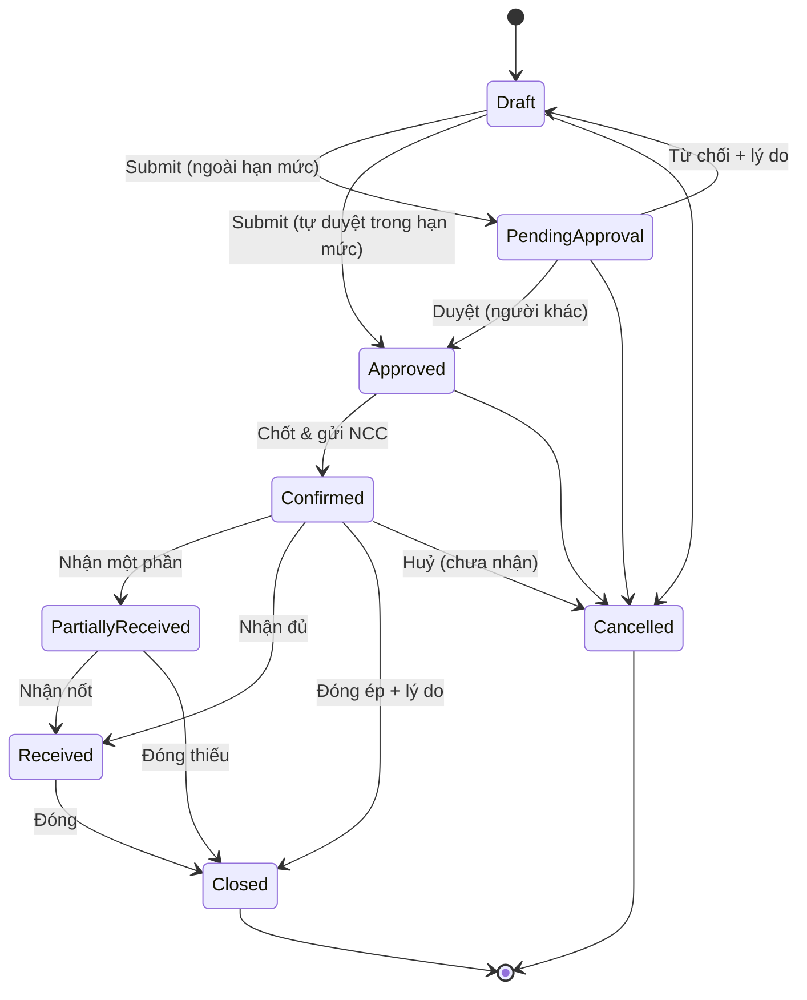

# 02 — Đơn đặt hàng nhà cung cấp (Purchase Order – PO)

## 1. Mục đích (Purpose)

Ghi nhận **cam kết mua hàng** giữa doanh nghiệp và nhà cung cấp (supplier / vendor): mua **cái gì, số lượng bao nhiêu, giá nào, giao về kho nào, khi nào**. Module gồm cả **hồ sơ nhà cung cấp** và **danh mục hàng của từng nhà cung cấp** (giá, MOQ, quy cách, lead time) — nền cho mọi quy tắc của PO.

PO có hai loại:
- **PO mua hàng** (`STANDARD`) — mua phôi, vật tư.
- **PO gia công** (`SUBCONTRACT`) — thuê nhà gia công in một phần lệnh sản xuất. Hệ thống tự sinh khi Quản lý kho tách LSX, xem [19 §4.7](../19-production/README.md).

Hai loại dùng chung vòng đời, hạn mức duyệt và nhận hàng.

PO là **chứng từ gốc của luồng Procurement**. Mọi lần nhận hàng ([03 Receipt](../03-receipt/README.md)) và hoá đơn NCC ([04 Invoice](../04-invoice/README.md)) đều đối chiếu ngược về PO (three-way matching: PO ↔ Receipt ↔ Invoice).

---

## 2. Actor liên quan

| Actor | Vai trò |
|-------|---------|
| **Nhân viên mua hàng (Procurement Staff)** | Quản lý **hồ sơ NCC** và **danh mục hàng của NCC**. Tạo, sửa PO ở `Draft`. Gửi duyệt. **Chốt & gửi PO cho NCC**. Ghi **phản hồi của NCC**. Huỷ, đóng PO. Xem báo cáo mua hàng. |
| **Quản lý kho (Warehouse Manager)** — người duyệt PO | **Duyệt / từ chối** PO chờ duyệt (không duyệt PO do chính mình gửi, không vượt hạn mức của mình nếu có). **Gửi lại** PO khi gửi cho NCC thất bại. Duyệt phần bổ sung của PO gia công. |
| **Nhân viên kế hoạch (Inventory Planner)** | Theo dõi cảnh báo tồn ([20](../20-inventory-control/README.md)); đề xuất nhu cầu nhập hàng cho bộ phận mua |
| **Nhân viên kho (Warehouse Staff)** | Xem PO đang `Confirmed` để chuẩn bị nhận hàng |
| **Kế toán (Accountant)** | Xem hồ sơ NCC; tham chiếu PO khi đối chiếu công nợ & hoá đơn |
| **Hệ thống** | Kiểm điều kiện NCC & danh mục hàng, lấy giá từ danh mục, tính ngày giao dự kiến, cảnh báo PO có thể trùng, tự duyệt PO trong hạn mức, gửi PO cho NCC (email / API) và theo dõi kết quả gửi |

- Người dùng gắn với kho chỉ xem và thao tác PO của **các kho được gán**.
- Báo cáo mua hàng chỉ dành cho người không bị giới hạn theo kho.

---

## 3. Input / Output

### Input

| Trường | Mô tả | Bắt buộc |
|--------|-------|----------|
| **Hồ sơ NCC** | Mã (cố định, viết hoa), tên, người liên hệ (cần email hoặc điện thoại), email, điện thoại, **mã số thuế** (duy nhất), kỳ thanh toán (mặc định 30 ngày), lead time (mặc định 7 ngày), **kênh gửi PO** (`EMAIL` cần email; `API` cần địa chỉ https), **dung sai nhận vượt %**, cờ **nhà gia công in**, **dung sai hao hụt phôi %** (mặc định 2%) | Có |
| **Danh mục hàng của NCC** | Theo từng SKU: mã hàng phía NCC, **đơn giá** (theo tiền tệ của NCC), **MOQ**, **quy cách đóng gói** (MOQ phải là bội số), lead time riêng (trống = theo NCC), NCC mặc định của SKU | Có (để đặt PO STANDARD) |
| Nhà cung cấp của PO | NCC đang `Active` | Có |
| Kho nhận (ship-to warehouse) | Kho đang hoạt động, trong phạm vi kho của người tạo | Có |
| Ngày đặt / Ngày giao dự kiến | Trống → hôm nay + lead time của dòng chậm nhất; phải ≥ ngày đặt | Có |
| Tiền tệ | Hợp lệ; không trộn nhiều loại tiền trong một PO | Có |
| **Dòng hàng (PO lines)** | SKU (có Inventory Item, còn mua được, có trong danh mục NCC), số lượng **theo đơn vị tồn** của SKU (1–1.000.000), đơn giá (trống → lấy giá danh mục), thuế 0–100%; mỗi SKU một dòng; tối đa 200 dòng | Có (≥ 1 dòng) |
| Ghi chú / điều kiện đặc biệt | | Không |

### Output

| Kết quả | Dùng bởi |
|---------|----------|
| **PO number** (mã PO duy nhất) | 03 Receipt, 04 Invoice, báo cáo mua hàng |
| **PO đã chốt & đã gửi NCC (Confirmed PO)** | Cơ sở để tạo Receipt; hiển thị "hàng đang về" (on-order) |
| **Phản hồi của NCC** (chờ / xác nhận / từ chối) và **trạng thái gửi** | Procurement, Quản lý kho |
| **Số lượng còn chờ nhận (open quantity)** | Theo từng dòng = SL đặt − SL đã nhận |
| **Bản sửa (revision)** mỗi lần gửi duyệt + dòng thời gian thay đổi (trước / sau) | Kiểm soát nội bộ |
| **Cảnh báo**: PO có thể trùng; ngày giao đã qua | Procurement |
| **Báo cáo**: số PO theo trạng thái, chi tiêu theo NCC, hiệu suất NCC | Procurement, quản lý |

---

## 4. Luồng nghiệp vụ từng bước (Step-by-step)

### 4.1. Hồ sơ & danh mục hàng của NCC

1. **Tạo / sửa hồ sơ NCC** — Procurement nhập thông tin ở §3.
   - Mã NCC **không đổi được** sau khi tạo.
   - Mã NCC và mã số thuế phải **duy nhất**.
   - Kênh `EMAIL` phải có email; kênh `API` phải có địa chỉ https.
2. **Trạng thái NCC** — `Active` / `Inactive` / `Blacklisted`; chỉ `Active` nhận PO mới.
   - Không chuyển NCC khỏi `Active` khi còn **PO đang mở** (`Draft`, `Pending Approval`, `Approved`, `Confirmed`, `Partially Received`).
   - Xoá NCC = chuyển `Inactive`, cùng điều kiện.
3. **Danh mục hàng của NCC** — thêm SKU mà NCC bán: mã hàng phía NCC, giá, MOQ, quy cách, lead time.
   - Chỉ NCC `Active`, SKU còn mua được; mỗi cặp NCC + SKU một dòng.
   - **Đổi giá** đóng kỳ giá cũ và mở kỳ giá mới (lưu lịch sử giá).
   - Không xoá được dòng danh mục khi còn PO đang mở đặt SKU đó từ NCC đó.
   - Đánh dấu NCC mặc định thì Inventory Item ([01](../01-product-creation/README.md)) nhận NCC đó làm NCC mặc định.
4. **Tra cứu "SKU X mua ở đâu"** — liệt kê mọi NCC có SKU trong danh mục (kể cả NCC không còn `Active`, kèm trạng thái). NCC mặc định đứng đầu.

### 4.2. Đề xuất & tạo PO

5. **Đề xuất nhập hàng** — Planner theo dõi cảnh báo `REORDER` / `SAFETY` ([20](../20-inventory-control/README.md)) và chuyển nhu cầu cho Procurement.
   > ⚠️ Giả định: Bảng Đề xuất Nhập hàng (Replenishment Proposal) do MRP tự sinh, và nút "Convert to Draft PO", thuộc **phạm vi giai đoạn sau**. Hiện Procurement tạo PO trực tiếp từ cảnh báo tồn. Xem [open-questions C19](../../open-questions/README.md).
6. **Tạo PO nháp** — Procurement chọn NCC (`Active`), kho nhận, tiền tệ, ngày giao dự kiến, thêm dòng → PO `Draft`.
7. **Kiểm tra dòng** — mọi lỗi trả về cùng lúc, chỉ rõ từng dòng:
   - SKU phải có trong **danh mục của NCC** và còn mua được;
   - số lượng ≥ MOQ và là **bội số quy cách đóng gói** của NCC;
   - đơn giá để trống → lấy **giá danh mục** (cùng tiền tệ); giá nhập tay thắng; không có giá danh mục cùng tiền tệ thì bắt buộc nhập.
8. **Cảnh báo PO có thể trùng** — có PO khác cùng NCC, cùng ngày giao dự kiến, còn mở, chung ít nhất một SKU → cảnh báo, **không chặn**.
9. **Sửa PO nháp** — gửi lại **toàn bộ** nội dung kèm phiên bản đang xem.
   - Dòng giữ lại **không đổi SKU**.
   - Dòng bỏ ra rời PO; nếu đã nằm trong một bản sửa trước đó thì giữ lại ở trạng thái `Withdrawn`.
   - Số thứ tự dòng mới **không bao giờ dùng lại**.
   - Mỗi lần sửa ghi dòng thời gian với giá trị trước / sau.

### 4.3. Gửi duyệt & duyệt

10. **Gửi duyệt (Submit)** — hệ thống kiểm lại SKU còn mua được và ghi **một bản sửa (revision)**: lần đầu là bản 0, mỗi lần gửi lại sau khi bị từ chối +1. Sau đó:
    - **Tự duyệt** → `Approved` khi:
      - người gửi có **hạn mức duyệt** > 0 theo tiền tệ của PO;
      - tổng giá trị (sau thuế) ≤ hạn mức;
      - PO **chưa từng bị từ chối**;
      - tổng các PO người đó đã tự duyệt cho **cùng NCC trong 7 ngày**, cộng PO này, vẫn ≤ hạn mức.

      Người gửi được ghi là người duyệt.
    - Không đủ điều kiện → `Pending Approval`.
11. **Duyệt / từ chối** — Quản lý kho:
    - **Duyệt** → `Approved`. Người duyệt **khác người gửi**. Nếu người duyệt có hạn mức thì PO không được vượt hạn mức đó; không khai báo hạn mức thì không giới hạn.
    - **Từ chối** (bắt buộc lý do) → `Draft`; bản sửa bị từ chối giữ làm lịch sử.

> ⚠️ Giả định: hạn mức duyệt khai báo theo **role + tiền tệ + thời gian hiệu lực**; một người lấy hạn mức cao nhất trong các role của mình. Hiện **chưa có màn hình / dữ liệu khai báo hạn mức**, nên mọi PO đều vào `Pending Approval` và người duyệt không bị giới hạn số tiền. Xem [open-questions C20](../../open-questions/README.md).

### 4.4. Chốt & gửi PO cho NCC

12. **Chốt (Confirm)** — PO `Approved` → `Confirmed`, **đồng thời gửi PO cho NCC** theo kênh của NCC (email / API).
    - Bắt buộc **ngày giao** (≥ ngày đặt).
    - **Đổi ngày đã thoả thuận** phải ghi lý do.
    - NCC phải còn `Active` và có thông tin liên hệ theo kênh gửi.
    - Từ đây PO **khoá nội dung**.
13. **Theo dõi gửi** — mỗi lần gửi được ghi lại (kênh, người nhận). Trạng thái gửi: chưa gửi / đang chờ / đã gửi / đang thử lại / thất bại… Gửi là việc bất đồng bộ và **không phải là NCC đã đồng ý**.
14. **Gửi lại khi thất bại** — Quản lý kho gửi lại một PO đã gửi thất bại hẳn, khi NCC chưa phản hồi. Bắt buộc:
    - ghi lý do;
    - xác nhận đã đối chiếu với NCC;
    - nếu ngày giao đã qua / trống thì xác nhận chấp nhận.

    Gửi lại **không đổi trạng thái PO**.
15. **Phản hồi của NCC** — Procurement ghi NCC **xác nhận** hoặc **từ chối**.
    - Từ chối bắt buộc ghi chú và chỉ được **trước khi có hàng nhận**.
    - Phản hồi là **chốt một lần**.
    - Ghi phản hồi dừng việc gửi lại tự động, **không đổi trạng thái PO**. PO bị NCC từ chối không nhận hàng được ([03](../03-receipt/README.md)).

### 4.5. Nhận hàng, đóng & huỷ

16. **Theo dõi tiến độ giao** — NV kho tạo [Receipt](../03-receipt/README.md) tham chiếu PO. Mỗi lần nhận cập nhật *SL đã nhận* và *open quantity* của dòng → PO `Partially Received` / `Received`.
17. **Đóng PO** — Procurement đóng thủ công:
    - **Đóng thường:** `Received` → `Closed`.
    - **Đóng thiếu (short-close):** `Partially Received` → `Closed`; phần còn lại không nhận nữa.
    - **Đóng ép (force close):** `Confirmed` (chưa nhận gì) → `Closed`, kèm lý do. Không gửi thông báo huỷ cho NCC.

    Không đóng ép khi đang có phiếu nhận `Draft`.
    > ⚠️ Giả định: điều kiện "hoá đơn đã đối chiếu xong" trước khi đóng sẽ áp dụng khi module [04 Invoice](../04-invoice/README.md) được xây; hiện đóng PO không kiểm hoá đơn.
18. **Huỷ PO** — từ `Draft`, `Pending Approval`, `Approved` hoặc `Confirmed` (chưa nhận gì), bắt buộc lý do.
    - **Không huỷ** khi đang có **phiếu nhận `Draft`** (đang kiểm đếm).
    - Dòng còn mở → `Cancelled`.
    - Huỷ PO đã gửi → hệ thống gửi **thông báo huỷ** cho NCC theo địa chỉ đã gửi PO.
19. **Sửa PO đã chốt** — PO `STANDARD` đã `Confirmed` **không sửa được**. Muốn đổi thì huỷ (nếu chưa nhận) hoặc đóng thiếu, rồi lập PO mới. Chỉ PO gia công có luồng **bổ sung** ([19](../19-production/README.md)).

### 4.6. Báo cáo mua hàng

20. **Số PO theo trạng thái** (đủ mọi trạng thái, kể cả 0).
21. **Chi tiêu theo NCC** — tổng giá trị PO, nhóm theo NCC **và tiền tệ** (không cộng các loại tiền với nhau). Bỏ `Draft`, `Pending Approval`, `Cancelled`. Lọc theo NCC, tiền tệ, khoảng ngày giao.
22. **Hiệu suất NCC:**
    - **Tỷ lệ giao đúng hạn:** ngày nhận cuối ≤ ngày giao dự kiến.
    - **Lead time trung bình:** từ lúc chốt tới lần nhận cuối.
    - **Tỷ lệ đạt QC:** số đạt / (đạt + loại), không tính cách ly.

    Chỉ tính PO đã `Received` / đóng thường.

---

## 5. Trạng thái / Vòng đời (Lifecycle)

### 5.1. Trạng thái PO

| Trạng thái | Ý nghĩa | Chuyển tiếp cho phép | Ai thực hiện |
|------------|---------|----------------------|--------------|
| `Draft` | Đang soạn, sửa tự do (gửi kèm phiên bản) | → `Pending Approval`, → `Approved` (tự duyệt trong hạn mức), → `Cancelled` | Procurement |
| `Pending Approval` | Chờ duyệt | → `Approved`, → `Draft` (từ chối, có lý do), → `Cancelled` | Quản lý kho (≠ người gửi) |
| `Approved` | Đã duyệt, chưa chốt | → `Confirmed`, → `Cancelled` | Procurement |
| `Confirmed` | Đã chốt & gửi NCC; khoá nội dung; chờ hàng | → `Partially Received`, → `Received`, → `Cancelled` (chưa nhận gì), → `Closed` (đóng ép) | Procurement / Kho |
| `Partially Received` | Đã nhận một phần | → `Received`, → `Closed` (đóng thiếu) | Kho / Procurement |
| `Received` | Đã nhận đủ toàn bộ dòng hàng | → `Closed` | Procurement |
| `Closed` | Đã đóng (thường / thiếu / ép) | *(cuối)* | Procurement |
| `Cancelled` | Bị huỷ trước khi nhận hàng | *(cuối)* | Procurement |

### 5.2. Phản hồi của NCC (trục riêng, không đổi trạng thái PO)

| Trạng thái | Ý nghĩa | Chuyển tiếp cho phép | Ai thực hiện |
|------------|---------|----------------------|--------------|
| `Not Sent` | Chưa gửi NCC | → `Pending` (khi chốt PO) | Hệ thống |
| `Pending` | Đã gửi, chờ NCC trả lời | → `Confirmed`, → `Rejected` (có ghi chú, trước khi nhận hàng) | Procurement |
| `Confirmed` / `Rejected` | NCC đã trả lời; chốt một lần | *(cuối)* | Procurement |

### 5.3. Trạng thái dòng PO

| Trạng thái | Ý nghĩa |
|------------|---------|
| `Open` | Chờ nhận |
| `Partially Received` / `Received` | Đã nhận một phần / đủ |
| `Closed` | Đóng (PO đóng thiếu / đóng) |
| `Cancelled` | Huỷ cùng PO |
| `Withdrawn` | Bị bỏ khỏi bản nháp sau khi đã nằm trong một bản sửa (giữ làm lịch sử) |

---

## 6. Ràng buộc nghiệp vụ (Business Rules) & Edge case

### Business rules

- **BR-01:** PO `STANDARD` chỉ chứa SKU **còn mua được** (biến thể `Active` của sản phẩm `Approved` / `Published`) và **có trong danh mục hàng của NCC**. Kiểm khi tạo, sửa, gửi duyệt và duyệt; hệ thống chỉ rõ từng dòng không đạt.
- **BR-02:** Mỗi lần **gửi duyệt** ghi một **bản sửa** bất biến. PO `STANDARD` đã `Confirmed` không sửa được.
- **BR-03:** Không được nhận hàng ([Receipt](../03-receipt/README.md)) nếu PO chưa ở `Confirmed` / `Partially Received`, hoặc đã bị NCC từ chối.
- **BR-04:** Tổng số lượng nhận của một dòng không vượt *SL đặt × (1 + dung sai nhận vượt **của NCC**)*, làm tròn xuống. NCC không khai báo → dung sai 0. Vượt → **luôn chặn**, không có duyệt ngoại lệ.
- **BR-05:** PO chỉ `Cancelled` khi **chưa nhận hàng** và **không có phiếu nhận `Draft`**.
- **BR-06:** Ngày giao dự kiến trong quá khứ → cảnh báo, không chặn.
- **BR-07:** Đơn vị tiền tệ của PO cố định cho cả PO; giá danh mục NCC theo tiền tệ của NCC.
- **BR-08:** Dòng PO tính theo **đơn vị tồn** của SKU. Số lượng ≥ MOQ và là bội số **quy cách đóng gói** của NCC. MOQ trong danh mục phải là bội số của quy cách.
- **BR-09:** **Bốn mắt:** người duyệt không được là người gửi. Người có hạn mức không duyệt PO vượt hạn mức của mình.
- **BR-10:** PO gia công (`SUBCONTRACT`) chỉ đặt cho NCC được đánh dấu **gia công in**, luôn gắn đúng một LSX con, và không sửa số lượng ngoài luồng tách / gửi bù của [19](../19-production/README.md). Phần bổ sung sau khi duyệt là một **bản bổ sung** chờ duyệt (bốn mắt, theo hạn mức), mỗi lần chỉ một bản chờ.
- **BR-11:** Mã NCC không đổi; mã NCC và mã số thuế duy nhất. NCC không rời `Active` khi còn PO đang mở. Chỉ NCC `Active` nhận PO mới và được thêm hàng vào danh mục.
- **BR-12:** Chốt PO là **gửi PO cho NCC**. Đổi ngày giao đã thoả thuận phải có lý do. Gửi lại PO thất bại chỉ do Quản lý kho, có lý do và xác nhận đã đối chiếu.
- **BR-13:** Phản hồi của NCC chốt một lần; từ chối chỉ trước khi nhận hàng và phải có ghi chú.
- **BR-14:** **Phạm vi kho:** người dùng gắn với kho chỉ thấy / thao tác PO của kho được gán. Báo cáo mua hàng từ chối người dùng gắn với kho.

### Edge case

| Tình huống | Hướng xử lý |
|------------|-------------|
| NCC giao thừa so với PO | Trong dung sai của NCC → chấp nhận; vượt → chặn ở phiếu nhận ([03](../03-receipt/README.md)) |
| NCC giao thiếu, báo không giao nốt | Đóng thiếu PO: đóng phần còn lại |
| Giá trên hoá đơn NCC lệch giá PO | Xử lý chênh lệch giá ở [Invoice](../04-invoice/README.md); PO không tự đổi giá |
| Cần đổi kho nhận / số lượng sau khi Confirmed | Không sửa PO; huỷ (nếu chưa nhận) hoặc đóng thiếu rồi lập PO mới. Hàng đã lên đường → nhận tại kho ban đầu rồi [Transfer](../10-inter-warehouse-transfer/README.md) |
| Nhiều PO cùng NCC giao chung một chuyến | Mỗi PO một phiếu nhận ([03](../03-receipt/README.md)) |
| Huỷ PO đã chốt | Gửi thông báo huỷ cho NCC; trạng thái `Cancelled` |
| SKU ngừng kinh doanh khi PO còn `Draft` | Gửi duyệt / duyệt bị chặn, chỉ rõ dòng; bỏ dòng hoặc đổi SKU |
| SKU ngừng kinh doanh khi PO đã chốt | Cho nhận nốt hàng đang về; không thêm PO mới cho SKU đó |
| Gửi PO cho NCC thất bại (email lỗi, API lỗi) | Quản lý kho gửi lại sau khi đối chiếu với NCC |
| NCC từ chối PO | Ghi phản hồi `Rejected` + ghi chú; không nhận hàng được; huỷ PO và đặt NCC khác |
| Hai PO giống nhau cho cùng NCC, cùng ngày | Cảnh báo PO có thể trùng; Procurement tự quyết |
| Muốn ngưng NCC còn PO đang mở | Chặn; đóng / huỷ PO trước |

---

## 7. Liên kết với các module khác

| Module | Quan hệ |
|--------|---------|
| [01 · Product Creation](../01-product-creation/README.md) | SKU còn mua được; Inventory Item (đơn vị tồn, NCC mặc định) |
| [03 · Receipt](../03-receipt/README.md) | Receipt tham chiếu PO; cập nhật *SL đã nhận* / *open quantity*; dung sai nhận vượt của NCC; quyết định `Partially Received` / `Received` |
| [04 · Invoice](../04-invoice/README.md) | Hoá đơn NCC đối chiếu PO ↔ Receipt (three-way matching) |
| [05 · Putaway](../05-putaway/README.md) | Gián tiếp: hàng nhận theo PO sẽ được cất kho |
| [10 · Inter-warehouse Transfer](../10-inter-warehouse-transfer/README.md) | Khi cần điều chuyển hàng nhận sai kho so với nhu cầu |
| [19 · Production](../19-production/README.md) | Sinh PO gia công khi tách LSX; bổ sung PO gia công; quyết toán gia công |
| [20 · Inventory Control](../20-inventory-control/README.md) | Cảnh báo `REORDER` / `SAFETY` là tín hiệu lập PO bổ sung |
| [00 · System Overview §5](../../00-system-overview/README.md) | PO là bước mở đầu luồng Procurement |
