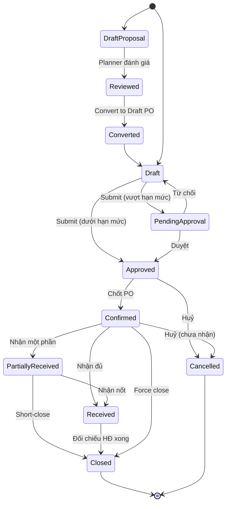

# 02 — Đơn đặt hàng nhà cung cấp (Purchase Order – PO)

## 1. Mục đích (Purpose)

Ghi nhận **cam kết mua hàng** giữa doanh nghiệp và nhà cung cấp (supplier/vendor): mua **cái gì, số lượng bao nhiêu, giá nào, giao về kho nào, khi nào**.

PO có hai loại: **PO mua hàng** (`STANDARD` — mua phôi, vật tư) và **PO gia công** (`SUBCONTRACT` — thuê nhà gia công in một phần lệnh sản xuất, sinh tự động khi Quản lý kho tách LSX, xem [19 §4.7](../19-production/README.md)). Hai loại dùng chung vòng đời, hạn mức duyệt, nhận hàng và đối chiếu hoá đơn.

PO là **chứng từ gốc của luồng Procurement**. Mọi lần nhận hàng ([03 Receipt](../03-receipt/README.md)) và hoá đơn NCC ([04 Invoice](../04-invoice/README.md)) đều đối chiếu ngược về PO (three-way matching: PO ↔ Receipt ↔ Invoice).

---

## 2. Actor liên quan

| Actor | Vai trò |
|-------|---------|
| **Nhân viên kế hoạch (Inventory Planner)** | Đánh giá Bảng Đề xuất Nhập hàng (Replenishment Proposal) do hệ thống sinh, phân tích sức mua / sức chứa kho, chuyển thành Draft PO |
| **Nhân viên mua hàng (Procurement Staff)** | Tạo, chỉnh sửa PO ở trạng thái `Draft`; chốt PO |
| **Người giữ quyền duyệt PO (Approver)** | Phê duyệt PO vượt hạn mức; từ chối kèm lý do — là quyền phê duyệt theo [Role Registry](../../00-system-overview/README.md), không phải chức danh riêng |
| **Nhân viên kho (Warehouse Staff)** | Tham chiếu PO đang `Confirmed` để chuẩn bị nhận hàng |
| **Kế toán (Accountant)** | Tham chiếu PO khi đối chiếu công nợ & hoá đơn |

---

## 3. Input / Output

### Input

| Trường | Mô tả | Bắt buộc |
|--------|-------|----------|
| Bảng Đề xuất Nhập hàng (Replenishment Proposal) | Danh sách SKU chạm ngưỡng tái đặt hàng do hệ thống MRP sinh | Không (có thể tạo PO trực tiếp) |
| Nhà cung cấp | Chọn từ danh mục NCC | Có |
| Kho nhận (ship-to warehouse) | Kho vật lý sẽ nhận hàng | Có |
| Ngày đặt / Ngày giao dự kiến (expected date) | | Có |
| Điều khoản (payment terms, incoterms) | Kế thừa từ hồ sơ NCC, cho phép ghi đè | Không |
| **Dòng hàng (PO lines)** | SKU, số lượng đặt, **đơn vị mua** (mặc định lấy từ [01](../01-product-creation/README.md), ví dụ *thùng*), đơn giá theo đơn vị mua, thuế, chiết khấu; hệ thống lưu kèm số lượng quy về đơn vị cơ sở | Có (≥ 1 dòng) |
| Ghi chú / điều kiện đặc biệt | | Không |
| Chứng từ đính kèm | Báo giá, hợp đồng khung | Không |

### Output

| Kết quả | Dùng bởi |
|---------|----------|
| **PO number** (mã PO duy nhất) | 03 Receipt, 04 Invoice, báo cáo mua hàng |
| **PO đã xác nhận (Confirmed PO)** | Cơ sở để tạo Receipt; hiển thị "hàng đang về" (on-order / incoming stock) |
| **Số lượng còn chờ nhận (open quantity)** | Tính theo từng dòng = SL đặt − SL đã nhận |
| **Lịch sử thay đổi (audit trail)** | Kiểm soát nội bộ |

---

## 4. Luồng nghiệp vụ từng bước (Step-by-step)

1. **Hệ thống sinh đề xuất (Replenishment Proposal)** — MRP định kỳ đối soát (Tồn thực tế + Hàng đang về − Hàng chờ xuất); khi dưới ngưỡng reorder point → sinh Bảng Đề xuất liệt kê SKU cần bổ sung.
2. **Planner đánh giá & chuyển PO (Review & Convert)** — Inventory Planner phân tích sức mua / sức chứa kho, chỉnh số lượng, bấm "Convert to Draft PO" → tạo Draft PO và thông báo sang bộ phận Thu mua.
3. **Tạo PO nháp (Create draft)** — Procurement chọn NCC, kho nhận, ngày giao dự kiến. PO ở `Draft`. Hoặc mở Draft PO do Planner chuyển sang.
4. **Thêm dòng hàng** — chọn SKU (`Active`), chọn đơn vị mua (ví dụ *thùng*), nhập số lượng & đơn giá; hệ thống quy đổi số lượng về đơn vị cơ sở để so với tồn và nhận hàng. Hệ thống có thể gợi ý SKU cần bổ sung dựa trên ngưỡng tồn tối thiểu (reorder point) từ [module 01](../01-product-creation/README.md).
5. **Kiểm tra ràng buộc NCC** — MOQ (số lượng đặt tối thiểu), bội số đóng gói, danh mục SKU mà NCC cung cấp.
6. **Tính tổng tiền** — subtotal, thuế, chiết khấu, phí vận chuyển (nếu nhập) → tổng giá trị PO.
7. **Gửi duyệt (Submit)** — nếu tổng giá trị vượt hạn mức của người tạo → `Pending Approval`; nếu không → có thể tự chuyển tiếp.
8. **Phê duyệt / Từ chối** — Approver duyệt → `Approved`; từ chối → về `Draft` kèm lý do.
9. **Chốt PO (Confirm)** — Procurement chốt PO → `Confirmed`. Từ đây PO **khoá chỉnh sửa nội dung chính** (SKU, số lượng, giá) — thay đổi phải qua **PO amendment / revision**.
10. **Theo dõi tiến độ giao** — NV kho tạo [Receipt](../03-receipt/README.md) tham chiếu PO. Mỗi lần nhận cập nhật *SL đã nhận* và *open quantity* của dòng hàng.
11. **Nhận một phần (partial receipt)** — PO chuyển `Partially Received`; phần còn lại vẫn open.
12. **Hoàn tất nhận** — khi tất cả dòng hàng nhận đủ (hoặc trong dung sai cho phép) → `Received`.
13. **Đối chiếu hoá đơn** — [Invoice](../04-invoice/README.md) từ NCC được match với PO & Receipt (three-way matching).
14. **Đóng PO (Close)** — khi đã nhận đủ và hoá đơn đã đối chiếu xong → `Closed`. PO có open quantity nhỏ không kỳ vọng nhận thêm có thể **force close** kèm lý do.
15. **Huỷ PO (Cancel)** — chỉ khi **chưa phát sinh Receipt**. Nếu đã nhận một phần, phải đóng phần đã nhận và huỷ phần còn lại (short-close).

---

## 5. Trạng thái / Vòng đời (Lifecycle)

**Vòng đời Đề xuất Nhập hàng (Replenishment Proposal):** `Draft Proposal` → `Reviewed` → `Converted` (chuyển thành Draft PO)

| Trạng thái | Ý nghĩa | Chuyển tiếp cho phép | Ai thực hiện |
|------------|---------|----------------------|--------------|
| `Draft` | Đang soạn, sửa tự do | → `Pending Approval`, → `Approved` (nếu dưới hạn mức), → `Cancelled` | Procurement |
| `Pending Approval` | Chờ duyệt | → `Approved`, → `Draft` (từ chối) | Approver |
| `Approved` | Đã duyệt, chưa chốt | → `Confirmed`, → `Cancelled` | Procurement |
| `Confirmed` | PO đã chốt nội bộ; khoá nội dung chính; đang chờ hàng | → `Partially Received`, → `Received`, → `Cancelled` (nếu chưa nhận gì), → `Closed` (force) | Procurement / Warehouse |
| `Partially Received` | Đã nhận một phần | → `Received`, → `Closed` (short-close) | Warehouse / Procurement |
| `Received` | Đã nhận đủ toàn bộ dòng hàng | → `Closed` | Procurement |
| `Closed` | Hoàn tất & đã đối chiếu hoá đơn | *(cuối)* | Procurement / Accounting |
| `Cancelled` | Bị huỷ trước khi nhận hàng | *(cuối)* | Procurement / Approver |

---

## 6. Ràng buộc nghiệp vụ (Business Rules) & Edge case

### Business rules

- **BR-01:** PO chỉ chứa SKU ở trạng thái `Active` và thuộc danh mục NCC cung cấp.
- **BR-02:** Sau khi `Confirmed`, mọi thay đổi SKU/số lượng/đơn giá phải tạo **PO revision** (tăng số version) và ghi log; không sửa đè.
- **BR-03:** Không được nhận hàng ([Receipt](../03-receipt/README.md)) nếu PO chưa ở `Confirmed` (hoặc `Partially Received`).
- **BR-04:** Tổng số lượng nhận của một dòng không vượt *SL đặt × (1 + dung sai nhận vượt)*. Dung sai (over-receipt tolerance) cấu hình theo hệ thống hoặc theo NCC.
- **BR-05:** PO không thể `Cancelled` khi đã có ít nhất một Receipt gắn với nó.
- **BR-06:** Ngày giao dự kiến trong quá khứ → cảnh báo, không chặn.
- **BR-07:** Đơn vị tiền tệ của PO cố định theo NCC; không trộn nhiều loại tiền trong một PO.
- **BR-08:** Hệ thống chỉ sinh đề xuất khi *(Tồn thực tế + Hàng đang về − Hàng chờ xuất) < Reorder Point*.
- **BR-09:** Số lượng đề xuất được làm tròn lên theo MOQ / bội số đóng gói của NCC.
- **BR-10:** PO gia công (`SUBCONTRACT`) chỉ đặt cho NCC được đánh dấu **gia công in**, luôn gắn đúng một LSX con, và không sửa số lượng ngoài luồng tách / gửi bù của [19](../19-production/README.md).

### Edge case

| Tình huống | Hướng xử lý |
|------------|-------------|
| NCC giao thừa so với PO | Nhận trong dung sai → chấp nhận; vượt dung sai → chặn hoặc yêu cầu duyệt ngoại lệ |
| NCC giao thiếu, báo không giao nốt | Short-close dòng hàng: đóng phần còn lại, ghi lý do |
| Giá trên hoá đơn NCC lệch giá PO | Chuyển sang xử lý chênh lệch giá ở [Invoice](../04-invoice/README.md); PO không tự đổi giá |
| Cần đổi kho nhận sau khi Confirmed | Tạo PO revision; nếu hàng đã lên đường, xử lý như nhận tại kho ban đầu rồi [Transfer](../10-inter-warehouse-transfer/README.md) |
| Nhiều PO cùng NCC giao chung một chuyến | Mỗi Receipt vẫn tham chiếu đúng PO của từng dòng; cho phép một phiên nhận xử lý nhiều PO |
| Huỷ PO đã chốt | Gửi thông báo huỷ (cancellation notice); trạng thái `Cancelled` |
| SKU bị `Discontinued` khi PO còn open | Cảnh báo; cho nhận nốt hàng đang về, chặn thêm dòng mới |

---

## 7. Liên kết với các module khác

| Module | Quan hệ |
|--------|---------|
| [01 · Product Creation](../01-product-creation/README.md) | Nguồn SKU, NCC mặc định, giá mua tham chiếu, MOQ, lead time, ngưỡng reorder — nguồn dữ liệu cho Replenishment Proposal |
| [03 · Receipt](../03-receipt/README.md) | Receipt tham chiếu PO; cập nhật *SL đã nhận* / *open quantity*; quyết định `Partially Received` / `Received` |
| [04 · Invoice](../04-invoice/README.md) | Hoá đơn NCC đối chiếu PO ↔ Receipt (three-way matching); xử lý chênh lệch giá/số lượng |
| [05 · Putaway](../05-putaway/README.md) | Gián tiếp: hàng nhận theo PO sẽ được cất kho |
| [10 · Inter-warehouse Transfer](../10-inter-warehouse-transfer/README.md) | Khi cần điều chuyển hàng nhận sai kho so với nhu cầu |
| [19 · Production](../19-production/README.md) | Sinh PO gia công khi tách LSX; LSX con chỉ gửi đi khi PO gia công `Approved` |
| [00 · System Overview §5](../../00-system-overview/README.md) | PO là bước mở đầu luồng Procurement |
