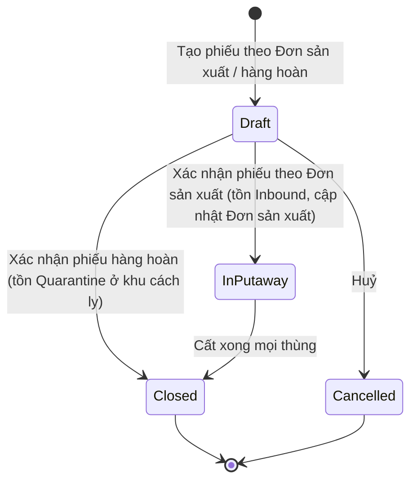

# 03 — Nhập kho thành phẩm (Finished Goods Receipt)

## 1. Mục đích (Purpose)

Ghi nhận việc **thùng thành phẩm về đến kho** và đưa chúng vào sự kiểm soát của kho. Có **hai loại phiếu nhập** *(Đã chốt 2026-11-05)*:

| Loại phiếu | Nguồn hàng | Chứng từ tham chiếu | Khu nhận | Bước tiếp theo |
|------------|------------|---------------------|----------|----------------|
| **Theo Đơn sản xuất** (`PRODUCTION`) | Đơn vị sản xuất giao thành phẩm mới | **Một** [Đơn sản xuất (Production Order)](../../ecommerce/17-order-management/README.md) — chứng từ thuộc module 17 | `RECEIVING` | Cất lên bin ([05](../05-putaway/README.md)) |
| **Hàng hoàn** (`RETURN`) | Hàng hãng vận chuyển hoàn về (RTO), hoặc hàng khách trả theo yêu cầu trả hàng | Shipment hoàn về ([09](../09-shipping/README.md)) **hoặc** yêu cầu trả hàng đã duyệt (RMA) của đơn ([17 §4.10](../../ecommerce/17-order-management/README.md)) | `QUARANTINE` | Quản lý kho quyết định gỡ cách ly hoặc ghi giảm ([20](../20-inventory-control/README.md)) |

**Đơn vị sản xuất** là xưởng của công ty hoặc đối tác ngoài, khai báo trong danh mục Đơn vị sản xuất ([17](../../ecommerce/17-order-management/README.md)); sản xuất nằm ngoài hệ thống.

Với phiếu **theo Đơn sản xuất**, kho:

- kiểm đếm **theo số thùng**: dán nhãn **LPN** cho từng thùng; mọi thùng nhận vào đúng **số cái chuẩn / thùng** của SKU;
- đối chiếu **số thùng** thực nhận với số thùng trên Đơn sản xuất (**đủ / thiếu / thừa**);
- ghi **lô sản xuất** (nếu SKU theo dõi lô);
- đưa hàng vào **khu nhận hàng** (WH/Input — Area `RECEIVING`).

> **Đã chốt 2026-11-04:** kho chỉ là **kho thành phẩm**. Nhập thành phẩm mới chỉ theo **Đơn sản xuất**, **không kiểm tra chất lượng tại kho** (đơn vị sản xuất đã kiểm chất lượng) — kho chỉ đếm đủ / thiếu / thừa. Mọi thành phẩm về kho **đã được đơn vị sản xuất đóng thùng sẵn**; kho nhập **theo thùng**, không nhập hàng ngoài thùng.

> **Đã chốt 2026-11-05:** ly / bao bì **không có hạn dùng** — phiếu nhập không ghi hạn dùng, không có cảnh báo cận hạn. **Lô** là **lô sản xuất** gắn Đơn sản xuất, dùng để truy vết ([20](../20-inventory-control/README.md)).

Nhập thành phẩm theo Đơn sản xuất đi **2 bước**:

| Chặng | Từ → Đến | Module |
|-------|----------|--------|
| 1 | Đơn vị sản xuất → WH/Input (Area `RECEIVING`) | 03 (module này) |
| 2 | WH/Input → WH/Stock (bin), nguyên thùng | [05 · Putaway](../05-putaway/README.md) |

Hàng nhập là **SKU thành phẩm theo mẫu của khách** ([01](../01-product-creation/README.md)), đã mang thiết kế của khách. Tồn ghi theo đúng SKU trên dòng Đơn sản xuất.

Phiếu nhập kho là **điểm hàng hoá chính thức thuộc quyền kiểm soát của kho**, và là căn cứ để:

- cập nhật tiến độ Đơn sản xuất (đã nhận / còn thiếu) ở [17](../../ecommerce/17-order-management/README.md);
- sinh nhiệm vụ [Putaway](../05-putaway/README.md) — mỗi thùng một nhiệm vụ;
- với hàng hoàn: báo [17](../../ecommerce/17-order-management/README.md) hàng đã về kho (căn cứ xử lý đơn `Returned` và hoàn tiền).

> ⚠️ Giả định: Tồn kho khả dụng để bán (available-to-promise) chỉ được cộng **sau khi Putaway hoàn tất**, không phải ngay khi nhập. Hàng ở khu nhận hàng coi là "đã nhận, chưa khả dụng" (`Inbound`). Xem [open-questions](../../open-questions/README.md).

> **Đã chốt 2026-11-05:** số lượng trên Đơn sản xuất là **số thùng**. Đơn vị sản xuất đóng **mọi thùng đúng số cái chuẩn / thùng** của SKU ([01](../01-product-creation/README.md) BR-11). Kho đếm **số thùng**; thùng có số cái **khác số chuẩn thì không nhận** — trả lại đơn vị sản xuất, phần đó **vẫn mở** trên Đơn sản xuất (BR-13). Không có khái niệm thùng ít hơn số chuẩn. Xem [open-questions B24](../../open-questions/README.md).

> ⚠️ Giả định: hàng lỗi phát hiện **sau khi** phiếu đã xác nhận được đổi trả với đơn vị sản xuất **ngoài hệ thống**; trong hệ thống chỉ ghi nhận bằng điều chỉnh tồn có duyệt hoặc chuyển sang khu cách ly (Area `QUARANTINE`) ở [20](../20-inventory-control/README.md). Xem [open-questions](../../open-questions/README.md).

---

## 2. Actor liên quan

| Actor | Vai trò |
|-------|---------|
| **Nhân viên kho (Warehouse Staff / Receiver)** | Tạo phiếu nhập (cả hai loại), kiểm đếm theo thùng, ghi lô sản xuất, dán nhãn thùng LPN (in / in lại nhãn), quét LPN thùng hàng hoàn, xác nhận phiếu, huỷ phiếu nháp |
| **Quản lý kho (Warehouse Manager)** | Theo dõi phiếu nhập của kho; xử lý **nhận thiếu / thừa / thùng lệch số chuẩn**; **quyết định hàng hoàn trong khu cách ly** — gỡ cách ly đưa lại tồn khả dụng hoặc ghi giảm bằng điều chỉnh có duyệt ([20](../20-inventory-control/README.md)); xử lý chênh lệch sau khi xác nhận bằng điều chỉnh tồn có duyệt. Có đủ quyền thao tác như nhân viên kho (làm thay khi cần) |
| **Nhân viên Sale (Sales Staff)** | Không thao tác phiếu nhập. Người lập và theo dõi Đơn sản xuất ([17](../../ecommerce/17-order-management/README.md)): theo dõi số đã nhận / còn thiếu, được báo khi nhận thiếu hoặc thùng bị từ chối nhận, làm việc lại với đơn vị sản xuất, quyết định **đóng thiếu** Đơn sản xuất |
| **Đơn vị sản xuất** *(ngoài hệ thống)* | Giao thành phẩm **đã đóng thùng đúng số chuẩn** tới đúng **kho nhận** của Đơn sản xuất, kèm phiếu giao ghi số Đơn sản xuất và số thùng; nhận lại thùng thừa / thùng lỗi / thùng lệch số chuẩn bị từ chối |
| **Hãng vận chuyển / Khách hàng sỉ** *(hàng hoàn)* | Hãng trả kiện không giao được về kho (RTO); khách gửi hàng trả theo RMA ([17 §4.10](../../ecommerce/17-order-management/README.md)) |
| **Hệ thống** | Kiểm số thùng nhận luỹ kế không vượt số thùng của Đơn sản xuất; cấp mã LPN; ghi tồn `Inbound` theo thùng và sổ biến động; cập nhật trạng thái Đơn sản xuất; mở nhiệm vụ cất; đóng phiếu khi cất xong. Với hàng hoàn: chỉ nhận thùng LPN thuộc shipment / đơn được tham chiếu, ghi tồn `Quarantine` tại khu cách ly, báo 17 |

- Mọi thao tác chỉ trong phạm vi **kho được gán**.

---

## 3. Input / Output

### Input

**Phiếu theo Đơn sản xuất**

| Trường | Mô tả | Bắt buộc |
|--------|-------|----------|
| Đơn sản xuất tham chiếu | **Một** Đơn sản xuất đang mở và **nhận được hàng** (BR-01, BR-15): `In Production` / `Partially Received`; hoặc `Sent` / `Accepted` nếu Đơn sản xuất **không bật** cờ cần duyệt mẫu in — có **kho nhận** là kho của phiếu ([17](../../ecommerce/17-order-management/README.md)). Kho nhận của Đơn sản xuất luôn là kho xuất của đơn bán liên quan | Có |
| Khu nhận hàng | Area loại `RECEIVING` của kho nhận (xem [06](../06-warehouse-map-slotting/README.md)) | Có (từng dòng) |
| **Dòng nhập (receipt lines)** | Theo **dòng Đơn sản xuất + lô sản xuất**; 1–200 dòng. Số thực nhận của dòng = **số thùng** của dòng (kèm số cái = số thùng × số cái chuẩn / thùng) | Có |
| **Thùng LPN** | Mỗi dòng có **ít nhất một thùng**. Mỗi thùng: đơn vị thùng (theo **quy cách thùng** của SKU — [01](../01-product-creation/README.md)); số cái trong thùng **luôn bằng số cái chuẩn / thùng** (hệ thống gán, không nhập số khác — BR-13) | Có |

**Phiếu hàng hoàn**

| Trường | Mô tả | Bắt buộc |
|--------|-------|----------|
| Chứng từ tham chiếu | **Một** trong hai: shipment đã ghi nhận hoàn về (RTO — [09](../09-shipping/README.md)); hoặc yêu cầu trả hàng đã duyệt (RMA) của đơn ([17 §4.10](../../ecommerce/17-order-management/README.md)) | Có |
| Khu cách ly | Area loại `QUARANTINE` của kho ([06](../06-warehouse-map-slotting/README.md)) | Có |
| **Thùng LPN quét** | Mã LPN của từng thùng hoàn về. Chỉ nhận thùng **thuộc shipment / đơn được tham chiếu**; thùng giữ nguyên mã LPN, SKU, lô, số cái chuẩn / thùng như khi xuất | Có (ít nhất một thùng) |
| Ghi chú tình trạng | Tình trạng bên ngoài của thùng (móp, ướt, đã mở…) | Không |

### Output

| Kết quả | Dùng bởi |
|---------|----------|
| **Receipt number** (mã phiếu nhập, kèm loại phiếu) | 05 Putaway, 17 (tiến độ Đơn sản xuất; hàng trả về kho), truy vết |
| **Kết quả kiểm đếm** theo dòng, tính theo **số thùng** (kèm số cái): số trên Đơn sản xuất, số đã nhận luỹ kế, số còn thiếu | Sale ([17](../../ecommerce/17-order-management/README.md)), Quản lý kho |
| **Thùng LPN** — mã `LPN-yyyyMMdd-NNNNNN`, nhãn PDF (mã chữ, QR, Code 128) | Dán lên thùng; [05](../05-putaway/README.md), [07](../07-picking/README.md), [20](../20-inventory-control/README.md) |
| **Cập nhật Đơn sản xuất**: số thùng đã nhận, số thùng còn thiếu, trạng thái (`Partially Received` / `Received`) | [17](../../ecommerce/17-order-management/README.md) |
| **Tồn `Inbound` ở khu nhận hàng** theo SKU + lô, **nằm trong từng thùng** (thùng `In Stock`) khi phiếu theo Đơn sản xuất được xác nhận | 05 Putaway, báo cáo tồn |
| **Thùng sẵn sàng cất** — mọi thùng của phiếu theo Đơn sản xuất khi xác nhận | 05 Putaway |
| **Tồn `Quarantine` ở khu cách ly** — thùng hàng hoàn khi phiếu hàng hoàn được xác nhận; chờ Quản lý kho quyết định | [20 §4.4](../20-inventory-control/README.md), [05](../05-putaway/README.md) (cất lại sau khi gỡ cách ly) |
| **Sự kiện hàng hoàn đã về kho** (đơn, shipment / RMA, các thùng nhận) | [17](../../ecommerce/17-order-management/README.md), [15](../../ecommerce/15-payment/README.md) (hoàn tiền) |

---

## 4. Luồng nghiệp vụ từng bước (Step-by-step)

### 4.1. Phiếu theo Đơn sản xuất

**Chặng 1 — Nhập vào WH/Input**

1. **Tạo phiếu nhập** — Đơn vị sản xuất giao các thùng thành phẩm kèm phiếu giao ghi số Đơn sản xuất. NV kho chọn **một Đơn sản xuất** nhận được hàng (BR-01, BR-15), kho nhận đúng kho mình → phiếu `Draft`.
   - Đơn sản xuất **bật cờ cần duyệt mẫu in** mà mẫu **chưa được khách duyệt** (đơn còn `Sent` / `Accepted` / `Sample Pending`) → **chặn** tạo phiếu; báo Sale ([17](../../ecommerce/17-order-management/README.md)).
   - Kho đầy **không chặn nhận**: hàng vẫn nhận vào `RECEIVING`; thùng không còn bin hợp lệ được cất vào khu tạm `OVERFLOW` ([05](../05-putaway/README.md), [06 §4.6](../06-warehouse-map-slotting/README.md)).
2. **Kiểm đếm theo thùng** — với từng dòng (dòng Đơn sản xuất + lô sản xuất): chọn khu nhận hàng, ghi lô (nếu SKU theo dõi lô), rồi **liệt kê các thùng** nhận. Mỗi thùng mang đúng số cái chuẩn / thùng của SKU; thùng có số cái **khác số chuẩn** thì **không liệt kê, không nhận** — trả lại đơn vị sản xuất (BR-13). Hệ thống:
   - cấp **mã LPN** cho thùng mới → thùng `Receiving`; thùng đã liệt kê trước được đếm lại; thùng có trên lần lưu trước mà lần này không còn → `Void`;
   - tính **số thực nhận của dòng = số thùng** (kèm số cái).

   **Mỗi lần lưu là thay toàn bộ** bản đếm; dòng đếm lại giữ nguyên mã dòng. Hệ thống kiểm:
   - dòng thuộc Đơn sản xuất và còn mở; mỗi (dòng Đơn sản xuất, lô) một dòng;
   - khu nhận là Area `RECEIVING` của kho nhận;
   - lô đúng cấu hình SKU: **bắt buộc** khi SKU theo dõi lô; **không được nhập** khi SKU không theo dõi (BR-03). Mọi lỗi trả về cùng lúc, theo từng trường;
   - **không nhận vượt** số thùng trên Đơn sản xuất (BR-02).
3. **Đối chiếu đủ / thiếu / thừa** — hệ thống hiện, theo từng dòng, **số thùng** thực nhận so với số thùng còn mở của dòng Đơn sản xuất:

   | Kết quả | Điều kiện | Xử lý |
   |---------|-----------|-------|
   | **Đủ** | Số thùng nhận luỹ kế = số thùng trên Đơn sản xuất | Dòng Đơn sản xuất nhận xong |
   | **Thiếu** | Số thùng nhận luỹ kế < số thùng trên Đơn sản xuất (kể cả do thùng lệch số chuẩn bị trả lại) | Nhận các thùng đúng chuẩn thực có; phần thiếu **vẫn mở** trên Đơn sản xuất (BR-10, BR-13); Sale được báo |
   | **Thừa** | Số thùng nhận luỹ kế > số thùng trên Đơn sản xuất | **Chặn**; không nhận thùng làm vượt số còn mở — trả nguyên thùng lại đơn vị sản xuất (BR-02) |

4. **In & dán nhãn LPN** — NV kho **in nhãn** theo dòng nhập, hoặc **in lại** theo mã LPN (tối đa 500 nhãn một lần; không in thùng `Void` hoặc thất lạc; thùng đã lấy cho đơn vẫn in lại được khi nhãn LPN rách / mất — xem vòng đời thùng ở [20](../20-inventory-control/README.md)), rồi dán lên từng thùng.
5. **Bỏ dòng** — dòng **đã từng có thùng** (kể cả thùng `Void`) không bỏ được, cũng không đổi đơn vị thùng được khi còn thùng cũ. Muốn làm lại thì huỷ phiếu và đếm lại.
6. **Xác nhận phiếu nhập** — hệ thống kiểm mỗi dòng có ít nhất một thùng và kiểm lại số nhận luỹ kế (BR-02). Sau đó:
   - ghi tồn **`Inbound`** tại khu nhận hàng: **mỗi thùng một dòng tồn bên trong thùng**, thùng → `In Stock`;
   - cập nhật *số thùng đã nhận* và trạng thái Đơn sản xuất ở [17](../../ecommerce/17-order-management/README.md): `Partially Received` / `Received`. Đơn sản xuất không bật cờ duyệt mẫu in mà còn `Sent` / `Accepted` thì hệ thống tự chuyển qua `In Production` trước (BR-15);
   - mọi thùng → **sẵn sàng cất** ([05](../05-putaway/README.md));
   - phiếu → **`In Putaway`**.

**Chặng 2 — Bàn giao cho Putaway và đóng phiếu**

7. **Bàn giao cho Putaway** — hệ thống mở **nhiệm vụ cất hàng** ([05](../05-putaway/README.md)): **mỗi thùng một nhiệm vụ**, cất nguyên thùng.
8. **Đóng phiếu nhập** — khi mọi thùng của phiếu đã được cất → `Closed` tự động. Hàng cất xong thành tồn `Available`; [17](../../ecommerce/17-order-management/README.md) dùng tồn này để đưa đơn `Awaiting Stock` sang `Ready to Fulfill`.

> ⚠️ Giả định: Đơn sản xuất **không bật** cờ cần duyệt mẫu in mà hàng về khi còn `Sent` / `Accepted` (bên sản xuất chưa báo / Sale chưa ghi nhận tiến độ) vẫn được nhận; lúc xác nhận phiếu, hệ thống tự chuyển Đơn sản xuất qua `In Production` rồi `Partially Received` / `Received`. Đơn sản xuất **bật** cờ mà mẫu chưa được khách duyệt thì **chặn** nhập: hàng in hàng loạt chưa được khách chấp thuận mẫu. Xem [open-questions](../../open-questions/README.md).

### 4.2. Phiếu hàng hoàn

*(Đã chốt 2026-11-05)* Hàng hoàn gồm kiện hãng vận chuyển trả về kho (RTO — shipment `Delivery Failed` rồi hoàn về, [09](../09-shipping/README.md)) và hàng khách trả theo yêu cầu trả hàng đã duyệt (RMA — [17 §4.10](../../ecommerce/17-order-management/README.md)). Hàng hoàn **luôn** nhập qua phiếu này, không cộng thẳng tồn.

9. **Tạo phiếu hàng hoàn** — NV kho chọn **shipment hoàn về** hoặc **RMA** của đơn, chọn khu `QUARANTINE` của kho → phiếu `Draft`.
10. **Quét LPN từng thùng** — hệ thống chỉ nhận thùng **thuộc shipment / đơn được tham chiếu** (thùng đã xuất cho đơn đó); thùng khác bị từ chối. Mỗi thùng giữ nguyên mã LPN, SKU, lô, số cái chuẩn / thùng; không cấp mã mới, nhãn rách thì in lại theo mã LPN (bước 4). NV kho ghi chú tình trạng bên ngoài nếu có.
11. **Đối chiếu** — hệ thống hiện số thùng đã quét so với số thùng của shipment / RMA. Thiếu thùng → phiếu vẫn xác nhận được với các thùng thực có; Quản lý kho xử lý phần thiếu với hãng / khách **ngoài hệ thống** (⚠️ giả định — xem Edge case).
12. **Xác nhận phiếu hàng hoàn** — hệ thống:
    - đưa từng thùng vào khu **`QUARANTINE`**: thùng `Consumed` → `In Stock` (giữ mã LPN gốc), tồn ở trạng thái **`Quarantine`** (không thuộc ATP), ghi dòng sổ biến động có chứng từ nguồn là phiếu hàng hoàn ([20](../20-inventory-control/README.md));
    - báo [17](../../ecommerce/17-order-management/README.md) hàng đã về kho (căn cứ đơn `Returned` và hoàn tiền ở [15](../../ecommerce/15-payment/README.md));
    - phiếu → **`Closed`** (không mở nhiệm vụ cất).
13. **Quản lý kho quyết định** từng thùng trong khu cách ly ([20 §4.4](../20-inventory-control/README.md)):
    - **gỡ cách ly** → thùng được cất lại lên bin qua [05](../05-putaway/README.md), trở thành tồn `Available` của SKU riêng — dùng được cho **đơn sau của chính khách sở hữu**;
    - **ghi giảm** cả thùng bằng **điều chỉnh tồn có duyệt** (lý do `DAMAGED`…) ở [20 §4.3](../20-inventory-control/README.md).

> ⚠️ Giả định: phiếu hàng hoàn lập tại **kho xuất của đơn** (hàng hoàn về kho đã gửi); thùng hàng hoàn giữ nguyên mã LPN gốc; phiếu hàng hoàn đóng ngay khi xác nhận, việc gỡ cách ly / ghi giảm theo dõi ở [20](../20-inventory-control/README.md). Xem [open-questions](../../open-questions/README.md).

---

## 5. Trạng thái / Vòng đời (Lifecycle)

### Trạng thái phiếu nhập (Receipt status)

| Trạng thái | Ý nghĩa | Chuyển tiếp cho phép | Ai thực hiện |
|------------|---------|----------------------|--------------|
| `Draft` | Đang kiểm đếm, dán thùng (theo Đơn sản xuất) hoặc quét thùng (hàng hoàn); sửa được | → `In Putaway` (xác nhận phiếu theo Đơn sản xuất); → `Closed` (xác nhận phiếu hàng hoàn); → `Cancelled` | NV kho / Quản lý kho |
| `In Putaway` | Chỉ phiếu theo Đơn sản xuất: đã xác nhận; tồn `Inbound` trong các thùng ở khu nhận hàng; đang cất hàng | → `Closed` | Hệ thống (khi cất xong) |
| `Closed` | Phiếu theo Đơn sản xuất: mọi thùng đã cất. Phiếu hàng hoàn: đã xác nhận, thùng ở khu cách ly chờ Quản lý kho quyết định | *(cuối)* | Hệ thống |
| `Cancelled` | Huỷ khi còn `Draft`; thùng mới cấp mã → `Void` (thùng hàng hoàn giữ nguyên trạng thái cũ) | *(cuối)* | NV kho / Quản lý kho |

> Xác nhận là một bước, không phải trạng thái lưu lại. Vòng đời thùng LPN (`Receiving` → `In Stock` …) mô tả ở [20](../20-inventory-control/README.md).

---

## 6. Ràng buộc nghiệp vụ (Business Rules) & Edge case

### Business rules

- **BR-01:** Phiếu theo Đơn sản xuất chỉ tạo cho Đơn sản xuất **nhận được hàng** (BR-15), **chỉ tại đúng kho nhận** của Đơn sản xuất. **Một phiếu nhập = một Đơn sản xuất.** Đơn sản xuất `Draft`, `Pending Approval`, `Received`, `Closed`, `Cancelled` không nhận được.
- **BR-02:** Tổng **số thùng** nhận luỹ kế của một dòng Đơn sản xuất ≤ **số thùng trên dòng**. Tổng tính trên **mọi phiếu nhập chưa huỷ** của Đơn sản xuất, kể cả phiếu nháp. Kiểm khi đếm và khi xác nhận. Vượt → **chặn**; thùng làm vượt không được nhận (không mở thùng để nhận một phần). ⚠️ Giả định: không có dung sai nhận vượt (tính theo số thùng); dung sai cấu hình được là phạm vi sau. Xem [open-questions](../../open-questions/README.md).
- **BR-03:** SKU theo dõi lô → **bắt buộc** ghi **lô sản xuất**. SKU không theo dõi → **không được** ghi lô.
- **BR-04:** Hàng chưa qua Putaway (`Inbound` ở khu nhận hàng) và hàng hoàn ở khu cách ly (`Quarantine`) **không** được tính vào tồn khả dụng bán.
- **BR-05:** Chỉ phiếu `Draft` được huỷ (thùng mới cấp mã → `Void`). Phiếu đã xác nhận không xoá, không huỷ; sai sót xử lý bằng **điều chỉnh tồn có duyệt** ([20 §4.3](../20-inventory-control/README.md)).
- **BR-06:** **Không theo dõi hạn dùng** *(Đã chốt 2026-11-05)*: phiếu nhập không ghi hạn dùng, không cảnh báo cận hạn. Lô là lô sản xuất gắn Đơn sản xuất, dùng để truy vết.
- **BR-07:** **Không kiểm tra chất lượng tại kho** *(Đã chốt 2026-11-04)* với thành phẩm theo Đơn sản xuất. Kho chỉ kiểm đếm số thùng, thùng đúng số cái chuẩn, lô. Xác nhận phiếu → mọi thùng sẵn sàng cất ngay từ khu `RECEIVING`.
- **BR-08:** Mọi lần hàng đổi chỗ trong luồng nhập (khu nhận hàng → bin; nhập hàng hoàn vào khu cách ly) đều ghi **dòng sổ biến động** có chứng từ nguồn là phiếu nhập hoặc nhiệm vụ cất ([20](../20-inventory-control/README.md)); không sửa tồn trực tiếp.
- **BR-09:** **Thùng LPN:**
  - Thùng dán nhãn trên dòng nhập của phiếu theo Đơn sản xuất `Draft` → `Receiving`.
  - Thùng → `In Stock` khi phiếu xác nhận.
  - Thùng luôn được cất **nguyên thùng** ([05](../05-putaway/README.md)).
  - Dòng đã có thùng không bỏ được.
  - Mã LPN không trùng; có thể có khoảng trống trong dãy số. Thùng hàng hoàn giữ mã LPN gốc.
- **BR-10:** **Nhận thiếu** không đóng dòng Đơn sản xuất: phần thiếu vẫn mở để nhận ở phiếu sau. Chỉ **Sale** **đóng thiếu** Đơn sản xuất ở [17](../../ecommerce/17-order-management/README.md); phiếu nhập không tự đóng Đơn sản xuất.
- **BR-11:** Hàng nhập ghi tồn theo **đúng SKU trên dòng Đơn sản xuất**. Tồn thuộc SKU, **không gắn sẵn với đơn** (gắn đơn là việc phân bổ ở [17](../../ecommerce/17-order-management/README.md) / [20](../20-inventory-control/README.md)).
- **BR-12:** **Chỉ nhập theo thùng** *(Đã chốt 2026-11-04)*: mọi hàng nhận đều nằm trong một thùng LPN; mỗi dòng nhập có ít nhất một thùng; số thực nhận của dòng bằng số thùng. Không có tồn ngoài thùng.
- **BR-13:** **Mọi thùng đúng số cái chuẩn** *(Đã chốt 2026-11-05)*: số cái trong mỗi thùng nhận vào bằng **số cái chuẩn / thùng** của SKU ([01](../01-product-creation/README.md) BR-11). Thùng có số cái khác số chuẩn (thiếu hay thừa) **không được nhận**: trả nguyên thùng lại đơn vị sản xuất, phần tương ứng **vẫn mở** trên Đơn sản xuất.
- **BR-14:** **Hàng hoàn** *(Đã chốt 2026-11-05)*: nhập qua phiếu hàng hoàn tham chiếu **một** shipment hoàn về hoặc **một** RMA; chỉ nhận thùng LPN thuộc shipment / đơn đó; nhập **thẳng vào khu `QUARANTINE`** (tồn `Quarantine`, không qua `RECEIVING`, không mở nhiệm vụ cất). **Quản lý kho** quyết định gỡ cách ly (cất lại qua [05](../05-putaway/README.md)) hoặc ghi giảm bằng điều chỉnh có duyệt ([20](../20-inventory-control/README.md)).
- **BR-15:** **Trạng thái Đơn sản xuất nhận được hàng:** `In Production` / `Partially Received`. Đơn sản xuất **bật cờ cần duyệt mẫu in** mà mẫu chưa được khách duyệt (`Sent` / `Accepted` / `Sample Pending`) → **chặn** nhập kho. Đơn sản xuất **không bật** cờ mà còn `Sent` / `Accepted` → nhận được; lúc xác nhận phiếu, hệ thống tự chuyển Đơn sản xuất qua `In Production` rồi `Partially Received` / `Received` (⚠️ giả định §4.1).

### Edge case

| Tình huống | Hướng xử lý |
|------------|-------------|
| Hàng về không có Đơn sản xuất | Chưa hỗ trợ nhận không chứng từ; mọi phiếu nhập thành phẩm phải theo một Đơn sản xuất đang mở (Đơn sản xuất chỉ phát sinh từ đơn bán — [17](../../ecommerce/17-order-management/README.md)). ⚠️ Giả định: nhận không chứng từ (blind receipt) là phạm vi sau — [open-questions C19](../../open-questions/README.md) |
| Một chuyến giao hàng của nhiều Đơn sản xuất | Mỗi Đơn sản xuất một phiếu nhập |
| Đơn vị sản xuất giao tới kho khác kho nhận của Đơn sản xuất | Không tạo được phiếu tại kho đó (BR-01); đơn vị sản xuất phải giao đúng kho nhận; báo Sale |
| Giao SKU không có trên Đơn sản xuất | Không nhận các thùng đó; trả lại đơn vị sản xuất; báo Sale |
| Hàng giao rời, chưa đóng thùng | Không nhận (BR-12); đơn vị sản xuất đóng thùng rồi giao lại |
| Thùng có số cái khác số chuẩn / thùng (thiếu hoặc thừa) | Không nhận thùng đó, trả lại đơn vị sản xuất; phần đó vẫn mở trên Đơn sản xuất để nhận ở phiếu sau (BR-13); Quản lý kho xử lý, báo Sale |
| Giao vượt số trên Đơn sản xuất | Chặn; nhận các thùng trong phạm vi số còn mở, thùng làm vượt trả nguyên thùng lại đơn vị sản xuất (BR-02) |
| Giao thiếu | Nhận các thùng thực có; Đơn sản xuất → `Partially Received`; lần giao sau là phiếu nhập mới, hoặc Sale đóng thiếu ở 17 |
| Hàng về khi Đơn sản xuất còn `Sent` / `Accepted`, không bật cờ duyệt mẫu in | Nhận bình thường; Đơn sản xuất tự qua `In Production` khi xác nhận phiếu (BR-15) |
| Hàng về khi Đơn sản xuất bật cờ duyệt mẫu in mà mẫu chưa được khách duyệt (`Sent` / `Accepted` / `Sample Pending`) | **Chặn** nhập (BR-15); không nhận hàng, báo Sale xử lý với khách và đơn vị sản xuất ở [17](../../ecommerce/17-order-management/README.md) |
| Kho đầy khi hàng về | Không chặn nhận; thùng không còn bin hợp lệ được cất vào khu `OVERFLOW` ([05](../05-putaway/README.md)); Bảng sức chứa kho đã cảnh báo từ lúc lập Đơn sản xuất ([06](../06-warehouse-map-slotting/README.md)) |
| Thùng lỗi thấy rõ khi kiểm đếm (móp, in sai, bẩn) | ⚠️ Giả định: không nhận thùng lỗi, trả nguyên thùng lại đơn vị sản xuất ngay khi giao; phần đó vẫn mở trên Đơn sản xuất. Xem [open-questions](../../open-questions/README.md) |
| Hàng lỗi phát hiện sau khi đã xác nhận phiếu | Điều chỉnh tồn có duyệt hoặc chuyển thùng sang khu `QUARANTINE` ([20](../20-inventory-control/README.md)); đổi trả với đơn vị sản xuất ngoài hệ thống (⚠️ giả định §1) |
| Đếm lại một dòng đã dán thùng | Lưu lại bản đếm: thùng còn liệt kê được đếm lại, thùng bỏ ra thành `Void` |
| Nhãn LPN bị rách / mất trước khi cất | In lại theo mã LPN |
| Sau khi xác nhận mới phát hiện một thùng lệch số cái chuẩn | ⚠️ Giả định: thùng lệch không được phân bổ — chuyển thùng sang khu `QUARANTINE` rồi loại cả thùng khỏi tồn bằng điều chỉnh tồn có duyệt ([20 §4.3](../20-inventory-control/README.md)); đổi trả với đơn vị sản xuất ngoài hệ thống; báo Sale. Xem [open-questions](../../open-questions/README.md) |
| Huỷ hoặc đóng thiếu Đơn sản xuất khi đang có phiếu nhập nháp | Chặn; xác nhận hoặc huỷ phiếu nháp trước |
| Quét thùng hàng hoàn không thuộc shipment / đơn được tham chiếu | Từ chối thùng đó (BR-14); kiểm lại chứng từ tham chiếu |
| Hàng hoàn về thiếu thùng so với shipment / RMA | ⚠️ Giả định: xác nhận các thùng thực có; Quản lý kho xử lý phần thiếu với hãng vận chuyển / khách ngoài hệ thống; báo Sale. Xem [open-questions](../../open-questions/README.md) |
| Thùng hàng hoàn đã bị mở / nghi thiếu cái | Vẫn nhận cả thùng vào `QUARANTINE`, ghi chú tình trạng; Quản lý kho ghi giảm bằng điều chỉnh có duyệt nếu không dùng được ([20](../20-inventory-control/README.md)) |
| Thùng hàng hoàn nguyên vẹn | Quản lý kho gỡ cách ly → cất lại lên bin ([05](../05-putaway/README.md)); dùng cho đơn sau của chính khách sở hữu SKU |

---

## 7. Liên kết với các module khác

| Module | Quan hệ |
|--------|---------|
| [17 · Order Management](../../ecommerce/17-order-management/README.md) | Phiếu theo Đơn sản xuất tham chiếu một Đơn sản xuất (phát sinh từ đơn bán, kho nhận = kho xuất của đơn); cập nhật số thùng đã nhận & trạng thái Đơn sản xuất (tự qua `In Production` nếu không bật cờ duyệt mẫu in, rồi `Partially Received` / `Received`); cờ duyệt mẫu in chưa được khách duyệt chặn nhập; phiếu nháp chặn huỷ / đóng thiếu Đơn sản xuất; hàng cất xong là căn cứ đưa đơn `Awaiting Stock` sang `Ready to Fulfill`. Phiếu hàng hoàn tham chiếu RMA của yêu cầu trả hàng; báo hàng trả đã về kho |
| [09 · Shipping](../09-shipping/README.md) | Shipment hoàn về (RTO) là chứng từ tham chiếu của phiếu hàng hoàn |
| [05 · Putaway](../05-putaway/README.md) | Xác nhận phiếu theo Đơn sản xuất mở nhiệm vụ cất (mỗi thùng một nhiệm vụ); cất xong mọi thùng → phiếu `Closed`; thùng hàng hoàn gỡ cách ly được cất lại lên bin; kho đầy → cất vào `OVERFLOW` |
| [01 · Product Creation](../01-product-creation/README.md) | SKU thành phẩm theo mẫu của khách; quy cách thùng (số cái chuẩn / thùng) là căn cứ nhận — thùng lệch số chuẩn không nhận; cấu hình theo dõi lô |
| [06 · Warehouse Map & Slotting](../06-warehouse-map-slotting/README.md) | Khu nhận hàng (`RECEIVING`); khu cách ly (`QUARANTINE`) cho hàng hoàn và hàng lỗi phát hiện sau khi nhập; khu `OVERFLOW`; Bảng sức chứa kho (Sắp về giảm khi nhận) |
| [07 · Picking](../07-picking/README.md) | Thùng LPN dán khi nhập là đơn vị lấy hàng (nguyên thùng) |
| [15 · Payment](../../ecommerce/15-payment/README.md) | Hàng trả đã về kho là căn cứ hoàn tiền |
| [20 · Inventory Control](../20-inventory-control/README.md) | Thùng LPN và vòng đời thùng; cách ly, gỡ cách ly, ghi giảm hàng hoàn; sai lệch, hàng lỗi sau khi xác nhận xử lý bằng điều chỉnh tồn có duyệt / khu cách ly; phiếu nhập là nguồn gốc cho truy xuất lô |
