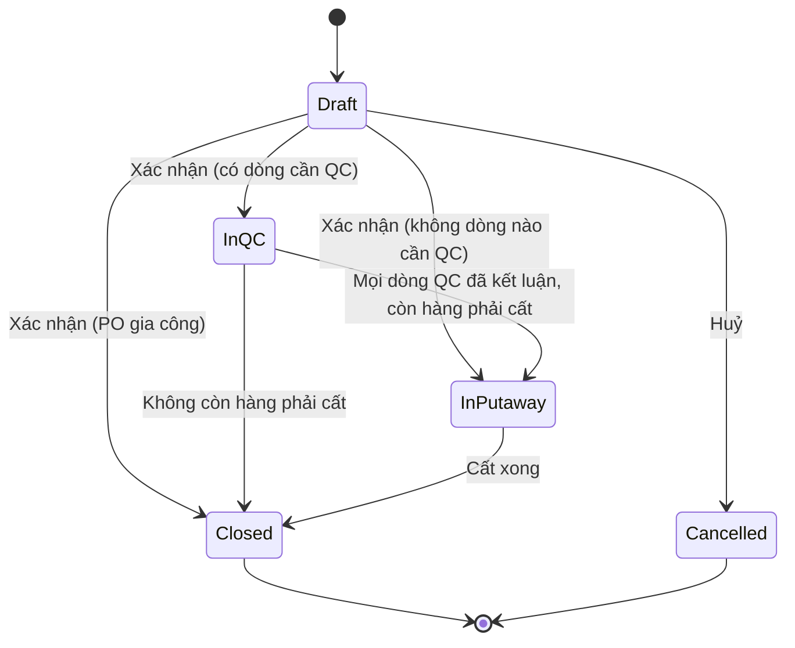

# 03 — Nhận hàng (Receipt / Goods Receipt)

## 1. Mục đích (Purpose)

Ghi nhận việc **hàng hoá thực tế về đến kho** theo **một** [PO](../02-purchase-order/README.md):

- kiểm đếm số lượng;
- ghi lô / hạn dùng (nếu SKU yêu cầu);
- **dán nhãn thùng LPN** cho hàng nguyên thùng;
- đưa hàng vào **khu nhận hàng** (WH/Input — Area `RECEIVING`);
- với SKU bắt buộc kiểm tra chất lượng, **chuyển hàng sang khu kiểm tra chất lượng** (WH/Quality Control — Area `QUALITY_CONTROL`) để QC kết luận.

Nhập kho được tổ chức theo **luồng nhiều bước**. Số bước phụ thuộc cờ **Yêu cầu QC khi nhận** của SKU ([01](../01-product-creation/README.md)):

| Luồng | Áp dụng cho | Các chặng |
|-------|-------------|-----------|
| **3 bước** | SKU bật cờ Yêu cầu QC | NCC → WH/Input (`RECEIVING`) → WH/Quality Control (`QUALITY_CONTROL`) → WH/Stock (bin) |
| **2 bước** | SKU không bật cờ | NCC → WH/Input (`RECEIVING`) → WH/Stock (bin) |

Module này bao phủ các chặng **đến hết kết luận QC**. Chặng cuối lên bin là [Putaway](../05-putaway/README.md).

Receipt là **điểm hàng hoá chính thức thuộc quyền kiểm soát của kho**, và là căn cứ để:

- cập nhật tiến độ PO (đã nhận / còn chờ);
- đối chiếu [hoá đơn NCC](../04-invoice/README.md) (three-way matching);
- sinh nhiệm vụ [Putaway](../05-putaway/README.md) để cất hàng lên vị trí lưu trữ.

**Hàng gia công ngoài** trả về cũng nhận theo luồng này, tham chiếu **PO gia công**:

- chỉ đếm thành phẩm (không dán thùng);
- không QC ở kho, không Putaway;
- phiếu nhận **đóng ngay khi xác nhận**; thành phẩm giao cho QC của LSX ([19](../19-production/README.md)).

Đối soát phôi (phế phẩm, phôi trả về) làm **sau đó** ở 19.

> ⚠️ Giả định: Tồn kho khả dụng để bán (available-to-promise) chỉ được cộng **sau khi Putaway hoàn tất**, không phải ngay khi Receipt. Hàng ở khu nhận hàng và khu QC coi là "đã nhận, chưa khả dụng" (`Inbound`). Xem [open-questions](../../open-questions/README.md).

---

## 2. Actor liên quan

| Actor | Vai trò |
|-------|---------|
| **Nhân viên kho (Warehouse Staff / Receiver)** | Tạo phiếu nhận, kiểm đếm, ghi lô / hạn dùng, dán nhãn thùng LPN (in / in lại nhãn), xác nhận phiếu, chuyển hàng sang khu QC, huỷ phiếu nháp |
| **Nhân viên mua hàng (Procurement Staff)** | Làm được các việc nhận hàng như nhân viên kho; được báo khi có chênh lệch hoặc hàng không đạt QC để làm việc với NCC |
| **Nhân viên QC (QC Staff)** | **Kết luận QC**: chia phần đạt / cách ly / không đạt cho từng dòng, kèm lý do |
| **Quản lý kho (Warehouse Manager)** | Làm được các việc của nhân viên kho; xử lý chênh lệch sau khi xác nhận bằng điều chỉnh tồn có duyệt ([20](../20-inventory-control/README.md)) |

- Mọi thao tác chỉ trong phạm vi **kho được gán**.

---

## 3. Input / Output

### Input

| Trường | Mô tả | Bắt buộc |
|--------|-------|----------|
| PO tham chiếu | **Một PO** `Confirmed` / `Partially Received`, chưa bị NCC từ chối | Có |
| Khu nhận hàng | Area loại `RECEIVING` của kho nhận (xem [06](../06-warehouse-map-slotting/README.md)) | Có (từng dòng) |
| Khu kiểm tra chất lượng | Area loại `QUALITY_CONTROL` của kho | Có nếu phiếu có SKU bật cờ Yêu cầu QC, hoặc là PO gia công |
| **Dòng nhận (receipt lines)** | Theo **dòng PO + lô**: số lượng thực nhận ≥ 1 (đơn vị tồn), lô, hạn dùng; 1–200 dòng | Có |
| **Thùng LPN** | Với hàng nguyên thùng: đơn vị đóng gói (đang dùng, khác đơn vị cơ sở), số lượng trong mỗi thùng (≥ 1) | Không |
| Cờ Yêu cầu QC khi nhận | Lấy từ SKU (module 01); PO gia công không QC tại kho | Có (mặc định: không yêu cầu) |
| Kết quả QC | Số lượng đạt / cách ly / không đạt của từng dòng; lý do và khu cách ly cho phần không đạt | Có với dòng cần QC |

### Output

| Kết quả | Dùng bởi |
|---------|----------|
| **Receipt number** (mã phiếu nhận) | 04 Invoice, 05 Putaway, truy vết |
| **Cảnh báo cận hạn** (hạn dùng ≤ 30 ngày tính từ ngày nhận) | NV kho, Quản lý kho |
| **Thùng LPN** — mã `LPN-yyyyMMdd-NNNNNN`, nhãn PDF (mã chữ, QR, Code 128) | Dán lên thùng; [20](../20-inventory-control/README.md) |
| **Cập nhật PO**: SL đã nhận, open quantity, trạng thái PO | 02 PO |
| **Tồn `Inbound` ở khu nhận hàng** theo SKU + lô (thùng `In Stock` + phần lẻ) khi phiếu được xác nhận | 05 Putaway, báo cáo tồn |
| **Kết quả QC** theo từng dòng (đạt / cách ly / không đạt) | 04 Invoice, 05 Putaway, hiệu suất NCC ([02](../02-purchase-order/README.md)) |
| **Hàng sẵn sàng cất** — dòng không cần QC (khi xác nhận) và phần đạt QC | 05 Putaway |
| **Tồn ở khu cách ly** (Area `QUARANTINE`) cho phần cách ly / không đạt | Quản lý kho, Procurement (trả NCC) |

---

## 4. Luồng nghiệp vụ từng bước (Step-by-step)

**Chặng 1 — Nhận hàng vào WH/Input**

1. **Tạo phiếu nhận** — NV kho chọn **một PO** `Confirmed` / `Partially Received` (chưa bị NCC từ chối) → phiếu `Draft`.
2. **Kiểm đếm** — nhập từng dòng (dòng PO + lô): số lượng thực nhận, khu nhận hàng, lô / hạn dùng. **Mỗi lần lưu là thay toàn bộ** bản đếm. Dòng đếm lại giữ nguyên mã dòng. Hệ thống kiểm:
   - dòng thuộc PO và còn mở; mỗi (dòng PO, lô) một dòng;
   - khu nhận là Area `RECEIVING` của kho nhận;
   - lô / hạn dùng đúng cấu hình SKU:
     - bắt buộc khi SKU theo dõi; **không được nhập** khi SKU không theo dõi;
     - hạn dùng phải **sau ngày nhận** và không vượt **ngày nhận + hạn dùng tối đa** của SKU.

     Mọi lỗi trả về cùng lúc, theo từng trường.
   - **dung sai nhận vượt** (BR-02).
3. **Cảnh báo cận hạn** — hạn dùng trong vòng **30 ngày** tính từ ngày nhận → cảnh báo, **không chặn**.
4. **Dán nhãn thùng LPN** — với hàng nguyên thùng, nhập các thùng của dòng (đơn vị đóng gói, số lượng mỗi thùng). Hệ thống:
   - cấp **mã LPN** cho thùng mới → thùng `Receiving`;
   - đếm lại các thùng đã liệt kê;
   - thùng có trên phiếu trước mà lần này không còn → `Void`.

   Tổng các thùng không vượt số lượng dòng. NV kho **in nhãn** theo dòng nhận, hoặc **in lại** theo mã LPN (tối đa 500 nhãn một lần; không in thùng `Void` / `Consumed` / `Lost`).
5. **Bỏ dòng** — dòng **đã từng có thùng** (kể cả thùng `Void`) không bỏ được, cũng không đổi đơn vị đóng gói được khi còn thùng cũ. Muốn làm lại thì huỷ phiếu và đếm lại.
6. **Xác nhận phiếu nhận** — hệ thống kiểm lại dung sai, và kiểm kho có khu QC nếu phiếu có dòng cần QC. Sau đó:
   - ghi tồn **`Inbound`** tại khu nhận hàng: mỗi thùng một dòng tồn bên trong thùng (thùng → `In Stock`, còn nguyên đai), phần còn lại là tồn lẻ;
   - cập nhật *SL đã nhận* và trạng thái PO (`Partially Received` / `Received`);
   - dòng **không cần QC** → **sẵn sàng cất** ([05](../05-putaway/README.md));
   - phiếu → **`In QC`** nếu có dòng cần QC, không thì **`In Putaway`**. Phiếu của **PO gia công** → **`Closed`** ngay.

**Chặng 2 — Chuyển sang WH/Quality Control và kiểm QC** *(chỉ dòng cần QC)*

7. **Chuyển hàng sang khu QC** — NV kho chuyển một dòng sang một Area `QUALITY_CONTROL`. Phần lẻ đi một lần; **thùng đi nguyên thùng**. Mỗi dòng chỉ chuyển một lần. Tồn vẫn `Inbound`.
8. **Kết luận QC** — QC Staff kiểm hàng tại khu QC, chia số lượng của dòng thành **đạt / cách ly / không đạt**:
   - tổng ba phần **bằng** số lượng đã nhận;
   - phần không đạt bắt buộc **lý do** và **khu cách ly** (Area `QUARANTINE`); phần **cách ly** và phần **không đạt** phải vào **hai khu cách ly khác nhau**;
   - có thể chỉ định **cả thùng** vào từng phần; thùng phải thuộc dòng, đang `In Stock` và nằm ở khu QC;
   - mỗi dòng **chỉ kết luận một lần**.
9. **Xử lý theo kết luận QC:**
   - **Đạt** → ở lại khu QC, vẫn `Inbound`, **sẵn sàng cất**.
   - **Cách ly** → chuyển sang khu cách ly, tồn `Quarantine`.
   - **Không đạt** → chuyển sang khu cách ly khác, tồn `Blocked`; chờ trả NCC. Không cất.

   Khi mọi dòng cần QC đã có kết luận: còn hàng phải cất → `In Putaway`, không thì `Closed`.

**Chặng 3 — Bàn giao và đóng phiếu**

10. **Bàn giao cho Putaway** — hệ thống mở **nhiệm vụ cất hàng** cho hàng sẵn sàng cất ([05](../05-putaway/README.md)): mỗi thùng một nhiệm vụ, phần lẻ của dòng một nhiệm vụ.
11. **Thông báo Invoice matching** — Receipt trở thành một vế trong three-way matching với [Invoice](../04-invoice/README.md); phần được đối chiếu thanh toán là phần không bị loại.
12. **Đóng phiếu nhận** — khi mọi dòng đã cất xong số phải cất (toàn bộ số nhận với dòng không QC, phần đạt với dòng có QC) → `Closed` tự động.

---

## 5. Trạng thái / Vòng đời (Lifecycle)

### 5.1. Trạng thái phiếu nhận (Receipt status)

| Trạng thái | Ý nghĩa | Chuyển tiếp cho phép | Ai thực hiện |
|------------|---------|----------------------|--------------|
| `Draft` | Đang kiểm đếm, dán thùng; sửa được | → `In QC` / `In Putaway` / `Closed` (xác nhận), → `Cancelled` | NV kho / Procurement |
| `In QC` | Đã xác nhận; còn ít nhất một dòng cần QC chưa có kết luận | → `In Putaway`, → `Closed` | NV kho / QC Staff |
| `In Putaway` | Mọi dòng cần QC đã có kết luận; đang cất hàng | → `Closed` | Hệ thống (khi cất xong) |
| `Closed` | Mọi dòng đã xử lý xong (PO gia công: đóng ngay khi xác nhận) | *(cuối)* | Hệ thống |
| `Cancelled` | Huỷ khi còn `Draft`; thùng → `Void` | *(cuối)* | NV kho / Procurement |

> Xác nhận là một bước, không phải trạng thái lưu lại: phiếu đi thẳng từ `Draft` sang `In QC` / `In Putaway` / `Closed`.

### 5.2. Trạng thái chất lượng của hàng nhận (theo dòng)

| Trạng thái | Ý nghĩa | Hệ quả |
|------------|---------|--------|
| `Not Required` | SKU không bật cờ Yêu cầu QC | Sẵn sàng cất từ khu `RECEIVING` ngay khi xác nhận phiếu |
| `Pending` | Cần QC, chưa có kết luận (chờ chuyển sang khu QC hoặc đang kiểm) | Tồn `Inbound`; không cất |
| `Accepted` | Đạt QC | Sẵn sàng cất từ khu `QUALITY_CONTROL`; thành tồn khả dụng sau Putaway |
| `Quarantine` | Cách ly | Chuyển sang Area `QUARANTINE`, tồn `Quarantine` |
| `Rejected` | Không đạt | Chuyển sang một Area `QUARANTINE` khác, tồn `Blocked`; trả NCC; không nhập tồn khả dụng |
| `Production QC` | Dòng của PO gia công | Không QC ở kho; QC của LSX ([19](../19-production/README.md)) |

---

## 6. Ràng buộc nghiệp vụ (Business Rules) & Edge case

### Business rules

- **BR-01:** Chỉ tạo phiếu nhận cho PO `Confirmed` / `Partially Received`, chưa bị NCC từ chối. **Một phiếu nhận = một PO.**
- **BR-02:** Tổng SL nhận luỹ kế của một dòng PO ≤ *SL đặt × (1 + dung sai nhận vượt của NCC)*, làm tròn xuống. NCC không khai báo → 0. Tổng tính trên **mọi phiếu nhận chưa huỷ** của PO, kể cả phiếu nháp. Kiểm khi đếm và khi xác nhận. Vượt → **luôn chặn**.
- **BR-03:** SKU theo dõi lô / hạn dùng → **bắt buộc** nhập. SKU không theo dõi → **không được** nhập.
- **BR-04:** Hàng chưa qua Putaway (`Inbound` ở khu nhận hàng hoặc khu QC), hàng `Quarantine` và hàng `Blocked` **không** được tính vào tồn khả dụng bán.
- **BR-05:** Chỉ phiếu `Draft` được huỷ (thùng → `Void`). Phiếu đã xác nhận không xoá, không huỷ; sai sót xử lý bằng **điều chỉnh tồn có duyệt** ([20 §4.3](../20-inventory-control/README.md)).
- **BR-06:** Hạn dùng phải **sau ngày nhận** và ≤ ngày nhận + hạn dùng tối đa của SKU. Hạn dùng trong vòng 30 ngày tính từ ngày nhận → cảnh báo cận hạn.
- **BR-07:** Dòng nhận của SKU bật cờ Yêu cầu QC **không** được cất trước khi có kết luận QC. Hàng chỉ cất từ khu `QUALITY_CONTROL`, không đi tắt từ khu `RECEIVING` lên bin.
- **BR-08:** QC chỉ kết luận cho dòng **đã chuyển sang khu QC**, mỗi dòng một lần.
  - Tổng đạt + cách ly + không đạt = số đã nhận.
  - Phần không đạt có lý do.
  - Phần **cách ly** và phần **không đạt** vào **hai khu cách ly khác nhau**.
- **BR-09:** Mọi lần hàng đổi chỗ trong luồng nhận (khu nhận hàng → khu QC → khu cách ly / bin) đều ghi **dòng sổ biến động** có chứng từ nguồn là phiếu nhận ([20](../20-inventory-control/README.md)); không sửa tồn trực tiếp.
- **BR-10:** Phiếu nhận của **PO gia công** không dán thùng, không QC ở kho, không cất. Phiếu **đóng ngay khi xác nhận** và thành phẩm giao QC của LSX. **Đối soát phôi** (phế phẩm, phôi trả về, hao hụt vượt mức do Quản lý kho duyệt) làm ở [19](../19-production/README.md) BR-16, BR-17 sau khi nhận.
- **BR-11:** **Thùng LPN:**
  - Thùng dán nhãn trên dòng nhận của phiếu `Draft`.
  - Thùng → `In Stock` khi phiếu xác nhận.
  - Thùng luôn đi **nguyên thùng** khi chuyển QC và khi kết luận QC.
  - Dòng đã có thùng không bỏ được.
  - Mã LPN không trùng; có thể có khoảng trống trong dãy số.
- **BR-12:** Kho phải có **khu QC** mới xác nhận được phiếu có dòng cần QC (hoặc phiếu PO gia công).

### Edge case

| Tình huống | Hướng xử lý |
|------------|-------------|
| Hàng về không có PO (nhận khẩn, hàng mẫu, quà kèm) | Chưa hỗ trợ. ⚠️ Giả định: "nhận không PO" (blind receipt) thuộc phạm vi sau — [open-questions C19](../../open-questions/README.md); hiện phải lập PO trước |
| Một chuyến giao nhiều PO | Mỗi PO một phiếu nhận |
| Sai SKU trên phiếu giao NCC | Chỉ nhận dòng có trên PO; SKU không có trên PO → không nhận, làm việc với NCC / lập PO bổ sung |
| Giao vượt dung sai | Chặn; nhận đúng phần trong dung sai, phần vượt trả NCC |
| Thùng hỏng, nghi hụt bên trong | Ghi nhận có điều kiện (conditional receipt); dòng đó **bắt buộc đi qua khu QC** dù SKU không bật cờ Yêu cầu QC (⚠️ giả định — [open-questions C15](../../open-questions/README.md)); mở khiếu nại NCC |
| NCC giao lô có hạn dùng ngắn | Cảnh báo cận hạn; Quản lý kho quyết định nhận / từ chối |
| Đếm lại một dòng đã dán thùng | Lưu lại bản đếm: thùng còn liệt kê được đếm lại, thùng bỏ ra thành `Void` |
| Kiểm đếm lại sau khi xác nhận phát hiện lệch | Điều chỉnh tồn có duyệt ([20 §4.3](../20-inventory-control/README.md)) tại khu đang chứa hàng; thông báo Procurement |
| Số lượng đếm được tại khu QC khác số đã chuyển | QC Staff không kết luận; báo Quản lý kho xử lý bằng điều chỉnh tồn ([20 §4.3](../20-inventory-control/README.md)) trước khi kiểm |
| Khu QC chưa được khai báo nhưng phiếu có SKU cần QC | Chặn xác nhận; Admin phải khai báo Area `QUALITY_CONTROL` cho kho ([06](../06-warehouse-map-slotting/README.md)) |
| Hàng cách ly cần kết luận lại | ⚠️ Giả định: luồng **kết luận lại** hàng cách ly (đạt → cất từ khu cách ly, hoặc không đạt) chưa có trong hệ thống — [open-questions C10](../../open-questions/README.md) |
| Hàng không đạt đã trả NCC | Dòng sổ xuất khỏi kho làm giảm tồn `Blocked` tại khu cách ly |
| Nhà gia công trả thiếu thành phẩm / thiếu phôi | Ghi số thực nhận; đối soát phôi và hao hụt ở [19](../19-production/README.md) |
| Huỷ PO khi đang có phiếu nhận nháp | Chặn; xác nhận hoặc huỷ phiếu nháp trước |

---

## 7. Liên kết với các module khác

| Module | Quan hệ |
|--------|---------|
| [02 · Purchase Order](../02-purchase-order/README.md) | Phiếu nhận tham chiếu một PO; dung sai nhận vượt của NCC; cập nhật SL đã nhận & trạng thái PO; phiếu nháp chặn huỷ / đóng ép PO |
| [04 · Invoice](../04-invoice/README.md) | Receipt là vế "hàng thực nhận" trong three-way matching; phần không đạt không được thanh toán |
| [05 · Putaway](../05-putaway/README.md) | Hàng sẵn sàng cất mở nhiệm vụ cất (mỗi thùng / mỗi phần lẻ); cất xong → phiếu `Closed` |
| [01 · Product Creation](../01-product-creation/README.md) | Cấu hình lô / hạn dùng / hạn dùng tối đa, đơn vị đóng gói và cờ Yêu cầu QC của SKU |
| [06 · Warehouse Map & Slotting](../06-warehouse-map-slotting/README.md) | Khu nhận hàng (`RECEIVING`), khu QC (`QUALITY_CONTROL`), khu cách ly (`QUARANTINE`) |
| [19 · Production](../19-production/README.md) | Nhận hàng gia công; phiếu đóng ngay, LSX con sang `QC`; đối soát phôi |
| [10 · Inter-warehouse Transfer](../10-inter-warehouse-transfer/README.md) | Nhận hàng chuyển kho tại kho đích chưa có trong hệ thống (xem 10 §4 ghi chú hiện trạng); phiếu nhận ở module này chỉ dùng cho PO |
| [20 · Inventory Control](../20-inventory-control/README.md) | Thùng LPN và vòng đời thùng; sai lệch sau khi xác nhận xử lý bằng điều chỉnh tồn có duyệt; phiếu nhận là nguồn gốc cho truy xuất lô |
