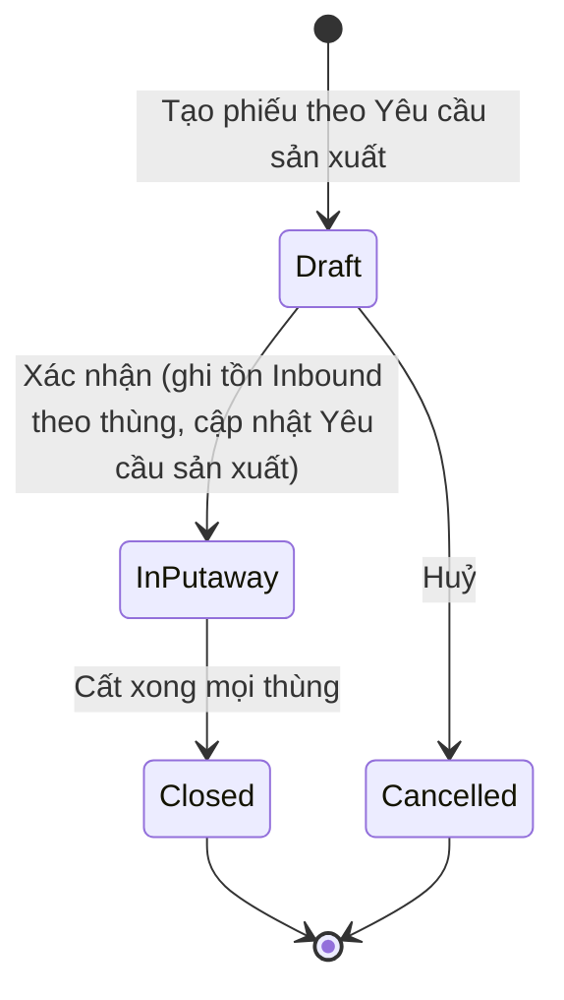

# 03 — Nhập kho thành phẩm (Finished Goods Receipt)

## 1. Mục đích (Purpose)

Ghi nhận việc **thành phẩm từ bộ phận sản xuất về đến kho** theo **một** [Yêu cầu sản xuất (Production Request)](../../ecommerce/17-order-management/README.md) — chứng từ thuộc module 17:

- kiểm đếm **theo số thùng**: dán nhãn **LPN** cho từng thùng; mọi thùng nhận vào đúng **số cái chuẩn / thùng** của SKU;
- đối chiếu **số thùng** thực nhận với số thùng yêu cầu (**đủ / thiếu / thừa**);
- ghi lô / hạn dùng (nếu SKU yêu cầu);
- đưa hàng vào **khu nhận hàng** (WH/Input — Area `RECEIVING`).

> **Đã chốt 2026-11-04:** kho chỉ là **kho thành phẩm**; sản xuất nằm ngoài hệ thống. Nhập kho chỉ theo **Yêu cầu sản xuất**, **không kiểm tra chất lượng tại kho** (bộ phận sản xuất đã kiểm chất lượng) — kho chỉ đếm đủ / thiếu / thừa. Mọi thành phẩm về kho **đã được bộ phận sản xuất đóng thùng sẵn**; kho nhập **theo thùng**, không nhập hàng ngoài thùng.

Nhập kho thành phẩm đi **2 bước**:

| Chặng | Từ → Đến | Module |
|-------|----------|--------|
| 1 | Bộ phận sản xuất → WH/Input (Area `RECEIVING`) | 03 (module này) |
| 2 | WH/Input → WH/Stock (bin), nguyên thùng | [05 · Putaway](../05-putaway/README.md) |

Hàng nhập là **SKU thành phẩm theo mẫu của khách** ([01](../01-product-creation/README.md)), đã mang thiết kế của khách. Tồn ghi theo đúng SKU trên dòng Yêu cầu sản xuất.

Phiếu nhập kho là **điểm hàng hoá chính thức thuộc quyền kiểm soát của kho**, và là căn cứ để:

- cập nhật tiến độ Yêu cầu sản xuất (đã nhận / còn thiếu) ở [17](../../ecommerce/17-order-management/README.md);
- sinh nhiệm vụ [Putaway](../05-putaway/README.md) — mỗi thùng một nhiệm vụ.

> ⚠️ Giả định: Tồn kho khả dụng để bán (available-to-promise) chỉ được cộng **sau khi Putaway hoàn tất**, không phải ngay khi nhập. Hàng ở khu nhận hàng coi là "đã nhận, chưa khả dụng" (`Inbound`). Xem [open-questions](../../open-questions/README.md).

> **Đã chốt 2026-11-05:** số lượng trên Yêu cầu sản xuất là **số thùng**. Bộ phận sản xuất đóng **mọi thùng đúng số cái chuẩn / thùng** của SKU ([01](../01-product-creation/README.md) BR-11). Kho đếm **số thùng**; thùng có số cái **khác số chuẩn thì không nhận** — trả lại bộ phận sản xuất, phần đó **vẫn mở** trên Yêu cầu sản xuất (BR-13). Không có khái niệm thùng ít hơn số chuẩn. Xem [open-questions B24](../../open-questions/README.md).

> ⚠️ Giả định: hàng lỗi phát hiện **sau khi** phiếu đã xác nhận được đổi trả với bộ phận sản xuất **ngoài hệ thống**; trong hệ thống chỉ ghi nhận bằng điều chỉnh tồn có duyệt hoặc chuyển sang khu cách ly (Area `QUARANTINE`) ở [20](../20-inventory-control/README.md). Xem [open-questions](../../open-questions/README.md).

---

## 2. Actor liên quan

| Actor | Vai trò |
|-------|---------|
| **Nhân viên kho (Warehouse Staff / Receiver)** | Tạo phiếu nhập, kiểm đếm theo thùng, ghi lô / hạn dùng, dán nhãn thùng LPN (in / in lại nhãn), xác nhận phiếu, huỷ phiếu nháp |
| **Quản lý kho (Warehouse Manager)** | Làm được các việc của nhân viên kho; quyết định nhận / không nhận lô cận hạn; xử lý chênh lệch sau khi xác nhận bằng điều chỉnh tồn có duyệt ([20](../20-inventory-control/README.md)) |
| **Điều phối đơn hàng (Order Coordinator)** | Không thao tác phiếu nhập. Chủ Yêu cầu sản xuất ([17](../../ecommerce/17-order-management/README.md)): theo dõi số đã nhận / còn thiếu, được báo khi nhận thiếu hoặc bị từ chối nhận, quyết định đóng thiếu |
| **Bộ phận sản xuất** *(ngoài hệ thống)* | Giao thành phẩm **đã đóng thùng đúng số chuẩn** tới kho kèm phiếu giao, ghi số Yêu cầu sản xuất và số thùng; nhận lại thùng thừa / thùng lỗi / thùng lệch số chuẩn bị từ chối |
| **Hệ thống** | Kiểm số thùng nhận luỹ kế không vượt số thùng yêu cầu; cấp mã LPN; ghi tồn `Inbound` theo thùng và sổ biến động; cập nhật Yêu cầu sản xuất; mở nhiệm vụ cất; đóng phiếu khi cất xong |

- Mọi thao tác chỉ trong phạm vi **kho được gán**.

---

## 3. Input / Output

### Input

| Trường | Mô tả | Bắt buộc |
|--------|-------|----------|
| Yêu cầu sản xuất tham chiếu | **Một** Yêu cầu sản xuất đang mở (`Sent` / `In Production` / `Partially Received`) có **kho nhận** là kho của phiếu ([17](../../ecommerce/17-order-management/README.md)) | Có |
| Khu nhận hàng | Area loại `RECEIVING` của kho nhận (xem [06](../06-warehouse-map-slotting/README.md)) | Có (từng dòng) |
| **Dòng nhập (receipt lines)** | Theo **dòng Yêu cầu sản xuất + lô**: lô, hạn dùng; 1–200 dòng. Số thực nhận của dòng = **số thùng** của dòng (kèm số cái = số thùng × số cái chuẩn / thùng) | Có |
| **Thùng LPN** | Mỗi dòng có **ít nhất một thùng**. Mỗi thùng: đơn vị thùng (theo **quy cách thùng** của SKU — [01](../01-product-creation/README.md)); số cái trong thùng **luôn bằng số cái chuẩn / thùng** (hệ thống gán, không nhập số khác — BR-13) | Có |

### Output

| Kết quả | Dùng bởi |
|---------|----------|
| **Receipt number** (mã phiếu nhập) | 05 Putaway, 17 (tiến độ Yêu cầu sản xuất), truy vết |
| **Kết quả kiểm đếm** theo dòng, tính theo **số thùng** (kèm số cái): số yêu cầu, số đã nhận luỹ kế, số còn thiếu | Điều phối đơn hàng ([17](../../ecommerce/17-order-management/README.md)), Quản lý kho |
| **Cảnh báo cận hạn** (hạn dùng ≤ 30 ngày tính từ ngày nhận) | NV kho, Quản lý kho |
| **Thùng LPN** — mã `LPN-yyyyMMdd-NNNNNN`, nhãn PDF (mã chữ, QR, Code 128) | Dán lên thùng; [05](../05-putaway/README.md), [07](../07-picking/README.md), [20](../20-inventory-control/README.md) |
| **Cập nhật Yêu cầu sản xuất**: số thùng đã nhận, số thùng còn thiếu, trạng thái (`Partially Received` / `Received`) | [17](../../ecommerce/17-order-management/README.md) |
| **Tồn `Inbound` ở khu nhận hàng** theo SKU + lô, **nằm trong từng thùng** (thùng `In Stock`) khi phiếu được xác nhận | 05 Putaway, báo cáo tồn |
| **Thùng sẵn sàng cất** — mọi thùng của phiếu khi xác nhận | 05 Putaway |

---

## 4. Luồng nghiệp vụ từng bước (Step-by-step)

**Chặng 1 — Nhập vào WH/Input**

1. **Tạo phiếu nhập** — Bộ phận sản xuất giao các thùng thành phẩm kèm phiếu giao ghi số Yêu cầu sản xuất. NV kho chọn **một Yêu cầu sản xuất** đang mở, kho nhận đúng kho mình → phiếu `Draft`.
2. **Kiểm đếm theo thùng** — với từng dòng (dòng Yêu cầu sản xuất + lô): chọn khu nhận hàng, ghi lô / hạn dùng, rồi **liệt kê các thùng** nhận. Mỗi thùng mang đúng số cái chuẩn / thùng của SKU; thùng có số cái **khác số chuẩn** thì **không liệt kê, không nhận** — trả lại bộ phận sản xuất (BR-13). Hệ thống:
   - cấp **mã LPN** cho thùng mới → thùng `Receiving`; thùng đã liệt kê trước được đếm lại; thùng có trên lần lưu trước mà lần này không còn → `Void`;
   - tính **số thực nhận của dòng = số thùng** (kèm số cái).

   **Mỗi lần lưu là thay toàn bộ** bản đếm; dòng đếm lại giữ nguyên mã dòng. Hệ thống kiểm:
   - dòng thuộc Yêu cầu sản xuất và còn mở; mỗi (dòng yêu cầu, lô) một dòng;
   - khu nhận là Area `RECEIVING` của kho nhận;
   - lô / hạn dùng đúng cấu hình SKU:
     - bắt buộc khi SKU theo dõi; **không được nhập** khi SKU không theo dõi;
     - hạn dùng phải **sau ngày nhận** và không vượt **ngày nhận + hạn dùng tối đa** của SKU.

     Mọi lỗi trả về cùng lúc, theo từng trường.
   - **không nhận vượt** số thùng yêu cầu (BR-02).
3. **Đối chiếu đủ / thiếu / thừa** — hệ thống hiện, theo từng dòng, **số thùng** thực nhận so với số thùng còn mở của dòng yêu cầu:

   | Kết quả | Điều kiện | Xử lý |
   |---------|-----------|-------|
   | **Đủ** | Số thùng nhận luỹ kế = số thùng yêu cầu | Dòng yêu cầu nhận xong |
   | **Thiếu** | Số thùng nhận luỹ kế < số thùng yêu cầu (kể cả do thùng lệch số chuẩn bị trả lại) | Nhận các thùng đúng chuẩn thực có; phần thiếu **vẫn mở** trên Yêu cầu sản xuất (BR-10, BR-13) |
   | **Thừa** | Số thùng nhận luỹ kế > số thùng yêu cầu | **Chặn**; không nhận thùng làm vượt số còn mở — trả nguyên thùng lại bộ phận sản xuất (BR-02) |

4. **Cảnh báo cận hạn** — hạn dùng trong vòng **30 ngày** tính từ ngày nhận → cảnh báo, **không chặn**.
5. **In & dán nhãn LPN** — NV kho **in nhãn** theo dòng nhập, hoặc **in lại** theo mã LPN (tối đa 500 nhãn một lần; không in thùng `Void` hoặc thất lạc; thùng đã lấy cho đơn vẫn in lại được khi nhãn LPN rách / mất — xem vòng đời thùng ở [20](../20-inventory-control/README.md)), rồi dán lên từng thùng.
6. **Bỏ dòng** — dòng **đã từng có thùng** (kể cả thùng `Void`) không bỏ được, cũng không đổi đơn vị thùng được khi còn thùng cũ. Muốn làm lại thì huỷ phiếu và đếm lại.
7. **Xác nhận phiếu nhập** — hệ thống kiểm mỗi dòng có ít nhất một thùng và kiểm lại số nhận luỹ kế (BR-02). Sau đó:
   - ghi tồn **`Inbound`** tại khu nhận hàng: **mỗi thùng một dòng tồn bên trong thùng**, thùng → `In Stock`;
   - cập nhật *số thùng đã nhận* và trạng thái Yêu cầu sản xuất (`Partially Received` / `Received`) ở [17](../../ecommerce/17-order-management/README.md);
   - mọi thùng → **sẵn sàng cất** ([05](../05-putaway/README.md));
   - phiếu → **`In Putaway`**.

**Chặng 2 — Bàn giao cho Putaway và đóng phiếu**

8. **Bàn giao cho Putaway** — hệ thống mở **nhiệm vụ cất hàng** ([05](../05-putaway/README.md)): **mỗi thùng một nhiệm vụ**, cất nguyên thùng.
9. **Đóng phiếu nhập** — khi mọi thùng của phiếu đã được cất → `Closed` tự động. Hàng cất xong thành tồn `Available`; [17](../../ecommerce/17-order-management/README.md) dùng tồn này để đưa đơn `Awaiting Stock` sang `Ready to Fulfill`.

---

## 5. Trạng thái / Vòng đời (Lifecycle)

### Trạng thái phiếu nhập (Receipt status)

| Trạng thái | Ý nghĩa | Chuyển tiếp cho phép | Ai thực hiện |
|------------|---------|----------------------|--------------|
| `Draft` | Đang kiểm đếm, dán thùng; sửa được | → `In Putaway` (xác nhận), → `Cancelled` | NV kho / Quản lý kho |
| `In Putaway` | Đã xác nhận; tồn `Inbound` trong các thùng ở khu nhận hàng; đang cất hàng | → `Closed` | Hệ thống (khi cất xong) |
| `Closed` | Mọi thùng đã cất | *(cuối)* | Hệ thống |
| `Cancelled` | Huỷ khi còn `Draft`; thùng → `Void` | *(cuối)* | NV kho / Quản lý kho |

> Xác nhận là một bước, không phải trạng thái lưu lại: phiếu đi thẳng từ `Draft` sang `In Putaway`. Vòng đời thùng LPN (`Receiving` → `In Stock` …) mô tả ở [20](../20-inventory-control/README.md).

---

## 6. Ràng buộc nghiệp vụ (Business Rules) & Edge case

### Business rules

- **BR-01:** Chỉ tạo phiếu nhập cho Yêu cầu sản xuất đang mở (`Sent` / `In Production` / `Partially Received`), tại đúng **kho nhận** của yêu cầu. **Một phiếu nhập = một Yêu cầu sản xuất.** Yêu cầu `Draft`, `Received`, `Closed`, `Cancelled` không nhận được.
- **BR-02:** Tổng **số thùng** nhận luỹ kế của một dòng Yêu cầu sản xuất ≤ **số thùng yêu cầu**. Tổng tính trên **mọi phiếu nhập chưa huỷ** của yêu cầu, kể cả phiếu nháp. Kiểm khi đếm và khi xác nhận. Vượt → **chặn**; thùng làm vượt không được nhận (không mở thùng để nhận một phần). ⚠️ Giả định: không có dung sai nhận vượt (tính theo số thùng); dung sai cấu hình được là phạm vi sau. Xem [open-questions](../../open-questions/README.md).
- **BR-03:** SKU theo dõi lô / hạn dùng → **bắt buộc** nhập. SKU không theo dõi → **không được** nhập.
- **BR-04:** Hàng chưa qua Putaway (`Inbound` ở khu nhận hàng) **không** được tính vào tồn khả dụng bán.
- **BR-05:** Chỉ phiếu `Draft` được huỷ (thùng → `Void`). Phiếu đã xác nhận không xoá, không huỷ; sai sót xử lý bằng **điều chỉnh tồn có duyệt** ([20 §4.3](../20-inventory-control/README.md)).
- **BR-06:** Hạn dùng phải **sau ngày nhận** và ≤ ngày nhận + hạn dùng tối đa của SKU. Hạn dùng trong vòng 30 ngày tính từ ngày nhận → cảnh báo cận hạn.
- **BR-07:** **Không kiểm tra chất lượng tại kho** *(Đã chốt 2026-11-04)*. Kho chỉ kiểm đếm số thùng, thùng đúng số cái chuẩn, lô. Xác nhận phiếu → mọi thùng sẵn sàng cất ngay từ khu `RECEIVING`.
- **BR-08:** Mọi lần hàng đổi chỗ trong luồng nhập (khu nhận hàng → bin) đều ghi **dòng sổ biến động** có chứng từ nguồn là phiếu nhập hoặc nhiệm vụ cất ([20](../20-inventory-control/README.md)); không sửa tồn trực tiếp.
- **BR-09:** **Thùng LPN:**
  - Thùng dán nhãn trên dòng nhập của phiếu `Draft` → `Receiving`.
  - Thùng → `In Stock` khi phiếu xác nhận.
  - Thùng luôn được cất **nguyên thùng** ([05](../05-putaway/README.md)).
  - Dòng đã có thùng không bỏ được.
  - Mã LPN không trùng; có thể có khoảng trống trong dãy số.
- **BR-10:** **Nhận thiếu** không đóng dòng yêu cầu: phần thiếu vẫn mở trên Yêu cầu sản xuất để nhận ở phiếu sau. Chỉ Điều phối đơn hàng **đóng thiếu** Yêu cầu sản xuất ở [17](../../ecommerce/17-order-management/README.md); phiếu nhập không tự đóng yêu cầu.
- **BR-11:** Hàng nhập ghi tồn theo **đúng SKU trên dòng Yêu cầu sản xuất**. Tồn thuộc SKU, **không gắn sẵn với đơn** (gắn đơn là việc phân bổ ở [17](../../ecommerce/17-order-management/README.md) / [20](../20-inventory-control/README.md)).
- **BR-12:** **Chỉ nhập theo thùng** *(Đã chốt 2026-11-04)*: mọi hàng nhận đều nằm trong một thùng LPN; mỗi dòng nhập có ít nhất một thùng; số thực nhận của dòng bằng số thùng. Không có tồn ngoài thùng.
- **BR-13:** **Mọi thùng đúng số cái chuẩn** *(Đã chốt 2026-11-05)*: số cái trong mỗi thùng nhận vào bằng **số cái chuẩn / thùng** của SKU ([01](../01-product-creation/README.md) BR-11). Thùng có số cái khác số chuẩn (thiếu hay thừa) **không được nhận**: trả nguyên thùng lại bộ phận sản xuất, phần tương ứng **vẫn mở** trên Yêu cầu sản xuất.

### Edge case

| Tình huống | Hướng xử lý |
|------------|-------------|
| Hàng về không có Yêu cầu sản xuất | Chưa hỗ trợ nhận không chứng từ; mọi phiếu nhập phải theo một Yêu cầu sản xuất đang mở (Yêu cầu sản xuất chỉ phát sinh từ đơn — [17](../../ecommerce/17-order-management/README.md)). ⚠️ Giả định: nhận không chứng từ (blind receipt) là phạm vi sau — [open-questions C19](../../open-questions/README.md) |
| Một chuyến giao hàng của nhiều Yêu cầu sản xuất | Mỗi Yêu cầu sản xuất một phiếu nhập |
| Giao SKU không có trên Yêu cầu sản xuất | Không nhận các thùng đó; trả lại bộ phận sản xuất; báo Điều phối |
| Hàng giao rời, chưa đóng thùng | Không nhận (BR-12); bộ phận sản xuất đóng thùng rồi giao lại |
| Thùng có số cái khác số chuẩn / thùng (thiếu hoặc thừa) | Không nhận thùng đó, trả lại bộ phận sản xuất; phần đó vẫn mở trên Yêu cầu sản xuất để nhận ở phiếu sau (BR-13); báo Điều phối |
| Giao vượt số yêu cầu | Chặn; nhận các thùng trong phạm vi số còn mở, thùng làm vượt trả nguyên thùng lại bộ phận sản xuất (BR-02) |
| Giao thiếu | Nhận các thùng thực có; Yêu cầu sản xuất → `Partially Received`; lần giao sau là phiếu nhập mới, hoặc Điều phối đóng thiếu ở 17 |
| Thùng lỗi thấy rõ khi kiểm đếm (móp, in sai, bẩn) | ⚠️ Giả định: không nhận thùng lỗi, trả nguyên thùng lại bộ phận sản xuất ngay khi giao; phần đó vẫn mở trên Yêu cầu sản xuất. Xem [open-questions](../../open-questions/README.md) |
| Hàng lỗi phát hiện sau khi đã xác nhận phiếu | Điều chỉnh tồn có duyệt hoặc chuyển thùng sang khu `QUARANTINE` ([20](../20-inventory-control/README.md)); đổi trả với bộ phận sản xuất ngoài hệ thống (⚠️ giả định §1) |
| Lô có hạn dùng ngắn | Cảnh báo cận hạn; Quản lý kho quyết định nhận / trả lại |
| Đếm lại một dòng đã dán thùng | Lưu lại bản đếm: thùng còn liệt kê được đếm lại, thùng bỏ ra thành `Void` |
| Nhãn LPN bị rách / mất trước khi cất | In lại theo mã LPN |
| Sau khi xác nhận mới phát hiện một thùng lệch số cái chuẩn | ⚠️ Giả định: thùng lệch không được phân bổ — chuyển thùng sang khu `QUARANTINE` rồi loại cả thùng khỏi tồn bằng điều chỉnh tồn có duyệt ([20 §4.3](../20-inventory-control/README.md)); đổi trả với bộ phận sản xuất ngoài hệ thống; báo Điều phối. Xem [open-questions](../../open-questions/README.md) |
| Huỷ hoặc đóng thiếu Yêu cầu sản xuất khi đang có phiếu nhập nháp | Chặn; xác nhận hoặc huỷ phiếu nháp trước |

---

## 7. Liên kết với các module khác

| Module | Quan hệ |
|--------|---------|
| [17 · Order Management](../../ecommerce/17-order-management/README.md) | Phiếu nhập tham chiếu một Yêu cầu sản xuất (phát sinh từ đơn); cập nhật số thùng đã nhận & trạng thái yêu cầu (`Partially Received` / `Received`); phiếu nháp chặn huỷ / đóng thiếu yêu cầu; hàng cất xong là căn cứ đưa đơn `Awaiting Stock` sang `Ready to Fulfill` |
| [05 · Putaway](../05-putaway/README.md) | Xác nhận phiếu mở nhiệm vụ cất (mỗi thùng một nhiệm vụ); cất xong mọi thùng → phiếu `Closed` |
| [01 · Product Creation](../01-product-creation/README.md) | SKU thành phẩm theo mẫu của khách; quy cách thùng (số cái chuẩn / thùng) là căn cứ nhận — thùng lệch số chuẩn không nhận; cấu hình lô / hạn dùng / hạn dùng tối đa |
| [06 · Warehouse Map & Slotting](../06-warehouse-map-slotting/README.md) | Khu nhận hàng (`RECEIVING`); khu cách ly (`QUARANTINE`) cho hàng lỗi phát hiện sau khi nhập |
| [07 · Picking](../07-picking/README.md) | Thùng LPN dán khi nhập là đơn vị lấy hàng (nguyên thùng) |
| [10 · Inter-warehouse Transfer](../10-inter-warehouse-transfer/README.md) | Nhận hàng chuyển kho tại kho đích chưa có trong hệ thống (xem 10 §4 ghi chú hiện trạng); phiếu nhập ở module này chỉ dùng cho Yêu cầu sản xuất |
| [20 · Inventory Control](../20-inventory-control/README.md) | Thùng LPN và vòng đời thùng; sai lệch, hàng lỗi sau khi xác nhận xử lý bằng điều chỉnh tồn có duyệt / khu cách ly; phiếu nhập là nguồn gốc cho truy xuất lô |
