# 03 — Nhập kho thành phẩm (Finished Goods Receipt)

## 1. Mục đích (Purpose)

Ghi nhận việc **thùng thành phẩm về đến kho** và đưa chúng vào sự kiểm soát của kho. Có **hai loại phiếu nhập** *(Đã chốt 2026-11-05)*:

| Loại phiếu | Nguồn hàng | Chứng từ tham chiếu | Khu nhận | Bước tiếp theo |
|------------|------------|---------------------|----------|----------------|
| **Theo Đơn sản xuất** (`PRODUCTION`) | Đơn vị sản xuất giao thành phẩm mới | **Một** [Đơn sản xuất (Production Order)](../../ecommerce/17-order-management/README.md) — chứng từ thuộc module 17 | `RECEIVING` | Cất lên bin ([05](../05-putaway/README.md)) |
| **Hàng hoàn** (`RETURN`) | Hàng hãng vận chuyển hoàn về (RTO), hoặc hàng khách trả theo yêu cầu trả hàng | Shipment hoàn về ([09](../09-shipping/README.md)) **hoặc** yêu cầu trả hàng đã duyệt (RMA) của đơn ([17 §4.10](../../ecommerce/17-order-management/README.md)); một chứng từ có thể có **nhiều phiếu** | `QUARANTINE` | Thùng nguyên niêm: Quản lý kho quyết định gỡ cách ly hoặc ghi giảm ([20](../20-inventory-control/README.md)). Thùng đã mở / hàng lẻ: **không nhập tồn**. Hàng ngoài phạm vi duyệt: **hàng giữ hộ** khách (§4.3) |

**Đơn vị sản xuất** là xưởng của công ty hoặc đối tác ngoài, khai báo trong danh mục Đơn vị sản xuất ([17](../../ecommerce/17-order-management/README.md)); sản xuất nằm ngoài hệ thống.

Với phiếu **theo Đơn sản xuất**, kho:

- kiểm đếm **theo số thùng**: dán nhãn **LPN** cho từng thùng; mọi thùng nhận vào đúng **số cái chuẩn / thùng** của SKU;
- đối chiếu **số thùng** thực nhận với số thùng trên Đơn sản xuất (**đủ / thiếu / thừa**);
- gán **lô sản xuất** cho mọi thùng — lô = **mã Đơn sản xuất**, hệ thống tự gán (BR-03);
- đưa hàng vào **khu nhận hàng** (WH/Input — Area `RECEIVING`).

> **Đã chốt 2026-11-04:** kho chỉ là **kho thành phẩm**. Nhập thành phẩm mới chỉ theo **Đơn sản xuất**, **không kiểm tra chất lượng tại kho** (đơn vị sản xuất đã kiểm chất lượng) — kho chỉ đếm đủ / thiếu / thừa. Mọi thành phẩm về kho **đã được đơn vị sản xuất đóng thùng sẵn**; kho nhập **theo thùng**, không nhập hàng ngoài thùng.

> **Đã chốt 2026-11-05:** ly / bao bì **không có hạn dùng** — phiếu nhập không ghi hạn dùng, không có cảnh báo cận hạn. **Lô** là **lô sản xuất** gắn Đơn sản xuất, dùng để truy vết ([20](../20-inventory-control/README.md)).

> ✅ Đã chốt 2026-11-05: **lô bắt buộc** với mọi SKU riêng ([01](../01-product-creation/README.md) BR-17). Khi nhập theo Đơn sản xuất, hệ thống **tự gán lô = mã Đơn sản xuất** của phiếu cho mọi thùng; NV kho không nhập, không sửa lô. Thùng hàng hoàn **giữ lô gốc** (BR-03).

Nhập thành phẩm theo Đơn sản xuất đi **2 bước**:

| Chặng | Từ → Đến | Module |
|-------|----------|--------|
| 1 | Đơn vị sản xuất → WH/Input (Area `RECEIVING`) | 03 (module này) |
| 2 | WH/Input → WH/Stock (bin), nguyên thùng | [05 · Putaway](../05-putaway/README.md) |

Hàng nhập là **SKU thành phẩm theo mẫu của khách** ([01](../01-product-creation/README.md)), đã mang thiết kế của khách. Tồn ghi theo đúng SKU trên dòng Đơn sản xuất.

Phiếu nhập kho là **điểm hàng hoá chính thức thuộc quyền kiểm soát của kho**, và là căn cứ để:

- cập nhật tiến độ Đơn sản xuất (đã nhận / còn thiếu) ở [17](../../ecommerce/17-order-management/README.md);
- sinh nhiệm vụ [Putaway](../05-putaway/README.md) — mỗi thùng một nhiệm vụ;
- với hàng hoàn: báo [17](../../ecommerce/17-order-management/README.md) và [15](../../ecommerce/15-payment/README.md) hàng đã về kho — **thời điểm tính tiền** của chuyến bị hãng hoàn về (*✅ Chốt 2026-11-24, Q-7*) và căn cứ hoàn tiền hàng khách trả theo **số đếm thật** (Q-18).

> ⚠️ Giả định: Tồn kho khả dụng để bán (available-to-promise) chỉ được cộng **sau khi Putaway hoàn tất**, không phải ngay khi nhập. Hàng ở khu nhận hàng coi là "đã nhận, chưa khả dụng" (`Inbound`). Xem [open-questions](../../open-questions/README.md).

> **Đã chốt 2026-11-05:** số lượng trên Đơn sản xuất là **số thùng**. Đơn vị sản xuất đóng **mọi thùng đúng số cái chuẩn / thùng** của SKU ([01](../01-product-creation/README.md) BR-11). Kho đếm **số thùng**; thùng có số cái **khác số chuẩn thì không nhận** — trả lại đơn vị sản xuất, phần đó **vẫn mở** trên Đơn sản xuất (BR-13). Không có khái niệm thùng ít hơn số chuẩn. Xem [open-questions B24](../../open-questions/README.md).

> ✅ Đã chốt 2026-11-05: hàng lỗi phát hiện **sau khi** phiếu đã xác nhận được đổi trả với đơn vị sản xuất **ngoài hệ thống**; trong hệ thống chỉ ghi nhận bằng điều chỉnh tồn có duyệt hoặc chuyển sang khu cách ly (Area `QUARANTINE`) ở [20](../20-inventory-control/README.md). Xem [open-questions](../../open-questions/README.md).

---

## 2. Actor liên quan

| Actor | Vai trò |
|-------|---------|
| **Nhân viên kho (Warehouse Staff / Receiver)** | Tạo phiếu nhập (cả hai loại), kiểm đếm theo thùng, dán nhãn thùng LPN (in / in lại nhãn), quét LPN thùng hàng hoàn, **đếm số cái trong thùng đã mở**, ghi **hàng lẻ** kèm ảnh, ghi **hàng giữ hộ** kèm ảnh, xác nhận phiếu (trừ phiếu có thùng mở / hàng lẻ), huỷ phiếu nháp. Chỉ thấy và ghi **yêu cầu trả hàng của kho mình** |
| **Quản lý kho (Warehouse Manager)** | Theo dõi phiếu nhập của kho; xử lý **nhận thiếu / thừa / thùng lệch số chuẩn**; **quyết định hàng hoàn trong khu cách ly** — gỡ cách ly đưa lại tồn khả dụng hoặc ghi giảm bằng điều chỉnh có duyệt ([20](../20-inventory-control/README.md)); **xác nhận phiếu hàng hoàn có thùng đã mở / hàng lẻ** — chỉ khi mình không đếm trên phiếu đó (*Q-18*); **thực hiện hàng giữ hộ** từng thùng / từng lần theo lựa chọn của khách (gửi trả, huỷ hộ có biên bản); xử lý chênh lệch sau khi xác nhận bằng điều chỉnh tồn có duyệt. Có đủ quyền thao tác như nhân viên kho (làm thay khi cần) |
| **Điều phối sản xuất (Production Coordinator)** *(thay Sale từ 2026-11-07)* | Không thao tác phiếu nhập. Người lập và theo dõi Đơn sản xuất ([17](../../ecommerce/17-order-management/README.md)): theo dõi số đã nhận / còn thiếu, được báo khi nhận thiếu hoặc thùng bị từ chối nhận, làm việc lại với đơn vị sản xuất, quyết định **đóng thiếu** Đơn sản xuất |
| **Nhân viên Sale (Sales Staff)** | Không thao tác phiếu nhập; được báo khi hàng hoàn về thiếu thùng so với shipment / RMA ([17 §4.10](../../ecommerce/17-order-management/README.md)) để làm việc với khách. Hỏi khách và **ghi lựa chọn cho hàng giữ hộ**: gửi trả (khách chịu phí), huỷ hộ (khách đồng ý bằng văn bản), hoặc mở **yêu cầu trả bổ sung** (§4.3) |
| **Kế toán (Accountant)** | Không thao tác phiếu nhập. **Xem và in phiếu nhập kho 01-VT** của hàng hoàn, **không sửa** (TT 99/2025) |
| **Đơn vị sản xuất** *(ngoài hệ thống)* | Giao thành phẩm **đã đóng thùng đúng số chuẩn** tới đúng **kho nhận** của Đơn sản xuất, kèm phiếu giao ghi số Đơn sản xuất và số thùng; nhận lại thùng thừa / thùng lỗi / thùng lệch số chuẩn bị từ chối |
| **Hãng vận chuyển / Khách hàng sỉ** *(hàng hoàn)* | Hãng trả kiện không giao được về kho (RTO); khách gửi hàng trả theo RMA ([17 §4.10](../../ecommerce/17-order-management/README.md)) |
| **Hệ thống** | Kiểm số thùng nhận luỹ kế không vượt số thùng của Đơn sản xuất; cấp mã LPN; **tự gán lô = mã Đơn sản xuất** cho thùng; ghi tồn `Inbound` theo thùng và sổ biến động; cập nhật trạng thái Đơn sản xuất; mở nhiệm vụ cất; đóng phiếu khi cất xong. Với hàng hoàn: chỉ nhận thùng LPN thuộc shipment / đơn được tham chiếu và (với yêu cầu trả) SKU được duyệt, không vượt số duyệt; ghi tồn `Quarantine` tại khu cách ly cho **thùng nguyên niêm**; không nhập tồn thùng đã mở / hàng lẻ; báo 17 và 15 |

- Mọi thao tác chỉ trong phạm vi **kho được gán**.

---

## 3. Input / Output

### Input

**Phiếu theo Đơn sản xuất**

| Trường | Mô tả | Bắt buộc |
|--------|-------|----------|
| Đơn sản xuất tham chiếu | **Một** Đơn sản xuất đang mở và **nhận được hàng** (BR-01, BR-15): `In Production` / `Partially Received`; hoặc `Sent` / `Accepted` nếu Đơn sản xuất **không bật** cờ cần duyệt mẫu in — có **kho nhận** là kho của phiếu ([17](../../ecommerce/17-order-management/README.md)). Kho nhận của Đơn sản xuất luôn là kho xuất của đơn bán liên quan | Có |
| Khu nhận hàng | Area loại `RECEIVING` của kho nhận (xem [06](../06-warehouse-map-slotting/README.md)) | Có (từng dòng) |
| **Dòng nhập (receipt lines)** | Theo **dòng Đơn sản xuất** (mỗi dòng Đơn sản xuất một dòng nhập; lô do hệ thống tự gán = mã Đơn sản xuất, không nhập — BR-03); 1–200 dòng. Số thực nhận của dòng = **số thùng** của dòng (kèm số cái = số thùng × số cái chuẩn / thùng) | Có |
| **Thùng LPN** | Mỗi dòng có **ít nhất một thùng**. Mỗi thùng: đơn vị thùng (theo **quy cách thùng** của SKU — [01](../01-product-creation/README.md)); số cái trong thùng **luôn bằng số cái chuẩn / thùng** (hệ thống gán, không nhập số khác — BR-13) | Có |

**Phiếu hàng hoàn**

| Trường | Mô tả | Bắt buộc |
|--------|-------|----------|
| Chứng từ tham chiếu | **Một** trong hai: shipment đã ghi nhận hoàn về (RTO — [09](../09-shipping/README.md)); hoặc yêu cầu trả hàng **đã duyệt, tiền hoàn chưa quyết toán** (RMA) của đơn chưa đóng ([17 §4.10](../../ecommerce/17-order-management/README.md)). Một chứng từ có thể có **nhiều phiếu** (mỗi kiện / mỗi chuyến một phiếu), mỗi lúc **một phiếu nháp** (BR-14) | Có |
| Khu cách ly | Area loại `QUARANTINE` của kho ([06](../06-warehouse-map-slotting/README.md)) | Có |
| **Thùng LPN quét** | Mã LPN của từng thùng hoàn về. Chỉ nhận thùng **thuộc shipment / đơn được tham chiếu**, và với yêu cầu trả: **SKU được duyệt**, không vượt số duyệt còn chờ về (BR-14); thùng giữ nguyên mã LPN, SKU, **lô gốc** như khi xuất | Có (ít nhất một thùng hoặc một dòng hàng lẻ) |
| **Số cái đếm trong thùng** | Thùng nguyên niêm: bằng số trên nhãn. Thùng **đã mở / rỗng**: số cái đếm thật (ít hơn nhãn, có thể 0) (BR-16) | Có |
| **Hàng lẻ** *(chỉ phiếu của yêu cầu trả)* | Hàng không còn nhãn thùng: SKU (thuộc đơn), lô nếu đọc được, số cái, **ảnh bắt buộc** (BR-16) | Không |
| Ghi chú tình trạng | Tình trạng bên ngoài của thùng (móp, ướt, đã mở…) | Không |

### Output

| Kết quả | Dùng bởi |
|---------|----------|
| **Receipt number** (mã phiếu nhập, kèm loại phiếu) | 05 Putaway, 17 (tiến độ Đơn sản xuất; hàng trả về kho), truy vết |
| **Kết quả kiểm đếm** theo dòng, tính theo **số thùng** (kèm số cái): số trên Đơn sản xuất, số đã nhận luỹ kế, số còn thiếu | Điều phối sản xuất ([17](../../ecommerce/17-order-management/README.md)), Quản lý kho |
| **Thùng LPN** — mã `LPN-yyyyMMdd-NNNNNN`, nhãn PDF (mã chữ, QR, Code 128) | Dán lên thùng; [05](../05-putaway/README.md), [07](../07-picking/README.md), [20](../20-inventory-control/README.md) |
| **Cập nhật Đơn sản xuất**: số thùng đã nhận, số thùng còn thiếu, trạng thái (`Partially Received` / `Received`) | [17](../../ecommerce/17-order-management/README.md) |
| **Tồn `Inbound` ở khu nhận hàng** theo SKU + lô, **nằm trong từng thùng** (thùng `In Stock`) khi phiếu theo Đơn sản xuất được xác nhận | 05 Putaway, báo cáo tồn |
| **Thùng sẵn sàng cất** — mọi thùng của phiếu theo Đơn sản xuất khi xác nhận | 05 Putaway |
| **Tồn `Quarantine` ở khu cách ly** — chỉ **thùng nguyên niêm** của phiếu hàng hoàn khi xác nhận; chờ Quản lý kho quyết định | [20 §4.4](../20-inventory-control/README.md), [05](../05-putaway/README.md) (cất lại sau khi gỡ cách ly) |
| **Sự kiện hàng hoàn đã về kho** (đơn, shipment / RMA, các thùng nhận kèm số đếm, thùng đã mở, hàng lẻ) | [17](../../ecommerce/17-order-management/README.md), [15](../../ecommerce/15-payment/README.md) (quyết toán chuyến hãng hoàn về; hoàn tiền hàng khách trả theo số đếm, tối đa số duyệt) |
| **Phiếu nhập kho hàng trả lại (Mẫu 01-VT, TT 99/2025)** — PDF dựng khi tải; mỗi SKU một dòng: cột "Theo chứng từ" = số trên nhãn các thùng hoàn về, cột "Thực nhập" **chỉ đếm thùng đã nhập tồn**; thùng đã mở / rỗng thành chênh lệch, ghi chú số đếm thật và "huỷ, không nhập kho"; hàng lẻ một dòng riêng, thực nhập 0; thùng giữ hộ in 0 kèm ghi chú "giữ hộ, không nhập kho"; cột đơn giá, thành tiền để trống cho Kế toán ghi | Kho, Kế toán (xem, in), khách (tải trên cổng) |
| **Hàng giữ hộ** — thùng / hàng của khách nằm ở khu cách ly, không phải tồn (§4.3) | Quản lý kho, Sale, [17](../../ecommerce/17-order-management/README.md) |

---

## 4. Luồng nghiệp vụ từng bước (Step-by-step)

### 4.1. Phiếu theo Đơn sản xuất

**Chặng 1 — Nhập vào WH/Input**

1. **Tạo phiếu nhập** — Đơn vị sản xuất giao các thùng thành phẩm kèm phiếu giao ghi số Đơn sản xuất. NV kho chọn **một Đơn sản xuất** nhận được hàng (BR-01, BR-15), kho nhận đúng kho mình → phiếu `Draft`.
   - Đơn sản xuất **bật cờ cần duyệt mẫu in** mà mẫu **chưa được khách duyệt** (đơn còn `Sent` / `Accepted` / `Sample Pending`) → **chặn** tạo phiếu; báo Điều phối sản xuất ([17](../../ecommerce/17-order-management/README.md)).
   - Kho đầy **không chặn nhận**: hàng vẫn nhận vào `RECEIVING`; thùng không còn bin hợp lệ được cất vào khu tạm `OVERFLOW` ([05](../05-putaway/README.md), [06 §4.6](../06-warehouse-map-slotting/README.md)).
2. **Kiểm đếm theo thùng** — với từng dòng (dòng Đơn sản xuất): chọn khu nhận hàng, rồi **liệt kê các thùng** nhận; hệ thống tự gán **lô = mã Đơn sản xuất** cho mọi thùng của dòng (BR-03). Mỗi thùng mang đúng số cái chuẩn / thùng của SKU; thùng có số cái **khác số chuẩn** thì **không liệt kê, không nhận** — trả lại đơn vị sản xuất (BR-13). Hệ thống:
   - cấp **mã LPN** cho thùng mới → thùng `Receiving`; thùng đã liệt kê trước được đếm lại; thùng có trên lần lưu trước mà lần này không còn → `Void`;
   - tính **số thực nhận của dòng = số thùng** (kèm số cái).

   **Mỗi lần lưu là thay toàn bộ** bản đếm; dòng đếm lại giữ nguyên mã dòng. Hệ thống kiểm:
   - dòng thuộc Đơn sản xuất và còn mở; mỗi dòng Đơn sản xuất một dòng nhập;
   - khu nhận là Area `RECEIVING` của kho nhận. Mọi lỗi trả về cùng lúc, theo từng trường;
   - **không nhận vượt** số thùng trên Đơn sản xuất (BR-02).
3. **Đối chiếu đủ / thiếu / thừa** — hệ thống hiện, theo từng dòng, **số thùng** thực nhận so với số thùng còn mở của dòng Đơn sản xuất:

   | Kết quả | Điều kiện | Xử lý |
   |---------|-----------|-------|
   | **Đủ** | Số thùng nhận luỹ kế = số thùng trên Đơn sản xuất | Dòng Đơn sản xuất nhận xong |
   | **Thiếu** | Số thùng nhận luỹ kế < số thùng trên Đơn sản xuất (kể cả do thùng lệch số chuẩn bị trả lại) | Nhận các thùng đúng chuẩn thực có; phần thiếu **vẫn mở** trên Đơn sản xuất (BR-10, BR-13); Điều phối sản xuất được báo |
   | **Thừa** | Số thùng nhận luỹ kế > số thùng trên Đơn sản xuất | **Chặn**; không nhận thùng làm vượt số còn mở — trả nguyên thùng lại đơn vị sản xuất (BR-02) |

4. **In & dán nhãn LPN** — NV kho **in nhãn** theo dòng nhập, hoặc **in lại** theo mã LPN (tối đa 500 nhãn một lần; không in thùng `Void` hoặc thất lạc; thùng đã lấy cho đơn vẫn in lại được khi nhãn LPN rách / mất — xem vòng đời thùng ở [20](../20-inventory-control/README.md)), rồi dán lên từng thùng.
5. **Bỏ dòng** — dòng **đã từng có thùng** (kể cả thùng `Void`) không bỏ được, cũng không đổi đơn vị thùng được khi còn thùng cũ. Muốn làm lại thì huỷ phiếu và đếm lại.
6. **Xác nhận phiếu nhập** — hệ thống kiểm mỗi dòng có ít nhất một thùng và kiểm lại số nhận luỹ kế (BR-02). Sau đó:
   - ghi tồn **`Inbound`** tại khu nhận hàng: **mỗi thùng một dòng tồn bên trong thùng**, thùng → `In Stock`;
   - cập nhật *số thùng đã nhận* và trạng thái Đơn sản xuất ở [17](../../ecommerce/17-order-management/README.md): `Partially Received` / `Received`. Đơn sản xuất không bật cờ duyệt mẫu in mà còn `Sent` / `Accepted` thì hệ thống tự chuyển qua `In Production` trước (BR-15);
   - mọi thùng → **sẵn sàng cất** ([05](../05-putaway/README.md));
   - phiếu → **`In Putaway`**.

**Chặng 2 — Bàn giao cho Putaway và đóng phiếu**

7. **Bàn giao cho Putaway** — hệ thống mở **nhiệm vụ cất hàng** ([05](../05-putaway/README.md)): **mỗi thùng một nhiệm vụ**, cất nguyên thùng.
8. **Đóng phiếu nhập** — khi mọi thùng của phiếu đã được cất → `Closed` tự động. Hàng cất xong thành tồn `Available`; [17](../../ecommerce/17-order-management/README.md) dùng tồn này để đưa đơn `Awaiting Stock` sang `Ready to Fulfill`.

> ✅ Đã chốt 2026-11-05: Đơn sản xuất **không bật** cờ cần duyệt mẫu in mà hàng về khi còn `Sent` / `Accepted` (bên sản xuất chưa báo / Điều phối sản xuất chưa ghi nhận tiến độ) vẫn được nhận; lúc xác nhận phiếu, hệ thống tự chuyển Đơn sản xuất qua `In Production` rồi `Partially Received` / `Received`. Đơn sản xuất **bật** cờ mà mẫu chưa được khách duyệt thì **chặn** nhập: hàng in hàng loạt chưa được khách chấp thuận mẫu. Xem [open-questions](../../open-questions/README.md).

### 4.2. Phiếu hàng hoàn

*(Đã chốt 2026-11-05)* Hàng hoàn gồm kiện hãng vận chuyển trả về kho (RTO — shipment `Delivery Failed` rồi hoàn về, [09](../09-shipping/README.md)) và hàng khách trả theo yêu cầu trả hàng đã duyệt (RMA — [17 §4.10](../../ecommerce/17-order-management/README.md)). Hàng hoàn **luôn** nhập qua phiếu này, không cộng thẳng tồn.

9. **Tạo phiếu hàng hoàn** — NV kho chọn **shipment hoàn về** hoặc **RMA** của đơn, chọn khu `QUARANTINE` của kho → phiếu `Draft`. NV kho chỉ thấy và chọn được chứng từ **của kho mình**. *(✅ Chốt 2026-11-24, Q-11)* Một chứng từ có thể có **nhiều phiếu**: hàng khách trả về nhiều kiện thì mỗi kiện một phiếu; hãng chở hàng về nhiều chuyến thì mỗi chuyến một phiếu — mỗi lúc **một phiếu nháp**. Phiếu cho yêu cầu trả mở được khi yêu cầu **đã duyệt và tiền hoàn chưa quyết toán**, kể cả khi kiện về **sau hạn** hoặc sau khi yêu cầu đã ghi "đủ hàng". Đơn **đã đóng**, hoặc yêu cầu đã quyết toán tiền hoàn → không mở phiếu; hàng về đi đường **giữ hộ** (§4.3).
10. **Quét LPN từng thùng** — hệ thống chỉ nhận thùng **thuộc shipment / đơn được tham chiếu** (thùng đã xuất cho đơn đó); thùng khác bị từ chối. Mỗi thùng giữ nguyên mã LPN, SKU, **lô gốc** (mã Đơn sản xuất của lần nhập đầu — BR-03); không cấp mã mới, không gán lô mới, nhãn rách thì in lại theo mã LPN (bước 4). NV kho ghi chú tình trạng bên ngoài nếu có. Với phiếu của **yêu cầu trả** *(Q-11)*:
    - phiếu **chỉ nhận SKU được duyệt** trả, và tổng số cái của SKU (thùng và hàng lẻ, trên mọi phiếu của yêu cầu) **không vượt số được duyệt**; thùng không bao giờ bị tách;
    - thùng **sai loại** (SKU không được duyệt) hoặc làm **vượt** số duyệt → hệ thống từ chối nhận vào phiếu; NV kho ghi thành **hàng giữ hộ** trên yêu cầu trả (§4.3), **không nhập tồn**.
11. **Đếm hàng trong thùng & hàng lẻ** *(✅ Chốt 2026-11-24, Q-18)*:
    - thùng nguyên niêm: số cái = số trên nhãn;
    - thùng **đã bị mở hoặc rỗng**: NV kho ghi **số cái đếm thật** (ít hơn nhãn, có thể 0);
    - hàng **lẻ** không còn nhãn thùng (chỉ phiếu của yêu cầu trả): ghi SKU (thuộc đơn), lô nếu đọc được, số cái, kèm **ảnh bắt buộc**; không vượt số duyệt còn chờ về.

    Hệ thống hiện số thùng đã quét so với số thùng của shipment / RMA. Thiếu thùng → phiếu vẫn xác nhận được với các thùng thực có; Quản lý kho xử lý phần thiếu với hãng / khách **ngoài hệ thống** (✅ đã chốt 2026-11-05 — xem Edge case).
12. **Xác nhận phiếu hàng hoàn** — phiếu chỉ có thùng nguyên niêm: NV kho hoặc Quản lý kho xác nhận. Phiếu có **thùng đã mở hoặc hàng lẻ**: chỉ **Quản lý kho** xác nhận, và phải là người **không đếm** trên phiếu đó (BR-16). Hệ thống:
    - đưa từng **thùng nguyên niêm** vào khu **`QUARANTINE`**: thùng `Consumed` → `In Stock` (giữ mã LPN gốc), tồn ở trạng thái **`Quarantine`** (không thuộc ATP), ghi dòng sổ biến động có chứng từ nguồn là phiếu hàng hoàn ([20](../20-inventory-control/README.md));
    - **thùng đã mở / rỗng và hàng lẻ không nhập tồn**: thùng giữ `Consumed`, được đánh dấu đã mở (không nhận lại lần nữa), không ghi sổ biến động; số đếm thật chỉ nằm trên phiếu, hàng bị huỷ;
    - báo [17](../../ecommerce/17-order-management/README.md) và [15](../../ecommerce/15-payment/README.md) hàng đã về kho: chuyến bị hãng hoàn về được **quyết toán tiền tại thời điểm này** (Q-7, Q-2); yêu cầu trả được hoàn tiền theo **số đếm, tối đa số duyệt** — tiền hoàn = min(số đếm, số duyệt) (Q-18). Mỗi chuyến hãng hoàn về chỉ quyết toán một lần; phiếu sau của cùng chuyến chỉ thêm thùng;
    - phiếu → **`Closed`** (không mở nhiệm vụ cất).
13. **Quản lý kho quyết định** từng thùng nguyên niêm trong khu cách ly ([20 §4.4](../20-inventory-control/README.md)):
    - **gỡ cách ly** → thùng được cất lại lên bin qua [05](../05-putaway/README.md), trở thành tồn `Available` của SKU riêng — dùng được cho **đơn sau của chính khách sở hữu**;
    - **ghi giảm** cả thùng bằng **điều chỉnh tồn có duyệt** (lý do `DAMAGED`…) ở [20 §4.3](../20-inventory-control/README.md).

    Thùng của **yêu cầu trả** chỉ thuộc công ty khi tiền hoàn đã được duyệt có hoàn SKU đó; trước đó thùng **chờ**, chưa gỡ cách ly hay ghi giảm được. Thùng mà tiền hoàn không nhận lại (từ chối, hoàn 0 đồng, hoàn một phần — chia theo từng SKU) thì huỷ bút toán nhập, thành **hàng giữ hộ** của khách (§4.3). Thùng hãng hoàn về là hàng của công ty ngay.

> ✅ Đã chốt 2026-11-05: phiếu hàng hoàn lập tại **kho xuất của đơn** (hàng hoàn về kho đã gửi); thùng hàng hoàn giữ nguyên mã LPN gốc; phiếu hàng hoàn đóng ngay khi xác nhận, việc gỡ cách ly / ghi giảm theo dõi ở [20](../20-inventory-control/README.md). Xem [open-questions](../../open-questions/README.md).

### 4.3. Hàng giữ hộ khách (Customer custody)

*(✅ Chốt 2026-11-24, Q-11, Q-4)* **Hàng giữ hộ** là hàng khách gửi về mà không phiếu nhập nào nhận: SKU không được duyệt trả, số vượt số duyệt, kiện về khi tiền hoàn đã quyết toán hoặc đơn đã đóng, và thùng mà tiền hoàn không nhận lại (bước 13). Hàng giữ hộ **vẫn là của khách**: nằm ở khu cách ly, **chờ quyết định**, **không nhập tồn, không bán lại**, không có hạn chót.

14. **Ghi hàng giữ hộ** — NV kho, Quản lý kho hoặc Sale ghi trên yêu cầu trả hàng: mô tả hàng, kèm ảnh. Thùng mà tiền hoàn không nhận lại được hệ thống tự đưa vào danh sách giữ hộ.
15. **Ghi lựa chọn của khách** — Sale hỏi khách và ghi một trong: **gửi trả** (khách chịu phí), **huỷ hộ** (khách đồng ý bằng văn bản — biên bản), hoặc — với hàng ghi giữ hộ ở bước 14 — mở **yêu cầu trả bổ sung** (được duyệt thì hàng nhận trên phiếu của yêu cầu đó, hoàn tiền và điều chỉnh hoá đơn ở đó). Chưa có lựa chọn thì kho chưa làm gì được.
16. **Thực hiện** — **Quản lý kho** làm **từng thùng / từng lần** theo đúng lựa chọn Sale đã ghi, từ danh sách hàng giữ hộ của kho mình, ghi số biên bản bàn giao hoặc biên bản huỷ. Không đổi tồn, không ghi sổ biến động (hàng đã ngoài sổ).

---

## 5. Trạng thái / Vòng đời (Lifecycle)

### Trạng thái phiếu nhập (Receipt status)

| Trạng thái | Ý nghĩa | Chuyển tiếp cho phép | Ai thực hiện |
|------------|---------|----------------------|--------------|
| `Draft` | Đang kiểm đếm, dán thùng (theo Đơn sản xuất) hoặc quét / đếm thùng, ghi hàng lẻ (hàng hoàn); sửa được. Mỗi chứng từ hàng hoàn mỗi lúc một phiếu nháp | → `In Putaway` (xác nhận phiếu theo Đơn sản xuất); → `Closed` (xác nhận phiếu hàng hoàn); → `Cancelled` | NV kho / Quản lý kho; phiếu hàng hoàn có thùng đã mở / hàng lẻ: chỉ Quản lý kho không đếm trên phiếu xác nhận (BR-16) |
| `In Putaway` | Chỉ phiếu theo Đơn sản xuất: đã xác nhận; tồn `Inbound` trong các thùng ở khu nhận hàng; đang cất hàng | → `Closed` | Hệ thống (khi cất xong) |
| `Closed` | Phiếu theo Đơn sản xuất: mọi thùng đã cất. Phiếu hàng hoàn: đã xác nhận, thùng nguyên niêm ở khu cách ly chờ Quản lý kho quyết định; thùng đã mở / hàng lẻ chỉ ghi trên phiếu, không nhập tồn | *(cuối)* | Hệ thống |
| `Cancelled` | Huỷ khi còn `Draft`; thùng mới cấp mã → `Void` (thùng hàng hoàn giữ nguyên trạng thái cũ) | *(cuối)* | NV kho / Quản lý kho |

> Xác nhận là một bước, không phải trạng thái lưu lại. Vòng đời thùng LPN (`Receiving` → `In Stock` …) mô tả ở [20](../20-inventory-control/README.md).

```mermaid
stateDiagram-v2
    [*] --> Draft: Tạo phiếu theo Đơn sản xuất / hàng hoàn
    Draft --> InPutaway: Xác nhận phiếu theo Đơn sản xuất (tồn Inbound, cập nhật Đơn sản xuất)
    Draft --> Closed: Xác nhận phiếu hàng hoàn (thùng nguyên niêm vào Quarantine; thùng mở / hàng lẻ không nhập tồn)
    Draft --> Cancelled: Huỷ
    InPutaway --> Closed: Cất xong mọi thùng
    Closed --> [*]
    Cancelled --> [*]
```

---

## 6. Ràng buộc nghiệp vụ (Business Rules) & Edge case

### Business rules

- **BR-01:** Phiếu theo Đơn sản xuất chỉ tạo cho Đơn sản xuất **nhận được hàng** (BR-15), **chỉ tại đúng kho nhận** của Đơn sản xuất. **Một phiếu nhập = một Đơn sản xuất.** Đơn sản xuất `Draft`, `Pending Approval` (chỉ còn trong lịch sử — *✅ Chốt lại 2026-11-20*), `Received`, `Closed`, `Cancelled` không nhận được.
- **BR-02:** Tổng **số thùng** nhận luỹ kế của một dòng Đơn sản xuất ≤ **số thùng trên dòng**. Tổng tính trên **mọi phiếu nhập chưa huỷ** của Đơn sản xuất, kể cả phiếu nháp. Kiểm khi đếm và khi xác nhận. Vượt → **chặn**; thùng làm vượt không được nhận (không mở thùng để nhận một phần). ✅ Đã chốt 2026-11-05: không có dung sai nhận vượt (tính theo số thùng); dung sai cấu hình được là phạm vi sau. Xem [open-questions](../../open-questions/README.md).
- **BR-03:** **Lô bắt buộc, tự gán** *(✅ Đã chốt 2026-11-05)*: mọi SKU riêng theo dõi theo lô ([01](../01-product-creation/README.md) BR-17). Lô của thùng nhập theo Đơn sản xuất = **mã Đơn sản xuất** của phiếu, hệ thống tự gán; người dùng không nhập, không sửa. Mọi thùng của một Đơn sản xuất — kể cả nhận qua nhiều phiếu — cùng một lô. Thùng hàng hoàn **giữ lô gốc**, không gán lô mới.
- **BR-04:** Hàng chưa qua Putaway (`Inbound` ở khu nhận hàng) và hàng hoàn ở khu cách ly (`Quarantine`) **không** được tính vào tồn khả dụng bán.
- **BR-05:** Chỉ phiếu `Draft` được huỷ (thùng mới cấp mã → `Void`). Phiếu đã xác nhận không xoá, không huỷ; sai sót xử lý bằng **điều chỉnh tồn có duyệt** ([20 §4.3](../20-inventory-control/README.md)).
- **BR-06:** **Không theo dõi hạn dùng** *(Đã chốt 2026-11-05)*: phiếu nhập không ghi hạn dùng, không cảnh báo cận hạn. Lô là lô sản xuất gắn Đơn sản xuất, dùng để truy vết.
- **BR-07:** **Không kiểm tra chất lượng tại kho** *(Đã chốt 2026-11-04)* với thành phẩm theo Đơn sản xuất. Kho chỉ kiểm đếm số thùng và thùng đúng số cái chuẩn (lô do hệ thống gán — BR-03). Xác nhận phiếu → mọi thùng sẵn sàng cất ngay từ khu `RECEIVING`.
- **BR-08:** Mọi lần hàng đổi chỗ trong luồng nhập (khu nhận hàng → bin; nhập hàng hoàn vào khu cách ly) đều ghi **dòng sổ biến động** có chứng từ nguồn là phiếu nhập hoặc nhiệm vụ cất ([20](../20-inventory-control/README.md)); không sửa tồn trực tiếp.
- **BR-09:** **Thùng LPN:**
  - Thùng dán nhãn trên dòng nhập của phiếu theo Đơn sản xuất `Draft` → `Receiving`.
  - Thùng → `In Stock` khi phiếu xác nhận.
  - Thùng luôn được cất **nguyên thùng** ([05](../05-putaway/README.md)).
  - Dòng đã có thùng không bỏ được.
  - Mã LPN không trùng; có thể có khoảng trống trong dãy số. Thùng hàng hoàn giữ mã LPN gốc.
- **BR-10:** **Nhận thiếu** không đóng dòng Đơn sản xuất: phần thiếu vẫn mở để nhận ở phiếu sau. Chỉ **Điều phối sản xuất** **đóng thiếu** Đơn sản xuất ở [17](../../ecommerce/17-order-management/README.md); phiếu nhập không tự đóng Đơn sản xuất.
- **BR-11:** Hàng nhập ghi tồn theo **đúng SKU trên dòng Đơn sản xuất**. Tồn thuộc SKU, **không gắn sẵn với đơn** (gắn đơn là việc phân bổ ở [17](../../ecommerce/17-order-management/README.md) / [20](../20-inventory-control/README.md)).
- **BR-12:** **Chỉ nhập theo thùng** *(Đã chốt 2026-11-04)*: mọi hàng nhận đều nằm trong một thùng LPN; mỗi dòng nhập có ít nhất một thùng; số thực nhận của dòng bằng số thùng. Không có tồn ngoài thùng.
- **BR-13:** **Mọi thùng đúng số cái chuẩn** *(Đã chốt 2026-11-05)*: số cái trong mỗi thùng nhận vào bằng **số cái chuẩn / thùng** của SKU ([01](../01-product-creation/README.md) BR-11). Thùng có số cái khác số chuẩn (thiếu hay thừa) **không được nhận**: trả nguyên thùng lại đơn vị sản xuất, phần tương ứng **vẫn mở** trên Đơn sản xuất. *(✅ Chốt lại 2026-11-22)* Thùng nhập theo Đơn sản xuất phải có **quy cách thùng đủ kích thước và khối lượng thùng đầy** ([01](../01-product-creation/README.md) BR-03): thiếu thì dòng nhập bị từ chối, vì Inventory Item không còn số đo nào thay thế. Thùng hàng hoàn (BR-14) không kiểm điều này.
- **BR-14:** **Hàng hoàn** *(Đã chốt 2026-11-05; ✅ cập nhật 2026-11-24, Q-11)*: nhập qua phiếu hàng hoàn tham chiếu **một** shipment hoàn về hoặc **một** RMA; một chứng từ có thể có **nhiều phiếu** (nhiều kiện, nhiều chuyến hãng chở về), mỗi lúc **một phiếu nháp**; thùng đã nhận trên phiếu trước không nhận lại. Chỉ nhận thùng LPN thuộc shipment / đơn đó, thùng giữ mã LPN và **lô gốc** (BR-03). Phiếu của yêu cầu trả **chỉ nhận SKU được duyệt**, tổng số cái nhận (mọi phiếu, thùng và hàng lẻ) **không vượt số duyệt**, không tách thùng; hàng **sai loại / vượt** số duyệt là **hàng giữ hộ** (BR-17), không nhập tồn. Phiếu của yêu cầu trả mở được tới khi tiền hoàn quyết toán; đơn đã đóng thì không mở phiếu. Thùng nguyên niêm nhập **thẳng vào khu `QUARANTINE`** (tồn `Quarantine`, không qua `RECEIVING`, không mở nhiệm vụ cất). **Quản lý kho** quyết định gỡ cách ly (cất lại qua [05](../05-putaway/README.md)) hoặc ghi giảm bằng điều chỉnh có duyệt ([20](../20-inventory-control/README.md)); thùng của yêu cầu trả chỉ quyết định được sau khi tiền hoàn được duyệt có hoàn SKU đó (§4.2 bước 13).
- **BR-15:** **Trạng thái Đơn sản xuất nhận được hàng:** `In Production` / `Partially Received`. Đơn sản xuất **bật cờ cần duyệt mẫu in** mà mẫu chưa được khách duyệt (`Sent` / `Accepted` / `Sample Pending`) → **chặn** nhập kho. Đơn sản xuất **không bật** cờ mà còn `Sent` / `Accepted` → nhận được; lúc xác nhận phiếu, hệ thống tự chuyển Đơn sản xuất qua `In Production` rồi `Partially Received` / `Received` (✅ đã chốt 2026-11-05, §4.1).
- **BR-16:** **Thùng đã mở và hàng lẻ không nhập tồn** *(✅ Chốt 2026-11-24, Q-18)*. Thùng hoàn về đã bị mở hoặc rỗng được ghi **số cái đếm thật** trên phiếu và **huỷ** — thùng giữ `Consumed`, không ghi sổ biến động, không nhận lại lần nữa. Hàng lẻ (không nhãn thùng; chỉ phiếu của yêu cầu trả) **bắt buộc ảnh** chụp trong lúc phiếu còn nháp, không nhập tồn. Phiếu có thùng đã mở hoặc hàng lẻ chỉ **Quản lý kho** xác nhận, và **khác người đếm** trên phiếu đó. Tiền hoàn của yêu cầu trả = **min(số đếm, số duyệt)** ([15](../../ecommerce/15-payment/README.md)).
- **BR-17:** **Hàng giữ hộ** *(✅ Chốt 2026-11-24, Q-11, Q-4)*: hàng khách gửi về mà không phiếu nào nhận (sai loại, vượt số duyệt, kiện về sau khi tiền hoàn đã quyết toán hoặc đơn đã đóng) và thùng mà tiền hoàn không nhận lại là **hàng của khách**: nằm ở khu cách ly, chờ quyết định, **không nhập tồn, không bán lại**, không có hạn chót. Sale ghi lựa chọn của khách; **Quản lý kho** thực hiện từng thùng / từng lần đúng lựa chọn đó (gửi trả, hoặc huỷ hộ có biên bản) (§4.3).
- **BR-18:** **Phiếu nhập kho 01-VT** của hàng hoàn (mẫu TT 99/2025) dựng từ phiếu đã xác nhận mỗi lần tải; **Kế toán xem và in, không sửa**; khách tải được phiếu của yêu cầu trả của mình. Cột "Thực nhập" chỉ đếm **thùng đã nhập tồn**; thùng giữ hộ in 0 kèm ghi chú; thùng đã mở in số đếm thật và "huỷ" ở ghi chú.
- **BR-19:** **Phạm vi kho với yêu cầu trả hàng**: nhân viên kho chỉ thấy và ghi yêu cầu trả hàng, hàng giữ hộ của **kho mình** (kho xuất của đơn).

### Edge case

| Tình huống | Hướng xử lý |
|------------|-------------|
| Hàng về không có Đơn sản xuất | Chưa hỗ trợ nhận không chứng từ; mọi phiếu nhập thành phẩm phải theo một Đơn sản xuất đang mở (Đơn sản xuất chỉ phát sinh từ đơn bán — [17](../../ecommerce/17-order-management/README.md)). ⚠️ Giả định: nhận không chứng từ (blind receipt) là phạm vi sau — [open-questions C19](../../open-questions/README.md) |
| Một chuyến giao hàng của nhiều Đơn sản xuất | Mỗi Đơn sản xuất một phiếu nhập |
| Đơn vị sản xuất giao tới kho khác kho nhận của Đơn sản xuất | Không tạo được phiếu tại kho đó (BR-01); đơn vị sản xuất phải giao đúng kho nhận; báo Điều phối sản xuất |
| Giao SKU không có trên Đơn sản xuất | Không nhận các thùng đó; trả lại đơn vị sản xuất; báo Điều phối sản xuất |
| Hàng giao rời, chưa đóng thùng | Không nhận (BR-12); đơn vị sản xuất đóng thùng rồi giao lại |
| Thùng có số cái khác số chuẩn / thùng (thiếu hoặc thừa) | Không nhận thùng đó, trả lại đơn vị sản xuất; phần đó vẫn mở trên Đơn sản xuất để nhận ở phiếu sau (BR-13); Quản lý kho xử lý, báo Điều phối sản xuất |
| Giao vượt số trên Đơn sản xuất | Chặn; nhận các thùng trong phạm vi số còn mở, thùng làm vượt trả nguyên thùng lại đơn vị sản xuất (BR-02) |
| Giao thiếu | Nhận các thùng thực có; Đơn sản xuất → `Partially Received`; lần giao sau là phiếu nhập mới, hoặc Điều phối sản xuất đóng thiếu ở 17 |
| Hàng về khi Đơn sản xuất còn `Sent` / `Accepted`, không bật cờ duyệt mẫu in | Nhận bình thường; Đơn sản xuất tự qua `In Production` khi xác nhận phiếu (BR-15) |
| Hàng về khi Đơn sản xuất bật cờ duyệt mẫu in mà mẫu chưa được khách duyệt (`Sent` / `Accepted` / `Sample Pending`) | **Chặn** nhập (BR-15); không nhận hàng, báo Điều phối sản xuất xử lý với đơn vị sản xuất (Sale xử lý với khách) ở [17](../../ecommerce/17-order-management/README.md) |
| Kho đầy khi hàng về | Không chặn nhận; thùng không còn bin hợp lệ được cất vào khu `OVERFLOW` ([05](../05-putaway/README.md)); Bảng sức chứa kho đã cảnh báo từ lúc lập Đơn sản xuất ([06](../06-warehouse-map-slotting/README.md)) |
| Thùng lỗi thấy rõ khi kiểm đếm (móp, in sai, bẩn) | ✅ Đã chốt 2026-11-05: không nhận thùng lỗi, trả nguyên thùng lại đơn vị sản xuất ngay khi giao; phần đó vẫn mở trên Đơn sản xuất. Xem [open-questions](../../open-questions/README.md) |
| Hàng lỗi phát hiện sau khi đã xác nhận phiếu | Điều chỉnh tồn có duyệt hoặc chuyển thùng sang khu `QUARANTINE` ([20](../20-inventory-control/README.md)); đổi trả với đơn vị sản xuất ngoài hệ thống (✅ đã chốt 2026-11-05, §1) |
| Đếm lại một dòng đã dán thùng | Lưu lại bản đếm: thùng còn liệt kê được đếm lại, thùng bỏ ra thành `Void` |
| Nhãn LPN bị rách / mất trước khi cất | In lại theo mã LPN |
| Sau khi xác nhận mới phát hiện một thùng lệch số cái chuẩn | ✅ Đã chốt 2026-11-05: thùng lệch không được phân bổ — chuyển thùng sang khu `QUARANTINE` rồi loại cả thùng khỏi tồn bằng điều chỉnh tồn có duyệt ([20 §4.3](../20-inventory-control/README.md)); đổi trả với đơn vị sản xuất ngoài hệ thống; báo Điều phối sản xuất — lập Đơn sản xuất bù nếu đơn bán còn thiếu ([17 §4.13](../../ecommerce/17-order-management/README.md)). Xem [open-questions](../../open-questions/README.md) |
| Huỷ hoặc đóng thiếu Đơn sản xuất khi đang có phiếu nhập nháp | Chặn; xác nhận hoặc huỷ phiếu nháp trước |
| Quét thùng hàng hoàn không thuộc shipment / đơn được tham chiếu | Từ chối thùng đó (BR-14); kiểm lại chứng từ tham chiếu |
| Khách gửi kèm thùng SKU không được duyệt trả, hoặc nhiều hơn số duyệt | Phiếu không nhận các thùng đó; NV kho ghi **hàng giữ hộ** kèm ảnh trên yêu cầu trả; Sale hỏi khách: gửi trả / huỷ hộ / mở yêu cầu trả bổ sung (BR-14, BR-17; Q-11) |
| Hàng khách trả về nhiều kiện, kiện sau tới muộn (kể cả sau hạn) | Mỗi kiện một phiếu nhập; phiếu mở được tới khi tiền hoàn của yêu cầu quyết toán (BR-14) |
| Kiện tới khi tiền hoàn đã quyết toán, hoặc đơn đã đóng | Không mở phiếu nhập; hàng thành hàng giữ hộ (BR-17) |
| Hãng chở hàng hoàn của một chuyến về làm nhiều lần | Mỗi lần một phiếu; tiền của chuyến chỉ quyết toán ở phiếu đầu tiên được xác nhận, phiếu sau chỉ thêm thùng ([15](../../ecommerce/15-payment/README.md) §4.5) |
| Hàng hoàn về thiếu thùng so với shipment / RMA | ✅ Đã chốt 2026-11-05: xác nhận các thùng thực có; Quản lý kho xử lý phần thiếu với hãng vận chuyển / khách ngoài hệ thống; báo Sale. Xem [open-questions](../../open-questions/README.md) |
| Thùng hàng hoàn đã bị mở / rỗng / nghi thiếu cái | **Không nhập tồn** *(✅ Chốt 2026-11-24, Q-18; thay cách cũ "nhận cả thùng vào `QUARANTINE`")*: NV kho đếm và ghi số cái thật trên phiếu, hàng bị huỷ; Quản lý kho (không phải người đếm) xác nhận phiếu; tiền hoàn = min(số đếm, số duyệt) (BR-16) |
| Hàng trả về rời, không còn nhãn thùng | Ghi **hàng lẻ** trên phiếu của yêu cầu trả: SKU, lô nếu đọc được, số cái, **ảnh bắt buộc**; không nhập tồn; Quản lý kho xác nhận (BR-16). Phiếu của shipment hãng hoàn về không nhận hàng lẻ |
| Người đếm phiếu có thùng mở / hàng lẻ cũng là Quản lý kho | Không tự xác nhận được; Quản lý kho khác xác nhận (BR-16) |
| Tiền hoàn của yêu cầu trả bị từ chối / hoàn 0 đồng / hoàn một phần | Thùng nguyên niêm của SKU không được hoàn bị huỷ bút toán nhập, thành hàng giữ hộ của khách, chia theo từng SKU (§4.2 bước 13, BR-17) |
| Kế toán cần chứng từ nhập kho hàng trả để ghi sổ | Xem và in phiếu 01-VT từ phiếu đã xác nhận; không sửa (BR-18) |
| Thùng hàng hoàn nguyên vẹn | Quản lý kho gỡ cách ly → cất lại lên bin ([05](../05-putaway/README.md)); dùng cho đơn sau của chính khách sở hữu SKU |

---

## 7. Liên kết với các module khác

| Module | Quan hệ |
|--------|---------|
| [17 · Order Management](../../ecommerce/17-order-management/README.md) | Phiếu theo Đơn sản xuất tham chiếu một Đơn sản xuất (phát sinh từ đơn bán, kho nhận = kho xuất của đơn); cập nhật số thùng đã nhận & trạng thái Đơn sản xuất (tự qua `In Production` nếu không bật cờ duyệt mẫu in, rồi `Partially Received` / `Received`); cờ duyệt mẫu in chưa được khách duyệt chặn nhập; phiếu nháp chặn huỷ / đóng thiếu Đơn sản xuất; hàng cất xong là căn cứ đưa đơn `Awaiting Stock` sang `Ready to Fulfill`. Phiếu hàng hoàn tham chiếu RMA của yêu cầu trả hàng (nhiều phiếu một yêu cầu, chỉ SKU được duyệt); báo hàng trả đã về kho kèm số đếm; **hàng giữ hộ** ghi trên yêu cầu trả, Sale ghi lựa chọn của khách, yêu cầu trả bổ sung |
| [09 · Shipping](../09-shipping/README.md) | Shipment hoàn về (RTO) là chứng từ tham chiếu của phiếu hàng hoàn |
| [05 · Putaway](../05-putaway/README.md) | Xác nhận phiếu theo Đơn sản xuất mở nhiệm vụ cất (mỗi thùng một nhiệm vụ); cất xong mọi thùng → phiếu `Closed`; thùng hàng hoàn gỡ cách ly được cất lại lên bin; kho đầy → cất vào `OVERFLOW` |
| [01 · Product Creation](../01-product-creation/README.md) | SKU thành phẩm theo mẫu của khách; quy cách thùng (số cái chuẩn / thùng) là căn cứ nhận — thùng lệch số chuẩn không nhận; mọi SKU riêng bắt buộc theo dõi theo lô (lô = mã Đơn sản xuất, tự gán) |
| [06 · Warehouse Map & Slotting](../06-warehouse-map-slotting/README.md) | Khu nhận hàng (`RECEIVING`); khu cách ly (`QUARANTINE`) cho hàng hoàn và hàng lỗi phát hiện sau khi nhập; khu `OVERFLOW`; Bảng sức chứa kho (Sắp về giảm khi nhận) |
| [07 · Picking](../07-picking/README.md) | Thùng LPN dán khi nhập là đơn vị lấy hàng (nguyên thùng) |
| [15 · Payment](../../ecommerce/15-payment/README.md) | Xác nhận phiếu hàng hoàn là thời điểm quyết toán tiền của chuyến bị hãng hoàn về (Q-7, Q-2); số đếm thật (tối đa số duyệt) là căn cứ hoàn tiền hàng khách trả (Q-18) |
| [20 · Inventory Control](../20-inventory-control/README.md) | Thùng LPN và vòng đời thùng; cách ly, gỡ cách ly, ghi giảm hàng hoàn (chỉ thùng nguyên niêm); danh sách hàng giữ hộ khách; sai lệch, hàng lỗi sau khi xác nhận xử lý bằng điều chỉnh tồn có duyệt / khu cách ly; phiếu nhập là nguồn gốc cho truy xuất lô |
