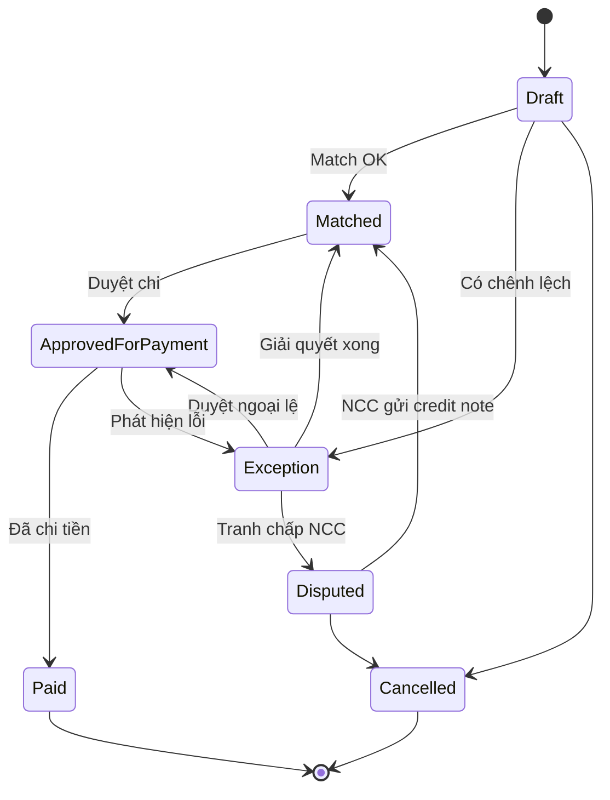

# 04 — Hoá đơn (Invoice — Hoá đơn mua hàng / Vendor Invoice / AP Invoice)

## 1. Mục đích (Purpose)

Ghi nhận **yêu cầu thanh toán từ nhà cung cấp** cho hàng hoá/dịch vụ đã cung ứng, và **đối chiếu ba chiều (three-way matching)** giữa:

1. **[PO](../02-purchase-order/README.md)** — ta đặt gì, giá nào.
2. **[Receipt](../03-receipt/README.md)** — ta thực nhận bao nhiêu.
3. **Invoice** — NCC đòi tiền cho bao nhiêu, giá nào.

Mục tiêu: **chỉ thanh toán cho hàng đã thực nhận, đúng giá đã thoả thuận**, phát hiện chênh lệch (số lượng, đơn giá, thuế, phí) trước khi ghi công nợ phải trả (Accounts Payable).

> ⚠️ Giả định: StockFlowCommerce quản lý invoice ở mức **đối chiếu & duyệt thanh toán (AP matching & approval)**, còn hạch toán sổ cái và chi tiền có thể do hệ thống kế toán riêng đảm nhận (tích hợp). Phạm vi tính năng "Invoice" theo đề bài chưa nêu rõ mức độ kế toán — xem [open-questions](../../open-questions/README.md).

---

## 2. Actor liên quan

| Actor | Vai trò |
|-------|---------|
| **Kế toán công nợ (AP Accountant)** | Nhập/nhận hoá đơn NCC, chạy đối chiếu, xử lý chênh lệch, đề nghị thanh toán |
| **Nhân viên mua hàng (Procurement)** | Xác nhận/điều chỉnh giá, xử lý tranh chấp giá với NCC, phê duyệt chênh lệch trong hạn mức |
| **Người duyệt chi (Finance Approver)** | Phê duyệt thanh toán vượt hạn mức |
| **Nhà cung cấp (Supplier)** | Phát hành hoá đơn; nhận thông báo tranh chấp (dispute) |

---

## 3. Input / Output

### Input

| Trường | Mô tả | Bắt buộc |
|--------|-------|----------|
| Nhà cung cấp | | Có |
| Số hoá đơn NCC & ngày hoá đơn | Duy nhất theo NCC | Có |
| PO / Receipt tham chiếu | Một hoặc nhiều | Có (trừ hoá đơn không PO — xem edge case) |
| **Dòng hoá đơn (invoice lines)** | SKU / mô tả, số lượng, đơn giá, thành tiền | Có |
| Thuế (VAT), phí vận chuyển, phụ phí, chiết khấu | | Không |
| Điều khoản thanh toán & hạn thanh toán (due date) | Kế thừa từ PO/NCC | Không |
| File hoá đơn (PDF/scan) | | Không (khuyến nghị) |

### Output

| Kết quả | Dùng bởi |
|---------|----------|
| **Invoice number nội bộ** + liên kết PO/Receipt | Báo cáo mua hàng, công nợ |
| **Kết quả matching**: `Matched` / `Exception` kèm danh sách chênh lệch | AP, Procurement |
| **Đề nghị thanh toán (payment proposal)** khi đã duyệt | Hệ thống kế toán / ngân hàng |
| **Bản ghi tranh chấp (dispute)** nếu có | Procurement, NCC |
| Cập nhật trạng thái PO → cho phép `Closed` khi hoá đơn đã đối chiếu | 02 PO |

---

## 4. Luồng nghiệp vụ từng bước (Step-by-step)

1. **Tiếp nhận hoá đơn** — AP nhập tay hoặc import hoá đơn NCC; chọn NCC và (các) PO/Receipt liên quan.
2. **Nạp dữ liệu đối chiếu** — hệ thống kéo dòng PO (giá đặt) và dòng Receipt (SL thực nhận) tương ứng.
3. **Chạy three-way matching** theo từng dòng:
   - **Khớp số lượng:** SL trên hoá đơn ≤ SL đã nhận (Receipt) và chưa bị hoá đơn khác dùng.
   - **Khớp đơn giá:** đơn giá hoá đơn = đơn giá PO (trong dung sai giá — price tolerance).
   - **Khớp thuế/phí:** theo điều khoản PO.
4. **Phân loại kết quả:**
   - Tất cả trong dung sai → `Matched`.
   - Có sai lệch → `Exception`, liệt kê loại chênh lệch (quantity variance / price variance / tax variance / uninvoiced receipt / over-invoice).
5. **Xử lý chênh lệch (exception handling):**
   - **Chênh giá:** Procurement xác nhận giá đúng → điều chỉnh PO revision hoặc chấp nhận giá hoá đơn (ghi lý do); nếu sai → mở **dispute** với NCC, yêu cầu hoá đơn điều chỉnh (credit note).
   - **Chênh số lượng:** kiểm tra lại Receipt; nếu NCC tính thừa → dispute; nếu ta nhận thiếu ghi nhận Receipt bổ sung khi hàng về.
   - **Hoá đơn cho hàng chưa nhận:** giữ (hold) đến khi có Receipt.
6. **Phê duyệt (Approve)** — khi `Matched` hoặc chênh lệch đã được duyệt/giải quyết: người có quyền theo hạn mức phê duyệt → `Approved for Payment`.
7. **Lập đề nghị thanh toán** — tạo payment proposal theo hạn thanh toán; chuyển sang hệ thống chi tiền (tích hợp).
8. **Ghi nhận đã thanh toán (Paid)** — khi có xác nhận chi tiền (từ kế toán/ngân hàng) → `Paid`.
9. **Đóng liên kết PO** — khi mọi hàng đã nhận và mọi hoá đơn liên quan đã `Approved`/`Paid` → cho phép [PO](../02-purchase-order/README.md) chuyển `Closed`.

---

## 5. Trạng thái / Vòng đời (Lifecycle)

| Trạng thái | Ý nghĩa | Chuyển tiếp | Ai |
|------------|---------|-------------|----|
| `Draft` | Đã nhập, chưa đối chiếu | → `Matched`, → `Exception`, → `Cancelled` | AP |
| `Matched` | Ba chiều khớp trong dung sai | → `Approved for Payment` | AP |
| `Exception` | Có chênh lệch cần xử lý | → `Matched` (đã giải quyết), → `Disputed`, → `Approved for Payment` (duyệt ngoại lệ) | AP / Procurement |
| `Disputed` | Đang tranh chấp với NCC | → `Matched` (NCC gửi credit note / hoá đơn sửa), → `Cancelled` | Procurement |
| `Approved for Payment` | Đã duyệt chi | → `Paid`, → `Exception` (phát hiện lỗi trước khi chi) | Finance Approver |
| `Paid` | Đã thanh toán | *(cuối)* | AP / hệ thống chi tiền |
| `Cancelled` | Huỷ (nhập nhầm, NCC thu hồi hoá đơn) | *(cuối)* | AP |

---

## 6. Ràng buộc nghiệp vụ (Business Rules) & Edge case

### Business rules

- **BR-01:** Không `Approved for Payment` khi còn chênh lệch chưa được duyệt hoặc chưa giải quyết.
- **BR-02:** Số lượng trên hoá đơn không vượt số lượng đã `Receipt` (`Accepted`) và chưa bị hoá đơn khác "tiêu thụ" (matched-against). Vượt → `Exception: over-invoice`.
- **BR-03:** Dung sai giá (price tolerance) và dung sai số lượng cấu hình theo hệ thống hoặc theo NCC; ngoài dung sai bắt buộc `Exception`.
- **BR-04:** Số hoá đơn NCC là **duy nhất theo từng NCC** — chặn nhập trùng (chống thanh toán hai lần).
- **BR-05:** Một Receipt có thể được đối chiếu bởi nhiều hoá đơn (giao nhiều đợt, hoá đơn từng phần) nhưng tổng không vượt SL đã nhận.
- **BR-06:** Hoá đơn `Paid` là bất biến; điều chỉnh phải qua **credit note / debit note** riêng.

### Edge case

| Tình huống | Hướng xử lý |
|------------|-------------|
| Hoá đơn không gắn PO (dịch vụ, phụ phí phát sinh) | Cho phép "invoice không PO" + quy trình duyệt chi riêng (không three-way matching) |
| NCC gộp nhiều PO/Receipt vào một hoá đơn | Cho map nhiều PO/Receipt; matching theo từng dòng |
| NCC xuất hoá đơn trước khi giao hàng (advance invoice) | Giữ ở `Draft`/`Hold` đến khi có Receipt tương ứng |
| Chênh lệch nhỏ dưới ngưỡng "xử lý thủ công" | Auto-accept, ghi log; không tạo Exception |
| Tỷ giá lệch (hoá đơn ngoại tệ) | Ghi nhận tỷ giá tại ngày hoá đơn; chênh lệch tỷ giá xử lý ở kế toán |
| Trả hàng NCC sau khi đã có hoá đơn | Yêu cầu credit note; đối chiếu giảm trừ vào đề nghị thanh toán |
| Hoá đơn cho phần hàng `Rejected` ở Receipt | `Exception`; không thanh toán phần bị từ chối |

---

## 7. Liên kết với các module khác

| Module | Quan hệ |
|--------|---------|
| [02 · Purchase Order](../02-purchase-order/README.md) | Cung cấp giá đặt & điều khoản; Invoice `Approved`/`Paid` là điều kiện để PO `Closed` |
| [03 · Receipt](../03-receipt/README.md) | Cung cấp số lượng thực nhận & trạng thái QC làm cơ sở matching |
| [00 · System Overview §5](../../00-system-overview/README.md) | Invoice là bước thứ 3 trong luồng Procurement (PO → Receipt → **Invoice** → Putaway) |
| Hệ thống kế toán / AP (ngoài phạm vi hoặc tích hợp) | Nhận payment proposal, thực hiện chi tiền, phản hồi trạng thái `Paid` |
