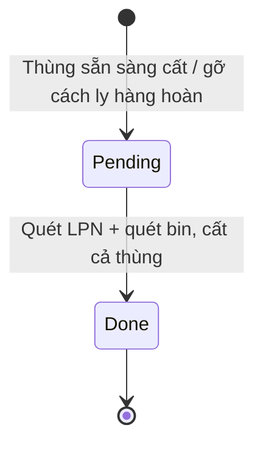
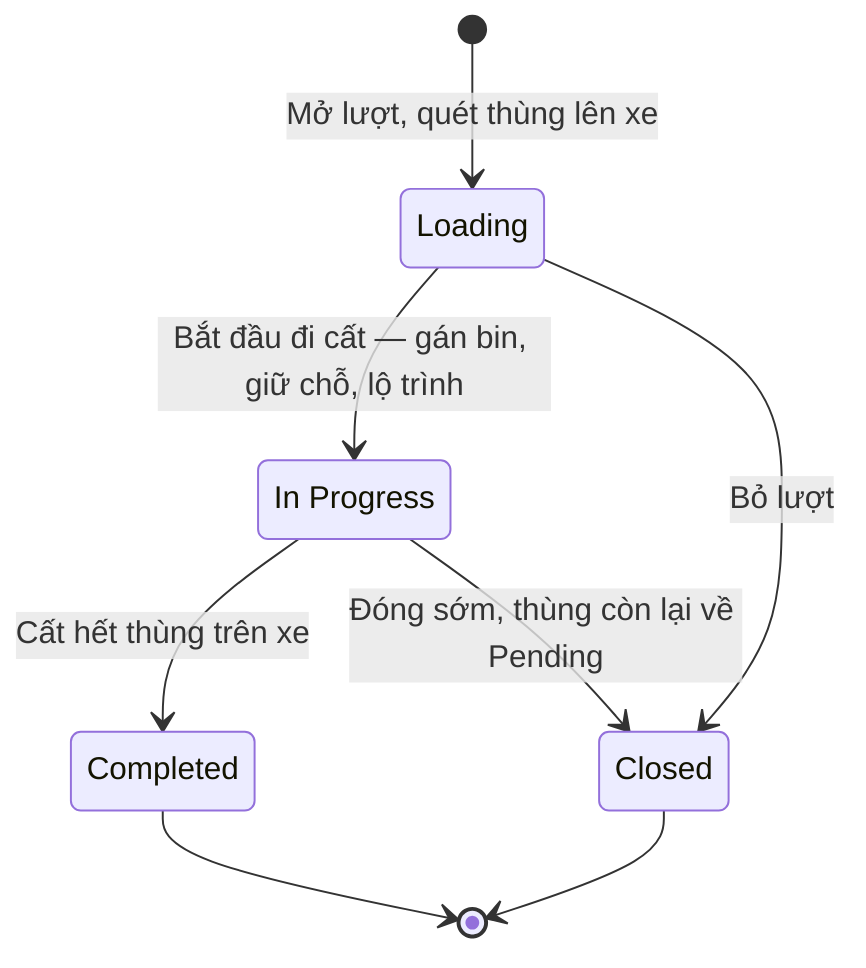

# 05 — Chuyển hàng vào kho (Putaway)

## 1. Mục đích (Purpose)

Di chuyển các **thùng thành phẩm (LPN)** từ **khu nhận hàng** (Area `RECEIVING`) sau khi [nhập kho thành phẩm](../03-receipt/README.md) — và các **thùng hàng hoàn được gỡ cách ly** từ khu `QUARANTINE` (§4.4) — tới **bin lưu trữ chính thức**, và **cập nhật tồn kho theo vị trí** để hàng trở nên **khả dụng cho lấy hàng / bán hàng**.

Putaway quyết định *hàng nằm ở đâu* — ảnh hưởng trực tiếp đến hiệu suất [Picking](../07-picking/README.md), mật độ lưu trữ và an toàn kho. Hệ thống **gợi ý bin** theo ràng buộc cứng và thứ tự ưu tiên (§4.2). Quyết định cuối cùng là **bin nhân viên quét thực tế**. NV kho cất **từng thùng** (§4.3), hoặc **theo lượt** — chở nhiều thùng trên một xe, hệ thống gán bin cho cả xe, **giữ chỗ** ở bin và **sắp lộ trình** đi cất (§4.5).

Putaway là **chặng cuối** của luồng nhập kho **2 bước**: WH/Input (`RECEIVING`) → WH/Stock (bin). Không có chặng kiểm tra chất lượng tại kho *(Đã chốt 2026-11-04 — [03](../03-receipt/README.md))*.

> Nguyên tắc dữ liệu *(Đã chốt 2026-11-04)*: mọi thành phẩm nằm trong **thùng LPN** do đơn vị sản xuất đóng sẵn; thao tác vật lý luôn theo **nguyên thùng**, không mở thùng. Mọi thùng đúng **số cái chuẩn / thùng** của SKU *(Đã chốt 2026-11-05 — [03](../03-receipt/README.md) BR-13)*. Tồn nằm trong từng thùng; nội bộ có thể ghi theo **đơn vị cơ sở** để truy vết, còn màn hình và tồn khả dụng hiển thị theo **số thùng** kèm số cái ([01](../01-product-creation/README.md) BR-09).

> ⚠️ Giả định: các phần sau thuộc **phạm vi giai đoạn sau** (xem [open-questions C18](../../open-questions/README.md)):
> - **phân công** nhiệm vụ cất cho từng người;
> - **bắt buộc mã lý do** khi cất khác bin gợi ý;
> - **cất nhiều chặng** qua khu trung gian;
> - **quãng đường đi thực tế** cho lộ trình lượt cất (tránh kệ / tường, đồ thị lối đi) và tối ưu lộ trình ngoài láng giềng gần nhất (§4.5);
> - **tiêu chí mềm nâng cao** của slotting (velocity / ABC, quãng đường, cân bằng tải — [06](../06-warehouse-map-slotting/README.md), [C1](../../open-questions/README.md)).
>
> Hiện mọi nhân viên kho của kho đó đều thấy và cất được mọi nhiệm vụ. *(✅ 2026-11-08: **giữ chỗ bin** — trước đây "khoá mềm" — có khi cất theo lượt, §4.5.)*

> **Đã chốt 2026-11-05:** chỗ trống của bin đo bằng **thể tích (m³)** và **tải trọng (kg)** ([06](../06-warehouse-map-slotting/README.md)), thay cho sức chứa theo đơn vị. **Thể tích bin do hệ thống tự tính** = rộng × dài của bin × chiều cao lọt của tầng kệ (bắt buộc), không nhập tay ([06](../06-warehouse-map-slotting/README.md) BR-19). Thể tích một thùng = D × R × C theo quy cách thùng ([01](../01-product-creation/README.md)); khối lượng một thùng = khối lượng thùng đầy.

---

## 2. Actor liên quan

| Actor | Vai trò |
|-------|---------|
| **Nhân viên kho (Warehouse Staff)** | Xem nhiệm vụ cất của kho, xem bin gợi ý, quét thùng, quét bin đích, xác nhận cất. **Cất theo lượt** (§4.5): mở lượt, quét thùng lên xe, bắt đầu đi cất, đi theo lộ trình, đóng lượt |
| **Quản lý kho (Warehouse Manager)** | Có đủ quyền như nhân viên kho (làm thay khi cần); xử lý khi không còn bin hợp lệ (mở thêm bin, cho cất vào khu `OVERFLOW`), lệch tồn; **gỡ cách ly** thùng hàng hoàn để mở nhiệm vụ cất (§4.4); **đóng lượt cất** của nhân viên khác khi bị bỏ dở (§4.5). Khai báo bản đồ kho: kệ, tầng, bin, cờ **cho phép cất** (`is_putaway_target`), **kích thước bin** và **chiều cao lọt của tầng** (hệ thống tự tính thể tích m³), **tải trọng tối đa** — chi tiết ở [06](../06-warehouse-map-slotting/README.md) |
| **Quản trị hệ thống (System Admin)** | Như Quản lý kho về khai báo bản đồ kho ([06](../06-warehouse-map-slotting/README.md)) |
| **Hệ thống** | Mở nhiệm vụ cất khi thùng sẵn sàng (phiếu nhập xác nhận, hoặc thùng hàng hoàn được gỡ cách ly); gợi ý tối đa 10 bin; chặn bin vi phạm ràng buộc cứng; với lượt cất: **gán bin cho mọi thùng trên xe, giữ chỗ, sắp lộ trình**, tự nhả chỗ giữ hết hạn; ghi sổ biến động; đóng phiếu nhập khi cất xong |
| **Quản lý kho — kiểm soát tồn** | Lập kiểm kê, duyệt điều chỉnh tồn khi có sai lệch phát hiện trong / sau putaway — xem [20 · Inventory Control](../20-inventory-control/README.md) |

- Mọi thao tác chỉ trong phạm vi **kho được gán**, và theo vị trí hàng đang đứng.
- Kiểm kê và điều chỉnh tồn không có role riêng: do Quản lý kho thực hiện ở [20](../20-inventory-control/README.md).

---

## 3. Input / Output

### Input

| Trường | Mô tả | Bắt buộc |
|--------|-------|----------|
| **Nhiệm vụ cất (putaway task)** | Mở tự động khi phiếu nhập theo Đơn sản xuất được xác nhận ([03](../03-receipt/README.md)), hoặc khi Quản lý kho gỡ cách ly một thùng hàng hoàn (§4.4): **mỗi thùng LPN một nhiệm vụ** | Có |
| SKU, lô, số lượng, thể tích, khối lượng | Từ thùng; một nhiệm vụ = một thùng (số cái = số cái chuẩn / thùng của SKU; thể tích, khối lượng theo quy cách thùng — [01](../01-product-creation/README.md)) | Có |
| Vị trí nguồn | Khu nhận hàng (Area `RECEIVING`); hoặc khu cách ly (`QUARANTINE`) với thùng hàng hoàn được gỡ cách ly | Có |
| **Bin gợi ý** | Tối đa 10 bin, tính mỗi lần xem nhiệm vụ (không lưu) | Không |
| **Mã LPN** | NV kho quét đúng thùng của nhiệm vụ | Có |
| **Bin đích thực tế** | NV kho quét khi đặt thùng; bất kỳ bin hợp lệ nào, không bắt buộc là bin gợi ý. Không còn bin hợp lệ: vị trí thuộc khu `OVERFLOW` (§4.3, BR-13) | Có |
| **Lượt cất** | Các thùng NV kho quét lên xe (nhiệm vụ `Pending` cùng kho, có thể của nhiều phiếu); không giới hạn số thùng (§4.5) | Không (chỉ khi cất theo lượt) |
| **Toạ độ trên Kho Map** | Toạ độ, kích thước, góc xoay, mặt lấy hàng của kệ; toạ độ bin trong kệ; toạ độ khu nguồn — để tính **điểm đứng** và lộ trình ([06](../06-warehouse-map-slotting/README.md) §4.4) | Không (chỉ khi cất theo lượt) |

### Output

| Kết quả | Dùng bởi |
|---------|----------|
| **Cập nhật tồn kho theo vị trí** (thùng nằm ở bin hoặc khu `OVERFLOW`); tồn `Inbound` (hoặc `Quarantine` với hàng hoàn gỡ cách ly) → **`Available`** | 06 Map (Bảng sức chứa kho — Đang chiếm), 07 Picking, báo cáo tồn |
| **Tồn khả dụng để bán** tăng thêm một thùng mỗi nhiệm vụ | 13 Catalog / 14 Order (ATP) |
| **Dòng sổ biến động** `MOVE` cho mỗi thùng được cất (hoặc `STATUS_CHANGE` khi thùng đã nằm sẵn ở bin) | [20](../20-inventory-control/README.md), truy vết |
| **Nhiệm vụ `Done`** → phiếu nhập theo Đơn sản xuất `Closed` khi mọi thùng đã cất | 03 Receipt |
| **Lượt cất**: bin được gán cho từng thùng trên xe, **lộ trình** (danh sách điểm dừng theo thứ tự, đường nối trên Kho Map 2D) | NV kho; [06](../06-warehouse-map-slotting/README.md) (vẽ trên bản đồ) |
| **Giữ chỗ bin** của lượt (thể tích, khối lượng từng thùng tại bin được gán) | Gợi ý bin cho nhiệm vụ / lượt khác (§4.2) |
| **Tồn `Available` của SKU** sau khi cất | [17](../../ecommerce/17-order-management/README.md) (đưa đơn `Awaiting Stock` sang `Ready to Fulfill`) |

---

## 4. Luồng nghiệp vụ từng bước (Step-by-step)

### 4.1. Mở nhiệm vụ

1. Khi phiếu nhập được xác nhận ([03](../03-receipt/README.md)), hệ thống mở **một nhiệm vụ cất cho mỗi thùng LPN `In Stock`** của phiếu (cất nguyên thùng). Thùng đã có nhiệm vụ thì không mở thêm (mở lại không sinh trùng). Nhiệm vụ mới ở `Pending`.
2. NV kho xem danh sách nhiệm vụ đang mở theo kho, hoặc theo phiếu nhập.

### 4.2. Gợi ý bin

3. Khi mở một nhiệm vụ, hệ thống gợi ý **tối đa 10 bin**. Bin phải thoả **ràng buộc cứng**:
   - là **bin** (không phải khu vực) của **cùng kho**, cho phép cất (`is_putaway_target`);
   - bin, kệ và kho đều đang **`Active`**;
   - **thùng vừa bin theo từng chiều**: D × R × C của thùng (quy cách thùng — [01](../01-product-creation/README.md)) ≤ rộng × dài của bin × chiều cao lọt của tầng; thùng có cờ **cho phép xoay** được xoay ngang (đổi D và R), vừa theo một trong hai hướng là đạt ([06 §4.4](../06-warehouse-map-slotting/README.md));
   - **còn chỗ theo thể tích**: thể tích trống của bin (thể tích bin **tự tính** − tổng thể tích các thùng đang nằm trong bin − thể tích **đang giữ chỗ** cho lượt cất khác, §4.5) ≥ thể tích thùng. Bin chưa tính được thể tích (dữ liệu cũ: tầng thiếu chiều cao lọt) coi như không giới hạn (✅ đã chốt 2026-11-05 — [06 §4.6](../06-warehouse-map-slotting/README.md));
   - **không vượt tải trọng**: tổng khối lượng thùng đang có + khối lượng đang giữ chỗ cho lượt cất khác + khối lượng thùng mới ≤ tải trọng tối đa của bin. Bin không khai báo tải trọng thì không kiểm.

   Độ lấp đầy tính trên **mọi SKU, mọi trạng thái** đang nằm trong bin.
4. Bin hợp lệ được **xếp hạng** theo thứ tự *(✅ Đã chốt 2026-11-08 — thay thứ tự 2026-10-28 "cùng lô → cùng SKU → bin trống → còn chỗ, nhiều chỗ trống trước")*:
   1. **Nhóm** — mỗi bin thuộc nhóm cao nhất mà nó thoả:

      | Nhóm | Bin | Mục đích |
      |------|-----|----------|
      | 1 | Đã có thùng **cùng lô** (cùng Đơn sản xuất) | Gom hàng của cùng một Đơn sản xuất / đợt giao |
      | 2 | **Bin trống** (chưa có thùng nào) | Phải mở chỗ mới thì mở bin sạch, không trộn lô |
      | 3 | Có thùng **cùng SKU, lô khác** | Chỉ trộn lô khi không còn bin trống phù hợp |
      | 4 | Đang có thùng **SKU khác** | Xếp chung với hàng không liên quan — cuối cùng |

   2. **Trong cùng nhóm:**
      - nhóm 1, 3, 4 — bin **còn ít thể tích trống hơn** đứng trước (*best-fit*): lấp đầy bin đang dở rồi mới sang bin khác;
      - nhóm 2 — **bin nhỏ nhất vẫn chứa được cả phần còn lại của lô** đứng trước. *Phần còn lại của lô* = các thùng cùng lô, cùng kho đang có nhiệm vụ cất `Pending` (kể cả thùng đang cất); *chứa được* = thể tích trống ≥ tổng thể tích các thùng đó và tải trọng còn lại ≥ tổng khối lượng của chúng. Các bin trống không chứa đủ xếp sau, **bin lớn hơn trước** (chứa được nhiều thùng của lô nhất).
   3. theo **mã vị trí**.

   Bin **chưa tính được thể tích** (dữ liệu cũ: tầng thiếu chiều cao lọt) xếp **sau mọi bin đã có thể tích**; giữa các bin này vẫn theo nhóm rồi mã vị trí.

   > Ví dụ: Đơn sản xuất PO-12 về 3 thùng SKU A (0,1 m³ / thùng); kho có bin trống B03 (0,8 m³), B04 (1,5 m³), bin B02 chứa SKU A lô PO-09. Thùng 1: chưa bin nào có lô PO-12 → nhóm 2, cả 3 thùng (0,3 m³) vừa cả B03 và B04 → **B03** (nhỏ hơn) đứng đầu; B02 ở nhóm 3. Thùng 2, 3: B03 đã có lô PO-12 → nhóm 1 → B03.

### 4.3. Cất hàng

5. NV kho lấy thùng ở khu nhận hàng, **quét đúng mã LPN** của nhiệm vụ, đi tới bin, **quét bin đích**. Cả thùng được chuyển; không nhập số lượng, không chia thùng.
6. Hệ thống kiểm lại ràng buộc cứng (§4.2) **tại bin được quét**, kể cả khi bin đó không nằm trong gợi ý. Vi phạm → từ chối:
   - không tìm thấy vị trí;
   - không phải bin;
   - khác kho;
   - bin không dùng được hoặc không cho phép cất;
   - thùng không vừa bin (kể cả khi xoay ngang được);
   - vượt thể tích hoặc tải trọng.

   Hai người không cùng lúc cất vào một bin: hệ thống xếp hàng các lần cất vào cùng bin.
7. **Ghi tồn** — thùng chuyển từ vị trí nguồn sang bin, tồn **`Inbound` → `Available`** (hàng hoàn gỡ cách ly: **`Quarantine` → `Available`**), ghi dòng sổ `MOVE`. Thùng **đã được người chuyển tay** vào đúng bin đó ([11](../11-intra-warehouse-transfer/README.md)) thì được cất tại chỗ (dòng sổ `STATUS_CHANGE`), và không bị tính hai lần vào thể tích / tải trọng.
8. **Hoàn tất** — nhiệm vụ → **`Done`**.
9. **Đóng phiếu nhập** — khi mọi thùng của phiếu theo Đơn sản xuất đã được cất, phiếu nhập tự `Closed` ([03](../03-receipt/README.md)).

### Các luồng biến thể

| Luồng | Khi dùng | Cách xử lý |
|-------|----------|------------|
| **Cất khác bin gợi ý** | Gợi ý không đúng thực tế | Quét bin khác; được nếu bin thoả ràng buộc cứng |
| **Không có bin hợp lệ** | Kho đầy, sai cấu hình, thùng không vừa bin nào | Danh sách gợi ý rỗng; Quản lý kho khai báo / mở bin cho phép cất. Kho đầy hoặc thùng không vừa bin nào: NV kho quét vị trí thuộc khu tạm **`OVERFLOW`** để hoàn tất nhiệm vụ (BR-13); khi có chỗ, thùng được dời lên bin bằng [di chuyển nguyên thùng](../11-intra-warehouse-transfer/README.md) |

### 4.4. Cất hàng hoàn sau khi gỡ cách ly

10. Thùng hàng hoàn nhập qua phiếu hàng hoàn nằm ở khu `QUARANTINE` với tồn `Quarantine` ([03 §4.2](../03-receipt/README.md)). **Quản lý kho** xem tình trạng và quyết định ([20 §4.8](../20-inventory-control/README.md)):
    - **gỡ cách ly** → hệ thống mở **một nhiệm vụ cất** cho thùng đó (vị trí nguồn: khu `QUARANTINE`), ở `Pending`;
    - **ghi giảm** → không qua module này; điều chỉnh tồn có duyệt ở [20 §4.3](../20-inventory-control/README.md).
11. NV kho cất thùng như §4.2–§4.3 (gợi ý bin, quét LPN, quét bin, kiểm ràng buộc cứng). Cất xong, tồn **`Quarantine` → `Available`**: thùng là tồn khả dụng của SKU riêng, dùng được cho đơn sau của chính khách sở hữu.

> ✅ Đã chốt 2026-11-05: gỡ cách ly mở nhiệm vụ cất; thùng **vẫn là `Quarantine`** (không thuộc ATP) tới khi được cất lên bin, lúc đó mới thành `Available`. Xem [open-questions](../../open-questions/README.md).

### 4.5. Cất theo lượt (Putaway trip)

*(✅ Đã chốt 2026-11-08.)* Ngoài cất từng thùng (§4.3), NV kho cất được **theo lượt**: chở nhiều thùng trên một xe, hệ thống gán bin cho cả xe, giữ chỗ và sắp lộ trình. Hai cách dùng song song; ràng buộc cứng và ghi tồn như nhau.

12. **Mở lượt & nhận thùng lên xe** → lượt `Loading`. NV kho quét LPN từng thùng có nhiệm vụ `Pending` của cùng kho để đưa lên xe; mỗi thùng quét được gắn vào lượt. Lượt có thể gồm thùng của **nhiều phiếu nhập** và thùng hàng hoàn đã gỡ cách ly; **không giới hạn số thùng** — lượt là những thùng đang trên xe. Quét bỏ để đưa một thùng ra khỏi lượt trước khi đi. Ở bước này **chưa gán bin, chưa giữ chỗ**.
13. **Bắt đầu đi cất** → `In Progress`. Hệ thống:
    - **gán bin** cho từng thùng trên xe theo thứ tự xếp hạng §4.2, thùng cùng lô gán liền nhau; thùng đã gán trừ chỗ trống của bin khi gán thùng sau, nên không gán hai thùng vào cùng một chỗ trống. Không có bin hợp lệ → gán khu `OVERFLOW` (BR-13);
    - **giữ chỗ bin** — thể tích và khối lượng của từng thùng tại bin được gán được tính **như đã chiếm** khi gợi ý / gán bin cho nhiệm vụ và lượt khác (§4.2). Giữ chỗ **không phải khoá cứng**: ràng buộc cứng vẫn kiểm lúc quét bin (bước 6);
    - **sắp lộ trình** (bước 14).
14. **Lộ trình** — mỗi bin có **điểm đứng**: điểm ngay trước mặt lấy hàng của kệ chứa bin, tính từ toạ độ, kích thước, góc xoay của kệ và toạ độ bin trong kệ ([06](../06-warehouse-map-slotting/README.md) §4.4). Điểm xuất phát là tâm **khu nguồn** của thùng quét lên xe cuối cùng (`RECEIVING` hoặc `QUARANTINE`). Hệ thống sắp điểm dừng theo **láng giềng gần nhất (nearest neighbor)**: từ chỗ đang đứng, đi tới điểm dừng chưa ghé có **khoảng cách Manhattan** (|Δx| + |Δy|) nhỏ nhất; bằng nhau thì theo mã vị trí. Nhiều thùng cùng bin gộp thành một điểm dừng; khu `OVERFLOW` luôn là điểm dừng cuối. Màn hình hiện danh sách điểm dừng (bin → các thùng cần đặt) và đường nối các điểm dừng trên Kho Map 2D.

    > ⚠️ Giả định: khoảng cách tính trên mặt bằng, **không tránh kệ / tường**; nearest neighbor không bảo đảm lộ trình ngắn nhất. Quãng đường thực tế (đồ thị lối đi) và cải thiện lộ trình (ví dụ 2-opt) là phạm vi sau. Xem [open-questions C46](../../open-questions/README.md).
15. **Cất tại từng điểm dừng** — NV kho quét bin, rồi quét LPN thùng đặt vào; hệ thống làm như bước 6–8 (kiểm ràng buộc cứng, ghi tồn, nhiệm vụ `Done`) và nhả chỗ giữ của thùng đó. **Không bắt buộc đi đúng thứ tự**. Cất vào bin khác bin được gán vẫn được nếu bin hợp lệ — chỗ giữ ở bin cũ được nhả. Bin được gán bị từ chối lúc quét → hệ thống gợi ý lại cho thùng đó (§4.2).
16. **Thời hạn giữ chỗ** — chỗ giữ của lượt **tự nhả khi lượt không có thao tác nào trong 30 phút** (mỗi lần quét trong lượt đếm lại từ đầu). Lượt và thùng trên xe giữ nguyên; khi NV kho quay lại, bin vẫn được kiểm lúc quét, đã bị lấp thì gợi ý lại.

    > ⚠️ Giả định: thời hạn **30 phút không thao tác**, cấu hình theo kho. Xem [open-questions C46](../../open-questions/README.md).
17. **Kết thúc lượt** — mọi thùng trên xe đã cất → `Completed`. NV kho đóng sớm (hoặc Quản lý kho đóng thay khi lượt bị bỏ dở) → `Closed`: thùng chưa cất trở lại nhiệm vụ `Pending` (thùng đặt lại khu nguồn), chỗ giữ còn lại được nhả.

> Ví dụ: xe chở 6 thùng, sau bước 13 được gán A01-1-02 (3 thùng), C04-2-01 (2 thùng), B02-1-05 (1 thùng); khu nhận ở góc trái dưới bản đồ. Lộ trình: RECEIVING → A01-1-02 → B02-1-05 → C04-2-01 — 3 điểm dừng thay vì 6 lần đi riêng.

---

## 5. Trạng thái / Vòng đời (Lifecycle)

### Trạng thái nhiệm vụ cất (Putaway Task status)

| Trạng thái | Ý nghĩa | Chuyển tiếp cho phép | Ai thực hiện |
|------------|---------|----------------------|--------------|
| `Pending` | Đã mở, thùng chưa cất | → `Done` (cất cả thùng) | Hệ thống mở; NV kho cất |
| `Done` | Thùng đã cất vào bin (hoặc khu `OVERFLOW` khi kho đầy — BR-13); tồn đã cập nhật | *(cuối)* | NV kho |
| `Cancelled` | Dành sẵn; hiện không có thao tác huỷ | *(cuối)* | — |

### Trạng thái hàng trong quá trình

| Trạng thái tồn | Ý nghĩa |
|----------------|---------|
| `Inbound` | Đã nhận, thùng ở khu nhận hàng, **chưa khả dụng** để bán |
| `Quarantine` | Thùng hàng hoàn ở khu cách ly; đã gỡ cách ly thì chờ cất, **chưa khả dụng** |
| `Available` | Thùng đã ở bin lưu trữ (hoặc khu `OVERFLOW`), **khả dụng** để lấy hàng / bán |

Hàng không có trạng thái "đang di chuyển": mỗi lần cất chuyển thẳng thùng từ vị trí nguồn sang bin. Trạng thái tồn và vòng đời thùng đầy đủ xem [20 §5](../20-inventory-control/README.md).

### Trạng thái lượt cất (Putaway trip status)

| Trạng thái | Ý nghĩa | Chuyển tiếp cho phép | Ai thực hiện |
|------------|---------|----------------------|--------------|
| `Loading` | Đang quét thùng lên xe; chưa gán bin, chưa giữ chỗ | → `In Progress` (bắt đầu đi cất, có ít nhất một thùng), → `Closed` (bỏ lượt, thùng về `Pending`) | NV kho |
| `In Progress` | Đã gán bin, giữ chỗ, có lộ trình; đang cất | → `Completed` (cất hết thùng trên xe), → `Closed` (đóng sớm) | NV kho / Hệ thống / Quản lý kho (đóng thay) |
| `Completed` | Mọi thùng của lượt đã cất | *(cuối)* | Hệ thống |
| `Closed` | Đóng khi còn thùng chưa cất; các thùng đó về nhiệm vụ `Pending`, chỗ giữ được nhả | *(cuối)* | NV kho / Quản lý kho |

Giữ chỗ hết hạn (30 phút không thao tác — §4.5 bước 16) **không đổi trạng thái lượt**, chỉ nhả chỗ giữ.

### Dữ liệu tối thiểu cần lưu

| Thực thể | Trường chính |
|----------|--------------|
| `PutawayTask` | `id`, `source` (`RECEIPT` / `QUARANTINE_RELEASE`), `receiptLineId?`, `stockPackageId` (thùng), `sku`, `lot`, `quantity` (số cái trong thùng = số cái chuẩn / thùng), `status` |
| `PutawayTrip` | `id`, `warehouseId`, `operatorId`, `status`, `startLocationId` (khu nguồn), `startedAt?`, `lastActivityAt`, `closedAt?` |
| `PutawayTripItem` | `tripId`, `putawayTaskId`, `stockPackageId`, `assignedLocationId?`, `stopSequence?`, `holdVolumeM3?`, `holdWeightKg?`, `holdReleasedAt?` |
| `StockMovement` | `type` (`MOVE` / `STATUS_CHANGE`), `reference = PUTAWAY_TASK`, `fromLocation`, `toLocation`, `sku`, `lot`, `quantity`, `stockPackageId`, `performedBy`, `performedAt` |

---

## 6. Ràng buộc nghiệp vụ (Business Rules) & Edge case

### Business rules

- **BR-01:** Chỉ hai nguồn có nhiệm vụ cất: thùng của **phiếu nhập theo Đơn sản xuất đã xác nhận** (tồn `Inbound` ở khu `RECEIVING`), và thùng hàng hoàn được **Quản lý kho gỡ cách ly** (khu `QUARANTINE` — §4.4). Hàng khác ở khu cách ly chưa có quyết định thì không cất.
- **BR-02:** Tồn kho **luôn gắn với một vị trí** — một **bin** hoặc một **khu vực chứa hàng**. Không tồn tại tồn "không vị trí".
- **BR-03:** Không đặt hàng vượt **thể tích** của bin (`capacity_volume_m3` — **hệ thống tự tính** = rộng × dài bin × chiều cao lọt của tầng, không nhập tay — [06](../06-warehouse-map-slotting/README.md) BR-19) — tính theo tổng thể tích thùng (D × R × C theo quy cách thùng); không vượt **tải trọng tối đa** (`max_weight`) — tính theo tổng khối lượng thùng đầy *(Đã chốt 2026-11-05)*. Tải trọng không khai báo thì không kiểm; bin chưa tính được thể tích (dữ liệu cũ thiếu chiều cao lọt) thì không kiểm thể tích (✅ đã chốt 2026-11-05 — [06 §4.6](../06-warehouse-map-slotting/README.md)).
- **BR-04:** Chỉ cất vào **bin** cho phép cất (`is_putaway_target`) của cùng kho mà **thùng vừa bin theo từng chiều** — D × R × C của thùng ≤ rộng × dài của bin × chiều cao lọt của tầng, được xoay ngang (đổi D và R) nếu thùng có cờ cho phép xoay ([06](../06-warehouse-map-slotting/README.md) BR-01) — với bin, kệ và kho đều `Active` — ngoại lệ duy nhất là khu `OVERFLOW` khi kho đầy hoặc thùng không vừa bin nào (BR-13). Một bin có thể chứa nhiều thùng, nhiều SKU / lô nếu còn thể tích và tải trọng.
- **BR-05:** Gợi ý ưu tiên **gom cùng lô**; phải mở chỗ mới thì dùng **bin trống** — bin nhỏ nhất chứa được cả phần còn lại của lô — trước khi trộn vào bin có cùng SKU lô khác, rồi bin có SKU khác; trong nhóm, bin đang dở được lấp đầy trước; bin chưa tính được thể tích xếp cuối (§4.2, *✅ Đã chốt 2026-11-08*). FIFO (ngày nhập) được bảo đảm ở bước **phân bổ khi lấy hàng** ([20](../20-inventory-control/README.md), [07](../07-picking/README.md)), không ở bước gợi ý bin. Không có hạn dùng, không FEFO *(Đã chốt 2026-11-05)*.
- **BR-06:** Nhiệm vụ `Done` không sửa; điều chỉnh vị trí sau đó dùng [Intra-warehouse Transfer](../11-intra-warehouse-transfer/README.md) (di chuyển nguyên thùng).
- **BR-07:** Cất vào bin khác gợi ý được phép khi bin thoả ràng buộc cứng; không bắt buộc mã lý do (⚠️ giả định — C18).
- **BR-08:** **Cất nguyên thùng** *(Đã chốt 2026-11-04)*: mỗi nhiệm vụ là **một thùng LPN**, phải quét đúng mã thùng, cất cả thùng vào **một bin** trong một lần; không mở thùng, không chia thùng ra nhiều bin.
- **BR-09:** Ràng buộc cứng được kiểm **tại lúc xác nhận**, trên bin được quét. Các lần cất vào cùng một bin được xếp hàng tuần tự, để thể tích / tải trọng không bị vượt do hai người cất cùng lúc.
- **BR-10:** Mỗi lần cất ghi **dòng sổ biến động** có chứng từ nguồn là nhiệm vụ cất.
- **BR-11:** Nếu phát hiện một thùng lệch số cái chuẩn tại khu nhận hàng hoặc tại bin đích, không tự sửa nhiệm vụ đã chốt; thùng lệch không được phân bổ, xử lý bằng khu cách ly / kiểm kê / điều chỉnh tồn có phê duyệt (✅ đã chốt 2026-11-05 — [03](../03-receipt/README.md)) — xem [20 §4.2–4.3](../20-inventory-control/README.md).
- **BR-12:** Available-to-promise chỉ tăng khi thùng đã cất (vào bin, hoặc vào khu `OVERFLOW` theo BR-13); hàng ở khu nhận hàng, khu cách ly không được bán.
- **BR-13:** **Kho đầy → khu tạm `OVERFLOW`** *(Đã chốt 2026-11-05)*: khi không còn bin hợp lệ — kho đầy, hoặc thùng không vừa bin nào theo kích thước (BR-04) — nhiệm vụ cất được hoàn tất bằng cách quét một vị trí thuộc khu `OVERFLOW` của cùng kho (không kiểm thể tích của khu). Thùng ở `OVERFLOW` được dời lên bin bằng [11](../11-intra-warehouse-transfer/README.md) khi có chỗ. ✅ Đã chốt 2026-11-05: chỉ cho cất vào `OVERFLOW` khi gợi ý bin rỗng; thùng ở `OVERFLOW` là tồn `Available` ở một khu chứa hàng, coi như đã cất xong (thuộc ATP, **giữ cho đơn được ngay**), lấy hàng được nếu khu khai báo cho phép lấy hàng ([06](../06-warehouse-map-slotting/README.md)). Xem [open-questions](../../open-questions/README.md).
- **BR-14:** Thùng hàng hoàn chỉ được cất lại sau khi **Quản lý kho gỡ cách ly** ([03](../03-receipt/README.md) BR-14, [20](../20-inventory-control/README.md)); tồn `Quarantine` → `Available` khi cất xong (✅ đã chốt 2026-11-05, §4.4).
- **BR-15:** **Lượt cất** *(✅ Đã chốt 2026-11-08)*: mỗi NV kho có **tối đa một lượt mở** (`Loading` / `In Progress`); một nhiệm vụ thuộc **tối đa một lượt mở**; chỉ nhận lên xe thùng có nhiệm vụ `Pending` của cùng kho; **không giới hạn số thùng**. Bin chỉ được gán khi **bắt đầu đi cất**, cho đúng các thùng đang trên xe (§4.5).
- **BR-16:** **Giữ chỗ bin**: tạo khi bắt đầu đi cất; được tính như đã chiếm khi gợi ý / gán bin cho mọi nhiệm vụ và lượt khác (§4.2); **không phải khoá cứng** — ràng buộc cứng vẫn kiểm lúc quét (BR-09). Nhả khi thùng được cất, khi cất sang bin khác, khi lượt kết thúc, hoặc khi lượt **30 phút không có thao tác** (⚠️ giả định — [open-questions C46](../../open-questions/README.md)).
- **BR-17:** **Lộ trình** sắp theo **láng giềng gần nhất**, khoảng cách Manhattan giữa các **điểm đứng** trên Kho Map, xuất phát từ khu nguồn; `OVERFLOW` là điểm dừng cuối. Lộ trình chỉ là hướng dẫn — **không bắt buộc đi đúng thứ tự** (§4.5, ⚠️ C46).

### Đối chiếu chuẩn tham chiếu

| Chủ đề | Cách thiết kế trong hệ thống | Ghi chú so với Odoo/MISA |
|--------|------------------------------|---------------------------|
| Nhập kho nhiều bước | 2 bước: khu nhận hàng → bin; không có chặng kiểm tra chất lượng tại kho | Khớp mô hình nhận hàng 2 bước (Input → Stock) của Odoo; MISA cũng hỗ trợ quy trình nhập/xuất nhiều bước |
| Gợi ý vị trí | Lọc ràng buộc cứng, rồi xếp hạng: cùng lô → bin trống (nhỏ nhất chứa được cả phần còn lại của lô) → cùng SKU lô khác → SKU khác; trong nhóm lấp đầy bin đang dở trước (best-fit) | Tương tự tinh thần Odoo Putaway Rules/Storage Categories; thứ tự xếp hạng là thiết kế riêng |
| Capacity | Thể tích (m³, tự tính từ kích thước bin × chiều cao lọt của tầng) và tải trọng tối đa (kg) của bin, so với tổng thể tích / khối lượng thùng | Odoo có storage category/capacity |
| Cất khác gợi ý | Cho phép nếu không vi phạm ràng buộc cứng | Phù hợp thực tế vận hành barcode/WMS: người làm kho xác nhận theo thực địa |
| Theo thùng | Mỗi thùng LPN là một nhiệm vụ, cất nguyên thùng; không có hàng ngoài thùng | Tương tự package / LPN putaway của các WMS phổ biến |
| Cất theo lượt | Gán bin cho mọi thùng trên xe khi bắt đầu đi, giữ chỗ có hạn, lộ trình láng giềng gần nhất theo toạ độ Kho Map | Tương tự cluster / batch putaway của các WMS; lộ trình là ước lượng trên mặt bằng, chưa theo lối đi thực tế |
| FIFO | Bảo đảm ở bước phân bổ khi lấy hàng (không có hạn dùng nên không dùng FEFO) | Khớp chiến lược xuất kho phổ biến trong Odoo/MISA |

### Edge case

| Tình huống | Hướng xử lý |
|------------|-------------|
| Bin gợi ý đã đầy (do lần cất khác) | Lúc xác nhận hệ thống kiểm lại và từ chối; xem lại gợi ý (tính lại theo tồn hiện tại) và chọn bin khác |
| Lô nhỏ (ví dụ 2 thùng) trong khi kho còn nhiều bin trống lớn | Gợi ý bin trống **nhỏ nhất** chứa đủ 2 thùng, giữ bin lớn cho lô lớn / thùng cồng kềnh (§4.2) |
| Không bin trống nào chứa được cả phần còn lại của lô | Bin trống **lớn nhất** đứng đầu nhóm 2; bin đó đầy thì các thùng sau theo nhóm 1 (bin khác đã có lô) hoặc mở bin trống kế tiếp |
| Hết bin trống, còn bin có cùng SKU lô khác | Gợi ý nhóm 3 — trộn lô trong bin; FIFO vẫn bảo đảm vì phân bổ và lấy hàng theo từng LPN (BR-05) |
| Bin gợi ý đứng đầu là bin chưa tính được thể tích | Không xảy ra khi còn bin đã có thể tích hợp lệ: bin thiếu dữ liệu luôn xếp cuối (§4.2); Quản lý kho bổ sung chiều cao lọt ([06](../06-warehouse-map-slotting/README.md)) |
| Không còn chỗ cho SKU (kho đầy) | Gợi ý rỗng; Quản lý kho mở thêm bin cho phép cất, hoặc NV kho cất vào khu `OVERFLOW` (BR-13), dời lên bin khi có chỗ ([11](../11-intra-warehouse-transfer/README.md)) |
| Thùng không vừa thể tích trống của bin nào | Gợi ý rỗng; không chia thùng. Quản lý kho mở bin lớn hơn, dọn chỗ bằng [di chuyển nguyên thùng](../11-intra-warehouse-transfer/README.md), hoặc cất vào khu `OVERFLOW` (BR-13) |
| Thùng cồng kềnh không vừa bin tiêu chuẩn | Cất vào bin vừa thùng nếu có (xoay ngang được nếu thùng có cờ cho phép xoay); không bin nào vừa → cất vào khu `OVERFLOW` (BR-13); Quản lý kho mở bin lớn hơn nếu cần ([06](../06-warehouse-map-slotting/README.md)) rồi dời thùng lên bằng [di chuyển nguyên thùng](../11-intra-warehouse-transfer/README.md) |
| Quét sai thùng | Từ chối (thùng không khớp nhiệm vụ) |
| Thùng đã được chuyển tay vào bin trước khi xác nhận | Xác nhận đúng bin đó: hệ thống cất tại chỗ, không tính trùng sức chứa |
| Nhãn LPN bị rách / không quét được | In lại nhãn theo mã LPN ([03](../03-receipt/README.md)) rồi quét |
| Mất mát / hư hỏng phát hiện khi cất | Không sửa nhiệm vụ; điều chỉnh tồn (lý do `DAMAGED` / `LOST`, có duyệt — [20 §4.3](../20-inventory-control/README.md)) hoặc chuyển thùng sang khu cách ly `QUARANTINE`; đổi trả với đơn vị sản xuất ngoài hệ thống (✅ đã chốt 2026-11-05 — [03](../03-receipt/README.md)) |
| Thùng hàng hoàn được gỡ cách ly | Mở nhiệm vụ cất từ khu `QUARANTINE`; cất như thùng mới nhập (§4.4) |
| Thùng hàng hoàn chưa có quyết định của Quản lý kho | Không có nhiệm vụ cất; thùng nằm ở khu cách ly (BR-01) |
| Đặt nhầm vị trí và đã xác nhận | Sửa bằng di chuyển nguyên thùng ([11](../11-intra-warehouse-transfer/README.md)), không sửa trực tiếp nhiệm vụ |
| NV kho bỏ xe giữa lượt | Sau 30 phút không thao tác, chỗ giữ tự nhả (BR-16); Quản lý kho đóng lượt → thùng chưa cất về `Pending` |
| Tới bin được gán thì bin đã bị lấp (giữ chỗ đã hết hạn, hoặc dữ liệu bin đổi) | Lúc quét hệ thống từ chối (BR-09); gợi ý lại cho thùng đó |
| Hai lượt cùng cần chỗ trong một bin gần đầy | Lượt bắt đầu sau thấy phần đã giữ của lượt trước, không được gán vượt chỗ trống còn lại (BR-16) |
| Thùng trên xe không có bin hợp lệ | Gán khu `OVERFLOW`, là điểm dừng cuối của lộ trình (BR-13, BR-17) |
| Quét lên xe thùng đang thuộc lượt mở của người khác | Từ chối (BR-15); Quản lý kho đóng lượt kia nếu bị bỏ dở |
| Lộ trình đi xuyên kệ / tường trên bản đồ | Khoảng cách chỉ là ước lượng trên mặt bằng (⚠️ C46); NV kho đi theo lối thực tế, không bắt buộc thứ tự |

---

## 7. Liên kết với các module khác

| Module | Quan hệ |
|--------|---------|
| [03 · Receipt](../03-receipt/README.md) | Xác nhận phiếu nhập theo Đơn sản xuất mở nhiệm vụ cất (mỗi thùng một nhiệm vụ); cất xong mọi thùng → phiếu nhập `Closed`. Phiếu hàng hoàn đưa thùng vào khu `QUARANTINE`, cất lại sau khi gỡ cách ly |
| [06 · Warehouse Map & Slotting](../06-warehouse-map-slotting/README.md) | Toạ độ kệ / bin / khu để tính **điểm đứng** và vẽ **lộ trình lượt cất**; giữ chỗ của lượt trừ vào chỗ trống khi gợi ý; bin, cờ cho phép cất, kích thước bin và chiều cao lọt của tầng (kiểm thùng vừa bin), thể tích (m³, tự tính), tải trọng; khu `RECEIVING` / `QUARANTINE` là vị trí nguồn; khu `OVERFLOW` khi kho đầy hoặc thùng không vừa bin nào; cất xong cập nhật "Đang chiếm" của Bảng sức chứa kho |
| [01 · Product Creation](../01-product-creation/README.md) | Quy cách thùng của SKU (kích thước D × R × C, thể tích thùng, khối lượng thùng đầy) và cờ cho phép xoay |
| [07 · Picking](../07-picking/README.md) | Vị trí cất hợp lý và gom lô giúp lấy nguyên thùng nhanh; FIFO ở bước phân bổ |
| [11 · Intra-warehouse Transfer](../11-intra-warehouse-transfer/README.md) | Di chuyển nguyên thùng bằng tay để sửa vị trí sau khi đã cất, hoặc dời thùng từ `OVERFLOW` lên bin |
| [13 · Catalog](../../ecommerce/13-catalog/README.md) / [14 · Order](../../ecommerce/14-cart-and-order/README.md) | Cất xong làm tăng tồn khả dụng (ATP) |
| [17 · Order Management](../../ecommerce/17-order-management/README.md) | Hàng của Đơn sản xuất cất xong là căn cứ đưa đơn `Awaiting Stock` sang `Ready to Fulfill` |
| [20 · Inventory Control](../20-inventory-control/README.md) | Thùng LPN và vòng đời thùng; dòng sổ biến động; lệch số khi cất xử lý bằng kiểm kê / điều chỉnh tồn có duyệt; `Inbound` → `Available`; gỡ cách ly hàng hoàn → cất → `Available` |
