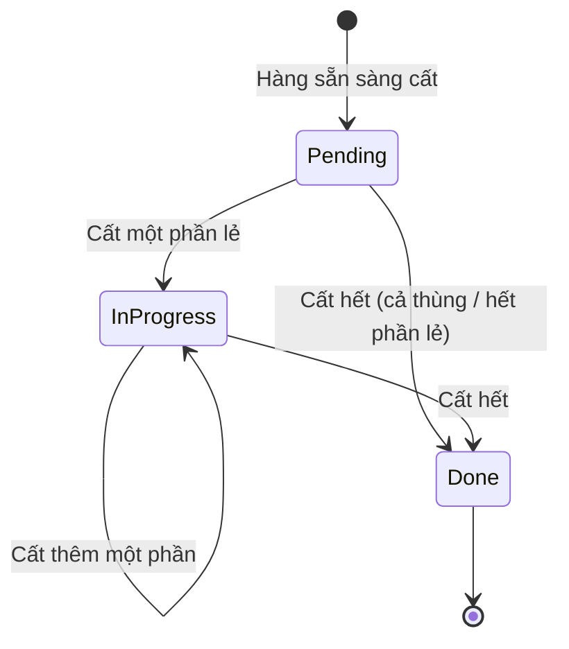

# 05 — Chuyển hàng vào kho (Putaway)

## 1. Mục đích (Purpose)

Di chuyển hàng hoá từ **khu chờ cất** sau khi [nhận hàng](../03-receipt/README.md) tới **bin lưu trữ chính thức**, và **cập nhật tồn kho theo vị trí** để hàng trở nên **khả dụng cho lấy hàng / bán hàng**. Khu chờ cất là:

- **khu kiểm tra chất lượng** (Area `QUALITY_CONTROL`) với hàng đã đạt QC;
- **khu nhận hàng** (Area `RECEIVING`) với SKU không yêu cầu QC.

Putaway quyết định *hàng nằm ở đâu* — ảnh hưởng trực tiếp đến hiệu suất [Picking](../07-picking/README.md), mật độ lưu trữ và an toàn kho. Hệ thống **gợi ý bin** theo ràng buộc cứng và thứ tự ưu tiên (§4.2). Quyết định cuối cùng là **bin nhân viên quét thực tế**.

Putaway là **chặng cuối** của luồng nhập kho:

- **3 bước:** WH/Input → WH/Quality Control → WH/Stock;
- **2 bước:** WH/Input → WH/Stock.

> Nguyên tắc dữ liệu: thao tác vật lý theo **thùng (LPN)** hoặc theo **phần lẻ**, nhưng tồn kho luôn ghi theo **đơn vị cơ sở của SKU** (hệ số quy đổi khai báo ở [01](../01-product-creation/README.md)). Một thùng LPN được cất **nguyên thùng**.

> ⚠️ Giả định: các phần sau thuộc **phạm vi giai đoạn sau** (xem [open-questions C18](../../open-questions/README.md)):
> - **phân công** nhiệm vụ cất cho từng người;
> - **khoá mềm** sức chứa bin khi nhận nhiệm vụ;
> - **bắt buộc mã lý do** khi cất khác bin gợi ý;
> - **cất nhiều chặng** qua khu trung gian;
> - **tiêu chí mềm nâng cao** của slotting (velocity / ABC, quãng đường, FEFO, cân bằng tải — [06](../06-warehouse-map-slotting/README.md), [C1](../../open-questions/README.md)).
>
> Hiện mọi nhân viên kho của kho đó đều thấy và cất được mọi nhiệm vụ.

---

## 2. Actor liên quan

| Actor | Vai trò |
|-------|---------|
| **Nhân viên kho (Warehouse Staff)** | Xem nhiệm vụ cất của kho, xem bin gợi ý, quét thùng / nhập số lượng, quét bin đích, xác nhận cất |
| **Quản lý kho (Warehouse Manager)** | Như nhân viên kho; xử lý khi không còn bin hợp lệ, lệch tồn |
| **Admin / System Config** | Khai báo bản đồ kho: kệ, tầng, bin, cờ **cho phép cất** (`is_putaway_target`), **lớp lưu trữ**, **sức chứa**, **tải trọng tối đa** — chi tiết ở [06](../06-warehouse-map-slotting/README.md) |
| **Hệ thống** | Mở nhiệm vụ cất khi hàng sẵn sàng; gợi ý tối đa 10 bin; chặn bin vi phạm ràng buộc cứng; ghi sổ biến động; đóng phiếu nhận khi cất xong |
| **Quản lý kho — kiểm soát tồn** | Lập kiểm kê, duyệt điều chỉnh tồn khi có sai lệch phát hiện trong / sau putaway — xem [20 · Inventory Control](../20-inventory-control/README.md) |

- Mọi thao tác chỉ trong phạm vi **kho được gán**, và theo vị trí hàng đang đứng.
- Kiểm kê và điều chỉnh tồn không có role riêng: do Quản lý kho / Nhân viên kế hoạch tồn kho thực hiện ở [20](../20-inventory-control/README.md).

---

## 3. Input / Output

### Input

| Trường | Mô tả | Bắt buộc |
|--------|-------|----------|
| **Nhiệm vụ cất (putaway task)** | Mở tự động khi hàng sẵn sàng cất ([03](../03-receipt/README.md)): **mỗi thùng LPN một nhiệm vụ**, cộng **một nhiệm vụ cho phần lẻ** của dòng nhận | Có |
| SKU, lô, số lượng | Từ phiếu nhận; số lượng theo đơn vị cơ sở | Có |
| Vị trí nguồn | Khu QC (hàng đạt QC) hoặc khu nhận hàng (SKU không cần QC) | Có |
| **Bin gợi ý** | Tối đa 10 bin, tính mỗi lần xem nhiệm vụ (không lưu) | Không |
| **Bin đích thực tế** | NV kho quét khi đặt hàng; bất kỳ bin hợp lệ nào, không bắt buộc là bin gợi ý | Có |
| Mã LPN | Bắt buộc với nhiệm vụ thùng (quét đúng thùng) | Có (nhiệm vụ thùng) |
| Số lượng cất | Với nhiệm vụ phần lẻ: 1 tới số còn lại; được cất nhiều lần | Có (nhiệm vụ phần lẻ) |

### Output

| Kết quả | Dùng bởi |
|---------|----------|
| **Cập nhật tồn kho theo vị trí**; tồn `Inbound` → **`Available`** | 06 Map, 07 Picking, báo cáo tồn |
| **Tồn khả dụng để bán** tăng lên | 13 Catalog / 14 Order (ATP) |
| **Dòng sổ biến động** `MOVE` cho mỗi lần cất (hoặc `STATUS_CHANGE` khi hàng đã nằm sẵn ở bin) | [20](../20-inventory-control/README.md), truy vết |
| **Nhiệm vụ `Done`** → phiếu nhận `Closed` khi cất đủ | 03 Receipt |

---

## 4. Luồng nghiệp vụ từng bước (Step-by-step)

### 4.1. Mở nhiệm vụ

1. Khi hàng sẵn sàng cất — dòng **không cần QC** lúc xác nhận phiếu nhận, hoặc phần **đạt QC** lúc kết luận — hệ thống mở nhiệm vụ cất:
   - **mỗi thùng LPN `In Stock`** có hàng một nhiệm vụ (cất nguyên thùng);
   - **phần lẻ còn lại** của dòng một nhiệm vụ.

   Dòng nhận đã có nhiệm vụ thì không mở thêm (mở lại không sinh trùng). Nhiệm vụ mới ở `Pending`.
2. NV kho xem danh sách nhiệm vụ đang mở theo kho, hoặc theo phiếu nhận.

### 4.2. Gợi ý bin

3. Khi mở một nhiệm vụ, hệ thống gợi ý **tối đa 10 bin**. Bin phải thoả **ràng buộc cứng**:
   - là **bin** (không phải khu vực) của **cùng kho**, cho phép cất (`is_putaway_target`);
   - cùng **lớp lưu trữ** với SKU;
   - bin, kệ và kho đều đang **`Active`**;
   - **còn chỗ**: số đơn vị trống ≥ số cần cất (thùng: cả thùng; phần lẻ: ít nhất 1). Bin không khai báo sức chứa coi như không giới hạn;
   - **không vượt tải trọng**: chỉ kiểm khi biết cả tải trọng tối đa của bin và khối lượng đơn vị của SKU.

   Độ lấp đầy tính trên **mọi SKU, mọi trạng thái** đang nằm trong bin (cả lẻ lẫn trong thùng).
4. Bin hợp lệ được **xếp hạng** theo thứ tự:
   1. **gom hàng trước khi trải rộng** — bin đã có **cùng lô**, rồi bin có **cùng SKU**, rồi **bin trống**, rồi bin **còn chỗ**;
   2. bin **còn nhiều chỗ hơn** đứng trước (bin không giới hạn đứng đầu);
   3. theo **mã vị trí**.

### 4.3. Cất hàng

5. NV kho lấy hàng ở khu chờ cất, đi tới bin, **quét bin đích**:
   - **Nhiệm vụ thùng:** quét **đúng mã LPN**; cả thùng được chuyển, không nhập số lượng.
   - **Nhiệm vụ phần lẻ:** nhập số lượng (1 tới số còn lại). **Cất nhiều lần, nhiều bin** được — mỗi lần một dòng sổ.
6. Hệ thống kiểm lại ràng buộc cứng (§4.2) **tại bin được quét**, kể cả khi bin đó không nằm trong gợi ý. Vi phạm → từ chối:
   - không tìm thấy vị trí;
   - không phải bin;
   - khác kho;
   - bin không dùng được hoặc không cho phép cất;
   - sai lớp lưu trữ;
   - vượt sức chứa.

   Hai người không cùng lúc cất vào một bin: hệ thống xếp hàng các lần cất vào cùng bin.
7. **Ghi tồn** — hàng chuyển từ khu chờ cất sang bin, tồn **`Inbound` → `Available`**, ghi dòng sổ `MOVE`. Hàng **đã được người chuyển tay** vào đúng bin đó thì được cất tại chỗ (dòng sổ `STATUS_CHANGE`), và không bị tính hai lần vào sức chứa.
8. **Hoàn tất** — nhiệm vụ còn hàng → `In Progress`; hết hàng → **`Done`**.
9. **Đóng phiếu nhận** — khi mọi dòng của phiếu đã cất đủ số phải cất (toàn bộ số nhận, hoặc phần đạt QC), phiếu nhận tự `Closed` ([03](../03-receipt/README.md)).

### Các luồng biến thể

| Luồng | Khi dùng | Cách xử lý |
|-------|----------|------------|
| **Luồng 2 bước** | SKU không bật cờ Yêu cầu QC | Xác nhận phiếu nhận → nhiệm vụ cất từ khu `RECEIVING` |
| **Luồng 3 bước (có QC)** | SKU bật cờ Yêu cầu QC | Chuyển sang khu `QUALITY_CONTROL`, kết luận QC ([03](../03-receipt/README.md)) → phần đạt mở nhiệm vụ cất từ khu QC; phần cách ly / không đạt vào khu cách ly, không cất |
| **Cất khác bin gợi ý** | Gợi ý không đúng thực tế | Quét bin khác; được nếu bin thoả ràng buộc cứng |
| **Không có bin hợp lệ** | Kho đầy, sai cấu hình, hàng quá khổ | Danh sách gợi ý rỗng; Quản lý kho khai báo / mở bin cho phép cất, hoặc chuyển kho ([10](../10-inter-warehouse-transfer/README.md)) |
| **Phần lẻ chia nhiều bin** | Một bin không đủ chỗ cho toàn bộ phần lẻ | Cất từng phần vào các bin khác nhau; mỗi lần một dòng sổ |

---

## 5. Trạng thái / Vòng đời (Lifecycle)

### Trạng thái nhiệm vụ cất (Putaway Task status)

| Trạng thái | Ý nghĩa | Chuyển tiếp cho phép | Ai thực hiện |
|------------|---------|----------------------|--------------|
| `Pending` | Đã mở, chưa cất gì | → `In Progress` (cất một phần lẻ), → `Done` (cất hết) | Hệ thống mở; NV kho cất |
| `In Progress` | Đã cất một phần lẻ, còn phần chưa cất | → `Done` | NV kho |
| `Done` | Đã cất hết; tồn đã cập nhật | *(cuối)* | NV kho |
| `Cancelled` | Dành sẵn; hiện không có thao tác huỷ | *(cuối)* | — |

### Trạng thái hàng trong quá trình

| Trạng thái tồn | Ý nghĩa |
|----------------|---------|
| `Inbound` | Đã nhận, ở khu nhận hàng hoặc khu QC, **chưa khả dụng** để bán |
| `Available` | Đã ở bin lưu trữ, **khả dụng** để lấy hàng / bán |

Hàng không có trạng thái "đang di chuyển": mỗi lần cất chuyển thẳng từ khu chờ cất sang bin. Trạng thái tồn đầy đủ xem [20 §5.1](../20-inventory-control/README.md).

### Dữ liệu tối thiểu cần lưu

| Thực thể | Trường chính |
|----------|--------------|
| `PutawayTask` | `id`, `receiptLineId`, `stockPackageId?` (nhiệm vụ thùng), `sku`, `lot`, `quantity`, `status` |
| `StockMovement` | `type` (`MOVE` / `STATUS_CHANGE`), `reference = PUTAWAY_TASK`, `fromLocation`, `toLocation`, `sku`, `lot`, `quantity`, `stockPackageId?`, `performedBy`, `performedAt` |

---

## 6. Ràng buộc nghiệp vụ (Business Rules) & Edge case

### Business rules

- **BR-01:** Chỉ hàng **đạt QC** hoặc hàng của SKU không yêu cầu QC mới có nhiệm vụ cất. Hàng chờ QC, `Quarantine`, `Blocked` không cất vào vùng lưu trữ.
- **BR-02:** Tồn kho **luôn gắn với một vị trí** — một **bin** hoặc một **khu vực chứa hàng**. Không tồn tại tồn "không vị trí" ngoài trạng thái quá cảnh của lệnh chuyển kho.
- **BR-03:** Không đặt hàng vượt **sức chứa** khai báo của bin (`capacity_units`); không vượt **tải trọng tối đa** khi biết cả tải trọng bin và khối lượng SKU. Trường nào không khai báo thì không kiểm tra.
- **BR-04:** Chỉ cất vào **bin** cho phép cất (`is_putaway_target`) của cùng kho, có **lớp lưu trữ trùng lớp lưu trữ của SKU**, với bin, kệ và kho đều `Active`. Một bin có thể chứa nhiều SKU / lô nếu còn sức chứa.
- **BR-05:** Gợi ý ưu tiên **gom cùng lô, cùng SKU** trước khi trải sang bin trống (BR-SLT-004). FEFO được bảo đảm ở bước **phân bổ khi lấy hàng** ([20](../20-inventory-control/README.md) BR-01, [07](../07-picking/README.md)), không ở bước gợi ý bin.
- **BR-06:** Nhiệm vụ `Done` không sửa; điều chỉnh vị trí sau đó dùng [Intra-warehouse Transfer](../11-intra-warehouse-transfer/README.md).
- **BR-07:** Cất vào bin khác gợi ý được phép khi bin thoả ràng buộc cứng; không bắt buộc mã lý do (⚠️ giả định — C18).
- **BR-08:** **Thùng LPN** luôn cất **nguyên thùng**, phải quét đúng mã thùng. **Phần lẻ** được cất từng phần, mỗi lần không vượt số còn lại.
- **BR-09:** Ràng buộc cứng được kiểm **tại lúc xác nhận**, trên bin được quét. Các lần cất vào cùng một bin được xếp hàng tuần tự, để sức chứa không bị vượt do hai người cất cùng lúc.
- **BR-10:** Mỗi lần cất ghi **dòng sổ biến động** có chứng từ nguồn là nhiệm vụ cất; số còn lại của nhiệm vụ tính từ sổ.
- **BR-11:** Nếu phát hiện lệch số lượng tại khu chờ cất hoặc tại bin đích, không tự sửa nhiệm vụ đã chốt; tạo kiểm kê / điều chỉnh tồn có phê duyệt — xem [20 §4.2–4.3](../20-inventory-control/README.md).
- **BR-12:** Available-to-promise chỉ tăng khi hàng đã cất vào bin; hàng ở khu nhận hàng, khu QC, khu cách ly không được bán.

### Đối chiếu chuẩn tham chiếu

| Chủ đề | Cách thiết kế trong hệ thống | Ghi chú so với Odoo/MISA |
|--------|------------------------------|---------------------------|
| Nhập kho nhiều bước | 3 bước: khu nhận hàng → khu QC → bin; 2 bước: khu nhận hàng → bin; chọn theo cờ Yêu cầu QC của SKU | Khớp mô hình nhận hàng 2/3 bước (Input → Quality Control → Stock) của Odoo; khác Odoo ở chỗ số bước chọn theo SKU thay vì theo kho; MISA cũng hỗ trợ quy trình nhập/xuất nhiều bước |
| Gợi ý vị trí | Lọc ràng buộc cứng, rồi xếp hạng: cùng lô → cùng SKU → bin trống → còn chỗ; nhiều chỗ trống trước | Tương tự tinh thần Odoo Putaway Rules/Storage Categories; thứ tự xếp hạng là thiết kế riêng |
| Capacity | Số đơn vị tối đa của bin, tải trọng tối đa (khi biết khối lượng SKU) | Odoo có storage category/capacity |
| Cất khác gợi ý | Cho phép nếu không vi phạm ràng buộc cứng | Phù hợp thực tế vận hành barcode/WMS: người làm kho xác nhận theo thực địa |
| Theo thùng | Thùng LPN là một nhiệm vụ, cất nguyên thùng | Tương tự package / LPN putaway của các WMS phổ biến |
| FIFO/FEFO | Bảo đảm ở bước phân bổ khi lấy hàng | Khớp chiến lược xuất kho phổ biến trong Odoo/MISA |

### Edge case

| Tình huống | Hướng xử lý |
|------------|-------------|
| Bin gợi ý đã đầy (do lần cất khác) | Lúc xác nhận hệ thống kiểm lại và từ chối; xem lại gợi ý (tính lại theo tồn hiện tại) và chọn bin khác |
| Không còn chỗ cho SKU (kho đầy) | Gợi ý rỗng; Quản lý kho mở thêm bin cho phép cất, hoặc xem xét [chuyển kho](../10-inter-warehouse-transfer/README.md) |
| Hàng cồng kềnh không vừa bin tiêu chuẩn | Cất vào bin có lớp lưu trữ phù hợp (ví dụ `OVERSIZE`); nếu không có, Admin khai báo thêm ([06](../06-warehouse-map-slotting/README.md)) |
| Phần lẻ lớn hơn chỗ trống của một bin | Cất từng phần vào nhiều bin |
| Quét sai thùng | Từ chối (thùng không khớp nhiệm vụ) |
| Hàng đã được chuyển tay vào bin trước khi xác nhận | Xác nhận đúng bin đó: hệ thống cất tại chỗ, không tính trùng sức chứa |
| Mất mát / hư hỏng phát hiện khi cất | Không sửa nhiệm vụ; điều chỉnh tồn (lý do `DAMAGED` / `LOST`, có duyệt — [20 §4.3](../20-inventory-control/README.md)) |
| Đặt nhầm vị trí và đã xác nhận | Sửa bằng Intra-warehouse Transfer, không sửa trực tiếp nhiệm vụ |
| Hàng cách ly sau đó được kết luận đạt | ⚠️ Giả định: chưa có luồng kết luận lại hàng cách ly ([03](../03-receipt/README.md), [open-questions C10](../../open-questions/README.md)) |

---

## 7. Liên kết với các module khác

| Module | Quan hệ |
|--------|---------|
| [03 · Receipt](../03-receipt/README.md) | Hàng không cần QC (khi xác nhận) và phần đạt QC mở nhiệm vụ cất; cất đủ → phiếu nhận `Closed` |
| [06 · Warehouse Map & Slotting](../06-warehouse-map-slotting/README.md) | Bin, cờ cho phép cất, lớp lưu trữ, sức chứa, tải trọng; khu `QUALITY_CONTROL` / `RECEIVING` là vị trí nguồn |
| [01 · Product Creation](../01-product-creation/README.md) | Lớp lưu trữ và khối lượng đơn vị của SKU |
| [07 · Picking](../07-picking/README.md) | Vị trí cất hợp lý và gom lô giúp lấy hàng nhanh; FEFO ở bước phân bổ |
| [11 · Intra-warehouse Transfer](../11-intra-warehouse-transfer/README.md) | Di chuyển thủ công để sửa vị trí sau khi đã cất |
| [13 · Catalog](../../ecommerce/13-catalog/README.md) / [14 · Order](../../ecommerce/14-cart-and-order/README.md) | Cất xong làm tăng tồn khả dụng (ATP) |
| [20 · Inventory Control](../20-inventory-control/README.md) | Thùng LPN; dòng sổ biến động; lệch số khi cất xử lý bằng kiểm kê / điều chỉnh tồn có duyệt; `Inbound` → `Available` |
