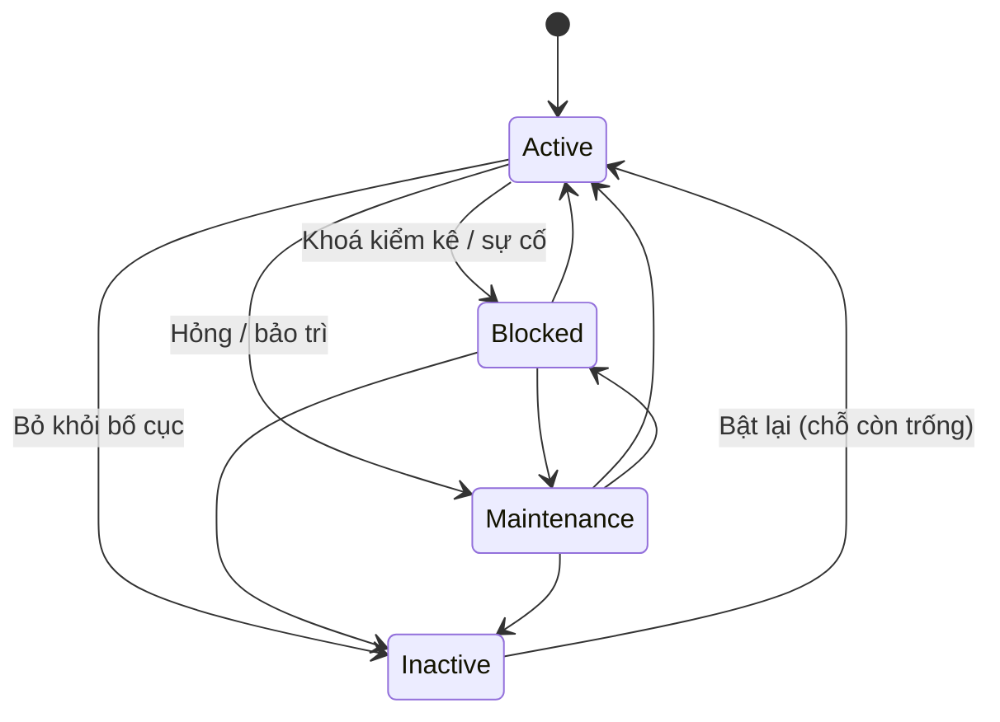

# 06 — Kho Map 2D/3D & Gợi ý vị trí (Warehouse Map & Slotting Suggestion)

## 1. Mục đích (Purpose)

Cung cấp **mô hình không gian của kho** và các công cụ quanh nó:

- **Bản đồ kho (Warehouse Map):** mặt bằng kho — **kệ (Shelf) → tầng kệ (Shelf Level) → ô (Bin)**, các **khu vực trên sàn (Area)**, **tường & cửa (Boundary)**, nhóm kệ theo **Zone** (tùy chọn). Một lần đọc trả cả bố cục kèm trạng thái để vẽ **2D** (mặt bằng) và **3D** (kệ theo cao độ tầng).
- **Vị trí tồn kho (Storage Location):** mỗi bin và mỗi khu vực chứa hàng là một vị trí có **mã vị trí đầy đủ** duy nhất toàn hệ thống — chuỗi được in nhãn, quét khi cất / lấy hàng và ghi trong tồn kho.
- **Nhãn vị trí:** in nhãn có mã QR và mã vạch Code 128 ra PDF.
- **Gợi ý vị trí khi cất hàng (putaway suggestion):** lọc bin theo ràng buộc cứng, xếp hạng theo quy tắc cố định — chi tiết vận hành ở [05 · Putaway](../05-putaway/README.md).
- **Bảng sức chứa kho (Warehouse Capacity Board):** sức chứa, đang chiếm, sắp về, còn trống dự kiến của từng kho, đo bằng **thể tích (m³)** — dùng khi Sale lập Đơn sản xuất (Production Order) và chọn kho xuất cho đơn ([17](../../ecommerce/17-order-management/README.md)) — chi tiết §4.6.

Mục tiêu: định vị nhanh, mã vị trí không trùng và không đổi, cất hàng đúng điều kiện lưu trữ, biết trước kho nào còn chỗ.

> **Đã chốt 2026-11-05:** sức chứa của bin và khu chứa hàng đo bằng **thể tích (m³)** kèm **tải trọng (kg)**, thay cho "sức chứa theo đơn vị". Thể tích một thùng = D × R × C theo quy cách thùng ([01](../01-product-creation/README.md)). Một đơn bán có **đúng một kho xuất**; mọi Đơn sản xuất của đơn có kho nhận = kho xuất ([17](../../ecommerce/17-order-management/README.md)).

> ⚠️ Giả định: các phần sau thuộc **phạm vi giai đoạn sau** (xem [open-questions C2, C22](../../open-questions/README.md)):
> - **quãng đường đi thực tế** trên bản đồ (không xuyên tường, qua cửa mở) và lộ trình lấy hàng;
> - kiểm **mặt lấy hàng không bị tường / vật cản che**;
> - **heatmap độ lấp đầy**, chỉ số sử dụng kho, honeycombing;
> - **chấm điểm mềm có trọng số** (gần khu kiểm thùng `PACKING`, golden zone, hàng nặng tầng thấp, cân bằng tải, loại ô);
> - **tối ưu định kỳ (re-slotting)** theo ABC / tần suất xuất;
> - **tự động đưa thùng** từ bin dự trữ sang bin lấy hàng theo ngưỡng của bin;
> - lưu lịch sử phiên bản bố cục kho.
>
> Cơ sở dữ liệu đã có bảng cho quy tắc slotting và lệnh di chuyển nội bộ nhưng chưa có chức năng.

### Mô hình không gian kho

| Thành phần | Thuộc về | Vai trò |
|------------|----------|---------|
| **Kho (Warehouse)** | — | Khung bản đồ (đơn vị đo, chiều rộng × chiều dài), tên, địa chỉ kho, địa chỉ hoàn hàng, **tiền tố mã (prefix)** |
| **Zone** | Kho | **Nhóm kệ tùy chọn** (tên, màu hiển thị) để hiển thị và chọn nhãn in. Không mang quy tắc lưu trữ; khu vực không thuộc zone |
| **Kệ (Shelf)** | Kho, Zone (tùy chọn) | Khối kệ trên mặt bằng (toạ độ, kích thước, góc xoay 0/90/180/270); **mặt lấy hàng** (bắc / đông / nam / tây) và **lớp lưu trữ mặc định** |
| **Tầng kệ (Shelf Level)** | Kệ | Tầng thứ n (1–99) của kệ; cao độ, chiều cao lọt, tải trọng tối đa (đều tùy chọn) |
| **Ô (Bin)** | Tầng kệ | Điểm chứa hàng nhỏ nhất trên kệ; toạ độ tương đối trong kệ, loại ô, lớp lưu trữ ghi đè; là một **vị trí tồn kho** |
| **Khu vực (Area)** | Kho | Vùng trên sàn **không phải kệ**: khu nhận hàng, khu chờ xuất, khu cách ly, khu kiểm thùng & dán nhãn giao, khu chờ giao, khu tràn, hoặc khu không chứa hàng. Khu chứa hàng là một **vị trí tồn kho** |
| **Ranh giới (Boundary)** | Kho | Đoạn **tường (WALL)** hoặc **cửa (DOOR)** |

**Thuộc tính chung của vị trí tồn kho** (bin và khu chứa hàng): mã vị trí đầy đủ, lớp lưu trữ, **thể tích (m³)**, **tải trọng tối đa (kg)**, cờ **cho phép lấy hàng** (`is_pickable`), cờ **cho phép cất hàng** (`is_putaway_target`), trạng thái. Lối đi không khai báo thành thực thể.

---

## 2. Actor liên quan

| Actor | Vai trò |
|-------|---------|
| **Quản lý kho (Warehouse Manager)** | Phạm vi vận hành theo **kho được gán** (1..n kho; bản đồ xem / sửa không giới hạn — xem ghi chú dưới bảng). Vai trò trong toàn hệ thống *(Đã chốt 2026-11-05)*: • **Thiết lập** — khai báo kho, bản đồ (zone, kệ, tầng, bin, khu vực, tường / cửa), vị trí (**thể tích, tải trọng**), cờ lấy / cất; đổi trạng thái kho, kệ, bin, khu vực; xoá tường / cửa; in nhãn (module này); danh mục hãng vận chuyển, loại xe ([09](../09-shipping/README.md)); quy cách thùng ([01](../01-product-creation/README.md)). • **Nhập kho** — theo dõi phiếu nhập; xử lý nhận thiếu / thừa / thùng lệch số chuẩn; quyết định hàng hoàn trong khu cách ly; xử lý chênh lệch sau nhập bằng điều chỉnh tồn ([03](../03-receipt/README.md)). • **Xuất kho** — release đơn, tạo task lấy hàng và giao người; quyết định giữ hàng ở khu chờ xuất (§4.5); chuyển task sang khu kiểm & dán nhãn; huỷ chuyến bàn giao; ghi nhận kết quả giao ([07](../07-picking/README.md), [08](../08-packing/README.md), [09](../09-shipping/README.md)). • **Kiểm soát tồn** — lập kiểm kê; duyệt điều chỉnh tồn (người duyệt ≠ người gửi); cách ly / gỡ cách ly; **theo dõi Bảng sức chứa kho** (§4.6) ([20](../20-inventory-control/README.md)). • **Quyền** — có đủ quyền thao tác như nhân viên kho (làm thay khi cần); đây là quyền, không phải việc chính |
| **Quản trị hệ thống (System Admin)** | Như Quản lý kho về thiết lập bản đồ, vị trí |
| **Nhân viên kho (Warehouse Staff)** | Xem bản đồ, tra cứu vị trí khi quét, in nhãn; nhận gợi ý bin khi cất hàng ([05](../05-putaway/README.md)) |
| **Nhân viên Sale (Sales Staff) / Quản lý kinh doanh (Sales Manager)** | Xem danh sách kho và **Bảng sức chứa kho** (còn trống dự kiến) khi lập Đơn sản xuất, chọn kho xuất cho đơn ([17](../../ecommerce/17-order-management/README.md)) |
| **Hệ thống** | Ghép mã vị trí; kiểm hình học khi lưu; tính trạng thái hiệu lực; lọc và xếp hạng bin gợi ý; tính Bảng sức chứa kho và cảnh báo vượt chỗ trống dự kiến |

- Bản đồ và vị trí **không giới hạn theo kho được gán**; chỉ nhiệm vụ cất hàng mới giới hạn theo kho ([05](../05-putaway/README.md)).

---

## 3. Input / Output

### Input

| Nhóm | Dữ liệu | Nguồn |
|------|---------|-------|
| **Khung kho** | Tên (≤ 200), **prefix** (1–10 ký tự `A–Z0–9`, duy nhất, không đổi), địa chỉ (bắt buộc, ≤ 500), địa chỉ hoàn hàng (tùy chọn), đơn vị bản đồ (`M`), chiều rộng × chiều dài bản đồ | Quản lý kho |
| **Bố cục mặt bằng** | Zone (tên duy nhất trong kho, màu `#RRGGBB`); tường & cửa (đoạn thẳng đầu–cuối; cửa: đi qua được không, `Open` / `Closed`); khu vực (mã, loại, tên, toạ độ, kích thước, góc xoay, vật cản); kệ (mã, tên, mô tả, toạ độ, kích thước, góc xoay, vật cản, mặt lấy hàng, lớp lưu trữ mặc định, zone) | Quản lý kho |
| **Cấu trúc kệ** | Tầng (thứ tự, cao độ, chiều cao lọt, tải trọng tối đa); bin (mã, mô tả, toạ độ tương đối, kích thước, loại ô, lớp lưu trữ ghi đè) — nhập từng bin hoặc **tự sinh** (BR-14) | Quản lý kho |
| **Thuộc tính vị trí** | **Thể tích (m³)**, tải trọng tối đa (kg), cho phép lấy / cất hàng; lớp lưu trữ của khu chứa hàng (mặc định `NORMAL`) | Quản lý kho |
| **Thuộc tính SKU** | Lớp lưu trữ; **thể tích thùng** (D × R × C) và khối lượng thùng đầy theo quy cách thùng | [01](../01-product-creation/README.md) (Inventory Item) |
| **Tồn theo vị trí** | Thùng LPN, SKU, lô trên từng bin / khu (để gợi ý vị trí và tính Đang chiếm) | [20](../20-inventory-control/README.md) |
| **Đơn sản xuất đang mở** | Phần chưa nhận (số thùng) của các Đơn sản xuất `Sent` / `Accepted` / `Sample Pending` / `In Production` / `Partially Received`, theo kho nhận (để tính Sắp về) | [17](../../ecommerce/17-order-management/README.md) |
| **Thùng đã giữ cho đơn chưa giao** | Khoản giữ / phân bổ theo kho xuất (để tính Sắp xuất — tham khảo) | [20](../20-inventory-control/README.md), [17](../../ecommerce/17-order-management/README.md) |

Đo lường giữ tới 3 chữ số thập phân; giá trị lẻ hơn bị từ chối, không làm tròn.

### Output

| Kết quả | Dùng bởi |
|---------|----------|
| **Bố cục kho** (khung, zone, kệ với tầng & bin, khu vực, tường / cửa; mỗi vị trí kèm trạng thái, trạng thái hiệu lực, dùng được hay không) để vẽ 2D / 3D | Quản lý kho, NV kho |
| **Mã vị trí đầy đủ** cho từng bin và khu chứa hàng | 03, 05, 07, 08, 11, 20 (quét xác nhận, ghi tồn) |
| **Tra cứu vị trí theo mã quét** — loại, kho, lớp lưu trữ, trạng thái, trạng thái hiệu lực, dùng được | 05, 07, 20 |
| **Nhãn vị trí PDF** (mã chữ + QR + Code 128) | NV kho |
| **Danh sách bin gợi ý** khi cất hàng (tối đa 10, kèm lý do, thể tích và tải trọng còn trống) | [05 · Putaway](../05-putaway/README.md) |
| **Vị trí lấy hàng được** của một kho (cho phép lấy + dùng được) | Phân bổ khi lấy hàng ([07](../07-picking/README.md), [20](../20-inventory-control/README.md)) |
| **Khu `STAGING` / `PACKING` / `DISPATCH` của kho** | [07](../07-picking/README.md), [08](../08-packing/README.md), [09](../09-shipping/README.md), [17](../../ecommerce/17-order-management/README.md) |
| **Địa chỉ kho** in trên nhãn giao hàng / chứng từ | [08](../08-packing/README.md), [09](../09-shipping/README.md) |
| **Bảng sức chứa kho** theo từng kho: Sức chứa, Đang chiếm, Sắp về, Còn trống dự kiến, Sắp xuất (tham khảo) — §4.6 | Sale khi lập Đơn sản xuất / chọn kho xuất ([17](../../ecommerce/17-order-management/README.md)); Quản lý kho |
| **Cảnh báo vượt chỗ trống dự kiến** (không chặn) | [17](../../ecommerce/17-order-management/README.md) |

---

## 4. Luồng nghiệp vụ từng bước (Step-by-step)

### 4.1. Thiết lập & duy trì bản đồ kho

1. **Khai báo kho** — tên, prefix, địa chỉ, địa chỉ hoàn hàng, đơn vị bản đồ, kích thước khung. Khung chỉ thu nhỏ được tới phạm vi bố cục hiện có.
2. **(Tùy chọn) Khai báo Zone** — tên, màu.
3. **Vẽ ranh giới** — tường (luôn không đi qua được, không có trạng thái) và cửa (có / không đi qua được; `Open` / `Closed`).
4. **Đặt khu vực** — mã, loại, tên, vị trí, kích thước, góc xoay, vật cản. Khu **chứa hàng** thêm lớp lưu trữ, **thể tích (m³)**, tải trọng, cho phép lấy / cất. Hệ thống sinh **mã vị trí** của khu (BR-10).
5. **Đặt kệ** — mã, tên, vị trí, kích thước, góc xoay, zone, **mặt lấy hàng**, **lớp lưu trữ mặc định**.
6. **Khai báo tầng** — tối đa **20 tầng** mỗi kệ; thứ tự tầng 1–99.
7. **Khai báo bin** — tối đa **200 bin** mỗi tầng:
   - **Nhập từng bin:** mã, vị trí tương đối, kích thước, loại ô, lớp lưu trữ ghi đè, **thể tích (m³)**, tải trọng, cho phép lấy / cất.
   - **Tự sinh bin:** chọn kệ, các tầng **chưa có bin** (tối đa 20 tầng mỗi lần), số hàng × số cột (tích ≤ 200), kiểu đặt mã; mọi bin sinh ra dùng chung thuộc tính (BR-14).

   Mỗi bin có **mã vị trí đầy đủ** (BR-10).
8. **Kiểm khi lưu** — hệ thống kiểm các ràng buộc hình học (BR-06 → BR-08) trên mọi thay đổi.
   - Thay đổi bố cục của một kho được xếp hàng tuần tự (khoá theo kho).
   - Mỗi bản ghi mang **phiên bản**; lưu với phiên bản cũ → từ chối.
   - Mọi thay đổi ghi **nhật ký kiểm toán** (ai, lúc nào, gì).
9. **Duy trì** — đổi trạng thái kệ / bin / khu vực (`Active` / `Blocked` / `Maintenance` / `Inactive`), đổi trạng thái kho, mở / đóng cửa.
   - **Kệ, bin, khu vực, zone không xoá**; bỏ khỏi bố cục bằng `Inactive`.
   - **Tường và cửa xoá hẳn được.**
   - Mã vị trí không sửa; tạo nhầm thì `Inactive` rồi tạo mới (BR-13).

### 4.2. Trạng thái hiệu lực

1. Trạng thái **hiệu lực** của một vị trí = trạng thái **hẹp nhất** trong (kho, kệ, vị trí), theo thứ tự `Inactive` > `Maintenance` > `Blocked` > `Active`. Kho `Inactive` → mọi vị trí trong kho `Inactive`.
2. Trạng thái được **tính khi đọc**, **không ghi lan** xuống con. Bật lại kệ / kho thì các vị trí con trở về đúng trạng thái riêng của chúng.
3. Vị trí **dùng được** khi trạng thái hiệu lực là `Active`.
4. Đưa kệ / bin / khu vực ra khỏi `Inactive` đòi chỗ của nó trên bản đồ **còn trống** (không chồng lấn vị trí đang dùng).

### 4.3. Nhãn vị trí & tra cứu khi quét

1. **In nhãn** — chọn **một** trong:
   - cả kho;
   - một kệ (tuỳ chọn một số tầng);
   - một zone (chỉ bin của các kệ trong zone, không gồm khu vực);
   - danh sách mã vị trí (1–2.000 mã, không phân biệt hoa thường).
2. Nhãn in theo **thứ tự đi**: bin theo mã kệ → tầng → mã bin, rồi các khu chứa hàng. Tối đa **2.000 nhãn** mỗi lần. Khổ **A4** (24 nhãn 70×37 mm) hoặc **cuộn in nhiệt** (60×40 mm).
3. Vị trí `Inactive` và bin của kệ `Inactive` bị bỏ qua (nêu đích danh một mã như vậy → báo lỗi). Vị trí `Blocked` / `Maintenance` vẫn in.
4. **Tra cứu theo mã quét** — trả loại vị trí, kho, lớp lưu trữ, trạng thái, trạng thái hiệu lực, dùng được hay không. Mã không có hoặc là khu không chứa hàng → không tìm thấy.

### 4.4. Gợi ý vị trí khi cất hàng

Chi tiết vận hành ở [05 §4.2](../05-putaway/README.md); tóm tắt quy tắc:

1. **Lọc (ràng buộc cứng)** — chỉ **bin** (không phải khu vực) **cùng kho**, cho phép cất (`is_putaway_target`), **lớp lưu trữ trùng lớp của SKU**, kho / kệ / bin đều `Active`.
2. **Còn chỗ** — thể tích bin trừ tổng thể tích các thùng đang có (mọi SKU) ≥ thể tích thùng cần cất (cất nguyên thùng — [05](../05-putaway/README.md) BR-08). Khối lượng hiện có + khối lượng thùng mới ≤ tải trọng tối đa. Không khai báo thể tích / tải trọng = không giới hạn theo tiêu chí đó.
3. **Xếp hạng** — cùng lô → cùng SKU → bin trống → còn chỗ; cùng hạng thì bin còn nhiều chỗ hơn trước (không giới hạn đứng đầu), rồi theo mã.
4. **Trả tối đa 10 bin**, mỗi bin kèm lý do, thể tích và tải trọng còn trống. Gợi ý tính mỗi lần xem, **không lưu**.
5. NV kho cất vào **bất kỳ bin hợp lệ** nào; hệ thống kiểm lại ràng buộc tại bin được quét. Không bắt buộc mã lý do khi khác gợi ý ([open-questions C18](../../open-questions/README.md)).

### 4.5. Khu chờ xuất (Staging)

> **Đã chốt 2026-11-04:** thêm loại khu `STAGING` — **Khu chờ xuất**.

1. Quản lý kho khai báo khu `STAGING` như mọi khu chứa hàng (§4.1 bước 4). Khu này **không phải đích gợi ý cất** (gợi ý chỉ trả bin — BR-12).
2. Các thùng đã lấy cho một đơn được gom và **giữ riêng cho đơn** tại khu chờ xuất khi đơn chưa xuất ngay — ví dụ còn chờ phần hàng từ Đơn sản xuất, hoặc chờ thu đợt thanh toán `BEFORE_DELIVERY` ([07](../07-picking/README.md), [17](../../ecommerce/17-order-management/README.md)).
3. Khi đơn sẵn sàng xuất, các thùng chuyển từ khu chờ xuất sang khu kiểm thùng & dán nhãn giao `PACKING` ([08](../08-packing/README.md)). Đơn đủ hàng, xuất ngay thì lấy thẳng sang `PACKING`, không qua khu chờ xuất.

> ✅ Đã chốt 2026-11-05: **Quản lý kho** (của kho xuất) quyết định có dùng khu chờ xuất cho đơn hay không.
>
> ⚠️ Giả định: tồn ở `STAGING` đã gắn đơn, **không khả dụng cho đơn khác**. Xem [open-questions](../../open-questions/README.md).

### 4.6. Bảng sức chứa kho (Warehouse Capacity Board)

> **Đã chốt 2026-11-05:** yêu cầu mới. Heatmap độ lấp đầy, honeycombing vẫn là phạm vi sau.

1. **Nguồn số liệu** — mỗi bin và khu chứa hàng khai báo **thể tích (m³)** và **tải trọng (kg)** (§4.1). Thể tích một thùng = D × R × C theo quy cách thùng của SKU ([01](../01-product-creation/README.md)).
2. **Các cột của bảng**, cho từng kho, tính **khi đọc** (không lưu):

   | Cột | Cách tính |
   |-----|-----------|
   | **Sức chứa** | Tổng thể tích các bin và khu chứa hàng **đang dùng được** (trạng thái hiệu lực `Active`) của kho |
   | **Đang chiếm** | Tổng thể tích các thùng đang nằm trong kho (thùng `In Stock` ở mọi vị trí của kho, mọi trạng thái tồn) |
   | **Sắp về** | Phần **chưa nhận** (số thùng còn mở × thể tích thùng) của các Đơn sản xuất `Sent` / `Accepted` / `Sample Pending` / `In Production` / `Partially Received` có **kho nhận** là kho này ([17](../../ecommerce/17-order-management/README.md)) |
   | **Còn trống dự kiến** | = Sức chứa − Đang chiếm − Sắp về (có thể âm) |
   | **Sắp xuất** *(tham khảo)* | Tổng thể tích các thùng **đã giữ cho đơn chưa giao** của kho ([20](../20-inventory-control/README.md)); **không cộng** vào chỗ trống |

   Bảng hiện kèm tổng tải trọng tương ứng (kg) để tham khảo.
3. **Dùng khi Sale lập Đơn sản xuất / chọn kho xuất** ([17](../../ecommerce/17-order-management/README.md)) — hệ thống hiện **còn trống dự kiến** của các kho. Thể tích cần chứa (số thùng × thể tích thùng) **lớn hơn** còn trống dự kiến của kho được chọn → **cảnh báo**, **không chặn**.
4. **Hàng về khi kho đầy** — kho vẫn nhận ([03](../03-receipt/README.md)); thùng không còn bin hợp lệ được cất vào khu tạm **`OVERFLOW`** — là tồn `Available` ở khu chứa hàng, coi như đã cất xong, giữ cho đơn được ngay (⚠️ giả định — [05](../05-putaway/README.md) BR-13) — rồi Quản lý kho dời lên bin khi có chỗ ([05](../05-putaway/README.md) BR-13, [11](../11-intra-warehouse-transfer/README.md)).
5. **Quản lý kho** theo dõi bảng để mở thêm bin, dọn chỗ hoặc báo Sale trước khi hàng về.

> ⚠️ Giả định: bin / khu **chưa khai báo thể tích** không được cộng vào Sức chứa (bảng hiện số vị trí chưa khai báo để Quản lý kho bổ sung); thùng nằm ở mọi vị trí của kho — kể cả `RECEIVING`, `QUARANTINE`, `STAGING`, `PACKING`, `DISPATCH`, `OVERFLOW` — đều tính vào Đang chiếm. Xem [open-questions](../../open-questions/README.md).

---

## 5. Trạng thái / Vòng đời

Module này **không có chứng từ vòng đời riêng**. Trạng thái của các thực thể:

| Thực thể | Trạng thái | Chuyển tiếp cho phép | Ai thực hiện |
|----------|-----------|----------------------|--------------|
| **Kho** | `Active` · `Inactive` | `Active` ⇄ `Inactive` (kích hoạt / ngưng; bật lại khôi phục trạng thái riêng của vị trí) | Quản lý kho / System Admin |
| **Kệ / Bin / Khu vực** | `Active` (dùng bình thường) · `Blocked` (khoá kiểm kê / sự cố) · `Maintenance` (hỏng / bảo trì) · `Inactive` (bỏ khỏi bố cục) | Giữa bốn trạng thái; ra khỏi `Inactive` khi chỗ còn trống | Quản lý kho / System Admin |
| **Cửa** | `Open` · `Closed` | Mở ⇄ đóng | Quản lý kho / System Admin |
| **Tường** | — | Tạo / sửa / xoá | Quản lý kho / System Admin |
| **Zone** | — (không trạng thái, không xoá) | — | Quản lý kho / System Admin |

`Full` (đầy) **không lưu** — tính ra từ tổng thể tích / khối lượng thùng so với thể tích / tải trọng của bin khi gợi ý vị trí. Bảng sức chứa kho cũng tính khi đọc (§4.6).

### Giá trị phân loại

| Trường | Giá trị | Ý nghĩa |
|--------|---------|---------|
| **Loại khu vực (`Area.type`)** | `RECEIVING` | Khu nhận hàng: thành phẩm vừa nhập từ đơn vị sản xuất, chờ cất ([03](../03-receipt/README.md)) |
| | `STAGING` | Khu chờ xuất: thùng đã lấy cho một đơn, giữ riêng cho đơn tới khi xuất (§4.5) |
| | `QUARANTINE` | Khu cách ly: hàng lỗi / hàng hoàn về chờ xử lý |
| | `PACKING` | **Khu kiểm thùng & dán nhãn giao**: thùng đã lấy cho đơn chờ quét kiểm đủ thùng và dán nhãn giao hàng ([08](../08-packing/README.md)). Giữ tên kỹ thuật `PACKING`; không đóng lại hàng tại khu này |
| | `DISPATCH` | Khu chờ giao: thùng đã dán nhãn, gom theo shipment chờ bàn giao vận chuyển ([09](../09-shipping/README.md)) |
| | `OVERFLOW` | Khu tạm: thùng về khi kho đầy (không còn bin hợp lệ) hoặc hàng quá khổ; cất lên bin khi có chỗ (§4.6, [05](../05-putaway/README.md) BR-13) |
| | `NON_STORAGE` | Khu không chứa hàng (văn phòng, khu sạc xe…); không phải vị trí tồn kho |
| **Lớp lưu trữ** | `NORMAL` · `COLD` · `HAZMAT` · `FRAGILE` · `OVERSIZE` | Hàng thường · lạnh · nguy hiểm · dễ vỡ · quá khổ |
| **Loại ô (`Bin.type`)** | `STANDARD` · `PALLET` · `SMALL_PARTS` | Ô tiêu chuẩn · ô pallet · ô hàng nhỏ. Chỉ để mô tả; chưa dùng trong gợi ý |
| **Đơn vị bản đồ** | `M` | Mét |
| **Kiểu đặt mã bin khi tự sinh** | `SEQUENTIAL` | Số liên tục theo hàng rồi cột: `01`, `02`… |
| | `ROW_LETTER_COLUMN` | Chữ là hàng, số là cột: `A01`, `A02`, `B01`… (tối đa 26 hàng) |

### Dữ liệu tối thiểu cần lưu

| Thực thể | Trường chính |
|----------|--------------|
| `Warehouse` | `id`, `name`, `prefix`, `address`, `return_address?`, `map_unit`, `map_width`, `map_height`, `status`, `version` |
| `Zone` | `id`, `warehouse_id`, `name`, `color?` |
| `Shelf` | `id`, `warehouse_id`, `zone_id?`, `code`, `name`, `description?`, `x`, `y`, `width`, `length`, `rotation`, `is_obstacle`, `pick_north`, `pick_east`, `pick_south`, `pick_west`, `default_storage_class`, `status` |
| `ShelfLevel` | `id`, `shelf_id`, `level_index`, `elevation?`, `usable_height?`, `max_weight?` |
| `Bin` | `id`, `level_id`, `location_id`, `code`, `description?`, `x`, `y` (tương đối trong kệ), `width`, `length`, `rotation`, `type`, `storage_class_override?` |
| `Area` | `id`, `warehouse_id`, `location_id?` (chỉ khu chứa hàng), `code`, `type`, `name`, `x`, `y`, `width`, `length`, `rotation`, `is_obstacle`, `status` |
| `StorageLocation` | `id`, `warehouse_id`, `kind` (`BIN` / `AREA`), `location_code`, `storage_class`, `capacity_volume_m3?`, `max_weight?`, `is_pickable`, `is_putaway_target`, `status` |
| `Boundary` | `id`, `warehouse_id`, `type` (`WALL` / `DOOR`), `start_x`, `start_y`, `end_x`, `end_y`, `is_passable`, `door_status?` |

Trường có dấu `?` là tùy chọn; để trống thì hệ thống **không kiểm** ràng buộc tương ứng (ví dụ không có tải trọng → không kiểm tải; không có thể tích → không kiểm chỗ trống và không cộng vào Sức chứa của bảng sức chứa — ⚠️ §4.6).

`code` là **mã cục bộ**, duy nhất trong phạm vi cha trực tiếp. `location_code` là **mã vị trí đầy đủ** do hệ thống ghép (BR-10), chỉ có ở vị trí tồn kho.

---

## 6. Ràng buộc nghiệp vụ (Business Rules) & Edge case

### Business rules

- **BR-01:** Ràng buộc cứng khi cất hàng (bin, cùng kho, dùng được, cho phép cất, lớp lưu trữ trùng, còn thể tích và tải trọng) **không bao giờ bị vượt**, kể cả khi NV kho chọn bin ngoài gợi ý.
- **BR-02:** NV kho được cất vào bin khác gợi ý, **không cần mã lý do** (⚠️ C18).
- **BR-03:** Gợi ý tính từ tồn **tại thời điểm xem**; lúc xác nhận hệ thống kiểm lại dưới khoá theo bin.
- **BR-04:** Kệ, bin, khu vực, zone **không xoá**, chỉ `Inactive`. ⚠️ Giả định: không ngưng vị trí còn tồn và không đổi lớp lưu trữ khi đang chứa hàng khác lớp — **hệ thống hiện chưa kiểm**, người dùng tự bảo đảm. Xem [open-questions C22](../../open-questions/README.md).
- **BR-05:** Bản đồ là công cụ trực quan, **không phải nguồn sự thật của tồn**; nguồn sự thật là tồn theo vị trí ([20](../20-inventory-control/README.md)).
- **BR-06:** Kệ, khu vực và hai đầu tường / cửa phải nằm trong khung bản đồ (chạm mép được tính là bên trong); khung chỉ thu nhỏ được tới phạm vi bố cục.
- **BR-07:** Kệ và khu vực (đang không `Inactive`) **không chồng lấn** nhau (chạm cạnh được). Bin nằm trong kệ, không chồng lấn bin khác cùng tầng; kệ không thu nhỏ quá bin. Tường không kiểm chồng lấn.
- **BR-08:** Kệ có bin cho phép lấy hàng phải có **ít nhất một mặt lấy hàng**. (Kiểm mặt đó không bị tường / vật cản che: phạm vi sau.)
- **BR-09:** Góc xoay của kệ, khu vực, bin chỉ là 0 / 90 / 180 / 270 độ.
- **BR-10:** Mã vị trí đầy đủ do hệ thống ghép khi tạo, **duy nhất toàn hệ thống**:
  - Bin = **prefix kho – mã kệ – thứ tự tầng – mã bin**, ví dụ `HN-A01-2-03` (tầng viết không có số 0 đầu).
  - Khu vực = **prefix kho – mã khu vực**, ví dụ `HN-RCV01`.

  Prefix ≤ 10 ký tự, mã kệ / bin / khu vực ≤ 20 ký tự, cả mã ≤ 64 ký tự. Mỗi thành phần chỉ gồm `A–Z`, `0–9`, **không chứa `-`**; chữ thường tự đổi thành chữ hoa. Prefix duy nhất toàn hệ thống; mã kệ, mã khu vực duy nhất trong kho; thứ tự tầng duy nhất trong kệ; mã bin duy nhất trong tầng.
- **BR-11:** Tồn chỉ gắn vào **bin** hoặc **khu chứa hàng** (`RECEIVING`, `STAGING`, `QUARANTINE`, `PACKING`, `DISPATCH`, `OVERFLOW`). Khu `NON_STORAGE` không chứa tồn. **Khu chứa hàng không đổi được thành `NON_STORAGE`**; chiều ngược lại được (tạo vị trí mới).
- **BR-12:** Phân bổ lấy hàng chỉ dùng vị trí **cho phép lấy hàng** và **dùng được** (bin hoặc khu chứa hàng). Gợi ý cất hàng chỉ trả **bin**.
- **BR-13:** Các thành phần tạo nên mã vị trí — prefix kho, mã kệ, thứ tự tầng, mã bin, mã khu vực — và đơn vị bản đồ **không sửa được** sau khi tạo. Tạo nhầm thì `Inactive` rồi tạo mới; mã của vị trí `Inactive` vẫn giữ, không cấp lại. Thuộc tính còn lại (tên, mô tả, toạ độ, kích thước, góc xoay, zone, lớp lưu trữ, thể tích, tải trọng, cờ lấy / cất, mặt lấy hàng, trạng thái) sửa được.
- **BR-14:** Tự sinh bin:
  - Chỉ cho tầng **chưa có bin nào**, kể cả bin `Inactive`; mọi tầng chọn phải thuộc kệ đã chọn; một tầng không hợp lệ thì không sinh cho tầng nào.
  - Số hàng, số cột ≥ 1; hàng × cột ≤ 200; tối đa 20 tầng mỗi lần.
  - Kích thước bin = chiều rộng kệ ÷ số cột, chiều dài kệ ÷ số hàng, **làm tròn xuống** tới milimét; góc xoay 0.
  - Mã đặt theo hàng rồi cột. Phần số có ít nhất 2 chữ số, thêm `0` đầu cho cùng độ dài (`SEQUENTIAL`: theo tổng số bin; `ROW_LETTER_COLUMN`: theo số cột).
  - Mọi bin sinh ra dùng chung loại ô, lớp lưu trữ ghi đè và thuộc tính vị trí; bin cho phép lấy hàng đòi kệ có mặt lấy hàng.
- **BR-15:** Giới hạn: tối đa **20 tầng** mỗi kệ, **200 bin** mỗi tầng.
- **BR-16:** Trạng thái hiệu lực = hẹp nhất của kho / kệ / vị trí, tính khi đọc, không ghi lan.
- **BR-17:** In nhãn tối đa 2.000 nhãn mỗi lần, theo thứ tự đi, bỏ qua vị trí `Inactive`.
- **BR-18:** Tồn ở khu chờ xuất (`STAGING`) đã gắn **một đơn**; không được phân bổ cho đơn khác (⚠️ giả định §4.5). Hàng chỉ vào `STAGING` qua lấy hàng ([07](../07-picking/README.md)), không phải đích của di chuyển thủ công ([11](../11-intra-warehouse-transfer/README.md)).
- **BR-19:** **Sức chứa đo bằng thể tích** *(Đã chốt 2026-11-05)*: bin và khu chứa hàng khai báo thể tích (m³) và tải trọng (kg); chỗ trống tính theo tổng thể tích thùng (D × R × C của quy cách thùng) và tổng khối lượng thùng đầy. Không còn sức chứa theo đơn vị.
- **BR-20:** **Bảng sức chứa kho** *(Đã chốt 2026-11-05)*: Còn trống dự kiến = Sức chứa − Đang chiếm − Sắp về; Sắp về chỉ tính Đơn sản xuất `Sent` / `Accepted` / `Sample Pending` / `In Production` / `Partially Received` có kho nhận là kho đó; Sắp xuất chỉ để tham khảo, không cộng vào chỗ trống. Bảng tính khi đọc, không lưu.
- **BR-21:** Thể tích cần chứa vượt còn trống dự kiến khi Sale lập Đơn sản xuất / chọn kho xuất → **chỉ cảnh báo, không chặn**. Hàng về khi kho đầy vẫn được nhận, cất vào khu `OVERFLOW` ([05](../05-putaway/README.md) BR-13).

### Edge case

| Tình huống | Hướng xử lý |
|------------|-------------|
| Không có bin nào thoả ràng buộc cứng | Gợi ý rỗng; Quản lý kho mở thêm bin cho phép cất / sửa lớp lưu trữ; kho đầy thì cất vào khu `OVERFLOW` ([05](../05-putaway/README.md) BR-13) |
| Hai lần cất song song vào cùng một bin | Lúc xác nhận khoá theo bin, kiểm lại thể tích / tải trọng; lần sau bị từ chối nếu hết chỗ |
| Ngưng kho rồi bật lại | Vị trí trở về trạng thái riêng trước đó (không ghi lan) |
| Bật lại kệ `Inactive` mà chỗ cũ đã có kệ khác | Từ chối; dời một trong hai kệ trước |
| Ngưng vị trí còn tồn | Hệ thống chưa chặn (⚠️ BR-04, C22); Quản lý kho chuyển hết hàng đi trước |
| Đổi lớp lưu trữ mặc định của kệ | Áp cho mọi bin của kệ không có lớp ghi đè; hàng đã có không bị kiểm (⚠️ C22) |
| Đổi khu chứa hàng thành `NON_STORAGE` | Từ chối |
| Nhập nhầm mã kệ / bin / khu vực | Không sửa mã; `Inactive` vị trí nhầm, tạo vị trí mới (BR-13) |
| Tự sinh bin cho tầng đã có bin | Từ chối; nhập từng bin |
| Kích thước kệ không chia hết | Làm tròn xuống kích thước bin; phần dư cuối kệ để trống |
| Nhập toạ độ quá 3 chữ số thập phân | Từ chối, không làm tròn |
| Người khác vừa sửa cùng kệ | Lệch phiên bản → từ chối; tải lại rồi sửa |
| Mã quét không tồn tại | Báo không tìm thấy vị trí |
| Bản đồ lệch thực địa | Kiểm kê theo vị trí ([20 §4.2](../20-inventory-control/README.md)); ưu tiên số liệu kiểm kê |
| Sale lập Đơn sản xuất có thể tích vượt còn trống dự kiến của kho nhận | Cảnh báo, không chặn (BR-21); Sale cân nhắc chọn kho xuất khác (khi còn đổi được — [17](../../ecommerce/17-order-management/README.md)) hoặc báo Quản lý kho dọn chỗ |
| Còn trống dự kiến âm | Hiện số âm; kho dự kiến thiếu chỗ — Quản lý kho mở thêm bin / khu, hàng về dư dùng khu `OVERFLOW` |
| Bin chưa khai báo thể tích | Không giới hạn khi gợi ý cất; không cộng vào Sức chứa của bảng (⚠️ §4.6); Quản lý kho bổ sung thể tích |
| Đơn sản xuất bị huỷ / đóng thiếu | Phần chưa nhận rời khỏi Sắp về ngay (bảng tính khi đọc) |

---

## 7. Liên kết với các module khác

| Module | Quan hệ |
|--------|---------|
| [05 · Putaway](../05-putaway/README.md) | Nhận danh sách bin gợi ý; kiểm lại ràng buộc tại bin được quét; khu `RECEIVING` là vị trí nguồn |
| [07 · Picking](../07-picking/README.md) | Phân bổ chỉ từ vị trí cho phép lấy hàng và dùng được; quét mã vị trí và LPN khi lấy; thùng đã lấy đưa vào `STAGING` (giữ cho đơn) hoặc thẳng sang `PACKING` |
| [03 · Receipt](../03-receipt/README.md) / [08 · Outbound Check & Labeling](../08-packing/README.md) | Thùng thành phẩm nhập ở `RECEIVING`, hàng lỗi / hoàn về ở `QUARANTINE`; kiểm thùng & dán nhãn giao ở `PACKING`, chờ giao ở `DISPATCH` |
| [17 · Order Management](../../ecommerce/17-order-management/README.md) | Quản lý kho quyết định dùng khu chờ xuất `STAGING` cho đơn; Sale xem **Bảng sức chứa kho** khi lập Đơn sản xuất / chọn kho xuất (cảnh báo, không chặn); Đơn sản xuất đang mở tạo nên cột Sắp về |
| [09 · Shipping](../09-shipping/README.md) | Địa chỉ kho in trên nhãn giao hàng và biên bản; thùng đã dán nhãn chờ giao ở `DISPATCH` |
| [11 · Intra-warehouse Transfer](../11-intra-warehouse-transfer/README.md) | Di chuyển nguyên thùng giữa vị trí dùng mã vị trí và mã LPN (kể cả dời thùng từ `OVERFLOW` lên bin); tự động đưa thùng ra bin lấy hàng và re-slotting là phạm vi sau |
| [20 · Inventory Control](../20-inventory-control/README.md) | Tồn theo vị trí (Đang chiếm); thùng đã giữ cho đơn (Sắp xuất); kiểm kê theo vị trí; lớp lưu trữ và trạng thái vị trí |
| [01 · Product Creation](../01-product-creation/README.md) | Lớp lưu trữ; thể tích thùng (D × R × C) và khối lượng thùng đầy theo quy cách thùng |
| [00 · System Overview](../../00-system-overview/README.md) | Lớp hỗ trợ xuyên suốt luồng lưu kho |
