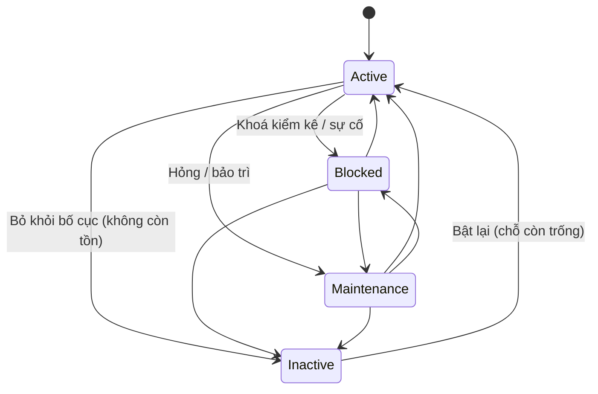

# 06 — Kho Map 2D/3D & Gợi ý vị trí (Warehouse Map & Slotting Suggestion)

## 1. Mục đích (Purpose)

Cung cấp **mô hình không gian của kho** và các công cụ quanh nó:

- **Bản đồ kho (Warehouse Map):** mặt bằng kho — **kệ (Shelf) → tầng kệ (Shelf Level) → ô (Bin)**, các **khu vực trên sàn (Area)**, **tường & cửa (Boundary)**, nhóm kệ theo **Zone** (tùy chọn). Một lần đọc trả cả bố cục kèm trạng thái để vẽ **2D** (mặt bằng) và **3D** (kệ theo cao độ tầng).
- **Vị trí tồn kho (Storage Location):** mỗi bin và mỗi khu vực chứa hàng là một vị trí có **mã vị trí đầy đủ** duy nhất toàn hệ thống — chuỗi được in nhãn, quét khi cất / lấy hàng và ghi trong tồn kho.
- **Nhãn vị trí:** in nhãn có mã QR và mã vạch Code 128 ra PDF.
- **Gợi ý vị trí khi cất hàng (putaway suggestion):** lọc bin theo ràng buộc cứng, xếp hạng theo quy tắc cố định — chi tiết vận hành ở [05 · Putaway](../05-putaway/README.md).
- **Bảng sức chứa kho (Warehouse Capacity Board):** sức chứa, đang chiếm, sắp về, còn trống dự kiến của từng kho, đo bằng **thể tích (m³)** kèm **phần trăm**, xem được theo **kho → zone / kệ / khu** — dùng khi Điều phối sản xuất lập Đơn sản xuất (Production Order) và Sale chọn kho xuất cho đơn ([17](../../ecommerce/17-order-management/README.md)) — chi tiết §4.6.

Mục tiêu: định vị nhanh, mã vị trí không trùng và không đổi, cất hàng đúng điều kiện lưu trữ, biết trước kho nào còn chỗ.

> **Đã chốt 2026-11-05:** sức chứa của bin và khu chứa hàng đo bằng **thể tích (m³)** kèm **tải trọng (kg)**, thay cho "sức chứa theo đơn vị". Thể tích một thùng = D × R × C theo quy cách thùng ([01](../01-product-creation/README.md)). Một đơn bán có **đúng một kho xuất**; mọi Đơn sản xuất của đơn có kho nhận = kho xuất ([17](../../ecommerce/17-order-management/README.md)).
>
> **Đã chốt 2026-11-05 (bổ sung):**
> - **Thể tích vị trí do hệ thống tự tính, không nhập tay** — bin = rộng × dài của bin × **chiều cao lọt** của tầng kệ (nay **bắt buộc**); **khu vực không có thể tích / sức chứa** (✅ chốt lại 2026-11-13 — bỏ chiều cao xếp tối đa). Tải trọng (kg) vẫn khai báo (BR-19).
> - Bảng sức chứa kho có **phần trăm**, xem theo **zone / kệ / khu** và **hệ số sử dụng** của kho (§4.6).
> - **Bỏ khu kiểm thùng & dán nhãn riêng**: kiểm thùng & dán nhãn giao làm tại **Khu xuất hàng (`DISPATCH`)** (BR-22).
> - **Bỏ hẳn lớp lưu trữ** (của SKU, kệ, bin, khu chứa hàng); thay bằng ràng buộc cứng **thùng vừa bin theo từng chiều** — D × R × C của thùng ≤ rộng × dài của bin × chiều cao lọt của tầng, được xoay ngang nếu thùng có cờ cho phép xoay (§4.4, BR-01). Thùng không vừa bin nào được cất vào khu `OVERFLOW`.

> ⚠️ Giả định: các phần sau thuộc **phạm vi giai đoạn sau** (xem [open-questions C2](../../open-questions/README.md)):
> - **quãng đường đi thực tế** trên bản đồ (không xuyên tường, qua cửa mở) và lộ trình lấy hàng *(✅ 2026-11-08: lộ trình **lượt cất** đã có, nhưng chỉ ước lượng theo khoảng cách Manhattan giữa các điểm đứng — §4.4 bước 6)*;
> - kiểm **mặt lấy hàng không bị tường / vật cản che**;
> - **heatmap độ lấp đầy** trên bản đồ, honeycombing (tỷ lệ lấp đầy dạng bảng theo kho / zone / kệ / khu đã có ở §4.6);
> - **chấm điểm mềm có trọng số** (gần khu xuất hàng `DISPATCH`, golden zone, hàng nặng tầng thấp, cân bằng tải, loại ô);
> - **tối ưu định kỳ (re-slotting)** theo ABC / tần suất xuất;
> - **tự động đưa thùng** từ bin dự trữ sang bin lấy hàng theo ngưỡng của bin;
> - lưu lịch sử phiên bản bố cục kho.
>
> Cơ sở dữ liệu đã có bảng cho quy tắc slotting và lệnh di chuyển nội bộ nhưng chưa có chức năng.

### Mô hình không gian kho

| Thành phần | Thuộc về | Vai trò |
|------------|----------|---------|
| **Kho (Warehouse)** | — | Khung bản đồ (đơn vị đo, chiều rộng × chiều dài), tên, địa chỉ kho, địa chỉ hoàn hàng, **tiền tố mã (prefix)**, **hệ số sử dụng** (§4.6) |
| **Zone** | Kho | **Nhóm kệ tùy chọn** (tên, màu hiển thị) để hiển thị và chọn nhãn in. Không mang quy tắc lưu trữ; khu vực không thuộc zone |
| **Kệ (Shelf)** | Kho, Zone (tùy chọn) | Khối kệ trên mặt bằng (toạ độ, kích thước, góc xoay 0/90/180/270); **mặt lấy hàng** (bắc / đông / nam / tây) |
| **Tầng kệ (Shelf Level)** | Kệ | Tầng thứ n (1–99) của kệ; **chiều cao lọt (bắt buộc)**; cao độ, tải trọng tối đa (tùy chọn) |
| **Ô (Bin)** | Tầng kệ | Điểm chứa hàng nhỏ nhất trên kệ; toạ độ tương đối trong kệ, kích thước, loại ô; **thể tích tự tính** = rộng × dài × chiều cao lọt của tầng; là một **vị trí tồn kho** |
| **Khu vực (Area)** | Kho | Vùng trên sàn **không phải kệ**: khu nhận hàng, khu cách ly, khu tạm, khu chờ xuất, khu xuất hàng, hoặc khu không chứa hàng. Khu chứa hàng là một **vị trí tồn kho**, **không có thể tích / sức chứa** (✅ 2026-11-13 — BR-19) |
| **Ranh giới (Boundary)** | Kho | Đoạn **tường (WALL)** hoặc **cửa (DOOR)** |

**Thuộc tính chung của vị trí tồn kho** (bin và khu chứa hàng): mã vị trí đầy đủ, **thể tích (m³) — hệ thống tự tính, không nhập tay**, **tải trọng tối đa (kg)**, cờ **cho phép lấy hàng** (`is_pickable`), cờ **cho phép cất hàng** (`is_putaway_target`), trạng thái. Lối đi không khai báo thành thực thể.

---

## 2. Actor liên quan

| Actor | Vai trò |
|-------|---------|
| **Quản lý kho (Warehouse Manager)** | Phạm vi vận hành theo **kho được gán** (1..n kho; bản đồ xem / sửa không giới hạn — xem ghi chú dưới bảng). Vai trò trong toàn hệ thống *(Đã chốt 2026-11-05)*: • **Thiết lập** — khai báo kho, bản đồ (zone, kệ, tầng, bin, khu vực, tường / cửa), vị trí (**kích thước, chiều cao lọt của tầng** — thể tích bin tự tính; **tải trọng**), cờ lấy / cất; **hệ số sử dụng** của kho (§4.6); đổi trạng thái kho, kệ, bin, khu vực; xoá tường / cửa; in nhãn (module này); danh mục hãng vận chuyển, loại xe ([09](../09-shipping/README.md)); quy cách thùng ([01](../01-product-creation/README.md)). • **Nhập kho** — theo dõi phiếu nhập; xử lý nhận thiếu / thừa / thùng lệch số chuẩn; quyết định hàng hoàn trong khu cách ly; xử lý chênh lệch sau nhập bằng điều chỉnh tồn ([03](../03-receipt/README.md)). • **Xuất kho** — release đơn, tạo task lấy hàng và giao người; quyết định giữ hàng ở khu chờ xuất (§4.5); chuyển task sang khu xuất hàng; huỷ chuyến bàn giao; ghi nhận kết quả giao ([07](../07-picking/README.md), [08](../08-packing/README.md), [09](../09-shipping/README.md)). • **Kiểm soát tồn** — lập kiểm kê; duyệt điều chỉnh tồn (người duyệt ≠ người gửi); cách ly / gỡ cách ly; **theo dõi Bảng sức chứa kho** (§4.6) ([20](../20-inventory-control/README.md)). • **Quyền** — có đủ quyền thao tác như nhân viên kho (làm thay khi cần); đây là quyền, không phải việc chính |
| **Quản trị hệ thống (System Admin)** | Như Quản lý kho về thiết lập bản đồ, vị trí |
| **Nhân viên kho (Warehouse Staff)** | Xem bản đồ, tra cứu vị trí khi quét, in nhãn; nhận gợi ý bin khi cất hàng ([05](../05-putaway/README.md)) |
| **Nhân viên Sale (Sales Staff) / Điều phối sản xuất (Production Coordinator) / Quản lý kinh doanh (Sales Manager)** | Xem danh sách kho và **Bảng sức chứa kho** (còn trống dự kiến): Sale khi chọn kho xuất cho đơn, Điều phối sản xuất khi lập Đơn sản xuất, Sales Manager khi duyệt ([17](../../ecommerce/17-order-management/README.md)) |
| **Hệ thống** | Ghép mã vị trí; kiểm hình học khi lưu; **tự tính thể tích** bin / khu chứa hàng; tính trạng thái hiệu lực; lọc và xếp hạng bin gợi ý; tính Bảng sức chứa kho và cảnh báo vượt chỗ trống dự kiến |

- Bản đồ và vị trí **không giới hạn theo kho được gán**; chỉ nhiệm vụ cất hàng mới giới hạn theo kho ([05](../05-putaway/README.md)).

---

## 3. Input / Output

### Input

| Nhóm | Dữ liệu | Nguồn |
|------|---------|-------|
| **Khung kho** | Tên (≤ 200), **prefix** (1–10 ký tự `A–Z0–9`, duy nhất, không đổi), địa chỉ (bắt buộc, ≤ 500), địa chỉ hoàn hàng (tùy chọn), đơn vị bản đồ (`M`), chiều rộng × chiều dài bản đồ, **hệ số sử dụng** (%, mặc định 100% — §4.6) | Quản lý kho |
| **Bố cục mặt bằng** | Zone (tên duy nhất trong kho, màu `#RRGGBB`); tường & cửa (đoạn thẳng đầu–cuối; cửa: đi qua được không, `Open` / `Closed`); khu vực (mã, loại, tên, toạ độ, kích thước, góc xoay, vật cản); kệ (mã, tên, mô tả, toạ độ, kích thước, góc xoay, vật cản, mặt lấy hàng, zone) | Quản lý kho |
| **Cấu trúc kệ** | Tầng (thứ tự, **chiều cao lọt — bắt buộc**, cao độ, tải trọng tối đa); bin (mã, mô tả, toạ độ tương đối, kích thước, loại ô) — nhập từng bin hoặc **tự sinh** (BR-14) | Quản lý kho |
| **Thuộc tính vị trí** | Tải trọng tối đa (kg), cho phép lấy / cất hàng. **Thể tích (m³) không nhập** — hệ thống tự tính từ kích thước bin và chiều cao lọt của tầng; khu vực không có thể tích (BR-19) | Quản lý kho |
| **Thuộc tính SKU** | **Kích thước thùng** (D × R × C — để kiểm thùng vừa bin và tính thể tích thùng), khối lượng thùng đầy theo quy cách thùng; **cờ cho phép xoay** | [01](../01-product-creation/README.md) (Inventory Item) |
| **Tồn theo vị trí** | Thùng LPN, SKU, lô trên từng bin / khu (để gợi ý vị trí và tính Đang chiếm) | [20](../20-inventory-control/README.md) |
| **Đơn sản xuất đang mở** | Phần chưa nhận (số thùng) của các Đơn sản xuất `Sent` / `Accepted` / `Sample Pending` / `In Production` / `Partially Received`, theo kho nhận (để tính Sắp về) | [17](../../ecommerce/17-order-management/README.md) |
| **Thùng đã giữ cho đơn chưa giao** | Khoản giữ / phân bổ theo kho xuất (để tính Sắp xuất — tham khảo) | [20](../20-inventory-control/README.md), [17](../../ecommerce/17-order-management/README.md) |

Đo lường giữ tới 3 chữ số thập phân; giá trị lẻ hơn bị từ chối, không làm tròn.

### Output

| Kết quả | Dùng bởi |
|---------|----------|
| **Bố cục kho** (khung, zone, kệ với tầng & bin, khu vực, tường / cửa; mỗi vị trí kèm **thể tích tự tính**, trạng thái, trạng thái hiệu lực, dùng được hay không) để vẽ 2D / 3D | Quản lý kho, NV kho |
| **Mã vị trí đầy đủ** cho từng bin và khu chứa hàng | 03, 05, 07, 08, 11, 20 (quét xác nhận, ghi tồn) |
| **Tra cứu vị trí theo mã quét** — loại, kho, trạng thái, trạng thái hiệu lực, dùng được | 05, 07, 20 |
| **Nhãn vị trí PDF** (mã chữ + QR + Code 128) | NV kho |
| **Danh sách bin gợi ý** khi cất hàng (tối đa 10, kèm lý do, thể tích và tải trọng còn trống — đã trừ phần giữ chỗ của lượt cất) | [05 · Putaway](../05-putaway/README.md) |
| **Điểm đứng** của từng bin và **lộ trình lượt cất** vẽ trên Kho Map 2D (§4.4 bước 6) | [05 · Putaway](../05-putaway/README.md) §4.5 |
| **Vị trí lấy hàng được** của một kho (cho phép lấy + dùng được) | Phân bổ khi lấy hàng ([07](../07-picking/README.md), [20](../20-inventory-control/README.md)) |
| **Khu chờ xuất `STAGING` / khu xuất hàng `DISPATCH` của kho** | [07](../07-picking/README.md), [08](../08-packing/README.md), [09](../09-shipping/README.md), [17](../../ecommerce/17-order-management/README.md) |
| **Địa chỉ kho** in trên nhãn giao hàng / chứng từ | [08](../08-packing/README.md), [09](../09-shipping/README.md) |
| **Bảng sức chứa kho** theo từng kho: Sức chứa, Đang chiếm, Sắp về, Còn trống dự kiến, **Chờ duyệt**, **Còn trống nếu duyệt hết**, Sắp xuất (tham khảo), **% đang chiếm**, **% còn trống dự kiến**; xem chi tiết theo **zone / kệ / khu** — §4.6 | Sale khi chọn kho xuất, Điều phối sản xuất khi lập Đơn sản xuất, Sales Manager khi duyệt Đơn sản xuất ([17](../../ecommerce/17-order-management/README.md)); Quản lý kho |
| **Thông báo sức chứa** cho Quản lý kho của kho nhận: Đơn sản xuất được gửi về kho; còn trống dự kiến của kho chuyển sang âm — §4.6 | Quản lý kho ([00 §6](../../00-system-overview/README.md)) |
| **Cảnh báo vượt chỗ trống dự kiến** (không chặn) | [17](../../ecommerce/17-order-management/README.md) |

---

## 4. Luồng nghiệp vụ từng bước (Step-by-step)

### 4.1. Thiết lập & duy trì bản đồ kho

1. **Khai báo kho** — tên, prefix, địa chỉ, địa chỉ hoàn hàng, đơn vị bản đồ, kích thước khung, **hệ số sử dụng** (mặc định 100% — §4.6). Khung chỉ thu nhỏ được tới phạm vi bố cục hiện có.
2. **(Tùy chọn) Khai báo Zone** — tên, màu.
3. **Vẽ ranh giới** — tường (luôn không đi qua được, không có trạng thái) và cửa (có / không đi qua được; `Open` / `Closed`).
4. **Đặt khu vực** — mã, loại, tên, vị trí, kích thước, góc xoay, vật cản. Khu **chứa hàng** thêm tải trọng, cho phép lấy / cất; khu **không có thể tích** (BR-19, ✅ 2026-11-13). Hệ thống sinh **mã vị trí** của khu (BR-10).
5. **Đặt kệ** — mã, tên, vị trí, kích thước, góc xoay, zone, **mặt lấy hàng**.
6. **Khai báo tầng** — tối đa **20 tầng** mỗi kệ; thứ tự tầng 1–99; mỗi tầng **bắt buộc có chiều cao lọt** (`usable_height`).
7. **Khai báo bin** — tối đa **200 bin** mỗi tầng:
   - **Nhập từng bin:** mã, vị trí tương đối, kích thước, loại ô, tải trọng, cho phép lấy / cất.
   - **Tự sinh bin:** chọn kệ, các tầng **chưa có bin** (tối đa 20 tầng mỗi lần), số hàng × số cột (tích ≤ 200), kiểu đặt mã; mọi bin sinh ra dùng chung thuộc tính (BR-14).

   Mỗi bin có **mã vị trí đầy đủ** (BR-10). Hệ thống **tự tính thể tích bin** = rộng × dài của bin × chiều cao lọt của tầng (BR-19); không có ô nhập thể tích. Sửa kích thước bin hoặc chiều cao lọt thì thể tích **tự cập nhật** — nhưng **bị chặn** nếu sau khi sửa có thùng đang nằm ở vị trí đó **không còn vừa bin** hoặc thể tích vị trí **nhỏ hơn thể tích đang chiếm** (BR-23).
8. **Kiểm khi lưu** — hệ thống kiểm các ràng buộc hình học (BR-06 → BR-08) và ràng buộc với thùng đang chứa (BR-23) trên mọi thay đổi.
   - Thay đổi bố cục của một kho được xếp hàng tuần tự (khoá theo kho).
   - Mỗi bản ghi mang **phiên bản**; lưu với phiên bản cũ → từ chối.
   - Mọi thay đổi ghi **nhật ký kiểm toán** (ai, lúc nào, gì).
9. **Duy trì** — đổi trạng thái kệ / bin / khu vực (`Active` / `Blocked` / `Maintenance` / `Inactive`), đổi trạng thái kho, mở / đóng cửa.
   - *(✅ Đã chốt 2026-11-05)* **Không ngưng vị trí / kho còn tồn** (BR-04): chuyển kệ / bin / khu vực sang `Inactive` (bỏ khỏi bố cục), hoặc kho sang `Inactive`, bị **chặn** khi còn thùng `In Stock` nằm trong đó. `Blocked` / `Maintenance` **vẫn đặt được khi còn hàng** — đó là cách khoá vị trí (không cất / lấy thêm) trong lúc kiểm kê, xử lý sự cố hoặc dời thùng ra ([11](../11-intra-warehouse-transfer/README.md)) (kệ: ở bất kỳ bin nào của kệ; kho: ở bất kỳ vị trí nào của kho). Hệ thống liệt kê các thùng còn lại; Quản lý kho dời thùng đi trước ([11](../11-intra-warehouse-transfer/README.md)) rồi mới ngưng.
   - *(✅ Đã chốt 2026-11-05)* **Không sửa kích thước / chiều cao làm thùng đang chứa không còn chỗ** (BR-23): sửa kích thước bin hoặc chiều cao lọt của tầng bị chặn nếu sau khi sửa có thùng đang nằm ở vị trí liên quan không còn vừa bin, hoặc thể tích vị trí nhỏ hơn thể tích đang chiếm. Hệ thống liệt kê vị trí và thùng vướng; Quản lý kho dời thùng đi trước ([11](../11-intra-warehouse-transfer/README.md)).
   - **Kệ, bin, khu vực, zone không xoá**; bỏ khỏi bố cục bằng `Inactive`.
   - **Tường và cửa xoá hẳn được.**
   - Mã vị trí không sửa; tạo nhầm thì `Inactive` rồi tạo mới (BR-13).

### 4.2. Trạng thái hiệu lực

1. Trạng thái **hiệu lực** của một vị trí = trạng thái **hẹp nhất** trong (kho, kệ, vị trí), theo thứ tự `Inactive` > `Maintenance` > `Blocked` > `Active`. Kho `Inactive` → mọi vị trí trong kho `Inactive`.
2. Trạng thái được **tính khi đọc**, **không ghi lan** xuống con. Bật lại kệ / kho thì các vị trí con trở về đúng trạng thái riêng của chúng.
3. Vị trí **dùng được** khi trạng thái hiệu lực là `Active`.
4. Đưa kệ / bin / khu vực ra khỏi `Inactive` đòi chỗ của nó trên bản đồ **còn trống** (không chồng lấn vị trí đang dùng).
5. *(✅ Đã chốt 2026-11-05)* Chỉ kệ / bin / khu vực / kho **không còn tồn** mới chuyển được sang `Inactive` (BR-04); do đó không có thùng nào nằm ở vị trí đã bị bỏ khỏi bố cục. Vị trí `Blocked` / `Maintenance` có thể còn hàng, nhưng không được gợi ý cất / lấy.

### 4.3. Nhãn vị trí & tra cứu khi quét

1. **In nhãn** — chọn **một** trong:
   - cả kho;
   - một kệ (tuỳ chọn một số tầng);
   - một zone (chỉ bin của các kệ trong zone, không gồm khu vực);
   - danh sách mã vị trí (1–2.000 mã, không phân biệt hoa thường).
2. Nhãn in theo **thứ tự đi**: bin theo mã kệ → tầng → mã bin, rồi các khu chứa hàng. Tối đa **2.000 nhãn** mỗi lần. Khổ **A4** (24 nhãn 70×37 mm) hoặc **cuộn in nhiệt** (60×40 mm).
3. Vị trí `Inactive` và bin của kệ `Inactive` bị bỏ qua (nêu đích danh một mã như vậy → báo lỗi). Vị trí `Blocked` / `Maintenance` vẫn in.
4. **Tra cứu theo mã quét** — trả loại vị trí, kho, trạng thái, trạng thái hiệu lực, dùng được hay không. Mã không có hoặc là khu không chứa hàng → không tìm thấy.

### 4.4. Gợi ý vị trí khi cất hàng

Chi tiết vận hành ở [05 §4.2](../05-putaway/README.md); tóm tắt quy tắc:

1. **Lọc (ràng buộc cứng)** — chỉ **bin** (không phải khu vực) **cùng kho**, cho phép cất (`is_putaway_target`), kho / kệ / bin đều `Active`, và **thùng vừa bin theo từng chiều**: D × R × C của thùng (quy cách thùng — [01](../01-product-creation/README.md)) ≤ rộng × dài của bin × chiều cao lọt của tầng. Thùng có cờ **cho phép xoay** được xoay ngang (đổi D và R) — vừa theo một trong hai hướng là đạt; chiều cao C luôn so với chiều cao lọt. Tầng thiếu chiều cao lọt (dữ liệu cũ) thì không kiểm chiều cao (✅ đã chốt 2026-11-05, §4.6). Thùng không vừa bin nào → cất vào khu `OVERFLOW` ([05](../05-putaway/README.md) BR-13).
2. **Còn chỗ** — thể tích bin **tự tính** (BR-19) trừ tổng thể tích các thùng đang có (mọi SKU) và phần **đang giữ chỗ** cho lượt cất khác ([05](../05-putaway/README.md) §4.5, *✅ 2026-11-08*) ≥ thể tích thùng cần cất (cất nguyên thùng — [05](../05-putaway/README.md) BR-08). Khối lượng hiện có + khối lượng thùng mới ≤ tải trọng tối đa. Không khai báo tải trọng = không kiểm tải; bin chưa tính được thể tích (dữ liệu cũ: tầng thiếu chiều cao lọt) = không giới hạn thể tích (✅ đã chốt 2026-11-05, §4.6).
3. **Xếp hạng** *(✅ Đã chốt 2026-11-08)* — cùng lô → **bin trống** → cùng SKU lô khác → SKU khác. Trong nhóm cùng lô / cùng SKU / SKU khác: bin **còn ít chỗ hơn** trước (lấp đầy bin đang dở); trong nhóm bin trống: bin **nhỏ nhất chứa được cả phần còn lại của lô** (các thùng cùng lô còn nhiệm vụ cất `Pending`) trước, không bin nào đủ thì bin lớn hơn trước; rồi theo mã. Bin chưa tính được thể tích xếp **sau mọi bin đã có thể tích**. Chi tiết và ví dụ: [05 §4.2](../05-putaway/README.md).
4. **Trả tối đa 10 bin**, mỗi bin kèm lý do, thể tích và tải trọng còn trống. Gợi ý tính mỗi lần xem, **không lưu**; riêng khi **cất theo lượt**, bin được gán cho các thùng trên xe được lưu cùng lượt và giữ chỗ ([05](../05-putaway/README.md) §4.5).
5. NV kho cất vào **bất kỳ bin hợp lệ** nào; hệ thống kiểm lại ràng buộc tại bin được quét. Không bắt buộc mã lý do khi khác gợi ý ([open-questions C18](../../open-questions/README.md)).
6. **Điểm đứng & lộ trình lượt cất** *(✅ Đã chốt 2026-11-08)* — **điểm đứng** của một bin là điểm ngay trước **mặt lấy hàng** của kệ chứa bin (kệ có nhiều mặt lấy hàng thì lấy mặt gần bin nhất), tính từ toạ độ, kích thước, góc xoay của kệ và toạ độ bin trong kệ; điểm đứng của khu vực là tâm khu. Không lưu, tính khi lập lộ trình. Lộ trình lượt cất sắp các điểm dừng theo **láng giềng gần nhất**, khoảng cách **Manhattan** (|Δx| + |Δy|), xuất phát từ khu nguồn, `OVERFLOW` cuối cùng ([05](../05-putaway/README.md) §4.5); vẽ thành đường nối các điểm dừng trên bản đồ 2D.

   > ⚠️ Giả định: khoảng cách không tránh kệ / tường / cửa (lối đi không khai báo thành thực thể); chọn mặt lấy hàng gần bin nhất khi kệ có nhiều mặt. Xem [open-questions C46](../../open-questions/README.md).

### 4.5. Khu chờ xuất (Staging)

> **Đã chốt 2026-11-04:** thêm loại khu `STAGING` — **Khu chờ xuất**.

1. Quản lý kho khai báo khu `STAGING` như mọi khu chứa hàng (§4.1 bước 4). Khu này **không phải đích gợi ý cất** (gợi ý chỉ trả bin — BR-12).
2. Các thùng đã lấy cho một đơn được gom và **giữ riêng cho đơn** tại khu chờ xuất khi đơn chưa xuất ngay — ví dụ còn chờ phần hàng từ Đơn sản xuất, hoặc chờ thu đợt thanh toán `BEFORE_DELIVERY` ([07](../07-picking/README.md), [17](../../ecommerce/17-order-management/README.md)).
3. Khi đơn sẵn sàng xuất, các thùng chuyển từ khu chờ xuất sang **khu xuất hàng `DISPATCH`** ([07](../07-picking/README.md), [08](../08-packing/README.md)). Đơn đủ hàng, xuất ngay thì lấy thẳng sang `DISPATCH` (đích lấy hàng mặc định), không qua khu chờ xuất.

**Khu chờ xuất (`STAGING`) và Khu xuất hàng (`DISPATCH`)** *(Đã chốt 2026-11-05)*:

| Tiêu chí | Khu chờ xuất `STAGING` | Khu xuất hàng `DISPATCH` |
|----------|------------------------|--------------------------|
| Thùng nằm ở đây | Thùng của đơn **chưa được phép xuất** (chờ hàng từ Đơn sản xuất, chờ thanh toán…) | Thùng của đơn **đủ điều kiện xuất** |
| Thao tác tại khu | Chỉ gom và giữ riêng cho đơn | Quét kiểm đủ thùng, **dán nhãn giao hàng tại chỗ** ([08](../08-packing/README.md)), gom theo shipment, chờ xe ([09](../09-shipping/README.md)) |
| Nhãn giao hàng | Chưa dán | Dán tại khu |
| Tồn | **Chưa trừ** (thùng `In Stock`, gắn đơn) | **Bị trừ** khi thùng tới khu ([07](../07-picking/README.md)) |
| Đơn còn huỷ được | Có (thùng cất lại) | Theo quy tắc huỷ của [17](../../ecommerce/17-order-management/README.md) |
| Thời gian nằm | Có thể vài ngày | Trong ngày, tới khi bàn giao vận chuyển |
| Bắt buộc dùng | Không — Quản lý kho quyết định | Có — mọi thùng xuất đều qua khu này |

> ✅ Đã chốt 2026-11-05: **Quản lý kho** (của kho xuất) quyết định có dùng khu chờ xuất cho đơn hay không.
>
> ✅ Đã chốt 2026-11-05: tồn ở `STAGING` đã gắn đơn, **không khả dụng cho đơn khác**. Xem [open-questions](../../open-questions/README.md).

### 4.6. Bảng sức chứa kho (Warehouse Capacity Board)

> **Đã chốt 2026-11-05:** yêu cầu mới. Heatmap độ lấp đầy, honeycombing và **dự báo chỗ trống theo ngày** vẫn là phạm vi sau.
>
> **Đã chốt 2026-11-05 (bổ sung):** thêm cột **Chờ duyệt** (Đơn sản xuất chưa gửi đi), **kiểm lại chỗ trống khi Sales Manager duyệt** và **thông báo cho Quản lý kho** của kho nhận.
>
> **Đã chốt 2026-11-05 (bổ sung):** thể tích vị trí **tự tính** (BR-19); thêm **% đang chiếm**, **% còn trống dự kiến**, xem theo **kho → zone / kệ / khu**; thêm **hệ số sử dụng** của kho.
>
> **Chốt lại 2026-11-13 (SCRUM-666):** **khu vực không có sức chứa**. Khu nhận hàng, cách ly, chờ xuất, xuất hàng là nơi hàng đi qua, không phải chỗ cất; rộng × dài × cao của một khu sàn không phản ánh lượng hàng xếp được (lối đi, khe hở, xếp chồng không đều). Bỏ **chiều cao xếp tối đa**; Sức chứa chỉ tính từ **bin**; thùng nằm ở khu vẫn tính vào Đang chiếm; BR-23 chỉ còn áp cho bin và tầng.

1. **Nguồn số liệu** — **thể tích (m³)** của mỗi bin do hệ thống **tự tính** từ kích thước bin và chiều cao lọt của tầng (§4.1, BR-19); khu vực không có sức chứa (✅ 2026-11-13); **tải trọng (kg)** do Quản lý kho khai báo. Thể tích một thùng = D × R × C theo quy cách thùng của SKU ([01](../01-product-creation/README.md)).
2. **Hệ số sử dụng** của kho — tỷ lệ thể tích thực sự xếp được (trừ lối thao tác, khe hở giữa các thùng…). Mặc định **100%**; Quản lý kho chỉnh được (ví dụ 85%).
3. **Các cột của bảng**, cho từng kho, tính **khi đọc** (không lưu):

   | Cột | Cách tính |
   |-----|-----------|
   | **Sức chứa** | Tổng thể tích tự tính của các bin **đang dùng được** (trạng thái hiệu lực `Active`) của kho **× hệ số sử dụng** |
   | **Đang chiếm** | Tổng thể tích các thùng đang nằm trong kho (thùng `In Stock` ở mọi vị trí của kho, mọi trạng thái tồn) |
   | **Sắp về** | Phần **chưa nhận** (số thùng còn mở × thể tích thùng) của các Đơn sản xuất `Sent` / `Accepted` / `Sample Pending` / `In Production` / `Partially Received` có **kho nhận** là kho này ([17](../../ecommerce/17-order-management/README.md)) |
   | **Còn trống dự kiến** | = Sức chứa − Đang chiếm − Sắp về (có thể âm) |
   | **Chờ duyệt** | Thể tích các Đơn sản xuất **chưa gửi đi** (`Draft` / `Pending Approval`) có kho nhận là kho này — tách riêng, **không** trừ vào còn trống dự kiến vì đơn chưa chắc được gửi |
   | **Còn trống nếu duyệt hết** | = Còn trống dự kiến − Chờ duyệt (có thể âm) |
   | **Sắp xuất** *(tham khảo)* | Tổng thể tích các thùng **đã giữ cho đơn chưa giao** của kho ([20](../20-inventory-control/README.md)); **không cộng** vào chỗ trống |
   | **% đang chiếm** | = Đang chiếm ÷ Sức chứa |
   | **% còn trống dự kiến** | = Còn trống dự kiến ÷ Sức chứa (có thể âm) |

   Bảng hiện kèm tổng tải trọng tương ứng (kg) để tham khảo.
4. **Xem theo cấp** — từ một kho mở xuống từng **zone**, **kệ**, **khu chứa hàng** (bin của kệ không thuộc zone gom vào nhóm "Không thuộc zone"; khu vực không thuộc zone; khu chỉ có Đang chiếm, không có Sức chứa). Ở cấp này bảng hiện Sức chứa, Đang chiếm, Còn trống hiện tại (= Sức chứa − Đang chiếm) và % tương ứng; Sắp về, Chờ duyệt, Sắp xuất chỉ có ở cấp kho vì Đơn sản xuất và khoản giữ chỉ xác định tới kho (✅ đã chốt 2026-11-05 — bên dưới).
5. **Dùng khi Điều phối sản xuất lập Đơn sản xuất / Sale chọn kho xuất** ([17](../../ecommerce/17-order-management/README.md)) — hệ thống hiện **còn trống dự kiến**, **chờ duyệt** và **còn trống nếu duyệt hết** của các kho. Thể tích cần chứa (số thùng × thể tích thùng) **lớn hơn** còn trống dự kiến của kho được chọn → **cảnh báo**; lớn hơn **còn trống nếu duyệt hết** (không tính chính đơn đang lập) → cảnh báo thêm rằng các Đơn sản xuất khác đang chờ duyệt về cùng kho. Cả hai đều **không chặn**.
6. **Kiểm lại khi Sales Manager duyệt** Đơn sản xuất — hệ thống tính lại bảng **tại thời điểm duyệt** (chỗ trống có thể đã đổi từ lúc Điều phối sản xuất lập) và hiện cho người duyệt cùng cảnh báo như bước 5; **không chặn**, người duyệt quyết duyệt, trả lại (ví dụ để Sale đổi kho xuất, khi còn đổi được) hoặc duyệt kèm ghi chú.
7. **Hàng về khi kho đầy** — kho vẫn nhận ([03](../03-receipt/README.md)); thùng không còn bin hợp lệ được cất vào khu tạm **`OVERFLOW`** — là tồn `Available` ở khu chứa hàng, coi như đã cất xong, giữ cho đơn được ngay (✅ đã chốt 2026-11-05 — [05](../05-putaway/README.md) BR-13) — rồi Quản lý kho dời lên bin khi có chỗ ([05](../05-putaway/README.md) BR-13, [11](../11-intra-warehouse-transfer/README.md)).
8. **Thông báo cho Quản lý kho** của kho nhận (hộp thông báo — [00 §6](../../00-system-overview/README.md)):
   - khi một Đơn sản xuất chuyển `Sent` về kho: `INFO` — mã Đơn sản xuất, số thùng, thể tích, ngày cần hàng;
   - khi lần gửi đó làm **còn trống dự kiến** của kho **chuyển từ ≥ 0 sang âm**: `WARN` — số m³ thiếu (✅ đã chốt 2026-11-05: chỉ báo ở lần chuyển sang âm, không báo lặp khi kho vẫn âm; xem [open-questions C42](../../open-questions/README.md)).
9. **Quản lý kho** theo dõi bảng (cả theo zone / kệ / khu) để mở thêm bin, dọn chỗ, chỉnh hệ số sử dụng hoặc báo Điều phối sản xuất trước khi hàng về.

> ✅ Đã chốt 2026-11-05: vị trí **chưa tính được thể tích** — bin trên tầng thiếu chiều cao lọt (dữ liệu cũ, vì trường này nay bắt buộc) — không được cộng vào Sức chứa; bảng hiện **số vị trí còn thiếu** để Quản lý kho bổ sung. Thùng nằm ở mọi vị trí của kho — kể cả `RECEIVING`, `QUARANTINE`, `STAGING`, `DISPATCH`, `OVERFLOW` — đều tính vào Đang chiếm. Xem [open-questions C40](../../open-questions/README.md).
>
> ✅ Đã chốt 2026-11-05: **một hệ số sử dụng cho cả kho**, mặc định **100%**, nhận giá trị trong khoảng (0%, 100%], áp cho bin (khu vực không có sức chứa — ✅ 2026-11-13), cho mọi cấp xem (kho / zone / kệ / khu); hệ số **chỉ dùng cho Bảng sức chứa** — kiểm còn chỗ khi cất hàng ([05](../05-putaway/README.md)) dùng thể tích tự tính đầy đủ. Ở cấp zone / kệ / khu chỉ có Sức chứa, Đang chiếm, Còn trống hiện tại và %. Xem [open-questions C43](../../open-questions/README.md).

---

## 5. Trạng thái / Vòng đời

Module này **không có chứng từ vòng đời riêng**. Trạng thái của các thực thể:

| Thực thể | Trạng thái | Chuyển tiếp cho phép | Ai thực hiện |
|----------|-----------|----------------------|--------------|
| **Kho** | `Active` · `Inactive` | `Active` ⇄ `Inactive` (kích hoạt / ngưng; bật lại khôi phục trạng thái riêng của vị trí). Ngưng chỉ khi kho **không còn tồn** (BR-04) | Quản lý kho / System Admin |
| **Kệ / Bin / Khu vực** | `Active` (dùng bình thường) · `Blocked` (khoá kiểm kê / sự cố) · `Maintenance` (hỏng / bảo trì) · `Inactive` (bỏ khỏi bố cục) | Giữa bốn trạng thái; sang `Inactive` chỉ khi vị trí **không còn tồn** (BR-04), `Blocked` / `Maintenance` đặt được cả khi còn hàng; ra khỏi `Inactive` khi chỗ còn trống | Quản lý kho / System Admin |
| **Cửa** | `Open` · `Closed` | Mở ⇄ đóng | Quản lý kho / System Admin |
| **Tường** | — | Tạo / sửa / xoá | Quản lý kho / System Admin |
| **Zone** | — (không trạng thái, không xoá) | — | Quản lý kho / System Admin |

`Full` (đầy) **không lưu** — tính ra từ tổng thể tích / khối lượng thùng so với thể tích tự tính / tải trọng của bin khi gợi ý vị trí. Bảng sức chứa kho cũng tính khi đọc (§4.6).

### Giá trị phân loại

| Trường | Giá trị | Ý nghĩa |
|--------|---------|---------|
| **Loại khu vực (`Area.type`)** — 5 loại khu chứa hàng + `NON_STORAGE` *(Đã chốt 2026-11-05: bỏ khu kiểm thùng & dán nhãn riêng, gộp vào `DISPATCH`)* | `RECEIVING` | Khu nhận hàng: thành phẩm vừa nhập từ đơn vị sản xuất, chờ cất ([03](../03-receipt/README.md)) |
| | `QUARANTINE` | Khu cách ly: hàng lỗi / hàng hoàn về chờ xử lý |
| | `OVERFLOW` | Khu tạm: nhận thùng khi kho đầy (không còn bin hợp lệ) và cả thùng **không vừa bin nào** theo kích thước (§4.4); cất lên bin khi có chỗ / có bin vừa (§4.6, [05](../05-putaway/README.md) BR-13) |
| | `STAGING` | Khu chờ xuất (tùy chọn): thùng đã lấy cho một đơn **chưa được phép xuất**, giữ riêng cho đơn; chưa dán nhãn, tồn chưa trừ (§4.5) |
| | `DISPATCH` | **Khu xuất hàng**: thùng đủ điều kiện xuất được đưa thẳng tới đây sau khi lấy (hoặc từ `STAGING`); quét kiểm đủ thùng và **dán nhãn giao hàng tại chỗ** ([08](../08-packing/README.md)), gom theo shipment, chờ xe bàn giao vận chuyển ([09](../09-shipping/README.md)). Không đóng lại hàng tại khu này (§4.5, BR-22) |
| | `NON_STORAGE` | Khu không chứa hàng (văn phòng, khu sạc xe…); không phải vị trí tồn kho |
| **Loại ô (`Bin.type`)** | `STANDARD` · `PALLET` · `SMALL_PARTS` | Ô tiêu chuẩn · ô pallet · ô hàng nhỏ. Chỉ để mô tả; chưa dùng trong gợi ý |
| **Đơn vị bản đồ** | `M` | Mét |
| **Kiểu đặt mã bin khi tự sinh** | `SEQUENTIAL` | Số liên tục theo hàng rồi cột: `01`, `02`… |
| | `ROW_LETTER_COLUMN` | Chữ là hàng, số là cột: `A01`, `A02`, `B01`… (tối đa 26 hàng) |

### Dữ liệu tối thiểu cần lưu

| Thực thể | Trường chính |
|----------|--------------|
| `Warehouse` | `id`, `name`, `prefix`, `address`, `return_address?`, `map_unit`, `map_width`, `map_height`, `utilization_factor` (hệ số sử dụng, mặc định 100%), `status`, `version` |
| `Zone` | `id`, `warehouse_id`, `name`, `color?` |
| `Shelf` | `id`, `warehouse_id`, `zone_id?`, `code`, `name`, `description?`, `x`, `y`, `width`, `length`, `rotation`, `is_obstacle`, `pick_north`, `pick_east`, `pick_south`, `pick_west`, `status` |
| `ShelfLevel` | `id`, `shelf_id`, `level_index`, `elevation?`, `usable_height` (bắt buộc), `max_weight?` |
| `Bin` | `id`, `level_id`, `location_id`, `code`, `description?`, `x`, `y` (tương đối trong kệ), `width`, `length`, `rotation`, `type` |
| `Area` | `id`, `warehouse_id`, `location_id?` (chỉ khu chứa hàng), `code`, `type`, `name`, `x`, `y`, `width`, `length`, `rotation`, `is_obstacle`, `status` |
| `StorageLocation` | `id`, `warehouse_id`, `kind` (`BIN` / `AREA`), `location_code`, `capacity_volume_m3` (**giá trị tính ra**, không nhập, chỉ bin — BR-19), `max_weight?`, `is_pickable`, `is_putaway_target`, `status` |
| `Boundary` | `id`, `warehouse_id`, `type` (`WALL` / `DOOR`), `start_x`, `start_y`, `end_x`, `end_y`, `is_passable`, `door_status?` |

Trường có dấu `?` là tùy chọn; để trống thì hệ thống **không kiểm** ràng buộc tương ứng (ví dụ không có tải trọng → không kiểm tải). `capacity_volume_m3` = `width` × `length` × `usable_height` của tầng, chỉ cho bin (khu vực không có — ✅ 2026-11-13), đơn vị mét; tính lại mỗi khi một trong các trường đó đổi. Vị trí chưa tính được thể tích (dữ liệu cũ thiếu chiều cao) → không kiểm chỗ trống khi cất và không cộng vào Sức chứa của bảng sức chứa (✅ đã chốt 2026-11-05, §4.6).

`code` là **mã cục bộ**, duy nhất trong phạm vi cha trực tiếp. `location_code` là **mã vị trí đầy đủ** do hệ thống ghép (BR-10), chỉ có ở vị trí tồn kho.

---

## 6. Ràng buộc nghiệp vụ (Business Rules) & Edge case

### Business rules

- **BR-01:** Ràng buộc cứng khi cất hàng (bin, cùng kho, dùng được, cho phép cất, **thùng vừa bin theo từng chiều** — D × R × C của thùng ≤ rộng × dài của bin × chiều cao lọt của tầng, được xoay ngang nếu thùng có cờ cho phép xoay — §4.4; còn thể tích và tải trọng) **không bao giờ bị vượt**, kể cả khi NV kho chọn bin ngoài gợi ý. **Thùng vừa bin áp cho mọi thao tác đưa thùng vào bin** *(Đã chốt 2026-11-05)*: cất hàng ([05](../05-putaway/README.md)), cất lại thùng của đơn huỷ ([07](../07-picking/README.md) BR-12), di chuyển thủ công kể cả dời từ `OVERFLOW` lên bin và sửa lệch vị trí khi kiểm kê ([11](../11-intra-warehouse-transfer/README.md) BR-10).
- **BR-02:** NV kho được cất vào bin khác gợi ý, **không cần mã lý do** (⚠️ C18).
- **BR-03:** Gợi ý tính từ tồn **tại thời điểm xem**, trừ phần **giữ chỗ** của các lượt cất đang mở ([05](../05-putaway/README.md) BR-16); lúc xác nhận hệ thống kiểm lại dưới khoá theo bin.
- **BR-04:** Kệ, bin, khu vực, zone **không xoá**, chỉ `Inactive`. **Không ngưng vị trí / kho còn tồn** *(✅ Đã chốt 2026-11-05)*: người dùng chuyển kệ / bin / khu vực sang `Inactive`, hoặc kho sang `Inactive`, bị **chặn** khi còn thùng `In Stock` nằm trong đó (`Blocked` / `Maintenance` vẫn đặt được khi còn hàng, để khoá vị trí trong lúc kiểm kê / sự cố / dời thùng) — mọi trạng thái tồn, kể cả ở `RECEIVING`, `QUARANTINE`, `STAGING`, `DISPATCH`, `OVERFLOW`; với kệ tính mọi bin của kệ, với kho tính mọi vị trí của kho. Muốn ngưng thì dời / xử lý hết thùng trước ([11](../11-intra-warehouse-transfer/README.md)).
- **BR-05:** Bản đồ là công cụ trực quan, **không phải nguồn sự thật của tồn**; nguồn sự thật là tồn theo vị trí ([20](../20-inventory-control/README.md)).
- **BR-06:** Kệ, khu vực và hai đầu tường / cửa phải nằm trong khung bản đồ (chạm mép được tính là bên trong); khung chỉ thu nhỏ được tới phạm vi bố cục.
- **BR-07:** Kệ và khu vực (đang không `Inactive`) **không chồng lấn** nhau (chạm cạnh được). Bin nằm trong kệ, không chồng lấn bin khác cùng tầng; kệ không thu nhỏ quá bin. Tường không kiểm chồng lấn.
- **BR-08:** Kệ có bin cho phép lấy hàng phải có **ít nhất một mặt lấy hàng**. (Kiểm mặt đó không bị tường / vật cản che: phạm vi sau.)
- **BR-09:** Góc xoay của kệ, khu vực, bin chỉ là 0 / 90 / 180 / 270 độ.
- **BR-10:** Mã vị trí đầy đủ do hệ thống ghép khi tạo, **duy nhất toàn hệ thống**:
  - Bin = **prefix kho – mã kệ – thứ tự tầng – mã bin**, ví dụ `HN-A01-2-03` (tầng viết không có số 0 đầu).
  - Khu vực = **prefix kho – mã khu vực**, ví dụ `HN-RCV01`.

  Prefix ≤ 10 ký tự, mã kệ / bin / khu vực ≤ 20 ký tự, cả mã ≤ 64 ký tự. Mỗi thành phần chỉ gồm `A–Z`, `0–9`, **không chứa `-`**; chữ thường tự đổi thành chữ hoa. Prefix duy nhất toàn hệ thống; mã kệ, mã khu vực duy nhất trong kho; thứ tự tầng duy nhất trong kệ; mã bin duy nhất trong tầng.
- **BR-11:** Tồn chỉ gắn vào **bin** hoặc **khu chứa hàng** (`RECEIVING`, `QUARANTINE`, `OVERFLOW`, `STAGING`, `DISPATCH`). Khu `NON_STORAGE` không chứa tồn. **Khu chứa hàng không đổi được thành `NON_STORAGE`**; chiều ngược lại được (tạo vị trí mới).
- **BR-12:** Phân bổ lấy hàng chỉ dùng vị trí **cho phép lấy hàng** và **dùng được** (bin hoặc khu chứa hàng). Gợi ý cất hàng chỉ trả **bin**.
- **BR-13:** Các thành phần tạo nên mã vị trí — prefix kho, mã kệ, thứ tự tầng, mã bin, mã khu vực — và đơn vị bản đồ **không sửa được** sau khi tạo. Tạo nhầm thì `Inactive` rồi tạo mới; mã của vị trí `Inactive` vẫn giữ, không cấp lại. Thuộc tính còn lại (tên, mô tả, toạ độ, kích thước, góc xoay, zone, chiều cao lọt, tải trọng, cờ lấy / cất, mặt lấy hàng, trạng thái, hệ số sử dụng của kho) sửa được — trong giới hạn BR-04 (trạng thái) và BR-23 (kích thước, chiều cao); thể tích không sửa trực tiếp mà tự cập nhật theo kích thước và chiều cao (BR-19).
- **BR-14:** Tự sinh bin:
  - Chỉ cho tầng **chưa có bin nào**, kể cả bin `Inactive`; mọi tầng chọn phải thuộc kệ đã chọn; một tầng không hợp lệ thì không sinh cho tầng nào.
  - Số hàng, số cột ≥ 1; hàng × cột ≤ 200; tối đa 20 tầng mỗi lần.
  - Kích thước bin = chiều rộng kệ ÷ số cột, chiều dài kệ ÷ số hàng, **làm tròn xuống** tới milimét; góc xoay 0; thể tích mỗi bin tự tính theo kích thước này (BR-19).
  - Mã đặt theo hàng rồi cột. Phần số có ít nhất 2 chữ số, thêm `0` đầu cho cùng độ dài (`SEQUENTIAL`: theo tổng số bin; `ROW_LETTER_COLUMN`: theo số cột).
  - Mọi bin sinh ra dùng chung loại ô và thuộc tính vị trí; bin cho phép lấy hàng đòi kệ có mặt lấy hàng.
- **BR-15:** Giới hạn: tối đa **20 tầng** mỗi kệ, **200 bin** mỗi tầng.
- **BR-16:** Trạng thái hiệu lực = hẹp nhất của kho / kệ / vị trí, tính khi đọc, không ghi lan.
- **BR-17:** In nhãn tối đa 2.000 nhãn mỗi lần, theo thứ tự đi, bỏ qua vị trí `Inactive`.
- **BR-18:** Tồn ở khu chờ xuất (`STAGING`) đã gắn **một đơn**; không được phân bổ cho đơn khác (✅ đã chốt 2026-11-05, §4.5). Hàng chỉ vào `STAGING` qua lấy hàng ([07](../07-picking/README.md)), không phải đích của di chuyển thủ công ([11](../11-intra-warehouse-transfer/README.md)).
- **BR-19:** **Sức chứa đo bằng thể tích, thể tích tự tính** *(Đã chốt 2026-11-05)*: sức chứa của bin là **thể tích (m³)** và **tải trọng (kg)**; chỗ trống tính theo tổng thể tích thùng (D × R × C của quy cách thùng) và tổng khối lượng thùng đầy. Không còn sức chứa theo đơn vị.
  - **Thể tích bin** = rộng × dài của bin × **chiều cao lọt** (`usable_height`) của tầng kệ — chiều cao lọt **bắt buộc** khi khai báo tầng.
  - **Khu vực không có sức chứa** *(✅ chốt lại 2026-11-13, SCRUM-666 — thay cho chiều cao xếp tối đa của 2026-11-05)*: khu nhận hàng, cách ly, chờ xuất, xuất hàng là nơi hàng đi qua; rộng × dài × cao của một khu sàn không phản ánh lượng hàng xếp được (lối đi, khe hở, xếp chồng không đều). Khu không có thể tích, không cộng vào Sức chứa của Bảng sức chứa kho; thùng nằm ở khu vẫn tính vào Đang chiếm (§4.6).
  - **Không nhập tay thể tích**; sửa kích thước bin hoặc chiều cao lọt thì thể tích tự cập nhật. Đơn vị bản đồ là mét. Tải trọng tối đa vẫn do người dùng khai báo.
- **BR-20:** **Bảng sức chứa kho** *(Đã chốt 2026-11-05)*: Sức chứa = tổng thể tích tự tính của các vị trí dùng được × **hệ số sử dụng** của kho (mặc định 100%, Quản lý kho chỉnh được — ✅ đã chốt 2026-11-05, §4.6); Còn trống dự kiến = Sức chứa − Đang chiếm − Sắp về; **% đang chiếm** và **% còn trống dự kiến** tính trên Sức chứa; xem được theo **kho → zone / kệ / khu**; Sắp về chỉ tính Đơn sản xuất `Sent` / `Accepted` / `Sample Pending` / `In Production` / `Partially Received` có kho nhận là kho đó; **Chờ duyệt** tính Đơn sản xuất `Draft` / `Pending Approval`, hiện riêng và chỉ trừ ở cột **Còn trống nếu duyệt hết**; Sắp xuất chỉ để tham khảo, không cộng vào chỗ trống. Bảng tính khi đọc, không lưu.
- **BR-21:** Thể tích cần chứa vượt còn trống dự kiến (hoặc còn trống nếu duyệt hết) khi Điều phối sản xuất lập Đơn sản xuất / Sale chọn kho xuất **và khi Sales Manager duyệt** (tính lại tại thời điểm duyệt) → **chỉ cảnh báo, không chặn**. Đơn sản xuất được gửi về kho thì báo Quản lý kho kho nhận; làm còn trống dự kiến chuyển sang âm thì báo `WARN`. Hàng về khi kho đầy vẫn được nhận, cất vào khu `OVERFLOW` ([05](../05-putaway/README.md) BR-13).
- **BR-22:** **Khu xuất hàng (`DISPATCH`)** *(Đã chốt 2026-11-05)*: không còn khu kiểm thùng & dán nhãn riêng. Đích lấy hàng là `DISPATCH` (mặc định) hoặc `STAGING` ([07](../07-picking/README.md)); thùng tới `DISPATCH` thì tồn bị trừ, được quét kiểm đủ thùng và dán nhãn giao hàng tại chỗ ([08](../08-packing/README.md)), gom theo shipment và chờ xe ([09](../09-shipping/README.md)). `STAGING` chỉ giữ thùng của đơn chưa được phép xuất (chưa dán nhãn, tồn chưa trừ — §4.5).
- **BR-23:** **Sửa kích thước / chiều cao không được làm thùng đang chứa mất chỗ** *(✅ Đã chốt 2026-11-05)*. Sửa **kích thước bin** hoặc **chiều cao lọt** của tầng (áp cho mọi bin của tầng) bị **chặn** nếu sau khi sửa, ở một vị trí bị ảnh hưởng:
  - có thùng đang nằm trong bin **không còn vừa bin** theo từng chiều (cùng phép kiểm BR-01, được xoay ngang nếu thùng có cờ cho phép xoay); hoặc
  - **thể tích tự tính mới < tổng thể tích các thùng đang nằm** ở vị trí đó.

  Hệ thống liệt kê vị trí và thùng vướng; muốn sửa thì dời thùng đi trước ([11](../11-intra-warehouse-transfer/README.md)). Khu vực không có thể tích, nên sửa kích thước khu không bị BR-23 chặn (✅ 2026-11-13 — [open-questions C44](../../open-questions/README.md)).

### Edge case

| Tình huống | Hướng xử lý |
|------------|-------------|
| Không có bin nào thoả ràng buộc cứng | Gợi ý rỗng; Quản lý kho mở thêm bin cho phép cất; kho đầy thì cất vào khu `OVERFLOW` ([05](../05-putaway/README.md) BR-13) |
| Thùng không vừa bin nào theo kích thước (kể cả khi xoay ngang được) | Gợi ý rỗng; cất vào khu `OVERFLOW` ([05](../05-putaway/README.md) BR-13); Quản lý kho mở bin lớn hơn nếu cần rồi dời thùng lên bin ([11](../11-intra-warehouse-transfer/README.md)) |
| Hai lần cất song song vào cùng một bin | Lúc xác nhận khoá theo bin, kiểm lại thể tích / tải trọng; lần sau bị từ chối nếu hết chỗ |
| Ngưng kho rồi bật lại | Vị trí trở về trạng thái riêng trước đó (không ghi lan) |
| Bật lại kệ `Inactive` mà chỗ cũ đã có kệ khác | Từ chối; dời một trong hai kệ trước |
| Ngưng hẳn (`Inactive`) kệ / bin / khu vực còn tồn, hoặc ngưng kho còn tồn | **Chặn** (BR-04); hệ thống liệt kê thùng còn lại; Quản lý kho dời / xử lý hết thùng ([11](../11-intra-warehouse-transfer/README.md)) rồi ngưng |
| Đổi khu chứa hàng thành `NON_STORAGE` | Từ chối |
| Nhập nhầm mã kệ / bin / khu vực | Không sửa mã; `Inactive` vị trí nhầm, tạo vị trí mới (BR-13) |
| Tự sinh bin cho tầng đã có bin | Từ chối; nhập từng bin |
| Kích thước kệ không chia hết | Làm tròn xuống kích thước bin; phần dư cuối kệ để trống |
| Nhập toạ độ quá 3 chữ số thập phân | Từ chối, không làm tròn |
| Người khác vừa sửa cùng kệ | Lệch phiên bản → từ chối; tải lại rồi sửa |
| Mã quét không tồn tại | Báo không tìm thấy vị trí |
| Bản đồ lệch thực địa | Kiểm kê theo vị trí ([20 §4.2](../20-inventory-control/README.md)); ưu tiên số liệu kiểm kê |
| Điều phối sản xuất lập Đơn sản xuất có thể tích vượt còn trống dự kiến của kho nhận | Cảnh báo, không chặn (BR-21); Điều phối sản xuất báo Sale cân nhắc chọn kho xuất khác (khi còn đổi được — [17](../../ecommerce/17-order-management/README.md)) hoặc báo Quản lý kho dọn chỗ |
| Hai Đơn sản xuất được lập về cùng một kho, mỗi đơn vừa chỗ nhưng cộng lại thì không | Đơn lập sau thấy đơn trước ở cột **Chờ duyệt** và nhận cảnh báo theo **còn trống nếu duyệt hết**; Sales Manager thấy lại khi duyệt (BR-21) |
| Chỗ trống đổi giữa lúc Điều phối sản xuất lập và lúc Sales Manager duyệt | Bảng được tính lại khi duyệt; người duyệt thấy số mới nhất và cảnh báo nếu vượt (BR-21) |
| Còn trống dự kiến âm | Hiện số âm; kho dự kiến thiếu chỗ — Quản lý kho mở thêm bin / khu, hàng về dư dùng khu `OVERFLOW` |
| Vị trí chưa tính được thể tích (dữ liệu cũ: tầng thiếu chiều cao lọt) | Bin không giới hạn thể tích khi gợi ý cất nhưng **xếp sau mọi bin đã có thể tích** (§4.4, ✅ 2026-11-08); không cộng vào Sức chứa, bảng báo số vị trí còn thiếu (✅ đã chốt 2026-11-05, §4.6); Quản lý kho bổ sung chiều cao |
| Khai báo tầng không có chiều cao lọt | Từ chối (BR-19) |
| Sửa kích thước bin hoặc chiều cao lọt | Thể tích tự cập nhật; gợi ý cất và Bảng sức chứa dùng ngay giá trị mới. Sau khi sửa mà có thùng đang nằm ở vị trí không còn vừa bin, hoặc thể tích mới < thể tích đang chiếm → **chặn** việc sửa (BR-23); dời thùng đi trước ([11](../11-intra-warehouse-transfer/README.md)) |
| Hạ chiều cao lọt của tầng khi một bin của tầng có thùng cao hơn chiều cao mới | **Chặn** (BR-23); hệ thống liệt kê bin và thùng vướng |
| Quản lý kho hạ hệ số sử dụng (ví dụ 100% → 85%) | Sức chứa, Còn trống dự kiến và % trên bảng tính lại ngay; không ảnh hưởng kiểm còn chỗ khi cất (✅ đã chốt 2026-11-05, §4.6) |
| Kho có bin của kệ không thuộc zone | Khi xem theo zone, các bin này gom vào nhóm "Không thuộc zone"; khu vực xem riêng theo từng khu |
| Đơn sản xuất bị huỷ / đóng thiếu | Phần chưa nhận rời khỏi Sắp về ngay (bảng tính khi đọc) |

---

## 7. Liên kết với các module khác

| Module | Quan hệ |
|--------|---------|
| [05 · Putaway](../05-putaway/README.md) | Nhận danh sách bin gợi ý (đã trừ giữ chỗ của lượt cất); điểm đứng của bin và lộ trình lượt cất vẽ trên bản đồ; kiểm lại ràng buộc (kể cả thùng vừa bin) tại bin được quét; khu `RECEIVING` là vị trí nguồn; thùng không vừa bin nào hoặc kho đầy cất vào khu `OVERFLOW` |
| [07 · Picking](../07-picking/README.md) | Phân bổ chỉ từ vị trí cho phép lấy hàng và dùng được; quét mã vị trí và LPN khi lấy; thùng đã lấy đưa vào `STAGING` (giữ cho đơn) hoặc thẳng sang khu xuất hàng `DISPATCH` (mặc định) |
| [03 · Receipt](../03-receipt/README.md) / [08 · Outbound Check & Labeling](../08-packing/README.md) | Thùng thành phẩm nhập ở `RECEIVING`, hàng lỗi / hoàn về ở `QUARANTINE`; kiểm thùng & dán nhãn giao **tại khu xuất hàng `DISPATCH`** |
| [17 · Order Management](../../ecommerce/17-order-management/README.md) | Quản lý kho quyết định dùng khu chờ xuất `STAGING` cho đơn; Sale (chọn kho xuất) và Điều phối sản xuất (lập Đơn sản xuất) xem **Bảng sức chứa kho** (kèm %) (cảnh báo, không chặn); Đơn sản xuất đang mở tạo nên cột Sắp về |
| [09 · Shipping](../09-shipping/README.md) | Địa chỉ kho in trên nhãn giao hàng và biên bản; thùng đã dán nhãn gom theo shipment, chờ xe ở khu xuất hàng `DISPATCH` |
| [11 · Intra-warehouse Transfer](../11-intra-warehouse-transfer/README.md) | Di chuyển nguyên thùng giữa vị trí dùng mã vị trí và mã LPN (kể cả dời thùng từ `OVERFLOW` lên bin); tự động đưa thùng ra bin lấy hàng và re-slotting là phạm vi sau |
| [20 · Inventory Control](../20-inventory-control/README.md) | Tồn theo vị trí (Đang chiếm); thùng đã giữ cho đơn (Sắp xuất); kiểm kê theo vị trí; trạng thái vị trí |
| [01 · Product Creation](../01-product-creation/README.md) | Kích thước thùng (D × R × C) và cờ cho phép xoay để kiểm thùng vừa bin; thể tích thùng và khối lượng thùng đầy theo quy cách thùng |
| [00 · System Overview](../../00-system-overview/README.md) | Lớp hỗ trợ xuyên suốt luồng lưu kho |
